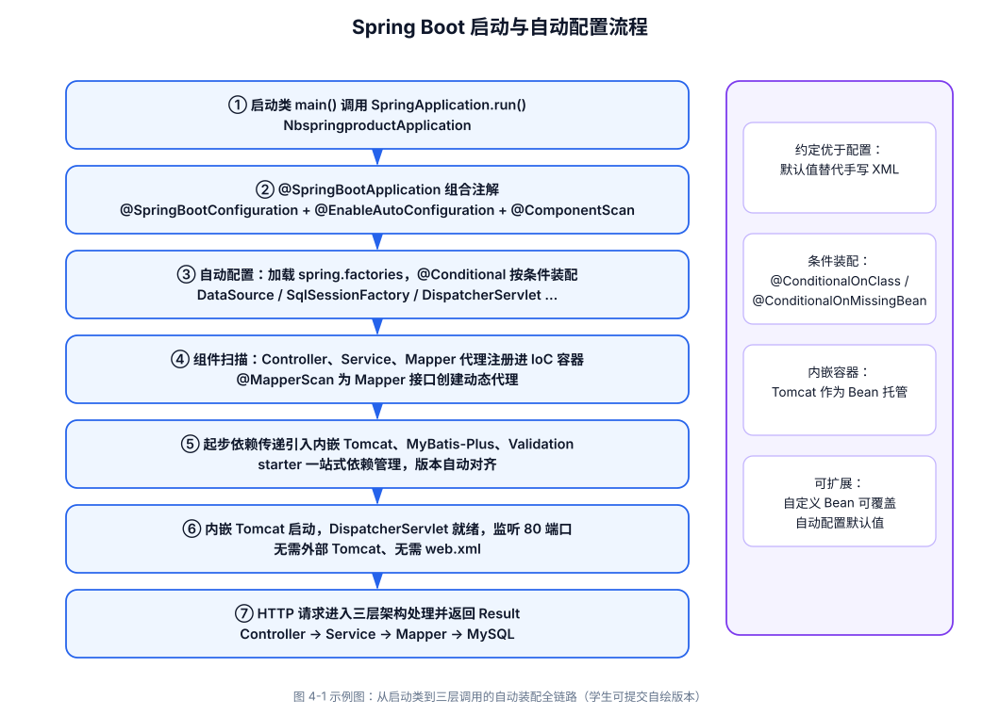
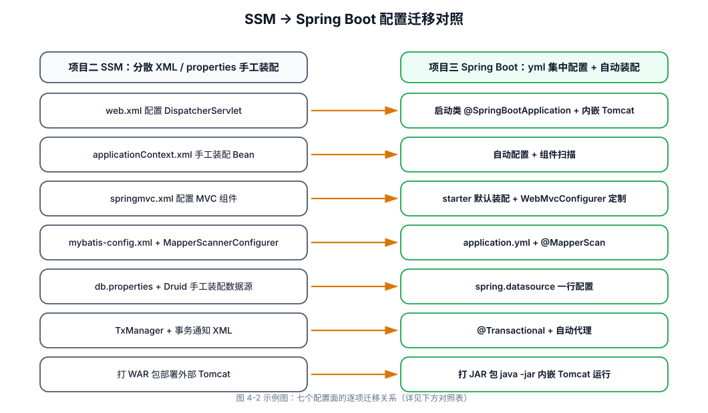
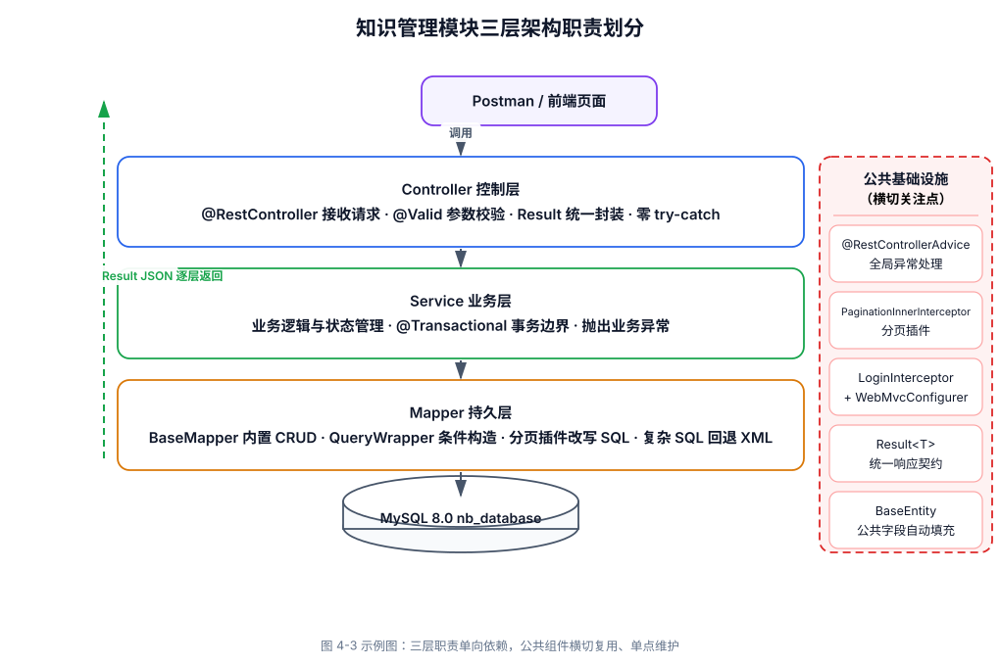
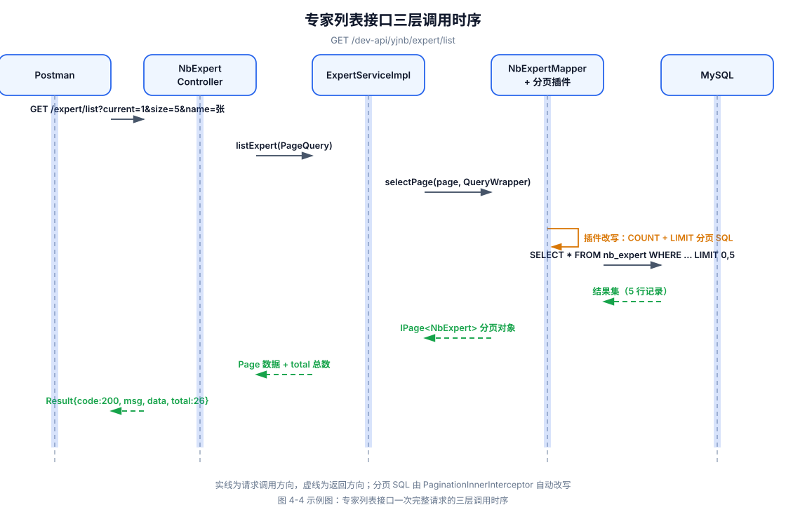
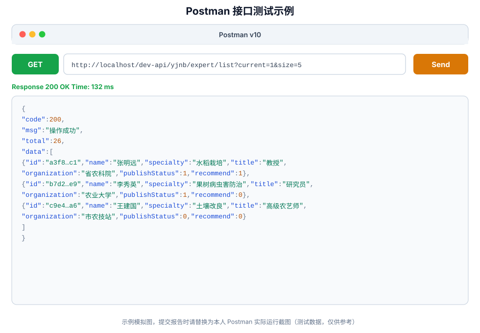
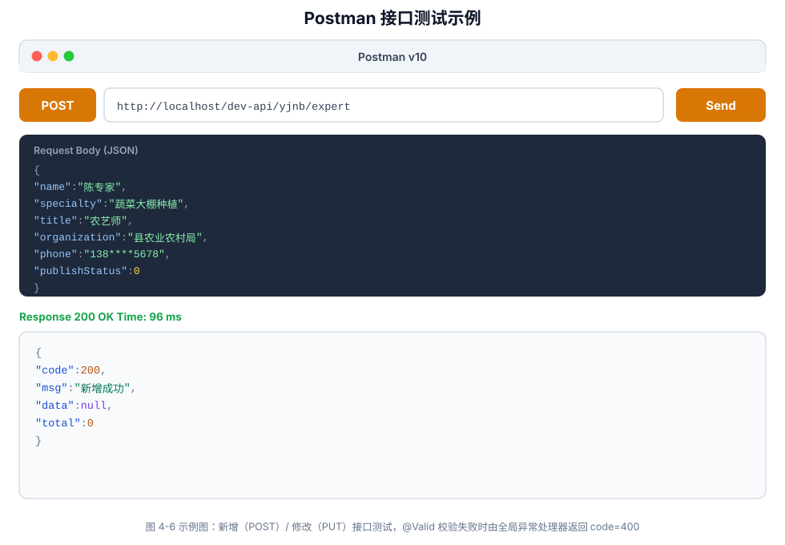
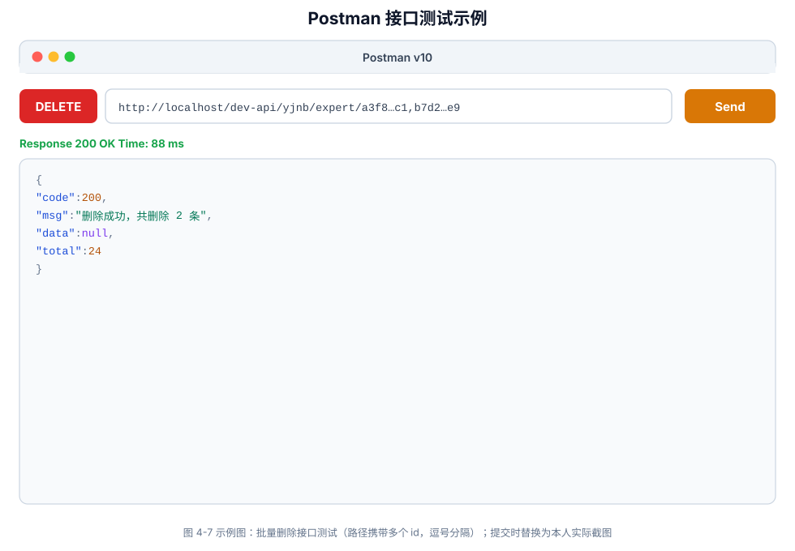

# ××××××课程

# ××××××项目

> **实验实训报告**
>
> （封面建议在系统填报基本信息后，自动生成）

**×××专业教研室编**

**×××教学单位**

**××年××月**

***

# 一、实验实训项目名称

**项目三：基于 SpringBoot 实现知识管理模块**

# 二、项目内容与要求

> （请从实验实训目标、内容、条件、安全要求、注意事项等方面阐述）

## （一）实验实训目标

### 1. 知识目标

1. 理解 Spring Boot“约定优于配置”的设计思想，掌握自动配置、起步依赖（Starter）与内嵌 Tomcat 的工作机制。
2. 掌握 Spring Boot 与 MyBatis-Plus 的整合方式，理解 `@MapperScan` 扫描、驼峰映射、分页插件、逻辑删除等关键配置。
3. 掌握 Lombok 简化实体类、`@Valid` 参数校验、`@RestControllerAdvice` 全局异常处理等工程化要点。
4. 理解 SSM 与 Spring Boot 在配置方式、依赖管理与部署方式上的差异，建立“先机制、后效率”的框架演进认知。
5. 了解 AI 在异常处理设计、日志规范制定、API 文档生成与代码审查中的应用思路。

### 2. 能力目标

1. 能使用 Spring Initializr 或 Maven 独立搭建可运行的 Spring Boot 工程，并完成 `application.yml` 集中配置。
2. 能基于 `nb_expert`、`nb_graphic_course`、`nb_video_course` 三张表，完成专家、图文课程、视频课程三个子模块的 CRUD、分页与条件查询。
3. 能复用项目二分层模板横向扩展业务模块，并能说明 MyBatis 与 MyBatis-Plus、XML 配置与自动配置的差异。
4. 能审查 AI 生成代码，识别分页插件缺失、条件构造器误用、事务缺失、大字段全量返回等典型问题。
5. 能使用 Postman 完成全部核心接口测试，并整理可供前端联调使用的接口文档。

### 3. 素质目标

1. 树立“理解机制、善用工具”的技术演进意识，既不排斥新框架，也不停留在“开箱即用”的表面。
2. 养成统一契约、规范命名、公共组件单点维护的专业习惯。
3. 建立对专家信息、课程内容等知识数据的尊重与责任意识，遵守数据安全与知识产权要求，形成精益求精的工程素养。

## （二）任务背景与目标

**背景：** 项目二基于 SSM 实现了农产品、农贸市场两个模块，学生已掌握三层架构与框架整合的底层机制。随着平台进入内容运营阶段，内容运营人员提出新诉求：邀请农业专家录制课程、撰写图文教程，但内容分散、缺乏结构化课程体系，需要建设知识管理模块统一管理专家信息、图文课程与视频课程，为前端“知识学习中心”“专家讲堂”等页面提供数据支撑。本阶段引入 Spring Boot 2.6.13 + MyBatis-Plus 技术栈：一是对齐企业主流开发方式，二是与项目二形成“机制—效率”对照，帮助学生理解“约定优于配置”“自动配置”“起步依赖”的真实价值。在 AI 辅助编程背景下，CRUD 代码可快速生成，教学重心应转向：自动配置为什么生效、MyBatis-Plus 在什么场景替代手写 SQL、公共组件如何跨框架迁移复用、AI 生成代码如何审查把关。

**目标：** 基于项目一数据库规划与接口规范、项目二分层模板，使用 Spring Boot + MyBatis-Plus 实现知识管理模块的专家管理、图文课程管理、视频课程管理三个子模块及公共基础设施迁移升级，形成 SSM→Spring Boot 迁移对照笔记与可复用分层模板；掌握“设计先行、AI 辅助实现、人工审查验收”的工程化开发流程。

## （三）任务具体要求

### 1. 课堂讲练分工（建议）

| 环节     | 教师讲授重点（理念层）                                                    | 学生动手重点（实践层）                                       | AI 可辅助                                | 须人工掌握                 |
| ------ | -------------------------------------------------------------- | ------------------------------------------------- | ------------------------------------- | --------------------- |
| 第 1 课时 | Spring Boot 核心理念：约定优于配置、自动配置、Starter、内嵌 Tomcat；SSM→Boot 配置迁移对照 | 搭建工程骨架、绘制配置迁移对照图                                  | 生成 `pom.xml` 依赖与 `application.yml` 片段 | 解释“为什么不再需要 `web.xml`” |
| 第 2 课时 | MyBatis-Plus 机制：BaseMapper、条件构造器、分页插件、逻辑删除                     | 完成启动类、Result、BaseEntity、GlobalExceptionHandler 迁移 | 生成公共组件骨架                              | 判断哪些项目二组件可直接复用        |
| 第 3 课时 | 参数校验、全局异常、事务边界在 Boot 中的落位                                      | 专家模块 Entity→Mapper→Service→Controller             | 生成实体类与 Mapper                         | 审查分页插件配置、主键策略         |
| 第 4 课时 | 模板复用与“同构模块”抽象方法                                                | 图文课程、视频课程模块复用模板并说明差异点                             | 基于专家模块生成两个课程模块代码                      | 写出复用清单与业务差异分析         |
| 第 5 课时 | 统一响应契约、AI 辅助质量保障、与项目四 Boot 进阶衔接                                | Postman 全量测试、导出接口文档                               | 生成 Postman Collection 与 API 文档初稿      | 截图记录测试过程与异常场景排查       |

### 2. 开发环境与工程初始化

1. 配置 JDK 17（Spring Boot 2.6.13 兼容 JDK 8+，与教材环境保持一致即可）、Maven 3.6+、MySQL 8.0、IDEA（安装 Lombok 插件并启用注解处理器）。
2. 导入项目一规划的 `nb_database.sql`，确认 `nb_expert`、`nb_graphic_course`、`nb_video_course` 表及测试数据可用。
3. 使用 Spring Initializr 创建工程 `nbspringproduct`，包名 `com.movie.nbspringproduct`（与项目二 `com.nongbao.ssm` 形成迁移对照，便于逐项比较）。
4. 引入起步依赖：`spring-boot-starter-web`、`mybatis-plus-boot-starter`、`mysql-connector-j`、`lombok`、`spring-boot-starter-validation`、`spring-boot-starter-test`。
5. 完成 `application.yml` 集中配置：端口 80、数据源、Jackson 日期格式化、MyBatis-Plus 驼峰映射与 Mapper 扫描、日志级别。
6. 课堂必交付：《SSM→Spring Boot 配置迁移对照图》一份（见第四节示范）。

### 3. 公共基础设施（框架设计层）

1. 迁移项目二统一响应类 `Result<T>`（字段：code、msg、data、total），与项目一《04-接口规范》保持一致，禁止修改字段结构。
2. 迁移 `BaseEntity` 公共字段（createBy、createTime、updateBy、updateTime、remark），可结合 MyBatis-Plus 自动填充实现。
3. 实现 `@RestControllerAdvice` 全局异常处理器，Controller 层禁止编写 try-catch。
4. 配置 MyBatis-Plus 分页插件 `PaginationInnerInterceptor`（未配置则分页不生效），如表结构支持可启用逻辑删除。
5. 将项目二 `LoginInterceptor` 的注册方式由 `springmvc.xml` 迁移为 `WebMvcConfigurer` 配置类，保护业务接口。

### 4. 任务一：专家管理模块

1. 依据 `nb_expert` 表创建 `NbExpert` 实体类，主键使用 `@TableId(type = IdType.ASSIGN_UUID)` 生成 UUID 字符串。
2. Mapper 继承 `BaseMapper<NbExpert>`，分页条件查询使用 QueryWrapper 或手写 XML 实现。
3. 完成 Service 接口与实现类（新增时生成 UUID 主键、设置默认发布状态）。
4. 完成 `NbExpertController`，接口前缀 `/dev-api/yjnb/expert`，实现 5 个核心接口：

| 功能   | 方法     | 路径                           |
| ---- | ------ | ---------------------------- |
| 列表查询 | GET    | `/dev-api/yjnb/expert/list`  |
| 详情查询 | GET    | `/dev-api/yjnb/expert/{id}`  |
| 新增   | POST   | `/dev-api/yjnb/expert`       |
| 修改   | PUT    | `/dev-api/yjnb/expert`       |
| 删除   | DELETE | `/dev-api/yjnb/expert/{ids}` |

1. 列表接口支持 `name`、`specialty`、`publish_status` 等条件筛选与分页。
2. Controller 新增/修改接口使用 `@Valid` 校验（专家姓名、专业领域必填），异常统一交给全局处理器。
3. 使用 Postman 验证全部接口。

### 5. 任务二：图文课程管理模块（模板复用）

1. 依据 `nb_graphic_course` 表创建 `NbGraphicCourse` 实体类。
2. 复用任务一的代码结构与分层模式，完成 Mapper/Service/Controller。
3. 接口前缀 `/dev-api/yjnb/graphicCourse`，实现与专家模块对等的 5 个 CRUD 接口。
4. 差异化要求：列表接口不返回 `content` 大字段（仅返回摘要），详情接口返回全文；实现批量发布/下线扩展接口，Service 层添加 `@Transactional`。
5. 提交《模块复用对照表》：说明哪些类/配置直接复用、哪些因业务差异而调整（如大字段处理、状态语义：启用/禁用 vs 发布/下线）。

### 6. 任务三：视频课程管理模块（模板复用）

1. 依据 `nb_video_course` 表创建 `NbVideoCourse` 实体类，包含 `video_url`、`duration`、`browse_num` 等特征字段。
2. 复用模板完成 Mapper/Service/Controller，接口前缀 `/dev-api/yjnb/videoCourse`，实现对等 5 个核心接口及发布/下线、推荐扩展接口。
3. 本阶段只管理视频元数据（标题、封面、地址、时长、分类、状态），不实现视频文件上传与转码。
4. 不重复编写 `Result`、`GlobalExceptionHandler` 等公共组件，体现 “公共组件单点维护”原则。
5. 为播放量（`browse_num`）更新预留 Service 方法，衔接后续数据统计项目。

### 7. AI 辅助开发与代码审查（必做过程记录）

1. 允许使用 Cursor、GitHub Copilot、通义灵码等 AI 工具生成实体、Mapper、Service、Controller 骨架及 API 文档初稿。
2. 必须完成 AI 代码审查记录（写入实验报告 4.4 节），至少包含 3 条审查项，例如：
   - 分页是否已配置 `PaginationInnerInterceptor`（否则 Page 参数不生效）；
   - QueryWrapper 条件更新是否可能造成全表更新（须校验条件非空）；
   - Service 写操作是否添加 `@Transactional(rollbackFor = Exception.class)`；
   - 列表接口是否误返回 `content` 等大字段影响性能；
   - 数据库密码是否硬编码在代码或配置中提交至公共仓库。
3. 对 AI 生成代码的修改说明须写入报告，体现 “生成→审查→修正”闭环。

### 8. 实验报告撰写

1. 按本手册第四节模板撰写实验实训报告。
2. 报告须包含：SSM→Spring Boot 配置迁移对照图、三层架构调用时序说明、Postman 测试截图（不少于 6 张）、AI 代码审查记录、与项目一/项目二规范的对照检查表。
3. 须回答 “为何项目二用 SSM、项目三用 Spring Boot”的迁移思考（见 4.6 分析示范）。

## （四）实验条件

| 项目    | 要求                                             |
| ----- | ---------------------------------------------- |
| 操作系统  | Windows 10 及以上                                 |
| JDK   | 17（Spring Boot 2.6.13 兼容 JDK 8+，与教材环境一致即可）     |
| 构建工具  | Maven 3.6+                                     |
| 数据库   | MySQL 8.0+，数据库名 `nb_database`                  |
| 核心框架  | Spring Boot 2.6.13 + MyBatis-Plus（与教材版本一致）     |
| 开发工具  | IntelliJ IDEA、Postman、浏览器                      |
| AI 工具 | Cursor/Copilot 等（实验过程允许使用）                     |
| 参考资料  | 项目一 5 份设计文档、项目二源码、`nb_database.sql`、本课程教材项目三章节 |

## （五）安全要求

1. 数据库账号密码仅用于本地实验，`application.yml` 不得提交真实服务器地址与生产密码至公共仓库。
2. 专家电话、邮箱等个人信息字段须使用测试数据，报告展示时可脱敏（如 `138****5678`）。
3. 图文、视频课程素材须使用自有或已授权内容，尊重知识产权，样例内容注明“测试数据，仅供参考”。
4. 服务端口、上传目录等配置仅限本机测试，注意本地防火墙与磁盘权限。

## （六）注意事项

1. 本阶段聚焦后端接口，前端页面联调在项目五进行；接口测试统一使用 Postman。
2. 持久层使用 MyBatis-Plus，但须能说明其内置方法对应的等价原生 SQL；复杂动态 SQL 允许手写 XML。
3. 包结构、表名、接口前缀须与项目一《03-数据库规划》《04-接口规范》保持一致。
4. 三个子模块考察 “模板复用”，禁止无差异全量复制；须能说明主键策略、大字段处理、统计字段等差异及调整理由。
5. 工程名与项目二区分：`nbspringproduct`（`com.movie.nbspringproduct`），便于 SSM→Boot 逐项迁移对照。
6. 源码存放路径：`项目3-知识管理模块/nbspringproduct/`。

## （七）需提交资料

> （打包为压缩文件提交学习通）

1. **后端工程：** `项目3-知识管理模块/nbspringproduct/` 完整 Maven 工程（含 `pom.xml`、`application.yml`、Java 源码、Mapper XML（如有））。
2. **接口测试：** `农宝项目三-知识管理接口.postman_collection.json`（可选，建议导出）。
3. **实验实训报告：** 一份，按第四节撰写；含配置迁移对照图、三层时序说明、Postman 截图（≥6 张）、AI 审查记录、模块复用对照表。

# 三、考核方式与标准

## （一）考核方式

| 考核项     | 形式            | 权重  |
| ------- | ------------- | --- |
| 实验报告    | 按第四节模板撰写      | 50% |
| 后端工程与接口 | 源码+Postman 演示 | 35% |
| 课堂答辩    | 自动配置原理与迁移说明   | 15% |

## （二）评分标准

| 等级  | 分数     | 标准                                                                   |
| --- | ------ | -------------------------------------------------------------------- |
| 优秀  | 90～100 | 三模块 15 个核心接口全部通过；能清晰讲解自动配置与 SSM→Boot 迁移要点；MyBatis-Plus 使用规范；AI 审查有深度 |
| 良好  | 80～89  | 主要接口可用；分层基本规范；有审查记录；少量配置或 SQL 问题                                     |
| 中等  | 70～79  | 至少两个子模块 CRUD 可用；配置文件基本完整；报告偏简略                                       |
| 及格  | 60～69  | 工程可编译启动；部分接口可访问；设计理念阐述不足                                             |
| 不及格 | <60    | 无法启动、分层混乱、未提交或与项目无关                                                  |

## （三）提交要求

1. `学号_姓名_项目三_实验报告.docx/pdf`
2. `项目3-知识管理模块/` 文件夹（含完整后端工程）
3. 报告含不少于 6 张 Postman 测试截图及 SSM→Spring Boot 配置迁移对照图

# 四、报告内容

> （学生填写）
>
> 以下为学生实验报告详实示范。请复制模板后，将【】中内容替换为个人信息；可在此基础上增删，但须保持对框架演进与迁移的分析深度，避免仅粘贴代码。

## 4.1 基本信息

| 项目   | 内容              |
| ---- | --------------- |
| 姓名   | 【填写姓名】          |
| 学号   | 【填写学号】          |
| 班级   | 【填写班级】          |
| 实验日期 | 2026 年 06 月【×】日 |
| 实验地点 | 【填写机房/地点】       |
| 指导教师 | 【填写教师姓名】        |

## 4.2 实验目的

本次实验围绕 “农宝”项目三展开，在项目二 SSM 基础上突出以下能力培养目标：

1. 理解 Spring Boot 自动配置机制，能说明 启动类 → 自动装配 → 内嵌 Tomcat → 三层调用的完整过程。
2. 掌握 MyBatis-Plus 的 BaseMapper、条件构造器与分页插件用法，能辨析其与原生 MyBatis 的适用边界。
3. 完成专家、图文课程、视频课程三个子模块的后端 CRUD，形成可跨项目复用的分层开发模板。
4. 完成项目二公共组件向 Spring Boot 的迁移升级，理解 “公共组件单点维护”与契约一致性。
5. 学会使用 AI 辅助编码并进行代码审查，养成 “生成→审查→测试”的开发习惯，为项目四进阶功能开发做好准备。

## 4.3 实验环境与工具

| 工具/环境        | 版本                         | 用途                 |
| ------------ | -------------------------- | ------------------ |
| JDK          | 17                         | 编译与运行              |
| Maven        | 3.9.x                      | 依赖管理与打包            |
| MySQL        | 8.0.33                     | `nb_database` 数据存储 |
| Spring Boot  | 2.6.13                     | 后端框架，内嵌 Tomcat     |
| MyBatis-Plus | 3.5.x                      | 持久层增强（与教材一致）       |
| IDEA         | 2024.x                     | 后端开发与调试            |
| Postman      | 最新版                        | REST 接口测试          |
| AI 工具        | Cursor                     | 生成实体/Service 骨架并审查 |
| 参考资料         | 项目一二设计文档、`nb_database.sql` | 表结构与接口对照           |

## 4.4 实验步骤与过程记录

### 步骤一：Spring Boot 工程搭建与配置迁移分析（理念重点）

> **图 4-1 Spring Boot 启动与自动配置流程（学生须提交自绘版本）**



> **图 4-2 SSM→Spring Boot 配置迁移对照**



| 配置项    | 项目二 SSM 实现                                   | 项目三 Spring Boot 实现                     |
| ------ | -------------------------------------------- | -------------------------------------- |
| Web 入口 | `web.xml` 配置 DispatcherServlet               | 内嵌 Tomcat，启动类 `@SpringBootApplication` |
| 根容器    | `applicationContext.xml` 手工装配                | 自动配置+组件扫描                              |
| MVC 配置 | `springmvc.xml`                              | starter 默认+`WebMvcConfigurer` 定制       |
| 持久层    | `mybatis-config.xml`+MapperScannerConfigurer | yml 中 mybatis-plus 配置+`@MapperScan`    |
| 数据源    | `db.properties`+Druid 手工装配                   | `application.yml` 中 spring.datasource  |
| 事务     | TxManager+事务通知                               | `@Transactional`+自动代理                  |
| 启动方式   | 打 WAR 部署外部 Tomcat                            | 打 JAR，`java -jar` 内嵌 Tomcat 运行         |

**课堂研讨记录（示例）：**

| 问题                              | 我的理解                                                        |
| ------------------------------- | ----------------------------------------------------------- |
| 为什么启动类不再需要 `web.xml`？           | `spring-boot-starter-web` 自动装配内嵌 Tomcat 与 DispatcherServlet |
| Mapper 接口没有实现类为何能注入？            | `@MapperScan` 为接口创建动态代理并注册到 IoC 容器                          |
| BaseMapper 的 insert 方法 SQL 从哪来？ | MP 启动时解析实体注解与表结构，生成内置 SQL                                   |
| yml 里一行配置为何能生效？                 | 自动配置类通过条件注解读取配置属性完成组件装配                                     |

#### 2. 工程目录结构

```text
nbspringproduct/
├── src/main/java/com/movie/nbspringproduct/
│   ├── NbspringproductApplication.java   # 启动类，@SpringBootApplication+@MapperScan
│   ├── common/          # Result, BaseEntity, 全局异常
│   ├── config/          # MybatisPlusConfig(分页插件), WebMvcConfig(拦截器)
│   ├── controller/      # NbExpertController, NbGraphicCourseController, NbVideoCourseController
│   ├── service/         # 接口
│   ├── service/impl/    # 实现类
│   ├── mapper/          # Mapper接口
│   ├── entity/          # 实体类
│   └── interceptor/     # LoginInterceptor
├── src/main/resources/
│   ├── mapper/          # 复杂SQL的XML（可选）
│   └── application.yml  # 全局集中配置
└── pom.xml
```

#### 3. application.yml 关键配置（示例）

```yaml
server:
  port: 80
spring:
  datasource:
    driver-class-name: com.mysql.cj.jdbc.Driver
    url: jdbc:mysql://localhost:3306/nb_database?useUnicode=true&characterEncoding=utf8&useSSL=false&serverTimezone=GMT%2B8
    username: root
    password: ******
  jackson:
    date-format: yyyy-MM-dd HH:mm:ss
    time-zone: GMT+8
mybatis-plus:
  configuration:
    map-underscore-to-camel-case: true
    log-impl: org.apache.ibatis.logging.stdout.StdOutImpl
  global-config:
    db-config:
      id-type: auto
  mapper-locations: classpath*:mapper/**/*.xml
  type-aliases-package: com.movie.nbspringproduct.entity
```

**设计说明：** 项目二分散在 5 个文件中的配置，此处收敛为一个 yml 文件；端口、数据源、驼峰映射三处是本模块能否跑通的关键。

### 步骤二：公共基础设施迁移与升级

#### 1. 三层架构职责（理念重点）

> **图 4-3 知识管理模块三层架构职责划分**



#### 2. 统一响应 Result（从项目二原样迁移）

与项目一接口规范对齐：

```json
{
  "code": 200,
  "msg": "操作成功",
  "data": {},
  "total": 0
}
```

**迁移说明：** Result 字段结构与项目二完全一致，保证项目二（produce/market）与项目三（expert/graphicCourse/videoCourse）接口契约统一，前端可使用同一套解析逻辑。

#### 3. MyBatis-Plus 分页插件配置

```java
@Configuration
@MapperScan("com.movie.nbspringproduct.mapper")
public class MybatisPlusConfig {
    @Bean
    public MybatisPlusInterceptor mybatisPlusInterceptor() {
        MybatisPlusInterceptor interceptor = new MybatisPlusInterceptor();
        interceptor.addInnerInterceptor(new PaginationInnerInterceptor(DbType.MYSQL));
        return interceptor;
    }
}
```

**理念记录：** 分页从项目二手写 LIMIT 变为插件拦截改写 SQL，开发者须理解插件“做了什么”，否则分页参数失效时无从排查。

#### 4. 全局异常处理（@ControllerAdvice 升级为 @RestControllerAdvice）

| 异常类型   | 处理方式                            | 返回 code 示例 |
| ------ | ------------------------------- | ---------- |
| 参数校验失败 | MethodArgumentNotValidException | 400        |
| 业务异常   | 自定义 BusinessException           | 500+业务 msg |
| 未知异常   | Exception                       | 500+通用提示   |

**迁移说明：** 项目二 XML 注册的组件全部改为配置类+注解；异常仍在 Service 抛出、在 `@RestControllerAdvice` 收敛，Controller 层保持零 try-catch。

### 步骤三：专家管理模块实现与接口测试

#### 1. 三层调用时序（理念重点）

> **图 4-4 专家列表接口三层调用时序**



#### 2. 核心表字段映射（nb\_expert）

| 字段名             | 数据类型         | 实体属性          | 说明                              |
| --------------- | ------------ | ------------- | ------------------------------- |
| id              | varchar(50)  | id            | `@TableId(ASSIGN_UUID)` UUID 主键 |
| name            | varchar(50)  | name          | 专家姓名，`@NotBlank`                |
| avatar          | varchar(255) | avatar        | 头像 URL                          |
| specialty       | varchar(100) | specialty     | 专业领域，`@NotBlank`                |
| title           | varchar(50)  | title         | 职称                              |
| organization    | varchar(100) | organization  | 所属机构                            |
| phone           | varchar(20)  | phone         | 联系电话（测试数据）                      |
| publish\_status | int          | publishStatus | 0 未发布 1 已发布                     |
| recommend       | int          | recommend     | 0 普通 1 推荐                       |
| sort            | int          | sort          | 排序值                             |

#### 3. 核心接口与 Postman 测试记录（示例）

| 序号 | 接口              | 方法     | 预期               | 实际 | 截图编号  |
| -- | --------------- | ------ | ---------------- | -- | ----- |
| 1  | `/expert/list`  | GET    | code=200，含 total | 通过 | 图 4-5 |
| 2  | `/expert/{id}`  | GET    | 返回单条 data        | 通过 | 图 4-5 |
| 3  | `/expert`       | POST   | 新增成功             | 通过 | 图 4-6 |
| 4  | `/expert`       | PUT    | 修改成功             | 通过 | 图 4-6 |
| 5  | `/expert/{ids}` | DELETE | 批量删除成功           | 通过 | 图 4-7 |

> **图 4-5 专家列表接口测试（Postman 响应截图，学生替换为自己的截图）**



> **图 4-6 专家新增/修改接口测试（Postman 响应截图，学生替换为自己的截图）**



> **图 4-7 专家批量删除接口测试（Postman 响应截图，学生替换为自己的截图）**



**扩展接口：** 启用/禁用、推荐/取消推荐（Service 层封装状态更新，Postman 验证）。

### 步骤四：图文课程模块模板复用

**模块复用对照表（必交）**

| 复用项                           | 专家模块                       | 图文课程模块                       | 是否复用 | 差异说明          |
| ----------------------------- | -------------------------- | ---------------------------- | ---- | ------------- |
| Result/GlobalExceptionHandler | ✓                          | 直接复用                         | 是    | 公共组件单点维护      |
| Controller 模式                 | list/get/add/update/delete | 同结构                          | 是    | 仅路径与实体不同      |
| Mapper 模式                     | BaseMapper+QueryWrapper    | 同模式                          | 是    | 查询字段不同        |
| 主键策略                          | ASSIGN\_UUID               | 按项目一表结构                      | 视表而定 | 以《03-数据库规划》为准 |
| 大字段处理                         | 无                          | 列表不返回 content                | 否    | 列表返回摘要、详情返回全文 |
| 状态语义                          | 启用/禁用                      | 发布/下线（批量 @Transactional）     | 部分   | 业务规则不同        |
| 动态 SQL 条件                     | name、specialty             | title、category、publishStatus | 部分   | 查询字段不同        |

**复用率自评：** 公共代码约【70】%，业务代码约【30】%需定制。

### 步骤五：视频课程模块模板复用

**差异点分析（必交）：**

| 差异项  | 图文课程                | 视频课程                     | 处理方式                        |
| ---- | ------------------- | ------------------------ | --------------------------- |
| 特征字段 | content 正文 longtext | 正文改为 video\_url+duration | 实体字段调整，Mapper/Service 同构    |
| 统计字段 | browse\_num 浏览量     | browse\_num 播放量          | 预留 updatePlayCount 方法衔接统计项目 |
| 媒体内容 | 图片封面                | 封面+视频地址                  | 本阶段仅管理元数据，不做上传转码            |
| 发布控制 | 发布/下线               | 发布/下线                    | 复用同一 Service 模式             |

**理念记录：** 三个子模块本质是“同构模块”，复用的是分层骨架与公共组件，定制的是字段、校验与业务规则——这正是项目一分析出的“文章类/课程类实体抽象”在后端的落地。

### 步骤六：AI 辅助开发与代码审查记录（必做）

#### 1. AI 使用场景

| 步骤             | AI 提示词要点                                            | 生成内容               | 是否采用                  |
| -------------- | --------------------------------------------------- | ------------------ | --------------------- |
| 实体类            | “根据 nb\_expert 字段生成 MP 实体，UUID 主键，继承 BaseEntity”    | NbExpert+Lombok 注解 | 采用，补充了校验注解            |
| Mapper/Service | “BaseMapper+分页条件查询，name、specialty 判空”               | ExpertServiceImpl  | 采用，补充了 @Transactional |
| Controller     | “RESTful+Result 封装+\@Valid，前缀 /dev-api/yjnb/expert” | 5 个映射方法            | 部分采用，统一了路径前缀          |
| 课程模块           | “参照专家模块生成图文课程/视频课程模块”                               | 两套 CRUD 代码         | 部分采用，重写大字段与发布逻辑       |

#### 2. AI 代码审查清单（示例）

| 审查项  | AI 初稿问题                        | 我的修正                                             | 结论   |
| ---- | ------------------------------ | ------------------------------------------------ | ---- |
| 分页配置 | 未配置分页插件，Page 不生效               | 新增 PaginationInnerInterceptor                    | 必须修正 |
| 条件更新 | QueryWrapper 无条件 update 造成全表更新 | 校验条件非空或改用 updateById                             | 必须修正 |
| 事务   | 批量发布未加事务                       | 添加 `@Transactional(rollbackFor=Exception.class)` | 已修正  |
| 性能   | 列表接口返回 content 全文              | select 排除大字段，详情再查全文                              | 已修正  |
| 响应格式 | 直接返回 List                      | 包装为 `Result.success(list).total(total)`          | 已修正  |
| 安全   | 密码硬编码并建议提交仓库                   | 移入本地配置并脱敏                                        | 必须修正 |

**反思：** AI 擅长生成同构 CRUD，但对插件装配、事务边界、大字段性能、安全细节判断不足，迁移类项目尤其需要人工对照机制逐项审查。

### 步骤七：与项目一/项目二规范对照检查

| 检查项   | 项目一规划/项目二实现                                       | 项目三实现                                | 是否一致 |
| ----- | ------------------------------------------------- | ------------------------------------ | ---- |
| 数据库名  | `nb_database`                                     | `nb_database`                        | ☑    |
| 三张业务表 | `nb_expert`/`nb_graphic_course`/`nb_video_course` | 已映射                                  | ☑    |
| 接口前缀  | `/dev-api/yjnb/`                                  | expert、graphicCourse、videoCourse 已遵循 | ☑    |
| 响应格式  | code/msg/data/total                               | Result 类迁移复用                         | ☑    |
| 分层模板  | 项目二 SSM 三层                                        | 升级为 Boot+MP，分层不变                     | ☑    |
| 公共组件  | 项目二 Result/全局异常/拦截器                               | 迁移复用，未重复编写                           | ☑    |

## 4.5 实验结果

### （1）交付物清单

| 序号 | 交付物              | 路径                                                               | 完成情况 |
| -- | ---------------- | ---------------------------------------------------------------- | ---- |
| 1  | Spring Boot 后端工程 | `项目3-知识管理模块/nbspringproduct/`                                    | ☑    |
| 2  | 专家管理模块           | controller/service/mapper/entity                                 | ☑    |
| 3  | 图文课程模块           | 同上                                                               | ☑    |
| 4  | 视频课程模块           | 同上                                                               | ☑    |
| 5  | 公共组件迁移           | Result、GlobalExceptionHandler、MybatisPlusConfig、LoginInterceptor | ☑    |
| 6  | Postman 测试集      | 可选 json 导出                                                       | ☑    |

### （2）实现成果统计

| 统计项           | 数量                        |
| ------------- | ------------------------- |
| 实体类           | 3                         |
| Mapper 接口     | 3（继承 BaseMapper）          |
| Service 接口+实现 | 3+3                       |
| Controller    | 3                         |
| REST 接口       | 15 个核心（每模块 5 个）+4 个状态扩展   |
| 配置文件          | 1（`application.yml` 集中配置） |
| 迁移对照记录        | SSM→Boot 对照图 1 份          |

### （3）接口测试结果汇总

| 模块   | 测试用例数 | 通过 | 失败 | 备注                       |
| ---- | ----- | -- | -- | ------------------------ |
| 专家管理 | 5     | 5  | 0  | 含 name/specialty 条件分页    |
| 图文课程 | 5     | 5  | 0  | 列表不含 content 大字段         |
| 视频课程 | 5     | 5  | 0  | 含 video\_url、duration 字段 |
| 合计   | 15    | 15 | 0  | 扩展状态接口另行演示               |

## 4.6 分析与总结

### （1）框架设计理念收获（回应课堂讲授重点）

**① 约定优于配置 ≠ 没有配置**

Spring Boot 只是把项目二手工编写的装配工作前置到自动配置类中：数据源、SqlSessionFactory、DispatcherServlet 依然存在，只是由框架按约定创建。理解这一点后，配置冲突、Bean 缺失等问题的排查思路与项目二完全一致。

**② MyBatis-Plus 的取舍是工程判断**

BaseMapper 与条件构造器消除了三模块大量重复 CRUD，但复杂动态 SQL 仍可回退到手写 XML。选择标准是：简单 CRUD 交给 Plus，复杂查询与性能敏感 SQL 保留人工控制——工具提升效率，机制保障下限。

**③ 模板复用的再升华**

三模块复用“分层骨架+公共组件”，定制“字段、校验、状态语义、大字段策略”。结合项目一的分析，文章类/课程类实体未来可进一步抽象公共基类，复用的最高形态是抽象模式而非复制文件。

**④ 接口契约跨框架稳定**

从 SSM 到 Spring Boot，接口前缀、Result 结构、表名均未改变——这正是项目一“设计先行”的价值：框架会演进，契约须稳定，前端与文档才可长期复用。

### （2）SSM 与 Spring Boot 迁移对照（衔接项目四）

| 对比项  | 项目二 SSM                   | 项目三 Spring Boot              |
| ---- | ------------------------- | ---------------------------- |
| 配置方式 | 5 个 XML/properties 分散配置   | `application.yml` 集中+自动配置    |
| 依赖管理 | 逐个引入 Spring/MyBatis 坐标    | `spring-boot-starter-*` 起步依赖 |
| 打包部署 | WAR→外部 Tomcat             | JAR→内嵌 Tomcat，`java -jar`    |
| 持久层  | 原生 MyBatis 手写 XML         | MyBatis-Plus，复杂 SQL 可回退 XML  |
| 公共组件 | XML 注册                    | 配置类+注解注册                     |
| 分层结构 | Controller/Service/Mapper | 保留不变                         |
| 接口契约 | `/dev-api/yjnb/`+Result   | 保持不变，前端零改动                   |

### （3）AI 时代开发方式反思

| 传统教学侧重           | 本实验调整后侧重              |
| ---------------- | --------------------- |
| 记忆 SSM 每个 XML 标签 | 说清自动配置“替你做了什么”        |
| 逐行手写 CRUD        | AI 生成+人工审查+Postman 验收 |
| 比较框架语法差异         | 比较装配机制与适用场景           |
| 功能跑通即完成          | 性能（大字段）、事务、安全同样验收     |

### （4）问题与改进

| 问题          | 原因分析                               | 改进建议                                 |
| ----------- | ---------------------------------- | ------------------------------------ |
| 端口占用启动失败    | 80 端口被占用                           | 修改 `server.port` 或释放端口               |
| Mapper 注入失败 | `@MapperScan` 路径或包名不一致             | 对照启动类扫描路径排查                          |
| 驼峰映射失效      | 未配置 `map-underscore-to-camel-case` | 检查 mybatis-plus yml 配置               |
| 分页不生效       | 未装配分页插件                            | 添加 PaginationInnerInterceptor        |
| Lombok 编译报错 | 插件/注解处理器未启用                        | 安装 Lombok 插件并启用 annotation processor |
| 时间相差 8 小时   | 连接串缺时区参数                           | URL 添加 `serverTimezone=GMT%2B8`      |
| 事务不生效       | 同类内部自调用                            | 保持通过 Spring 代理调用 Service             |

## 4.7 自我评价

| 评价项                | 自评（1～5 分） | 说明                    |
| ------------------ | --------- | --------------------- |
| Spring Boot 机制理解深度 | 5         | 能独立讲解自动配置与启动流程        |
| MyBatis-Plus 使用规范性 | 4         | 分页与条件构造规范，复杂 SQL 仍需练习 |
| 模板复用能力             | 5         | 两个课程模块各约 1 小时完成       |
| AI 审查意识            | 4         | 已修正分页、事务与性能问题         |
| 接口测试完整性            | 5         | 15 个核心接口全部 Postman 验证 |

## 4.8 教师评语与成绩

| 项目   | 内容     |
| ---- | ------ |
| 评语   | （教师填写） |
| 成绩   | （教师填写） |
| 评阅日期 | （教师填写） |
| 评阅教师 | （教师填写） |

