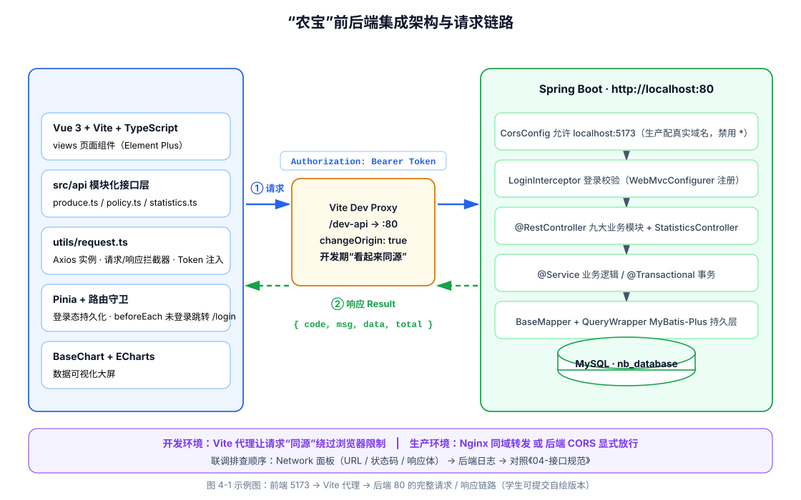
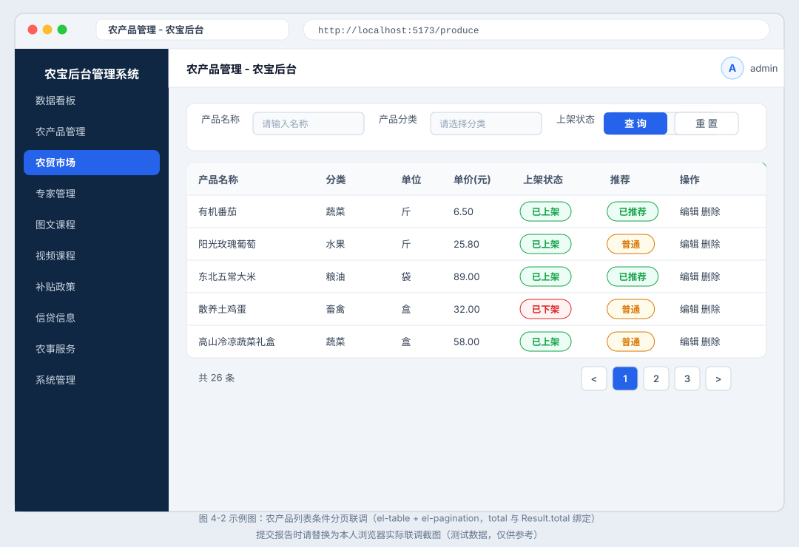
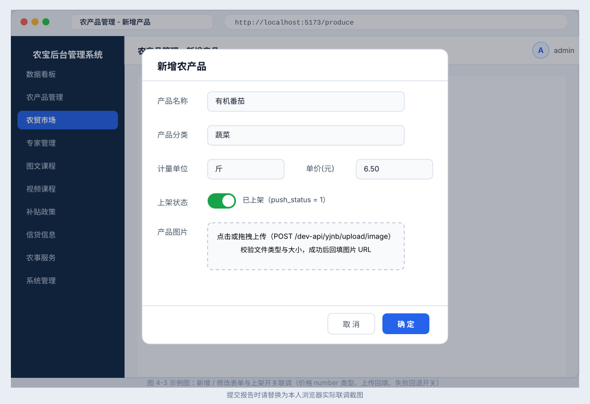
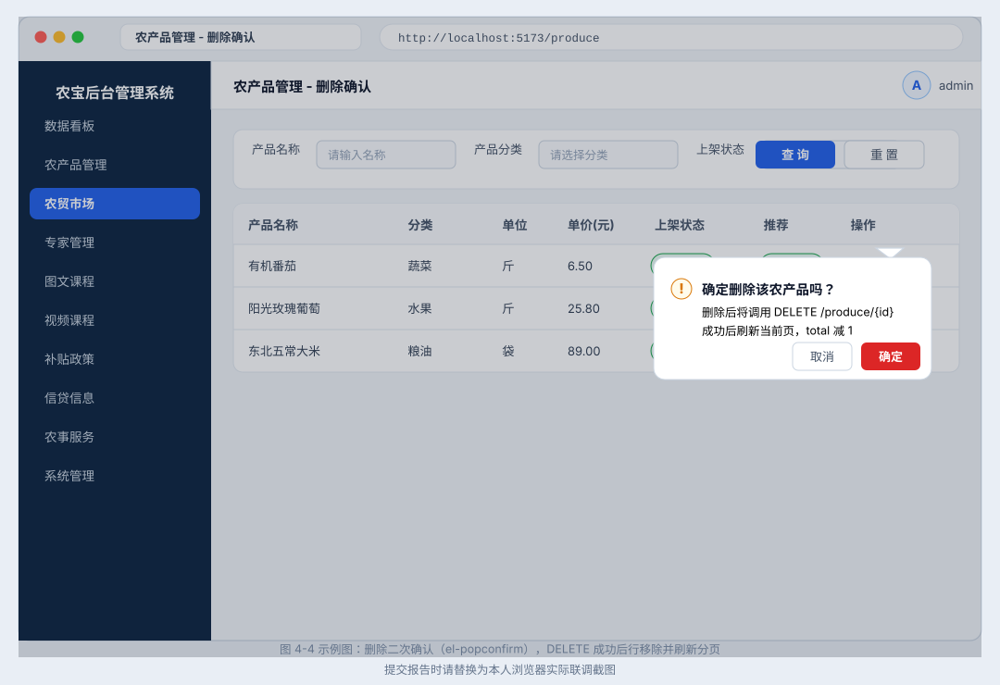
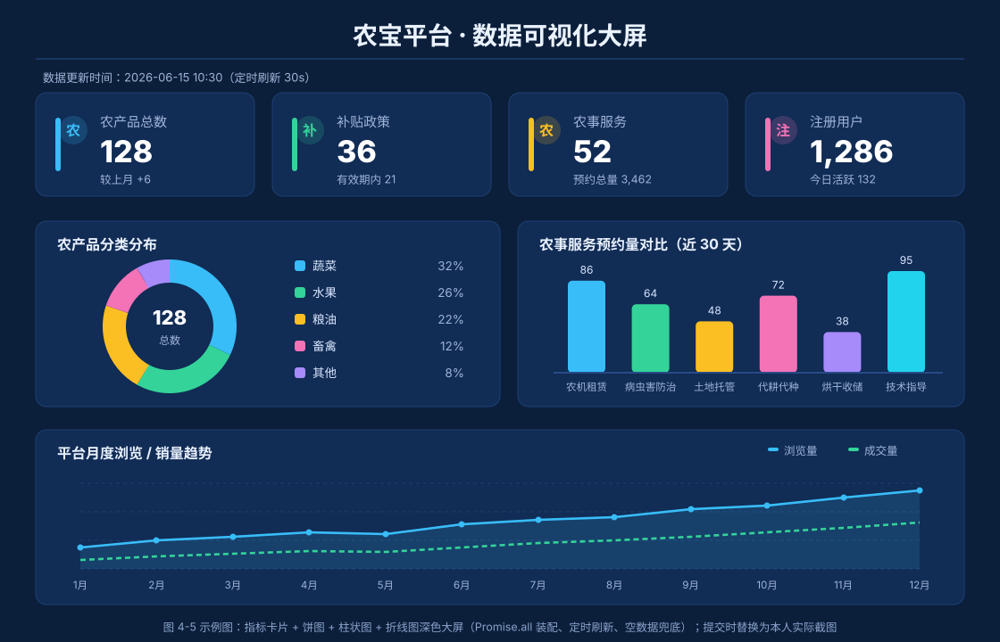

# ××××××课程

# ××××××项目

> **实验实训报告**
>
> （封面建议在系统填报基本信息后，自动生成）

**×××专业教研室编**

**×××教学单位**

**××年××月**

---

# 一、实验实训项目名称

**项目五：集成前端界面与后端服务**

# 二、项目内容与要求

> （请从实验实训目标、内容、条件、安全要求、注意事项等方面阐述）

## （一）实验实训目标

### 1. 知识目标

1. 理解前后端分离架构下前后端协作的完整流程，掌握接口契约（统一前缀、统一响应格式）在联调中的核心地位。
2. 掌握 Axios 异步请求库的核心机制：实例封装、请求/响应拦截器、Token 注入、统一错误处理。
3. 理解浏览器同源策略与 CORS 跨域原理，掌握开发环境 Vite 代理与生产环境 CORS 配置两种解决方案的差异与适用场景。
4. 理解 Pinia 状态管理、Vue Router 路由守卫在登录态保持与页面保护中的作用。
5. 掌握 ECharts 数据可视化的核心配置要素与图表选型原则（数据特征与图表类型匹配）。
6. 了解 AI 辅助前后端联调（接口代码生成、跨域诊断、契约核对）的应用思路。

### 2. 能力目标

1. 能完成前端工程初始化，封装 Axios 请求工具（基地址、拦截器、Token 携带、统一错误提示）。
2. 能配置 Vite 开发代理与 Spring Boot CORS，独立解决跨域问题。
3. 能完成农产品、补贴政策等核心模块的前后端对接，实现列表查询、新增、修改、删除、状态切换、图片上传等完整业务流程联调。
4. 能基于后端统计接口与 ECharts 实现数据可视化大屏（指标卡片、饼图、柱状图、折线图），支持动态刷新。
5. 能运用浏览器开发者工具（Network 面板）与后端日志，形成“现象→定位→解决”的联调问题排查能力。

### 3. 素质目标

1. 树立“接口契约先行、换位思考”的前后端协作意识，理解“团队大于个人”的协作价值。
2. 养成规范联调、问题闭环（记录、定位、解决、复盘）、及时留痕的专业习惯。
3. 建立对数据准确展示与用户体验的责任意识，形成精益求精的工程素养。

## （二）任务背景与目标

**背景：** 项目四完成后，后端工程已具备系统管理与九大业务模块共 41 个 REST 接口（含统计接口），并通过了日志管理与单元测试的质量验证。然而后端接口在 Postman 中“单点验证通过”，并不等于前后端“整体可用”：前端工程师调用接口时遭遇 CORS 跨域报错、数据字段与文档不一致、Token 未携带导致 401 等问题——前后端“各说各话”是集成阶段最典型的协作痛点。项目五作为系列项目的收官联调阶段，将集成后台管理系统的前端界面与后端服务，实现前后端的完整对接。AI 工具已能快速生成请求封装与页面代码，教学重心应转向：契约为何是“合同”、跨域为何发生、联调问题如何分层定位、图表选型为何要匹配数据特征。

**目标：** 基于项目一《04-接口规范》、项目三/四后端工程（`nbspringproduct`）与前端工程（`nongbao-web`），完成前端请求配置与代理、核心模块业务联调、数据可视化大屏三大任务，实现“农宝”后台管理系统的完整交付；掌握“契约先行、AI 辅助实现、人工审查验收、联调问题闭环”的前后端协作流程。

## （三）任务具体要求

### 1. 课堂讲练分工（建议）

| 环节 | 教师讲授重点（理念层） | 学生动手重点（实践层） | AI 可辅助 | 须人工掌握 |
| --- | --- | --- | --- | --- |
| 第 1 课时 | 前后端分离协作流程、接口契约的“合同”地位、HTTP 请求全链路 | 前端工程初始化、封装 `utils/request.ts` | 生成 Axios 封装骨架 | 解释拦截器执行顺序与 Token 注入时机 |
| 第 2 课时 | 同源策略与 CORS 原理、开发代理与生产 CORS 的差异 | 配置 `vite.config.ts` 代理与 CorsConfig，完成登录接口首次联调 | 生成代理与 CORS 配置片段 | 判断报错属于哪一环（跨域/契约/网络） |
| 第 3 课时 | 前端 API 分层与组件解耦、Pinia 状态管理、路由守卫 | 农产品模块 API 定义与列表页对接 | 生成 produce.ts 与列表页骨架 | 审查接口路径、参数、Result 解析是否符合契约 |
| 第 4 课时 | 复杂表单联调（图片上传、富文本）、状态字段语义 | 补贴政策模块对接、上传接口联调 | 生成表单与上传组件代码 | 审查表单校验与错误提示统一性 |
| 第 5 课时 | 图表选型与数据特征匹配、大屏聚合接口设计 | 数据大屏对接与全模块回归联调 | 生成 ECharts 配置与统计 API | 截图记录“Network 面板定位联调问题”过程 |

### 2. 开发环境与工程初始化

1. 配置 JDK 17、Maven 3.6+、MySQL 8.0、Node.js 16+、IDEA（后端）、VS Code（前端）、Chrome/Edge 浏览器。
2. 启动项目四后端工程 `nbspringproduct`（端口 80），Postman 抽查核心接口可用；确认 `nb_database` 中九大业务模块测试数据完备。
3. 导入前端工程 `nongbao-web`（Vue 3 + Vite + TypeScript + Element Plus + Pinia + ECharts），`npm install` 安装依赖，`npm run dev` 启动（端口 5173）。
4. 完成 Axios 封装 `src/utils/request.ts`：baseURL 读取环境变量（默认 `/dev-api`）、超时 15 秒、请求拦截器携带 Token、响应拦截器统一解析 Result（code/msg/data/total）、统一 ElMessage 错误提示、401 跳转登录。
5. 完成 Vite 代理配置 `vite.config.ts`：`/dev-api` → `http://localhost:80`；确认后端 CorsConfig 允许来源 `http://localhost:5173`。
6. 课堂必交付：《前后端联调问题排查清单》一份（见第四节示范）。

### 3. 公共基础设施（集成层约定）

1. **接口契约：** 沿用项目一《04-接口规范》——统一前缀 `/dev-api/yjnb/`、统一响应格式 `{code, msg, data, total}`；统计接口按教材实现（`/dev-api/statistics/…`）。
2. **前端 API 分层：** `src/api/` 按模块定义接口函数（`produce.ts`、`policy.ts`、`statistics.ts` 等），页面组件禁止直接书写 URL。
3. **登录态管理：** Pinia（`src/stores/user.ts`）持久化 Token 与用户名；路由守卫 `router.beforeEach` 统一校验，未登录跳转 `/login`。
4. **错误处理约定：** code≠200 统一提示 msg；网络异常统一提示；401 清除登录态并跳转登录页；禁止组件内各自弹窗。

### 4. 任务一：配置前端请求与代理（打通通信链路）

1. 封装 `src/utils/request.ts`（代码要求与教材代码 5-1 一致）：创建 Axios 实例、请求计数 loading、请求/响应拦截器、错误统一处理。
2. 配置 `vite.config.ts` 开发代理（与教材代码 5-2 一致）：`/dev-api` 转发至后端 localhost:80，注意 rewrite 规则与 ws 选项。
3. 配置后端 `CorsConfig.java`（与教材代码 5-3 一致）：允许来源 localhost:5173、允许方法与头部、allowCredentials；生产环境须配置实际域名（禁止使用 `*`）。
4. 配置环境变量 `.env.development` / `.env.production`（`VITE_API_BASE_URL`），说明开发与生产的差异。
5. **验收标准：** 登录接口联调通过；浏览器 Network 面板可完整观察“前端 5173 → 代理 → 后端 80 → 响应解析”全链路。

### 5. 任务二：对接功能模块接口（核心业务联调）

1. **农产品管理模块：** 编写 `src/api/produce.ts`（与教材代码 5-4 一致），完成 `views/ProduceManagement.vue` 对接（与教材代码 5-5 一致）。实现 5 个核心接口联调：

| 功能 | 方法 | 路径 |
| --- | --- | --- |
| 列表查询 | GET | `/dev-api/yjnb/produce/list` |
| 详情查询 | GET | `/dev-api/yjnb/produce/{id}` |
| 新增 | POST | `/dev-api/yjnb/produce` |
| 修改 | PUT | `/dev-api/yjnb/produce` |
| 删除 | DELETE | `/dev-api/yjnb/produce/{id}` |

2. **扩展联调：** 上架/下架（`push_status`）、推荐/取消推荐（`recommend`）状态切换；图片上传（`POST /dev-api/yjnb/upload/image`）与表单回显。
3. **补贴政策管理模块：** 复用农产品对接模式，接口前缀 `/dev-api/yjnb/policy`，实现列表、新增、修改、删除及发布（`publish_status`）、推荐状态联调；注意富文本内容与有效期字段的表单处理。
4. **状态管理与路由：** Pinia 维护登录态与用户信息；路由配置含 `/statistics` 大屏路由；路由守卫保护业务页面。
5. **联调测试：** 以真实数据库数据走通“查询→新增→修改→状态切换→删除”完整闭环，记录问题与排查过程。

### 6. 任务三：数据可视化大屏（统计接口+ECharts）

1. 后端统计接口 `StatisticsController`（与教材代码 5-9 一致）：`GET /dev-api/statistics/overview`（综合统计）、`/dev-api/statistics/produceDistribution`（产品分布）、`/dev-api/statistics/serviceDistribution`（服务分布）、`/dev-api/statistics/monthlyTrend`（月度趋势）。
2. 前端统计 API：`src/api/statistics.ts`（与教材代码 5-11 一致）。
3. 通用图表组件：`src/components/BaseChart.vue`（与教材代码 5-10 一致），封装 ECharts 初始化、自适应缩放与实例销毁。
4. 大屏页面：`views/DataVisualization.vue`（与教材代码 5-12 一致），布局为第一行 4 个指标卡片、第二行饼图+柱状图、第三行折线图；深色主题、定时刷新。
5. 图表选型须匹配数据特征（占比用饼图、对比用柱状图、趋势用折线图），并在报告中说明选型理由。

### 7. AI 辅助前后端联调与代码审查（必做过程记录）

1. 允许使用 Cursor、GitHub Copilot、通义灵码等 AI 工具生成 API 接口定义、页面组件骨架、图表配置，并辅助诊断跨域报错。
2. 必须完成 AI 代码审查记录（写入实验报告 4.4 节），至少包含 3 条审查项，例如：
   - 接口路径是否与项目一《04-接口规范》一致（AI 常生成 `/api/xxx` 等错误前缀）；
   - 响应解析是否统一判断 code 并处理 total（禁止直接取 data 忽略契约）；
   - 请求拦截器是否正确携带 Token（键名与后端约定一致）；
   - 分页参数命名是否与后端一致（如 current/size 与 pageNum/pageSize）；
   - 图表是否处理接口失败与空数据兜底。
3. 对 AI 生成代码的修改说明须写入报告，体现“生成→审查→修正”闭环。

### 8. 实验报告撰写

1. 按本手册第四节模板撰写实验实训报告。
2. 报告须包含：前后端集成架构图、Axios 请求链路说明、联调界面截图（不少于 6 张，须含数据大屏）、联调问题排查清单、AI 代码审查记录、与项目一接口规范的对照检查表。
3. 须回答“为何开发环境用代理、生产环境用 CORS”（见 4.6 分析示范）。

## （四）实验条件

| 项目 | 要求 |
| --- | --- |
| 操作系统 | Windows 10 及以上 |
| JDK | 17（沿用项目三/四环境） |
| 构建工具 | Maven 3.6+、npm（Node.js 16+） |
| 数据库 | MySQL 8.0+，数据库名 `nb_database` |
| 后端框架 | Spring Boot 2.6.13 + MyBatis-Plus（沿用项目三/四工程，端口 80） |
| 前端框架 | Vue 3 + Vite + TypeScript（端口 5173） |
| 前端组件 | Element Plus、Pinia、Axios、ECharts 5.x |
| 开发工具 | IntelliJ IDEA、VS Code、Postman、Chrome/Edge（开发者工具） |
| AI 工具 | Cursor/Copilot 等（实验过程允许使用） |
| 参考资料 | 项目一 5 份设计文档、项目三/四源码、`nb_database.sql`、本课程教材项目五章节 |

## （五）安全要求

1. 数据库账号密码、登录 Token 仅用于本地实验，不得提交真实服务器地址与生产密码至公共仓库。
2. Token 存储于 localStorage 存在 XSS 风险，实验环境可接受，报告中须说明生产环境的加固思路（如 HttpOnly Cookie）。
3. 大屏统计数据均为测试数据，报告须注明“测试数据，仅供参考”。
4. 上传图片仅限本机测试目录，须校验文件类型与大小，不得上传违规内容。
5. 实验报告中账号信息可脱敏显示（如 admin / ******）。

## （六）注意事项

1. 本阶段为前后端集成联调，在后端工程（项目三/四迭代）与前端工程基础上开发，禁止重复创建工程或复制公共组件。
2. 接口路径、参数名、响应格式须与项目一《04-接口规范》严格一致；发现不一致时以后端实现与规范对照定位，并在报告中记录差异，禁止前端“将就”后端硬编码。
3. 三个任务层层递进：未打通请求链路（任务一验收通过）不得开始模块联调；模块联调未过半不得开始大屏开发。
4. 农产品与补贴政策模块考察对接模板复用，禁止无差异全量复制；须能说明图片上传、富文本、状态语义（上架/发布）等差异及处理方式。
5. 联调问题须按“现象→定位→解决”记录闭环，禁止删除功能代码绕过问题。
6. 源码存放路径：`项目5-前后端集成联调/`（含前端 `nongbao-web` 与后端 `nbspringproduct` 整包）。

## （七）需提交资料

> （打包为压缩文件提交学习通）

1. **前端工程：** `项目5-前后端集成联调/nongbao-web/` 完整前端工程（含 `request.ts`、api、views、stores、router）。
2. **后端工程：** `项目5-前后端集成联调/nbspringproduct/`（沿用迭代，含 StatisticsController 统计接口）。
3. **联调材料：** 浏览器联调截图、联调问题排查清单、Postman 集合导出（可选）。
4. **实验实训报告：** 一份，按第四节撰写；含集成架构图、请求链路说明、联调截图（≥6 张，含数据大屏）、AI 审查记录、模块复用对照表。

# 三、考核方式与标准

## （一）考核方式

| 考核项 | 形式 | 权重 |
| --- | --- | --- |
| 实验报告 | 按第四节模板撰写 | 50% |
| 前后端工程与联调 | 源码+现场演示（登录→模块操作→大屏） | 35% |
| 课堂答辩 | 前后端协作理念与联调问题定位说明 | 15% |

## （二）评分标准

| 等级 | 分数 | 标准 |
| --- | --- | --- |
| 优秀 | 90～100 | 登录与九大模块联调全部通过；大屏四类图表正常动态展示；请求链路与跨域原理讲解清晰；AI 审查有深度；能说明开发代理与生产 CORS 差异及部署迁移要点 |
| 良好 | 80～89 | 登录与核心模块（农产品、补贴政策）联调可用；大屏基本展示；有审查记录；少量契约或配置问题 |
| 中等 | 70～79 | 登录+至少一个模块联调可用；大屏未完成或部分图表；报告偏简略 |
| 及格 | 60～69 | 前后端均可启动、登录联通；模块联调不完整；协作理念阐述不足 |
| 不及格 | <60 | 前后端无法联通、未提交或与项目无关 |

## （三）提交要求

1. `学号_姓名_项目五_实验报告.docx/pdf`
2. `项目5-前后端集成联调/` 文件夹（前端+后端完整工程）
3. 报告含不少于 6 张联调界面截图（含数据大屏）及前后端集成架构图

# 四、报告内容

> （学生填写）
>
> 以下为学生实验报告详实示范。请复制模板后，将【】中内容替换为个人信息；可在此基础上增删，但须保持对前后端协作与联调定位的分析深度，避免仅粘贴代码。

## 4.1 基本信息

| 项目 | 内容 |
| --- | --- |
| 姓名 | 【填写姓名】 |
| 学号 | 【填写学号】 |
| 班级 | 【填写班级】 |
| 实验日期 | 2026 年 06 月【×】日 |
| 实验地点 | 【填写机房/地点】 |
| 指导教师 | 【填写教师姓名】 |

## 4.2 实验目的

本次实验围绕“农宝”项目五展开，突出前后端集成与协作能力培养：

1. 理解前后端分离架构下的完整协作流程，掌握接口契约在联调中的“合同”地位。
2. 掌握 Axios 封装（拦截器、Token 注入、统一错误处理）与 Vite 代理、Spring Boot CORS 两种跨域解决方案。
3. 完成农产品、补贴政策等核心模块的前后端对接，形成可复用的“API 定义→页面对接→联调验证”前端开发模板。
4. 基于统计接口与 ECharts 实现数据可视化大屏，掌握图表选型与数据特征匹配的方法。
5. 学会运用 Network 面板与后端日志定位联调问题，养成“现象→定位→解决→留痕”的排查习惯。

## 4.3 实验环境与工具

| 工具/环境 | 版本 | 用途 |
| --- | --- | --- |
| JDK | 17 | 后端编译与运行 |
| Maven | 3.9.x | 后端依赖管理 |
| Node.js + npm | 18.x | 前端依赖安装与开发服务器 |
| MySQL | 8.0.33 | `nb_database` 数据存储 |
| Spring Boot | 2.6.13 | 后端框架（沿用项目三/四工程，端口 80） |
| Vue 3 + Vite | 3.x / 4.x | 前端框架与构建工具（`nongbao-web`，端口 5173） |
| Element Plus | 2.x | 后台 UI 组件 |
| Pinia | 2.x | 状态管理（登录态持久化） |
| Axios | 1.x | HTTP 请求封装 |
| ECharts | 5.x | 数据可视化大屏 |
| IDEA / VS Code | 2024.x | 后端/前端开发调试 |
| Postman | 最新版 | 接口预验证 |
| Chrome/Edge | 最新版 | 联调与 Network 面板排查 |
| AI 工具 | Cursor | 生成 API 定义/页面骨架并审查 |
| 参考资料 | 项目一设计文档、项目三四源码、`nb_database.sql` | 契约与表结构对照 |

## 4.4 实验步骤与过程记录

### 步骤一：前后端集成链路分析（理念重点）

> **图 4-1 “农宝”前后端集成架构与请求链路（学生须提交自绘版本）**



#### 1. 集成链路配置清单

| 配置项/文件 | 所处位置 | 核心职责 |
| --- | --- | --- |
| `utils/request.ts` | 前端 src/utils | Axios 实例、拦截器、Token 注入、Result 统一解析 |
| `vite.config.ts` proxy | 前端根目录 | 开发环境将 `/dev-api` 转发至 `http://localhost:80` |
| `.env.development` | 前端根目录 | `VITE_API_BASE_URL=/dev-api` |
| `CorsConfig.java` | 后端 config | 生产环境跨域放行（允许来源、方法、头部） |
| router（beforeEach） | 前端 src/router | 登录态校验，未登录跳转 `/login` |
| `store/user.ts` | 前端 src/stores | Token 与用户名持久化 |

#### 2. 课堂研讨记录（示例）

| 问题 | 我的理解 |
| --- | --- |
| 为什么开发环境用 Vite 代理、生产环境用 CORS？ | 代理让请求“同源”绕过浏览器限制且便于统一前缀；生产前后端同域部署或由 Nginx 转发，跨域放行交由后端 CORS 或网关 |
| baseURL 为什么配 '/dev-api' 而不是后端完整地址？ | 保持接口书写与环境无关，换环境只改代理或环境变量，页面代码零改动 |
| 请求/响应拦截器分别在什么时机执行？ | 请求拦截器在发出前（注入 Token、开启 loading）；响应拦截器在 then 之前（统一解包 Result、错误提示） |
| code=200 但 data 为 null，问题在前端还是后端？ | 先看 Network 响应体：后端正常返回 null 则查查询条件与 SQL；字段取错则属前端解析问题 |

#### 3. 前端工程增量结构

```text
nongbao-web/
├── src/
│   ├── api/            # produce.ts, policy.ts, statistics.ts, system.ts（新增/完善）
│   ├── utils/request.ts    # Axios封装（核心）
│   ├── stores/user.ts      # Token持久化
│   ├── router/router.ts    # 路由与守卫（含/statistics）
│   ├── components/BaseChart.vue  # ECharts通用组件（新增）
│   └── views/
│       ├── Login.vue / Dashboard.vue
│       ├── ProduceManagement.vue   # 农产品联调
│       ├── PolicyManagement.vue    # 补贴政策联调
│       └── DataVisualization.vue   # 数据大屏（新增）
├── .env.development / .env.production
└── vite.config.ts           # 代理配置
```

### 步骤二：前端请求配置与代理打通链路

#### 1. Axios 封装核心（节选自 request.ts）

```ts
// 请求拦截器：注入Token
service.interceptors.request.use(config => {
  const token = userStore.token
  if (token) config.headers.Authorization = `Bearer ${token}`
  showLoading()
  return config
})

// 响应拦截器：统一解包Result
service.interceptors.response.use(
  (response: AxiosResponse) => {
    hideLoading()
    const res = response.data as Result
    if (res.code !== 200) {
      if (res.code === 401) { userStore.logout(); router.push('/login') }
      ElMessage.error(res.msg || '请求失败')
      return Promise.reject(new Error(res.msg))
    }
    return res
  },
  error => { hideLoading(); ElMessage.error('网络异常'); return Promise.reject(error) }
)
```

**审查记录：** AI 初稿未处理 401 分支且直接 `return response.data.data`，导致 total 丢失；修正为统一返回 Result 并在 401 时清除登录态。

#### 2. Vite 代理配置（节选）

```ts
server: {
  port: 5173,
  proxy: {
    '/dev-api': {
      target: 'http://localhost:80',
      changeOrigin: true
      // rewrite按教材代码5-2执行
    }
  }
}
```

#### 3. 后端 CORS 配置（节选）

```java
config.addAllowedOrigin("http://localhost:5173");   // 生产环境配实际域名，禁止*
config.addAllowedMethod("*");
config.addAllowedHeader("*");
```

#### 4. 登录接口首次联调验证

| 检查项 | 记录 |
| --- | --- |
| 请求 URL（Network） | `http://localhost:5173/dev-api/yjnb/system/login`（代理转发至 80） |
| 请求方法/体 | POST / `{"username":"admin","password":"******"}` |
| 响应结构 | `{code:200, msg:"操作成功", data:{...token}}` |
| 后续动作 | Token 写入 Pinia 并持久化，跳转 `/main` |

#### 5. 联调问题排查清单（必交）

| 序号 | 现象 | 初步判断 | 定位方式 | 解决方案 |
| --- | --- | --- | --- | --- |
| 1 | 控制台 CORS policy 报错 | 代理未生效或后端未放行 | Network 查看请求是否直连 80 | 检查 proxy 前缀与 CorsConfig，重启前后端 |
| 2 | 接口 404 | 路径或前缀不一致 | Network 看请求 URL | 对照《04-接口规范》修正 api 定义 |
| 3 | 401 且反复跳登录 | Token 未携带或失效 | 查看请求头 Authorization | 统一在请求拦截器注入 Token |
| 4 | 列表 total 为 0 | 前端取值字段与后端不一致 | 对比响应体 rows/total | 统一 Result.total 约定 |
| 5 | 字段显示 undefined | 驼峰/下划线命名不一致 | 对比响应体与实体 | 后端驼峰映射或前端字段对照修正 |

**理念记录：** 联调报错先看 Network“三件套”——URL、状态码、响应体，再看后端日志，最后对照契约；禁止凭感觉改代码。

### 步骤三：农产品管理模块前后端联调

#### 1. API 接口定义（节选自 produce.ts）

```ts
export function getProduceList(params: ProduceQuery) {
  return request.get<ProduceVO[]>('/yjnb/produce/list', params)
}
export function addProduce(data: ProduceForm) {
  return request.post('/yjnb/produce', data)
}
export function updateProduceStatus(id: string, pushStatus: number) {
  return request.post(`/yjnb/produce/push/${id}/${pushStatus}`)
}
```

**审查记录：** AI 初稿路径写成 `/api/produce` 且未带分页参数命名约定；逐条对照项目一接口规范修正。

#### 2. 页面对接要点

| 功能 | 组件 | 接口 | 联调关注点 |
| --- | --- | --- | --- |
| 列表查询 | el-table + el-pagination | GET `/produce/list` | 分页参数命名、total 绑定、条件筛选重置 |
| 新增/修改 | el-dialog + el-form | POST/PUT `/produce` | 表单校验规则、价格 number 类型、回显 |
| 删除 | el-popconfirm | DELETE `/produce/{id}` | 二次确认、成功后刷新当前页 |
| 上架/推荐 | el-switch | POST `/produce/push…` | 状态值 0/1 语义、失败回退开关 |
| 图片上传 | el-upload | POST `/upload/image` | 响应 URL 回填表单、回显前缀拼接 |

#### 3. 联调测试记录（示例）

| 序号 | 功能 | 接口 | 预期 | 实际 | 截图编号 |
| --- | --- | --- | --- | --- | --- |
| 1 | 分页列表 | GET `/produce/list` | code=200，total 正确 | 通过 | 图 4-2 |
| 2 | 条件筛选 | GET `/produce/list?title=蔬菜` | 返回过滤结果 | 通过 | 图 4-2 |
| 3 | 新增 | POST `/produce` | 新增后列表刷新 | 通过 | 图 4-3 |
| 4 | 上架切换 | el-switch → push | 状态切换并留痕 | 通过 | 图 4-3 |
| 5 | 删除 | DELETE `/produce/{id}` | 行移除、total 减 1 | 通过 | 图 4-4 |

> **图 4-2 农产品列表联调效果（浏览器截图，学生替换为自己的截图）**



> **图 4-3 农产品新增/修改表单联调效果（浏览器截图，学生替换为自己的截图）**



> **图 4-4 农产品删除二次确认联调效果（浏览器截图，学生替换为自己的截图）**



### 步骤四：补贴政策模块复用对接

**模块复用对照表（必交）**

| 复用项 | 农产品模块 | 补贴政策模块 | 是否复用 | 差异说明 |
| --- | --- | --- | --- | --- |
| request.ts/Axios 封装 | ✓ | 直接复用 | 是 | 公共通信层单点维护 |
| API 分层模式 | produce.ts | policy.ts | 是 | 仅路径与类型不同 |
| 列表页结构 | 搜索栏+表格+分页 | 同结构 | 是 | 筛选字段不同 |
| 图片上传 | 有（产品图片） | 无 | 否 | 政策无图片字段 |
| 富文本内容 | 无 | 有（content） | 否 | 新增富文本编辑器联调 |
| 状态语义 | 上架 push_status | 发布 publish_status+有效期 | 部分 | 切换接口与业务含义不同 |

**复用率自评：** 公共代码约【75】%，业务定制约【25】%。

### 步骤五：数据可视化大屏实现

#### 1. 图表选型表

| 数据特征 | 图表类型 | 对应接口 | 选型理由 |
| --- | --- | --- | --- |
| 核心指标（产品数/政策数/服务数/用户量） | 指标卡片 | GET `/statistics/overview` | 单值强调，读数直接 |
| 农产品分类分布 | 饼图（环形） | GET `/statistics/produceDistribution` | 占比构成 |
| 服务/销量对比 | 柱状图 | GET `/statistics/serviceDistribution` | 类目间数量对比 |
| 月度浏览/销量趋势 | 折线图 | GET `/statistics/monthlyTrend` | 时间趋势变化 |

#### 2. 大屏实现要点

1. `BaseChart.vue` 统一封装 init/setOption/resize/dispose，父组件仅传入 option；
2. `DataVisualization.vue` 按“4 卡片 / 饼图+柱状图 / 折线图”三行布局，深色主题；
3. onMounted 并行请求四个统计接口，`Promise.all` 装配数据；定时器周期刷新，onUnmounted 销毁；
4. 接口失败或空数据时图表显示“暂无数据”兜底，禁止白屏。

**审查记录：** AI 初稿在数据返回前初始化图表且容器未设高度，导致图表空白；修正为固定容器高度+数据就绪后 setOption+空数据兜底。

> **图 4-5 数据统计大屏效果（浏览器截图，学生替换为自己的截图）**



### 步骤六：AI 辅助联调与代码审查记录（必做）

#### 1. AI 使用场景

| 步骤 | AI 提示词要点 | 生成内容 | 是否采用 |
| --- | --- | --- | --- |
| API 接口定义 | “依据项目一 04-接口规范生成 produce.ts，前缀 /dev-api/yjnb” | 接口函数与 TS 类型 | 采用，逐条核对路径 |
| 列表页骨架 | “Element Plus 表格+分页+搜索栏 Vue3 组件” | ProduceManagement.vue 骨架 | 部分采用，统一分页参数命名 |
| 跨域诊断 | 贴出 CORS 报错与配置询问原因 | 给出代理/后端排查方向 | 参考，人工逐一验证 |
| ECharts 配置 | “生成环形图+折线图 option，深色主题” | 图表 option 配置 | 采用，调整配色与图例位置 |

#### 2. AI 代码审查清单（示例）

| 审查项 | AI 初稿问题 | 我的修正 | 结论 |
| --- | --- | --- | --- |
| 接口路径 | 写成 `/api/produce/list` | 改为 `/dev-api/yjnb/produce/list` | 必须修正 |
| 响应解析 | 直接返回 data.data 忽略 code 与 total | 统一判断 code 并保留 total | 必须修正 |
| Token 携带 | 键名写成 token 与后端约定不符 | 统一 `Authorization: Bearer xxx` | 必须修正 |
| 分页参数 | current/page 与后端不一致 | 对照接口规范改为约定命名 | 已修正 |
| 图表兜底 | 接口失败图表白屏 | 增加空数据与错误兜底 | 已修正 |

**反思：** AI 擅长生成“看起来能跑”的页面与图表代码，但对接口契约、错误边界、状态语义判断不足；联调的本质是“对合同”，审查与验证能力不可外包给 AI。

### 步骤七：与项目一规范对照检查

| 检查项 | 项目一规划 | 项目五实现 | 是否一致 |
| --- | --- | --- | --- |
| 接口前缀 | `/dev-api/yjnb/` | produce、policy、system、upload 已遵循 | ☑ |
| 统计接口 | 统计能力预留 | `/dev-api/statistics/` 四个接口已对接 | ☑ |
| 响应格式 | code/msg/data/total | request.ts 统一解包 | ☑ |
| 端口规划 | 前端 5173/后端 80 | Vite 代理指向 localhost:80 | ☑ |
| 登录接口 | `POST /system/login` | 联调通过，Token 持久化 | ☑ |
| 上传接口 | `POST /upload/image` | el-upload 对接并回显 | ☑ |

## 4.5 实验结果

### （1）交付物清单

| 序号 | 交付物 | 路径 | 完成情况 |
| --- | --- | --- | --- |
| 1 | 前端工程 | `项目5-前后端集成联调/nongbao-web/` | ☑ |
| 2 | 后端工程（迭代） | `项目5-前后端集成联调/nbspringproduct/` | ☑ |
| 3 | Axios 封装与代理配置 | request.ts、vite.config.ts、CorsConfig.java | ☑ |
| 4 | 农产品模块联调 | api/produce.ts + ProduceManagement.vue | ☑ |
| 5 | 补贴政策模块联调 | api/policy.ts + PolicyManagement.vue | ☑ |
| 6 | 数据可视化大屏 | api/statistics.ts + BaseChart.vue + DataVisualization.vue | ☑ |
| 7 | 联调问题排查清单 | 见报告 4.4 步骤二 | ☑ |

### （2）实现成果统计

| 统计项 | 数量 |
| --- | --- |
| 对接业务模块 | 9（重点深入 2 个：农产品、补贴政策） |
| 联调 REST 接口 | 41（含登录、上传、统计） |
| 前端 API 模块文件 | 9+（produce/policy/statistics/system/upload 等） |
| 大屏图表 | 4 类（指标卡片、饼图、柱状图、折线图） |
| 关键配置文件 | 4（request.ts、vite.config.ts、CorsConfig.java、.env） |

### （3）联调测试结果汇总

| 模块 | 测试用例数 | 通过 | 失败 | 备注 |
| --- | --- | --- | --- | --- |
| 登录认证 | 2 | 2 | 0 | 含错误密码场景 |
| 农产品管理 | 5+2 扩展 | 7 | 0 | 含筛选、状态切换 |
| 补贴政策管理 | 5+2 扩展 | 7 | 0 | 含发布、推荐 |
| 图片上传 | 1 | 1 | 0 | 含回显 |
| 数据统计大屏 | 4 | 4 | 0 | 四个统计接口 |
| 合计 | 21 | 21 | 0 |  |

## 4.6 分析与总结

### （1）前后端协作的收获（回应课堂讲授重点）

**① 接口契约是前后端的“合同”**

统一前缀、统一 Result 格式、统一参数命名，让前端可以“不看后端代码”开发。本次联调中大部分问题（404、字段 undefined、total 为 0）都源于契约理解偏差而非技术难点——先对合同，再写代码。

**② 跨域不是 Bug，是浏览器的安全机制**

同源策略保护用户数据，代理与 CORS 是它在开发与生产两种场景下的两种“通行证”：代理让请求在开发期“看起来同源”，CORS 让后端在生产期“显式放行”。理解机制比背配置更重要。

**③ 联调问题定位方法论**

现象→Network 面板看请求（URL、状态码、响应体）→后端日志看处理过程→契约文档找差异。分层定位让本实验中绝大多数问题在 10 分钟内闭环，而无方法论时容易前后端互相“甩锅”。

**④ 状态语义是联调的隐形陷阱**

`push_status`（上架）、`publish_status`（发布）、`recommend`（推荐）均为 int 状态，但业务含义不同；前端开关组件必须与后端状态值语义严格对齐，否则会出现“页面显示已上架、数据库仍是 0”的假联调。

### （2）与项目三/四的迭代对照（衔接项目六）

| 对比项 | 项目三/四（后端建设） | 项目五（前后端集成） |
| --- | --- | --- |
| 开发视角 | 单侧后端接口实现 | 前后端双向协作 |
| 验证方式 | Postman 单接口验证 | 浏览器全流程联调 |
| 数据来源 | Postman 手工构造 | 数据库真实数据流转 |
| 新增能力 | 日志、测试、导出 | 代理/CORS、状态管理、大屏可视化 |

项目六将实现系统级全局处理机制，本阶段 request.ts 的统一错误处理与后端全局异常处理器已形成“前后呼应”，届时将进一步完善统一拦截与日志链路。

### （3）AI 时代开发方式反思

| 传统教学侧重 | 本实验调整后侧重 |
| --- | --- |
| 背诵 Axios/ECharts 配置 | 判断 AI 生成的封装与图表配置是否可靠 |
| 页面“能显示”即完成 | 契约一致、错误边界、状态语义三线验收 |
| 跨域报错即慌乱 | 按排查清单分层定位 |
| 前端后端各自为战 | 契约先行、换位思考、联调闭环 |

### （4）问题与改进

| 问题 | 原因分析 | 改进建议 |
| --- | --- | --- |
| CORS 报错 | 代理未生效或后端未放行 | 检查 proxy 前缀与 CorsConfig 来源配置，重启服务 |
| 401 跳转死循环 | 守卫放行逻辑错误或 Token 键名不一致 | beforeEach 统一判断，登录页豁免 |
| 字段显示 undefined | 前后端命名风格不一致 | 对照接口文档统一，后端配置驼峰映射 |
| 分页 total 为 0 | 前端取值字段与响应结构不符 | 统一 Result.total 约定并在拦截器解包 |
| 图表空白 | 容器无高度或数据未就绪初始化 | 固定容器高度，数据就绪后 setOption，空数据兜底 |
| 上传图片不回显 | 返回 URL 未拼接资源前缀 | 上传响应统一处理完整 URL |

## 4.7 自我评价

| 评价项 | 自评（1～5 分） | 说明 |
| --- | --- | --- |
| 请求链路理解深度 | 5 | 能完整讲解拦截器、代理、CORS 的执行过程 |
| 跨域问题解决能力 | 5 | 独立完成代理与 CORS 配置并通过排查清单定位问题 |
| 模块对接完整性 | 4 | 农产品、政策模块全流程联调通过，其余模块复用模板快速接通 |
| 大屏实现质量 | 4 | 四类图表正常刷新，深色主题统一 |
| AI 审查意识 | 4 | 已修正路径、响应解析与 Token 问题 |
| 契约一致性 | 5 | 接口路径与响应格式与项目一规范逐条核对一致 |

## 4.8 教师评语与成绩

| 项目 | 内容 |
| --- | --- |
| 评语 | （教师填写） |
| 成绩 | （教师填写） |
| 评阅日期 | （教师填写） |
| 评阅教师 | （教师填写） |
