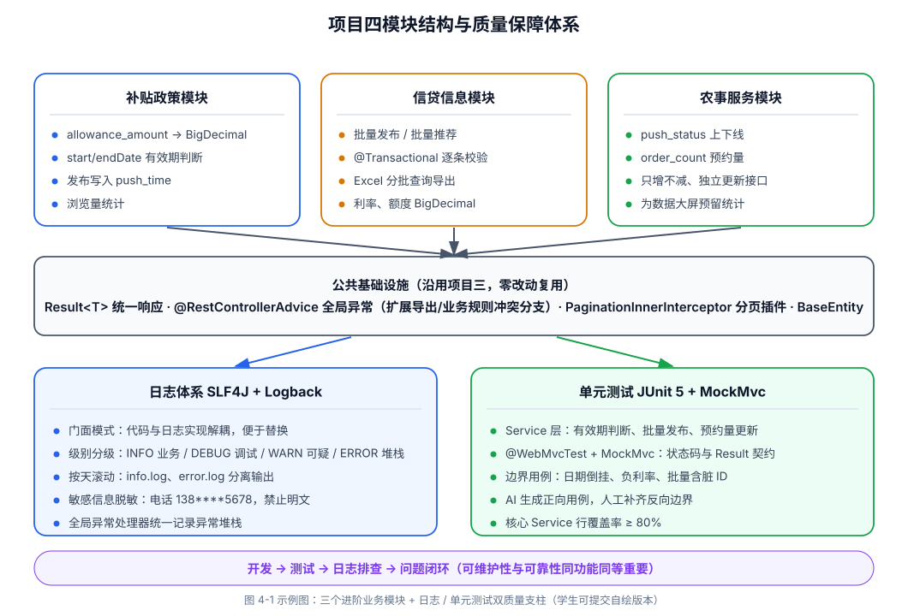
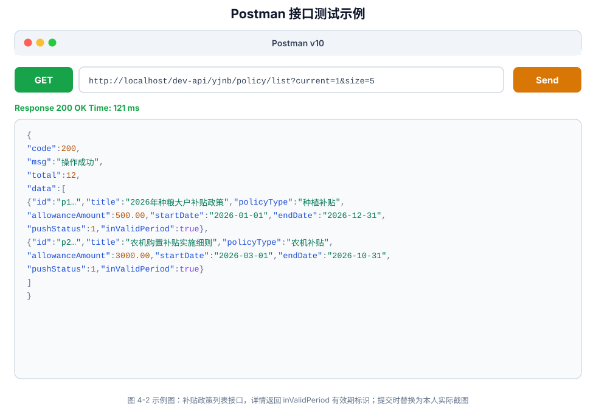
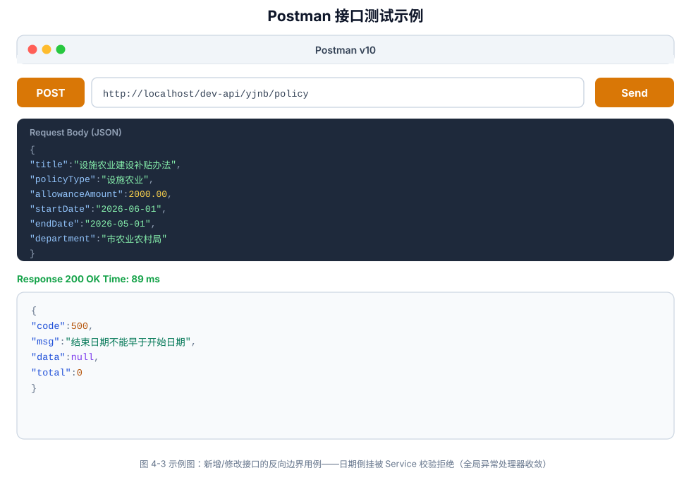
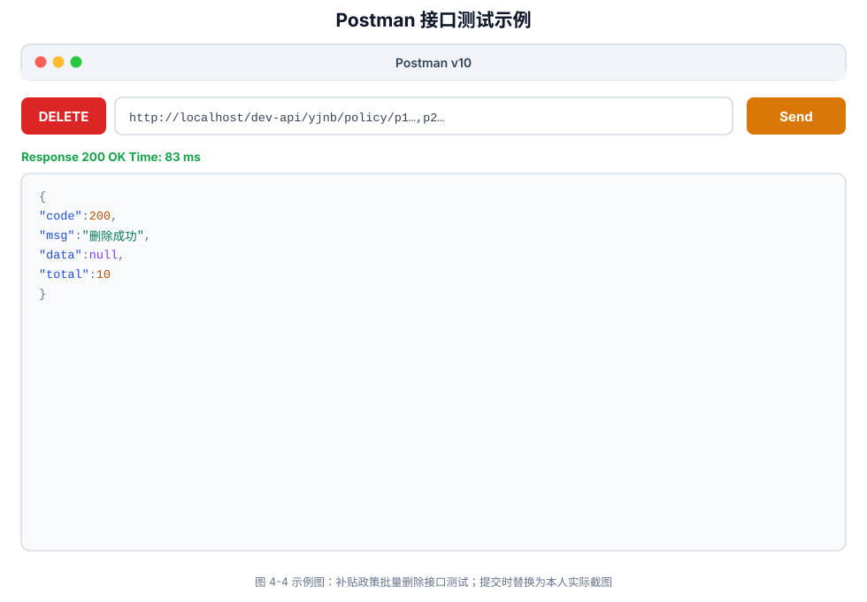
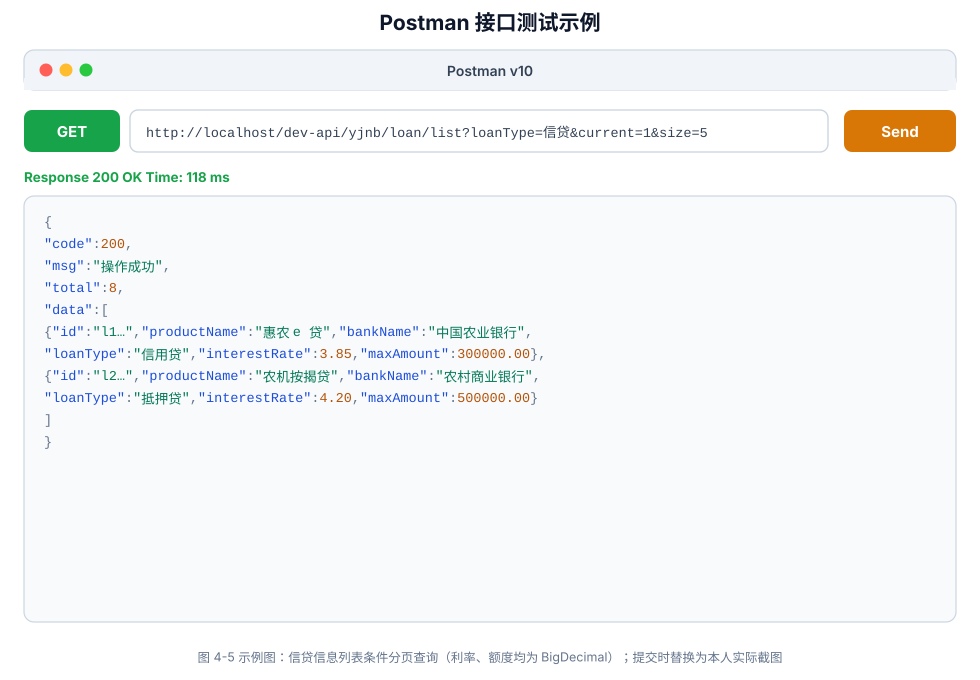
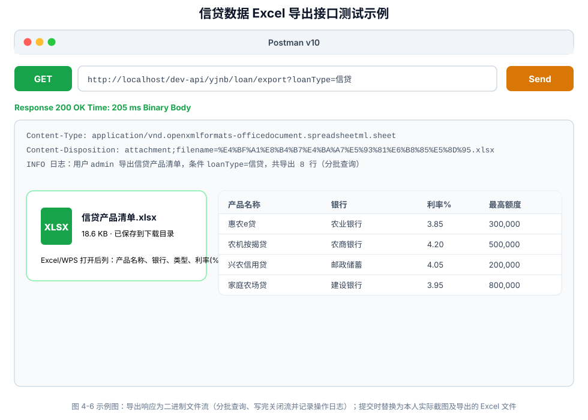
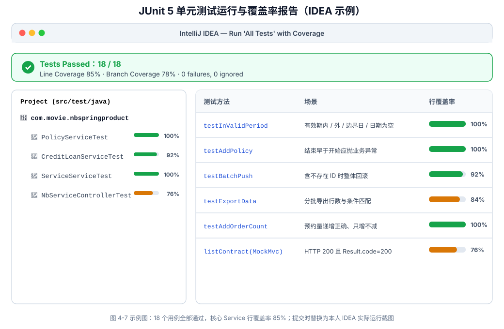

# ××××××课程

# ××××××项目

> **实验实训报告**
>
> （封面建议在系统填报基本信息后，自动生成）

**×××专业教研室编**

**×××教学单位**

**××年××月**

---

# 一、实验实训项目名称

**项目四：基于 SpringBoot 实现系统进阶功能与业务优化**

# 二、项目内容与要求

> （请从实验实训目标、内容、条件、安全要求、注意事项等方面阐述）

## （一）实验实训目标

### 1. 知识目标

1. 掌握 SLF4J 与 Logback 日志框架的核心概念，理解日志级别、输出格式、文件滚动与门面模式的设计思想。
2. 掌握 JUnit 5 测试框架的核心概念，理解 `@SpringBootTest`、`@WebMvcTest`、MockMvc 等 Spring Boot 测试支持机制。
3. 理解补贴政策、信贷信息、农事服务三个模块的业务规则：发布有效期判断、批量操作与 Excel 导出、预约量统计。
4. 理解 BigDecimal 金额精度处理、日期区间校验、文件流响应等进阶开发要点。
5. 了解 AI 在测试用例生成、覆盖率分析与日志排查中的应用思路。

### 2. 能力目标

1. 能基于 `nb_allowance_policy`、`nb_credit_loan`、`nb_service` 三张表完成三个业务模块的 CRUD、发布/推荐状态管理与批量操作。
2. 能实现信贷数据 Excel 导出接口与政策有效期业务规则，处理金额、日期等特殊字段。
3. 能为三个模块配置规范的业务日志体系（请求日志、业务日志、异常日志），并通过日志定位问题。
4. 能编写 Controller/Service 层单元测试，核心方法测试覆盖率达到 80% 以上，并借助 AI 识别测试盲点。
5. 能使用 Postman 完成全部接口测试，形成“开发-测试-日志排查”的完整闭环。

### 3. 素质目标

1. 树立“可维护性与可靠性同功能同等重要”的工程质量意识，养成写代码先想“出了问题怎么排查”的习惯。
2. 养成关键操作留痕、测试先行的专业开发习惯。
3. 建立对信贷、补贴等敏感业务数据准确性的责任意识，形成严谨求实的工程素养。

## （二）任务背景与目标

**背景：** 项目三基于 Spring Boot 完成了知识管理模块，系统已具备专家与课程的统一管理能力。随着平台运营深入，农业局提出新诉求：补贴政策需及时发布并支持有效期管理；信贷产品信息分散，需支持批量操作与 Excel 导出以便报表分析；农事服务（农机租赁、病虫害防治、土地托管）需支持预约量统计与上下线管理。同时，运维与测试团队反馈：系统出错时难以定位原因，代码质量缺乏自动化保障。因此，项目四在实现三个进阶业务模块的同时，引入日志管理（SLF4J+Logback）与单元测试（JUnit 5）两大系统级进阶功能，形成“业务实现+质量保障”双主线。AI 工具已能生成 CRUD 与测试用例初稿，教学重心应转向：日志该记什么、测试边界如何划分、业务规则（有效期、批量导出）如何正确落地。

**目标：** 基于项目一数据库规划与接口规范、项目三工程模板，使用 Spring Boot + MyBatis-Plus 实现补贴政策、信贷信息、农事服务三个模块，并完成日志体系配置与单元测试，形成“开发-测试-运维”闭环的开发体验；掌握“设计先行、AI 辅助实现、人工审查验收”的工程化流程。

## （三）任务具体要求

### 1. 课堂讲练分工（建议）

| 环节 | 教师讲授重点（理念层） | 学生动手重点（实践层） | AI 可辅助 | 须人工掌握 |
| --- | --- | --- | --- | --- |
| 第 1 课时 | 日志的价值、SLF4J 门面与 Logback 实现、日志级别与输出策略 | 搭建模块骨架、配置 `logback-spring.xml` | 生成日志配置模板 | 解释“为什么用日志门面而非直接用实现” |
| 第 2 课时 | 补贴政策业务规则：有效期判断、金额精度、发布语义 | 补贴政策模块 Entity→Mapper→Service→Controller | 生成实体与 Mapper | 审查 BigDecimal 与日期区间校验 |
| 第 3 课时 | 批量操作与 Excel 导出的实现方案与内存风险 | 信贷模块+批量发布/推荐+导出接口 | 生成 EasyExcel/POI 导出工具类 | 审查大数据量导出的性能与文件安全 |
| 第 4 课时 | JUnit 5 生命周期、测试金字塔、Mock 边界 | 农事服务模块+编写单元测试 | 生成测试用例初稿 | 判断断言有效性与测试边界 |
| 第 5 课时 | 日志驱动的问题定位、覆盖率分析、与项目五联调衔接 | Postman 全量测试+执行测试+日志排查演练 | 生成覆盖率分析报告 | 截图记录“日志定位缺陷”过程 |

### 2. 开发环境与工程初始化

1. 配置 JDK 17（Spring Boot 2.6.13 兼容 JDK 8+）、Maven 3.6+、MySQL 8.0、IDEA（含 Lombok 插件）。
2. 导入项目一规划的 `nb_database.sql`，确认 `nb_allowance_policy`、`nb_credit_loan`、`nb_service` 表及测试数据可用。
3. 在项目三工程 `nbspringproduct`（`com.movie.nbspringproduct`）基础上迭代开发，延续分层模板与公共组件，不新建重复工程。
4. 补充依赖：easyexcel（或 Apache POI）、`spring-boot-starter-test`（JUnit 5 已内置）。
5. 完成 `logback-spring.xml` 日志配置：控制台+滚动文件输出，开发期 DEBUG、业务操作 INFO、异常 ERROR 分级。
6. 课堂必交付：《模块业务规则与日志埋点设计表》一份（见第四节示范）。

### 3. 公共基础设施（沿用与升级）

1. 沿用项目三 `Result<T>`、BaseEntity、`@RestControllerAdvice` 全局异常处理器、分页插件配置，禁止重复编写。
2. 扩展全局异常处理：补充文件导出异常、业务规则冲突（如发布不存在的政策）的处理分支。
3. 日志规范约定：Controller 层记录请求入参摘要（INFO）、Service 层记录业务动作（INFO）、异常统一在全局处理器记录（ERROR 含堆栈）、敏感字段（电话）日志脱敏。

### 4. 任务一：补贴政策管理模块

1. 依据 `nb_allowance_policy` 表创建 `NbAllowancePolicy` 实体类（`allowance_amount` 使用 BigDecimal，`start_date`/`end_date` 使用日期类型）。
2. Mapper 继承 BaseMapper，列表支持 `title`、`policy_type`、`push_status` 条件分页查询。
3. Service 实现发布/取消发布：发布时写入 `push_time`；实现推荐/取消推荐；实现浏览量统计更新。
4. 实现有效期业务规则：查询与详情接口返回“是否在有效期内”的判断结果，供前端展示。
5. 完成 `NbAllowancePolicyController`，接口前缀 `/dev-api/yjnb/policy`，实现 5 个核心接口：

| 功能 | 方法 | 路径 |
| --- | --- | --- |
| 列表查询 | GET | `/dev-api/yjnb/policy/list` |
| 详情查询 | GET | `/dev-api/yjnb/policy/{id}` |
| 新增 | POST | `/dev-api/yjnb/policy` |
| 修改 | PUT | `/dev-api/yjnb/policy` |
| 删除 | DELETE | `/dev-api/yjnb/policy/{ids}` |

6. 扩展接口：发布/取消发布、推荐/取消推荐（命名参照项目一《04-接口规范》）。
7. 使用 Postman 验证全部接口。

### 5. 任务二：信贷信息管理模块（批量操作与导出）

1. 依据 `nb_credit_loan` 表创建 `NbCreditLoan` 实体类（`interest_rate`、`max_amount` 使用 BigDecimal）。
2. 接口前缀 `/dev-api/yjnb/loan`，实现与政策模块对等的 5 个核心接口。
3. 实现批量操作：批量发布、批量推荐（Service 层添加 `@Transactional`，逐条校验存在性）。
4. 实现 Excel 导出接口：支持按查询条件导出信贷产品清单（产品名称、银行、利率、额度、期限等列），使用 EasyExcel 或 POI，响应流方式输出。
5. 导出接口须记录业务日志（操作人、导出行数），并防范大数据量导出的内存风险（分批查询）。

### 6. 任务三：农事服务管理模块（模板复用+统计支撑）

1. 依据 `nb_service` 表创建 `NbService` 实体类（`price` 使用 BigDecimal，`order_count` 预约量）。
2. 复用前两个模块的分层模板，接口前缀 `/dev-api/yjnb/service`，实现对等 5 个核心接口。
3. 实现上下线状态管理（`push_status`：0 下线 1 上线）与预约量（`order_count`）更新接口，为后续数据大屏预留统计支撑。
4. 不重复编写公共组件，提交《模块复用对照表》。

### 7. 任务四：日志管理与单元测试（系统进阶，必做）

1. **日志管理：** 在三个模块的关键方法添加规范日志；配置按天滚动的日志文件；课堂演示“人为制造一个缺陷（如空指针），通过日志链路定位到具体方法”。
2. **单元测试：** 使用 JUnit 5 编写 Service 层测试（核心业务规则：有效期判断、批量发布、预约量更新）；使用 `@WebMvcTest`+MockMvc 测试 Controller 层接口契约（状态码与 Result 结构）；整体覆盖率不低于 80%。
3. **AI 辅助测试：** 使用 AI 生成测试用例初稿与边界用例（如结束日期早于开始日期、利率为负数），人工判断并补充遗漏场景。

### 8. AI 辅助开发与代码审查（必做过程记录）

1. 允许使用 Cursor、Copilot、通义灵码等生成实体、Service、导出工具类与测试用例初稿。
2. 必须完成 AI 代码审查记录（写入实验报告 4.4 节），至少包含 3 条审查项，例如：
   - 金额字段是否使用 BigDecimal 并正确处理精度与比较；
   - 日期区间校验是否遗漏“结束早于开始”的反向用例；
   - 批量操作是否逐条校验并包裹事务；
   - 导出是否分批查询、是否关闭响应流资源；
   - 日志是否打印敏感信息明文（电话、银行账号）。
3. 对 AI 生成代码的修改说明须写入报告，体现 “生成→审查→修正”闭环。

### 9. 实验报告撰写

1. 按本手册第四节模板撰写实验实训报告。
2. 报告须包含：模块业务规则与日志埋点设计表、单元测试报告（用例数+覆盖率截图）、Postman 测试截图（不少于 6 张，含导出文件效果）、AI 代码审查记录、与项目一规范对照检查表。
3. 须回答 “为何业务实现与日志/测试要同步推进”（见 4.6 分析示范）。

## （四）实验条件

| 项目 | 要求 |
| --- | --- |
| 操作系统 | Windows 10 及以上 |
| JDK | 17（Spring Boot 2.6.13 兼容 JDK 8+，与教材环境一致即可） |
| 构建工具 | Maven 3.6+ |
| 数据库 | MySQL 8.0+，数据库名 `nb_database` |
| 核心框架 | Spring Boot 2.6.13 + MyBatis-Plus（沿用项目三） |
| 进阶组件 | EasyExcel/POI、JUnit 5、SLF4J+Logback（均随依赖引入） |
| 开发工具 | IntelliJ IDEA、Postman、Excel/WPS |
| AI 工具 | Cursor/Copilot 等（实验过程允许使用） |
| 参考资料 | 项目一 5 份设计文档、项目三源码、`nb_database.sql`、本课程教材项目四章节 |

## （五）安全要求

1. 数据库账号密码仅用于本地实验，不得提交真实服务器地址与生产密码至公共仓库。
2. 信贷产品利率、额度等数据均为测试数据，报告须注明“测试数据，仅供参考”。
3. 日志中不得输出用户密码、完整联系电话等敏感信息明文，须脱敏处理。
4. Excel 导出文件仅含测试数据，不得将导出文件上传至公共网络。

## （六）注意事项

1. 本阶段聚焦后端接口与质量保障，前端页面联调在项目五进行；接口测试统一使用 Postman。
2. 在项目三工程上迭代开发，禁止重复创建工程或复制公共组件。
3. 包结构、表名、接口前缀须与项目一《03-数据库规划》《04-接口规范》保持一致。
4. 三个模块考察模板复用与业务规则落地，禁止无差异全量复制；须能说明金额/日期字段、批量导出、统计字段等差异及实现理由。
5. 日志与单元测试为必做项，缺项按评分标准降档。
6. 源码存放路径：`项目4-系统进阶功能/nbspringproduct/`（在项目三工程基础上迭代，提交时整包拷贝）。

## （七）需提交资料

> （打包为压缩文件提交学习通）

1. **后端工程：** `项目4-系统进阶功能/nbspringproduct/` 完整 Maven 工程（含日志配置、测试代码）。
2. **测试与日志材料：** 单元测试运行截图、覆盖率报告、日志文件样例（脱敏后）。
3. **接口测试：** `农宝项目四-进阶业务接口.postman_collection.json` 及导出的 Excel 样例文件。
4. **实验实训报告：** 一份，按第四节撰写；含业务规则设计表、测试报告、Postman 截图（≥6 张）、AI 审查记录、模块复用对照表。

# 三、考核方式与标准

## （一）考核方式

| 考核项 | 形式 | 权重 |
| --- | --- | --- |
| 实验报告 | 按第四节模板撰写 | 50% |
| 后端工程与接口 | 源码+Postman 演示（含导出） | 30% |
| 测试与日志 | 用例、覆盖率、日志排查演示 | 20% |
| 课堂答辩 | 业务规则与质量保障说明 | 10% |

## （二）评分标准

| 等级 | 分数 | 标准 |
| --- | --- | --- |
| 优秀 | 90～100 | 三模块 15 接口+导出全部通过；覆盖率≥80%；日志规范且能演示日志定位问题；业务规则讲解清晰 |
| 良好 | 80～89 | 主要接口可用；有测试用例与日志；覆盖率 60% 以上；少量字段或规则问题 |
| 中等 | 70～79 | 至少两个模块 CRUD 可用；日志或测试完成度不足；报告偏简略 |
| 及格 | 60～69 | 工程可编译启动；部分接口可访问；质量保障环节缺失 |
| 不及格 | <60 | 无法启动、未做日志与测试、未提交或与项目无关 |

## （三）提交要求

1. `学号_姓名_项目四_实验报告.docx/pdf`
2. `项目4-系统进阶功能/` 文件夹（含完整后端工程与测试代码）
3. 报告含不少于 6 张 Postman 测试截图、覆盖率截图及日志排查记录

# 四、报告内容

> （学生填写）
>
> 以下为学生实验报告详实示范。请复制模板后，将【】中内容替换为个人信息；可在此基础上增删，但须保持对业务规则与质量保障的分析深度，避免仅粘贴代码。

## 4.1 基本信息

| 项目 | 内容 |
| --- | --- |
| 姓名 | 【填写姓名】 |
| 学号 | 【填写学号】 |
| 班级 | 【填写班级】 |
| 实验日期 | 2026 年 06 月【×】日 |
| 实验地点 | 【填写机房/地点】 |
| 指导教师 | 【填写教师姓名】 |

## 4.2 实验目的

本次实验围绕 “农宝”项目四展开，突出业务进阶与质量保障双主线：

1. 完成补贴政策、信贷信息、农事服务三个模块的后端实现，掌握金额、日期、批量导出等进阶字段与操作的处理方法。
2. 掌握 SLF4J+Logback 日志体系的配置与埋点规范，能通过日志快速定位问题。
3. 掌握 JUnit 5 与 Spring Boot 测试支持，为核心业务编写单元测试并达到 80% 覆盖率。
4. 复用项目三分层模板横向扩展模块，深化 “公共组件单点维护”与 “同构模块定制”能力。
5. 学会 AI 辅助生成测试用例并人工审查，养成 “生成→审查→测试→留痕”的开发习惯。

## 4.3 实验环境与工具

| 工具/环境 | 版本 | 用途 |
| --- | --- | --- |
| JDK | 17 | 编译与运行 |
| Maven | 3.9.x | 依赖管理与打包 |
| MySQL | 8.0.33 | `nb_database` 数据存储 |
| Spring Boot | 2.6.13 | 后端框架（沿用项目三工程） |
| MyBatis-Plus | 3.5.x | 持久层增强 |
| EasyExcel | 3.x | 信贷数据 Excel 导出 |
| JUnit 5 + MockMvc | 内置 | 单元测试与接口测试 |
| SLF4J + Logback | 内置 | 日志体系 |
| IDEA | 2024.x | 后端开发、调试与测试 |
| Postman | 最新版 | REST 接口测试 |
| AI 工具 | Cursor | 生成实体/导出/测试骨架并审查 |
| 参考资料 | 项目一三设计文档、`nb_database.sql` | 表结构与接口对照 |

## 4.4 实验步骤与过程记录

### 步骤一：模块业务规则分析与日志埋点设计（理念重点）

> **图 4-1 项目四模块结构与质量保障体系（学生须提交自绘版本）**



#### 1. 模块业务规则设计表（必交）

| 模块 | 核心业务字段 | 关键业务规则 | 日志埋点（示例） |
| --- | --- | --- | --- |
| 补贴政策 | allowance_amount、start_date/end_date、policy_type | 发布写入 push_time；详情返回“是否在有效期内” | 发布/取消发布记录操作人与政策 ID |
| 信贷信息 | interest_rate、max_amount、bank_name、loan_type | 批量发布/推荐须逐条校验并包事务 | 导出记录操作人、条件与导出行数 |
| 农事服务 | price、order_count、service_type | 上下线控制；预约量只增不减 | 上下线与预约量更新记录前后值 |

#### 2. 日志级别规范

| 级别 | 使用场景 | 示例 |
| --- | --- | --- |
| INFO | 业务动作、请求摘要 | “用户 admin 批量发布信贷产品 3 条” |
| DEBUG | 开发调试、SQL 参数 | 开发期开启，验证后关闭 |
| WARN | 可预期异常、参数可疑 | “政策 id={} 不存在，发布跳过” |
| ERROR | 异常堆栈 | 全局异常处理器统一记录 |

**理念记录：** 日志是给“三个月后的自己”看的，埋点在业务规则处而非每行代码处；敏感字段必须脱敏。

#### 3. 工程增量结构

```text
nbspringproduct/
├── src/main/java/com/movie/nbspringproduct/
│   ├── controller/      # +NbAllowancePolicyController, NbCreditLoanController, NbServiceController
│   ├── service/impl/    # +对应实现类
│   ├── mapper/          # +对应Mapper
│   ├── entity/          # +NbAllowancePolicy, NbCreditLoan, NbService
│   ├── util/            # Excel导出工具类
│   └── common/          # 沿用Result、全局异常（扩展导出异常分支）
├── src/main/resources/
│   ├── logback-spring.xml   # 新增：日志配置
│   └── application.yml
└── src/test/java/com/movie/nbspringproduct/   # 新增：单元测试
    ├── service/         # PolicyServiceTest, CreditLoanServiceTest, ServiceServiceTest
    └── controller/      # MockMvc接口契约测试
```

### 步骤二：补贴政策管理模块实现与接口测试

#### 1. 核心表字段映射（nb_allowance_policy）

| 字段名 | 数据类型 | 实体属性 | 说明 |
| --- | --- | --- | --- |
| id | varchar(50) | id | `@TableId(ASSIGN_UUID)` UUID 主键 |
| title | varchar(200) | title | 政策标题，`@NotBlank` |
| resume | varchar(500) | resume | 政策摘要 |
| content | text | content | 政策内容 |
| policy_type | varchar(50) | policyType | 政策类型，筛选条件 |
| allowance_amount | decimal(10,2) | allowanceAmount | 补贴金额，BigDecimal |
| start_date/end_date | date | startDate/endDate | 有效期区间，须校验先后 |
| department | varchar(100) | department | 发布部门 |
| push_status | int | pushStatus | 0 未发布 1 已发布 |
| push_time | datetime | pushTime | 发布时间，发布时写入 |
| recommend | int | recommend | 0 不推荐 1 推荐 |
| browse_num | int | browseNum | 浏览次数 |

#### 2. 有效期业务规则实现（Service 层）

```java
public boolean inValidPeriod(NbAllowancePolicy p) {
    LocalDate now = LocalDate.now();
    return !now.isBefore(p.getStartDate()) && !now.isAfter(p.getEndDate());
}
```

**审查记录：** AI 初稿用 Date 直接比较且未判空日期，修正为先判空再比较，并补充“结束早于开始”的校验拒绝保存。

#### 3. 核心接口与 Postman 测试记录（示例）

| 序号 | 接口 | 方法 | 预期 | 实际 | 截图编号 |
| --- | --- | --- | --- | --- | --- |
| 1 | `/policy/list` | GET | code=200，含 total | 通过 | 图 4-2 |
| 2 | `/policy/{id}` | GET | 返回详情与有效期标识 | 通过 | 图 4-2 |
| 3 | `/policy` | POST | 新增成功 | 通过 | 图 4-3 |
| 4 | `/policy` | PUT | 修改成功 | 通过 | 图 4-3 |
| 5 | `/policy/{ids}` | DELETE | 批量删除成功 | 通过 | 图 4-4 |
| 6 | 发布/取消发布、推荐 | POST | 状态切换成功 | 通过 | 图 4-4 |

> **图 4-2 补贴政策列表接口测试（Postman 响应截图，学生替换为自己的截图）**



> **图 4-3 补贴政策新增/修改接口测试（Postman 响应截图，学生替换为自己的截图）**



> **图 4-4 补贴政策删除与发布接口测试（Postman 响应截图，学生替换为自己的截图）**



### 步骤三：信贷信息管理模块（批量操作与 Excel 导出）

#### 1. 批量操作实现要点

批量发布/批量推荐：Service 方法添加 `@Transactional(rollbackFor = Exception.class)`，循环内先 `selectById` 校验存在性，任一条不存在则整体回滚并抛业务异常。

#### 2. Excel 导出实现要点

```java
@GetMapping("/export")
public void export(NbCreditLoanQuery query, HttpServletResponse response) {
    response.setContentType("application/vnd.openxmlformats-officedocument.spreadsheetml.sheet");
    String fileName = URLEncoder.encode("信贷产品清单", "UTF-8");
    response.setHeader("Content-Disposition", "attachment;filename=" + fileName + ".xlsx");
    excelUtil.exportCreditLoan(query, response.getOutputStream()); // 分批查询，写完关闭流
}
```

**审查记录：** AI 初稿一次性 list 全部数据再导出，存在内存风险；修正为按分页批次查询写入；导出后记录 INFO 日志（操作人、行数）。

#### 3. Postman 测试记录

| 序号 | 接口 | 方法 | 预期 | 实际 | 截图编号 |
| --- | --- | --- | --- | --- | --- |
| 1 | `/loan/list` | GET | 分页+loan_type 筛选 | 通过 | 图 4-5 |
| 2 | `/loan` | POST/PUT | 新增/修改成功 | 通过 | 图 4-5 |
| 3 | `/loan/push` | POST | 批量发布成功 | 通过 | 图 4-6 |
| 4 | `/loan/export` | GET | 返回 xlsx 文件 | 通过 | 图 4-6（附文件打开效果） |

> **图 4-5 信贷信息列表接口测试（Postman 响应截图，学生替换为自己的截图）**



> **图 4-6 信贷数据导出接口测试（Postman 响应截图，学生替换为自己的截图）**



### 步骤四：农事服务模块模板复用

**模块复用对照表（必交）**

| 复用项 | 补贴政策模块 | 信贷/农事服务模块 | 是否复用 | 差异说明 |
| --- | --- | --- | --- | --- |
| Result/全局异常/分页插件 | ✓ | 直接复用 | 是 | 公共组件单点维护 |
| Controller 模式 | list/get/add/update/delete | 同结构 | 是 | 仅路径与实体不同 |
| 批量事务模式 | 政策单条发布 | 信贷批量发布+事务 | 部分 | 新增批量语义 |
| 金额字段 | allowanceAmount | price/maxAmount/interestRate | 是 | 同用 BigDecimal |
| 导出能力 | 无 | 信贷 Excel 导出 | 否 | 业务差异新增 |
| 统计字段 | browse_num | order_count 预约量 | 部分 | 预约量更新为独立接口 |

**复用率自评：** 公共代码约【75】%，业务代码约【25】%需定制。

### 步骤五：单元测试与覆盖率报告（必做）

#### 1. 测试用例清单（示例）

| 序号 | 测试类 | 测试方法 | 场景 | 结果 |
| --- | --- | --- | --- | --- |
| 1 | PolicyServiceTest | testInValidPeriod | 有效期内/外/边界日/日期为空 | 通过 |
| 2 | PolicyServiceTest | testAddPolicy | 结束早于开始应抛业务异常 | 通过 |
| 3 | CreditLoanServiceTest | testBatchPush | 含不存在 ID 时应整体回滚 | 通过 |
| 4 | CreditLoanServiceTest | testExportData | 导出行数与条件匹配 | 通过 |
| 5 | ServiceServiceTest | testAddOrderCount | 预约量递增正确 | 通过 |
| 6 | NbServiceControllerTest | MockMvc list 契约 | 状态码 200 且 code=200 | 通过 |

#### 2. 覆盖率结果

> **图 4-7 单元测试运行与覆盖率截图（学生替换为自己的截图）**



| 统计项 | 数量 |
| --- | --- |
| 测试类 | 4 |
| 测试用例 | 【18】 |
| 通过/失败 | 【18】/0 |
| 核心 Service 行覆盖率 | 【85】% |
| AI 生成用例采纳率 | 约【70】%，补充边界用例【5】个 |

**反思：** AI 生成的都是“正向用例”，反向边界（日期倒挂、负利率、批量含脏 ID）需人工补齐——测试的价值恰在边界。

### 步骤六：日志驱动的缺陷定位演练（必做）

**演练记录（示例）：**

| 步骤 | 操作 | 日志证据 |
| --- | --- | --- |
| 1 | 人为将预约量更新方法中的实体置空 | 控制台出现 ERROR 堆栈 |
| 2 | 查看 `log/error.log` | 定位到 ServiceServiceImpl 第【xx】行 NullPointerException |
| 3 | 修复并重启 | INFO 日志显示预约量更新成功 |
| 4 | 检查敏感信息 | 电话中间四位已脱敏 |

**结论：** 日志级别分级+文件滚动使问题可在【3】分钟内定位；无日志时只能靠断点复现，成本高。

### 步骤七：与项目一规范对照检查

| 检查项 | 项目一规划 | 项目四实现 | 是否一致 |
| --- | --- | --- | --- |
| 数据库名 | `nb_database` | `nb_database` | ☑ |
| 三张业务表 | `nb_allowance_policy`/`nb_credit_loan`/`nb_service` | 已映射 | ☑ |
| 接口前缀 | `/dev-api/yjnb/` | policy、loan、service 已遵循 | ☑ |
| 响应格式 | code/msg/data/total | 沿用 Result 统一封装 | ☑ |
| 推荐接口命名 | `POST /loan/recommandCreditLoan` | 按规范实现 | ☑ |
| 导出/批量 | 信贷批量+Excel 导出 | 已实现 | ☑ |

## 4.5 实验结果

### （1）交付物清单

| 序号 | 交付物 | 路径 | 完成情况 |
| --- | --- | --- | --- |
| 1 | 后端工程（迭代项目三） | `项目4-系统进阶功能/nbspringproduct/` | ☑ |
| 2 | 补贴政策模块 | controller/service/mapper/entity | ☑ |
| 3 | 信贷信息模块（含导出） | 同上+util | ☑ |
| 4 | 农事服务模块（含统计） | 同上 | ☑ |
| 5 | 日志体系 | `logback-spring.xml`+业务埋点 | ☑ |
| 6 | 单元测试 | src/test 4 个测试类 18 用例 | ☑ |
| 7 | Postman 测试集+导出样例 | json+xlsx | ☑ |

### （2）实现成果统计

| 统计项 | 数量 |
| --- | --- |
| 新增实体类 | 3 |
| 新增 Mapper | 3 |
| 新增 Service 接口+实现 | 3+3 |
| 新增 Controller | 3 |
| REST 接口 | 15 个核心+发布/推荐/导出/预约量等 6 个扩展 |
| 日志配置文件 | 1（`logback-spring.xml`） |
| 单元测试用例 | 18（覆盖率 85%） |

### （3）接口测试结果汇总

| 模块 | 测试用例数 | 通过 | 失败 | 备注 |
| --- | --- | --- | --- | --- |
| 补贴政策 | 5+2 扩展 | 7 | 0 | 含有效期判断 |
| 信贷信息 | 5+2 扩展 | 7 | 0 | 含批量与 Excel 导出 |
| 农事服务 | 5+1 扩展 | 6 | 0 | 含预约量更新 |
| 合计 | 20 | 20 | 0 |  |

## 4.6 分析与总结

### （1）业务实现与质量保障同步推进的收获（回应课堂讲授重点）

**① 业务规则是模块的灵魂**

三个模块的 CRUD 骨架高度同构，真正的工作量在业务规则：政策有效期、批量事务、预约量统计。CRUD 可由 AI 生成，规则必须人来定义与验证——这正是“设计先行”的落点。

**② 日志是系统的“黑匣子”**

SLF4J 门面将代码与 Logback 实现解耦，级别分级让 INFO 讲业务、ERROR 讲故障。本次演练中，一次空指针从报错到定位到行号仅用 3 分钟，而无日志版本只能逐层断点。可维护性不是额外成本，而是偿还未来的自己。

**③ 测试金字塔与覆盖率的意义**

Service 层业务规则用单测覆盖（快、稳），Controller 层用 MockMvc 验证契约（状态码、Result 结构）。80% 覆盖率不是目的，倒逼识别“哪些分支从没被执行过”才是目的。AI 能铺正向用例，边界场景仍靠人对业务的理解。

**④ 导出类接口的工程细节**

Excel 导出涉及响应流、编码、分批查询、资源关闭与日志留痕，是典型的“边界 IO 操作”，任何一步疏漏都会变成线上事故，适合作为工程素养的练兵场。

### （2）与项目三的迭代对照（衔接项目五）

| 对比项 | 项目三知识管理 | 项目四进阶业务 |
| --- | --- | --- |
| 业务特征 | 内容型（专家、课程） | 交易/政策型（金额、日期、状态机） |
| 新增能力 | 统一响应、分页插件 | 批量事务、Excel 导出、统计更新 |
| 质量保障 | Postman 手工验证 | 单元测试+覆盖率+日志排查 |
| 公共组件 | 首次迁移落地 | 零改动复用，仅扩展异常分支 |

### （3）AI 时代开发方式反思

| 传统教学侧重 | 本实验调整后侧重 |
| --- | --- |
| 功能跑通即完成 | 功能、日志、测试三线验收 |
| 测试是“额外作业” | 测试是提交前的门槛 |
| 日志=System.out.println | 分级日志+脱敏+文件滚动 |
| 背诵 POI/JUnit 语法 | 判断 AI 生成的导出与用例是否可靠 |

### （4）问题与改进

| 问题 | 原因分析 | 改进建议 |
| --- | --- | --- |
| 导出文件乱码 | 响应头编码未设置 | URLEncoder 编码文件名并设置 Content-Type |
| 批量发布部分成功 | 未加事务或逐条提交 | `@Transactional`+先校验后执行 |
| 测试启动慢连接库 | `@SpringBootTest` 全量装配 | 拆分 `@WebMvcTest`/`@MockBean` 按层测试 |
| 日志文件不滚动 | 滚动策略配置错误 | 检查 `logback-spring.xml` 的 FileNamePattern |
| 金额比较失真 | 用 equals/double 比较 | 统一使用 compareTo 并固定两位小数 |

## 4.7 自我评价

| 评价项 | 自评（1～5 分） | 说明 |
| --- | --- | --- |
| 业务规则实现 | 5 | 有效期、批量、统计规则全部落地并通过边界用例 |
| 日志规范与排查 | 4 | 埋点合理，已演练日志定位缺陷 |
| 单元测试质量 | 5 | 18 用例全过，覆盖率 85% |
| 模板复用能力 | 4 | 两模块快速扩展，导出为新增定制 |
| AI 审查意识 | 4 | 已修正导出内存与用例边界问题 |
| 接口测试完整性 | 5 | 20 个接口全部 Postman 验证 |

## 4.8 教师评语与成绩

| 项目 | 内容 |
| --- | --- |
| 评语 | （教师填写） |
| 成绩 | （教师填写） |
| 评阅日期 | （教师填写） |
| 评阅教师 | （教师填写） |
