# 项目三：基于SpringBoot实现知识管理模块

在项目一中，我们完成了“农宝”平台的需求分析、架构设计与数据库建模，为系统开发奠定了顶层设计基础；在项目二中，我们基于 SSM 框架实现了农产品和农贸市场等核心业务功能，初步构建了后台管理端的基础能力。随着平台上线试运行，系统开始承载真实数据与真实用户，新的业务诉求也随之产生。

在“农宝”平台上线试运行的过程中，后台系统已经初步具备了农产品管理、补贴政策管理、信贷信息管理等核心功能，极大提升了农业局的日常工作效率。然而，内容运营人员在一次运营复盘会上提出了新的困扰：

> “我们邀请了很多农业专家录制课程、撰写图文教程，但内容散落在不同渠道，很难统一管理和更新。农民想系统学习某一类知识，也缺乏结构化的课程体系。”  

与此同时，乡镇农技站工作人员也反馈：

> “农民更信任本地专家的经验分享，如果能在平台中统一展示专家信息、图文课程和视频课程，不仅方便农民学习，也便于我们组织线上线下的培训活动。”  

为响应这些需求，“农宝”平台规划建设**知识管理模块**，用于统一管理农业专家信息、图文课程内容和视频课程资源，并为前端学习中心提供统一数据支持。本项目将引导你基于 Spring Boot 框架，完整实现后台知识管理模块的核心功能，掌握 Spring Boot 在实际业务场景中的工程化用法。

**【价值思考】知识服务与能力建设**

“授人以鱼，不如授人以渔。”知识管理模块的建设，不仅是为了展示内容，更是为了提升农民的知识水平和生产决策能力。作为开发者，你所实现的每一个“专家介绍”、每一节“图文课程”和“视频课程”，背后都对应着农民在田间地头作出更好决策的可能性。将抽象的“Spring Boot 技术实践”落实到“提升农民知识与能力”的具体场景，是本项目的真正价值所在。

---

## 【项目介绍】

本项目以“农宝”后台知识管理模块为载体，围绕**专家管理、图文课程管理与视频课程管理**三个子模块，系统讲解如何使用 Spring Boot 快速构建一个可维护、可扩展、可集成 AI 能力的知识管理子系统。

在整体系统架构中，知识管理模块位于后台管理端之内，对接 MySQL 数据库，向前端“知识学习中心”“专家讲堂”等页面提供统一的 RESTful API 接口。模块主要职责包括（功能结构如图3-1所示）：

- **专家信息管理**：维护农业专家的基本资料、专业领域、职称、简介、头像、排序等信息，支持启用/禁用、推荐等业务操作。
- **图文课程管理**：统一管理面向农民的图文教程，包括课程标题、摘要、正文内容、分类标签、发布状态、推荐标记等。
- **视频课程管理**：维护农业视频课程的元数据，如课程标题、封面、视频地址、时长、难度等级、播放量等，并支持上线/下线控制。
- **统一发布控制**：对专家、图文课程和视频课程设置统一的发布状态、推荐状态，为前端展示提供统一规则。
- **基础统计支撑**：为后续的数据统计与推荐算法预留字段（如浏览量、学习进度等），支撑后续项目中的数据分析和个性化服务。

知识管理模块的主要功能点汇总如表3-1所示。

**表3-1 知识管理模块功能一览表**

| 功能分类           | 主要功能点                                                     | 典型页面/接口示例                           |
|--------------------|----------------------------------------------------------------|--------------------------------------------|
| 专家管理功能       | 专家信息增删改查、启用/禁用、首页推荐、专家排序               | 后台专家列表页、`GET /api/expert/list` 等  |
| 图文课程管理功能   | 课程内容维护（标题、简介、正文、封面）、分类、发布/下线、推荐、浏览量统计 | 图文课程管理页、`POST /api/yjnb/graphicCourse` 等 |
| 视频课程管理功能   | 视频元数据维护（标题、封面、视频地址、时长）、发布/下线、推荐、浏览量统计 | 视频课程管理页、`GET /api/yjnb/videoCourse/{id}` 等 |
| 统一发布与统计支撑 | 统一发布状态管理、统一推荐位管理、为数据统计和智能推荐预留关键字段 | 运营统计页、后续推荐算法所需统计字段       |

本项目将以**Spring Boot + MyBatis** 为核心技术栈，结合前两章完成的需求分析与数据库设计，完整实现知识管理模块的**Controller、Service、Mapper、实体类及配置**，并引入统一响应封装与异常处理机制。同时，将引导读者利用 AI 工具辅助代码审查与质量保障，使开发过程更加高效与规范。

知识管理模块的功能结构示意如图3-1所示。

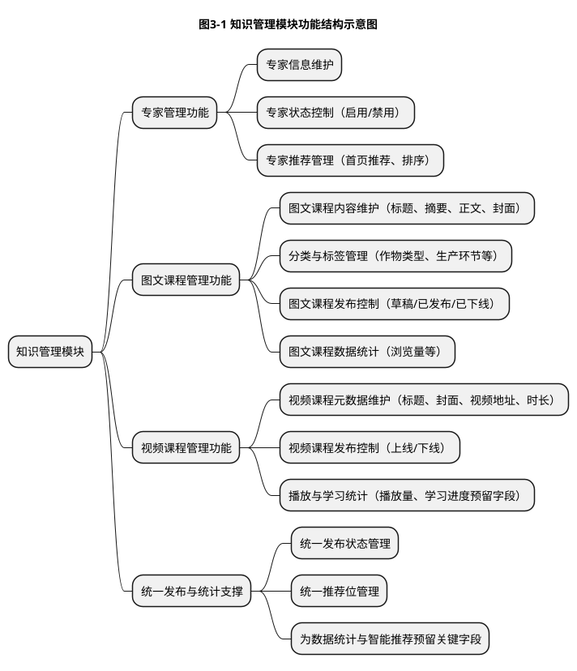


---

## 【学习目标】

### 【知识目标】

- **掌握 Spring Boot 核心理念与自动配置机制**，理解“约定优于配置”的设计思想。
- **熟悉 Spring Boot 项目结构与常用配置**，能够基于 Maven 快速搭建后端项目骨架。
- **掌握 Spring Boot 与 MyBatis 的整合方式**，理解数据源配置、Mapper 扫描、事务管理等关键知识点。
- **理解 RESTful 风格接口设计原则与统一响应封装模式**，掌握常见返回结果结构的设计与实现方法。
- **了解 AI 在代码审查与质量保障中的应用思路**，能在实践中尝试利用 AI 工具进行代码评审、性能分析和安全检测。

### 【能力目标】

- **项目搭建能力**：能够独立使用 Spring Initializr 或 Maven 手工配置，搭建一个可运行的 Spring Boot 项目。
- **模块实现能力**：能够基于已有数据表结构，设计并实现专家、图文课程、视频课程等相关实体、Mapper、Service、Controller 层代码。
- **接口设计与调试能力**：能够设计并实现符合 RESTful 风格的接口，完成增删改查、分页查询、条件筛选等典型业务操作，并借助 Postman/浏览器完成接口调试。
- **问题排查与调优能力**：能够初步使用日志、断点调试和 AI 工具定位错误，针对常见性能问题提出优化思路。
- **工程规范意识**：能够在开发中遵守统一响应规范、异常处理规范和代码命名规范，提高代码可读性与可维护性。

### 【素质目标】

- **工程化思维**：理解从“需求—设计—实现—测试—优化”的完整开发闭环，养成面向工程的开发习惯。
- **规范意识与责任感**：认识到统一响应、统一异常处理、日志记录等“看似繁琐”的工程实践，实际上是保障系统稳定性与可维护性的关键。
- **持续学习与创新精神**：在掌握 Spring Boot 基础用法的同时，主动探索 AI 工具在代码生成、审查、重构等环节的应用，形成面向未来的软件开发能力。
- **服务“三农”的使命意识**：在知识管理模块开发过程中，时刻思考如何让系统更加贴近农民的使用习惯和学习需求，让技术真正服务于乡村振兴。

---

## 【知识储备】

在正式实现知识管理模块前，建议读者先补充和复习以下知识点。

### 3.1 SpringBoot核心理念

为便于读者形成整体认知，本节涉及的 Spring Boot 核心理念可概括为“核心能力三角”，如图3-2所示。

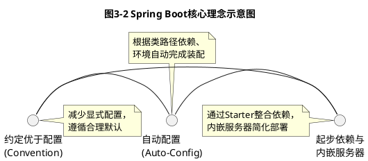


#### 3.1.1 约定优于配置（Convention over Configuration）

传统 Java Web 项目往往需要大量 XML 配置才能启动，一个简单功能可能涉及多份配置文件。Spring Boot 的核心思想之一是**“约定优于配置”**：在大多数场景下，框架提供合理的默认约定，开发者只需在少数地方进行显式配置。

- **默认包结构**：约定应用主类所在包为根包，子包中的组件（Controller、Service、Repository 等）可自动扫描。
- **默认配置文件**：约定使用 `application.properties` 或 `application.yml` 作为全局配置文件。
- **默认端口与上下文路径**：默认使用 8080 端口，对应根上下文路径 `/`，如有需要再进行覆盖配置。

通过遵循这些约定，开发者可以**更专注于业务逻辑实现**，大幅降低样板代码与配置工作量。

#### 3.1.2 自动配置（Auto-Configuration）

Spring Boot 通过自动配置机制，根据当前类路径中存在的依赖、用户的自定义配置等信息，自动完成大量配置工作。例如：

- 当类路径中存在 `spring-boot-starter-web` 时，自动配置内嵌 Tomcat、Spring MVC、JSON 序列化等组件。
- 当检测到 `spring-boot-starter-jdbc` 和数据库驱动时，自动配置数据源和 JdbcTemplate。

在知识管理模块中，我们主要依赖：

- `spring-boot-starter-web`（提供 Web 与 REST 接口能力）
- `mybatis-spring-boot-starter`（整合 MyBatis 框架）
- `mysql-connector-j`（连接 MySQL 数据库）

掌握自动配置原理有助于理解“项目为什么能跑起来”，并在出现配置冲突或异常时，更快定位问题原因。

#### 3.1.3 起步依赖（Starter）与内嵌服务器

Spring Boot 引入“起步依赖（Starter）”的概念，将一组常用依赖整合成一个统一坐标，避免开发者手动选择多个零散依赖。例如：

- `spring-boot-starter-web`：封装了 Spring MVC、Jackson、Tomcat 等。
- `spring-boot-starter-test`：封装了 JUnit、Mockito 等常用测试库。

同时，Spring Boot 提供内嵌服务器（如 Tomcat、Jetty），使应用以**独立可执行 JAR** 的形式运行，无需额外部署到外部服务器。这对教学项目和中小型应用尤为便利。

---

### 3.2 SpringBoot项目结构与全局配置

知识管理模块在项目中的典型包结构如图3-3所示。本图采用简化的 UML 包图形式，仅展示各层包及其依赖关系，便于在教材中紧凑呈现。

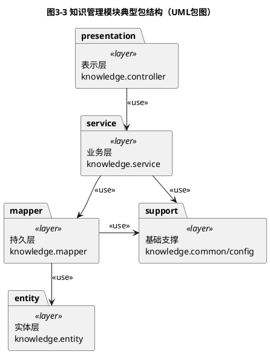


#### 3.2.1 典型项目结构

在本项目中，我们沿用典型的 Spring Boot 四层架构，知识管理模块相关代码将分布在如下包结构中（示例）：

- `controller`：对外暴露 REST 接口，如 `ExpertController`、`NbGraphicCourseController`、`NbVideoCourseController`。
- `service` / `service.impl`：封装业务逻辑，如 `ExpertService` 及其实现。
- `mapper`：数据访问接口，定义与数据库交互的方法。
- `entity` 或 `domain`：实体类，映射数据库表。
- `config`：全局配置类，如 MyBatis 配置、全局异常处理等。
- `common`：封装统一响应类 `Result`、分页对象 `PageResult`、全局枚举等。

清晰的包结构有助于模块划分和职能分离，是工程化项目中长期维护的基础。

#### 3.2.2 全局配置文件 `application.yml`

本项目推荐使用 `application.yml` 作为全局配置文件，主要配置内容包括：

- **服务基础配置**：如端口号、应用名称。
- **数据源配置**：包括数据库 URL、用户名、密码、连接池参数等。
- **MyBatis 配置**：Mapper 扫描路径、日志输出、驼峰命名映射等。
- **其他组件配置**：如日志级别、文件上传限制等。

在知识管理模块中，正确配置数据源和 MyBatis 映射，是保证专家、图文课程、视频课程数据能被成功读写的前提。

**【配置示例】知识管理模块 `application.yml` 完整配置**

下面给出本项目知识管理模块实际使用的 `application.yml` 配置文件示例，该配置文件位于项目的 `src/main/resources` 目录下：

```yaml
# 服务器配置
server:
  port: 80                    # 服务端口号，默认8080，这里改为80便于访问
  servlet:
    context-path: /           # 应用上下文路径，默认为根路径

# Spring Boot 应用配置
spring:
  application:
    name: nbspringproduct     # 应用名称，用于服务注册与日志标识

  # 数据源配置
  datasource:
    driver-class-name: com.mysql.cj.jdbc.Driver
    url: jdbc:mysql://localhost:3306/nb_database?useUnicode=true&characterEncoding=utf8&zeroDateTimeBehavior=convertToNull&useSSL=false&serverTimezone=GMT%2B8&allowPublicKeyRetrieval=true
    username: root            # 数据库用户名（实际部署时应使用专用账号）
    password: root            # 数据库密码（实际部署时应加密存储）

  # JSON序列化配置
  jackson:
    date-format: yyyy-MM-dd HH:mm:ss    # 日期格式化模板
    time-zone: GMT+8                     # 时区设置
    serialization:
      write-dates-as-timestamps: false   # 日期不转为时间戳

  # 文件上传配置
  servlet:
    multipart:
      enabled: true           # 启用文件上传
      max-file-size: 10MB     # 单个文件最大10MB
      max-request-size: 50MB  # 单次请求最大50MB

# MyBatis-Plus 配置
mybatis-plus:
  configuration:
    log-impl: org.apache.ibatis.logging.stdout.StdOutImpl  # 控制台输出SQL日志
    map-underscore-to-camel-case: true  # 数据库下划线字段自动映射为驼峰命名
  global-config:
    db-config:
      id-type: auto           # 主键自增策略
      logic-delete-field: deleted        # 逻辑删除字段名
      logic-delete-value: 1              # 逻辑删除值（已删除）
      logic-not-delete-value: 0          # 逻辑未删除值（正常）
  mapper-locations: classpath*:mapper/**/*.xml    # Mapper XML文件位置
  type-aliases-package: com.movie.nbspringproduct.entity  # 实体类扫描包

# 日志配置
logging:
  level:
    com.movie.nbspringproduct: debug     # 项目代码日志级别为debug
    org.springframework: warn            # Spring框架日志级别为warn
```

**配置说明：**

1. **数据源配置**是整个模块运行的基础，URL 中的参数 `serverTimezone=GMT%2B8` 解决了 MySQL 8.0+ 时区问题。
2. **MyBatis-Plus 配置**中的 `map-underscore-to-camel-case: true` 使得数据库字段 `expert_name` 可自动映射为实体类属性 `expertName`，无需手工转换。
3. **日志配置**在开发阶段建议设置为 `debug`，便于排查 SQL 执行与参数绑定问题；生产环境应调整为 `info` 或 `warn`。
4. 相比项目二中需要分别编写 `web.xml`、`applicationContext.xml`、`mybatis-config.xml` 等多个配置文件，Spring Boot 将所有配置集中在一个 YAML 文件中，极大简化了配置管理。

基于本书项目二与本章实现，SSM 框架与 Spring Boot 在本项目中的对比如表3-2所示。

**表3-2 本项目中 SSM 与 Spring Boot 实现对比**

| 对比维度       | 项目二：SSM 实现                                             | 项目三：Spring Boot 实现                                         |
|----------------|--------------------------------------------------------------|------------------------------------------------------------------|
| 项目结构       | 多个 XML 配置文件分散在 `web.xml`、`applicationContext.xml`、`springmvc.xml`、`mybatis-config.xml` 等处 | 约定优于配置，核心配置集中在 `application.yml`，启动类负责组件扫描 |
| 依赖管理       | 通过 Maven 引入 Spring、SpringMVC、MyBatis 及相关依赖       | 通过 `spring-boot-starter-*` 起步依赖一次性引入 Web、测试等组件  |
| 启动与运行方式 | 部署到外部容器（如 Tomcat），通过 `war` 包运行               | 内嵌 Tomcat，打包为可执行 `jar` 直接运行                         |
| 配置复杂度     | 需手工编写大量 XML，分别配置数据源、事务、映射器扫描等       | 依靠自动配置与约定，大幅减少显式配置，仅在个别地方覆盖默认值     |
| 适用场景       | 适合维护大量存量 SSM 项目，帮助理解 Spring 体系底层机制     | 适合新项目快速搭建，提升开发效率与可维护性                       |

---

### 3.3 SpringBoot整合MyBatis与事务管理

#### 3.3.1 MyBatis-SpringBoot整合思路

在传统项目中，整合 MyBatis 往往需要手动配置 SqlSessionFactory、MapperScanner 等组件。Spring Boot 通过 `mybatis-spring-boot-starter`，简化了整合过程，主要步骤包括：

- 在 `pom.xml` 中引入 `mybatis-spring-boot-starter` 依赖。
- 在全局配置中指定数据源和 MyBatis 基本配置。
- 使用 `@Mapper` 注解标记 Mapper 接口，或在启动类配置 `@MapperScan` 扫描路径。
- 使用 `@Select`、`@Insert` 等注解或 XML 方式编写 SQL 语句。

在知识管理模块中，我们可以为每个业务实体（如专家、课程）编写对应的 Mapper 接口与 SQL 映射，实现增删改查与分页查询等功能。

#### 3.3.2 事务管理与数据一致性

知识管理模块涉及多个表之间的关联操作，例如：

- 删除某位专家时，需要同步处理其关联的图文课程与视频课程的专家字段。
- 批量上下线课程时，需要一次性更新多条记录的发布状态。

为保证数据一致性，需要使用 Spring 的声明式事务管理：

- 在 Service 层方法上使用 `@Transactional` 注解，确保一组数据库操作**要么全部成功，要么全部回滚**。
- 合理划分事务边界，避免在 Controller 层直接操作 Mapper。

事务管理体现了工程化开发中的“可靠性”要求，是保障后台管理数据正确性的关键。知识管理模块中 Controller、Service、Mapper 与数据库在事务场景下的交互过程如图3-4所示。

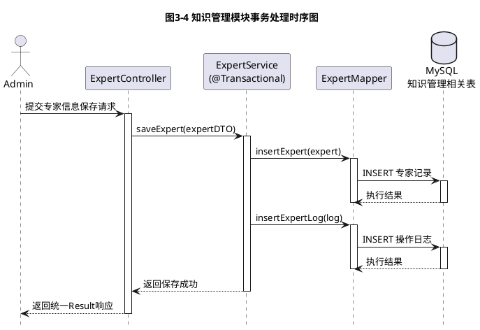


---

### 3.4 SpringBoot接口开发与统一响应

#### 3.4.1 RESTful 接口设计原则

为方便前端调用与后续维护，知识管理模块的接口遵循 RESTful 设计原则，其前端、接口层与服务层的交互关系如图3-5所示。常见 URL 示例如下：

- `GET /api/yjnb/expert/list`：分页查询专家列表。
- `POST /api/yjnb/expert`：新增专家。
- `PUT /api/yjnb/expert`：修改专家信息。
- `DELETE /api/yjnb/expert/{ids}`：删除专家（支持批量）。
- `POST /api/yjnb/graphicCourse/publish`：发布图文课程（批量）。
- `POST /api/yjnb/videoCourse/unpublish`：取消发布视频课程（批量）。

接口设计需关注：

- **语义清晰**：方法与 URL 表达的含义尽量直观。
- **参数规范**：路径参数、查询参数、请求体参数合理划分。
- **状态码合理**：区分成功（200/201）、客户端错误（400/404）、权限错误（401/403）、服务器错误（500）等。


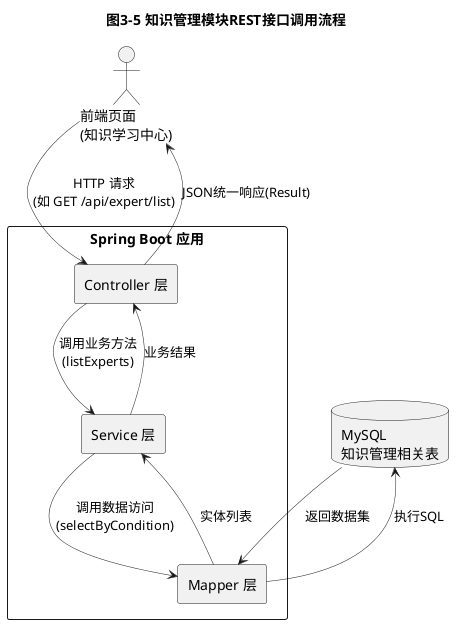

#### 3.4.2 统一响应封装

为提高前后端协作效率，减少前端判断逻辑，本项目统一使用 `Result<T>` 结构封装响应数据，典型字段包括：

- `code`：状态码，如 200 表示成功，其他表示不同错误类型。
- `msg`：提示消息，用于人类可读的结果说明。
- `data`：实际返回的数据载体，可以是单个对象、列表或分页对象。

统一响应结构的组成关系如图3-6所示。

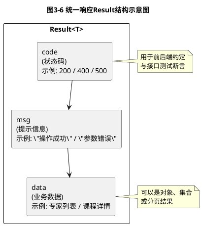


统一响应的好处：

- 降低前端对于不同接口返回结构差异的适配成本。
- 为错误处理、国际化提示、日志记录等提供统一入口。
- 有利于后续接入网关、监控平台实现统一管理。

**【价值思考】规范意识与团队协作**

统一响应封装看似是技术细节，实则体现了软件开发中的规范意识和团队协作精神。在"农宝"平台的知识管理模块中，如果专家、图文课程、视频课程三个子模块的接口返回格式不一致，前端就需要为每个接口编写不同的解析逻辑，不仅增加工作量，更容易产生错误。通过统一响应封装，我们不仅提升了代码可维护性，更重要的是培养了"站在团队整体角度思考问题"的协作意识，这种意识在与产品、测试等不同角色协作时都是不可或缺的职业素养。

#### 3.4.3 全局异常处理与校验

在知识管理模块中，常见异常场景包括：

- 参数校验失败（如必填字段为空、格式不正确）。
- 数据不存在（如根据 id 查询专家失败）。
- 业务约束冲突（如删除仍在使用的课程）。
- 数据库异常（如唯一索引冲突）。

推荐使用 Spring 的 `@RestControllerAdvice` + `@ExceptionHandler` 机制，实现全局异常捕获与统一错误响应；结合 `@Valid`、`@NotBlank` 等注解，实现入参的自动校验，从源头减少错误。

**【代码示例】全局异常处理器实现**

下面给出全局异常处理器的完整实现代码，该类可统一处理系统中的各类异常：

```java
package com.movie.nbspringproduct.config;

import com.movie.nbspringproduct.common.Result;
import lombok.extern.slf4j.Slf4j;
import org.springframework.validation.BindException;
import org.springframework.validation.FieldError;
import org.springframework.web.bind.MethodArgumentNotValidException;
import org.springframework.web.bind.annotation.ExceptionHandler;
import org.springframework.web.bind.annotation.RestControllerAdvice;

import java.util.stream.Collectors;

/**
 * 全局异常处理器
 * 统一捕获并处理系统中的各类异常，返回友好的错误信息
 */
@Slf4j                          // Lombok注解：自动生成日志对象log
@RestControllerAdvice           // 全局Controller增强，用于异常处理
public class GlobalExceptionHandler {

    /**
     * 处理参数校验异常（@Valid注解触发）
     * 当使用@RequestBody接收参数且校验失败时抛出此异常
     */
    @ExceptionHandler(MethodArgumentNotValidException.class)
    public Result<Void> handleValidException(MethodArgumentNotValidException e) {
        // 提取所有字段错误信息，拼接为友好提示
        String errorMsg = e.getBindingResult().getFieldErrors().stream()
                .map(FieldError::getDefaultMessage)
                .collect(Collectors.joining("; "));
        
        log.warn("参数校验失败：{}", errorMsg);
        return Result.error(400, "参数校验失败：" + errorMsg);
    }

    /**
     * 处理参数绑定异常（表单提交或URL参数校验失败）
     */
    @ExceptionHandler(BindException.class)
    public Result<Void> handleBindException(BindException e) {
        String errorMsg = e.getBindingResult().getFieldErrors().stream()
                .map(error -> error.getField() + ": " + error.getDefaultMessage())
                .collect(Collectors.joining("; "));
        
        log.warn("参数绑定失败：{}", errorMsg);
        return Result.error(400, "参数错误：" + errorMsg);
    }

    /**
     * 处理空指针异常
     */
    @ExceptionHandler(NullPointerException.class)
    public Result<Void> handleNullPointerException(NullPointerException e) {
        log.error("空指针异常", e);
        return Result.error(500, "系统内部错误：空指针异常");
    }

    /**
     * 处理非法参数异常
     */
    @ExceptionHandler(IllegalArgumentException.class)
    public Result<Void> handleIllegalArgumentException(IllegalArgumentException e) {
        log.warn("非法参数：{}", e.getMessage());
        return Result.error(400, "参数错误：" + e.getMessage());
    }

    /**
     * 处理自定义业务异常（需自行定义BusinessException类）
     * 示例：当专家不存在、课程已下线等业务场景时抛出
     */
    @ExceptionHandler(RuntimeException.class)
    public Result<Void> handleBusinessException(RuntimeException e) {
        log.error("业务异常：{}", e.getMessage(), e);
        return Result.error(500, e.getMessage());
    }

    /**
     * 处理所有未捕获的异常（兜底处理）
     */
    @ExceptionHandler(Exception.class)
    public Result<Void> handleException(Exception e) {
        log.error("系统异常", e);
        return Result.error(500, "系统繁忙，请稍后再试");
    }
}
```

**代码说明：**

1. **`@RestControllerAdvice`** 注解标记该类为全局异常处理器，可捕获所有 Controller 中抛出的异常。
2. **`@ExceptionHandler`** 注解用于指定该方法处理哪种类型的异常，可以定义多个方法分别处理不同异常。
3. **参数校验异常处理**：当使用 `@Valid` 或 `@Validated` 注解进行参数校验时，校验失败会抛出 `MethodArgumentNotValidException`，处理器会提取所有字段的错误信息并返回。
4. **异常优先级**：Spring 会按照异常的继承关系，优先匹配最具体的异常类型。例如 `NullPointerException` 会优先被其专属处理方法捕获，而不是被 `Exception` 处理方法捕获。
5. **日志记录**：所有异常都会记录日志，便于后续排查问题。生产环境应避免在响应中暴露详细的堆栈信息，防止信息泄露。

**使用示例：**

在 Controller 中使用参数校验注解：

```java
@PostMapping
public Result<Void> add(@Valid @RequestBody NbExpert expert) {
    // 如果expert对象中的字段不满足校验规则，会自动抛出异常
    // 全局异常处理器会捕获并返回友好的错误信息
    return expertService.insertExpert(expert) > 0 ? 
            Result.success("新增成功") : Result.error("新增失败");
}
```

在实体类中添加校验注解：

```java
@Data
@TableName("nb_expert")
public class NbExpert extends BaseEntity {
    
    @NotBlank(message = "专家姓名不能为空")
    private String name;
    
    @NotBlank(message = "专业领域不能为空")
    private String specialty;
    
    @Pattern(regexp = "^1[3-9]\\d{9}$", message = "手机号格式不正确")
    private String phone;
    
    @Email(message = "邮箱格式不正确")
    private String email;
}
```

当前端提交的数据不满足校验规则时，全局异常处理器会自动捕获并返回类似以下响应：

```json
{
    "code": 400,
    "msg": "参数校验失败：专家姓名不能为空; 手机号格式不正确",
    "data": null
}
```

通过全局异常处理机制，可以大幅减少 Controller 中的 try-catch 代码，使业务逻辑更加清晰，同时保证所有异常都能得到统一、规范的处理。

全局异常处理的工作流程如图3-7所示。

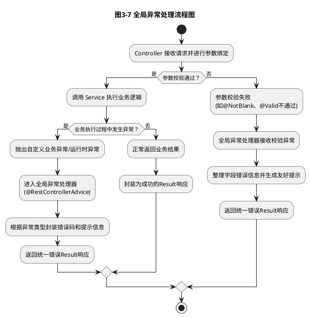


---

### 3.5 AI辅助代码审查与质量保证

在 AI 工具日益成熟的背景下，代码审查与质量保障不再完全依赖人工，本项目鼓励读者尝试在以下环节引入 AI 工具：

- **命名规范检查**：让 AI 审阅实体类、Service、Mapper、Controller 等命名是否清晰、统一，并给出改进建议。
- **重复代码识别**：将相似的 CRUD 代码片段交给 AI，识别可抽取的公共逻辑，减少重复实现。
- **潜在逻辑缺陷检测**：请 AI 帮助检查条件分支、事务边界、异常处理是否存在遗漏。
- **性能与安全建议**：让 AI 对分页查询、批量操作、日志打印等方面进行初步性能评估，并识别可能的安全隐患（如直接暴露内部 ID、缺乏权限校验等）。

【价值思考】AI 辅助下的代码质量提升

AI 工具不能替代开发者的专业判断，但能在审查与优化阶段提供“第二双眼睛”。在知识管理模块的开发中，借助 AI 进行代码走查，不仅能提升当下模块的质量，更能帮助你养成良好的编码风格和质量意识。

在实践中，知识管理模块及其承载的持续学习资源，本身也是提升农民与基层管理人员数字素养的重要载体，有助于培养“懂农业、爱农村、爱农民”的新型数字人才，服务乡村振兴战略。同时，在使用 AI 工具和处理专家知识、课程内容的过程中，必须时刻保持对数据安全、隐私保护和知识产权的尊重与敬畏，自觉践行软件工程师的职业伦理与社会责任。

---

## 任务一：实现知识管理模块专家列表功能

### 【任务描述】

本任务中，你将基于 Spring Boot 与 MyBatis，实现知识管理模块中**专家列表管理**功能，主要包括：

- 专家信息的新增、修改、删除。
- 专家列表的分页查询与条件筛选（按姓名、领域、职称、状态等）。
- 专家启用/禁用、推荐/取消推荐的状态管理。

通过本任务，你将从零开始实现一个完整的后台管理子功能，体验 Spring Boot 在实际业务场景中的具体用法。专家列表页面的典型界面布局与交互流程如图3-10和图3-11所示。

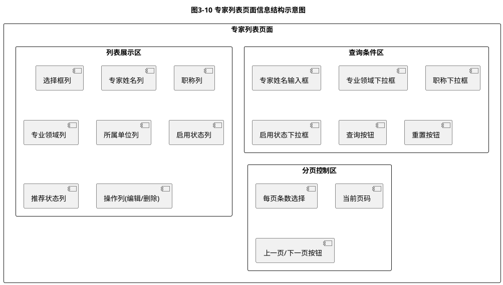


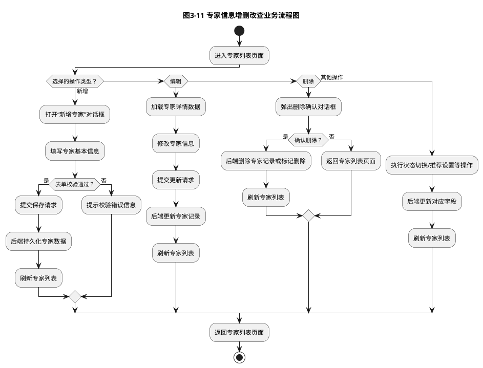


### 【任务分析】

结合前两章的需求分析与数据库设计，专家管理功能的核心要点包括：

- **管理对象**：农业专家，主要字段包括姓名、性别、职称、所属单位、专业领域、简介、头像 URL、启用状态、推荐状态、排序值、创建时间、更新时间等。
- **操作主体**：后台系统管理员与内容运营人员。
- **典型业务操作**：
  - 录入新专家信息；
  - 修改专家基本资料或简介；
  - 控制专家是否在前端展示（启用/禁用）；
  - 设置首页推荐专家（推荐/取消推荐）；
  - 按条件查询专家列表，并支持分页展示。

从技术实现角度看，本任务涉及：

- 实体类与数据表字段的映射设计；
- Mapper 接口与 SQL 语句编写；
- Service 层业务逻辑封装；
- Controller 层 REST 接口定义与统一响应封装；
- 分页查询与条件组合过滤实现。

### 【实现步骤】

1. **确认数据表结构**  
   - 根据数据库设计文档，查看专家表（如 `nb_expert`）的字段定义，确认主键、索引、状态字段等信息。  
   - 若表尚未创建，可根据设计文档编写建表 SQL，并在 MySQL 中执行。

2. **编写实体类与 Mapper 接口**  
   - 在 `entity` 包中新建 `Expert` 实体类，字段与数据库表一一对应，并补充必要的注释。  
   - 在 `mapper` 包中新建 `ExpertMapper` 接口，定义基础 CRUD 方法及分页查询方法。  
   - 使用 XML 或注解方式编写对应 SQL，注意条件查询中对可选字段（姓名、领域等）的判空处理。

3. **实现 Service 层逻辑**  
   - 在 `service` 包中新建 `ExpertService` 接口及其实现类 `ExpertServiceImpl`。  
   - 封装新增、修改、删除、分页查询、启用/禁用、推荐/取消推荐等方法。  
   - 在需要的地方添加事务控制，如批量状态更新操作。

4. **编写 Controller 层接口**  
   - 在 `controller` 包中新建 `ExpertController`，定义 RESTful 接口路径（如 `/api/expert`）。  
   - 为每个业务操作设计对应的 HTTP 方法与路径，统一使用 `Result` 进行响应封装。  
   - 适当使用参数校验注解（如 `@NotBlank`、`@NotNull`），并结合全局异常处理输出友好错误信息。

5. **接口调试与文档整理**  
   - 使用 Postman 或浏览器测试专家列表各接口的正确性，包括正常流程与异常场景。  
   - 根据测试结果完善接口文档，明确请求参数、返回数据结构及示例，方便前端同学对接。

### 【核心代码示例】

为帮助读者更好地理解专家管理功能的实现细节，下面给出各层的核心代码示例。

#### 1. 实体类 `NbExpert.java`

实体类用于映射数据库表结构，本项目使用 Lombok 注解简化 getter/setter 等样板代码：

```java
package com.movie.nbspringproduct.entity;

import com.baomidou.mybatisplus.annotation.IdType;
import com.baomidou.mybatisplus.annotation.TableId;
import com.baomidou.mybatisplus.annotation.TableName;
import com.movie.nbspringproduct.common.BaseEntity;
import lombok.Data;
import lombok.EqualsAndHashCode;

/**
 * 专家实体类
 * 对应数据库表 nb_expert
 */
@Data                                    // Lombok注解：自动生成getter/setter/toString等方法
@EqualsAndHashCode(callSuper = true)     // 继承父类的equals和hashCode
@TableName("nb_expert")                  // MyBatis-Plus注解：指定对应的数据库表名
public class NbExpert extends BaseEntity {
    
    /**
     * 主键ID（使用UUID策略）
     */
    @TableId(type = IdType.ASSIGN_UUID)
    private String id;
    
    /**
     * 专家姓名
     */
    private String name;
    
    /**
     * 专家头像URL
     */
    private String avatar;
    
    /**
     * 专业领域（如：水稻种植、畜牧养殖等）
     */
    private String specialty;
    
    /**
     * 职称（如：高级农艺师、教授等）
     */
    private String title;
    
    /**
     * 所属机构
     */
    private String organization;
    
    /**
     * 联系电话
     */
    private String phone;
    
    /**
     * 电子邮箱
     */
    private String email;
    
    /**
     * 个人简介
     */
    private String introduction;
    
    /**
     * 服务次数（统计字段）
     */
    private Integer serviceCount;
    
    /**
     * 评分（预留字段，用于后续评价功能）
     */
    private String rating;
    
    /**
     * 状态（0-不可用 1-可用）
     */
    private Integer status;
}
```

**代码说明：**

- `@Data` 注解由 Lombok 提供，可自动生成 getter、setter、toString、equals、hashCode 等方法，大幅减少样板代码。
- `@TableName` 注解指定实体类对应的数据库表名，MyBatis-Plus 会自动完成字段映射。
- `BaseEntity` 是公共父类，通常包含 `createTime`、`updateTime`、`createBy`、`updateBy` 等通用字段。
- 字段命名采用驼峰风格，配合 `application.yml` 中的 `map-underscore-to-camel-case: true`，可自动映射数据库的下划线命名字段。

#### 2. Mapper 接口 `NbExpertMapper.java`

Mapper 接口定义数据访问方法，本项目使用 MyBatis-Plus 提供的 `BaseMapper`，自动提供基础 CRUD 方法：

```java
package com.movie.nbspringproduct.mapper;

import com.baomidou.mybatisplus.core.mapper.BaseMapper;
import com.movie.nbspringproduct.entity.NbExpert;
import org.apache.ibatis.annotations.Mapper;

/**
 * 专家Mapper接口
 * 继承MyBatis-Plus的BaseMapper，自动获得单表CRUD能力
 */
@Mapper
public interface NbExpertMapper extends BaseMapper<NbExpert> {
    
    // BaseMapper已提供以下方法，无需手工编写：
    // - insert(T entity)：插入一条记录
    // - deleteById(Serializable id)：根据ID删除
    // - updateById(T entity)：根据ID更新
    // - selectById(Serializable id)：根据ID查询
    // - selectList(Wrapper<T> queryWrapper)：条件查询列表
    // - selectPage(Page<T> page, Wrapper<T> queryWrapper)：分页查询
    
    // 如需自定义复杂查询，可在此处声明方法，并在对应的XML文件中编写SQL
}
```

**代码说明：**

- `@Mapper` 注解标记该接口为 MyBatis 的 Mapper，Spring Boot 启动时会自动扫描并注册。
- 继承 `BaseMapper<NbExpert>` 后，无需编写任何 SQL，即可获得单表的增删改查能力。
- 若需要复杂查询（如多表关联、动态 SQL），可在接口中声明方法，并在 `resources/mapper/NbExpertMapper.xml` 中编写对应 SQL。

#### 3. Controller 接口 `NbExpertController.java`

Controller 层负责接收前端请求、调用 Service 层业务逻辑、返回统一响应结果：

```java
package com.movie.nbspringproduct.controller;

import com.movie.nbspringproduct.common.Result;
import com.movie.nbspringproduct.entity.NbExpert;
import com.movie.nbspringproduct.service.INbExpertService;
import org.springframework.beans.factory.annotation.Autowired;
import org.springframework.web.bind.annotation.*;

import java.util.List;

/**
 * 专家管理Controller
 * 提供专家信息的增删改查RESTful接口
 */
@RestController                          // 组合注解：@Controller + @ResponseBody
@RequestMapping("/api/yjnb/expert")  // 接口统一前缀
public class NbExpertController {
    
    @Autowired
    private INbExpertService expertService;
    
    /**
     * 查询专家列表
     * 支持按条件筛选（姓名、专业领域、职称、状态等）
     * 
     * @param expert 查询条件对象（字段为空则不作为筛选条件）
     * @return 专家列表及总记录数
     */
    @GetMapping("/list")
    public Result<List<NbExpert>> list(NbExpert expert) {
        List<NbExpert> list = expertService.selectExpertList(expert);
        return Result.success(list, (long) list.size());
    }
    
    /**
     * 获取专家详细信息
     * 
     * @param id 专家ID
     * @return 专家详情对象
     */
    @GetMapping("/{id}")
    public Result<NbExpert> getInfo(@PathVariable("id") String id) {
        return Result.success(expertService.selectExpertById(id));
    }
    
    /**
     * 新增专家
     * 
     * @param expert 专家信息对象（JSON格式）
     * @return 操作结果
     */
    @PostMapping
    public Result<Void> add(@RequestBody NbExpert expert) {
        return expertService.insertExpert(expert) > 0 ? 
                Result.success("新增成功") : Result.error("新增失败");
    }
    
    /**
     * 修改专家信息
     * 
     * @param expert 专家信息对象（必须包含id字段）
     * @return 操作结果
     */
    @PutMapping
    public Result<Void> edit(@RequestBody NbExpert expert) {
        return expertService.updateExpert(expert) > 0 ? 
                Result.success("修改成功") : Result.error("修改失败");
    }
    
    /**
     * 删除专家（支持批量删除）
     * 
     * @param ids 专家ID数组（多个ID用逗号分隔）
     * @return 操作结果
     */
    @DeleteMapping("/{ids}")
    public Result<Void> remove(@PathVariable String[] ids) {
        return expertService.deleteExpertByIds(ids) > 0 ? 
                Result.success("删除成功") : Result.error("删除失败");
    }
}
```

**代码说明：**

- `@RestController` 组合了 `@Controller` 和 `@ResponseBody`，表示该类中所有方法的返回值都会自动序列化为 JSON 格式。
- `@RequestMapping` 定义接口路径前缀，所有方法的路径都会拼接在此前缀之后。
- `@GetMapping`、`@PostMapping`、`@PutMapping`、`@DeleteMapping` 分别对应 RESTful 风格的查询、新增、修改、删除操作。
- `@PathVariable` 用于接收 URL 路径中的参数，如 `/expert/123` 中的 `123`。
- `@RequestBody` 用于接收前端提交的 JSON 数据，Spring Boot 会自动将 JSON 反序列化为 Java 对象。
- 所有接口统一使用 `Result<T>` 封装响应，保证前后端数据结构一致。

#### 4. 统一响应类 `Result.java`

统一响应类用于封装所有接口的返回结果，包括状态码、提示消息和业务数据：

```java
package com.movie.nbspringproduct.common;

import lombok.Data;
import java.io.Serializable;

/**
 * 通用响应结果类
 * 用于统一封装所有接口的返回数据格式
 */
@Data
public class Result<T> implements Serializable {

    private static final long serialVersionUID = 1L;

    /**
     * 状态码（200-成功 500-失败 其他根据业务定义）
     */
    private Integer code;

    /**
     * 返回消息（用于前端提示）
     */
    private String msg;

    /**
     * 返回数据（泛型，可以是对象、列表等）
     */
    private T data;

    /**
     * 总记录数（分页查询时使用）
     */
    private Long total;

    /**
     * 列表数据（分页查询时使用）
     */
    private T rows;

    // 构造方法
    public Result() {}

    public Result(Integer code, String msg) {
        this.code = code;
        this.msg = msg;
    }

    public Result(Integer code, String msg, T data) {
        this.code = code;
        this.msg = msg;
        this.data = data;
    }

    /**
     * 成功响应（无数据）
     */
    public static <T> Result<T> success() {
        return new Result<>(200, "操作成功");
    }

    /**
     * 成功响应（带消息）
     */
    public static <T> Result<T> success(String msg) {
        return new Result<>(200, msg);
    }

    /**
     * 成功响应（带数据）
     */
    public static <T> Result<T> success(T data) {
        Result<T> result = new Result<>(200, "操作成功");
        result.setData(data);
        return result;
    }

    /**
     * 分页成功响应
     */
    public static <T> Result<T> success(T rows, Long total) {
        Result<T> result = new Result<>(200, "查询成功");
        result.setRows(rows);
        result.setTotal(total);
        return result;
    }

    /**
     * 失败响应（默认500错误）
     */
    public static <T> Result<T> error() {
        return new Result<>(500, "操作失败");
    }

    /**
     * 失败响应（带消息）
     */
    public static <T> Result<T> error(String msg) {
        return new Result<>(500, msg);
    }

    /**
     * 失败响应（自定义状态码和消息）
     */
    public static <T> Result<T> error(Integer code, String msg) {
        return new Result<>(code, msg);
    }
}
```

**代码说明：**

- `Result<T>` 使用泛型设计，可以适配不同类型的业务数据。
- 提供多个静态工厂方法（`success()`、`error()` 等），方便在 Controller 中快速构造响应对象。
- `rows` 和 `total` 字段专门用于分页查询场景，前端可根据 `total` 计算总页数。
- 通过统一响应结构，前端只需判断 `code` 字段即可知道请求是否成功，无需针对不同接口编写不同的解析逻辑。

通过以上四段核心代码，专家管理功能的基本骨架已经搭建完成。读者可以在此基础上，参考 Service 层的业务逻辑实现（如条件查询、事务控制等），完成完整的功能开发。

### 【常见问题与调试】

在实现专家管理功能的过程中，初学者常会遇到一些典型问题。本节汇总常见错误及解决方案，帮助读者快速排查和解决问题。

#### 问题1：启动报错 `Failed to configure a DataSource`

**错误现象：**

应用启动时控制台输出类似以下错误信息：

```
***************************
APPLICATION FAILED TO START
***************************

Description:

Failed to configure a DataSource: 'url' attribute is not specified and no embedded datasource could be configured.

Reason: Failed to determine a suitable driver class
```

**原因分析：**

Spring Boot 检测到项目中引入了数据库相关依赖（如 `mybatis-spring-boot-starter`），但在 `application.yml` 中未正确配置数据源信息，或配置格式有误。

**解决方案：**

1. 检查 `application.yml` 中的数据源配置是否完整，必须包含以下四项：
   ```yaml
   spring:
     datasource:
       driver-class-name: com.mysql.cj.jdbc.Driver
       url: jdbc:mysql://localhost:3306/nb_database?serverTimezone=GMT%2B8
       username: root
       password: root
   ```

2. 确认 MySQL 数据库已启动，且数据库 `nb_database` 已创建。

3. 检查 `pom.xml` 中是否引入了 MySQL 驱动依赖：
   ```xml
   <dependency>
       <groupId>com.mysql</groupId>
       <artifactId>mysql-connector-j</artifactId>
       <scope>runtime</scope>
   </dependency>
   ```

4. 若暂时不需要数据库功能，可在启动类上添加注解排除数据源自动配置：
   ```java
   @SpringBootApplication(exclude = {DataSourceAutoConfiguration.class})
   ```

#### 问题2：Mapper 接口找不到，报错 `No qualifying bean of type 'xxxMapper'`

**错误现象：**

启动成功，但访问接口时报错：

```
No qualifying bean of type 'com.movie.nbspringproduct.mapper.NbExpertMapper' available
```

**原因分析：**

Spring Boot 未能扫描到 Mapper 接口，导致无法注入到 Service 中。

**解决方案：**

1. **方案一**：在每个 Mapper 接口上添加 `@Mapper` 注解：
   ```java
   @Mapper
   public interface NbExpertMapper extends BaseMapper<NbExpert> {
   }
   ```

2. **方案二**：在启动类上使用 `@MapperScan` 注解，统一扫描指定包下的所有 Mapper：
   ```java
   @SpringBootApplication
   @MapperScan("com.movie.nbspringproduct.mapper")
   public class NbSpringProductApplication {
       public static void main(String[] args) {
           SpringApplication.run(NbSpringProductApplication.class, args);
       }
   }
   ```

3. 确认 Mapper 接口所在包路径与 `@MapperScan` 配置一致。

#### 问题3：事务不生效，数据未回滚

**错误现象：**

在 Service 方法上添加了 `@Transactional` 注解，但当方法中某个数据库操作失败时，前面已执行的操作并未回滚。

**原因分析：**

常见原因包括：

- 异常被 `try-catch` 捕获后未重新抛出。
- 抛出的异常类型不是 `RuntimeException` 或 `Error`（默认情况下 Spring 事务只对这两类异常回滚）。
- 方法调用方式不正确（如类内部直接调用，未经过 Spring 代理）。

**解决方案：**

1. 确保异常能够正常抛出，不要在 Service 方法中捕获异常后不做处理：
   ```java
   @Transactional
   public void saveExpert(NbExpert expert) {
       expertMapper.insert(expert);
       // 如果这里发生异常，会自动回滚
       logMapper.insertLog(log);
   }
   ```

2. 若需要捕获异常进行处理，必须在处理后重新抛出：
   ```java
   @Transactional
   public void saveExpert(NbExpert expert) {
       try {
           expertMapper.insert(expert);
           logMapper.insertLog(log);
       } catch (Exception e) {
           log.error("保存专家失败", e);
           throw e;  // 必须重新抛出，否则事务不会回滚
       }
   }
   ```

3. 若抛出的是受检异常（Checked Exception），需在 `@Transactional` 注解中显式指定：
   ```java
   @Transactional(rollbackFor = Exception.class)
   public void saveExpert(NbExpert expert) throws Exception {
       // ...
   }
   ```

4. 避免在同一个类内部直接调用事务方法，应通过注入的 Service 对象调用。

#### 问题4：分页查询返回空列表或数据不正确

**错误现象：**

调用分页查询接口，返回的 `rows` 为空列表，或者 `total` 为 0，但数据库中确实有数据。

**原因分析：**

- 查询条件构造错误，导致 SQL 无法匹配到数据。
- 分页插件未正确配置或未生效。
- 字段映射问题，数据库字段名与实体类属性名不一致。

**解决方案：**

1. 开启 SQL 日志输出，查看实际执行的 SQL 语句：
   ```yaml
   mybatis-plus:
     configuration:
       log-impl: org.apache.ibatis.logging.stdout.StdOutImpl
   ```

2. 检查查询条件构造逻辑，确认条件字段是否正确：
   ```java
   QueryWrapper<NbExpert> wrapper = new QueryWrapper<>();
   if (StringUtils.isNotBlank(expert.getName())) {
       wrapper.like("name", expert.getName());  // 确认字段名正确
   }
   ```

3. 确认 MyBatis-Plus 分页插件已配置：
   ```java
   @Configuration
   public class MybatisPlusConfig {
       @Bean
       public MybatisPlusInterceptor mybatisPlusInterceptor() {
           MybatisPlusInterceptor interceptor = new MybatisPlusInterceptor();
           interceptor.addInnerInterceptor(new PaginationInnerInterceptor(DbType.MYSQL));
           return interceptor;
       }
   }
   ```

4. 检查实体类字段与数据库字段的映射关系，确保 `map-underscore-to-camel-case: true` 已配置。

#### 问题5：接口返回 404 Not Found

**错误现象：**

使用 Postman 访问接口时，返回 404 错误，提示路径不存在。

**原因分析：**

- 接口路径拼写错误。
- Controller 类未被 Spring 扫描到。
- 端口号或上下文路径配置错误。

**解决方案：**

1. 检查 Controller 类上的注解是否正确：
   ```java
   @RestController
   @RequestMapping("/api/yjnb/expert")
   public class NbExpertController {
   }
   ```

2. 确认 Controller 类所在包在启动类的扫描范围内（通常启动类所在包及其子包会自动扫描）。

3. 检查 `application.yml` 中的端口和上下文路径配置：
   ```yaml
   server:
     port: 80
     servlet:
       context-path: /
   ```

4. 确认 Postman 中的请求 URL 与实际配置一致，例如：
   ```
   GET http://localhost:80/api/yjnb/expert/list
   ```

5. 查看启动日志，确认接口映射是否成功：
   ```
   Mapped "{[/api/yjnb/expert/list],methods=[GET]}" onto public Result list(NbExpert)
   ```

通过以上常见问题的排查与解决，读者可以更加顺利地完成专家管理功能的开发与调试。在实际开发中，养成"看日志、查配置、验证 SQL"的调试习惯，能够大幅提高问题定位效率。

**【价值思考】工匠精神与持续改进**

在软件开发中，从"数据源配置失败"到"事务不生效"，从"分页查询返回空"到"接口返回 404"，每一个问题的解决都需要开发者具备耐心细致的排查能力和持续改进的学习态度。在知识管理模块的开发中，反复调试接口、查看日志、验证 SQL 的过程看似枯燥，但正是这种"不放过任何一个细节"的工匠精神，才能保证系统的稳定性和可靠性。当农民使用"农宝"平台学习农业知识时，我们的每一个细节把控都直接关系到用户体验。同时，问题解决的过程也是能力提升的过程，每一次成功解决 bug，不仅掌握了新的排查技巧，更重要的是培养了面对困难不退缩、持续学习不满足的职业品格。

### 【AI辅助环节】

#### AI代码审查和潜在bug识别

- 将 `ExpertController`、`ExpertServiceImpl` 与 `ExpertMapper` 中的核心代码提交给 AI，让其从以下维度进行审查：
  - 是否存在空指针风险；
  - 条件判断是否完整，是否存在边界情况遗漏；
  - 状态字段（启用/禁用、推荐）是否在所有业务路径中保持一致性。
- 请 AI 帮助识别可能的逻辑错误，例如：
  - 删除专家时未校验其是否与课程存在关联；
  - 分页查询中未处理页码越界问题。

#### 性能瓶颈智能分析和优化建议

- 将分页查询 SQL 与对应的 Mapper 方法交给 AI，请其分析是否存在全表扫描、模糊查询过多等性能隐患。  
- 请 AI 根据专家表字段和查询条件，给出索引优化建议，例如对常用筛选字段（如领域、状态）建立合适的联合索引。  
- 让 AI 对批量状态更新操作提出优化建议，如使用单条 SQL 进行批量更新，减少数据库往返次数。

#### 安全漏洞检测和修复方案推荐

- 请 AI 帮忙检查接口是否存在以下安全隐患：
  - 是否存在越权访问的可能（如未对关键操作校验用户权限）；  
  - 是否在日志中打印了敏感信息（如完整请求体、数据库错误堆栈等）；  
  - 是否存在基于 ID 的不安全暴露（如可通过遍历 ID 获取全部数据）。  
- 根据 AI 的反馈，完善权限校验、敏感信息脱敏与异常处理策略。

---

## 任务二：实现知识管理模块图文课程功能

### 【任务描述】

在本任务中，你将实现知识管理模块中的**图文课程管理**功能。主要目标包括：

- 图文课程内容的增删改查；
- 课程分类管理（通过 `category` 字段实现）；
- 课程的发布/下线、推荐/取消推荐控制；
- 支持按标题、讲师、分类、发布状态等条件进行查询。

图文课程是农民学习农业技术的重要入口，后台管理的易用性与内容结构的合理性，将直接影响农民的学习体验。

### 【任务分析】

从业务角度看，图文课程具备以下特点：

- **结构化内容**：包含标题（`title`）、讲师（`teacher`）、简介（`resume`）、正文内容（`content`）、封面图（`image`）等信息；  
- **清晰分类**：通过 `category` 字段按作物类型、生产环节、技术主题等进行分类，以便农民快速找到所需内容；  
- **状态多样**：通过 `publishStatus` 字段控制发布状态（0-未发布 1-已发布），通过 `recommend` 字段控制是否推荐到首页；  
- **更新频繁**：根据生产季节与政策变化，课程内容需要及时更新或下线。

从技术实现角度，图文课程管理与专家管理在总体结构上类似，但在字段和业务规则上略有差异，需要重点考虑：

- 富文本内容存储：正文通常为 HTML 或 Markdown 格式，需要使用合适字段类型存储。  
- 内容长度与性能：正文较长时，应注意查询接口中是否需要返回全文，或通过“列表接口返回摘要+详情接口返回全文”的方式优化性能。  
- 数据一致性：发布/下线操作对前端展示与统计有直接影响，需要确保状态更新准确。

### 【实现步骤】

1. **确认图文课程数据模型**  
   - 根据数据库设计文档检查图文课程表结构（如 `nb_graphic_course`），字段包括标题、摘要、内容、分类、标签、封面图、状态、推荐标记、浏览量、创建时间等。  
   - 若尚未创建数据表，则根据设计文档在 MySQL 中执行建表 SQL。

2. 编写实体类与 Mapper  
   - 在 `entity` 包中新建 `NbGraphicCourse` 实体类，字段与数据表保持一致。  
   - 在 `mapper` 包中新建 `NbGraphicCourseMapper`，实现基础 CRUD 和分页查询方法。  
   - 根据业务需求编写 SQL，实现按标题、分类、状态等条件的组合查询。

3. **实现 Service 层业务逻辑**  
   - 在 `service` 包中新建 `NbGraphicCourseService` 接口及实现类，封装课程新增、编辑、删除、发布/下线、推荐/取消推荐等逻辑。  
   - 对于发布流程，可设计简单规则：只有状态为草稿的课程才能发布，已发布课程才能下线等。

4. **设计 Controller 接口**  
   - 在 `controller` 包中新建 `NbGraphicCourseController`，定义接口路径（如 `/api/graphicCourse`）。  
   - 实现分页查询接口（列表页）与单条查询接口（详情页），合理控制返回字段，避免列表接口返回完整正文导致不必要的网络开销。  
   - 所有接口使用统一响应结构 `Result` 封装。

5. **接口调试与功能联动**  
   - 使用 Postman 测试添加、编辑、删除、发布等接口流程是否符合预期。  
   - 若前端页面已部分完成，可与前端同学进行联调，检查返回数据结构与字段命名的一致性。

### 【AI辅助环节】

图文课程的发布流程可抽象为图3-8所示。

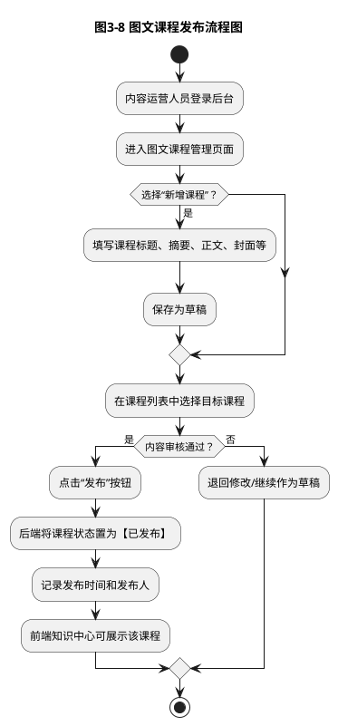


#### AI驱动的异常处理机制生成

- 将常见异常场景（如发布不存在的课程、删除已发布课程、标题为空等）描述给 AI，请其帮助设计合理的异常类型与错误码。  
- 请 AI 生成初版的全局异常处理类模板，并根据项目实际情况进行适当调整。  
- 让 AI 帮助梳理图文课程相关方法的异常抛出与捕获策略，保证错误信息准确易懂。

#### 智能日志记录策略建议

- 将图文课程增删改查等关键业务方法示例代码提供给 AI，请其评估当前日志打印是否合理（包括日志级别、日志内容、敏感信息处理等）。  
- 请 AI 给出一套适用于知识管理模块的日志记录规范，如：
  - 哪些操作需要记录操作人和操作时间；  
  - 哪些字段在日志中需要脱敏；  
  - 如何设置日志级别（INFO/DEBUG/WARN/ERROR）。  

#### 代码可读性评估和改进提示

- 将 `NbGraphicCourseServiceImpl` 与 `NbGraphicCourseController` 交给 AI，请其从"命名规范、方法长度、注释充分性、职责单一性"等角度提出改进建议。  
- 根据 AI 建议对复杂方法进行重构，如拆分为多个私有方法，增强可读性与可维护性。

### 【接口测试实战】

完成图文课程管理功能的代码编写后，需要进行系统的接口测试，验证功能的正确性与健壮性。本节以 Postman 为例，演示如何测试图文课程管理的核心接口。

#### 测试环境准备

1. **启动 Spring Boot 应用**：确保应用已成功启动，控制台无报错信息。
2. **打开 Postman 工具**：建议使用 Postman 桌面版或 Web 版。
3. **确认接口基础 URL**：根据 `application.yml` 配置，本项目的接口前缀为 `http://localhost:80/api/yjnb`。

#### 测试用例1：新增图文课程

**接口信息：**

- **请求方法**：POST
- **请求路径**：`http://localhost:80/api/yjnb/graphicCourse`
- **请求头**：`Content-Type: application/json`
- **请求体**（JSON 格式）：

```json
{
    "title": "水稻病虫害防治技术",
    "teacher": "张教授",
    "resume": "详细介绍水稻常见病虫害的识别与防治方法",
    "content": "<p>水稻是我国主要粮食作物之一，病虫害防治是保证产量的关键...</p>",
    "image": "https://example.com/images/rice-pest.jpg",
    "category": "种植技术",
    "publishStatus": 0,
    "recommend": 0
}
```

**预期响应**（成功）：

```json
{
    "code": 200,
    "msg": "新增成功",
    "data": null
}
```

**预期响应**（参数校验失败）：

若 `title` 字段为空，应返回：

```json
{
    "code": 400,
    "msg": "参数校验失败：课程标题不能为空",
    "data": null
}
```

**测试要点：**

- 验证必填字段校验是否生效（如标题、摘要等）。
- 验证数据是否成功插入数据库（可通过查询接口或直接查看数据库）。
- 验证返回的状态码和提示信息是否符合预期。

#### 测试用例2：分页查询图文课程列表

**接口信息：**

- **请求方法**：GET
- **请求路径**：`http://localhost:80/api/yjnb/graphicCourse/list?title=水稻`
- **请求参数**：
  - `title`：课程标题关键字（可选，模糊查询）
  - `teacher`：讲师姓名（可选）
  - `category`：分类（可选）
  - `publishStatus`：发布状态（可选，0-未发布 1-已发布）

**预期响应**：

```json
{
    "code": 200,
    "msg": "查询成功",
    "rows": [
        {
            "id": "1",
            "title": "水稻病虫害防治技术",
            "teacher": "张教授",
            "resume": "详细介绍水稻常见病虫害的识别与防治方法",
            "image": "https://example.com/images/rice-pest.jpg",
            "category": "种植技术",
            "publishStatus": 0,
            "recommend": 0,
            "browseNum": 0,
            "createTime": "2024-12-02 10:30:00"
        }
    ],
    "total": 1
}
```

**测试要点：**

- 验证分页功能是否正常（修改 `pageNum` 和 `pageSize` 参数）。
- 验证模糊查询是否生效（输入标题关键字）。
- 验证组合条件查询（同时传入 `title`、`category`、`status` 等参数）。
- 验证空结果场景（查询不存在的课程）。

#### 测试用例3：获取图文课程详情

**接口信息：**

- **请求方法**：GET
- **请求路径**：`http://localhost:80/api/yjnb/graphicCourse/1`
- **路径参数**：`1` 为课程 ID

**预期响应**（成功）：

```json
{
    "code": 200,
    "msg": "操作成功",
    "data": {
        "id": "1",
        "title": "水稻病虫害防治技术",
        "teacher": "张教授",
        "resume": "详细介绍水稻常见病虫害的识别与防治方法",
        "content": "<p>水稻是我国主要粮食作物之一，病虫害防治是保证产量的关键...</p>",
        "image": "https://example.com/images/rice-pest.jpg",
        "category": "种植技术",
        "publishStatus": 0,
        "recommend": 0,
        "browseNum": 0,
        "createTime": "2024-12-02 10:30:00"
    }
}
```

**预期响应**（课程不存在）：

```json
{
    "code": 500,
    "msg": "课程不存在",
    "data": null
}
```

**测试要点：**

- 验证正常查询是否返回完整的课程信息（包括正文内容）。
- 验证不存在的课程 ID 是否返回友好的错误提示。

#### 测试用例4：修改图文课程

**接口信息：**

- **请求方法**：PUT
- **请求路径**：`http://localhost:80/api/yjnb/graphicCourse`
- **请求头**：`Content-Type: application/json`
- **请求体**：

```json
{
    "id": "1",
    "title": "水稻病虫害综合防治技术（修订版）",
    "resume": "详细介绍水稻常见病虫害的识别与综合防治方法",
    "publishStatus": 1
}
```

**预期响应**：

```json
{
    "code": 200,
    "msg": "修改成功",
    "data": null
}
```

**测试要点：**

- 验证部分字段更新是否生效（只传入需要修改的字段）。
- 验证 ID 不存在时的错误提示。
- 验证修改后通过详情接口查询，数据是否已更新。

#### 测试用例5：删除图文课程

**接口信息：**

- **请求方法**：DELETE
- **请求路径**：`http://localhost:80/api/yjnb/graphicCourse/1,2,3`
- **路径参数**：支持批量删除，多个 ID 用逗号分隔

**预期响应**：

```json
{
    "code": 200,
    "msg": "删除成功",
    "data": null
}
```

**测试要点：**

- 验证单个删除和批量删除是否正常。
- 验证删除后通过列表接口查询，数据是否已移除。
- 验证删除不存在的课程时的错误提示。

#### 测试用例6：发布图文课程

**接口信息：**

- **请求方法**：POST
- **请求路径**：`http://localhost:80/api/yjnb/graphicCourse/publish`
- **请求头**：`Content-Type: application/json`
- **请求体**：课程 ID 数组（支持批量发布）

```json
["1", "2", "3"]
```

**预期响应**：

```json
{
    "code": 200,
    "msg": "发布成功",
    "data": null
}
```

**测试要点：**

- 验证发布操作是否将课程状态更新为"已发布"（`publishStatus` 设为 1）。
- 验证批量发布功能是否正常。
- 验证发布不存在的课程时的错误提示。

#### 异常场景测试

除了正常流程测试，还应覆盖以下异常场景：

1. **参数缺失**：不传必填字段，验证校验提示是否友好。
2. **参数类型错误**：传入错误的数据类型（如 `status` 传入字符串而非数字）。
3. **SQL 注入测试**：在查询参数中尝试注入 SQL 语句，验证是否被正确过滤。
4. **并发操作**：同时发起多个修改请求，验证数据一致性。
5. **边界值测试**：测试分页参数的边界值（如 `pageNum=0`、`pageSize=-1`）。

#### 测试结果记录

建议使用表格记录测试结果，示例如下：

| 测试用例 | 请求方法 | 请求路径 | 预期结果 | 实际结果 | 是否通过 |
|---------|---------|---------|---------|---------|---------|
| 新增图文课程 | POST | /graphicCourse | 返回200，新增成功 | 返回200，新增成功 | ✅ |
| 分页查询列表 | GET | /graphicCourse/list | 返回分页数据 | 返回分页数据 | ✅ |
| 获取课程详情 | GET | /graphicCourse/1 | 返回完整课程信息 | 返回完整课程信息 | ✅ |
| 修改课程信息 | PUT | /graphicCourse | 返回200，修改成功 | 返回200，修改成功 | ✅ |
| 删除课程 | DELETE | /graphicCourse/1 | 返回200，删除成功 | 返回200，删除成功 | ✅ |
| 参数校验失败 | POST | /graphicCourse | 返回400，校验失败提示 | 返回400，校验失败提示 | ✅ |

通过系统的接口测试，可以及早发现代码中的逻辑错误、边界问题和异常处理不足，确保图文课程管理功能的稳定性与可靠性。

---

## 任务三：实现知识管理模块视频课程功能

### 【任务描述】

本任务将引导你实现知识管理模块中的**视频课程管理**功能，主要包括：

- 视频课程基本信息的管理（标题、封面、视频地址、时长等）；  
- 视频课程的发布/下线、推荐设置；  
- 支持按标题、分类、难度、状态等条件的分页查询；  
- 为后续统计分析预留播放量、收藏量等字段。

视频课程通过生动直观的方式，将农业知识传递给农民，是知识管理模块中极具影响力的内容形态。

### 【任务分析】

与图文课程相比，视频课程具有以下技术特点：

- **文件存储与引用分离**：视频文件通常存储在对象存储服务或专用视频平台，后台数据库主要保存视频 URL、封面 URL 等元信息。  
- **播放统计需求**：需预留播放量、点赞量、收藏量等字段，为后续数据分析与推荐算法提供输入。  
- **带宽与性能要求**：虽然后台管理侧主要操作元数据，但需要考虑前端在高并发播放场景下的访问压力，合理设计接口调用频率和缓存策略。

在后台知识管理模块中，我们主要关注**元数据管理与发布控制**，而视频文件的上传与转码可在后续项目中进一步扩展。

### 【实现步骤】

1. **确定视频课程数据模型**  
   - 检查数据库中视频课程表结构（`nb_video_course`），字段包括标题（`title`）、讲师（`teacher`）、简介（`resume`）、介绍（`content`）、封面图（`image`）、视频链接（`videoUrl`）、时长（`duration`）、分类（`category`）、发布状态（`publishStatus`）、推荐状态（`recommend`）、浏览量（`browseNum`）、创建时间等。  
   - 若表尚未创建，参考图文课程与需求分析文档，编写建表 SQL 并执行。

2. **编写实体类与 Mapper**  
   - 在 `entity` 包中新建 `NbVideoCourse` 实体类，对应视频课程表各字段。  
   - 在 `mapper` 包中新建 `NbVideoCourseMapper`，继承 `BaseMapper<NbVideoCourse>`，自动获得基础 CRUD 能力。  
   - 特别注意对浏览量等统计字段的更新方式，可为后续统计模块预留合适接口。

3. **实现 Service 层业务逻辑**  
   - 在 `service` 包中新建 `INbVideoCourseService` 接口及实现类，封装新增、编辑、删除、发布/取消发布、推荐/取消推荐、浏览量更新等业务方法。  
   - 对敏感操作（如删除课程）制定合理规则，避免误删影响已上线业务。

4. **设计 Controller 接口**  
   - 在 `controller` 包中新建 `NbVideoCourseController`，定义统一接口前缀（`/api/yjnb/videoCourse`）。  
   - 实现视频课程列表查询、详情查询、新增、编辑、删除、发布/取消发布、推荐/取消推荐等接口。  
   - 返回结构参照统一响应规范，便于前后端一致性维护。

5. **联动测试与数据预置**  
   - 使用 Postman 等工具测试所有接口的正确性与鲁棒性。  
   - 可在数据库中预置若干典型视频课程数据，用于前端页面联调与展示。

### 【AI辅助环节】

视频课程在后台管理端的预览播放与后台元数据更新关系如图3-9所示。

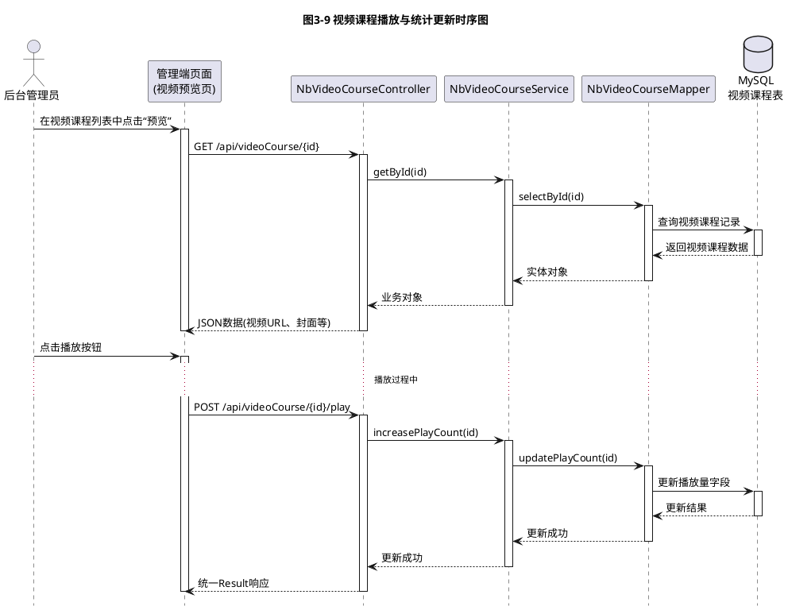


#### AI辅助API文档自动生成

- 将各 Controller 中的接口定义（包括方法注释、参数说明）提供给 AI，请其辅助生成结构化 API 文档，包括：
  - 接口路径与方法；  
  - 请求参数（含示例）；  
  - 响应结构与字段说明；  
  - 典型请求/响应示例。  
- 根据生成的文档进行人工复核，确保描述准确、术语统一。

#### 接口测试用例智能创建

- 请 AI 根据视频课程功能需求与接口说明，生成覆盖“正常流程、边界条件、异常场景”的接口测试用例列表。  
- 结合生成的用例使用 Postman 或自动化测试框架逐项验证，提升测试覆盖率。

#### 性能测试场景AI推荐

- 将视频课程访问特点（浏览高峰时段、前端请求频率等）描述给 AI，请其设计适合的性能测试场景，如并发访问量、压测持续时间等。  
- 根据 AI 提供的建议，使用合适的工具（如 JMeter）对关键接口（如课程列表查询）进行简单性能测试，为后续性能优化提供数据基础。

---

## 【代码复用与重构实践】

完成专家管理、图文课程管理、视频课程管理三个子模块后，细心的读者会发现，这三个模块在代码结构和业务逻辑上存在大量相似之处。本节将引导读者识别重复代码，并通过合理的抽象与重构，提升代码的可维护性与复用性。

### 相似性分析

三个模块在以下方面高度相似：

| 维度 | 专家管理 | 图文课程管理 | 视频课程管理 |
|------|---------|-------------|-------------|
| **基础 CRUD 操作** | 增删改查 | 增删改查 | 增删改查 |
| **分页查询** | 支持条件筛选 + 分页 | 支持条件筛选 + 分页 | 支持条件筛选 + 分页 |
| **状态管理** | 启用/禁用 | 发布/下线 | 发布/下线 |
| **推荐功能** | 首页推荐 | 首页推荐 | 首页推荐 |
| **统计字段** | 服务次数、评分 | 浏览量 | 播放量 |
| **响应封装** | 统一使用 `Result<T>` | 统一使用 `Result<T>` | 统一使用 `Result<T>` |
| **异常处理** | 全局异常处理器 | 全局异常处理器 | 全局异常处理器 |

### 重复代码识别

以 Controller 层为例，三个模块的代码结构几乎完全一致：

```java
// 专家Controller
@GetMapping("/list")
public Result<List<NbExpert>> list(NbExpert expert) {
    List<NbExpert> list = expertService.selectExpertList(expert);
    return Result.success(list, (long) list.size());
}

// 图文课程Controller
@GetMapping("/list")
public Result<List<NbGraphicCourse>> list(NbGraphicCourse course) {
    List<NbGraphicCourse> list = graphicCourseService.selectGraphicCourseList(course);
    return Result.success(list, (long) list.size());
}

// 视频课程Controller
@GetMapping("/list")
public Result<List<NbNbVideoCourse>> list(NbNbVideoCourse course) {
    List<NbNbVideoCourse> list = videoCourseService.selectNbVideoCourseList(course);
    return Result.success(list, (long) list.size());
}
```

可以看到，除了实体类型不同，业务逻辑完全相同，这正是需要重构的信号。

### 重构方案一：抽取公共 BaseService

对于通用的 CRUD 操作，可以定义一个泛型 `BaseService` 接口：

```java
package com.movie.nbspringproduct.service;

import java.util.List;

/**
 * 通用Service接口
 * 定义常见的CRUD方法，减少重复代码
 * 
 * @param <T> 实体类型
 */
public interface BaseService<T> {
    
    /**
     * 根据ID查询
     */
    T selectById(String id);
    
    /**
     * 查询列表
     */
    List<T> selectList(T entity);
    
    /**
     * 新增
     */
    int insert(T entity);
    
    /**
     * 修改
     */
    int update(T entity);
    
    /**
     * 删除
     */
    int deleteByIds(String[] ids);
}
```

各个具体的 Service 接口继承 `BaseService`，并添加特有的业务方法：

```java
public interface INbExpertService extends BaseService<NbExpert> {
    
    /**
     * 专家特有方法：查询专家列表
     */
    List<NbExpert> selectExpertList(NbExpert expert);
}

public interface INbGraphicCourseService extends BaseService<NbGraphicCourse> {
    
    /**
     * 图文课程特有方法：批量发布课程
     */
    int publishGraphicCourse(String[] ids);
}
```

### 重构方案二：抽取公共 BaseController

对于 Controller 层的通用接口，可以定义一个抽象的 `BaseController`：

```java
package com.movie.nbspringproduct.controller;

import com.movie.nbspringproduct.common.Result;
import com.movie.nbspringproduct.service.BaseService;
import org.springframework.beans.factory.annotation.Autowired;
import org.springframework.web.bind.annotation.*;

import java.util.List;

/**
 * 通用Controller基类
 * 提供常见的CRUD接口，子类只需继承即可获得基础能力
 * 
 * @param <T> 实体类型
 * @param <S> Service类型
 */
public abstract class BaseController<T, S extends BaseService<T>> {
    
    @Autowired
    protected S baseService;
    
    /**
     * 查询列表
     */
    @GetMapping("/list")
    public Result<List<T>> list(T entity) {
        List<T> list = baseService.selectList(entity);
        return Result.success(list, (long) list.size());
    }
    
    /**
     * 获取详情
     */
    @GetMapping("/{id}")
    public Result<T> getInfo(@PathVariable("id") String id) {
        return Result.success(baseService.selectById(id));
    }
    
    /**
     * 新增
     */
    @PostMapping
    public Result<Void> add(@RequestBody T entity) {
        return baseService.insert(entity) > 0 ? 
                Result.success("新增成功") : Result.error("新增失败");
    }
    
    /**
     * 修改
     */
    @PutMapping
    public Result<Void> edit(@RequestBody T entity) {
        return baseService.update(entity) > 0 ? 
                Result.success("修改成功") : Result.error("修改失败");
    }
    
    /**
     * 删除
     */
    @DeleteMapping("/{ids}")
    public Result<Void> remove(@PathVariable String[] ids) {
        return baseService.deleteByIds(ids) > 0 ? 
                Result.success("删除成功") : Result.error("删除失败");
    }
}
```

具体的 Controller 只需继承 `BaseController`，并添加特有的接口：

```java
@RestController
@RequestMapping("/api/yjnb/expert")
public class NbExpertController extends BaseController<NbExpert, INbExpertService> {
    
    // 基础CRUD接口已由父类提供，无需重复编写
    
    /**
     * 专家特有接口：推荐专家（示例，实际项目可扩展）
     */
    @PostMapping("/recommend")
    public Result<Void> recommend(@RequestBody String[] ids) {
        // 具体实现可参考图文课程的推荐功能
        return Result.success("推荐成功");
    }
}
```

### 重构方案三：使用 MyBatis-Plus 的通用 Mapper

本项目已使用 MyBatis-Plus 的 `BaseMapper`，它提供了丰富的单表 CRUD 方法，无需手工编写 SQL。各个 Mapper 只需继承 `BaseMapper` 即可：

```java
@Mapper
public interface NbExpertMapper extends BaseMapper<NbExpert> {
    // 自动获得 insert、deleteById、updateById、selectById、selectList 等方法
    // 只需添加复杂查询的自定义方法
}
```

### 重构收益分析

通过抽取公共基类，可以获得以下收益：

1. **代码量大幅减少**：三个模块的 Controller 代码从每个约 100 行减少到约 20 行，减少 80% 的重复代码。
2. **维护成本降低**：当需要修改通用逻辑（如统一响应格式、日志记录）时，只需修改基类，所有子类自动生效。
3. **一致性保证**：所有模块的接口风格、参数校验、异常处理保持一致，降低前端对接成本。
4. **扩展性增强**：新增其他管理模块（如政策管理、补贴管理）时，只需继承基类，快速实现基础功能。

### 重构注意事项

1. **不要过度抽象**：只抽取真正通用的逻辑，避免为了复用而强行抽象，导致代码难以理解。
2. **保留特殊逻辑**：各模块的特有业务逻辑（如专家服务次数统计、课程发布审核）应保留在各自的 Service 和 Controller 中。
3. **注意泛型边界**：使用泛型时要明确类型约束，避免运行时类型转换错误。
4. **团队协作**：重构前应与团队成员沟通，确保大家理解重构意图和新的代码结构。

### AI 辅助重构建议

可以请 AI 帮助识别重复代码并提供重构建议：

- 将三个模块的 Controller 代码提交给 AI，请其识别相似之处并给出抽象方案。
- 请 AI 评估重构后的代码是否符合"单一职责原则"和"开闭原则"。
- 让 AI 帮助生成重构后的单元测试用例，确保重构不影响原有功能。

通过本节的学习，读者不仅掌握了知识管理模块的具体实现，更重要的是培养了"识别重复、合理抽象、持续重构"的工程化思维，这是成为优秀软件工程师的必备素质。

---

## 【扩展学习：Lombok与Java代码简化】

在知识管理模块开发过程中，你会频繁编写实体类与 DTO 类，这些类通常包含大量的 getter/setter、构造方法、`toString` 等样板代码。为提高开发效率与代码可读性，可以引入 **Lombok** 工具。

通过在类或字段上添加注解，Lombok 能在编译期自动生成对应方法，例如：

- `@Getter` / `@Setter`：自动生成 getter 与 setter 方法；  
- `@Data`：一次性生成 getter、setter、`toString`、`equals`、`hashCode` 等；  
- `@Builder`：支持构建者模式创建对象；  
- `@NoArgsConstructor` / `@AllArgsConstructor`：生成无参/全参构造方法。

**注意事项：**

- Lombok 需要在 IDE 中安装插件，并在 `pom.xml` 中添加依赖；  
- 在使用 `@Data` 时，应注意避免在有循环依赖的对象之间产生不必要的 `toString` 调用；  
- 在团队协作中应达成共识，统一是否使用 Lombok 及其使用规范。

通过合理使用 Lombok，可以显著减少样板代码，让开发者把注意力更多集中在业务逻辑实现上。

---

## 【知识拓展】

在掌握知识管理模块的基础实现之后，读者可以从以下几个维度进一步拓展 Spring Boot 的应用深度：

- **运维与监控增强**：了解并尝试集成 Spring Boot Actuator，对知识管理模块的健康状况、接口调用情况、数据库连接状态等进行监控，为后续的性能优化与故障排查提供基础数据支撑。  
- **安全控制与权限管理**：结合项目四的系统管理功能，预习 Spring Security 或其他安全框架的基本用法，思考如何为知识管理模块的专家维护、课程发布等敏感操作增加角色权限控制。  
- **缓存与性能优化**：以专家列表、课程列表等高频查询接口为例，尝试引入 Redis 等缓存中间件，设计合理的缓存颗粒度与失效策略，在保证数据一致性的前提下提升响应速度。  
- **API 文档与前后端协同**：在现有统一响应与异常处理机制基础上，继续学习 SpringDoc/OpenAPI 等工具，为知识管理模块生成机器可读的接口文档，降低前后端联调成本。

通过这些拓展实践，读者可以从“会写 Spring Boot 模块”逐步走向“能设计、会运维、懂性能”的更高层次。

## 【答疑解惑】

**1. 知识管理模块与传统的 CMS（内容管理系统）有什么区别？**  
二者在“内容维护 + 发布控制”层面有相似之处，但本项目的知识管理模块更加聚焦农业场景下的专家、图文课程、视频课程等结构化知识资产，强调服务对象是农民与基层管理人员，并与后续的数据统计、推荐服务形成联动，而不仅仅是通用的文章管理。

**2. 为什么不直接在视频课程表中存储视频文件本身？**  
从工程实践看，大容量视频文件通常托管在对象存储或专业视频平台中，数据库只负责存储视频的 URL、封面、时长等元数据。这样既能减轻数据库存储压力，又便于后续进行内容分发、转码、CDN 加速等处理，更符合生产环境的部署习惯。

**3. 知识管理模块的包结构是否必须与示例完全一致？**  
不必须。示例给出的是一种“清晰、适合教学”的划分方式，实际项目中可以根据团队习惯进行微调，例如引入 `dto`、`vo`、`converter` 等包。但无论如何调整，**表现层—业务层—数据访问层**职责明确的分层思想应保持不变，这是保证系统可维护性的关键。

**4. 在本项目中使用 AI 工具进行代码审查，会不会削弱自己的编码能力？**  
关键在于使用方式：如果只是机械接受 AI 提示而不加思考，确实可能形成依赖；但如果将 AI 的反馈视为“代码评审意见”，主动分析其理由、取其精华、去其糟粕，反而能更快发现自身盲区，加速编码规范和工程思维的成长。AI 应当成为提升个人能力的“助推器”，而不是替代专业判断的“拐杖”。

---

## 【项目小结】

本项目以“知识管理模块”为载体，带领读者完成了从**需求场景理解 → Spring Boot 核心知识掌握 → 模块代码实现 → AI 辅助质量保障**的完整学习路径。通过专家管理、图文课程管理、视频课程管理三个子任务，你不仅掌握了 Spring Boot 整合 MyBatis、编写 RESTful 接口与统一响应的实战方法，也初步体验了 AI 工具在代码审查、异常处理设计、日志规范制定与性能测试场景规划中的辅助价值。

在“农宝”平台整体架构中，知识管理模块不仅是一个功能子系统，更是连接农业专家知识与农民实际需求的关键桥梁。通过本项目的学习，你将具备使用 Spring Boot 快速构建业务模块的能力，并在实践中逐步形成工程化思维与质量意识，为后续更复杂的系统进阶功能开发奠定扎实基础。

---

## 【习题】

1. **简答题**  
   （1）简述 Spring Boot “约定优于配置”的核心思想，并结合本项目知识管理模块举一个具体示例。  
   （2）说明在知识管理模块中为什么需要统一响应封装？统一响应结构中通常包含哪些字段？  
   （3）在专家管理功能中，为什么建议将业务逻辑放在 Service 层而不是 Controller 层？请从工程化开发角度给出理由。

2. **分析题**  
   假设当前系统中专家表数据已经较多，后台管理员反馈“按专家姓名模糊搜索时响应速度较慢”。请分析可能原因，并给出至少两种优化方案（可以从数据库索引、SQL 语句、分页策略等方面进行思考）。

3. **设计题**  
   （1）为图文课程管理功能设计一组 RESTful 接口（包括 URL、HTTP 方法、主要参数），要求覆盖新增、编辑、删除、发布/下线、分页查询等操作。  
   （2）为视频课程表设计字段列表，至少包括业务必需字段和统计相关字段，并说明每个字段的作用。

4. **实践题**  
   （1）在你的项目中实现专家列表分页查询接口，并使用 Postman 完成以下测试：  
   - 正常分页查询（指定页码与每页记录数）；  
   - 仅按姓名关键字查询；  
   - 姓名与领域组合查询；  
   - 页码超出范围时的处理结果。  
   （2）选取你编写的一个 Service 实现类，将其核心代码交给 AI 工具，请求 AI 从“命名规范、逻辑完整性、异常处理、性能隐患”等角度进行审查，并依据 AI 的反馈完成一轮代码优化。

通过完成以上习题，你将进一步巩固对 Spring Boot 知识管理模块的理解与掌握，为后续章节中更复杂的系统进阶功能与前后端联调打下坚实基础。

