# 项目一：解析项目需求与规划技术方案

清晨，某县农业局的办公室里，张主任正为如何高效管理全县的农业信息而发愁。农民们需要查询补贴政策，却要跑多个部门；农产品供应商找不到合适的销售渠道；信贷信息分散在各个银行，农户申请贷款困难重重。传统的纸质档案和Excel表格已经无法满足日益增长的信息管理需求。

“我们需要一个统一的平台”张主任在一次会议上提出，“让农民能随时查询政策、找到市场、了解信贷信息，让我们的管理工作更高效、更透明。”这个想法得到了上级部门的支持，于是，“农宝”农业综合管理平台的开发任务落到了技术团队肩上。

作为项目负责人，你面临的第一个挑战就是：如何将张主任口中的“统一平台”转化为清晰的技术方案？如何从“农民需要查询政策”这样的业务需求，推导出具体的功能模块和数据库设计？这正是需求分析与技术方案规划要解决的核心问题。本项目将带你体验从业务场景到技术实现的完整转化过程，学习如何运用结构化的分析方法，将复杂的业务需求转化为可执行的技术方案。

**【价值思考】技术赋能乡村振兴**

"农宝"平台的开发初衷，正是为了解决农民在生产生活中遇到的实际困难。作为软件工程师，我们不仅要掌握技术技能，更要思考技术如何服务社会、服务人民。每一次需求分析，都是对用户真实需求的深入理解；每一个功能设计，都承载着让农民生活更便利的使命。技术本身是中性的，但技术的应用却有着明确的价值导向——用技术改善民生，用创新服务"三农"，这正是新时代软件工程师应有的社会责任和使命担当。


​                                   图1-1 “农宝”平台开发

## 【项目介绍】

“农宝”农业综合管理以农民为核心用户，围绕其在生产、经营与日常生活中的实际问题，整合政策、技术、金融、市场与信息等关键资源，构建一个集服务获取、知识学习、事务办理与信息交互于一体的综合性数字平台。

农宝分为用户端（包括app端和web端）、后台管理端（一般是web端）。本教材以后台管理端的分析和实现为例进行阐述。管理端的效果图如下图1-2所示。

后台管理端的效果图如图1-2所示。

**图1-1 农宝平台后台管理端效果图**


​                          图1-2 后台管理端效果图

从图1-2效果图中可以看出，后台管理端采用经典的左右布局结构：左侧为功能导航菜单，包含农产品管理、农贸市场管理、补贴政策管理、信贷信息管理、知识管理、系统管理等模块；右侧为内容展示区域，采用表格、表单等组件展示和管理数据。整个界面简洁清晰，符合后台管理系统的设计规范。

本项目聚焦软件开发全生命周期的起始关键阶段——从真实业务需求到技术实现的系统化转化过程，本项目的核心任务包含以下几部分：

**①**　**分析业务需求与定义系统功能：**通过深入分析业务场景，识别系统的功能模块、用户角色和核心业务对象，输出完整的功能需求列表和API接口清单；

**②**　**规划系统架构与技术选型：**根据项目特点选择合适的技术栈，设计前后端分离的系统架构，输出技术选型方案文档和系统架构图；

**③**　**设计数据库与表结构：**基于业务需求设计数据库模型，创建数据表结构，输出数据库设计文档和建表SQL脚本。

项目完成后，可形成一套完整的系统分析与设计成果：

- l 一份完整的需求分析文档，包含功能模块的详细需求说明、功能需求清单、用户角色定义、API接口清单等，这份文档将清晰地描述系统“要做什么”，为开发团队提供明确的功能开发依据。
- l 一份规范的技术方案文档，包含前后端技术选型说明、系统架构设计图、项目结构规划等，为开发团队提供清晰的架构指导。
- l 一份详细的数据库设计文档，包含数据表的完整设计、ER关系图、建表SQL脚本、索引设计策略等，为后续的数据访问层开发提供依据。
- l 一套使用PlantUML绘制的系统架构图，清晰展示前端、后端、数据库三层架构的组成和技术栈，通过可视化方式呈现系统的整体架构。

**系统架构图**

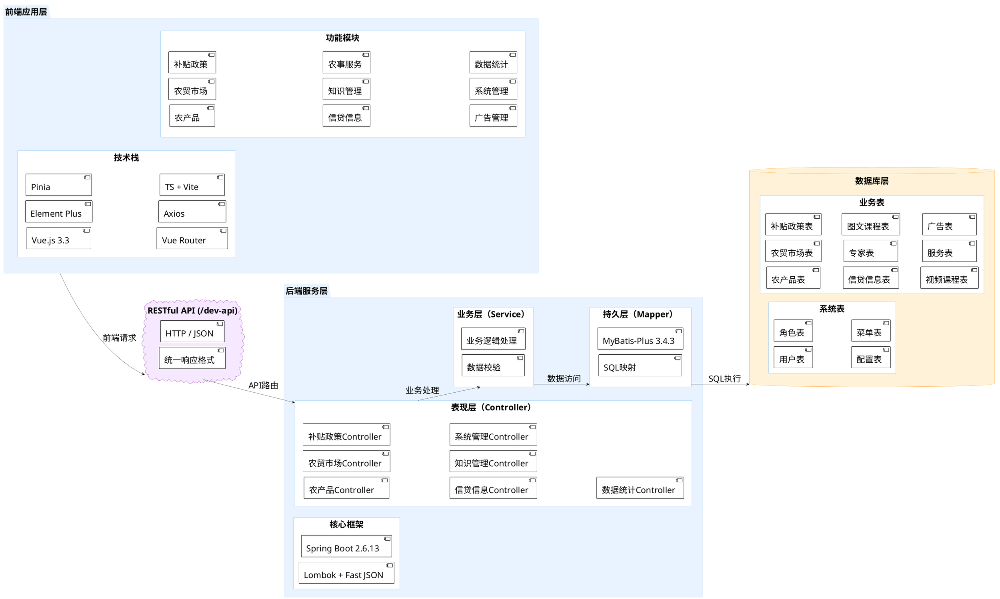

 

图1-3 系统架构图效果图

该架构图清晰展示了“农宝”平台的三层架构设计：

**前端应用层（nbvueproject）：**采用Vue.js 3.3 + Element Plus + Pinia + Vue Router + Axios技术栈，使用TypeScript和Vite构建工具，开发了11个功能管理页面，运行在5173端口。

**API接口层：**作为前后端通信桥梁，提供RESTful API服务（基础路径/dev-api），统一使用HTTP/JSON协议和Result响应封装，确保数据交互标准化。

**后端服务层（nbspringproduct）：**基于Spring Boot 2.6.13框架，采用经典四层架构设计。表现层包含15个Controller，提供41个API接口；业务层包含13个Service，处理业务逻辑和数据验证；持久层包含13个Mapper，使用MyBatis-Plus 3.4.3进行数据访问；核心框架层提供Spring Boot、Lombok、FastJSON等基础支撑。后端运行在80端口。

**数据库层：**使用MySQL 8.0数据库，包含13张数据表（9张业务表存储业务数据，4张系统表存储系统配置），运行在3306端口，采用utf8mb4字符集和InnoDB存储引擎。

各层之间通过标准协议进行交互：前端通过HTTP请求调用API，API层路由分发到Controller，Controller调用Service处理业务逻辑，Service通过Mapper访问数据库。这种分层架构实现了关注点分离，提高了系统的可维护性和可扩展性。

通过本项目的学习，可以建立起从需求分析到技术设计的完整思维链条，掌握企业级项目开发前期准备工作的标准流程，并熟练运用AI工具辅助需求梳理、文档生成、架构设计与数据库建模等关键环节，切实体验AI时代软件工程师所需的新技能。所产出的需求分析文档、技术方案文档、数据库设计文档及系统架构图，不仅是本阶段的核心成果，更将成为后续“农宝”平台开发的重要依据，为整个项目的顺利推进奠定坚实基础。

在开始具体的任务实施之前，我们需要先掌握软件需求分析、系统架构设计、数据库设计等相关的基础知识。本教材以后台管理端的分析和实现为例进行阐述，下面将系统介绍这些基础知识，帮助我们更好地理解和完成项目任务。

## 【学习目标】

### **【知识目标】**

- l 掌握软件需求分析的基本方法，能够从复杂的业务场景中提炼出清晰、可执行的功能需求；
- l 理解软件架构设计的基本原则，学会根据项目规模、团队能力、技术栈等因素进行合理的技术选型；
- l 掌握数据库设计的基本方法，能够设计符合业务需求、性能优良的数据库表结构；
- l 学习如何使用AI工具辅助需求分析、文档生成、数据库设计等工作，提升开发效率。

### **【能力目标】**

- l 培养系统化的需求分析能力，能够识别目标用户群体、提炼核心业务对象、分析主要业务操作；
- l 建立架构设计能力，能够根据需求特点设计合理的系统架构，进行技术方案的对比分析和决策；
- l 掌握数据库设计能力，能够设计符合业务需求的数据库模型，编写规范的建表SQL语句；
- l 提升团队协作能力，能够编写清晰的技术文档，与不同角色的人员有效沟通。

### **【素质目标】**

- l 培养系统化思维，建立从业务需求到技术实现的完整思维链条，学会从全局视角审视问题；
- l 建立工程化意识，理解软件工程规范的重要性，养成良好的文档编写和代码规范习惯；
- l 培养创新精神，学会利用新技术（如AI工具）提升开发效率，勇于尝试和探索；
- l 增强责任意识，理解软件质量的重要性，对需求分析和设计质量负责。

## 【知识储备】

### 1.1 软件需求分析与架构设计

#### **1.1.1 需求分析与常用工具**

在《Web前端框架技术》课程中，我们已经对"农宝"平台进行了初步的需求分析，完成了需求采集和功能模块划分。本教材在此基础上，重点关注后台管理端的需求分析与系统设计，将业务需求转化为可执行的技术方案。

需求分析是软件开发过程中的关键阶段，主要任务是确定软件系统"要做什么"。需求分析包含四个核心活动：需求获取、需求分析、需求规约和需求验证，形成一个完整的闭环。


图1-4 需求分析的核心活动

**（1）需求获取**

基于前期Web前端课程中已完成的需求采集和模块划分，本教材重点关注后台管理端的具体功能需求。系统管理员作为后台管理端的主要使用者，其核心需求包括：农产品信息管理（增删改查、发布、推荐）、补贴政策管理（审核、发布、统计）、信贷信息管理（批量操作、数据导出）、知识管理（专家、课程统一管理）、农贸市场管理、数据统计、系统管理等。

**【价值思考】以用户为中心的责任意识**

在需求获取过程中，我们深入了解了系统管理员和农民用户的实际需求。一位政策管理专员提到："补贴政策信息需要及时发布，但发布前要能预览和审核，发布后还要能统计查看次数，了解政策关注度。"这看似简单的需求背后，体现的是对农民用户负责的态度——确保政策信息准确无误，让农民能够及时获取到正确的政策信息。作为软件工程师，我们要始终牢记：每一个功能设计都关系到用户的切身利益，每一次需求分析都要站在用户的角度思考问题。只有真正理解用户、服务用户，才能开发出有价值、有温度的系统。

**（2）需求分析**

需求分析是对收集到的原始需求进行系统化处理的过程，需要区分功能需求和非功能需求。软件需求通常分为功能需求、非功能需求和业务需求三大类。

**功能需求**描述系统应该提供的功能和服务，如农产品信息管理、补贴政策管理等。**非功能需求**描述系统的质量属性，如性能、安全性、可用性等。**业务需求**描述系统要解决的业务问题和达成的业务目标。

三类需求之间的关系如图1-5所示。

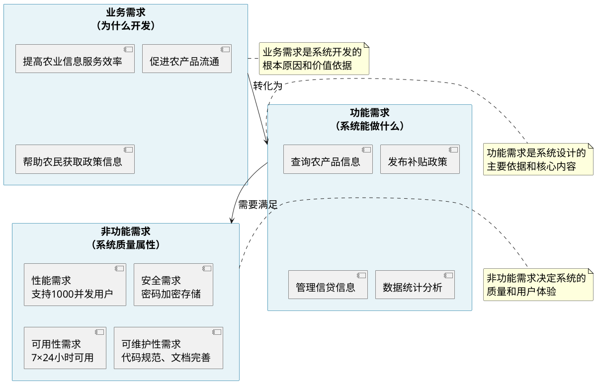


图1-5 需求分类关系图

图1-5展示了三类需求之间的关系。从图中可以看出，业务需求是系统开发的起点，需要转化为功能需求；功能需求是系统设计的核心，需要满足非功能需求；非功能需求决定系统的质量属性。三类需求相互关联，共同构成了完整的软件需求体系。

农宝系统的功能需求指系统必须提供的具体能力或行为，可直接转化为功能模块，比如：

- 农产品信息管理（增删改查、发布、推荐）
- 补贴政策信息管理（审核、发布、统计）
- 信贷信息管理（批量操作、数据导出）
- 知识管理（专家、图文课程、视频课程的统一管理）
- 农贸市场信息管理（快速编辑、批量导入）
- 农事服务信息管理
- 广告信息管理（发布、取消发布）
- 数据统计与分析（运营数据、访问量统计）
- 系统管理（用户管理、角色管理、系统配置）

非功能需求指系统运行的质量属性或约束条件，比如：

- 易用性：界面简洁清晰，操作流程顺畅，支持批量操作，减少重复录入
- 性能：页面加载时间 ≤ 2秒，数据导出和统计查询响应迅速，支持大数据量操作
- 可靠性：系统7×24小时可用，年可用性达到99.9%，数据操作准确无误
- 安全性：用户权限管理完善，操作日志记录完整，敏感数据加密存储
- 可维护性：代码结构清晰，文档完善，支持快速定位和修复问题
- 兼容性：支持主流浏览器（Chrome、Firefox、Edge等），适配不同屏幕分辨率

针对上述农户的原始需求，进行需求提炼，转换成系统功能描述，如下表1-1所示：

表1-1 需求分析到功能描述

| **原始用户语句（提炼核心诉求）**                             | **对应需求功能模块**       | **具体功能描述**                                             |
| ------------------------------------------------------------ | -------------------------- | ------------------------------------------------------------ |
| 需要统一后台管理农产品信息，包括添加、修改、删除、发布等功能，还要能设置推荐状态 | 农产品管理模块             | 提供农产品信息的增删改查功能；支持发布/取消发布操作；支持推荐/取消推荐操作 |
| 补贴政策信息需要及时发布，但发布前要能预览和审核，发布后还要能统计查看次数 | 补贴政策管理模块           | 提供政策信息的增删改查功能；支持发布/取消发布操作；支持推荐/取消推荐操作；支持浏览次数统计；支持数据导出功能 |
| 信贷信息管理很复杂，需要支持批量操作，还要能导出Excel        | 信贷信息管理模块           | 提供信贷信息的增删改查功能；支持批量操作（批量发布、批量推荐等）；支持数据导出为Excel格式；支持数据统计分析 |
| 专家和课程内容分散在各个模块，希望能统一管理，并且能设置发布状态 | 知识管理模块               | 提供专家信息管理功能；提供图文课程管理功能（增删改查、发布、推荐）；提供视频课程管理功能（增删改查、发布、推荐）；统一管理发布状态 |
| 农贸市场信息更新频繁，需要支持快速编辑，最好能批量导入       | 农贸市场管理模块           | 提供市场信息的增删改查功能；支持快速编辑功能；支持批量导入数据；支持数据导出功能 |
| 系统需要支持数据统计功能，比如农产品数量、政策发布量、用户访问量等 | 数据统计模块               | 提供综合统计概览功能；提供产品销量统计功能；提供数据分布统计功能；提供月度趋势分析功能 |
| 用户权限管理很重要，不同角色要有不同的操作权限，还要能记录操作日志 | 系统管理模块               | 提供用户管理功能（增删改查、状态管理）；提供角色管理功能（权限配置）；提供系统配置管理功能；记录操作日志 |
| 系统响应速度要快，特别是数据导出和统计查询，数据量大时不能卡顿 | （非功能需求，不列入本表） | —                                                            |

注：非功能需求虽不列入功能表，但在UI/UX设计、系统架构、测试验收等环节需专项落实。

**（3）需求规约**

需求规约是将分析结果形成规范文档的过程，包括编写需求规格说明书、绘制用例图、流程图等模型，定义系统的功能规格。规范的需求文档是团队沟通的基础，也是后续设计和开发的依据。

**【价值思考】规范文档中的诚信与责任**

需求文档是开发团队的"契约"，它明确了系统"要做什么"，是后续开发工作的依据。在编写需求文档时，我们要做到真实、准确、完整，不能为了迎合某些要求而夸大功能，也不能因为时间紧迫而省略关键需求。曾经有项目因为需求文档不实，导致开发过程中频繁返工，最终项目延期、成本超支。作为软件工程师，我们要以诚信为本，以责任为先，确保每一份文档都经得起检验，每一个承诺都能兑现。规范的需求文档不仅体现了我们的专业素养，更体现了我们的职业操守。

在"农宝"后台管理系统中，用例图可以清晰地展示系统管理员与各个功能模块之间的关系。例如，农产品管理模块的用例图如图1-7所示。

**图1-7 农产品管理模块用例图**

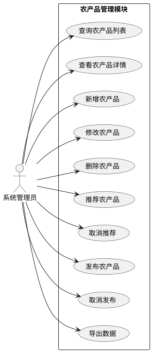

 

图1-7农产品管理模块用例图

从图1-7用例图中可以看出，系统管理员在农产品管理模块中可以执行9个主要操作，包括基本的增删改查功能，以及推荐、发布等业务功能。

**（4）需求验证**

需求验证是确保需求正确性和完整性的过程，需要与用户、业务专家、开发团队等多方进行确认，检查需求文档的一致性和完整性，获得用户对需求文档的正式确认。

**【价值思考】严谨态度与工匠精神**

需求验证看似简单，实则考验着我们的严谨态度。在"农宝"项目中，我们与系统管理员、政策专员、数据分析师等多方进行了三轮需求评审，每一次评审都发现了新的问题，每一次修改都让需求更加完善。这种严谨的态度，正是工匠精神的体现——不放过任何一个细节，不忽略任何一个需求，确保系统真正满足用户的实际需要。软件工程不是"差不多就行"的工作，而是需要精益求精、追求卓越的工程。只有以严谨的态度对待每一个环节，才能开发出高质量、高可靠性的系统。

在需求分析过程中，我们经常需要使用各种工具来帮助我们更好地理解、表达和验证需求。这些工具能够将抽象的需求转化为可视化的模型，提高需求分析的效率和准确性。

##### （1）用例图

用例图是UML（统一建模语言）中用于描述系统功能的图形化工具，它展示了系统的参与者（Actor）和用例（Use Case）之间的关系。用例图能够清晰地表达系统为哪些用户提供了哪些功能，是需求分析中最常用的工具之一。

**用例图的组成要素：**

- **参与者（Actor）**：系统的使用者，可以是人、组织或其他系统
- **用例（Use Case）**：系统提供的功能，用椭圆表示
- **关系**：参与者与用例之间的关联关系
- **系统边界**：用矩形框表示系统的范围

**绘制工具：**
- **PlantUML**：基于文本的UML工具，支持代码生成图表，适合版本控制
- **Draw.io（diagrams.net）**：免费的在线绘图工具，支持多种图表类型
- **StarUML**：专业的UML建模工具，功能强大
- **Visio**：微软的图表绘制工具，适合Windows用户
- **Lucidchart**：在线协作绘图工具，支持团队协作

**绘制注意事项：**

- 用例应该从用户视角描述，使用动词+名词的形式（如"查询农产品"）
- 避免用例过多，一个用例图最好不超过10个用例
- 用例之间可以通过包含（include）、扩展（extend）关系组织
- 参与者应该明确，避免使用"用户"等模糊概念
- 系统边界要清晰，区分系统内外的功能

在"农宝"后台管理系统中，用例图可以清晰地展示系统管理员与各个功能模块之间的关系。例如，补贴政策管理模块的用例图如图1-10所示。

**图1-10 补贴政策管理模块用例图**

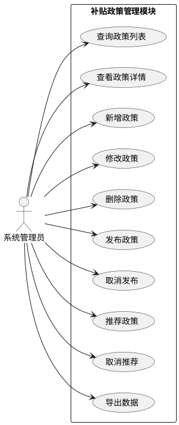

从用例图中可以看出，系统管理员在补贴政策管理模块中可以执行10个主要操作，包括基本的增删改查功能，以及发布、推荐、导出等业务功能。用例图通过图形化的方式，直观地展示了系统的功能边界和用户的操作范围。

##### （2）流程图

流程图用于描述业务流程或系统处理流程，通过图形化的方式展示各个步骤及其先后顺序。流程图能够帮助我们理解复杂的业务逻辑，发现流程中的问题和优化点。在需求分析中，我们经常需要绘制业务流程图，理解用户的操作流程，为系统设计提供依据。

**流程图的组成要素：**
- **开始/结束**：用圆角矩形表示流程的开始和结束
- **处理步骤**：用矩形表示具体的操作或处理
- **判断决策**：用菱形表示条件判断
- **连接线**：用箭头表示流程的方向
- **输入/输出**：用平行四边形表示数据的输入或输出

**绘制工具：**
- **PlantUML**：支持活动图、流程图等多种图表类型
- **Draw.io**：提供丰富的流程图模板和图形库
- **ProcessOn**：在线流程图工具，支持协作编辑
- **Visio**：专业的流程图绘制工具
- **亿图图示**：国产流程图工具，模板丰富

**绘制注意事项：**
- 流程应该从上到下或从左到右，保持方向一致
- 每个处理步骤应该清晰明确，避免模糊描述
- 判断节点应该有明确的"是"和"否"分支
- 避免流程过于复杂，可以拆分为多个子流程
- 使用标准的流程图符号，保持规范性

在"农宝"后台管理系统中，农产品发布流程是一个典型的业务流程。该流程包括创建农产品、设置推荐状态、发布、取消发布等步骤。农产品发布流程图如图1-4所示。

**图1-11 农产品发布流程图**

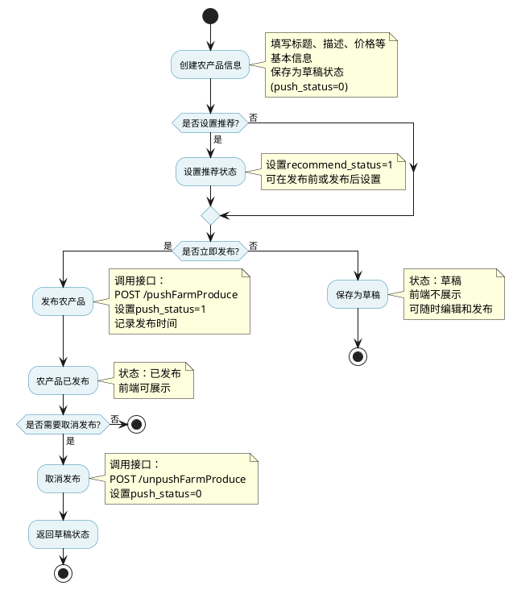


图1-11农产品发布流程图

从流程图中可以看出，农产品发布流程包括创建、推荐设置、发布、取消发布等环节。管理员创建农产品后，可以选择是否设置推荐状态，然后直接发布（无需审核，因为这是后台管理系统）。发布后可以取消发布，返回草稿状态。流程图通过图形化的方式，清晰地展示了业务流程的完整路径，有助于开发团队理解业务逻辑，设计合理的系统流程。

通过合理使用这些工具，可以大大提高需求分析的效率和准确性，减少需求理解偏差，为后续的系统设计和开发奠定良好的基础。

**表1-2 需求分析阶段与常用工具**

| **阶段**   | **阶段描述**                                                 | **常用方法**                                                 | **典型工具**                                                 | **说明**                                                     |
| ---------- | ------------------------------------------------------------ | ------------------------------------------------------------ | ------------------------------------------------------------ | ------------------------------------------------------------ |
| 01需求获取 | 通过访谈、问卷、文档分析等方式，从用户、业务专家、现有系统等渠道收集原始需求信息。 | 用户访谈、问卷调查、现场观察文档分析（如政策文件、业务流程图）、焦点小组讨论专家咨询 | 问卷星/腾讯问卷/Google Forms、微信/电话访谈记录、Word/Excel记录表、录音笔+笔记本、企业微信/钉钉群沟通记录 | 工具侧重于信息采集与初步整理，强调多方式结合，确保需求全面性与真实性。 |
| 02需求分析 | 对原始需求进行分类、梳理、去重、澄清，识别真正业务需求，挖掘隐含需求，形成逻辑清晰的需求结构。 | 需求分类（功能/非功能）、需求优先级排序、用户画像与场景分析用例建模（Use Case）、用户故事（User Story）、SWOT分析 | Excel/Notion（需求清单管理）、XMind/MindMaster（思维导图）、Axure/Balsamiq（原型草图）、白板/便签墙（协作分析）、AI辅助工具（如通义千问生成用户故事） | 强调从“杂乱信息”到“结构化需求”的转化过程，AI可辅助生成用户故事或需求摘要。 |
| 03需求规约 | 将分析结果转化为规范化的文档，明确系统“要做什么”，为后续设计与开发提供依据。 | 编写需求规格说明书、定义功能模块与接口、绘制流程图与状态图、输出用户故事地图、制定API接口清单 | Word/Markdown（撰写文档）、PlantUML/Draw.io（绘制流程图、时序图）、Confluence/语雀（知识库管理）、Swagger/Postman（API文档）、AI工具（自动生成文档初稿） | 此阶段输出正式文档，是开发团队的“契约”，需具备可读性、可追溯性。 |
| 04需求验证 | 与用户、业务专家、开发团队等多方确认需求文档，确保理解一致，获得正式认可。 | 需求评审会议、演示原型或Mockup、用户签字确认、需求变更管理   | Zoom/钉钉会议（线上评审）、Figma/Sketch（交互原型演示）需求跟踪表（Excel或Jira）、电子签名工具（如e签宝）、AI辅助生成评审报告 | 关键在于达成共识，避免后期返工；AI可辅助生成评审意见汇总或变更记录。 |

#### 1.1.2 **软件架构与技术选型**

软件架构是软件系统的高层次结构，它定义了系统的组成部分以及这些部分之间的关系。良好的软件架构能够提高系统的可维护性和可扩展性，促进团队协作和分工，降低系统复杂度。

在软件工程实践中，人们总结出了多种成熟的架构模式，每种模式都有其适用的场景和优缺点。理解这些架构模式，能够帮助我们根据项目特点选择最合适的架构方案。

单体架构是最传统的架构模式，它将所有功能模块部署在一个应用程序中。单体架构适合中小型项目，具有开发简单、部署方便、性能较好、调试和测试相对简单等优点。但是，单体架构也存在代码耦合度高、难以维护、扩展性差、技术栈固定等缺点。随着项目规模的增大，单体架构的缺点会越来越明显，因此，对于大型项目，通常需要考虑其他架构模式。

**图1-15 单体架构模式架构图**

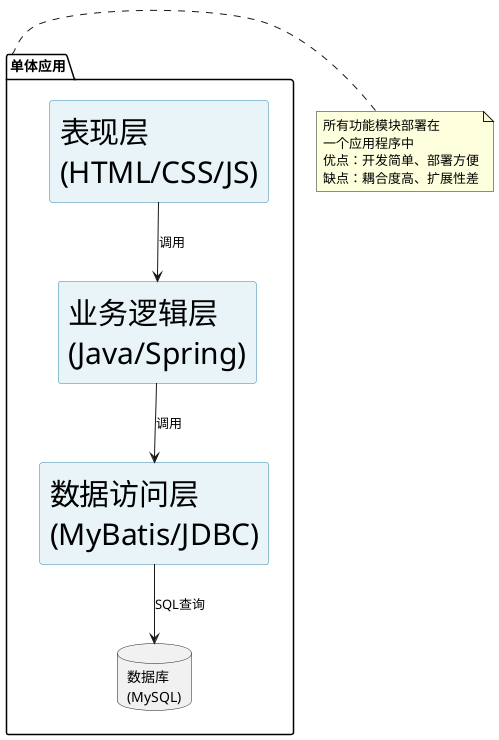


图1-15 单体架构模式架构图

单体架构将所有功能模块（表现层、业务逻辑层、数据访问层）都部署在一个应用程序中。用户通过浏览器访问应用，应用直接与数据库交互。这种架构适合小型项目，但随着项目规模增大，代码耦合度高、难以维护的问题会越来越明显。

分层架构是将系统划分为不同的层次，每层负责特定的职责。经典的三层架构包括表现层、业务逻辑层和数据访问层。表现层负责用户界面和用户交互，业务逻辑层负责业务规则和逻辑处理，数据访问层负责数据的存储和检索。分层架构能够实现关注点分离，降低系统复杂度，提高代码的可维护性和可测试性。在"农宝"平台中，我们采用的就是分层架构模式。

**图1-16 分层架构模式架构图**

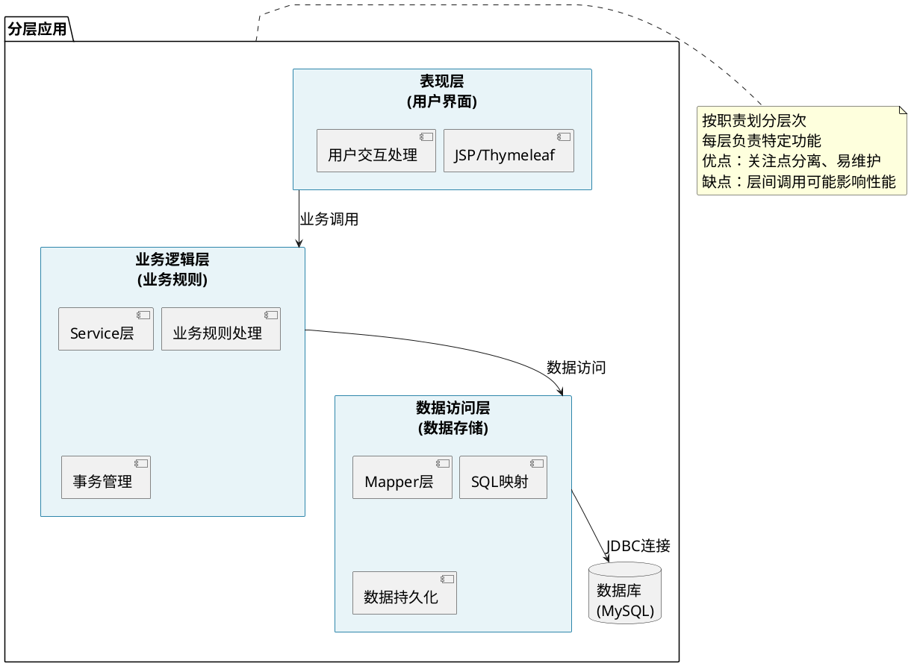


图1-16 分层架构模式架构图

分层架构将系统划分为不同的层次，每层负责特定的职责。表现层处理用户界面和交互，业务逻辑层处理业务规则，数据访问层处理数据存储。这种架构实现了关注点分离，提高了代码的可维护性和可测试性。

前后端分离架构是近年来流行的架构模式，它将前端和后端独立开发和部署，前端通过API接口调用后端服务。前后端分离架构具有前后端并行开发、提高开发效率、职责分离、便于维护、前端可以灵活选择技术栈、支持多端复用等优点。在"农宝"平台中，我们采用前后端分离架构，前端使用Vue.js开发，后端使用Spring Boot开发，通过RESTful API进行通信。

##### 【知识拓展】

**API接口的作用**

API（Application Programming Interface，应用程序编程接口）是前端和后端之间的"桥梁"。如果把前端比作"餐厅的菜单和点餐系统"，后端比作"厨房"，那么API接口就是"服务员"：

- **前端（菜单）**：展示给用户看，让用户选择想要的功能
- **API接口（服务员）**：接收用户的"点餐"（请求），告诉厨房（后端）要做什么
- **后端（厨房）**：根据"订单"（请求）准备"菜品"（数据），通过服务员（API）返回给用户

在"农宝"平台中，前端通过HTTP协议调用后端API接口（如`GET /dev-api/yjnb/produce/list`），后端处理业务逻辑并返回JSON格式的数据，前端接收数据后渲染到页面上。这种通信方式实现了前后端的完全解耦，提高了系统的灵活性和可维护性。

**岗位角色说明**

在前后端分离架构中，开发团队通常分为不同的角色：

- **前端工程师**：负责开发用户界面和交互逻辑，使用Vue.js、Element Plus等技术构建页面，通过Axios调用后端API获取数据并展示给用户。
- **后端工程师（Java开发工程师）**：负责开发API接口和业务逻辑，使用Spring Boot框架处理HTTP请求，通过MyBatis-Plus访问数据库，返回JSON格式的数据给前端。
- **移动端工程师**：负责开发移动应用，同样通过调用后端API接口获取数据。

本教材的核心任务是让读者掌握如何作为Java开发工程师，设计和实现后台API接口，为前端和移动端提供数据服务。

**图1-8 前后端分离架构模式架构图**

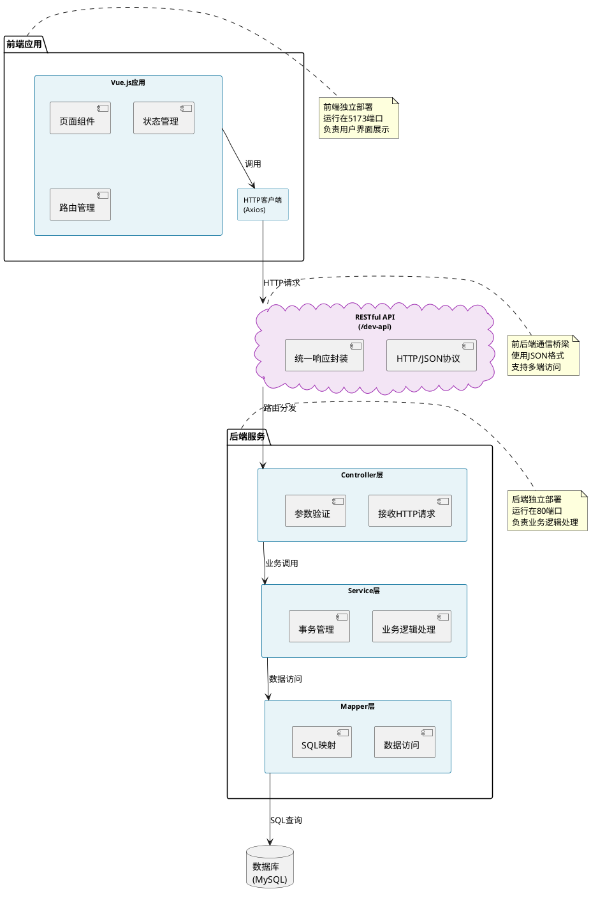


图1-17 前后端分离架构模式架构图

前后端分离架构将前端和后端完全解耦，前端负责用户界面展示，后端负责业务逻辑处理，两者通过RESTful API进行通信。这种架构允许前后端并行开发，提高了开发效率，同时支持多端复用（Web、移动端等）。

三种架构模式的对比如图1-18所示。

**图1-18 软件架构模式对比图**

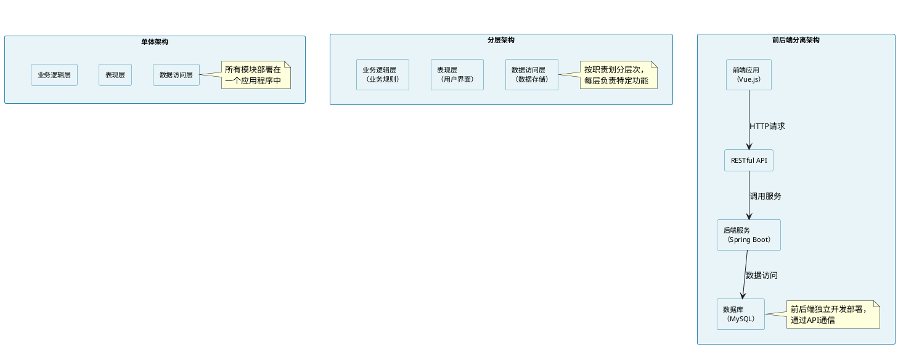


图1-18 软件架构模式对比图

图1-18展示了三种常见架构模式的结构对比。从图中可以看出，单体架构将所有功能集中在一个应用中，适合小型项目；分层架构按职责划分层次，适合中型项目；前后端分离架构将前端和后端完全解耦，适合中大型项目。"农宝"平台采用前后端分离架构，既保证了前后端的独立开发，又实现了系统的灵活扩展。

**技术选型的原则**

技术选型是架构设计的重要环节，需要综合考虑项目需求、团队能力、技术成熟度、技术生态系统和长期维护性等因素。技术选型的决策流程如图1-19所示。

**图1-19 技术选型决策流程图**

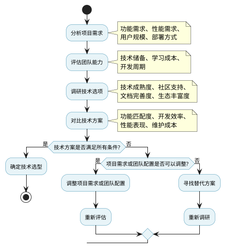


图1-19 技术选型决策流程图

图1-19展示了技术选型的决策流程。从图中可以看出，技术选型需要综合考虑项目需求、团队能力、技术成熟度等多个因素。如果某个技术方案不满足条件，需要调整项目需求或团队配置，或者寻找替代方案。只有满足所有条件的技术方案，才能作为最终的技术选型。

##### 【知识拓展】

**前端工程师、后端工程师和API接口**

在前后端分离架构中，开发团队通常分为前端工程师和后端工程师，他们通过API接口进行协作。下面通过一个实际场景来说明这三者的关系。

**场景：系统管理员查询农产品列表**

假设系统管理员在"农宝"后台管理系统中点击"农产品管理"菜单，想要查看所有农产品的列表。这个看似简单的操作，实际上涉及前端工程师、后端工程师和API接口的协同工作。

**1. 前端工程师的工作**

前端工程师负责开发用户看到的界面和交互。在这个场景中：

- **页面设计**：前端工程师使用Vue.js和Element Plus设计农产品管理页面，包括搜索框、数据表格、分页组件等
- **用户交互**：当管理员点击"查询"按钮时，前端工程师编写的代码会捕获这个点击事件
- **数据请求**：前端工程师使用Axios（HTTP客户端）向后端发送请求，请求格式如下：
  ```javascript
  // 前端代码示例
  axios.get('/dev-api/yjnb/produce/list', {
    params: {
      pageNum: 1,
      pageSize: 10,
      title: '大米'  // 搜索关键词
    }
  })
  ```
- **数据展示**：收到后端返回的数据后，前端工程师编写的代码会将数据渲染到表格中，展示给管理员

**前端工程师的核心技能**：
- HTML/CSS：页面结构和样式
- JavaScript/TypeScript：页面交互逻辑
- Vue.js/React等框架：构建用户界面
- 用户体验设计：让界面美观易用

**2. 后端工程师的工作**

后端工程师负责处理业务逻辑和数据。在这个场景中：

- **接收请求**：后端工程师编写的Controller层代码接收前端发来的HTTP请求
- **参数验证**：验证请求参数是否合法（如页码、每页数量等）
- **业务处理**：调用Service层，根据搜索条件查询数据库
- **数据查询**：通过Mapper层执行SQL语句，从MySQL数据库中查询农产品数据
- **数据返回**：将查询结果封装成JSON格式，返回给前端：
  ```json
  {
    "code": 200,
    "msg": "查询成功",
    "data": {
      "list": [
        {"id": "1", "title": "优质大米", "price": 5.80},
        {"id": "2", "title": "新鲜蔬菜", "price": 3.50}
      ],
      "total": 100
    }
  }
  ```

**后端工程师的核心技能**：
- Java/Python等编程语言：编写业务逻辑
- Spring Boot等框架：构建后端服务
- 数据库设计：设计表结构和SQL查询
- 系统架构：设计可扩展的系统架构

**3. API接口的作用**

API（Application Programming Interface，应用程序编程接口）是前端和后端之间的"桥梁"。在这个场景中：

- **接口定义**：API接口定义了前端可以调用哪些功能，以及如何调用
  - 接口地址：`GET /dev-api/yjnb/produce/list`
  - 请求参数：`pageNum`（页码）、`pageSize`（每页数量）、`title`（搜索关键词）
  - 返回数据：JSON格式的农产品列表

- **通信协议**：前端和后端通过HTTP协议进行通信，使用JSON格式传输数据

- **接口文档**：后端工程师会编写API接口文档，说明每个接口的用途、参数、返回值等，前端工程师根据文档进行开发

**API接口的比喻**：

如果把前端比作"餐厅的菜单和点餐系统"，后端比作"厨房"，那么API接口就是"服务员"：
- 前端（菜单）：展示给用户看，让用户选择想要的功能
- API接口（服务员）：接收用户的"点餐"（请求），告诉厨房（后端）要做什么
- 后端（厨房）：根据"订单"（请求）准备"菜品"（数据），通过服务员（API）返回给用户

**三者协作流程**：

```
管理员点击查询按钮
    ↓
前端工程师编写的代码捕获点击事件
    ↓
前端通过API接口发送HTTP请求
    ↓
后端工程师编写的代码接收请求
    ↓
后端查询数据库获取数据
    ↓
后端通过API接口返回JSON数据
    ↓
前端工程师编写的代码渲染数据到页面
    ↓
管理员看到农产品列表
```

通过这种分工协作，前端工程师专注于用户体验和界面设计，后端工程师专注于业务逻辑和数据处理，两者通过API接口进行通信，实现了职责分离和并行开发，大大提高了开发效率。

**【价值思考】团队协作中的集体主义精神**

在前后端分离的开发模式中，前端工程师和后端工程师虽然分工不同，但目标一致——共同完成"农宝"平台的开发任务。这种协作模式体现了集体主义精神：个人能力再强，也无法独自完成一个完整的系统；只有团队成员相互配合、相互支持，才能实现项目的成功。在实际开发中，前端工程师需要理解后端接口的设计意图，后端工程师需要关注前端的用户体验需求。当遇到问题时，大家要共同讨论、共同解决，而不是相互推诿。这种团队协作精神，不仅是软件开发的需要，更是新时代青年应有的品格。我们要在协作中学会尊重、学会沟通、学会担当，在集体中实现个人价值，在合作中成就共同目标。

### 1.2 数据库设计

在《计算机与人工智能导论》课程中，我们已经学习了数据库的基本概念，包括数据库的定义、关系型数据库的特点、数据库设计的基本步骤等基础知识。本教材在此基础上，重点关注结合"农宝"项目的具体表设计，将业务对象转化为数据库表结构。

数据库设计是一个系统化的过程，通常分为四个阶段：需求分析、概念设计、逻辑设计和物理设计。在"农宝"平台中，需要识别出农产品、市场、政策、信贷等核心业务实体，使用E-R图描述实体之间的关系，为每个实体设计对应的数据库表，确定表的字段、约束和索引。


图1-20 “农宝”平台数据库设计核心阶段解析

数据库设计流程图如图1-21所示，概括了四个阶段的关键活动与输出。

**图1-21 数据库设计流程图**

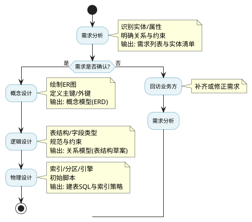


图1-21 数据库设计流程图

图1-21按教学顺序呈现数据库设计的核心步骤，并明确每步的产出物，便于教学与实践对照执行。

#### 1.2.1 数据库设计的范式

在《计算机与人工智能导论》课程中，我们已经学习了数据库的基本概念，包括数据库的定义、关系型数据库的特点、SQL语言的基本操作等基础知识。本教材在此基础上，重点介绍数据库设计的核心理论——数据库范式，帮助读者掌握如何设计规范、高效的数据库结构。

数据库范式是设计关系型数据库的规范理论，通过一系列规则指导数据组织，以减少数据冗余、提高数据完整性、避免数据异常。范式理论从第一范式到第五范式逐级递进，每一级范式都在前一级基础上增加更严格的约束条件。在实际应用中，我们通常关注前三个范式，它们涵盖了大多数数据库设计的需求。

**第一范式（1NF）**：要求每个字段都是不可分割的原子值，即每个字段只能存储一个值。例如，电话号码应作为单独字段，而不能将多个号码存储在一个字段中。

**第二范式（2NF）**：在第一范式基础上，要求非主键字段完全依赖于主键。如果表有复合主键，非主键字段必须依赖于整个主键，而不能只依赖于主键的一部分。

**第三范式（3NF）**：在第二范式基础上，要求非主键字段不能传递依赖于主键，即非主键字段不能依赖于其他非主键字段。

数据库范式的对比分析如表1-3所示。

**表1-3 数据库范式对比分析**

| 范式级别 | 范式名称 | 核心要求 | 解决的问题 | 实际应用示例 |
|---------|---------|---------|-----------|------------|
| 第一范式（1NF） | 原子性范式 | 每个字段都是不可分割的原子值 | 消除重复组，保证字段的原子性 | 电话号码字段不能存储多个号码，应拆分为多个字段或使用关联表 |
| 第二范式（2NF） | 完全依赖范式 | 非主键字段完全依赖于主键 | 消除部分依赖，减少数据冗余 | 订单明细表中，商品名称必须依赖于（订单号，商品编号）整个主键 |
| 第三范式（3NF） | 传递依赖范式 | 非主键字段不能传递依赖于主键 | 消除传递依赖，进一步减少冗余 | 学生表中，班级名称不应直接存储，应通过班级编号关联班级表 |

表1-3展示了数据库范式的核心要求和解决的问题。范式理论通过逐级递进的约束条件，逐步消除数据冗余和依赖异常，使数据库结构更加规范。

在实际应用中，需要在范式化和性能之间找到平衡。严格遵守范式会导致表过多，查询时需要大量关联，影响性能。因此，实际设计中需要根据业务需求适当反范式化。例如，在"农宝"平台的农产品表中，直接存储了供应商名称（provider_name），而没有单独创建供应商表，这是为了简化查询、提高性能，而适当牺牲了范式化的要求。

为了整体感知业务数据的组织方式，下面给出核心实体的E-R示意图，仅展示关键表与主要关系，保持教学所需的“简而全”。

#### 1.2.2 常见的字段类型

在《计算机与人工智能导论》课程中，我们已经学习了MySQL数据库的常见字段类型，包括数值类型、字符串类型、日期时间类型等。本教材在此基础上，重点说明"农宝"项目中实际使用的字段类型及其应用场景。

在"农宝"平台中，主要使用的字段类型包括：

- **整数类型**：`INT`用于存储浏览次数、状态字段等整数值
- **定点数类型**：`DECIMAL(10,2)`用于存储农产品价格、补贴金额、信贷额度等精确数值，避免浮点数精度问题
- **字符串类型**：`VARCHAR`用于存储标题、摘要、分类、供应商名称等长度不固定的文本；`CHAR`用于存储手机号码、状态标识等长度固定的文本
- **文本类型**：`TEXT`用于存储产品描述、政策内容等较长的文本
- **日期时间类型**：`DATETIME`用于存储创建时间、更新时间、发布时间等日期时间信息；`DATE`用于存储政策开始日期、结束日期等日期信息

MySQL常见字段类型的对比分析如表1-4所示。

**表1-4 MySQL常见字段类型对比分析**

| 类型分类 | 字段类型 | 存储空间 | 取值范围 | 适用场景 | 在"农宝"平台中的应用 |
|---------|---------|---------|---------|---------|-------------------|
| 整数类型 | `INT` | 4字节 | -2147483648 ~ 2147483647 | ID、数量、状态码 | 用户ID、浏览次数、状态字段 |
| 整数类型 | `BIGINT` | 8字节 | -9223372036854775808 ~ 9223372036854775807 | 大数值ID、订单号 | 主键ID（使用UUID字符串） |
| 定点数类型 | `DECIMAL(M,D)` | M+2字节 | 精确数值 | 金额、价格 | 农产品价格、补贴金额、信贷额度 |
| 浮点数类型 | `FLOAT` | 4字节 | 近似值 | 科学计算、统计数据 | 较少使用 |
| 浮点数类型 | `DOUBLE` | 8字节 | 近似值 | 科学计算、统计数据 | 较少使用 |
| 字符串类型 | `VARCHAR(N)` | 实际长度+1-2字节 | 0~65535字符 | 长度不固定的文本 | 标题、摘要、分类、供应商名称 |
| 字符串类型 | `CHAR(N)` | N字节 | 0~255字符 | 长度固定的文本 | 手机号码、状态标识 |
| 文本类型 | `TEXT` | 最大65535字节 | 长文本 | 文章、描述 | 产品描述、政策内容 |
| 日期类型 | `DATE` | 3字节 | 1000-01-01 ~ 9999-12-31 | 日期 | 政策开始日期、结束日期 |
| 日期时间类型 | `DATETIME` | 8字节 | 1000-01-01 00:00:00 ~ 9999-12-31 23:59:59 | 日期时间 | 创建时间、更新时间、发布时间 |
| 时间戳类型 | `TIMESTAMP` | 4字节 | 1970-01-01 ~ 2038-01-19 | 时间戳 | 较少使用 |

表1-4展示了MySQL常见字段类型的特点和适用场景。在选择字段类型时，需要考虑数据的实际需求，既要保证数据的准确性，又要优化存储空间和查询性能。对于金额、价格等需要精确计算的数值，应使用`DECIMAL`类型；对于长度不固定的文本，应使用`VARCHAR`类型；对于较长的文本内容，应使用`TEXT`类型。

## 任务一：分析业务需求与定义系统功能

### 【任务描述】

本任务的目标是将"农宝"平台的业务需求转化为结构化的功能规格说明，为后续的系统设计和开发提供依据。

**实现思路：**
1. 识别系统的核心功能模块，明确每个模块的作用和定位
2. 细化每个功能模块的具体功能点，包括数据的增删改查、发布、推荐等操作
3. 定义系统的用户角色，明确管理员的职责和权限
4. 输出规范的功能需求文档，包括功能需求列表、API接口清单等


图1-22 业务需求转化为功能规格说明实现思路

具体而言，“农宝”后台管理系统主要面向系统管理员，管理员负责整个系统的管理和维护。通过分析业务需求，可以识别出以下核心业务对象：农产品信息、农贸市场数据、补贴政策、信贷信息、农业知识（专家、课程）、农事服务、广告信息等。

系统需要支持的主要业务操作包括：数据的增删改查、信息的发布和取消发布、内容的推荐和取消推荐、数据的导出等。这些操作模式在多个模块中重复出现，说明系统需要建立统一的业务处理机制。

基于以上分析，功能模块划分的基本原则是：按照业务对象划分模块，每个模块包含完整的CRUD功能，支持推荐和发布机制，提供数据导出功能。

### 【实现步骤】

#### **步骤1：功能模块划分**

在《Web前端框架技术》课程中，我们已经对"农宝"平台进行了需求分析，识别出了主要的功能模块。本教材在此基础上，重点关注后台管理端应该具备的具体功能，将业务需求转化为后台系统的功能模块。

在"农宝"平台中，我们采用按业务对象划分模块的方式，每个模块围绕一个核心业务对象提供完整的管理功能。基于前期需求分析的结果，并结合后台管理系统通常应具备的基础功能（如系统配置、用户权限管理、数据统计等），我们梳理出后台系统所需的核心功能模块。

下面将需求分析阶段识别的功能模块对应到后台系统的功能模块，如表1-5所示。

**表1-5 需求功能模块与后台功能模块对应关系**

| **需求分析阶段的功能模块** | **具体功能描述** | **对应后台功能模块** |
|-------------------------|----------------|-------------------|
| 农产品管理模块 | 提供农产品信息的增删改查功能；支持发布/取消发布操作；支持推荐/取消推荐操作；支持数据导出功能 | 模块1：农产品管理 |
| 农贸市场管理模块 | 提供市场信息的增删改查功能；支持快速编辑功能；支持批量导入数据；支持数据导出功能 | 模块2：农贸市场管理 |
| 补贴政策管理模块 | 提供政策信息的增删改查功能；支持发布/取消发布操作；支持推荐/取消推荐操作；支持浏览次数统计；支持数据导出功能 | 模块3：补贴政策管理 |
| 信贷信息管理模块 | 提供信贷信息的增删改查功能；支持批量操作（批量发布、批量推荐等）；支持数据导出为Excel格式；支持数据统计分析 | 模块4：信贷信息管理 |
| 知识管理模块 | 提供专家信息管理功能；提供图文课程管理功能（增删改查、发布、推荐）；提供视频课程管理功能（增删改查、发布、推荐）；统一管理发布状态 | 模块5：知识管理 |
| （补充模块） | 整合农机租赁、病虫害防治、土地托管等社会化服务信息，支持服务内容配置、服务商关联与状态管理，促进农业服务供需对接 | 模块6：农事服务管理 |
| （补充模块） | 配置首页及各频道广告位内容，支持图片/链接上传、展示时段设置、优先级排序与点击统计，实现精准信息推广 | 模块7：广告管理 |
| 系统管理模块 | 提供用户管理功能（增删改查、状态管理）；提供角色管理功能（权限配置）；提供系统配置管理功能；记录操作日志 | 模块8：系统管理 |
| 数据统计模块 | 提供综合统计概览功能；提供产品销量统计功能；提供数据分布统计功能；提供月度趋势分析功能 | 模块9：数据统计 |

各后台功能模块的详细功能描述如表1-6所示。

**表1-6 农宝平台后台功能模块清单**

| 模块编号 | 模块名称 | 核心功能描述 | 主要业务对象 |
|---------|---------|-------------|-------------|
| 模块1 | 农产品管理 | 统一维护平台农产品信息库，支持分类发布、上下架控制、推荐位配置及批量导出，保障产销对接数据的准确性与时效性 | 农产品信息 |
| 模块2 | 农贸市场管理 | 管理线下农贸市场基础信息，包括地址、联系方式、经营品类等，支持信息审核、状态启用/停用及数据导出，为农户提供可靠交易场所指引 | 农贸市场信息 |
| 模块3 | 补贴政策管理 | 发布并动态更新各级农业补贴政策，支持按地区、对象、作物类型定向推送，配置政策解读内容与申报入口，提升政策触达效率 | 补贴政策信息 |
| 模块4 | 信贷信息管理 | 维护合作金融机构提供的信贷产品信息，配置申请条件、利率说明与跳转链接，支持推荐展示与效果追踪，助力农户便捷融资 | 信贷产品信息 |
| 模块5 | 知识管理 | 管理农技专家档案及课程资源（图文、视频），支持课程分类、审核发布、上下架及关联专家，构建结构化农业知识服务体系 | 专家、课程信息 |
| 模块6 | 农事服务管理 | 整合农机租赁、病虫害防治、土地托管等社会化服务信息，支持服务内容配置、服务商关联与状态管理，促进农业服务供需对接 | 农事服务信息 |
| 模块7 | 广告管理 | 配置首页及各频道广告位内容，支持图片/链接上传、展示时段设置、优先级排序与点击统计，实现精准信息推广 | 广告信息 |
| 模块8 | 系统管理 | 提供用户账号全生命周期管理、角色权限分配、操作日志审计及系统参数配置，保障平台安全、可控、可追溯 | 用户、角色、配置 |
| 模块9 | 数据统计 | 聚合用户行为、内容访问、服务使用等关键指标，生成多维度可视化报表，为运营决策与服务优化提供数据支撑 | 统计数据 |

表1-6展示了"农宝"平台的九个核心功能模块。从表中可以看出，前七个模块主要处理业务数据，模块8提供系统支撑功能，模块9提供数据分析功能。这种模块划分方式既保证了业务功能的完整性，又实现了系统功能的合理分层。

##### 【答疑解惑】

**什么是业务对象**

业务对象（Business Object）是指在业务领域中具有独立意义和完整属性的实体，它是需求分析阶段从业务需求中识别出来的核心概念。业务对象通常具有以下特征：

- **独立性**：业务对象在业务领域中有明确的边界和含义，可以独立存在
- **完整性**：业务对象包含描述其本质特征的属性集合
- **业务相关性**：业务对象直接对应业务领域中的实际事物或概念

在"农宝"平台中，业务对象包括：
- **农产品信息**：描述农产品的标题、价格、分类、供应商等属性
- **补贴政策信息**：描述政策的标题、内容、补贴金额、发布部门等属性
- **信贷产品信息**：描述信贷产品的名称、利率、额度、申请条件等属性
- **农贸市场信息**：描述市场的名称、地址、联系方式、经营品类等属性
- **专家信息**：描述专家的姓名、专业领域、联系方式等属性
- **课程信息**：描述课程的标题、内容、类型、发布状态等属性

**业务对象与数据库的关系**

在需求分析阶段识别的业务对象，在数据库设计阶段会对应到具体的数据库表。业务对象与数据库表之间存在明确的映射关系：

- **业务对象 → 数据库表**：每个业务对象通常对应一个数据库表，用于存储该业务对象的数据
- **业务对象的属性 → 数据库表的字段**：业务对象的属性会转换为数据库表的字段，如"农产品信息"的"标题"属性对应`nb_farm_produce`表的`title`字段
- **业务对象之间的关系 → 表之间的外键关系**：业务对象之间的关系会转换为数据库表之间的外键关系

**映射示例：**

在"农宝"平台中，业务对象到数据库表的映射关系如下：

- 业务对象"农产品信息" → 数据库表`nb_farm_produce`
  - 属性"标题" → 字段`title`
  - 属性"价格" → 字段`price`
  - 属性"分类" → 字段`catgory`
  
- 业务对象"补贴政策信息" → 数据库表`nb_allowance_policy`
  - 属性"标题" → 字段`title`
  - 属性"补贴金额" → 字段`allowance_amount`
  - 属性"发布部门" → 字段`department`
  
- 业务对象"信贷产品信息" → 数据库表`nb_credit_loan`
  - 属性"产品名称" → 字段`title`
  - 属性"利率" → 字段`interest_rate`
  - 属性"最高额度" → 字段`max_amount`

这种映射关系确保了需求分析阶段识别的业务对象能够准确落地到数据库设计中，保证了从需求到实现的完整性和一致性。通过业务对象的概念，我们可以更好地理解业务需求，并将其转化为可执行的数据库设计方案。

**【AI辅助】使用AI工具辅助功能模块划分**

在功能模块划分阶段，可以使用ChatGPT、Claude等AI工具帮助整理和结构化需求。

**实践步骤：**

① 准备好原始需求材料（如表1-1中的系统管理员原始需求）

② 向AI工具提问，参考提示词模板：
```
我正在开发一个农业综合管理平台的后台管理系统，业务方提供了以下需求描述：

[这里粘贴实际的业务需求]

请帮我：
1. 分析并提炼出核心功能模块
2. 为每个模块列出具体的功能点
3. 识别可能遗漏的需求
4. 按照功能模块清单的格式整理输出
```

③ 审查AI的输出结果，与业务方确认

④ 根据确认结果调整和完善功能模块划分

**重要提醒：**
- ⚠️ AI生成的内容仅供参考，必须由你和业务专家验证
- ⚠️ 关键业务逻辑不能依赖AI，必须深入理解业务
- ⚠️ AI建议作为辅助工具，最终决策由人来做

#### 步骤2：绘制系统功能结构图

在完成功能模块划分之后，我们需要绘制系统功能结构图，以直观地展示系统的整体结构和各模块之间的关系。功能结构图能够帮助团队成员快速理解系统的组织方式，为后续的开发工作提供清晰的指导。

系统功能结构图采用树形结构，从顶层到底层逐级展开。顶层是“农宝农业综合管理平台”这个整体系统，第二层是角色，第三层是系统的主要功能模块，包括农产品管理、农贸市场管理、补贴政策管理、信贷信息管理、农事服务管理、知识管理、广告管理、系统管理和数据分析模块等九个功能模块。第四层是每个模块下的具体功能操作。这种层次化的结构设计，既保证了功能的完整性，又实现了功能的合理分层。

绘制系统功能结构图可以按照以下步骤进行：

**第一，确定顶层系统名称。** 在树形结构的根节点，标注系统的整体名称"农宝农业综合管理平台"。

**第二，列出系统角色。** 在第二层，列出系统的使用者角色。在"农宝"后台管理系统中，主要角色是"管理员"。

**第三，列出功能模块。** 在第三层，根据功能模块划分的结果，列出所有主要功能模块。在"农宝"平台中，包括农产品管理、农贸市场管理、补贴政策管理、信贷信息管理、农事服务管理、知识管理、广告管理、系统管理和数据分析模块等九个功能模块。

**第四，细化功能操作。** 在第四层，为每个功能模块列出具体的功能操作。例如，农产品管理模块下包括查询农产品、添加农产品、修改农产品、删除农产品、推荐农产品、发布农产品等功能操作。

**第五，处理子模块。** 对于有子模块的功能模块（如知识管理模块），需要进一步细分。知识管理模块可以细分为专家管理、图文课程管理和视频课程管理三个子模块，每个子模块下再列出具体的功能操作。

**第六，检查完整性。** 检查结构图是否覆盖了所有功能模块和主要功能操作，确保没有遗漏。

**第七，优化布局。** 调整结构图的布局，使其清晰易读，可以使用缩进、连接线等符号来表示层次关系。

系统功能结构图如图1-8所示。

**图1-8 农宝平台功能结构图**

```
农宝农业综合管理平台
│
└── 管理员
    ├── 农产品管理
    │   ├── 查询农产品
    │   ├── 添加农产品
    │   ├── 修改农产品
    │   ├── 删除农产品
    │   ├── 推荐农产品
    │   └── 发布农产品
    │
    ├── 农贸市场管理
    │   ├── 查询市场信息
    │   ├── 添加市场信息
    │   ├── 修改市场信息
    │   └── 删除市场信息
    │
    ├── 补贴政策管理
    │   ├── 查询政策信息
    │   ├── 添加政策信息
    │   ├── 修改政策信息
    │   ├── 删除政策信息
    │   ├── 推荐政策信息
    │   └── 发布政策信息
    │
    ├── 信贷信息管理
    │   ├── 查询信贷信息
    │   ├── 添加信贷信息
    │   ├── 修改信贷信息
    │   ├── 删除信贷信息
    │   ├── 推荐信贷信息
    │   └── 发布信贷信息
    │
    ├── 农事服务管理
    │   ├── 查询服务信息
    │   ├── 添加服务信息
    │   ├── 修改服务信息
    │   └── 删除服务信息
    │
    ├── 知识管理
    │   ├── 专家管理
    │   │   ├── 查询专家信息
    │   │   ├── 添加专家信息
    │   │   ├── 修改专家信息
    │   │   └── 删除专家信息
    │   │
    │   ├── 图文课程管理
    │   │   ├── 查询课程信息
    │   │   ├── 添加课程信息
    │   │   ├── 修改课程信息
    │   │   ├── 删除课程信息
    │   │   ├── 推荐课程信息
    │   │   └── 发布课程信息
    │   │
    │   └── 视频课程管理
    │       ├── 查询课程信息
    │       ├── 添加课程信息
    │       ├── 修改课程信息
    │       ├── 删除课程信息
    │       ├── 推荐课程信息
    │       └── 发布课程信息
    │
    ├── 广告管理
    │   ├── 查询广告信息
    │   ├── 添加广告信息
    │   ├── 修改广告信息
    │   ├── 删除广告信息
    │   ├── 发布广告
    │   └── 取消发布广告
    │
    ├── 系统管理
    │   ├── 管理用户
    │   ├── 管理角色
    │   └── 配置系统
    │
    └── 数据分析模块
        ├── 综合统计概览
        ├── 产品销量统计
        ├── 数据分布统计
        └── 月度趋势分析
```

图1-8展示了"农宝"平台的完整功能结构。从图中可以看出，系统以管理员为中心，包含农产品管理、农贸市场管理、补贴政策管理、信贷信息管理、农事服务管理、知识管理、广告管理、系统管理和数据分析模块等九个主要功能模块，每个模块下包含具体的功能操作。知识管理模块进一步细分为专家管理、图文课程管理和视频课程管理三个子模块。这种层次化的结构设计既保证了功能的完整性，又实现了功能的合理分层，为后续的系统设计和开发提供了清晰的指导。图中列出的所有功能均已在系统中实际实现，可以通过对应的API接口进行调用。

为便于读者快速理解管理员与功能之间的关系，下面给出管理员用例图。该图从用户视角展示"管理员"可直接执行的关键用例，便于教学场景下讲解"谁做什么"的对应关系。

**图1-9 管理员用例图**

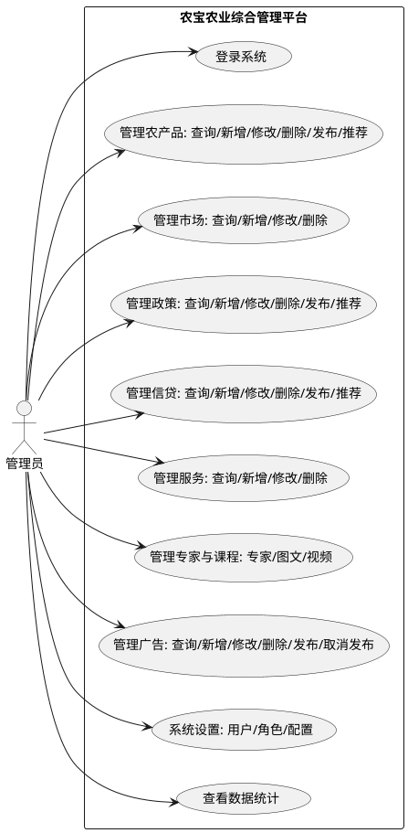

图1-9以用例图形式概括了管理员可执行的核心操作，有助于在需求讲解与测试用例设计时建立"角色—用例"的直观映射。

**【AI辅助】使用AI生成UML图表代码**

在绘制系统功能结构图时，如果需要绘制用例图、流程图、时序图等UML图表，可以让AI生成PlantUML代码。

**实践步骤：**

① 明确要绘制的图表类型和内容

② 向AI工具提问，参考提示词模板：
```
请为"农产品管理模块"生成PlantUML格式的用例图代码。

功能包括：
- 查询农产品列表
- 查看农产品详情
- 新增农产品
- 修改农产品
- 删除农产品
- 推荐农产品
- 发布农产品

参与者：管理员
```

③ AI会生成PlantUML代码，将代码复制到PlantUML在线编辑器（https://www.plantuml.com/plantuml）查看效果

④ 根据实际需求调整图表

#### 步骤3：定义系统用户角色（基于实际数据库）

用户角色定义是需求分析的重要组成部分，它决定了系统的权限体系和安全策略。在"农宝"平台中，系统采用单一管理员角色设计，管理员拥有系统的所有功能访问和管理权限。这种设计简化了权限管理，适合中小型后台管理系统。

根据实际数据库sys_role表，系统定义了管理员角色，如表1-7所示。

**表1-7 系统用户角色定义**

| 角色ID | 角色名称 | 角色权限字符串 | 数据范围 | 状态 | 说明 |
|--------|---------|---------------|---------|------|------|
| 1 | 管理员 | admin | 全部数据 | 正常 | 系统最高权限，拥有所有功能访问和管理权限 |

表1-7展示了"农宝"平台的管理员角色。管理员拥有系统的最高权限，可以访问和管理所有功能，包括用户管理、系统配置、全部业务模块的完整权限，以及数据统计功能。

系统已创建1个测试用户，如表1-8所示。

**表1-8 系统测试用户**

| 用户ID | 用户名 | 昵称 | 密码 | 邮箱 | 手机号码 | 状态 |
|--------|--------|------|------|------|---------|------|
| 1 | admin | 管理员 | 123456 | admin@nongbao.com | 13800138000 | 正常 |

表1-8展示了系统的测试用户信息。该测试用户可以用于系统测试和演示，帮助开发团队验证系统的功能。

#### 步骤4：输出功能需求列表

功能需求列表是需求分析的重要输出，它将系统的功能需求以结构化的方式呈现出来，为开发团队提供清晰的开发依据。功能需求列表应该包含功能编号、功能模块、功能名称、API接口、实现状态等信息，这样既便于管理，又便于跟踪。

根据实际开发的系统，我们整理出了已实现的功能需求清单，如表1-9所示。该清单涵盖了"农宝"平台的所有核心功能，包括农产品管理、补贴政策管理、信贷信息管理、农贸市场管理、知识管理、系统管理等模块的功能。每个功能都对应一个具体的API接口，便于前后端的对接和测试。

**表1-9 系统功能需求清单（部分）**

| 功能编号 | 功能模块 | 功能名称 | API接口 | 实现状态 |
|---------|---------|---------|---------|---------|
| F001 | 农产品管理 | 查询农产品列表 | GET /dev-api/yjnb/produce/list | ✅ 已实现 |
| F002 | 农产品管理 | 获取农产品详情 | GET /dev-api/yjnb/produce/{id} | ✅ 已实现 |
| F003 | 农产品管理 | 新增农产品 | POST /dev-api/yjnb/produce | ✅ 已实现 |
| F004 | 农产品管理 | 修改农产品 | PUT /dev-api/yjnb/produce | ✅ 已实现 |
| F005 | 农产品管理 | 删除农产品 | DELETE /dev-api/yjnb/produce/{ids} | ✅ 已实现 |
| F006 | 农产品管理 | 推荐农产品 | POST /dev-api/yjnb/produce/recommendFarmProduce | ✅ 已实现 |
| F007 | 农产品管理 | 取消推荐 | POST /dev-api/yjnb/produce/unrecommendFarmProduce | ✅ 已实现 |
| F008 | 农产品管理 | 发布农产品 | POST /dev-api/yjnb/produce/pushFarmProduce | ✅ 已实现 |
| F009 | 农产品管理 | 取消发布 | POST /dev-api/yjnb/produce/unpushFarmProduce | ✅ 已实现 |
| F010 | 农产品管理 | 导出数据 | POST /dev-api/yjnb/produce/export | ✅ 已实现 |
| F011 | 补贴政策管理 | 查询政策列表 | GET /dev-api/yjnb/policy/list | ✅ 已实现 |
| F012 | 补贴政策管理 | 获取政策详情 | GET /dev-api/yjnb/policy/{id} | ✅ 已实现 |
| F013 | 补贴政策管理 | 新增政策 | POST /dev-api/yjnb/policy | ✅ 已实现 |
| F014 | 补贴政策管理 | 发布政策 | POST /dev-api/yjnb/policy/releaseAllowancePolicy | ✅ 已实现 |
| F015 | 信贷信息管理 | 查询信贷列表 | GET /dev-api/yjnb/loan/list | ✅ 已实现 |
| F016 | 信贷信息管理 | 推荐信贷 | POST /dev-api/yjnb/loan/recommandCreditLoan | ✅ 已实现 |
| F017 | 农贸市场管理 | 查询市场列表 | GET /dev-api/yjnb/market/list | ✅ 已实现 |
| F018 | 专家管理 | 查询专家列表 | GET /dev-api/yjnb/expert/list | ✅ 已实现 |
| F019 | 图文课程管理 | 查询课程列表 | GET /dev-api/yjnb/graphic/list | ✅ 已实现 |
| F020 | 视频课程管理 | 查询课程列表 | GET /dev-api/yjnb/video/list | ✅ 已实现 |
| F021 | 农事服务管理 | 查询服务列表 | GET /dev-api/yjnb/service/list | ✅ 已实现 |
| F022 | 广告管理 | 查询广告列表 | GET /dev-api/yjnb/ad/list | ✅ 已实现 |
| F023 | 系统管理 | 用户登录 | POST /dev-api/yjnb/system/login | ✅ 已实现 |
| F024 | 系统管理 | 用户登出 | POST /dev-api/yjnb/system/logout | ✅ 已实现 |
| F025 | 数据统计 | 综合统计概览 | GET /dev-api/statistics/overview | ✅ 已实现 |
| F026 | 数据统计 | 产品销量统计 | GET /dev-api/statistics/productStats | ✅ 已实现 |
| F027 | 数据统计 | 数据分布统计 | GET /dev-api/statistics/distribution | ✅ 已实现 |
| F028 | 数据统计 | 月度趋势分析 | GET /dev-api/statistics/monthlyTrend | ✅ 已实现 |

表1-6展示了"农宝"平台的部分功能需求清单。从表中可以看出，系统共实现了28个核心功能，涵盖了农产品管理、补贴政策管理、信贷信息管理、农贸市场管理、知识管理、系统管理、数据统计等模块。每个功能都有对应的API接口，便于前后端的对接和测试。功能需求列表的建立，为后续的系统设计和开发提供了清晰的依据。

##### 【答疑解惑】

**API接口的作用与定义**

**场景：系统管理员查询农产品列表**

假设系统管理员在后台管理系统中点击"农产品管理"菜单，想要查看所有农产品的列表。这个操作涉及前端、API接口和后端的协同工作。

**API接口是什么？**

API（Application Programming Interface，应用程序编程接口）是前端和后端之间通信的"桥梁"。在这个场景中：

- **前端需要什么**：前端需要获取农产品列表数据，用于在页面上展示
- **后端能提供什么**：后端可以从数据库中查询农产品数据
- **API接口的作用**：API接口定义了前端如何向后端"要数据"，以及后端如何"给数据"

具体来说，API接口`GET /dev-api/yjnb/produce/list`定义了：
- **请求方式**：GET（表示查询操作）
- **接口地址**：`/dev-api/yjnb/produce/list`
- **请求参数**：`pageNum`（页码）、`pageSize`（每页数量）、`title`（搜索关键词，可选）
- **返回数据**：JSON格式的农产品列表，包含农产品ID、标题、价格、分类等信息

**谁去定义这个接口？**

API接口通常由**后端工程师**负责定义和实现，具体流程如下：

1. **需求分析阶段**：后端工程师根据功能需求，确定需要哪些API接口
2. **接口设计阶段**：后端工程师设计接口的请求方式、地址、参数和返回值
3. **接口文档编写**：后端工程师编写API接口文档，说明每个接口的用途、参数、返回值等
4. **接口实现阶段**：后端工程师编写Controller层的代码，实现接口的具体功能
5. **接口测试阶段**：后端工程师使用Postman等工具测试接口，确保接口正常工作

**为什么要这么写？**

API接口的设计需要遵循一定的规范和原则：

**第一，RESTful设计原则。** 使用标准的HTTP方法（GET、POST、PUT、DELETE）来表示不同的操作：
- GET：查询数据（如查询农产品列表）
- POST：新增数据（如添加农产品）
- PUT：修改数据（如修改农产品信息）
- DELETE：删除数据（如删除农产品）

**第二，统一的接口路径。** 使用统一的路径前缀`/dev-api`，便于管理和维护：
- `/dev-api/yjnb/produce/list`：农产品列表查询
- `/dev-api/yjnb/produce/add`：添加农产品
- `/dev-api/yjnb/policy/list`：政策列表查询

**第三，统一的响应格式。** 所有接口返回统一格式的JSON数据：
```json
{
  "code": 200,
  "msg": "查询成功",
  "data": {
    "list": [...],
    "total": 100
  }
}
```
这样前端可以统一处理响应数据，提高开发效率。

**第四，参数验证和错误处理。** 接口需要验证请求参数的有效性，并返回明确的错误信息，帮助前端快速定位问题。

通过这种规范化的API接口设计，前后端可以并行开发，前端工程师根据接口文档进行开发，后端工程师实现接口功能，两者通过API接口进行对接，大大提高了开发效率。

**【AI辅助】使用AI检查需求一致性**

在输出功能需求列表后，可以使用AI工具检查需求之间是否存在冲突或不一致。

**实践步骤：**

① 整理出所有相关的需求描述（包括功能需求列表、API接口清单等）

② 向AI工具提问，参考提示词模板：
```
我正在整理"农宝"平台的需求文档，请帮我检查以下需求是否存在冲突：

需求1：农产品信息发布后，用户可以查看
需求2：农产品必须由管理员发布（push_status=1）才能展示
需求3：管理员可以发布农产品
需求4：发布操作调用 /pushFarmProduce 接口

请分析这些需求之间的逻辑关系，指出是否存在矛盾，并给出改进建议。
```

③ 仔细阅读AI的分析结果

④ 与团队讨论AI提出的问题点

⑤ 修正需求文档中的不一致之处

**提示：** 
- AI可以帮助发现明显的逻辑矛盾
- 但业务规则的最终确认必须由业务专家完成

## 任务二：规划系统架构与技术选型

### 【任务描述】

本任务为"农宝"平台选择合适的技术架构和开发技术栈，并输出技术方案文档。

**实现思路：**

**① 确定系统整体架构**：根据项目规模、用户量、团队能力等因素，选择前后端分离架构模式。

**② 选择技术栈**：为前端、后端、数据库等各层选择合适的技术，考虑成熟度、学习成本、社区支持等因素。

**③ 设计系统分层结构**：明确各层的职责和交互方式，为开发团队提供架构指导。

**④ 编写技术方案文档**：将技术选型结果整理成规范文档，供项目团队参考。

### 【任务分析】

技术选型是一个综合性的决策过程，需要我们从多个维度进行分析和评估。

**① 分析项目的规模特征**："农宝"平台是一个中小型的企业级应用，包含约10个功能模块，这种规模决定了我们不需要采用过于复杂的微服务架构，单体架构或简单的分层架构即可满足需求。

**② 评估系统的用户规模**：根据业务需求，系统初期预计支持1000+用户，这个规模对系统的性能要求不高，但我们需要考虑未来的扩展性，选择的技术栈应该能够支持系统的平滑扩展。

**③ 考虑开发团队的能力**：对于3-5人的小型团队而言，技术栈的学习成本是一个重要的考虑因素。我们应该优先选择团队熟悉的技术，或者选择学习曲线平缓、文档完善的技术。

**④ 评估开发周期**："农宝"项目的开发周期为3-6个月，需要快速迭代，这就要求我们选择开发效率高的技术栈，能够快速构建和部署。

**⑤ 确定系统的部署方式**：对于初期项目，独立部署、单机部署即可满足需求，但随着业务的发展，可能需要考虑分布式部署。因此，我们在技术选型时应该选择支持分布式部署的技术栈。

基于以上分析，我们可以确定技术选型的基本原则：优先选择成熟稳定的技术，注重开发效率，兼顾扩展性，控制学习成本。

**【价值思考】技术选型中的工匠精神与创新意识**

在"农宝"项目的技术选型过程中，我们选择了Spring Boot、Vue.js、MySQL等成熟稳定的技术栈。这看似保守的选择，实际上体现了软件工程师应有的工匠精神——不盲目追求新技术，而是基于项目实际需求，选择最适合、最可靠的技术方案。同时，我们也积极拥抱AI辅助开发等新技术，在保证系统稳定性的前提下，勇于尝试和探索，体现了创新意识。真正的工匠精神，是在传承中创新，在创新中坚守。我们要在技术选型中平衡稳定与创新，既要保证系统的可靠性，又要保持对新技术的敏感度和学习能力。

### 【实现步骤】

#### 步骤1：确定系统整体架构

系统架构是软件系统的骨架，它决定了系统的组织方式、技术选型和开发模式。在"农宝"平台中，我们采用前后端分离架构，这种架构模式既保证了前后端的独立开发，又实现了系统的灵活扩展。

前后端分离架构的核心思想是将前端和后端完全解耦，前端负责用户界面和交互逻辑，后端负责业务逻辑和数据存储。前端通过RESTful API与后端通信，后端提供统一的API接口，支持多端访问。这种架构模式的优势在于：前后端可以并行开发，提高开发效率；前端可以独立部署，便于维护和更新；后端可以支持多个前端应用，如Web、移动端等。

"农宝"平台的实际架构如图2-1所示。

**图2-1 农宝平台系统架构图**

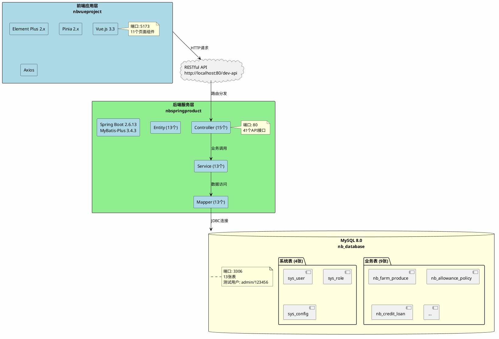

图2-1展示了"农宝"平台的完整系统架构。从图中可以看出，系统采用前后端分离的三层架构，包括前端应用层、后端服务层和数据库层。前端应用层使用Vue.js 3构建，运行在5173端口，包含11个页面组件；后端服务层使用Spring Boot构建，运行在80端口，包含15个控制器、13个服务、13个数据访问接口和13个实体类；数据库层使用MySQL 8.0，运行在3306端口，包含13张数据表。前端通过RESTful API与后端通信，后端通过JDBC与数据库交互。

前端层（nbvueproject）是用户交互的入口，负责展示用户界面和处理用户操作。前端使用Vue.js 3作为核心框架，Element Plus作为UI组件库，Pinia作为状态管理工具，Axios作为HTTP客户端。前端运行在5173端口，包含11个管理页面，涵盖了系统的所有功能模块。

后端层（nbspringproduct）是系统的核心，负责处理业务逻辑和数据访问。后端使用Spring Boot 2.6.13作为核心框架，MyBatis-Plus 3.4.3作为持久层框架。后端采用分层架构，Controller层处理HTTP请求，Service层处理业务逻辑，Mapper层处理数据访问，Entity层定义数据模型。后端运行在80端口，提供41个API接口，支持系统的所有功能。

数据库层（MySQL 8.0）是系统的数据存储中心，负责存储和管理系统的所有数据。数据库包含13张数据表，其中9张业务表存储业务数据，4张系统表存储系统配置数据。数据库运行在3306端口，使用utf8mb4字符集，支持中文存储。

前端和后端通过RESTful API进行通信，API基础路径为http://localhost:80/dev-api，使用HTTP协议（GET/POST/PUT/DELETE），数据格式为JSON，响应封装为统一的Result对象。这种通信方式既保证了前后端的解耦，又实现了数据的标准化传输。

前后端分离架构的优势在于：前后端可以完全分离，实现并行开发，提高开发效率；后端提供统一API，支持多端访问，如Web、移动端等；分层清晰，职责明确，易于维护和扩展；MyBatis-Plus简化CRUD操作，提高开发效率；跨域配置完善，前后端联调顺畅。

前后端分离架构的交互流程如图2-2所示。

**图2-2 前后端交互流程图**

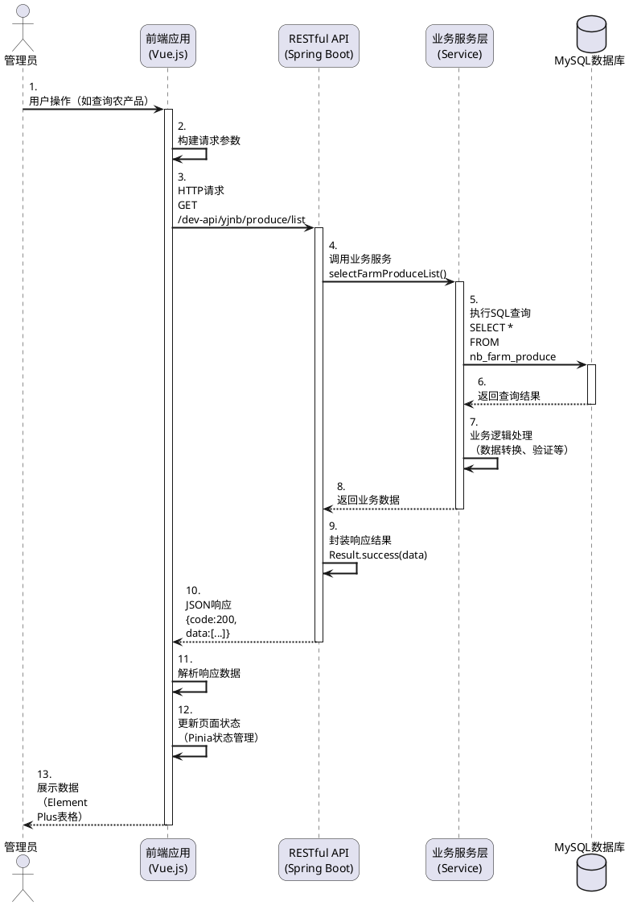

图2-2展示了前后端分离架构的完整交互流程。从图中可以看出，用户操作触发前端请求，前端通过HTTP协议调用后端API，后端服务层处理业务逻辑并访问数据库，最终将结果返回给前端展示。这种交互方式实现了前后端的完全解耦，提高了系统的灵活性和可维护性。

#### 步骤2：后端技术选型

后端技术选型是系统架构设计的核心环节，它直接影响系统的开发效率、性能表现和维护成本。在"农宝"平台中，我们需要选择一个既能满足企业级应用需求，又便于团队快速开发的技术栈。

经过综合评估，我们选择Spring Boot作为后端核心框架。Spring Boot是Spring框架的增强版，它提供了自动配置和起步依赖机制，大大减少了配置工作，让开发者能够快速搭建项目。Spring Boot的生态非常完善，有大量的第三方库和工具支持，能够满足各种业务需求。Spring Boot的社区非常活跃，文档完善，遇到问题容易找到解决方案。更重要的是，Spring Boot被广泛应用于企业级项目，经过大量项目的验证，稳定可靠。

在持久层框架的选择上，我们选择了MyBatis-Plus。MyBatis-Plus是MyBatis的增强工具，它在保持MyBatis灵活性的同时，提供了便捷的CRUD方法，能够大大提高开发效率。MyBatis-Plus支持Lambda表达式，能够避免硬编码字段名，提高代码的可维护性。MyBatis-Plus还提供了分页插件、自动填充等功能，能够满足"农宝"平台的各种需求。

在数据库的选择上，我们选择了MySQL 8.0。MySQL是开源的关系型数据库，性能优异，生态成熟，适合中小型应用。MySQL 8.0支持JSON数据类型、窗口函数等新特性，能够满足现代应用的需求。MySQL的文档完善，工具丰富，便于开发和维护。

后端技术栈的详细选型如表1-10所示。

**表1-10 后端技术栈选型**

| 技术分类 | 选用技术 | 版本 | 说明 |
|---------|---------|------|------|
| 基础框架 | Spring Boot | 2.6.13 | Java应用开发框架 |
| 持久层框架 | MyBatis-Plus | 3.4.3 | MyBatis增强工具 |
| 数据库 | MySQL | 8.0 | 关系型数据库 |
| 数据库连接池 | HikariCP | 内置 | Spring Boot默认连接池 |
| JSON处理 | FastJSON | 1.2.83 | JSON序列化工具 |
| 代码简化 | Lombok | 1.18.24 | 减少样板代码 |
| 接口文档 | Swagger | 3.0 | API文档工具（可选） |

表1-10展示了"农宝"平台的后端技术栈选型。这些技术都是经过大量项目验证的成熟技术，具有良好的稳定性和可维护性。

Spring Boot项目采用标准的Maven项目结构，这种结构清晰明了，便于团队协作和项目管理。项目结构如图2-3所示。

**图2-3 Spring Boot项目结构**

```
nbspringproduct/
├── src/main/java/com/movie/nbspringproduct/
│   ├── NbspringproductApplication.java    # 启动类
│   ├── common/                             # 通用类
│   │   ├── BaseEntity.java                 # 基础实体类
│   │   ├── Result.java                     # 统一响应结果
│   │   └── PageQuery.java                  # 分页查询参数
│   ├── config/                             # 配置类
│   │   ├── CorsConfig.java                 # 跨域配置
│   │   └── MyBatisPlusConfig.java          # MyBatis配置
│   ├── controller/                         # 控制器层
│   │   ├── NbFarmProduceController.java    # 农产品控制器
│   │   ├── NbFarmMarketController.java     # 农贸市场控制器
│   │   ├── NbAllowancePolicyController.java# 补贴政策控制器
│   │   └── ...                             # 其他控制器
│   ├── service/                            # 服务接口层
│   │   ├── INbFarmProduceService.java
│   │   └── impl/                           # 服务实现层
│   │       └── NbFarmProduceServiceImpl.java
│   ├── mapper/                             # 数据访问层
│   │   └── NbFarmProduceMapper.java
│   └── entity/                             # 实体类
│       └── NbFarmProduce.java
├── src/main/resources/
│   ├── application.yml                     # 应用配置文件
│   └── sql/                                # SQL脚本
│       └── schema.sql                      # 数据库初始化脚本
└── pom.xml                                 # Maven依赖配置
```

图2-3展示了Spring Boot项目的标准目录结构。从图中可以看出，项目采用分层架构，controller层处理HTTP请求，service层处理业务逻辑，mapper层处理数据访问，entity层定义数据模型。这种分层结构清晰明了，便于维护和扩展。

#### 步骤3：前端技术选型

前端技术选型需要考虑用户体验、开发效率、团队能力等多个因素。在"农宝"平台中，我们需要选择一个既能提供良好的用户体验，又便于团队快速开发的前端技术栈。

经过综合评估，我们选择Vue.js 3作为前端核心框架。Vue.js是一个渐进式的JavaScript框架，它的学习曲线平缓，语法简洁，易于上手，非常适合快速开发。Vue.js采用组件化开发模式，便于代码复用和维护，能够提高开发效率。Vue.js的生态非常完善，有丰富的UI组件库和工具支持，Element Plus就是基于Vue 3的优秀UI组件库。Vue.js支持双向数据绑定，能够简化数据操作，提高开发效率。

在UI组件库的选择上，我们选择了Element Plus。Element Plus是Element UI的Vue 3版本，它提供了丰富的组件，包括表格、表单、对话框、菜单等，能够满足后台管理系统的各种需求。Element Plus的组件设计美观，交互友好，能够提供良好的用户体验。

在状态管理的选择上，我们选择了Pinia。Pinia是Vue 3官方推荐的状态管理库，它比Vuex更简洁，更易用。Pinia支持TypeScript，能够提供更好的类型支持，提高代码的可维护性。

在路由管理的选择上，我们选择了Vue Router 4。Vue Router是Vue官方提供的路由管理器，它支持嵌套路由、路由守卫等功能，能够满足单页面应用的路由需求。

在HTTP客户端的选择上，我们选择了Axios。Axios是一个基于Promise的HTTP客户端，它支持请求拦截、响应拦截等功能，能够方便地处理HTTP请求。

在构建工具的选择上，我们选择了Vite。Vite是新一代的前端构建工具，它的启动速度快，热更新效率高，能够大大提高开发效率。

前端技术栈的详细选型如表1-11所示。

**表1-11 前端技术栈选型**

| 技术分类 | 选用技术 | 版本 | 说明 |
|---------|---------|------|------|
| 前端框架 | Vue.js | 3.x | 渐进式JavaScript框架 |
| UI组件库 | Element Plus | 2.x | 基于Vue 3的组件库 |
| 状态管理 | Pinia | 2.x | Vue 3官方推荐状态管理 |
| 路由管理 | Vue Router | 4.x | Vue官方路由管理器 |
| HTTP客户端 | Axios | 1.x | HTTP请求库 |
| 构建工具 | Vite | 4.x | 新一代前端构建工具 |
| 开发语言 | TypeScript | 4.x | JavaScript超集 |

表1-11展示了"农宝"平台的前端技术栈选型。这些技术都是现代前端开发的主流技术，具有良好的生态和社区支持。

Vue项目采用标准的单页面应用结构，这种结构清晰明了，便于团队协作和项目管理。项目结构如图2-4所示。

**图2-4 Vue项目结构**

```
nbvueproject/
├── src/
│   ├── main.ts                    # 入口文件
│   ├── App.vue                    # 根组件
│   ├── router/                    # 路由配置
│   │   └── router.ts
│   ├── store/                     # 状态管理
│   │   ├── index.ts
│   │   └── user.ts
│   ├── api/                       # API接口
│   │   └── request.ts
│   ├── components/                # 公共组件
│   │   ├── NavHeader.vue          # 导航栏
│   │   ├── Menu.vue               # 菜单
│   │   └── views/                 # 页面组件
│   │       ├── ProduceManagement.vue   # 农产品管理
│   │       ├── MarketManagement.vue    # 市场管理
│   │       └── ...
│   ├── assets/                    # 静态资源
│   │   ├── css/
│   │   └── images/
│   └── utils/                     # 工具函数
│       └── request.ts             # 请求封装
├── public/                        # 公共资源
├── index.html                     # HTML模板
├── vite.config.ts                 # Vite配置
└── package.json                   # 依赖配置
```

图2-4展示了Vue项目的标准目录结构。从图中可以看出，项目采用模块化组织方式，router目录存放路由配置，store目录存放状态管理，api目录存放API接口，components目录存放组件，views目录存放页面组件。这种结构清晰明了，便于维护和扩展。

#### 步骤4：数据库选型

数据库选型是系统架构设计的重要组成部分，它直接影响系统的数据存储能力、查询性能和维护成本。在"农宝"平台中，我们需要选择一个既能满足业务需求，又便于团队开发和维护的数据库。

经过综合评估，我们选择MySQL 8.0作为系统的数据库。MySQL是开源的关系型数据库，免费使用，适合中小型项目，能够降低项目成本。MySQL的性能优异，能够满足一般业务需求，对于"农宝"平台这种中小型应用来说，MySQL的性能完全足够。MySQL的生态非常成熟，有丰富的工具支持，如Navicat、DBeaver等，便于开发和维护。MySQL的文档完善，社区活跃，遇到问题容易找到解决方案。更重要的是，MySQL是开发人员普遍熟悉的数据库，学习成本低，能够提高开发效率。

MySQL 8.0是MySQL的最新稳定版本，它支持JSON数据类型、窗口函数、CTE（公共表表达式）等新特性，能够满足现代应用的需求。MySQL 8.0的性能相比之前的版本有了显著提升，特别是在高并发场景下的表现更加优秀。

在数据库设计方面，我们遵循以下原则：

**① 遵循第三范式，适当反范式化**：根据业务需求在范式化和性能之间找到平衡，避免因过度范式化导致表过多、查询性能下降。

**② 统一字段命名规范**：使用下划线命名法，字段名清晰明了，便于理解和维护。

**③ 预留扩展字段**：为未来可能的需求变化做好准备。

**④ 添加必要索引**：为经常查询的字段建立索引，优化查询性能。

#### 步骤5：编写技术选型方案文档

**农宝农业综合管理平台技术选型方案**

**一、项目概述**
- 项目名称：农宝农业综合管理平台
- 项目类型：企业级后台管理系统
- 架构模式：前后端分离架构

**二、后端技术选型**
- 开发语言：Java 1.8
- 核心框架：Spring Boot 2.6.13
- 持久层：MyBatis-Plus 3.4.3
- 数据库：MySQL 8.0
- 其他：Lombok、FastJSON等

**三、前端技术选型**
- 开发语言：TypeScript
- 核心框架：Vue.js 3.x
- UI组件：Element Plus
- 状态管理：Pinia
- 构建工具：Vite

**四、开发工具**
- IDE：IntelliJ IDEA（后端）、VS Code（前端）
- 版本控制：Git
- 接口测试：Postman
- 数据库管理：Navicat / DBeaver

**五、部署方案**
- 服务器：Linux（CentOS 7/Ubuntu）
- Web服务器：Nginx
- 应用服务器：内置Tomcat
- 数据库服务器：MySQL 8.0

### 【AI辅助环节】

在技术选型阶段，你可以尝试使用AI工具来辅助决策。以下是实用的方法：

#### 1. 如何使用AI获取技术栈推荐

**适用场景：** 当你对技术选型不确定，需要参考建议时。

**实践步骤：**

① 整理项目的关键特征

② 向AI工具提问，参考提示词模板：

```
我正在为一个农业管理平台进行技术选型，项目特点如下：
- 项目规模：中小型，约10个功能模块
- 用户规模：初期预计1000用户
- 开发团队：3-5人的小团队
- 开发周期：3-6个月
- 主要功能：农产品管理、政策发布、数据统计
- 已有技术储备：团队熟悉Java和Vue

请推荐合适的技术栈（后端框架、前端框架、数据库），并说明推荐理由。
```

③ 分析AI给出的推荐方案

④ 结合团队实际情况做最终决策

**重要提醒：**
- ⚠️ AI的推荐仅供参考，要结合团队实际技术栈
- ⚠️ 不要盲目追求新技术，成熟稳定更重要
- ⚠️ 技术选型要考虑长期维护成本

#### 2. 如何使用AI评估技术方案

**实践步骤：**

向AI工具提问，参考提示词模板：

```
"农宝"平台已确定采用以下技术方案：
- 后端：Spring Boot 2.6.13 + MyBatis-Plus 3.4.3
- 前端：Vue.js 3 + Element Plus + Pinia
- 数据库：MySQL 8.0
- 架构：前后端分离

请分析这个技术方案的优缺点、可能存在的风险，以及改进建议。
```

AI会从多个维度进行分析，帮助你全面评估方案的可行性。

#### 3. 如何使用AI对比技术方案

**实践步骤：**

向AI工具提问，参考提示词模板：

```
我在选择持久层框架，请对比以下选项：
1. MyBatis（手写SQL）
2. MyBatis-Plus（增强版）
3. JPA/Hibernate（ORM框架）

对比维度：学习成本、开发效率、SQL控制能力、性能、社区支持

请生成对比表格，并给出针对中小型项目的建议。
```

AI会生成结构化的对比表格，帮助你理性决策。

**说明：** "农宝"项目最终选择了MyBatis-Plus，原因是它在保持SQL灵活性的同时，提供了便捷的CRUD方法，适合快速开发。

**【价值思考】AI辅助开发中的技术伦理与创新精神**

AI工具为软件开发带来了前所未有的便利，但我们要清醒地认识到：AI是工具，不是替代者。在使用AI辅助开发时，我们要坚持"人为主导，AI辅助"的原则，不能完全依赖AI，更不能将AI生成的内容直接用于生产环境。我们要对AI的输出进行严格审查，确保代码质量、需求准确性和系统安全性。同时，我们要以开放的心态拥抱新技术，在保证质量的前提下，积极探索AI在软件开发中的应用，体现创新精神。真正的技术伦理，是在享受技术便利的同时，保持对技术的敬畏和对责任的担当。我们要成为AI时代有思想、有责任、有创新的软件工程师。

## 任务三：设计数据库与表结构

### 【任务描述】

本任务为"农宝"平台设计数据库表结构，并编写数据库创建脚本。

**实现思路：**

**① 识别核心业务实体**：从功能需求中识别出农产品、农贸市场、补贴政策、信贷信息、专家、课程、服务、广告等核心业务实体。

**② 设计数据库表结构**：为每个实体设计对应的数据库表，确定表的字段、类型、约束等，遵循数据库设计规范。

**③ 分析实体关系**：分析实体之间的关系，设计表之间的关联和约束，保证数据完整性。

**④ 编写建表脚本**：编写数据库创建脚本，准备测试数据，为后续开发工作做好准备。

### 【任务分析】

数据库设计是一个从业务需求到数据模型的转换过程，需要我们从多个角度进行分析和设计。

① 提取核心业务实体：从功能需求中提取核心业务实体。在"农宝"平台中，主要的业务实体包括农产品、农贸市场、补贴政策、信贷信息、专家、课程、服务、广告等。这些实体构成了系统的数据基础，每个实体都有其特定的属性和业务规则。

② 确定实体属性字段：确定每个实体的属性字段。属性的设计需要考虑业务需求、数据类型、数据长度、是否允许为空等多个因素。例如，农产品实体需要包含标题、描述、价格、分类、供应商等属性，这些属性既要满足业务需求，又要考虑数据的存储和查询效率。

③ 设计通用字段规范：在实际项目中，很多表都需要记录创建人、创建时间、更新人、更新时间等通用信息。统一设计这些通用字段，不仅能够保证数据的一致性，还能简化开发工作。

④ 分析实体关系：分析实体之间的关系。实体之间的关系包括一对一、一对多、多对多等类型。正确识别和设计这些关系，对于保证数据的完整性和提高查询效率至关重要。

⑤ 设计索引策略：索引是提高查询性能的重要手段，但索引也会增加存储空间和更新成本。因此，我们需要在查询性能和更新性能之间找到平衡，为经常查询的字段建立索引，为不经常查询的字段避免建立索引。

基于以上分析，我们可以确定数据库设计的基本原则：遵循数据库范式，适度反范式化；统一字段命名和类型规范；合理设计索引，优化查询性能；预留扩展字段，支持未来需求。

**【价值思考】数据安全与法治意识**

在数据库设计中，我们不仅要考虑技术层面的设计规范，更要关注数据安全和用户隐私保护。在"农宝"平台中，我们存储了用户的个人信息、农产品价格、信贷信息等敏感数据。作为软件工程师，我们要时刻牢记：数据安全不是技术问题，更是法律和道德问题。我们要严格遵守《网络安全法》《数据安全法》《个人信息保护法》等相关法律法规，在设计数据库时就要考虑数据加密、访问控制、审计日志等安全措施。每一个字段的设计，都关系到用户的数据安全；每一个权限的设置，都体现着我们的责任意识。只有以法治思维指导技术设计，才能构建安全可信的系统。

### 【实现步骤】

#### 步骤1：设计基础字段规范

为了保证数据库设计的一致性，我们首先定义通用字段规范。在实际项目中，很多表都需要记录创建人、创建时间、更新人、更新时间等通用信息。统一设计这些通用字段，不仅能够保证数据的一致性，还能简化开发工作。通用字段规范如表1-12所示。

**表1-12 通用字段规范**

| 字段名 | 类型 | 说明 |
|-------|------|------|
| id | VARCHAR(50) | 主键ID，使用UUID |
| create_by | VARCHAR(64) | 创建人 |
| create_time | DATETIME | 创建时间 |
| update_by | VARCHAR(64) | 更新人 |
| update_time | DATETIME | 更新时间 |
| remark | VARCHAR(500) | 备注 |

表1-12展示了所有数据表都应包含的通用字段。这些字段用于记录数据的基本信息，包括主键ID、创建人、创建时间、更新人、更新时间以及备注信息。统一使用这些字段，能够保证数据库设计的一致性，便于后续的维护和管理。

对于需要发布/推荐功能的实体，我们还需要定义常用业务字段。这些字段用于控制数据的发布状态、推荐状态以及统计浏览次数等信息。常用业务字段规范如表1-13所示。

**表1-13 常用业务字段规范**

| 字段名 | 类型 | 说明 |
|-------|------|------|
| recommend | INT | 推荐状态（0:不推荐 1:推荐） |
| push_status | INT | 发布状态（0:未发布 1:已发布） |
| push_time | DATETIME | 发布时间 |
| browse_num | INT | 浏览次数 |

表1-13展示了需要发布/推荐功能的实体应包含的业务字段。这些字段用于控制数据的发布状态、推荐状态以及统计浏览次数等信息。在"农宝"平台中，农产品、补贴政策、信贷信息等业务实体都使用了这些字段，实现了统一的业务处理机制。

通过定义通用字段规范和常用业务字段规范，我们为"农宝"平台的所有数据表建立了统一的设计标准。为了整体感知业务数据的组织方式，下面给出核心实体的E-R关系图，展示关键表与主要关系。

**图1-22 "农宝"平台数据库E-R关系图**


图1-22展示了"农宝"平台的完整数据库E-R关系图。从图中可以看出，数据库包含以下主要组成部分：

**（1）系统表（4张）**
- **sys_user（系统用户表）**：存储系统用户的基本信息，包括用户名、密码、邮箱、手机号码等，是系统的核心用户实体。
- **sys_role（角色表）**：定义系统中的角色信息，与sys_user表关联，实现用户与角色的多对一关系。
- **sys_config（系统配置表）**：存储系统级别的配置信息，如系统参数、开关设置等。

**（2）业务表（9张）**
- **nb_farm_produce（农产品表）**：存储农产品信息，包括标题、价格、分类、供应商等，是平台的核心业务实体。
- **nb_allowance_policy（补贴政策表）**：存储农业补贴政策信息，包括政策内容、补贴金额、发布部门等。
- **nb_credit_loan（信贷信息表）**：存储金融机构提供的信贷产品信息，包括利率、额度、申请条件等。
- **nb_farm_market（农贸市场表）**：存储农贸市场的基础信息，包括市场名称、地址、联系方式等。
- **nb_expert（专家表）**：存储农业专家的信息，包括姓名、专业领域、联系方式等。
- **nb_graphic_course（图文课程表）**：存储图文形式的农业知识课程。
- **nb_video_course（视频课程表）**：存储视频形式的农业知识课程。
- **nb_service（服务表）**：存储农事服务信息，如农机租赁、病虫害防治等。
- **nb_advertisement（广告表）**：存储广告信息，包括广告内容、展示位置、展示时段等。

**（3）表之间的关系**
- **sys_user与其他业务表的关系**：所有业务表都包含`create_by`和`update_by`字段，这些字段通过用户ID（varchar类型）与`sys_user`表关联，表示记录的创建者和最后更新者。这种设计实现了用户与业务数据的一对多关系，即一个用户可以创建多条业务记录。
- **sys_user与sys_role的关系**：用户通过角色ID与角色表关联，实现用户角色的管理。
- **业务表之间的独立性**：各业务表之间相对独立，通过统一的字段规范（通用字段和业务字段）保持设计一致性，便于维护和扩展。

通过E-R关系图，我们可以清晰地看到"农宝"平台数据库的整体结构，理解各表之间的关联关系，为后续的数据库设计和开发提供清晰的指导。

#### 步骤2：设计农产品表（基于实际数据库）

农产品表是"农宝"平台的核心业务表之一，它存储了平台中所有农产品的信息。在设计农产品表时，我们需要考虑农产品的各种属性，包括基本信息（标题、描述、图片等）、分类信息（分类、产品类型等）、价格信息、状态信息（发布状态、推荐状态等）以及通用字段（创建人、创建时间等）。

农产品表的字段设计需要满足以下业务需求：

**① 基本信息字段**：存储标题、摘要、详细描述、图片等，用于展示给用户。

**② 分类信息字段**：存储分类和产品类型，用于分类查询和统计。

**③ 价格信息字段**：使用DECIMAL类型存储价格，保证精度。

**④ 状态信息字段**：存储发布状态、推荐状态、浏览次数等，用于控制农产品的展示和排序。

农产品表的字段设计如表1-14所示。

**表1-14 农产品表字段设计**

| 字段名 | 类型 | 长度 | 是否为空 | 默认值 | 说明 |
|-------|------|------|---------|--------|------|
| id | VARCHAR | 50 | NOT NULL | - | 产品ID（主键） |
| title | VARCHAR | 255 | NULL | - | 标题 |
| resume | VARCHAR | 500 | NULL | - | 摘要 |
| description | TEXT | - | NULL | - | 描述 |
| image | VARCHAR | 500 | NULL | - | 图片路径 |
| catgory | VARCHAR | 50 | NULL | - | 分类 |
| produce_type | VARCHAR | 50 | NULL | - | 产品类型 |
| price | DECIMAL | (10,2) | NULL | 0.00 | 价格 |
| browse_num | INT | - | NULL | 0 | 浏览数 |
| push_status | INT | - | NULL | 0 | 推送状态（0未推送 1已推送） |
| push_time | DATETIME | - | NULL | - | 推送时间 |
| recommend | INT | - | NULL | 0 | 推荐状态（0不推荐 1推荐） |
| provider_name | VARCHAR | 100 | NULL | - | 供应商名称 |
| account_id | VARCHAR | 50 | NULL | - | 账户ID |
| created_time | VARCHAR | 50 | NULL | - | 创建时间字符串 |
| updated_time | VARCHAR | 50 | NULL | - | 更新时间字符串 |
| create_by | VARCHAR | 64 | NULL | - | 创建人 |
| create_time | DATETIME | - | NULL | CURRENT_TIMESTAMP | 创建时间 |
| update_by | VARCHAR | 64 | NULL | - | 更新人 |
| update_time | DATETIME | - | NULL | CURRENT_TIMESTAMP | 更新时间 |
| remark | VARCHAR | 500 | NULL | - | 备注 |

表1-14展示了农产品表的完整字段设计。从表中可以看出，表包含了农产品的基本信息、分类信息、价格信息、状态信息以及通用字段。字段类型的选择考虑了业务需求和性能要求，例如价格字段使用DECIMAL类型保证精度，描述字段使用TEXT类型支持长文本。

农产品表的建表SQL语句如代码3-1所示。

**代码3-1 农产品表建表SQL**

```sql
CREATE TABLE `nb_farm_produce` (
  `id` VARCHAR(50) NOT NULL COMMENT '主键ID',
  `title` VARCHAR(200) NOT NULL COMMENT '产品标题',
  `resume` VARCHAR(500) DEFAULT NULL COMMENT '产品摘要',
  `description` TEXT DEFAULT NULL COMMENT '产品描述',
  `image` VARCHAR(500) DEFAULT NULL COMMENT '产品图片',
  `catgory` VARCHAR(50) DEFAULT NULL COMMENT '产品分类',
  `produce_type` VARCHAR(50) DEFAULT NULL COMMENT '产品类型',
  `price` DECIMAL(10, 2) DEFAULT 0.00 COMMENT '产品价格',
  `browse_num` INT DEFAULT 0 COMMENT '浏览次数',
  `push_status` INT DEFAULT 0 COMMENT '发布状态（0未发布 1已发布）',
  `push_time` DATETIME DEFAULT NULL COMMENT '发布时间',
  `recommend` INT DEFAULT 0 COMMENT '推荐状态（0不推荐 1推荐）',
  `provider_name` VARCHAR(100) DEFAULT NULL COMMENT '供应商名称',
  `account_id` VARCHAR(50) DEFAULT NULL COMMENT '账户ID',
  `created_time` VARCHAR(50) DEFAULT NULL COMMENT '创建时间字符串',
  `updated_time` VARCHAR(50) DEFAULT NULL COMMENT '更新时间字符串',
  `create_by` VARCHAR(64) DEFAULT NULL COMMENT '创建人',
  `create_time` DATETIME DEFAULT CURRENT_TIMESTAMP COMMENT '创建时间',
  `update_by` VARCHAR(64) DEFAULT NULL COMMENT '更新人',
  `update_time` DATETIME DEFAULT CURRENT_TIMESTAMP ON UPDATE CURRENT_TIMESTAMP COMMENT '更新时间',
  `remark` VARCHAR(500) DEFAULT NULL COMMENT '备注',
  PRIMARY KEY (`id`),
  KEY `idx_title` (`title`),
  KEY `idx_catgory` (`catgory`),
  KEY `idx_push_status` (`push_status`),
  KEY `idx_recommend` (`recommend`)
) ENGINE=InnoDB DEFAULT CHARSET=utf8mb4 COMMENT='农产品信息表';
```

**设计说明：**

① **主键设计**：使用VARCHAR类型存储UUID，便于分布式环境下的ID生成

② **价格字段**：使用DECIMAL类型，避免浮点数精度问题

③ **索引设计**：
   - 在`title`字段上建立索引，优化按标题查询
   - 在`catgory`字段上建立索引，优化分类查询
   - 在`push_status`和`recommend`字段上建立索引，优化状态筛选

④ **时间字段**：同时保留DATETIME和VARCHAR两种格式，兼容不同的使用场景

#### 步骤3：设计其他核心表

**（1）农贸市场表（nb_farm_market）**

```sql
CREATE TABLE `nb_farm_market` (
  `id` VARCHAR(50) NOT NULL COMMENT '主键ID',
  `title` VARCHAR(200) NOT NULL COMMENT '市场名称',
  `resume` VARCHAR(500) DEFAULT NULL COMMENT '市场简介',
  `description` TEXT DEFAULT NULL COMMENT '市场描述',
  `image` VARCHAR(500) DEFAULT NULL COMMENT '市场图片',
  `address` VARCHAR(200) DEFAULT NULL COMMENT '市场地址',
  `contact_phone` VARCHAR(20) DEFAULT NULL COMMENT '联系电话',
  `contact_person` VARCHAR(50) DEFAULT NULL COMMENT '联系人',
  `business_hours` VARCHAR(100) DEFAULT NULL COMMENT '营业时间',
  `market_type` VARCHAR(50) DEFAULT NULL COMMENT '市场类型',
  `browse_num` INT DEFAULT 0 COMMENT '浏览次数',
  `created_time` VARCHAR(50) DEFAULT NULL COMMENT '创建时间字符串',
  `updated_time` VARCHAR(50) DEFAULT NULL COMMENT '更新时间字符串',
  `create_by` VARCHAR(64) DEFAULT NULL COMMENT '创建人',
  `create_time` DATETIME DEFAULT CURRENT_TIMESTAMP COMMENT '创建时间',
  `update_by` VARCHAR(64) DEFAULT NULL COMMENT '更新人',
  `update_time` DATETIME DEFAULT CURRENT_TIMESTAMP ON UPDATE CURRENT_TIMESTAMP COMMENT '更新时间',
  `remark` VARCHAR(500) DEFAULT NULL COMMENT '备注',
  PRIMARY KEY (`id`),
  KEY `idx_title` (`title`),
  KEY `idx_market_type` (`market_type`)
) ENGINE=InnoDB DEFAULT CHARSET=utf8mb4 COMMENT='农贸市场信息表';
```

**（2）补贴政策表（nb_allowance_policy）**

```sql
CREATE TABLE `nb_allowance_policy` (
  `id` VARCHAR(50) NOT NULL COMMENT '主键ID',
  `title` VARCHAR(200) NOT NULL COMMENT '政策标题',
  `resume` VARCHAR(500) DEFAULT NULL COMMENT '政策摘要',
  `content` TEXT DEFAULT NULL COMMENT '政策内容',
  `image` VARCHAR(500) DEFAULT NULL COMMENT '政策图片',
  `policy_type` VARCHAR(50) DEFAULT NULL COMMENT '政策类型',
  `apply_condition` TEXT DEFAULT NULL COMMENT '申请条件',
  `allowance_amount` DECIMAL(10, 2) DEFAULT NULL COMMENT '补贴金额',
  `start_date` DATE DEFAULT NULL COMMENT '开始日期',
  `end_date` DATE DEFAULT NULL COMMENT '结束日期',
  `department` VARCHAR(100) DEFAULT NULL COMMENT '发布部门',
  `browse_num` INT DEFAULT 0 COMMENT '浏览次数',
  `push_status` INT DEFAULT 0 COMMENT '发布状态（0未发布 1已发布）',
  `push_time` DATETIME DEFAULT NULL COMMENT '发布时间',
  `recommend` INT DEFAULT 0 COMMENT '推荐状态（0不推荐 1推荐）',
  `created_time` VARCHAR(50) DEFAULT NULL COMMENT '创建时间字符串',
  `updated_time` VARCHAR(50) DEFAULT NULL COMMENT '更新时间字符串',
  `create_by` VARCHAR(64) DEFAULT NULL COMMENT '创建人',
  `create_time` DATETIME DEFAULT CURRENT_TIMESTAMP COMMENT '创建时间',
  `update_by` VARCHAR(64) DEFAULT NULL COMMENT '更新人',
  `update_time` DATETIME DEFAULT CURRENT_TIMESTAMP ON UPDATE CURRENT_TIMESTAMP COMMENT '更新时间',
  `remark` VARCHAR(500) DEFAULT NULL COMMENT '备注',
  PRIMARY KEY (`id`),
  KEY `idx_title` (`title`),
  KEY `idx_policy_type` (`policy_type`),
  KEY `idx_push_status` (`push_status`)
) ENGINE=InnoDB DEFAULT CHARSET=utf8mb4 COMMENT='补贴政策信息表';
```

**（3）信贷信息表（nb_credit_loan）**

```sql
CREATE TABLE `nb_credit_loan` (
  `id` VARCHAR(50) NOT NULL COMMENT '主键ID',
  `title` VARCHAR(200) NOT NULL COMMENT '信贷产品名称',
  `resume` VARCHAR(500) DEFAULT NULL COMMENT '产品摘要',
  `description` TEXT DEFAULT NULL COMMENT '产品描述',
  `image` VARCHAR(500) DEFAULT NULL COMMENT '产品图片',
  `loan_type` VARCHAR(50) DEFAULT NULL COMMENT '贷款类型',
  `interest_rate` DECIMAL(5, 2) DEFAULT NULL COMMENT '利率（%）',
  `max_amount` DECIMAL(12, 2) DEFAULT NULL COMMENT '最高额度',
  `loan_term` VARCHAR(50) DEFAULT NULL COMMENT '贷款期限',
  `apply_condition` TEXT DEFAULT NULL COMMENT '申请条件',
  `bank_name` VARCHAR(100) DEFAULT NULL COMMENT '银行名称',
  `contact_phone` VARCHAR(20) DEFAULT NULL COMMENT '联系电话',
  `browse_num` INT DEFAULT 0 COMMENT '浏览次数',
  `push_status` INT DEFAULT 0 COMMENT '发布状态（0未发布 1已发布）',
  `push_time` DATETIME DEFAULT NULL COMMENT '发布时间',
  `recommend` INT DEFAULT 0 COMMENT '推荐状态（0不推荐 1推荐）',
  `created_time` VARCHAR(50) DEFAULT NULL COMMENT '创建时间字符串',
  `updated_time` VARCHAR(50) DEFAULT NULL COMMENT '更新时间字符串',
  `create_by` VARCHAR(64) DEFAULT NULL COMMENT '创建人',
  `create_time` DATETIME DEFAULT CURRENT_TIMESTAMP COMMENT '创建时间',
  `update_by` VARCHAR(64) DEFAULT NULL COMMENT '更新人',
  `update_time` DATETIME DEFAULT CURRENT_TIMESTAMP ON UPDATE CURRENT_TIMESTAMP COMMENT '更新时间',
  `remark` VARCHAR(500) DEFAULT NULL COMMENT '备注',
  PRIMARY KEY (`id`),
  KEY `idx_title` (`title`),
  KEY `idx_loan_type` (`loan_type`),
  KEY `idx_push_status` (`push_status`)
) ENGINE=InnoDB DEFAULT CHARSET=utf8mb4 COMMENT='信贷信息表';
```

#### 步骤4：设计实体类

在Java后端代码中，我们需要创建与数据库表对应的实体类。实体类是Java对象与数据库表之间的映射，它定义了Java对象的结构和属性。实体类的设计需要与数据库表结构保持一致，字段名和类型需要对应，这样才能保证数据的正确映射。

在"农宝"平台中，我们使用MyBatis-Plus作为持久层框架，实体类需要继承BaseEntity以获取通用字段，需要使用@TableName注解指定对应的数据库表名，需要使用@TableId注解指定主键字段和ID生成策略。实体类使用Lombok的@Data注解，自动生成getter/setter、toString等方法，减少样板代码。

农产品实体类的完整代码如代码3-2所示。

**代码3-2 农产品实体类**

```java
package com.movie.nbspringproduct.entity;

import com.baomidou.mybatisplus.annotation.IdType;
import com.baomidou.mybatisplus.annotation.TableId;
import com.baomidou.mybatisplus.annotation.TableName;
import com.fasterxml.jackson.annotation.JsonFormat;
import com.movie.nbspringproduct.common.BaseEntity;
import lombok.Data;
import lombok.EqualsAndHashCode;

import java.math.BigDecimal;
import java.util.Date;

/**
 * 农产品实体类
 */
@Data
@EqualsAndHashCode(callSuper = true)
@TableName("nb_farm_produce")
public class NbFarmProduce extends BaseEntity {
    
    private static final long serialVersionUID = 1L;
    
    /**
     * 主键ID
     */
    @TableId(type = IdType.ASSIGN_UUID)
    private String id;
    
    /**
     * 标题
     */
    private String title;
    
    /**
     * 摘要
     */
    private String resume;
    
    /**
     * 描述
     */
    private String description;
    
    /**
     * 图片
     */
    private String image;
    
    /**
     * 分类
     */
    private String catgory;
    
    /**
     * 产品类型
     */
    private String produceType;
    
    /**
     * 价格
     */
    private BigDecimal price;
    
    /**
     * 浏览数
     */
    private Integer browseNum;
    
    /**
     * 推送状态（0未推送 1已推送）
     */
    private Integer pushStatus;
    
    /**
     * 推送时间
     */
    @JsonFormat(pattern = "yyyy-MM-dd HH:mm:ss")
    private Date pushTime;
    
    /**
     * 推荐状态（0不推荐 1推荐）
     */
    private Integer recommend;
    
    /**
     * 供应商名称
     */
    private String providerName;
    
    /**
     * 账户ID
     */
    private String accountId;
    
    /**
     * 创建时间（字符串格式）
     */
    private String createdTime;
    
    /**
     * 更新时间（字符串格式）
     */
    private String updatedTime;
}
```

代码3-2展示了农产品实体类的完整代码。从代码中可以看出，实体类使用了多个注解来实现与数据库的映射。@Data注解由Lombok提供，自动生成getter/setter、toString等方法，大大减少了样板代码。@TableName注解由MyBatis-Plus提供，指定对应的数据库表名为"nb_farm_produce"。@TableId注解指定主键字段为id，ID生成策略为ASSIGN_UUID，即自动生成UUID作为主键。实体类继承BaseEntity，获取通用字段（创建人、创建时间等）。价格字段使用BigDecimal类型，保证精度，避免浮点数精度问题。

#### 步骤5：编写数据库初始化脚本

数据库初始化脚本是数据库设计的重要输出，它包含了创建数据库、创建表、插入测试数据等完整的SQL语句。编写规范的数据库初始化脚本，不仅能够方便数据库的部署和维护，还能为开发团队提供清晰的数据库结构说明。

数据库初始化脚本应该包含以下内容：

**① 创建数据库**：指定字符集和排序规则，确保数据库能够正确存储中文数据。

**② 创建数据表**：创建所有的业务表和系统表，每个表的字段、类型、约束都需要明确定义。

**③ 插入测试数据**：为开发和测试提供数据支持。

数据库初始化脚本的完整代码如代码3-3所示。

**代码3-3 数据库初始化脚本（部分）**

```sql
-- ==========================================
-- 农宝农业综合管理平台数据库初始化脚本
-- ==========================================

-- 1. 创建数据库
CREATE DATABASE IF NOT EXISTS `nb_database` 
DEFAULT CHARACTER SET utf8mb4 
COLLATE utf8mb4_unicode_ci;

USE `nb_database`;

-- 2. 创建农产品表
CREATE TABLE `nb_farm_produce` (
  `id` VARCHAR(50) NOT NULL COMMENT '主键ID',
  `title` VARCHAR(255) DEFAULT NULL COMMENT '标题',
  `resume` VARCHAR(500) DEFAULT NULL COMMENT '摘要',
  `description` TEXT DEFAULT NULL COMMENT '描述',
  `image` VARCHAR(500) DEFAULT NULL COMMENT '图片路径',
  `catgory` VARCHAR(50) DEFAULT NULL COMMENT '分类',
  `produce_type` VARCHAR(50) DEFAULT NULL COMMENT '产品类型',
  `price` DECIMAL(10, 2) DEFAULT 0.00 COMMENT '价格',
  `browse_num` INT DEFAULT 0 COMMENT '浏览数',
  `push_status` INT DEFAULT 0 COMMENT '推送状态（0未推送 1已推送）',
  `push_time` DATETIME DEFAULT NULL COMMENT '推送时间',
  `recommend` INT DEFAULT 0 COMMENT '推荐状态（0不推荐 1推荐）',
  `provider_name` VARCHAR(100) DEFAULT NULL COMMENT '供应商名称',
  `account_id` VARCHAR(50) DEFAULT NULL COMMENT '账户ID',
  `created_time` VARCHAR(50) DEFAULT NULL COMMENT '创建时间字符串',
  `updated_time` VARCHAR(50) DEFAULT NULL COMMENT '更新时间字符串',
  `create_by` VARCHAR(64) DEFAULT NULL COMMENT '创建人',
  `create_time` DATETIME DEFAULT CURRENT_TIMESTAMP COMMENT '创建时间',
  `update_by` VARCHAR(64) DEFAULT NULL COMMENT '更新人',
  `update_time` DATETIME DEFAULT CURRENT_TIMESTAMP ON UPDATE CURRENT_TIMESTAMP COMMENT '更新时间',
  `remark` VARCHAR(500) DEFAULT NULL COMMENT '备注',
  PRIMARY KEY (`id`),
  KEY `idx_title` (`title`),
  KEY `idx_catgory` (`catgory`),
  KEY `idx_push_status` (`push_status`),
  KEY `idx_recommend` (`recommend`)
) ENGINE=InnoDB DEFAULT CHARSET=utf8mb4 COMMENT='农产品信息表';

-- 3. 创建农贸市场表
CREATE TABLE `nb_farm_market` (
  -- 表结构定义（省略详细字段）
) ENGINE=InnoDB DEFAULT CHARSET=utf8mb4 COMMENT='农贸市场信息表';

-- 4. 创建补贴政策表
CREATE TABLE `nb_allowance_policy` (
  -- 表结构定义（省略详细字段）
) ENGINE=InnoDB DEFAULT CHARSET=utf8mb4 COMMENT='补贴政策信息表';

-- 5. 创建信贷信息表
CREATE TABLE `nb_credit_loan` (
  -- 表结构定义（省略详细字段）
) ENGINE=InnoDB DEFAULT CHARSET=utf8mb4 COMMENT='信贷信息表';

-- 6. 插入测试数据
INSERT INTO `nb_farm_produce` VALUES
('1', '优质大米', '东北优质大米，粒粒饱满', '来自东北黑土地的优质大米...', 
 '/images/rice.jpg', '粮食作物', '大米', 5.80, 0, 1, NOW(), 1, '张三农场', 
 'A001', NULL, NULL, 'admin', NOW(), 'admin', NOW(), NULL);

INSERT INTO `nb_farm_produce` VALUES
('2', '新鲜蔬菜', '当日采摘新鲜蔬菜', '无公害绿色蔬菜...', 
 '/images/vegetable.jpg', '蔬菜', '青菜', 3.50, 0, 1, NOW(), 0, '李四菜园', 
 'A002', NULL, NULL, 'admin', NOW(), 'admin', NOW(), NULL);

-- 更多测试数据...
```

代码3-3展示了数据库初始化脚本的部分内容。从代码中可以看出，脚本首先创建数据库，指定字符集为utf8mb4，支持中文存储；然后创建各个数据表，每个表都包含完整的字段定义、约束和索引；最后插入测试数据，为开发和测试提供数据支持。脚本的编写遵循了SQL规范，使用了注释说明，便于理解和维护。

### 【AI辅助环节】

在数据库设计阶段，你可以尝试使用AI工具来提高效率。以下是实用的方法：

#### 1. 如何使用AI辅助设计ER图

**适用场景：** 当你需要分析实体关系，或者不确定表结构设计是否合理时。

**实践步骤：**

① 列出系统中的主要业务实体

② 向AI工具提问，参考提示词模板：

```
"农宝"平台有以下核心实体：
- 农产品表（nb_farm_produce）：包含标题、价格、分类、供应商名称等
- 补贴政策表（nb_allowance_policy）：包含标题、内容、补贴金额等
- 系统用户表（sys_user）：包含用户名、密码、角色等

农产品表中的provider_name字段直接存储供应商名称，
请分析：
1. 这种设计是否合理？
2. 是否需要单独创建供应商表？
3. 各表之间应该如何关联？
```

③ 分析AI的建议，考虑实际业务需求

④ 根据项目实际情况调整设计

**实际案例：** "农宝"项目中，农产品表直接存储了`provider_name`字段，没有单独创建供应商表。这是因为项目初期需求简单，采用了适度冗余的设计以降低复杂度。

#### 2. 如何使用AI检查表结构设计

**实践步骤：**

向AI工具提问，参考提示词模板：

```
请检查"农宝"平台的农产品表设计是否合理：

CREATE TABLE nb_farm_produce (
  id VARCHAR(50) PRIMARY KEY,
  title VARCHAR(255),
  price DECIMAL(10,2),
  catgory VARCHAR(50),
  push_status INT DEFAULT 0,
  recommend INT DEFAULT 0,
  provider_name VARCHAR(100),
  create_time DATETIME,
  update_time DATETIME
);

请从以下角度分析：
1. 字段类型是否合适？
2. 是否符合数据库范式？
3. 是否需要添加索引？
4. 有哪些可以优化的地方？
```

AI会给出专业的分析建议，帮助你发现潜在问题。

#### 3. 如何使用AI生成常用SQL

**实践步骤：**

向AI工具提问，参考提示词模板：

```
基于"农宝"平台的农产品表（nb_farm_produce），请生成以下SQL：

表字段：id, title, catgory, price, push_status, recommend, create_time

需要的SQL：
1. 查询已发布（push_status=1）且推荐（recommend=1）的农产品
2. 统计每个分类的农产品数量
3. 查询价格在10-50元之间的产品
4. 批量更新推荐状态

请生成SQL并说明是否需要添加索引。
```

AI会生成SQL语句并给出性能优化建议。

**提示：** 
- AI生成的SQL要在实际环境中测试验证
- 注意SQL注入风险，使用参数化查询
- 复杂查询建议让DBA审核

**实际应用：** "农宝"项目在`catgory`、`push_status`、`recommend`字段上都建立了索引，以优化查询性能。

## 【扩展学习】

### AI在软件工程中的应用趋势

随着人工智能技术的快速发展，AI正在深刻改变软件开发的各个环节，从需求分析到代码生成，从质量保证到项目管理，AI技术都在发挥着越来越重要的作用。

在需求工程领域，AI技术能够实现自动化需求提取和分析，从大量的文档和对话中提取关键需求信息，识别需求之间的依赖关系和潜在冲突，分析需求变更对系统的影响。这些功能能够大大提高需求分析的效率和准确性。

在软件设计领域，AI技术能够提供智能架构推荐，根据项目特点推荐合适的架构模式；能够提供设计模式建议，帮助开发者选择合适的设计模式；能够进行代码结构优化，发现代码中的设计问题并提供改进建议。

在代码生成领域，AI代码助手如GitHub Copilot、Amazon CodeWhisperer等，能够提供自动化代码补全，根据上下文生成代码片段；能够生成单元测试，提高测试覆盖率；能够生成文档注释，提高代码的可维护性。

在质量保证领域，AI技术能够进行智能代码审查，发现代码中的潜在问题；能够进行自动化bug检测，提高bug发现的效率；能够进行性能瓶颈分析，帮助优化系统性能。

在项目管理领域，AI技术能够进行智能项目估算，根据历史数据预测项目的工作量和时间；能够进行风险预测，识别项目中的潜在风险；能够进行资源优化分配，提高资源利用效率。

未来，AI与人类开发者的协作将更加紧密，AI将成为开发者的得力助手，而不是替代者。低代码/无代码平台将更加智能化，让非技术人员也能参与软件开发。AI辅助的全生命周期开发将成为主流，从需求分析到系统部署，AI技术将在各个环节发挥重要作用。

### 敏捷开发方法与需求管理工具

敏捷开发是一种以人为核心、迭代、循序渐进的开发方法，它强调个体和互动优于流程和工具，可工作的软件优于详尽的文档，客户合作优于合同谈判，响应变化优于遵循计划。敏捷开发的核心思想是快速响应变化，持续交付价值，通过短周期的迭代开发，不断获取反馈，不断改进产品。

常用的敏捷方法包括Scrum、Kanban、XP（极限编程）等。Scrum以迭代周期（Sprint）为核心，通过产品待办列表、Sprint待办列表、每日站会、Sprint评审会、Sprint回顾会等活动，实现快速迭代和持续改进。Kanban采用可视化工作流管理，通过看板展示工作流程，限制在制品数量，提高流程效率。XP（极限编程）强调技术实践，包括测试驱动开发、持续集成、重构等，提高代码质量。

在需求管理方面，有多种工具可以帮助团队进行需求管理。Jira是功能强大的敏捷项目管理工具，支持Scrum和Kanban，提供需求跟踪、任务管理、缺陷管理等功能。Trello是简洁的看板式管理工具，适合小型团队使用，通过卡片和列表的方式管理任务。Teambition是国产协作平台，提供项目管理、任务管理、文档管理等功能。禅道是开源项目管理软件，提供需求管理、任务管理、缺陷管理等功能，适合中小型团队使用。

## 【项目小结】

通过本项目的系统学习，我们完成了"农宝"农业综合管理平台的前期准备工作，从业务需求分析到技术方案规划，从系统架构设计到数据库模型建立，形成了一个完整的企业级项目开发的前期准备流程。

在需求分析阶段，我们深入理解了业务需求，识别出了9大核心功能模块，涵盖了从核心业务到系统支撑的各个方面。我们梳理了28项已实现的功能需求，每个功能都对应具体的API接口，为后续的开发工作提供了清晰的依据。我们定义了系统的用户角色，明确了管理员的职责和权限范围。我们输出了完整的功能需求列表和API接口清单，为开发团队提供了规范的文档。在这个过程中，我们还学习了如何使用AI工具辅助需求分析，提高了工作效率。

在架构设计阶段，我们确定了前后端分离的架构模式，这种架构模式既保证了前后端的独立开发，又实现了系统的灵活扩展。我们完成了技术选型，选择了Spring Boot 2.6.13、Vue.js 3、MySQL 8.0等技术栈，这些技术都是经过大量项目验证的成熟技术，具有良好的稳定性和可维护性。我们设计了清晰的三层架构（Controller-Service-Mapper），明确了各层的职责和交互方式。我们规划了系统的分层结构和项目组织方式，为开发团队提供了清晰的架构指导。在这个过程中，我们还学习了如何使用AI工具辅助技术决策，提高了决策的科学性。

在数据库设计阶段，我们设计了13张数据库表，包括9张业务表和4张系统表，这些表涵盖了系统的所有数据需求。我们定义了统一的字段规范和命名约定，保证了数据库设计的一致性。我们创建了完整的建表脚本，包括字段定义、约束、索引等，为数据库的部署和维护提供了便利。我们设计了合理的索引策略，为经常查询的字段建立了索引，优化了查询性能。在这个过程中，我们还学习了如何使用AI工具辅助数据库设计，提高了设计效率。

"农宝"平台的实际项目成果如表1-15所示。

**表1-15 项目实际成果统计**

| 项目指标 | 数量 | 说明 |
|---------|------|------|
| 功能模块 | 9个 | 涵盖核心业务、知识管理、系统管理等 |
| 数据库表 | 13张 | 包含业务表和系统表 |
| API接口 | 41个 | 已全部实现并测试通过 |
| Controller | 15个 | 各功能模块的控制器 |
| Service | 13个 | 业务逻辑服务层 |
| Entity | 13个 | 实体类 |

表1-15展示了"农宝"平台的实际项目成果。从表中可以看出，项目已经实现了完整的功能模块、数据库表、API接口等，为后续的开发工作奠定了坚实的基础。

**【价值思考】服务意识与社会责任**

"农宝"平台的开发，不仅仅是一个技术项目，更是一项服务"三农"、助力乡村振兴的社会工程。当我们看到农民通过平台查询到补贴政策、找到销售渠道、获得信贷支持时，我们深刻体会到技术的力量和价值。作为软件工程师，我们要始终牢记：技术是手段，服务是目的。我们要以服务意识指导技术工作，以社会责任驱动技术创新。每一个功能的设计，都要考虑是否真正解决了用户的实际问题；每一个技术的选择，都要思考是否真正提升了用户体验。只有将个人成长与国家发展、社会进步相结合，才能实现技术价值的最大化，才能成为新时代有担当、有作为的软件工程师。

通过本项目的学习，我们获得了多方面的收获。在思维层面，我们学会了从业务需求出发，逐步推导出系统设计方案的完整流程，建立了系统化思维。在技能层面，我们掌握了使用AI工具提升开发效率的实用技巧，理解了软件工程规范的重要性，建立了良好的开发习惯。在实践层面，我们接触到了真实企业项目的开发流程和技术选型考虑因素，理解了从需求到数据库、从前端到后端的完整技术链路。

**【价值思考】持续学习与职业成长**

通过"农宝"项目的学习，我们不仅掌握了技术知识，更重要的是培养了持续学习的能力和职业成长的意识。软件技术日新月异，今天掌握的技术可能明天就会被新的技术替代。但只要我们具备了系统化思维、工程化意识和创新精神，就能在不断变化的技术环境中保持竞争力。我们要以开放的心态学习新技术，以严谨的态度对待每一个项目，以创新的精神探索新的可能。职业成长不是一蹴而就的，而是需要在每一个项目中积累经验，在每一次挑战中提升能力。让我们带着"农宝"项目的收获，在软件开发的路上不断前行，用技术创造价值，用创新服务社会。

在后续的项目中，我们将基于本章完成的需求分析、架构设计和数据库设计，逐步实现系统的各个功能模块。项目二将基于SSM框架实现系统基础功能，包括农产品管理和农贸市场管理模块；项目三将基于Spring Boot实现知识管理模块，包括专家管理、图文课程管理和视频课程管理；项目四将实现系统进阶功能和业务优化，包括补贴政策管理、信贷信息管理和农事服务管理；项目五将集成前端界面与后端服务，实现前后端的完整对接；项目六将实现系统级全局处理机制，包括异常处理、权限控制、日志记录等；项目七将实施项目部署，将系统部署到生产环境。通过这一系列项目的学习，我们将完成一个完整的企业级项目的开发，掌握从需求分析到系统部署的全流程技能。

## 【习题】

### 一、选择题

**1. 以下哪项不属于需求分析的主要活动？（  ）**
A. 需求获取  
B. 需求分析  
C. 代码编写  
D. 需求验证

**答案：C**

**2. 在数据库设计中，使用DECIMAL类型存储金额的主要原因是？（  ）**
A. 存储空间小  
B. 查询速度快  
C. 避免精度丢失  
D. 便于排序

**答案：C**

**3. 前后端分离架构的主要优点不包括？（  ）**
A. 前后端并行开发  
B. 提高系统安全性  
C. 支持多端复用  
D. 便于维护

**答案：B**

**4. MyBatis-Plus相比MyBatis的主要优势是？（  ）**
A. 性能更好  
B. 提供通用CRUD方法  
C. 学习成本更低  
D. 占用内存更少

**答案：B**

**5. 以下哪个不是数据库索引的作用？（  ）**
A. 加快查询速度  
B. 保证数据唯一性  
C. 减少存储空间  
D. 加速排序操作

**答案：C**

### 二、填空题

1. 软件需求通常分为____需求、____需求和____需求三大类。

**答案：功能需求、非功能需求、业务需求**

2. 经典的三层架构包括____层、____层和____层。

**答案：表现层（展示层）、业务逻辑层、数据访问层**

3. 在MySQL中，适合存储精确数值（如金额）的数据类型是____。

**答案：DECIMAL**

4. Spring Boot的核心特性是____配置和____依赖。

**答案：自动配置、起步依赖（或：约定优于配置、简化依赖）**

5. 数据库设计的第三范式要求非主键字段不能____依赖于主键。

**答案：传递**

### 三、简答题

**1. 请简述软件需求分析的重要性。**

**参考答案：**
需求分析是软件开发的第一步，其重要性体现在：
① 明确开发目标，避免盲目开发
② 为后续设计和编码提供依据
③ 帮助控制项目范围，防止需求蔓延
④ 需求质量直接影响最终产品质量
⑤ 良好的需求分析可以降低开发成本和风险

**2. 为什么选择前后端分离架构？请列举至少3个优点。**

**参考答案：**
前后端分离架构的优点包括：
① 前后端并行开发，提高开发效率
② 职责分离，代码结构更清晰，便于维护
③ 前端可以灵活选择技术栈（React、Vue、Angular等）
④ 后端API可以被多个前端复用（Web端、移动端、小程序等）
⑤ 便于团队分工协作
⑥ 前后端可以独立部署和扩展

**3. 在数据库设计中，为什么要建立索引？索引有哪些类型？**

**参考答案：**
建立索引的原因：
- 加快数据检索速度，避免全表扫描
- 提高查询性能，特别是大数据量场景
- 可以保证字段值的唯一性
- 加速表与表之间的连接

索引类型：
① 主键索引（PRIMARY KEY）：唯一且不为空
② 唯一索引（UNIQUE）：字段值唯一，可为空
③ 普通索引（INDEX）：加快查询速度
④ 全文索引（FULLTEXT）：用于文本搜索
⑤ 组合索引：多个字段组成的索引

### 四、设计题

**1. 请为"农宝"平台的"订单管理"功能设计数据库表结构。**

**要求：**
- 包含订单主表和订单明细表
- 明确字段类型和约束
- 说明表之间的关系
- 添加必要的索引

**参考答案：**

```sql
-- 订单主表
CREATE TABLE `nb_order` (
  `id` VARCHAR(50) NOT NULL COMMENT '订单ID',
  `order_no` VARCHAR(32) NOT NULL COMMENT '订单号',
  `user_id` VARCHAR(50) NOT NULL COMMENT '用户ID',
  `total_amount` DECIMAL(10, 2) NOT NULL COMMENT '订单总金额',
  `status` INT DEFAULT 0 COMMENT '订单状态（0待支付 1已支付 2已发货 3已完成 4已取消）',
  `receiver_name` VARCHAR(50) DEFAULT NULL COMMENT '收货人姓名',
  `receiver_phone` VARCHAR(20) DEFAULT NULL COMMENT '收货人电话',
  `receiver_address` VARCHAR(200) DEFAULT NULL COMMENT '收货地址',
  `payment_time` DATETIME DEFAULT NULL COMMENT '支付时间',
  `delivery_time` DATETIME DEFAULT NULL COMMENT '发货时间',
  `create_time` DATETIME DEFAULT CURRENT_TIMESTAMP COMMENT '创建时间',
  `update_time` DATETIME DEFAULT CURRENT_TIMESTAMP ON UPDATE CURRENT_TIMESTAMP COMMENT '更新时间',
  PRIMARY KEY (`id`),
  UNIQUE KEY `uk_order_no` (`order_no`),
  KEY `idx_user_id` (`user_id`),
  KEY `idx_status` (`status`),
  KEY `idx_create_time` (`create_time`)
) ENGINE=InnoDB DEFAULT CHARSET=utf8mb4 COMMENT='订单主表';

-- 订单明细表
CREATE TABLE `nb_order_item` (
  `id` VARCHAR(50) NOT NULL COMMENT '明细ID',
  `order_id` VARCHAR(50) NOT NULL COMMENT '订单ID',
  `produce_id` VARCHAR(50) NOT NULL COMMENT '农产品ID',
  `produce_name` VARCHAR(200) DEFAULT NULL COMMENT '产品名称',
  `produce_image` VARCHAR(500) DEFAULT NULL COMMENT '产品图片',
  `price` DECIMAL(10, 2) NOT NULL COMMENT '单价',
  `quantity` INT NOT NULL COMMENT '数量',
  `subtotal` DECIMAL(10, 2) NOT NULL COMMENT '小计',
  `create_time` DATETIME DEFAULT CURRENT_TIMESTAMP COMMENT '创建时间',
  PRIMARY KEY (`id`),
  KEY `idx_order_id` (`order_id`),
  KEY `idx_produce_id` (`produce_id`),
  CONSTRAINT `fk_order_item_order` FOREIGN KEY (`order_id`) REFERENCES `nb_order` (`id`)
) ENGINE=InnoDB DEFAULT CHARSET=utf8mb4 COMMENT='订单明细表';
```

**设计说明：**
- 订单主表和明细表通过`order_id`关联（一对多关系）
- `order_no`设置唯一索引，保证订单号唯一
- 金额字段使用DECIMAL类型保证精度
- 订单状态使用整型枚举，便于查询和统计
- 在常用查询字段上建立索引

**2. 使用AI工具（ChatGPT/Claude），为"专家管理"模块生成完整的需求文档。**

**要求：**
- 包含功能描述
- 列出详细的功能需求
- 定义数据字段
- 给出业务规则

**参考提示词：**
```
请为农业管理平台的"专家管理"模块编写需求文档，要求包括：
1. 模块功能描述
2. 具体功能需求列表（增删改查等）
3. 专家信息应包含的字段
4. 业务规则说明
5. 输出为规范的需求文档格式
```

**3. 设计一个AI辅助的需求分析工作流程。**

**要求：**
- 说明在需求分析的哪些环节可以使用AI
- 给出具体的AI工具使用方法
- 说明人工审核的要点

**参考答案：**

**AI辅助需求分析工作流程：**

```
需求收集阶段
    ↓
【AI辅助】需求整理与分类
  - 工具：ChatGPT/Claude
  - 方法：将原始需求输入AI，让其分类整理
  - 输出：结构化的需求列表
    ↓
【人工审核】需求确认
  - 与业务方确认需求是否准确
  - 补充遗漏的需求
    ↓
【AI辅助】需求细化
  - 工具：ChatGPT/Claude
  - 方法：让AI补充功能细节和边界条件
  - 输出：详细的需求说明
    ↓
【人工审核】业务逻辑验证
  - 验证业务逻辑的合理性
  - 检查需求间的一致性
    ↓
【AI辅助】文档生成
  - 工具：ChatGPT/Claude
  - 方法：根据需求生成规范文档
  - 输出：需求规格说明书
    ↓
【人工审核】最终确认
  - 审核文档完整性
  - 与干系人确认
    ↓
需求文档定稿
```

**关键点：**
- AI负责辅助性、重复性工作
- 人工负责决策和验证
- 保持人机协作的良好节奏
- 建立反馈机制，不断优化AI提示词

---

## 本章总结

通过本章的系统学习，我们完成了"农宝"农业综合管理平台的前期准备工作，从业务需求分析到技术方案规划，从系统架构设计到数据库模型建立，形成了一个完整的企业级项目开发的前期准备流程。

在本章的学习中，我们深入理解了软件需求分析的基本方法和工具，学会了如何从复杂的业务场景中提炼出清晰、可执行的功能需求。我们掌握了软件架构设计的基本原则，学会了如何根据项目特点进行合理的技术选型。我们学习了数据库设计的基本方法，学会了如何设计符合业务需求、性能优良的数据库表结构。更重要的是，我们学习了如何使用AI工具辅助需求分析、文档生成、数据库设计等工作，体验了现代软件工程中AI技术的实际应用价值。

通过本章的学习，我们不仅掌握了技术知识，更重要的是建立了系统化思维和工程化意识。我们学会了从全局视角审视问题，理解了软件工程规范的重要性，养成了良好的文档编写和代码规范习惯。这些能力和素质将伴随我们整个软件开发职业生涯，成为我们不断成长和进步的基石。

在下一章中，我们将基于本章完成的需求分析、架构设计和数据库设计，开始编写代码，实现系统的核心功能。我们将学习如何使用SSM框架实现系统基础功能，包括农产品管理和农贸市场管理模块。通过实际的代码编写，我们将进一步巩固和深化本章所学的知识，体验从设计到实现的完整过程。

记住：好的开始是成功的一半，扎实的需求分析和设计是项目成功的基石。只有在前期的需求分析和设计阶段投入足够的时间和精力，才能保证后续开发工作的顺利进行，才能开发出真正满足用户需求的高质量系统。让我们带着本章的收获，满怀信心地进入下一章的学习！
