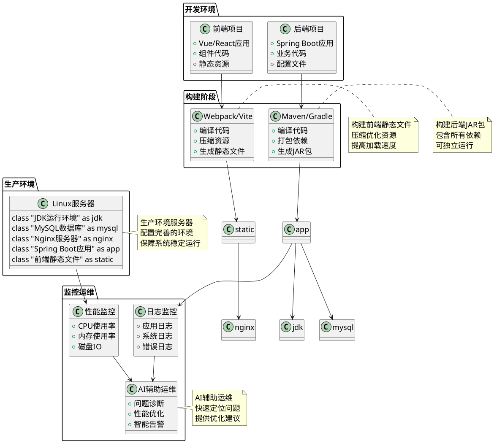
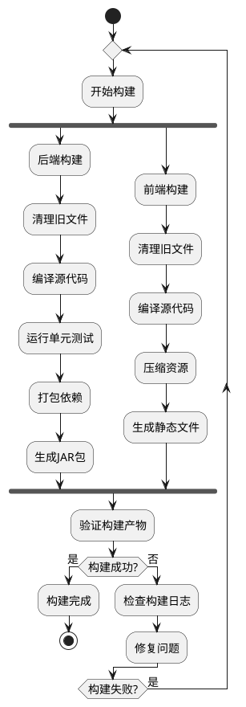
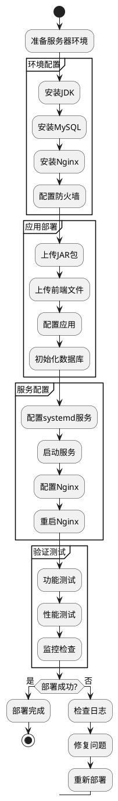

# 项目七 实施项目部署

在项目一至项目六的学习中，我们完成了"农宝"平台的需求分析、数据库设计、后端核心功能开发、日志管理与单元测试、前后端集成、全局处理机制建设等工作。系统功能日趋完善，代码质量不断提升，前后端已经可以顺畅协作，系统具备了完善的异常处理、安全防护和监控能力。然而，随着开发工作的完成，新的挑战逐渐浮现：

"代码在本地运行得好好的，为什么部署到服务器就出问题了？"——开发人员的困惑

"服务器配置这么复杂，每次部署都要花半天时间，有没有更简单的方法？"——运维工程师的期待

"系统上线后，我们怎么知道它运行是否正常？出了问题怎么快速定位？"——项目负责人的担忧

"用户反馈说访问很慢，但我们不知道是网络问题还是服务器问题，该怎么排查？"——技术支持人员的困扰

这些来自一线的真实痛点，指向了一个核心问题：**如何将开发完成的系统顺利部署到生产环境？如何保障系统在生产环境中的稳定运行？如何建立完善的部署和运维体系？**

答案就是本项目要学习的**项目构建打包、服务器部署、系统运维监控**。在这个项目中，我们将一起探索如何构建前后端工程包，如何将系统部署到服务器，如何配置生产环境，如何监控系统运行状态，让系统从"开发完成"走向"成功上线""稳定运行""持续优化"。让我们开始这段从开发到生产的最后关键之旅。

**【价值思考】部署运维中的工程素养**

软件系统的价值不仅在于代码的实现，更在于能够稳定地为用户提供服务。一个专业的软件工程师，不仅要能写出高质量的代码，更要能将代码成功部署到生产环境，并保障系统的稳定运行。在"农宝"项目中，当我们看到系统成功上线，用户能够正常访问和使用时，我们会感受到从开发到生产的完整闭环带来的成就感。部署不是简单的"上传文件"，而是涉及环境配置、资源管理、性能优化、安全防护、监控告警等多个方面的系统工程。正如建筑需要验收交付一样，软件系统也需要经过部署和运维的考验。唯有掌握完善的部署和运维能力，才能让系统真正为用户创造价值，这是成为全栈工程师的必经之路。

## 【项目介绍】

项目七是"农宝"平台开发的收官阶段，承担着将开发完成的系统成功部署到生产环境、保障系统稳定运行的重要使命。在前六个项目中，我们已经完成了业务功能的开发、前后端集成、全局处理机制建设，系统已经具备了完整的业务能力和基础设施。现在，是时候将系统从开发环境迁移到生产环境，让系统真正为用户提供服务。

本项目以"农宝"平台的部署和运维为载体，围绕**项目构建打包、服务器部署、系统运维监控**三大核心任务展开学习。我们将系统介绍如何使用Maven/Gradle构建后端项目，如何使用Webpack/Vite构建前端项目，如何配置服务器环境，如何部署应用，如何监控系统运行状态，如何利用AI工具辅助部署和运维。

在整体系统架构中，部署和运维是连接开发环境和生产环境的桥梁，是保障系统稳定运行的关键环节。这一环节的完善程度，直接影响系统的可用性、性能和用户体验。

本项目的核心内容包括：

1. **项目构建与打包：**学习如何使用构建工具（Maven/Gradle）构建后端项目，如何使用前端构建工具（Webpack/Vite）打包前端项目，生成可部署的工程包。

2. **服务器环境配置：**学习如何配置Linux服务器环境，包括JDK安装、数据库配置、Nginx配置、防火墙配置等，为系统部署做好准备。

3. **应用部署与启动：**学习如何将构建好的工程包部署到服务器，如何配置启动脚本，如何实现服务的自动启动和重启。

4. **系统监控与运维：**学习如何监控系统运行状态，如何查看日志，如何排查问题，如何利用AI工具辅助运维。

5. **AI辅助DevOps：**学习如何利用AI工具辅助构建优化、部署策略选择、问题诊断等，提升部署和运维效率。

项目完成后，将产出以下成果：

* 一套完整的项目构建和打包方案，包含后端JAR包构建、前端静态资源打包、构建脚本编写，实现一键构建。
* 一套完善的服务器环境配置方案，包含JDK、数据库、Nginx、防火墙等配置，确保生产环境稳定可靠。
* 一套标准的应用部署流程，包含部署脚本、启动脚本、服务配置，实现自动化部署。
* 一套系统监控和运维方案，包含日志查看、性能监控、问题排查，保障系统稳定运行。
* 一套AI辅助DevOps实践经验，包括构建优化、部署策略、问题诊断等，提升运维效率。

项目部署架构如图7-1所示。



图7-1 项目部署架构图

如图7-1所示，项目部署流程分为四个阶段：开发环境阶段完成代码编写，构建阶段生成可部署的工程包，生产环境阶段部署应用并提供服务，监控运维阶段保障系统稳定运行。各阶段之间通过清晰的流程组织，形成完整的部署体系。

通过本项目的学习，读者可以建立起完整的部署和运维思维，理解从开发到生产的完整流程，掌握项目构建、服务器配置、应用部署、系统监控等核心技术，并学会利用AI工具辅助部署和运维。本项目产出的构建脚本、部署方案、监控方案，既是本项目的核心成果，也将作为"农宝"平台的重要基础设施，为系统的稳定运行和持续演进提供保障。

在开展具体任务实施前，读者需先行掌握Maven/Gradle构建工具、Linux服务器基础、Nginx配置、系统监控等相关基础知识。本教材将系统介绍上述基础知识，助力读者更好地理解并完成项目任务。

## 【学习目标】

### 【知识目标】

* 掌握Maven/Gradle项目构建原理，理解依赖管理、生命周期、插件机制
* 掌握前端项目构建工具（Webpack/Vite）的使用方法，理解打包优化策略
* 掌握Linux服务器环境配置，理解JDK、数据库、Nginx等组件的配置方法
* 掌握Spring Boot应用部署方法，理解JAR包运行、服务配置、日志管理
* 了解系统监控和运维基础知识，理解日志查看、性能监控、问题排查方法
* 了解AI在DevOps中的应用，掌握AI辅助构建优化、部署策略、问题诊断等方法

### 【能力目标】

* 培养项目构建能力，能够使用构建工具生成可部署的工程包
* 建立服务器配置能力，能够独立配置生产环境，确保系统稳定运行
* 掌握应用部署能力，能够将应用成功部署到服务器并启动服务
* 提升运维监控能力，能够通过日志和监控数据快速定位和解决问题
* 培养DevOps思维，能够站在运维角度思考问题，设计完善的部署方案
* 提升AI工具应用能力，能够利用AI工具辅助部署和运维，提升效率

### 【素质目标】

* 培养工程化思维，理解部署和运维对系统质量的重要性，养成完善部署方案的习惯
* 建立责任意识，理解系统稳定性对业务的影响，对系统运行质量负责
* 培养持续改进意识，理解监控和优化的重要性，追求卓越的系统性能
* 增强问题解决能力，理解问题排查和解决的方法，提升应急响应能力
* 培养团队协作能力，理解DevOps中开发与运维的协作，提升沟通效率

## 【知识储备】

在正式开始动手实践前，让我们先了解一些必备的基础知识。这些知识就像建造房屋前需要了解的建筑原理，掌握它们才能更好地完成系统的部署和运维。

### 7.1 项目构建原理与打包方式

#### 7.1.1 Maven构建原理

Maven是Java项目最常用的构建工具，它通过项目对象模型（POM）管理项目的构建、报告和文档。

**Maven核心概念：**

- **POM（Project Object Model）：**项目对象模型，通过pom.xml文件定义项目信息、依赖关系、构建配置等
- **坐标（Coordinates）：**通过groupId、artifactId、version唯一标识一个依赖
- **仓库（Repository）：**存储依赖和插件的地方，分为本地仓库和远程仓库
- **生命周期（Lifecycle）：**Maven定义了三个生命周期：clean、default、site，每个生命周期包含多个阶段
- **插件（Plugin）：**Maven通过插件执行具体的构建任务，如编译、打包、测试等

**Maven生命周期阶段：**

Maven的default生命周期包含以下主要阶段：

1. **validate：**验证项目是否正确
2. **compile：**编译源代码
3. **test：**运行单元测试
4. **package：**打包编译后的代码（生成JAR或WAR）
5. **verify：**验证集成测试
6. **install：**安装到本地仓库
7. **deploy：**部署到远程仓库

**Spring Boot打包：**

Spring Boot使用spring-boot-maven-plugin插件打包，可以生成可执行的JAR包（fat JAR），包含所有依赖，可以直接运行：

```xml
<build>
    <plugins>
        <plugin>
            <groupId>org.springframework.boot</groupId>
            <artifactId>spring-boot-maven-plugin</artifactId>
        </plugin>
    </plugins>
</build>
```

执行`mvn clean package`后，会在target目录下生成`项目名-版本号.jar`文件，可以直接通过`java -jar`命令运行。

#### 7.1.2 前端项目构建

前端项目通常使用Webpack、Vite等构建工具，将源代码编译、打包、优化后生成静态文件。

**Webpack构建原理：**

- **入口（Entry）：**指定打包的入口文件
- **输出（Output）：**指定打包后的文件输出位置
- **加载器（Loader）：**处理非JavaScript文件（如CSS、图片等）
- **插件（Plugin）：**执行更广泛的任务（如代码压缩、环境变量注入等）

**Vite构建原理：**

Vite是新一代前端构建工具，具有以下特点：

- **开发环境：**使用ES模块，无需打包，启动速度快
- **生产环境：**使用Rollup打包，生成优化的静态文件
- **热更新：**基于ES模块的HMR，更新速度快

**前端打包优化：**

- **代码分割：**将代码分割成多个chunk，按需加载
- **资源压缩：**压缩JavaScript、CSS文件，减小体积
- **Tree Shaking：**移除未使用的代码
- **CDN加速：**将静态资源部署到CDN，提高加载速度

#### 7.1.3 构建配置文件

**后端Maven配置（pom.xml）：**

```xml
<?xml version="1.0" encoding="UTF-8"?>
<project xmlns="http://maven.apache.org/POM/4.0.0">
    <modelVersion>4.0.0</modelVersion>
    
    <groupId>org.nong</groupId>
    <artifactId>nongbao-backend</artifactId>
    <version>1.0.0</version>
    <packaging>jar</packaging>
    
    <parent>
        <groupId>org.springframework.boot</groupId>
        <artifactId>spring-boot-starter-parent</artifactId>
        <version>2.7.0</version>
    </parent>
    
    <dependencies>
        <!-- 项目依赖 -->
    </dependencies>
    
    <build>
        <plugins>
            <plugin>
                <groupId>org.springframework.boot</groupId>
                <artifactId>spring-boot-maven-plugin</artifactId>
            </plugin>
        </plugins>
    </build>
</project>
```

**前端Vite配置（vite.config.js）：**

```javascript
import { defineConfig } from 'vite'
import vue from '@vitejs/plugin-vue'

export default defineConfig({
  plugins: [vue()],
  build: {
    outDir: 'dist',
    assetsDir: 'assets',
    sourcemap: false,
    minify: 'terser',
    rollupOptions: {
      output: {
        chunkFileNames: 'js/[name]-[hash].js',
        entryFileNames: 'js/[name]-[hash].js',
        assetFileNames: 'assets/[name]-[hash].[ext]'
      }
    }
  }
})
```

### 7.2 服务器环境与部署原理

#### 7.2.1 Linux服务器基础

**常用Linux命令：**

- **文件操作：**ls、cd、mkdir、rm、cp、mv
- **文件查看：**cat、more、less、tail、head
- **权限管理：**chmod、chown、chgrp
- **进程管理：**ps、top、kill、nohup
- **网络管理：**ifconfig、netstat、ss、ping
- **系统服务：**systemctl、service

**文件权限：**

Linux文件权限分为三类：所有者（owner）、所属组（group）、其他人（others），每类权限包括读（r）、写（w）、执行（x）。

```bash
# 查看文件权限
ls -l filename

# 修改文件权限
chmod 755 filename  # rwxr-xr-x
chmod +x script.sh  # 添加执行权限
```

#### 7.2.2 JDK安装与配置

**安装JDK：**

```bash
# 方式1：使用yum安装（CentOS/RHEL）
sudo yum install java-11-openjdk java-11-openjdk-devel

# 方式2：下载Oracle JDK安装包
wget https://download.oracle.com/java/11/latest/jdk-11_linux-x64_bin.tar.gz
tar -xzf jdk-11_linux-x64_bin.tar.gz
sudo mv jdk-11 /usr/local/

# 配置环境变量
sudo vi /etc/profile
export JAVA_HOME=/usr/local/jdk-11
export PATH=$JAVA_HOME/bin:$PATH

# 使配置生效
source /etc/profile

# 验证安装
java -version
```

#### 7.2.3 MySQL安装与配置

**安装MySQL：**

```bash
# CentOS/RHEL
sudo yum install mysql-server
sudo systemctl start mysqld
sudo systemctl enable mysqld

# 获取初始密码
sudo grep 'temporary password' /var/log/mysqld.log

# 安全配置
sudo mysql_secure_installation
```

**配置MySQL：**

```bash
# 登录MySQL
mysql -u root -p

# 创建数据库
CREATE DATABASE nongbao CHARACTER SET utf8mb4 COLLATE utf8mb4_unicode_ci;

# 创建用户并授权
CREATE USER 'nongbao'@'localhost' IDENTIFIED BY 'password';
GRANT ALL PRIVILEGES ON nongbao.* TO 'nongbao'@'localhost';
FLUSH PRIVILEGES;
```

#### 7.2.4 Nginx安装与配置

**安装Nginx：**

```bash
# CentOS/RHEL
sudo yum install nginx
sudo systemctl start nginx
sudo systemctl enable nginx
```

**Nginx配置：**

```nginx
server {
    listen 80;
    server_name nongbao.example.com;
    
    # 前端静态文件
    location / {
        root /usr/share/nginx/html/nongbao;
        index index.html;
        try_files $uri $uri/ /index.html;
    }
    
    # 后端API代理
    location /api {
        proxy_pass http://localhost:8080;
        proxy_set_header Host $host;
        proxy_set_header X-Real-IP $remote_addr;
        proxy_set_header X-Forwarded-For $proxy_add_x_forwarded_for;
    }
    
    # 静态资源缓存
    location ~* \.(jpg|jpeg|png|gif|ico|css|js)$ {
        root /usr/share/nginx/html/nongbao;
        expires 30d;
        add_header Cache-Control "public, immutable";
    }
}
```

#### 7.2.5 防火墙配置

**CentOS/RHEL防火墙（firewalld）：**

```bash
# 查看防火墙状态
sudo systemctl status firewalld

# 开放端口
sudo firewall-cmd --permanent --add-port=80/tcp
sudo firewall-cmd --permanent --add-port=443/tcp
sudo firewall-cmd --permanent --add-port=8080/tcp
sudo firewall-cmd --reload

# 查看开放的端口
sudo firewall-cmd --list-ports
```

### 7.3 系统运维与监控基础

#### 7.3.1 日志管理

**应用日志：**

Spring Boot应用日志通常使用Logback或Log4j2，日志文件位置在application.yml中配置：

```yaml
logging:
  level:
    root: INFO
    org.nong: DEBUG
  file:
    name: /var/log/nongbao/application.log
    max-size: 10MB
    max-history: 30
```

**日志查看：**

```bash
# 查看日志
tail -f /var/log/nongbao/application.log

# 查看最近100行
tail -n 100 /var/log/nongbao/application.log

# 搜索错误日志
grep ERROR /var/log/nongbao/application.log

# 查看系统日志
journalctl -u nongbao.service -f
```

#### 7.3.2 性能监控

**系统资源监控：**

```bash
# 查看CPU使用率
top
htop

# 查看内存使用
free -h

# 查看磁盘使用
df -h
du -sh /path/to/directory

# 查看网络流量
iftop
nethogs
```

**Java应用监控：**

```bash
# 查看Java进程
jps -l

# 查看JVM内存使用
jmap -heap <pid>

# 查看线程信息
jstack <pid>

# 查看GC信息
jstat -gc <pid> 1000
```

#### 7.3.3 服务管理

**systemd服务配置：**

创建服务文件`/etc/systemd/system/nongbao.service`：

```ini
[Unit]
Description=Nongbao Application
After=network.target mysql.service

[Service]
Type=simple
User=nongbao
WorkingDirectory=/opt/nongbao
ExecStart=/usr/bin/java -jar /opt/nongbao/nongbao-backend.jar
Restart=always
RestartSec=10
StandardOutput=journal
StandardError=journal

[Install]
WantedBy=multi-user.target
```

**服务管理命令：**

```bash
# 启动服务
sudo systemctl start nongbao

# 停止服务
sudo systemctl stop nongbao

# 重启服务
sudo systemctl restart nongbao

# 查看服务状态
sudo systemctl status nongbao

# 设置开机自启
sudo systemctl enable nongbao

# 查看服务日志
sudo journalctl -u nongbao.service -f
```

### 7.4 AI驱动的DevOps与智能部署

#### 7.4.1 AI在构建优化中的应用

AI工具可以分析构建日志，识别构建瓶颈，提供优化建议：

- **依赖分析：**识别未使用的依赖，建议移除
- **构建时间优化：**分析构建时间分布，找出耗时步骤
- **缓存策略：**建议合理的缓存配置，加速构建

#### 7.4.2 AI在部署策略中的应用

AI工具可以分析系统架构和需求，推荐合适的部署策略：

- **部署方式选择：**单机部署、集群部署、容器化部署
- **资源评估：**根据业务量评估所需服务器资源
- **风险评估：**识别部署过程中的潜在风险

#### 7.4.3 AI在问题诊断中的应用

AI工具可以分析日志和监控数据，快速定位问题：

- **日志分析：**从大量日志中提取关键信息，识别异常模式
- **性能分析：**分析性能数据，找出性能瓶颈
- **根因分析：**关联多个系统指标，定位问题根本原因

---

**知识储备小结：**

通过以上四个知识点的学习，我们已经掌握了项目部署所需的核心知识：

1. **项目构建：**理解了Maven和前端构建工具的原理，掌握了打包方法
2. **服务器配置：**理解了Linux服务器环境配置，掌握了JDK、MySQL、Nginx等组件的安装和配置
3. **系统运维：**理解了日志管理、性能监控、服务管理的方法
4. **AI辅助：**了解了AI在DevOps中的应用场景

接下来，让我们进入实践环节，将这些知识应用到"农宝"项目的部署中。

## 任务一：构建前后端项目工程包

### 【任务描述】

本任务是项目部署的第一步，需要将开发完成的前后端项目构建成可部署的工程包。具体包括：

1. **配置后端构建：**配置Maven构建脚本，确保能够生成可执行的JAR包。
2. **配置前端构建：**配置前端构建工具（Webpack/Vite），生成优化的静态文件。
3. **环境配置分离：**区分开发环境和生产环境的配置文件。
4. **构建脚本编写：**编写自动化构建脚本，实现一键构建。
5. **构建验证：**验证构建产物是否正确，确保可以正常运行。

通过本任务的学习，你将掌握项目构建的标准流程，建立起从源代码到可部署产物的完整构建能力。

### 【任务分析】

在开发环境中，我们通常使用IDE直接运行项目，或者使用开发服务器（如Spring Boot DevTools、Vite Dev Server）。但在生产环境中，我们需要将项目构建成可部署的工程包。

**现有问题：**

1. **构建配置不完整：**Maven配置可能缺少生产环境所需的插件和配置
2. **环境配置混乱：**开发环境和生产环境的配置混在一起
3. **构建流程不标准：**没有统一的构建流程和脚本
4. **构建产物未验证：**构建完成后没有验证产物是否正确

**改进方案：**

建立标准的构建流程，配置完善的构建脚本，分离环境配置，验证构建产物。构建流程如图7-2所示。



图7-2 项目构建流程图

如图7-2所示，构建流程分为后端构建和前端构建两个并行流程，最后统一验证构建产物。如果构建失败，需要检查日志并修复问题后重新构建。

### 【实现步骤】

#### 步骤1：配置后端Maven构建

检查并完善pom.xml配置，确保能够生成可执行的JAR包。

**代码7-1 完整的pom.xml配置**

```xml
<?xml version="1.0" encoding="UTF-8"?>
<project xmlns="http://maven.apache.org/POM/4.0.0"
         xmlns:xsi="http://www.w3.org/2001/XMLSchema-instance"
         xsi:schemaLocation="http://maven.apache.org/POM/4.0.0 
         http://maven.apache.org/xsd/maven-4.0.0.xsd">
    <modelVersion>4.0.0</modelVersion>

    <groupId>org.nong</groupId>
    <artifactId>nongbao-backend</artifactId>
    <version>1.0.0</version>
    <packaging>jar</packaging>
    <name>nongbao-backend</name>
    <description>农宝平台后端系统</description>

    <parent>
        <groupId>org.springframework.boot</groupId>
        <artifactId>spring-boot-starter-parent</artifactId>
        <version>2.7.0</version>
        <relativePath/>
    </parent>

    <properties>
        <java.version>11</java.version>
        <maven.compiler.source>11</maven.compiler.source>
        <maven.compiler.target>11</maven.compiler.target>
        <project.build.sourceEncoding>UTF-8</project.build.sourceEncoding>
    </properties>

    <dependencies>
        <!-- Spring Boot Starter Web -->
        <dependency>
            <groupId>org.springframework.boot</groupId>
            <artifactId>spring-boot-starter-web</artifactId>
        </dependency>

        <!-- Spring Boot Starter AOP -->
        <dependency>
            <groupId>org.springframework.boot</groupId>
            <artifactId>spring-boot-starter-aop</artifactId>
        </dependency>

        <!-- MyBatis -->
        <dependency>
            <groupId>org.mybatis.spring.boot</groupId>
            <artifactId>mybatis-spring-boot-starter</artifactId>
            <version>2.2.2</version>
        </dependency>

        <!-- MySQL驱动 -->
        <dependency>
            <groupId>mysql</groupId>
            <artifactId>mysql-connector-java</artifactId>
            <scope>runtime</scope>
        </dependency>

        <!-- JWT -->
        <dependency>
            <groupId>io.jsonwebtoken</groupId>
            <artifactId>jjwt-api</artifactId>
            <version>0.11.5</version>
        </dependency>
        <dependency>
            <groupId>io.jsonwebtoken</groupId>
            <artifactId>jjwt-impl</artifactId>
            <version>0.11.5</version>
            <scope>runtime</scope>
        </dependency>
        <dependency>
            <groupId>io.jsonwebtoken</groupId>
            <artifactId>jjwt-jackson</artifactId>
            <version>0.11.5</version>
            <scope>runtime</scope>
        </dependency>

        <!-- Lombok -->
        <dependency>
            <groupId>org.projectlombok</groupId>
            <artifactId>lombok</artifactId>
            <optional>true</optional>
        </dependency>

        <!-- 测试依赖 -->
        <dependency>
            <groupId>org.springframework.boot</groupId>
            <artifactId>spring-boot-starter-test</artifactId>
            <scope>test</scope>
        </dependency>
    </dependencies>

    <build>
        <finalName>${project.artifactId}-${project.version}</finalName>
        <plugins>
            <!-- Spring Boot Maven Plugin -->
            <plugin>
                <groupId>org.springframework.boot</groupId>
                <artifactId>spring-boot-maven-plugin</artifactId>
                <configuration>
                    <excludes>
                        <exclude>
                            <groupId>org.projectlombok</groupId>
                            <artifactId>lombok</artifactId>
                        </exclude>
                    </excludes>
                </configuration>
            </plugin>

            <!-- Maven Compiler Plugin -->
            <plugin>
                <groupId>org.apache.maven.plugins</groupId>
                <artifactId>maven-compiler-plugin</artifactId>
                <version>3.8.1</version>
                <configuration>
                    <source>11</source>
                    <target>11</target>
                    <encoding>UTF-8</encoding>
                </configuration>
            </plugin>

            <!-- Maven Surefire Plugin (测试) -->
            <plugin>
                <groupId>org.apache.maven.plugins</groupId>
                <artifactId>maven-surefire-plugin</artifactId>
                <version>2.22.2</version>
                <configuration>
                    <skipTests>false</skipTests>
                </configuration>
            </plugin>
        </plugins>
    </build>
</project>
```

**代码说明：**

1. **parent配置：**继承spring-boot-starter-parent，统一管理Spring Boot版本和插件版本
2. **properties配置：**指定Java版本、编码格式等属性
3. **dependencies配置：**定义项目依赖，包括Spring Boot、MyBatis、MySQL、JWT等
4. **build配置：**配置构建插件，spring-boot-maven-plugin用于生成可执行JAR包
5. **finalName配置：**指定生成的JAR包名称

#### 步骤2：配置环境配置文件

分离开发环境和生产环境的配置。

**代码7-2 application.yml（主配置）**

```yaml
spring:
  profiles:
    active: @spring.profiles.active@
  application:
    name: nongbao-backend

server:
  port: 8080
  servlet:
    context-path: /

logging:
  level:
    root: INFO
    org.nong: DEBUG
  pattern:
    console: "%d{yyyy-MM-dd HH:mm:ss} [%thread] %-5level %logger{50} - %msg%n"
    file: "%d{yyyy-MM-dd HH:mm:ss} [%thread] %-5level %logger{50} - %msg%n"
```

**代码7-3 application-dev.yml（开发环境）**

```yaml
spring:
  datasource:
    driver-class-name: com.mysql.cj.jdbc.Driver
    url: jdbc:mysql://localhost:3306/nongbao?useUnicode=true&characterEncoding=utf8&useSSL=false&serverTimezone=Asia/Shanghai
    username: root
    password: root

mybatis:
  mapper-locations: classpath:mapper/*.xml
  type-aliases-package: org.nong.entity
  configuration:
    map-underscore-to-camel-case: true

jwt:
  secret-key: dev-secret-key-for-jwt-token-generation
  expiration-time: 604800000  # 7天
```

**代码7-4 application-prod.yml（生产环境）**

```yaml
spring:
  datasource:
    driver-class-name: com.mysql.cj.jdbc.Driver
    url: jdbc:mysql://${DB_HOST:localhost}:${DB_PORT:3306}/${DB_NAME:nongbao}?useUnicode=true&characterEncoding=utf8&useSSL=true&serverTimezone=Asia/Shanghai
    username: ${DB_USERNAME:nongbao}
    password: ${DB_PASSWORD:}
    hikari:
      maximum-pool-size: 20
      minimum-idle: 5
      connection-timeout: 30000
      idle-timeout: 600000
      max-lifetime: 1800000

mybatis:
  mapper-locations: classpath:mapper/*.xml
  type-aliases-package: org.nong.entity
  configuration:
    map-underscore-to-camel-case: true

jwt:
  secret-key: ${JWT_SECRET_KEY:}
  expiration-time: 172800000  # 2天

logging:
  file:
    name: /var/log/nongbao/application.log
    max-size: 10MB
    max-history: 30
```

**代码说明：**

1. **主配置文件：**使用`@spring.profiles.active@`占位符，构建时替换为实际环境
2. **开发环境配置：**使用本地数据库，配置相对宽松
3. **生产环境配置：**使用环境变量，配置更严格（连接池、日志等）

#### 步骤3：配置Maven资源过滤

在pom.xml中配置资源过滤，替换配置文件中的占位符。

**代码7-5 Maven资源过滤配置**

```xml
<build>
    <resources>
        <resource>
            <directory>src/main/resources</directory>
            <filtering>true</filtering>
            <includes>
                <include>**/*.yml</include>
                <include>**/*.yaml</include>
                <include>**/*.properties</include>
            </includes>
        </resource>
        <resource>
            <directory>src/main/resources</directory>
            <filtering>false</filtering>
            <excludes>
                <exclude>**/*.yml</exclude>
                <exclude>**/*.yaml</exclude>
                <exclude>**/*.properties</exclude>
            </excludes>
        </resource>
    </resources>
</build>
```

在pom.xml的properties中定义占位符值：

```xml
<properties>
    <spring.profiles.active>prod</spring.profiles.active>
</properties>
```

#### 步骤4：编写构建脚本

编写自动化构建脚本，实现一键构建。

**代码7-6 build.sh（Linux构建脚本）**

```bash
#!/bin/bash

# 构建脚本
# 用法: ./build.sh [dev|prod]

ENV=${1:-prod}
echo "开始构建，环境: $ENV"

# 设置Maven属性
export MAVEN_OPTS="-Xmx1024m"

# 清理并构建
mvn clean package -DskipTests -P$ENV

# 检查构建结果
if [ $? -eq 0 ]; then
    echo "构建成功！"
    echo "JAR包位置: target/nongbao-backend-1.0.0.jar"
    ls -lh target/nongbao-backend-1.0.0.jar
else
    echo "构建失败，请检查日志"
    exit 1
fi
```

**代码7-7 build.bat（Windows构建脚本）**

```batch
@echo off
setlocal

set ENV=%1
if "%ENV%"=="" set ENV=prod
echo 开始构建，环境: %ENV%

call mvn clean package -DskipTests -P%ENV%

if %ERRORLEVEL% EQU 0 (
    echo 构建成功！
    echo JAR包位置: target\nongbao-backend-1.0.0.jar
    dir target\nongbao-backend-1.0.0.jar
) else (
    echo 构建失败，请检查日志
    exit /b 1
)
```

#### 步骤5：配置前端构建

配置前端项目的构建工具。

**代码7-8 vite.config.js（Vite配置）**

```javascript
import { defineConfig } from 'vite'
import vue from '@vitejs/plugin-vue'
import { resolve } from 'path'

export default defineConfig({
  plugins: [vue()],
  resolve: {
    alias: {
      '@': resolve(__dirname, 'src')
    }
  },
  server: {
    port: 3000,
    proxy: {
      '/api': {
        target: 'http://localhost:8080',
        changeOrigin: true
      }
    }
  },
  build: {
    outDir: 'dist',
    assetsDir: 'assets',
    sourcemap: false,
    minify: 'terser',
    terserOptions: {
      compress: {
        drop_console: true,
        drop_debugger: true
      }
    },
    rollupOptions: {
      output: {
        chunkFileNames: 'js/[name]-[hash].js',
        entryFileNames: 'js/[name]-[hash].js',
        assetFileNames: 'assets/[name]-[hash].[ext]',
        manualChunks: {
          'vue-vendor': ['vue', 'vue-router', 'vuex'],
          'element-ui': ['element-plus']
        }
      }
    },
    chunkSizeWarningLimit: 1000
  }
})
```

**代码7-9 package.json（构建脚本）**

```json
{
  "name": "nongbao-frontend",
  "version": "1.0.0",
  "scripts": {
    "dev": "vite",
    "build": "vite build",
    "build:prod": "vite build --mode production",
    "preview": "vite preview"
  },
  "dependencies": {
    "vue": "^3.2.0",
    "vue-router": "^4.0.0",
    "vuex": "^4.0.0",
    "axios": "^0.27.0",
    "element-plus": "^2.0.0"
  },
  "devDependencies": {
    "@vitejs/plugin-vue": "^3.0.0",
    "vite": "^3.0.0",
    "terser": "^5.0.0"
  }
}
```

#### 步骤6：验证构建产物

构建完成后，验证构建产物是否正确。

**验证后端JAR包：**

```bash
# 查看JAR包信息
jar -tf target/nongbao-backend-1.0.0.jar | head -20

# 测试运行（本地）
java -jar target/nongbao-backend-1.0.0.jar --spring.profiles.active=dev

# 检查启动日志
tail -f logs/application.log
```

**验证前端构建产物：**

```bash
# 查看构建产物
ls -lh dist/

# 检查文件大小
du -sh dist/

# 本地预览
npm run preview
```

### 【AI辅助环节】

#### 1. AI优化构建流程和依赖管理

**适用场景：**当你发现构建时间过长或依赖冲突时，可以让AI帮助分析和优化。

**实践步骤：**

**步骤1：向AI提供构建信息**

```
我的Spring Boot项目构建时间很长，请帮我分析：

1. pom.xml依赖配置
2. 构建日志（如果有）
3. 项目结构

请帮我：
1. 识别未使用的依赖
2. 优化依赖版本
3. 建议构建优化方案
```

**步骤2：AI分析结果**

AI会分析依赖关系，识别问题，提供优化建议，如移除未使用的依赖、升级版本、使用BOM管理等。

#### 2. 智能打包策略和资源压缩

**适用场景：**当你需要优化构建产物大小时，可以让AI帮助分析并提供优化建议。

**实践步骤：**

向AI提供构建配置和产物信息，AI会分析并提供优化建议，如代码分割、资源压缩、Tree Shaking等。

#### 3. 构建时间优化和缓存策略

**适用场景：**当你需要加速构建时，可以让AI帮助分析构建时间分布并提供优化建议。

**实践步骤：**

向AI提供构建日志，AI会分析构建时间分布，识别瓶颈，提供优化建议，如并行构建、缓存策略、增量构建等。

### 【常见问题与调试】

**问题1：Maven构建失败，提示找不到依赖**

**原因：**可能是仓库配置问题或网络问题。

**解决：**
1. 检查Maven仓库配置（settings.xml）
2. 清理本地仓库缓存：`mvn clean`
3. 强制更新依赖：`mvn clean install -U`

**问题2：构建的JAR包无法运行**

**原因：**可能是缺少spring-boot-maven-plugin插件或配置不正确。

**解决：**检查pom.xml中是否配置了spring-boot-maven-plugin插件。

**问题3：前端构建产物过大**

**原因：**可能是没有启用代码压缩或代码分割。

**解决：**检查构建配置，启用压缩和代码分割。

---

**任务一小结：**

通过本任务的学习，我们完成了前后端项目工程包的构建：

1. ✅ 配置了后端Maven构建，确保能够生成可执行的JAR包
2. ✅ 配置了前端构建工具，生成优化的静态文件
3. ✅ 分离了开发环境和生产环境的配置
4. ✅ 编写了自动化构建脚本，实现一键构建
5. ✅ 验证了构建产物，确保可以正常运行
6. ✅ 学习了使用AI工具优化构建流程

现在，我们已经有了可部署的工程包，接下来让我们将这些工程包部署到服务器。

## 任务二：部署项目至服务器并完成线上验证

### 【任务描述】

本任务是项目部署的核心环节，需要将构建好的工程包部署到服务器，配置生产环境，启动服务，并完成线上验证。具体包括：

1. **服务器环境准备：**安装和配置JDK、MySQL、Nginx等必要组件。
2. **应用部署：**将构建好的JAR包和前端静态文件部署到服务器。
3. **服务配置：**配置systemd服务，实现服务的自动启动和重启。
4. **Nginx配置：**配置Nginx反向代理，实现前后端统一访问。
5. **线上验证：**验证系统功能是否正常，性能是否满足要求。
6. **监控配置：**配置日志和监控，保障系统稳定运行。

通过本任务的学习，你将掌握服务器部署的标准流程，建立起从构建到上线的完整部署能力。

### 【任务分析】

在开发环境中，我们使用IDE直接运行项目，但在生产环境中，我们需要将应用部署到服务器，并配置完善的环境。

**现有问题：**

1. **环境配置不熟悉：**不熟悉Linux服务器环境配置
2. **部署流程不标准：**没有标准的部署流程和脚本
3. **服务管理不规范：**没有配置系统服务，重启需要手动操作
4. **监控不完善：**缺少完善的监控和告警机制

**改进方案：**

建立标准的部署流程，配置完善的环境，使用systemd管理服务，配置Nginx反向代理，建立监控体系。部署流程如图7-3所示。



图7-3 项目部署流程图

如图7-3所示，部署流程分为环境配置、应用部署、服务配置、验证测试四个阶段。如果部署失败，需要检查日志并修复问题后重新部署。

### 【实现步骤】

#### 步骤1：准备服务器环境

**安装JDK：**

```bash
# 检查是否已安装Java
java -version

# 如果没有安装，使用yum安装
sudo yum install java-11-openjdk java-11-openjdk-devel

# 验证安装
java -version
javac -version
```

**安装MySQL：**

```bash
# 安装MySQL
sudo yum install mysql-server

# 启动MySQL
sudo systemctl start mysqld
sudo systemctl enable mysqld

# 获取初始密码
sudo grep 'temporary password' /var/log/mysqld.log

# 安全配置
sudo mysql_secure_installation

# 登录MySQL并创建数据库
mysql -u root -p
CREATE DATABASE nongbao CHARACTER SET utf8mb4 COLLATE utf8mb4_unicode_ci;
CREATE USER 'nongbao'@'localhost' IDENTIFIED BY 'your_password';
GRANT ALL PRIVILEGES ON nongbao.* TO 'nongbao'@'localhost';
FLUSH PRIVILEGES;
EXIT;
```

**安装Nginx：**

```bash
# 安装Nginx
sudo yum install nginx

# 启动Nginx
sudo systemctl start nginx
sudo systemctl enable nginx

# 验证安装
curl http://localhost
```

**配置防火墙：**

```bash
# 开放端口
sudo firewall-cmd --permanent --add-port=80/tcp
sudo firewall-cmd --permanent --add-port=443/tcp
sudo firewall-cmd --permanent --add-port=8080/tcp
sudo firewall-cmd --reload

# 查看开放的端口
sudo firewall-cmd --list-ports
```

#### 步骤2：部署后端应用

**创建应用目录：**

```bash
# 创建应用目录
sudo mkdir -p /opt/nongbao
sudo mkdir -p /var/log/nongbao
sudo chown -R nongbao:nongbao /opt/nongbao
sudo chown -R nongbao:nongbao /var/log/nongbao
```

**上传JAR包：**

```bash
# 使用scp上传（从本地）
scp target/nongbao-backend-1.0.0.jar user@server:/opt/nongbao/

# 或使用FTP工具上传
```

**创建启动脚本：**

**代码7-10 start.sh（启动脚本）**

```bash
#!/bin/bash

APP_NAME="nongbao-backend"
APP_JAR="/opt/nongbao/nongbao-backend-1.0.0.jar"
APP_LOG="/var/log/nongbao/application.log"
JAVA_OPTS="-Xms512m -Xmx1024m -XX:+UseG1GC"

cd /opt/nongbao

nohup java $JAVA_OPTS -jar $APP_JAR \
    --spring.profiles.active=prod \
    > $APP_LOG 2>&1 &

echo $! > /opt/nongbao/app.pid
echo "$APP_NAME started, PID: $(cat /opt/nongbao/app.pid)"
```

**创建停止脚本：**

**代码7-11 stop.sh（停止脚本）**

```bash
#!/bin/bash

APP_NAME="nongbao-backend"
PID_FILE="/opt/nongbao/app.pid"

if [ -f $PID_FILE ]; then
    PID=$(cat $PID_FILE)
    if ps -p $PID > /dev/null; then
        kill $PID
        echo "$APP_NAME stopped, PID: $PID"
        rm -f $PID_FILE
    else
        echo "$APP_NAME is not running"
        rm -f $PID_FILE
    fi
else
    echo "$APP_NAME is not running"
fi
```

**设置脚本权限：**

```bash
chmod +x /opt/nongbao/start.sh
chmod +x /opt/nongbao/stop.sh
```

#### 步骤3：配置systemd服务

创建systemd服务文件。

**代码7-12 /etc/systemd/system/nongbao.service**

```ini
[Unit]
Description=Nongbao Backend Application
After=network.target mysql.service

[Service]
Type=simple
User=nongbao
Group=nongbao
WorkingDirectory=/opt/nongbao
ExecStart=/usr/bin/java -Xms512m -Xmx1024m -XX:+UseG1GC -jar /opt/nongbao/nongbao-backend-1.0.0.jar --spring.profiles.active=prod
ExecStop=/bin/kill -15 $MAINPID
Restart=always
RestartSec=10
StandardOutput=journal
StandardError=journal
SyslogIdentifier=nongbao

[Install]
WantedBy=multi-user.target
```

**启动服务：**

```bash
# 重新加载systemd配置
sudo systemctl daemon-reload

# 启动服务
sudo systemctl start nongbao

# 设置开机自启
sudo systemctl enable nongbao

# 查看服务状态
sudo systemctl status nongbao

# 查看服务日志
sudo journalctl -u nongbao.service -f
```

#### 步骤4：部署前端应用

**上传前端文件：**

```bash
# 创建前端目录
sudo mkdir -p /usr/share/nginx/html/nongbao

# 上传前端构建产物
scp -r dist/* user@server:/usr/share/nginx/html/nongbao/

# 或使用FTP工具上传
```

**配置Nginx：**

**代码7-13 /etc/nginx/conf.d/nongbao.conf**

```nginx
server {
    listen 80;
    server_name nongbao.example.com;  # 修改为实际域名或IP

    # 前端静态文件
    location / {
        root /usr/share/nginx/html/nongbao;
        index index.html;
        try_files $uri $uri/ /index.html;
    }

    # 后端API代理
    location /api {
        proxy_pass http://localhost:8080;
        proxy_set_header Host $host;
        proxy_set_header X-Real-IP $remote_addr;
        proxy_set_header X-Forwarded-For $proxy_add_x_forwarded_for;
        proxy_set_header X-Forwarded-Proto $scheme;
        
        # 超时设置
        proxy_connect_timeout 60s;
        proxy_send_timeout 60s;
        proxy_read_timeout 60s;
    }

    # 静态资源缓存
    location ~* \.(jpg|jpeg|png|gif|ico|css|js|woff|woff2|ttf|svg)$ {
        root /usr/share/nginx/html/nongbao;
        expires 30d;
        add_header Cache-Control "public, immutable";
    }

    # 日志配置
    access_log /var/log/nginx/nongbao_access.log;
    error_log /var/log/nginx/nongbao_error.log;
}
```

**重启Nginx：**

```bash
# 测试Nginx配置
sudo nginx -t

# 重启Nginx
sudo systemctl restart nginx

# 查看Nginx状态
sudo systemctl status nginx
```

#### 步骤5：配置环境变量

创建环境变量配置文件。

**代码7-14 /opt/nongbao/.env**

```bash
# 数据库配置
DB_HOST=localhost
DB_PORT=3306
DB_NAME=nongbao
DB_USERNAME=nongbao
DB_PASSWORD=your_password

# JWT配置
JWT_SECRET_KEY=your-secret-key-here-should-be-very-long-and-random

# 其他配置
SPRING_PROFILES_ACTIVE=prod
```

修改systemd服务文件，加载环境变量：

```ini
[Service]
EnvironmentFile=/opt/nongbao/.env
ExecStart=/usr/bin/java -Xms512m -Xmx1024m -XX:+UseG1GC -jar /opt/nongbao/nongbao-backend-1.0.0.jar --spring.profiles.active=${SPRING_PROFILES_ACTIVE}
```

#### 步骤6：初始化数据库

**导入数据库脚本：**

```bash
# 导入数据库结构和数据
mysql -u nongbao -p nongbao < /path/to/nongbao.sql

# 或使用MySQL客户端导入
mysql -u nongbao -p
USE nongbao;
SOURCE /path/to/nongbao.sql;
```

#### 步骤7：线上验证

**功能验证：**

```bash
# 测试后端API
curl http://localhost:8080/api/auth/login

# 测试前端访问
curl http://localhost/

# 测试Nginx代理
curl http://localhost/api/auth/login
```

**性能验证：**

```bash
# 查看系统资源
top
free -h
df -h

# 查看应用日志
tail -f /var/log/nongbao/application.log

# 查看Nginx日志
tail -f /var/log/nginx/nongbao_access.log
```

**监控检查：**

```bash
# 检查服务状态
sudo systemctl status nongbao
sudo systemctl status nginx
sudo systemctl status mysqld

# 检查端口监听
sudo netstat -tlnp | grep -E '8080|80|3306'

# 检查进程
ps aux | grep java
ps aux | grep nginx
```

### 【AI辅助环节】

#### 1. AI辅助服务器环境配置和优化

**适用场景：**当你需要配置服务器环境时，可以让AI帮助生成配置脚本和优化建议。

**实践步骤：**

**步骤1：向AI描述服务器需求**

```
我需要配置一台CentOS 7服务器，用于部署Spring Boot应用，请帮我：

1. 生成JDK安装脚本
2. 生成MySQL安装和配置脚本
3. 生成Nginx安装和配置脚本
4. 提供防火墙配置建议
5. 提供系统优化建议
```

**步骤2：AI生成配置脚本**

AI会生成完整的配置脚本，包括安装、配置、优化等步骤。

#### 2. 智能部署策略选择和风险评估

**适用场景：**当你需要选择部署策略时，可以让AI帮助分析并推荐合适的方案。

**实践步骤：**

向AI描述系统架构和需求，AI会分析并推荐合适的部署策略，如单机部署、集群部署、容器化部署等，并评估风险。

#### 3. 线上问题智能诊断和解决方案

**适用场景：**当系统上线后出现问题，可以让AI帮助分析日志和监控数据，快速定位问题。

**实践步骤：**

向AI提供错误日志、监控数据、系统信息等，AI会分析并提供问题诊断和解决方案。

### 【常见问题与调试】

**问题1：服务启动失败**

**原因：**可能是端口被占用、配置文件错误、依赖缺失等。

**解决：**
1. 查看服务日志：`sudo journalctl -u nongbao.service -n 50`
2. 检查端口占用：`sudo netstat -tlnp | grep 8080`
3. 检查配置文件：`java -jar app.jar --spring.profiles.active=prod --debug`

**问题2：数据库连接失败**

**原因：**可能是数据库未启动、用户名密码错误、网络问题等。

**解决：**
1. 检查MySQL服务：`sudo systemctl status mysqld`
2. 测试数据库连接：`mysql -u nongbao -p -h localhost`
3. 检查防火墙：`sudo firewall-cmd --list-all`

**问题3：Nginx代理失败**

**原因：**可能是Nginx配置错误、后端服务未启动、端口问题等。

**解决：**
1. 检查Nginx配置：`sudo nginx -t`
2. 查看Nginx日志：`tail -f /var/log/nginx/error.log`
3. 测试后端服务：`curl http://localhost:8080/api/health`

---

**任务二小结：**

通过本任务的学习，我们完成了项目部署和线上验证：

1. ✅ 准备了服务器环境，安装了JDK、MySQL、Nginx等必要组件
2. ✅ 部署了后端应用，配置了systemd服务
3. ✅ 部署了前端应用，配置了Nginx反向代理
4. ✅ 配置了环境变量，实现了配置的灵活管理
5. ✅ 初始化了数据库，导入了数据
6. ✅ 完成了线上验证，确保系统正常运行
7. ✅ 学习了使用AI工具辅助部署和运维

现在，我们的系统已经成功部署到生产环境，可以为用户提供服务了。

## 【扩展学习：容器化部署简介(Docker)】

### Docker基础概念

Docker是一种容器化技术，可以将应用及其依赖打包成容器，实现"一次构建，到处运行"。

**核心概念：**

- **镜像（Image）：**只读的模板，用于创建容器
- **容器（Container）：**镜像的运行实例
- **仓库（Repository）：**存储镜像的地方
- **Dockerfile：**用于构建镜像的脚本文件

### Dockerfile示例

**后端Dockerfile：**

```dockerfile
FROM openjdk:11-jre-slim

WORKDIR /app

COPY target/nongbao-backend-1.0.0.jar app.jar

EXPOSE 8080

ENTRYPOINT ["java", "-jar", "app.jar"]
```

**前端Dockerfile：**

```dockerfile
FROM nginx:alpine

COPY dist /usr/share/nginx/html

COPY nginx.conf /etc/nginx/conf.d/default.conf

EXPOSE 80

CMD ["nginx", "-g", "daemon off;"]
```

### Docker Compose示例

```yaml
version: '3.8'

services:
  backend:
    build: ./backend
    ports:
      - "8080:8080"
    environment:
      - SPRING_PROFILES_ACTIVE=prod
      - DB_HOST=mysql
    depends_on:
      - mysql

  frontend:
    build: ./frontend
    ports:
      - "80:80"
    depends_on:
      - backend

  mysql:
    image: mysql:8.0
    environment:
      - MYSQL_ROOT_PASSWORD=root
      - MYSQL_DATABASE=nongbao
    volumes:
      - mysql_data:/var/lib/mysql

volumes:
  mysql_data:
```

### Docker部署优势

- **环境一致性：**开发、测试、生产环境完全一致
- **快速部署：**容器启动速度快，部署简单
- **资源隔离：**容器之间相互隔离，互不影响
- **易于扩展：**可以快速扩展容器数量

## 【项目小结】

通过项目七的系统学习，我们完成了"农宝"平台从开发到生产的完整部署流程：

1. **项目构建阶段：**配置了Maven和前端构建工具，实现了前后端项目的自动化构建，生成了可部署的工程包
2. **服务器环境配置阶段：**安装了JDK、MySQL、Nginx等必要组件，配置了防火墙，为系统部署做好准备
3. **应用部署阶段：**将构建好的工程包部署到服务器，配置了systemd服务，实现了服务的自动启动和重启
4. **Nginx配置阶段：**配置了Nginx反向代理，实现了前后端统一访问，优化了静态资源缓存
5. **线上验证阶段：**完成了功能测试、性能测试、监控检查，确保系统正常运行
6. **AI辅助阶段：**学习了使用AI工具辅助构建优化、部署策略选择、问题诊断等，提升了部署和运维效率

项目最终实现了：
- 一套完整的项目构建方案，包含后端JAR包构建、前端静态资源打包、构建脚本编写
- 一套完善的服务器环境配置方案，包含JDK、MySQL、Nginx、防火墙等配置
- 一套标准的应用部署流程，包含部署脚本、启动脚本、服务配置
- 一套系统监控和运维方案，包含日志查看、性能监控、问题排查
- 一套AI辅助DevOps实践经验，包括构建优化、部署策略、问题诊断等

通过项目七的学习，我们不仅掌握了项目构建、服务器配置、应用部署、系统监控等核心技术，更重要的是建立了从开发到生产的完整思维。我们学会了如何将开发完成的系统成功部署到生产环境，如何保障系统在生产环境中的稳定运行，如何建立完善的部署和运维体系。部署和运维不是简单的"上传文件"，而是涉及环境配置、资源管理、性能优化、安全防护、监控告警等多个方面的系统工程。这种对系统全生命周期的理解，对生产环境负责的态度，是成为全栈工程师的必经之路。

在整个项目实施过程中，我们学习了使用AI工具辅助构建优化、部署策略选择、问题诊断等，大幅提升了部署和运维效率。从项目一的需求分析，到项目七的成功部署，我们完成了"农宝"平台从0到1的完整开发过程，实现了从开发到生产的完整闭环。

## 【答疑解惑】

**1. 为什么生产环境要使用systemd管理服务？**

systemd是Linux系统的服务管理器，使用systemd管理服务有以下优势：

- **自动启动：**可以配置服务开机自启
- **自动重启：**服务异常退出时自动重启
- **日志管理：**统一管理服务日志
- **依赖管理：**可以配置服务之间的依赖关系
- **资源限制：**可以限制服务的资源使用

**2. 为什么要使用Nginx反向代理？**

使用Nginx反向代理有以下优势：
- **统一入口：**前后端通过统一域名访问
- **负载均衡：**可以配置多个后端服务器
- **静态资源服务：**高效处理静态文件
- **SSL终止：**可以在Nginx层面处理HTTPS
- **缓存优化：**可以配置缓存策略

**3. 如何实现零停机部署？**

实现零停机部署的方法：
- **蓝绿部署：**准备两套环境，切换流量
- **滚动更新：**逐步更新服务实例
- **容器化部署：**使用Docker和Kubernetes实现滚动更新
- **负载均衡：**使用负载均衡器分发流量

**4. 如何监控系统运行状态？**

监控系统运行状态的方法：
- **应用日志：**查看应用日志，了解业务运行情况
- **系统监控：**使用top、htop等工具监控系统资源
- **性能监控：**使用JMX、Prometheus等工具监控应用性能
- **告警机制：**配置告警规则，及时发现问题

**5. 如何保障系统安全？**

保障系统安全的方法：
- **防火墙配置：**只开放必要的端口
- **用户权限：**使用非root用户运行应用
- **密码安全：**使用强密码，定期更换
- **HTTPS：**使用HTTPS加密传输
- **安全更新：**及时更新系统和软件补丁

## 【习题】

### 一、选择题

1. Maven的default生命周期中，哪个阶段用于打包？（ ）

A. compile  
B. test  
C. package  
D. install

答案：C

2. Spring Boot应用打包后生成的文件类型是？（ ）

A. WAR  
B. JAR  
C. EAR  
D. ZIP

答案：B

3. systemd服务配置文件中，哪个字段用于指定服务启动命令？（ ）

A. ExecStart  
B. ExecStop  
C. WorkingDirectory  
D. User

答案：A

4. Nginx反向代理中，哪个指令用于指定后端服务器地址？（ ）

A. proxy_pass  
B. proxy_set_header  
C. proxy_connect_timeout  
D. proxy_read_timeout

答案：A

5. Docker中，哪个文件用于定义镜像构建过程？（ ）

A. Dockerfile  
B. docker-compose.yml  
C. .dockerignore  
D. Dockerfile.yml

答案：A

### 二、填空题

1. Maven的三个生命周期是：__、__和__。

答案：clean、default、site

2. Spring Boot使用__插件打包，生成可执行的JAR包。

答案：spring-boot-maven-plugin

3. systemd服务管理命令中，用于启动服务，用于查看服务状态。

答案：systemctl start、systemctl status

4. Nginx配置文件中，指令用于指定监听的端口，指令用于指定服务器名称。

答案：listen、server_name

5. Docker中，用于构建镜像，用于运行容器。

答案：docker build、docker run

### 三、简答题

1. 简述Maven构建Spring Boot应用的过程。

**参考答案：**

Maven构建Spring Boot应用的过程包括：
1. **清理阶段（clean）：**删除target目录下的旧文件
2. **编译阶段（compile）：**编译源代码，生成class文件
3. **测试阶段（test）：**运行单元测试
4. **打包阶段（package）：**使用spring-boot-maven-plugin插件打包，生成可执行的JAR包
5. **安装阶段（install）：**将JAR包安装到本地仓库

生成的JAR包是fat JAR，包含所有依赖，可以直接通过`java -jar`命令运行。

2. 简述使用systemd管理Spring Boot应用的优势。

**参考答案：**

使用systemd管理Spring Boot应用的优势包括：
1. **自动启动：**可以配置服务开机自启，服务器重启后自动启动应用
2. **自动重启：**服务异常退出时自动重启，提高系统可用性
3. **日志管理：**统一管理服务日志，便于查看和排查问题
4. **依赖管理：**可以配置服务之间的依赖关系，确保依赖服务先启动
5. **资源限制：**可以限制服务的资源使用，防止资源耗尽
6. **状态管理：**可以方便地查看、启动、停止、重启服务

3. 简述Nginx反向代理的配置要点。

**参考答案：**

Nginx反向代理的配置要点包括：
1. **proxy_pass：**指定后端服务器地址，如`proxy_pass http://localhost:8080`
2. **proxy_set_header：**设置请求头，传递客户端信息，如Host、X-Real-IP等
3. **超时设置：**配置连接、发送、读取超时时间，防止请求阻塞
4. **静态资源：**配置静态资源缓存，提高访问速度
5. **日志配置：**配置访问日志和错误日志，便于排查问题
6. **负载均衡：**可以配置多个后端服务器，实现负载均衡

### 四、设计题

1. 设计一套完整的项目部署方案，包括构建、部署、监控等环节。

**参考答案：**

完整的项目部署方案包括：

**1. 构建阶段：**
- 配置Maven构建脚本
- 配置前端构建工具
- 编写自动化构建脚本
- 验证构建产物

**2. 部署阶段：**
- 准备服务器环境（JDK、MySQL、Nginx）
- 部署后端应用（上传JAR包、配置服务）
- 部署前端应用（上传静态文件、配置Nginx）
- 初始化数据库

**3. 监控阶段：**
- 配置日志管理（应用日志、系统日志）
- 配置性能监控（CPU、内存、磁盘）
- 配置告警机制（异常告警、性能告警）

**4. 运维阶段：**
- 定期备份数据库
- 定期更新系统补丁
- 定期检查系统资源
- 定期优化系统性能

2. 设计一套Docker容器化部署方案。

**参考答案：**

Docker容器化部署方案包括：

**1. Dockerfile编写：**
- 后端Dockerfile：基于OpenJDK镜像，复制JAR包，暴露端口
- 前端Dockerfile：基于Nginx镜像，复制静态文件，配置Nginx

**2. Docker Compose配置：**
- 定义后端服务、前端服务、数据库服务
- 配置服务之间的依赖关系
- 配置数据卷持久化

**3. 部署流程：**
- 构建镜像：`docker build -t nongbao-backend .`
- 启动服务：`docker-compose up -d`
- 查看日志：`docker-compose logs -f`
- 停止服务：`docker-compose down`

### 五、实践题

1. 在你的项目中实现完整的构建和部署流程，包括构建脚本、部署脚本、服务配置等。

2. 使用Docker容器化部署你的项目，编写Dockerfile和docker-compose.yml文件。

3. 配置系统监控，包括日志查看、性能监控、告警机制等。

---

**项目七完结寄语：**

恭喜你完成了项目七的学习！通过这个项目，你不仅掌握了项目构建、服务器配置、应用部署、系统监控等核心技术，更重要的是建立了从开发到生产的完整思维。你学会了如何将开发完成的系统成功部署到生产环境，如何保障系统在生产环境中的稳定运行。

在"农宝"平台的开发旅程中，项目七是一个重要的里程碑——我们成功将系统从开发环境迁移到生产环境，让系统真正为用户提供服务。这标志着"农宝"平台从"开发完成"走向了"成功上线"。

从项目一的需求分析，到项目七的成功部署，我们完成了"农宝"平台从0到1的完整开发过程。每一个项目都是一个台阶，每一次学习都是一次成长。你已经从一个初学者成长为能够独立完成企业级应用开发、部署、运维的全栈工程师。

然而，这还不是终点。在后续的学习中，我们还将继续完善系统，探索更多的企业级特性，如微服务架构、容器编排、CI/CD等。但无论系统如何演进，本项目建立的部署和运维能力都将是坚实的基础，为系统的稳定运行提供有力保障。

路漫漫其修远兮，让我们继续前行，用技术服务"三农"，用创新助力乡村振兴！记住：优秀的软件工程师不仅要会写代码，更要能将代码成功部署到生产环境，并保障系统的稳定运行。这是我们的使命，也是我们的追求。

