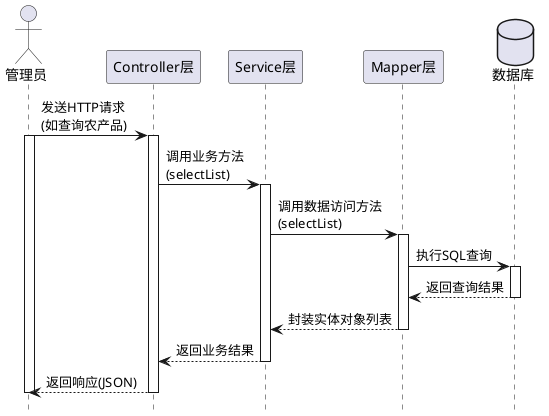
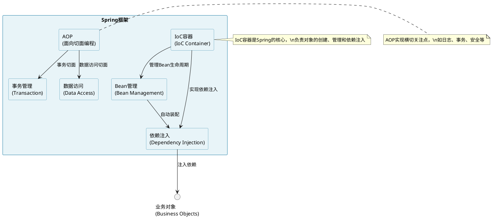
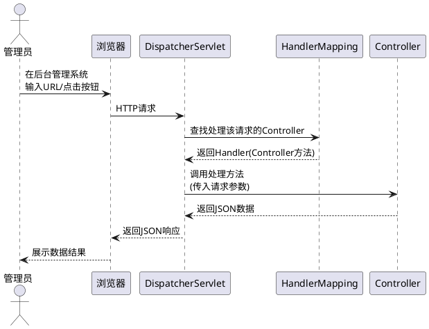
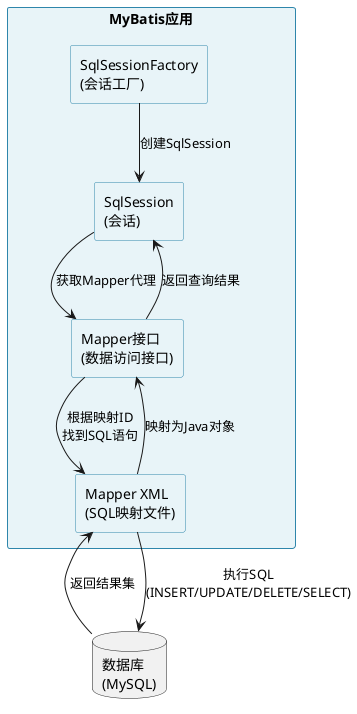
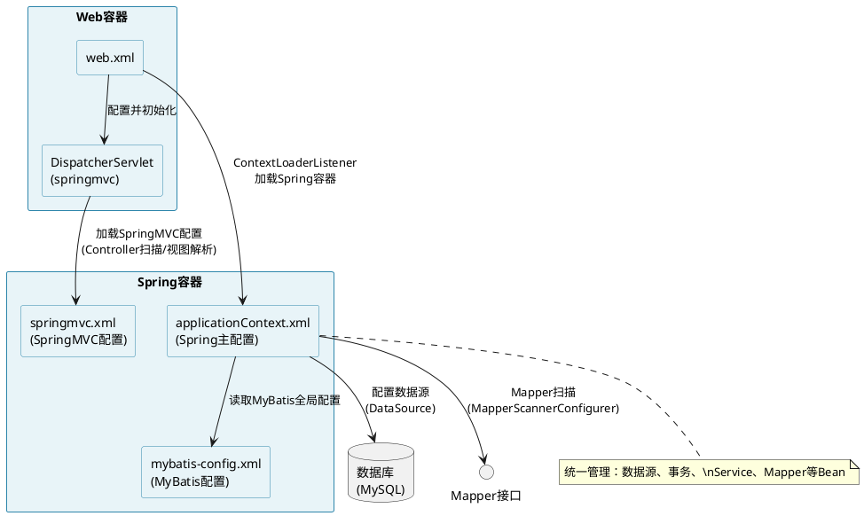
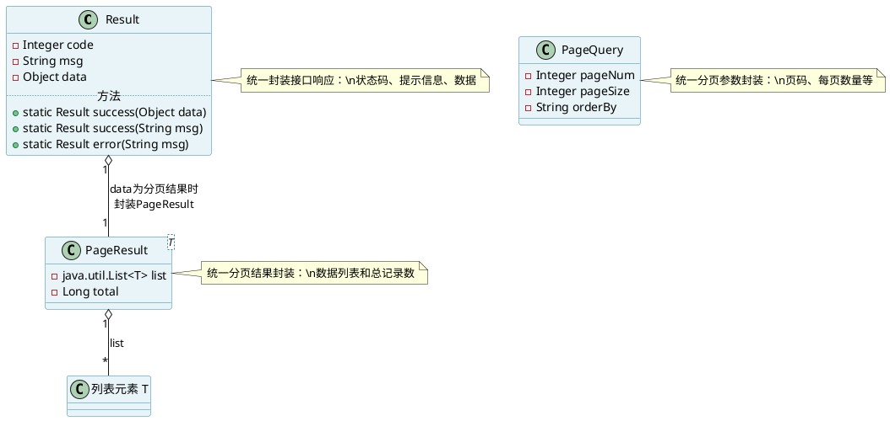

# 项目二：基于SSM框架实现系统基础功能

在项目一中，完成了"农宝"平台的需求分析、架构设计和数据库设计，为系统的开发奠定了坚实的基础。现在，将从设计阶段进入实现阶段，开始编写代码，让"农宝"平台从蓝图变为现实。

"农宝"平台的后端开发采用SSM（Spring + SpringMVC + MyBatis）框架，这是Java企业级开发的主流技术栈。本教材通过本项目，将系统介绍如何使用SSM框架实现系统的核心功能，包括农产品信息管理和农贸市场信息管理两个模块。这两个模块涵盖了企业级应用中最常见的CRUD（增删改查）操作，是学习后端开发的最佳实践。

作为Java开发工程师，面临的挑战是：如何将项目一中设计的数据库表结构转化为Java实体类？如何实现Controller、Service、Mapper三层架构？如何编写规范的代码，确保系统的可维护性和可扩展性？本项目将带领读者体验从数据库设计到代码实现的完整过程，学习如何使用SSM框架构建企业级应用。

**【价值思考】代码质量与工匠精神**

在编写代码时，要时刻牢记：代码不仅是给机器执行的，更是给人阅读和维护的。每一行代码都应该清晰、规范、易读，每一个方法都应该职责单一、逻辑清晰。在"农宝"项目中，严格遵循三层架构设计，Controller层负责接收请求，Service层处理业务逻辑，Mapper层访问数据库，每一层都有明确的职责。这种规范化的代码组织方式，不仅体现了专业素养，更体现了软件工程师应有的工匠精神——精益求精，追求卓越。只有以严谨的态度对待每一行代码，才能开发出高质量、可维护的系统。

## 【项目介绍】

项目二是"农宝"平台开发的核心阶段，本教材将基于项目一完成的需求分析和数据库设计，使用SSM框架实现系统的核心业务功能。本项目重点实现农产品信息管理和农贸市场信息管理两个模块，这两个模块涵盖了企业级应用中最常见的功能操作，是学习后端开发的最佳实践。

本项目采用经典的三层架构设计：

**表现层（Controller）**：负责接收HTTP请求，进行参数验证，调用业务层处理业务逻辑，返回响应结果。在"农宝"平台中，Controller层使用SpringMVC框架，通过注解方式简化开发。

**业务层（Service）**：负责处理业务逻辑，包括数据验证、业务规则处理、事务管理等。Service层是系统的核心，它连接表现层和数据访问层，实现业务逻辑的封装。

**持久层（Mapper）**：负责与数据库交互，执行SQL语句，进行数据的增删改查操作。在"农宝"平台中，Mapper层使用MyBatis框架，通过XML配置或注解方式实现SQL映射。

三层架构的交互流程如图2-1所示。




图2-1 三层架构交互流程图

从图2-1可以看出，管理员请求首先到达Controller层，Controller层调用Service层处理业务逻辑，Service层通过Mapper层访问数据库，最终将结果返回给管理员。这种分层架构实现了关注点分离，提高了代码的可维护性和可扩展性。

本项目的核心任务包含以下几部分：

**① 实现农产品信息模块**：完成农产品信息的增删改查功能，包括查询农产品列表、获取农产品详情、新增农产品、修改农产品、删除农产品等操作。

**② 实现农贸市场信息模块**：完成农贸市场信息的增删改查功能，包括查询市场列表、获取市场详情、新增市场信息、修改市场信息、删除市场信息等操作。

项目完成后，可形成以下成果：

- 一套完整的SSM框架项目结构，包含Controller、Service、Mapper三层代码，为后续功能开发提供模板和参考。
- 两个完整的功能模块实现，包括农产品管理和农贸市场管理，涵盖企业级应用中最常见的CRUD操作。
- 规范的代码编写习惯，包括命名规范、注释规范、异常处理规范等，为团队协作和代码维护提供保障。
- 使用AI工具辅助开发的实践经验，包括代码生成、代码补全、代码审查等，提升开发效率。

通过本项目的学习，读者可以建立起从数据库设计到代码实现的完整思维链条，掌握企业级项目开发的核心技能，并熟练运用AI工具辅助代码编写、代码审查、代码优化等关键环节，切实体验AI时代软件工程师所需的新技能。

## 【学习目标】

### **【知识目标】**

- 掌握SSM框架的核心概念和使用方法，理解Spring、SpringMVC、MyBatis三大框架的作用和关系；
- 理解三层架构的设计思想，掌握Controller、Service、Mapper各层的职责和交互方式；
- 掌握MyBatis的使用方法，包括XML配置、注解方式、动态SQL等，能够编写高效的数据库访问代码；
- 学习如何使用AI工具辅助代码生成、代码补全、代码审查等工作，提升开发效率。

### **【能力目标】**

- 培养代码实现能力，能够将数据库设计转化为Java实体类，将业务需求转化为代码实现；
- 建立架构设计能力，能够合理组织代码结构，实现清晰的三层架构设计；
- 掌握异常处理能力，能够编写规范的异常处理代码，提高系统的健壮性；
- 提升代码质量意识，能够编写规范、易读、可维护的代码。

### **【素质目标】**

- 培养工程化意识，理解代码规范的重要性，养成良好的编码习惯；
- 建立质量意识，理解代码质量对系统稳定性的影响，对代码质量负责；
- 培养持续学习能力，学会利用AI工具提升开发效率，勇于尝试新技术；
- 增强团队协作意识，理解代码可读性和可维护性对团队协作的重要性。

## 【知识储备】

### 2.1 开发环境准备与标准化搭建

在开始编码之前，需要搭建标准的开发环境。良好的开发环境不仅能够提高开发效率，还能保证代码的一致性和规范性。

#### 2.1.1 JDK环境配置

Java开发需要JDK（Java Development Kit）环境。在"农宝"项目中，我们使用JDK 1.8版本。JDK环境配置包括以下步骤：

**① 下载JDK**：从Oracle官网或OpenJDK官网下载JDK 1.8安装包。

JDK下载页面如图2-2所示。图中展示了Oracle官网的JDK下载页面，可以从该页面下载不同版本的JDK安装包。对于"农宝"项目，推荐下载JDK 1.8版本，这是Java企业级开发中广泛使用的稳定版本。


图2-2 JDK下载页面

**② 安装JDK**：按照安装向导完成JDK的安装，记住安装路径。

**③ 配置环境变量**：
- 新建系统变量`JAVA_HOME`，值为JDK安装路径（如：`C:\Program Files\Java\jdk1.8.0_291`）
- 在系统变量`Path`中添加`%JAVA_HOME%\bin`

系统变量配置界面如图2-3所示。在Windows系统中，可以通过"此电脑"右键选择"属性" → "高级系统设置" → "环境变量"打开系统变量配置对话框。在"系统变量"区域点击"新建"按钮，创建`JAVA_HOME`变量，变量值为JDK的安装路径。然后选中`Path`变量，点击"编辑"按钮，在变量值中添加`%JAVA_HOME%\bin`，确保Java命令可以在任意路径下执行。


图2-3 系统变量配置界面

**创建JAVA_HOME变量**：在系统变量配置对话框中，点击"新建"按钮，弹出"新建系统变量"对话框。在"变量名"输入框中输入`JAVA_HOME`，在"变量值"输入框中输入JDK的安装路径（如：`C:\Program Files\Java\jdk1.8.0_121`）。变量名通常使用`JAVA_HOME`，变量值必须是JDK的实际安装路径。创建JAVA_HOME变量如图2-4所示。


图2-4 创建JAVA_HOME变量

创建CLASSPATH变量，其变量值设定为：.;%JAVA_HOME%\lib;%JAVA_HOME%\lib\tools.jar（需注意，变量值起始处存在一个点）。CLASSPATH变量的创建情况如图2-5所示。 

 

图2-5 创建CLASSPATH变量页面

随后，对Path变量进行编辑。于系统变量列表中查找Path变量，点击"编辑"按钮，开启"编辑环境变量"对话框。在Path变量值列表里，点击"新建"按钮，添加%JAVA_HOME%\bin路径。%JAVA_HOME%属于环境变量引用，会自动替换为JAVA_HOME变量的数值。如此一来，当JDK安装路径发生变更时，仅需对JAVA_HOME变量进行修改，而无需对Path变量加以调整。编辑Path变量的情况如图2-6所示。


图2-6 编辑Path变量

**④ 验证安装**：打开命令行窗口，输入`java -version`，如果显示JDK版本信息，说明配置成功。JDK环境配置验证如图2-7所示。从图中可以看出，执行`java -version`命令后，显示了Java版本信息：`java version "1.8.0_121"`，以及Java运行时环境（Java(TM) SE Runtime Environment）和虚拟机（Java HotSpot(TM) 64-Bit Server VM）信息，说明JDK环境配置成功。


图2-7 JDK环境配置验证

#### 2.1.2 Maven环境配置

Maven是Java项目的依赖管理和构建工具。在"农宝"项目中，我们使用Maven来管理项目依赖和构建项目。

**① 下载Maven**：从Apache Maven官网下载Maven安装包（推荐版本3.6.3或更高）。Maven官网下载地址：http://maven.apache.org/download.cgi

Maven下载页面如图2-8所示。从Apache Maven官网可以下载不同版本的Maven安装包，推荐使用3.6.3或更高版本。下载时选择适合Windows系统的压缩包（通常是`apache-maven-3.6.3-bin.zip`格式）。


图2-8 Maven下载页面

**② 安装Maven**：将Maven安装包解压至指定目录（例如：`D:\apache-maven-3.6.3`）。

**③ 配置环境变量**：
- 新建系统变量`MAVEN_HOME`，其值设定为Maven的安装路径

创建MAVEN_HOME变量如图2-9所示。在系统变量配置对话框中，点击"新建"按钮，弹出"新建系统变量"对话框。在"变量名"输入框中输入`MAVEN_HOME`，在"变量值"输入框中输入Maven的安装路径（如：`D:\apache-maven-3.6.3`）。变量名通常使用`MAVEN_HOME`，变量值必须是Maven的实际安装路径。


图2-9 创建MAVEN_HOME变量

- 在系统变量`Path`中添加`%MAVEN_HOME%\bin`

编辑Path变量添加Maven路径如图2-10所示。在系统变量列表中找到`Path`变量，点击"编辑"按钮，打开"编辑环境变量"对话框。在Path变量值列表中，点击"新建"按钮，添加`%MAVEN_HOME%\bin`路径。`%MAVEN_HOME%`是一个环境变量引用，会自动替换为MAVEN_HOME变量的值，这样当Maven安装路径改变时，只需要修改MAVEN_HOME变量即可，无需修改Path变量。


图2-10 编辑Path变量添加Maven路径

**④ 配置Maven仓库**：对Maven安装目录下的`conf/settings.xml`文件进行编辑，以配置本地仓库路径和镜像源。

Maven配置文件settings.xml如图2-11所示。在Maven安装目录的`conf`文件夹下找到`settings.xml`文件，使用文本编辑器打开。在`<settings>`标签内，可以配置本地仓库路径（`<localRepository>`标签）和镜像源（`<mirrors>`标签）。配置本地仓库路径可以指定Maven依赖的存储位置，配置镜像源可以加快依赖下载速度，特别是使用国内镜像源（如阿里云镜像）时。


图2-11 Maven配置文件settings.xml

Maven常用配置如表2-1所示。

**表2-1 Maven常用配置**

| 配置项 | 配置说明 | 示例值 |
|--------|---------|--------|
| 本地仓库路径 | 指定Maven本地仓库的存储路径 | `<localRepository>D:/maven/repository</localRepository>` |
| 镜像源 | 配置国内镜像源，提高下载速度 | 阿里云镜像：`https://maven.aliyun.com/repository/public` |
| JDK版本 | 指定项目使用的JDK版本 | `<maven.compiler.source>1.8</maven.compiler.source>` |

**⑤ 验证安装**：打开命令行窗口，输入`mvn -version`，如果显示Maven版本信息，说明配置成功。Maven环境配置验证如图2-12所示。从图中可以看出，执行`mvn -version`命令后，显示了Maven版本信息（如：`Apache Maven 3.6.3`）、Maven安装路径、Java版本信息等，说明Maven环境配置成功。


图2-12 Maven环境配置验证

#### 2.1.3 IDE环境配置

IntelliJ IDEA作为Java开发领域的主流集成开发环境（IDE）工具，在"农宝"项目中被选用为开发工具。

**① 安装IDEA**：从JetBrains官方网站下载IDEA安装包，建议选用Ultimate版本或Community版本。下载地址为：https://www.jetbrains.com/idea/download/#section=windows。

IDEA下载页面如图2-13所示。从JetBrains官网可以下载不同版本的IDEA安装包，Ultimate版本是商业版本，功能完整但需要付费；Community版本是免费的开源版本，功能相对简化但足以满足日常开发需求。根据项目需求选择合适的版本进行下载。


图2-13 IDEA下载页面

**安装过程**：下载完成后，运行安装程序，按照安装向导完成IDEA的安装。安装过程包括以下步骤：

1. **选择安装路径**：建议将IDEA安装到非系统盘（如：`D:\develop\idea\IDEA`），避免占用系统盘空间。
2. **选择安装选项**：在安装选项中，建议勾选"64-bit launcher"（64位启动器）、"Add launchers dir to the PATH"（将启动器目录添加到PATH环境变量）、"Add 'Open Folder as Project' action to context menu"（在右键菜单中添加"以项目方式打开文件夹"选项）等。
3. **选择开始菜单文件夹**：可以选择默认的JetBrains文件夹，或自定义文件夹名称。
4. **完成安装**：点击"Install"按钮开始安装，等待安装完成后点击"Finish"按钮。首次启动IDEA时，会提示选择主题（Darcula深色主题或IntelliJ Light浅色主题）和是否导入设置。

**② 配置JDK**：于IDEA中进行JDK路径的配置，具体操作路径为：File → Project Structure → Project → SDK，选择JDK 1.8。

IDEA配置JDK如图2-14所示。在IDEA中，点击菜单栏的"File" → "Project Structure"，打开项目结构设置对话框。在左侧选择"Project"，在右侧的"SDK"下拉框中选择已安装的JDK 1.8版本。如果下拉框中没有JDK选项，可以点击下拉框右侧的"New"按钮，选择"JDK"，然后浏览选择JDK的安装路径。配置完成后，IDEA会使用该JDK版本进行项目编译和运行。


图2-14 IDEA配置JDK

**③ 配置Maven**：在IDEA里完成Maven路径的配置，操作步骤为：File → Settings → Build, Execution, Deployment → Build Tools → Maven，设置Maven主目录（Maven home directory）和用户设置文件（User settings file）。

IDEA配置Maven如图2-15所示。在IDEA中，点击菜单栏的"File" → "Settings"（Windows系统）或"IntelliJ IDEA" → "Preferences"（Mac系统），打开设置对话框。在左侧导航栏中，依次展开"Build, Execution, Deployment" → "Build Tools" → "Maven"。在右侧的"Maven home directory"中，选择Maven的安装路径（如：`D:\apache-maven-3.6.3`）。在"User settings file"中，选择Maven的settings.xml文件路径（如：`D:\apache-maven-3.6.3\conf\settings.xml`）。配置完成后，IDEA会使用该Maven配置进行项目依赖管理和构建。


图2-15 IDEA配置Maven

**④ 安装插件**：安装诸如Lombok插件、MyBatis插件等必要的插件。

IDEA插件市场如图2-16所示。在IDEA中，点击菜单栏的"File" → "Settings" → "Plugins"，打开插件管理界面。在插件市场中可以搜索和安装各种插件。对于"农宝"项目，需要安装以下必要的插件：


图2-16 IDEA插件市场

**① Lombok插件**：Lombok是一个Java库，通过注解自动生成getter/setter、toString、equals、hashCode等方法，大大减少样板代码。安装Lombok插件后，IDEA可以识别Lombok注解，提供代码提示和自动补全功能。

安装Lombok插件如图2-17所示。在插件管理界面中，搜索"Lombok"，找到"Lombok"插件，点击"Install"按钮进行安装。安装完成后，需要重启IDEA使插件生效。安装Lombok插件后，IDEA可以正确识别`@Data`、`@Getter`、`@Setter`等Lombok注解，避免编译错误。


图2-17 安装Lombok插件

**② MyBatis插件**：MyBatis插件提供了MyBatis框架的支持，包括Mapper接口与XML文件的关联、SQL语句的语法高亮、代码跳转等功能，提高MyBatis开发的效率。

安装MyBatis插件如图2-18所示。在插件管理界面中，搜索"MyBatis"，可以找到多个MyBatis相关插件，推荐安装"MyBatisX"或"Free MyBatis plugin"。这些插件提供了Mapper接口与XML文件之间的双向跳转、SQL语句的语法高亮、代码生成等功能，大大提高了MyBatis开发的效率。


图2-18 安装MyBatis插件

**③ 其他推荐插件**：除了Lombok和MyBatis插件外，还可以安装以下插件提高开发效率：

- **Git Integration**：Git版本控制集成插件，提供可视化的Git操作界面。
- **Rainbow Brackets**：彩虹括号插件，用不同颜色显示匹配的括号，提高代码可读性。
- **Translation**：翻译插件，可以快速翻译代码中的英文注释和变量名。
- **Alibaba Java Coding Guidelines**：阿里巴巴Java编码规范插件，可以检查代码是否符合编码规范。

安装完所有插件后，需要重启IDEA使插件生效。重启后，这些插件就可以在开发过程中提供相应的功能支持了。

#### 2.1.4 数据库环境配置

MySQL是"农宝"项目使用的数据库管理系统。本节介绍MySQL 8.0的安装、环境变量配置和数据库创建等基本操作。

**一、MySQL安装**

**① 下载与安装**：访问MySQL官网（https://dev.mysql.com/downloads/），下载MySQL Community Server 8.0社区版。运行安装包，选择"Custom"安装类型，建议将MySQL安装到非系统盘（如：`D:\WorkingTool\MySQL\MySQL Server 8.0`）。在安装配置中，选择"Development Computer"（开发机）类型，适合个人开发使用。

**② 关键配置**：在安装过程中，**必须选择"Use Legacy Authentication Method（使用传统身份验证方法）"**，否则图形化管理工具（如Navicat、SQLyog）无法连接MySQL。为root账户设置密码（建议使用简单易记的密码，如：123456，便于开发测试）。

MySQL身份验证方法配置如图2-19所示。MySQL 8.0默认使用强密码加密，但大多数图形化管理工具尚未完全支持，因此必须选择传统身份验证方法以保持兼容性。


图2-19 MySQL身份验证方法配置

**二、环境变量配置**

为了在命令行中使用MySQL命令，需要将MySQL的bin目录添加到系统环境变量Path中。具体操作步骤如下：

① 打开环境变量配置窗口：右键点击"此电脑" → "属性" → "高级系统设置" → "环境变量"，打开环境变量配置对话框。

② 编辑系统Path变量：在"系统变量"区域找到`Path`变量，选中后点击"编辑"按钮，打开"编辑环境变量"对话框。

③ 添加MySQL路径：在"编辑环境变量"对话框中，点击"新建"按钮，添加MySQL的bin目录路径。如果MySQL安装在`C:\Program Files\MySQL\MySQL Server 8.0`，则添加路径为：`C:\Program Files\MySQL\MySQL Server 8.0\bin`。如果安装在其他位置，请根据实际安装路径修改。

④ 确认配置：点击"确定"按钮保存配置，关闭所有对话框。

⑤ 验证配置：重新打开命令行窗口（必须重新打开才能生效），输入`mysql --version`，如果显示MySQL版本信息，说明环境变量配置成功。

MySQL环境变量配置如图2-20所示。图中展示了配置Path环境变量的完整流程：选择系统变量中的Path变量 → 点击"编辑"按钮 → 在编辑窗口中点击"新建"按钮 → 添加MySQL的bin目录路径 → 点击"确定"完成配置。


图2-20 MySQL环境变量配置

**注意**：配置环境变量后，必须重新打开命令行窗口，新配置的环境变量才会生效。如果使用`%MYSQL_HOME%\bin`的方式，需要先创建`MYSQL_HOME`系统变量，值为MySQL的安装路径。

**三、服务管理与连接测试**

**① 服务管理**：MySQL安装后会自动启动服务。可通过以下命令管理：
- 启动服务：`net start mysql80`
- 停止服务：`net stop mysql80`

**注意**：如提示"拒绝访问"，需以管理员身份运行命令行。

**② 连接测试**：在命令行输入`mysql -u root -h 127.0.0.1 -p`，输入密码后出现`mysql>`提示符，说明连接成功。输入`exit;`退出。

MySQL连接测试如图2-21所示。图中展示了在命令行中连接MySQL服务器的过程：执行`mysql -u root -h 127.0.0.1 -p`命令后，系统提示输入密码，输入正确的密码后，出现`mysql>`提示符，表示连接成功。此时可以执行SQL语句进行数据库操作。


图2-21 MySQL连接测试

**四、创建数据库**

在项目一中已设计数据库表结构，现在需要创建数据库并导入表结构。

**① 创建数据库**：使用Navicat或MySQL命令行执行以下SQL语句：

```sql
CREATE DATABASE nb_database CHARACTER SET utf8mb4 COLLATE utf8mb4_unicode_ci;
```

**② 导入表结构**：执行项目一中的数据库初始化脚本，创建所有数据表。

**③ 插入测试数据**：执行测试数据插入脚本，为开发测试提供数据支持。

数据库环境配置验证如图2-22所示。图中展示了使用Navicat或MySQL命令行工具连接数据库后，查看已创建的数据表和测试数据的情况。从图中可以看出，数据库`nb_database`已成功创建，所有数据表已导入，测试数据已插入，说明数据库环境配置成功，可以开始进行项目开发。


图2-22 数据库环境配置验证

**配置要点总结**：

MySQL环境配置的关键步骤和注意事项如表2-2所示。

**表2-2 MySQL环境配置要点**

| 配置项 | 配置说明 | 注意事项 |
|--------|---------|---------|
| 安装路径 | 建议安装到非系统盘 | 避免占用系统盘空间 |
| 身份验证方法 | 选择"传统身份验证方法" | **必须选择**，否则图形化管理工具无法连接 |
| root密码 | 设置简单易记的密码 | 开发环境可使用简单密码，生产环境需使用强密码 |
| 环境变量 | 配置MYSQL_HOME和Path | 使MySQL命令可以在任意路径下执行 |
| 服务管理 | 使用net start/stop命令 | 需要管理员权限才能执行 |
| 数据库创建 | 字符集设置为utf8mb4 | 支持中文和特殊字符 |

表2-2总结了MySQL环境配置的关键要点。在配置过程中，**身份验证方法的选择**是最容易出错的地方，必须选择"传统身份验证方法"，否则会导致图形化管理工具无法连接MySQL。

### 2.2 SSM框架核心概念解析

SSM框架是Spring、SpringMVC、MyBatis三大框架的整合，是Java企业级开发的主流技术栈。理解这三个框架的作用和关系，是掌握SSM开发的基础。

#### 2.2.1 Spring框架

Spring是Java企业级应用开发的基础框架，它提供了依赖注入（DI）和面向切面编程（AOP）等核心功能。

**依赖注入（Dependency Injection）**：Spring通过IoC容器管理对象的创建和依赖关系，开发者只需要声明依赖，Spring会自动注入。例如，Service层需要依赖Mapper层，只需要在Service类中声明Mapper属性，Spring会自动注入Mapper实例。

**面向切面编程（AOP）**：Spring提供了AOP功能，可以在不修改业务代码的情况下，实现日志记录、事务管理、权限控制等横切关注点。

Spring框架的核心组件如图2-23所示。图中展示了Spring框架的核心架构，包括IoC容器、Bean管理、依赖注入、AOP等核心功能模块及其相互关系。




图2-23 Spring框架核心组件

#### 2.2.2 SpringMVC框架

SpringMVC是Spring框架的Web模块，它基于MVC（Model-View-Controller）设计模式，提供了Web应用开发的支持。

**Controller层**：负责接收HTTP请求，进行参数验证，调用Service层处理业务逻辑，返回响应结果。在SpringMVC中，使用`@Controller`或`@RestController`注解标识Controller类，使用`@RequestMapping`、`@GetMapping`、`@PostMapping`等注解映射请求路径。

**请求处理流程**：管理员通过浏览器发送HTTP请求 → DispatcherServlet接收请求 → HandlerMapping找到对应的Controller → Controller处理请求 → 返回JSON数据 → 返回JSON响应给管理员。

SpringMVC请求处理流程如图2-24所示。




图2-24 SpringMVC请求处理流程

从图2-24可以看出，SpringMVC的请求处理流程如下：管理员通过浏览器发送HTTP请求 → DispatcherServlet接收请求 → HandlerMapping查找对应的Controller → Controller处理请求并返回JSON数据 → DispatcherServlet将响应返回给浏览器 → 浏览器展示数据结果。DispatcherServlet是SpringMVC的核心，它负责协调各个组件完成请求处理。

#### 2.2.3 MyBatis框架

MyBatis是Java持久层框架，它封装了JDBC操作，简化了数据库访问代码的编写。

**核心组件**：
- **SqlSessionFactory**：MyBatis的核心工厂类，用于创建SqlSession对象。
- **SqlSession**：MyBatis的核心接口，用于执行SQL语句。
- **Mapper接口**：定义数据访问方法，MyBatis通过动态代理实现Mapper接口。
- **Mapper XML**：定义SQL映射，将Java方法映射到SQL语句。

**使用方式**：MyBatis支持两种使用方式，一种是XML配置方式，在XML文件中定义SQL语句；另一种是注解方式，使用`@Select`、`@Insert`、`@Update`、`@Delete`等注解定义SQL语句。

MyBatis核心组件关系如图2-25所示。




图2-25 MyBatis核心组件关系

从图2-25可以看出，MyBatis的核心组件关系如下：SqlSessionFactory创建SqlSession对象 → SqlSession获取Mapper接口的代理对象 → Mapper接口根据方法名在Mapper XML中找到对应的SQL语句 → 执行SQL语句访问数据库 → 将查询结果映射为Java对象并返回。这种设计实现了Java方法与SQL语句的解耦，提高了代码的可维护性。

#### 2.2.4 SSM框架整合

SSM框架的整合需要配置Spring、SpringMVC、MyBatis三个框架，并实现它们之间的协作。

**整合步骤**：

**① 配置Spring**：在`applicationContext.xml`中配置数据源、事务管理器、Mapper扫描等。

**② 配置SpringMVC**：在`springmvc.xml`中配置视图解析器、静态资源映射、Controller扫描等。

**③ 配置MyBatis**：在`mybatis-config.xml`中配置MyBatis的全局设置，在`applicationContext.xml`中配置SqlSessionFactory和Mapper扫描。

**④ 配置Web.xml**：配置DispatcherServlet、字符编码过滤器、Spring容器加载等。

SSM框架整合配置关系如图2-26所示。




图2-26 SSM框架整合配置

从图2-26可以看出，SSM框架的整合配置关系如下：web.xml配置DispatcherServlet和ContextLoaderListener → DispatcherServlet加载springmvc.xml配置SpringMVC → ContextLoaderListener加载applicationContext.xml配置Spring容器 → applicationContext.xml读取mybatis-config.xml配置MyBatis → applicationContext.xml配置数据源和Mapper扫描。Spring容器统一管理数据源、事务、Service、Mapper等Bean，实现了三个框架的有机整合。

### 2.3 项目依赖管理与配置规范

在SSM项目中，我们使用Maven管理项目依赖。规范的依赖管理能够保证项目的稳定性和可维护性。

#### 2.3.1 Maven依赖配置

在`pom.xml`文件中，我们需要配置以下依赖：

**① Spring相关依赖**：spring-core、spring-beans、spring-context、spring-web、spring-webmvc等。

**② MyBatis相关依赖**：mybatis、mybatis-spring等。

**③ 数据库相关依赖**：mysql-connector-java、druid（数据库连接池）等。

**④ 其他工具依赖**：jackson（JSON处理）、lombok（代码简化）、junit（单元测试）等。

Maven依赖配置示例如表2-3所示。

**表2-3 Maven依赖配置示例**

| 依赖分类 | 依赖名称 | 版本 | 说明 |
|---------|---------|------|------|
| Spring核心 | spring-core | 5.3.21 | Spring核心功能 |
| Spring核心 | spring-beans | 5.3.21 | Bean管理 |
| Spring核心 | spring-context | 5.3.21 | 应用上下文 |
| Spring Web | spring-web | 5.3.21 | Web支持 |
| Spring Web | spring-webmvc | 5.3.21 | MVC框架 |
| MyBatis | mybatis | 3.5.10 | MyBatis核心 |
| MyBatis | mybatis-spring | 2.0.7 | MyBatis与Spring整合 |
| 数据库 | mysql-connector-java | 8.0.33 | MySQL驱动 |
| 连接池 | druid | 1.2.11 | 数据库连接池 |
| JSON处理 | jackson-core | 2.13.3 | JSON处理 |
| 代码简化 | lombok | 1.18.24 | 减少样板代码 |
| 单元测试 | junit | 4.13.2 | 单元测试框架 |

#### 2.3.2 项目结构规范

规范的项目结构能够提高代码的可维护性。SSM项目的标准结构如下：

```
nbspringproduct/
├── src/main/java/com/movie/nbspringproduct/
│   ├── controller/          # Controller层
│   │   ├── NbFarmProduceController.java
│   │   └── NbFarmMarketController.java
│   ├── service/             # Service接口层
│   │   ├── INbFarmProduceService.java
│   │   └── impl/            # Service实现层
│   │       ├── NbFarmProduceServiceImpl.java
│   │       └── NbFarmMarketServiceImpl.java
│   ├── mapper/              # Mapper接口层
│   │   ├── NbFarmProduceMapper.java
│   │   └── NbFarmMarketMapper.java
│   ├── entity/              # 实体类
│   │   ├── NbFarmProduce.java
│   │   └── NbFarmMarket.java
│   └── common/              # 通用类
│       ├── Result.java      # 统一响应结果
│       └── PageQuery.java   # 分页查询参数
├── src/main/resources/
│   ├── mapper/              # MyBatis映射文件
│   │   ├── NbFarmProduceMapper.xml
│   │   └── NbFarmMarketMapper.xml
│   ├── spring/              # Spring配置文件
│   │   ├── applicationContext.xml
│   │   └── springmvc.xml
│   ├── mybatis-config.xml   # MyBatis配置文件
│   └── db.properties        # 数据库配置
├── src/test/java/           # 测试代码
└── pom.xml                  # Maven配置文件
```

项目结构说明如图2-27所示。图中展示了SSM项目的标准目录结构，包括Controller层、Service层、Mapper层、实体类、配置文件等。规范的项目结构能够提高代码的可维护性，便于团队协作和项目管理。


图2-27 项目结构说明

#### 2.3.3 配置文件规范

SSM项目需要多个配置文件，规范的配置能够保证项目的正常运行。

**① applicationContext.xml**：Spring主配置文件，配置数据源、事务管理器、Mapper扫描等。

**② springmvc.xml**：SpringMVC配置文件，配置视图解析器、静态资源映射、Controller扫描等。

**③ mybatis-config.xml**：MyBatis配置文件，配置MyBatis的全局设置。

**④ db.properties**：数据库配置文件，配置数据库连接信息。

**⑤ web.xml**：Web应用配置文件，配置DispatcherServlet、字符编码过滤器等。

配置文件关系如图2-28所示。图中展示了SSM项目中各个配置文件之间的关系：web.xml作为入口配置DispatcherServlet和Spring容器 → applicationContext.xml配置Spring和MyBatis → springmvc.xml配置SpringMVC → mybatis-config.xml配置MyBatis全局设置 → db.properties配置数据库连接信息。这些配置文件共同构成了SSM框架的配置体系。

```
@startuml
skinparam rectangle {
  BackgroundColor #E8F4F8
  BorderColor #2E86AB
  FontSize 20
}

rectangle "web.xml\n(Web应用入口)" as WebXml #FFE5B4

rectangle "applicationContext.xml\n(Spring主配置)" as AppCtx #E8F4F8

rectangle "springmvc.xml\n(SpringMVC配置)" as MvcCfg #E8F4F8

rectangle "mybatis-config.xml\n(MyBatis全局配置)" as MyBatisCfg #E8F4F8

rectangle "db.properties\n(数据库配置)" as DbProps #E8F4F8

WebXml --> AppCtx : ContextLoaderListener\n加载Spring容器
WebXml --> MvcCfg : DispatcherServlet\n加载SpringMVC配置
AppCtx --> MyBatisCfg : 读取MyBatis\n全局配置
AppCtx --> DbProps : 读取数据库\n连接信息

note right of WebXml
  • 配置DispatcherServlet
  • 配置字符编码过滤器
  • 加载Spring容器
end note

note right of AppCtx
  • 配置数据源
  • 配置事务管理器
  • 配置Mapper扫描
  • 扫描Service层
end note

note right of MvcCfg
  • 扫描Controller层
  • 配置视图解析器
  • 配置静态资源映射
end note
@enduml
```


图2-28 配置文件关系

### 2.4 三层架构设计与数据封装

三层架构是SSM项目的核心设计模式，它实现了关注点分离，提高了代码的可维护性和可扩展性。

#### 2.4.1 Controller层设计

Controller层负责接收HTTP请求，进行参数验证，调用Service层处理业务逻辑，返回响应结果。

**设计原则**：
- **职责单一**：每个Controller只负责一个业务模块，如`NbFarmProduceController`只处理农产品相关的请求。
- **参数验证**：在Controller层进行基本的参数验证，如非空校验、格式校验等。
- **统一响应**：所有接口返回统一的响应格式，使用`Result`类封装响应结果。
- **异常处理**：使用`@ExceptionHandler`统一处理异常，返回友好的错误信息。

Controller层设计示例如表2-4所示。

**表2-4 Controller层方法设计**

| 方法名 | 请求方式 | 请求路径 | 功能说明 |
|--------|---------|---------|---------|
| list | GET | /produce/list | 查询农产品列表 |
| getById | GET | /produce/{id} | 获取农产品详情 |
| add | POST | /produce | 新增农产品 |
| update | PUT | /produce | 修改农产品 |
| delete | DELETE | /produce/{ids} | 删除农产品 |

#### 2.4.2 Service层设计

Service层负责处理业务逻辑，包括数据验证、业务规则处理、事务管理等。

**设计原则**：
- **业务封装**：将复杂的业务逻辑封装在Service层，Controller层只负责调用。
- **事务管理**：在Service层使用`@Transactional`注解管理事务，保证数据一致性。
- **异常处理**：在Service层抛出业务异常，由Controller层统一处理。
- **接口设计**：先定义Service接口，再实现Service实现类，便于测试和扩展。

Service层设计示例如表2-5所示。

**表2-5 Service层方法设计**

| 方法名 | 参数 | 返回值 | 功能说明 |
|--------|------|--------|---------|
| selectList | Map<String,Object> | Result<NbFarmProduce> | 查询农产品列表（分页） |
| selectFarmProduceById | String id | NbFarmProduce | 根据ID查询农产品详情 |
| insertFarmProduce | NbFarmProduce | int | 新增农产品 |
| updateFarmProduce | NbFarmProduce | int | 修改农产品 |
| deleteFarmProduceByIds | String[] ids | int | 批量删除农产品 |

#### 2.4.3 Mapper层设计

Mapper层负责与数据库交互，执行SQL语句，进行数据的增删改查操作。

**设计原则**：
- **接口定义**：在Mapper接口中定义数据访问方法，方法名要清晰明确。
- **SQL映射**：在Mapper XML文件中定义SQL语句，使用动态SQL提高灵活性。
- **参数传递**：使用`@Param`注解传递多个参数，使用实体类传递复杂参数。
- **结果映射**：使用`resultMap`映射查询结果，使用`resultType`映射简单结果。

Mapper层设计示例如表2-6所示。

**表2-6 Mapper层方法设计**

| 方法名 | SQL类型 | 功能说明 |
|--------|---------|---------|
| selectList | SELECT | 查询农产品列表 |
| selectFarmProduceById | SELECT | 根据ID查询农产品 |
| insertFarmProduce | INSERT | 新增农产品 |
| updateFarmProduce | UPDATE | 修改农产品 |
| deleteFarmProduceByIds | DELETE | 批量删除农产品 |

#### 2.4.4 数据封装设计

在SSM项目中，我们需要设计统一的数据封装类，包括响应结果封装、分页查询封装等。

**Result类**：统一响应结果封装，包含code（状态码）、msg（消息）、data（数据）三个字段。

**PageQuery类**：分页查询参数封装，包含pageNum（页码）、pageSize（每页数量）等字段。

**PageResult类**：分页查询结果封装，包含list（数据列表）、total（总记录数）等字段。

数据封装类设计如图2-29所示。




图2-29 数据封装类设计

从图2-29可以看出，数据封装类设计包括三个核心类：Result类用于统一封装接口响应，包含状态码、提示信息、数据三个字段；PageQuery类用于统一分页参数封装，包含页码、每页数量等字段；PageResult类用于统一分页结果封装，包含数据列表和总记录数。这种设计实现了接口响应的统一格式，提高了代码的规范性和可维护性。

### 2.5 AI代码助手与智能开发环境配置

AI代码助手是现代软件开发的重要工具，它能够提高开发效率，减少重复性工作。

#### 2.5.1 GitHub Copilot配置

GitHub Copilot是GitHub推出的AI代码助手，它能够根据上下文自动生成代码。

**① 安装插件**：在IDEA中安装GitHub Copilot插件。

**② 登录账号**：使用GitHub账号登录Copilot。

**③ 使用方式**：在编写代码时，Copilot会自动提示代码补全，按Tab键接受建议。

GitHub Copilot使用示例如图2-30所示。图中展示了GitHub Copilot在IDEA中的使用效果，当开发者输入代码注释或部分代码时，Copilot会根据上下文自动生成代码建议，开发者可以按Tab键接受建议，或继续输入以获取其他建议。这种智能代码补全功能能够大大提高开发效率，减少重复性代码编写。


图2-30 GitHub Copilot使用示例

#### 2.5.2 代码生成工具

在现代软件开发中，代码生成工具已经成为提高开发效率的重要手段。除了GitHub Copilot，还有众多优秀的代码生成工具可以帮助开发者快速生成代码、减少重复性工作。本节将介绍主流的代码生成工具及其使用方法。

**一、代码生成工具分类**

根据功能特点和使用方式，代码生成工具可以分为以下几类：

**① AI代码助手类**：基于大语言模型的智能代码生成工具，能够理解上下文、生成高质量代码。代表工具有GitHub Copilot、Cursor AI、Codeium、通义灵码等。

**② 对话式AI工具**：通过对话方式生成代码模板，适合生成完整的功能模块代码。代表工具有ChatGPT、Claude、文心快码等。

**③ 专用代码生成器**：针对特定框架或场景的代码生成工具，如Firebase Studio、Lovable等。

**④ IDE内置工具**：集成在开发环境中的代码模板和代码生成功能，如IDEA代码模板。

**二、主流代码生成工具介绍**

**① GitHub Copilot**：由GitHub和OpenAI联合开发的AI代码助手，支持多种编程语言，能够根据注释和上下文自动生成代码。Copilot深度集成在IDE中，提供实时代码补全建议，大大提高了编码效率。

**② Cursor AI**：基于AI的代码编辑器，集成了强大的代码生成和重构功能。Cursor不仅能够生成代码，还能帮助理解代码、进行代码重构，是新一代AI驱动的开发工具。

**③ Codeium**：免费的AI代码补全工具，支持多种IDE和编程语言。Codeium提供了类似Copilot的功能，但完全免费，适合个人开发者使用。

**④ 通义灵码**：阿里巴巴推出的AI代码助手，对中文支持良好，特别适合中国开发者使用。通义灵码支持多种IDE，提供智能代码补全、代码解释、代码优化等功能。

**⑤ ChatGPT/Claude**：通用AI对话工具，可以通过自然语言描述需求，生成代码模板。虽然需要手动复制粘贴代码，但功能强大，适合生成完整的代码模块。

**⑥ Tabnine**：支持离线模式的AI代码补全工具，注重隐私保护。Tabnine可以在本地运行，不依赖网络，适合对代码安全有要求的项目。

**⑦ AWS CodeWhisperer**：亚马逊推出的AI代码助手，免费使用，支持多种IDE。CodeWhisperer特别适合AWS云服务开发，能够生成AWS相关的代码。

**⑧ 文心快码**：百度推出的AI代码生成工具，中文支持好，适合中国开发者。文心快码可以通过自然语言描述生成代码，支持多种编程语言。

**三、代码生成工具选择建议**

在选择代码生成工具时，需要考虑以下因素：

**① 项目需求**：根据项目类型和开发语言选择合适的工具。例如，Java项目可以选择通义灵码、Codeium等；Web应用开发可以选择Lovable、Bolt.new等。

**② 预算考虑**：如果预算有限，可以选择免费工具如Codeium、CodeGeeX、通义灵码等；如果需要更强大的功能，可以考虑付费工具如GitHub Copilot、Cursor AI等。

**③ 隐私要求**：如果对代码隐私有严格要求，可以选择支持离线模式的工具如Tabnine，或者使用本地部署的开源工具如Cody。

**④ 团队协作**：如果团队需要统一的开发工具，建议选择支持多IDE、多平台的工具，如Codeium、AWS CodeWhisperer等。

**四、使用代码生成工具的注意事项**

在使用代码生成工具时，需要注意以下几点：

**① 代码审查**：AI生成的代码需要人工审查，不能盲目接受。要检查代码的逻辑正确性、安全性、性能等方面。

**② 理解代码**：不能完全依赖AI工具，要理解生成的代码逻辑，确保代码符合项目规范和业务需求。

**③ 版权问题**：某些AI工具生成的代码可能存在版权问题，需要了解工具的使用条款，避免侵权。

**④ 代码质量**：AI生成的代码可能不够优雅或存在冗余，需要根据实际情况进行优化和重构。

**⑤ 持续学习**：虽然AI工具能提高效率，但不能替代对编程基础知识的掌握。要持续学习，提升自己的编程能力。

代码生成工具对比如表2-7所示。

**表2-7 代码生成工具对比**

| 工具名称 | 适用场景 | 优点 | 缺点 |
|---------|---------|------|------|
| GitHub Copilot | 代码补全、代码生成 | 智能、上下文理解强 | 需要付费、依赖网络 |
| ChatGPT/Claude | 代码模板生成、代码解释 | 免费、功能强大 | 需要手动复制粘贴 |
| Cursor AI | AI代码编辑器、代码生成 | 集成AI、界面友好 | 需要付费、资源占用较大 |
| Codeium | AI代码补全、代码生成 | 免费、支持多语言 | 功能相对简单 |
| Tabnine | AI代码补全 | 支持离线模式、隐私保护 | 免费版功能有限 |
| AWS CodeWhisperer | AI代码补全 | 免费、支持多IDE | 需要AWS账号 |
| 通义灵码 | AI代码助手 | 中文支持好、免费 | 主要支持Java |
| CodeGeeX | AI代码生成 | 开源免费、支持多语言 | 功能相对基础 |
| TRAE | AI代码生成 | 智能代码补全 | 知名度较低 |
| 代码小浣熊 | AI代码助手 | 中文界面、易用 | 功能相对简单 |
| 文心快码 | AI代码生成 | 百度出品、中文支持 | 需要百度账号 |
| Qoder | AI代码生成 | 快速代码生成 | 功能相对基础 |
| Windsurf | AI代码编辑器 | 集成AI、界面现代 | 需要付费 |
| Firebase Studio | Firebase项目代码生成 | 专业Firebase支持 | 仅限Firebase项目 |
| Lovable | Web应用快速生成 | 可视化、快速原型 | 主要支持Web应用 |
| Bolt.new | 快速Web开发 | 实时预览、快速迭代 | 功能相对简单 |
| Cody | AI代码助手 | 开源、可定制 | 需要自行部署 |
| Replit Agent | AI代码助手 | 集成在Replit平台 | 仅限Replit使用 |
| MGX | AI代码生成 | 多语言支持 | 知名度较低 |
| IDEA代码模板 | 快速生成代码结构 | 快速、可定制 | 功能有限 |

#### 2.5.3 代码质量检查工具

代码质量检查工具能够帮助我们发现代码中的问题，提高代码质量。

**① SonarLint**：IDEA插件，实时检查代码质量问题。

**② Checkstyle**：代码风格检查工具，确保代码符合编码规范。

**③ FindBugs**：静态代码分析工具，发现潜在的bug。

代码质量检查工具配置如图2-31所示。图中展示了在IDEA中配置代码质量检查工具（如SonarLint）的界面，这些工具可以实时检查代码质量问题，包括代码规范、潜在bug、性能问题等，并提供改进建议。使用代码质量检查工具能够帮助开发者及时发现和修复代码问题，提高代码质量。


图2-31 代码质量检查工具配置

## 任务一：实现农产品信息模块

### 【任务描述】

本任务实现农产品信息管理模块的核心功能，包括农产品信息的增删改查操作。通过本任务的学习，掌握SSM框架的基本使用方法，理解三层架构的设计思想，学会编写规范的代码。

**实现思路：**

**① 创建实体类**：根据项目一中设计的数据库表结构，创建对应的Java实体类。

**② 创建Mapper层**：创建Mapper接口和Mapper XML文件，实现数据库访问功能。

**③ 创建Service层**：创建Service接口和Service实现类，实现业务逻辑处理。

**④ 创建Controller层**：创建Controller类，实现HTTP请求处理和响应返回。

**⑤ 编写配置文件**：配置Spring、SpringMVC、MyBatis等框架，实现框架整合。

### 【任务分析】

农产品信息模块是"农宝"平台的核心业务模块，它需要实现以下功能：

**① 查询农产品列表**：支持分页查询、条件查询（按标题、分类等），返回农产品列表数据。

**② 获取农产品详情**：根据农产品ID查询农产品详细信息。

**③ 新增农产品**：接收农产品信息，进行数据验证，保存到数据库。

**④ 修改农产品**：根据农产品ID更新农产品信息。

**⑤ 删除农产品**：支持单个删除和批量删除，根据农产品ID删除数据。

在实现过程中，需要遵循以下原则：

**① 分层清晰**：Controller层只负责接收请求和返回响应，Service层处理业务逻辑，Mapper层访问数据库。

**② 代码规范**：遵循Java编码规范，使用有意义的变量名和方法名，添加必要的注释。

**③ 异常处理**：在Service层抛出业务异常，在Controller层统一处理异常，返回友好的错误信息。

**④ 数据验证**：在Controller层进行参数验证，在Service层进行业务规则验证。

### 【实现步骤】

#### 步骤1：创建实体类

实体类是Java对象与数据库表之间的映射，它定义了Java对象的结构和属性。在"农宝"项目中，需要根据项目一中设计的数据库表结构创建对应的实体类。

**① 创建农产品实体类**：根据`nb_farm_produce`表结构创建`NbFarmProduce`实体类。

实体类设计要点：
- 使用Lombok的`@Data`注解，自动生成getter/setter方法
- 字段名使用驼峰命名，与数据库字段名对应（通过MyBatis映射）
- 使用合适的数据类型，如价格使用`BigDecimal`类型
- 添加必要的注释，说明字段的含义

农产品实体类代码如代码2-1所示。

**代码2-1 农产品实体类**

```java
package org.nong.entity;

import com.fasterxml.jackson.annotation.JsonFormat;
import lombok.Data;
import lombok.EqualsAndHashCode;
import org.nong.common.BaseEntity;
import java.math.BigDecimal;
import java.util.Date;

/**
 * 农产品实体类
 * 对应数据库表：nb_farm_produce
 */
@Data
@EqualsAndHashCode(callSuper = true)
public class NbFarmProduce extends BaseEntity {
    
    private static final long serialVersionUID = 1L;
    
    /**
     * 主键ID
     */
    private String id;
    
    /**
     * 标题
     */
    private String title;
    
    /**
     * 摘要
     */
    private String resume;
    
    /**
     * 描述
     */
    private String description;
    
    /**
     * 图片路径
     */
    private String image;
    
    /**
     * 分类
     */
    private String catgory;
    
    /**
     * 产品类型
     */
    private String produceType;
    
    /**
     * 价格
     */
    private BigDecimal price;
    
    /**
     * 浏览次数
     */
    private Integer browseNum;
    
    /**
     * 发布状态（0未发布 1已发布）
     */
    private Integer pushStatus;
    
    /**
     * 发布时间
     */
    @JsonFormat(pattern = "yyyy-MM-dd HH:mm:ss", timezone = "GMT+8")
    private Date pushTime;
    
    /**
     * 推荐状态（0不推荐 1推荐）
     */
    private Integer recommend;
    
    /**
     * 供应商名称
     */
    private String providerName;
    
    /**
     * 账户ID
     */
    private String accountId;
    
    /**
     * 创建时间（字符串格式）
     */
    private String createdTime;
    
    /**
     * 更新时间（字符串格式）
     */
    private String updatedTime;
}
```

代码2-1展示了农产品实体类的完整代码。从代码中可以看出，实体类继承了`BaseEntity`基类，`BaseEntity`包含了通用的字段（如`createBy`、`createTime`、`updateBy`、`updateTime`、`remark`等），减少了重复代码。实体类使用了Lombok的`@Data`和`@EqualsAndHashCode`注解，自动生成了getter/setter、toString、equals、hashCode等方法，大大减少了样板代码。字段名使用驼峰命名，与数据库字段名对应，MyBatis会自动进行映射。价格字段使用`BigDecimal`类型，保证精度，避免浮点数精度问题。

#### 步骤2：创建Mapper层

Mapper层负责与数据库交互，执行SQL语句。在MyBatis中，需要创建Mapper接口和Mapper XML文件。

**① 创建Mapper接口**：定义数据访问方法，方法名要清晰明确。

**② 创建Mapper XML文件**：定义SQL语句，使用动态SQL提高灵活性。

Mapper接口代码如代码2-2所示。

**代码2-2 农产品Mapper接口**

```java
package org.nong.mapper;

import org.apache.ibatis.annotations.Param;
import org.nong.entity.NbFarmProduce;
import java.util.List;
import java.util.Map;

/**
 * 农产品Mapper接口
 */
public interface NbFarmProduceMapper {
    
    /**
     * 查询农产品列表
     * @param params 查询参数（包含分页参数和查询条件）
     * @return 农产品列表
     */
    List<NbFarmProduce> selectList(Map<String, Object> params);
    
    /**
     * 查询总数
     * @param params 查询参数
     * @return 总记录数
     */
    Long selectCount(Map<String, Object> params);
    
    /**
     * 根据ID查询农产品
     * @param id 农产品ID
     * @return 农产品信息
     */
    NbFarmProduce selectById(@Param("id") String id);
    
    /**
     * 新增农产品
     * @param produce 农产品信息
     * @return 影响行数
     */
    int insert(NbFarmProduce produce);
    
    /**
     * 修改农产品
     * @param produce 农产品信息
     * @return 影响行数
     */
    int update(NbFarmProduce produce);
    
    /**
     * 删除农产品
     * @param id 农产品ID
     * @return 影响行数
     */
    int deleteById(@Param("id") String id);
    
    /**
     * 批量删除农产品
     * @param ids 农产品ID数组
     * @return 影响行数
     */
    int deleteBatch(@Param("ids") String[] ids);
}
```

代码2-2展示了农产品Mapper接口的完整代码。从代码中可以看出，Mapper接口定义了七个方法，分别对应查询列表、查询总数、查询详情、新增、修改、删除、批量删除操作。查询列表方法使用`Map<String, Object>`作为参数，可以灵活传递分页参数和查询条件。方法名使用动词+名词的形式，清晰明确。参数使用`@Param`注解标注，便于在XML中引用。

Mapper XML文件代码如代码2-3所示。

**代码2-3 农产品Mapper XML文件**

```xml
<?xml version="1.0" encoding="UTF-8"?>
<!DOCTYPE mapper PUBLIC "-//mybatis.org//DTD Mapper 3.0//EN" 
    "http://mybatis.org/dtd/mybatis-3-mapper.dtd">
<mapper namespace="org.nong.mapper.NbFarmProduceMapper">
    
    <!-- 结果映射 -->
    <resultMap id="BaseResultMap" type="org.nong.entity.NbFarmProduce">
        <id column="id" property="id" />
        <result column="title" property="title" />
        <result column="resume" property="resume" />
        <result column="description" property="description" />
        <result column="image" property="image" />
        <result column="catgory" property="catgory" />
        <result column="produce_type" property="produceType" />
        <result column="price" property="price" />
        <result column="browse_num" property="browseNum" />
        <result column="push_status" property="pushStatus" />
        <result column="push_time" property="pushTime" />
        <result column="recommend" property="recommend" />
        <result column="provider_name" property="providerName" />
        <result column="account_id" property="accountId" />
        <result column="created_time" property="createdTime" />
        <result column="updated_time" property="updatedTime" />
        <result column="create_by" property="createBy" />
        <result column="create_time" property="createTime" />
        <result column="update_by" property="updateBy" />
        <result column="update_time" property="updateTime" />
        <result column="remark" property="remark" />
    </resultMap>
    
    <!-- 查询字段 -->
    <sql id="selectColumns">
        id, title, resume, description, image, catgory, produce_type, price, 
        browse_num, push_status, push_time, recommend, provider_name, 
        account_id, created_time, updated_time, create_by, create_time, 
        update_by, update_time, remark
    </sql>
    
    <!-- 查询农产品列表 -->
    <select id="selectList" resultMap="BaseResultMap">
        SELECT <include refid="selectColumns"/>
        FROM nb_farm_produce
        <where>
            <if test="title != null and title != ''">
                AND title LIKE CONCAT('%', #{title}, '%')
            </if>
            <if test="catgory != null and catgory != ''">
                AND catgory = #{catgory}
            </if>
            <if test="providerName != null and providerName != ''">
                AND provider_name LIKE CONCAT('%', #{providerName}, '%')
            </if>
            <if test="pushStatus != null">
                AND push_status = #{pushStatus}
            </if>
            <if test="recommend != null">
                AND recommend = #{recommend}
            </if>
        </where>
        ORDER BY created_time DESC
        <if test="offset != null and pageSize != null">
            LIMIT #{offset}, #{pageSize}
        </if>
    </select>
    
    <!-- 查询总数 -->
    <select id="selectCount" resultType="long">
        SELECT COUNT(*)
        FROM nb_farm_produce
        <where>
            <if test="title != null and title != ''">
                AND title LIKE CONCAT('%', #{title}, '%')
            </if>
            <if test="catgory != null and catgory != ''">
                AND catgory = #{catgory}
            </if>
            <if test="providerName != null and providerName != ''">
                AND provider_name LIKE CONCAT('%', #{providerName}, '%')
            </if>
            <if test="pushStatus != null">
                AND push_status = #{pushStatus}
            </if>
            <if test="recommend != null">
                AND recommend = #{recommend}
            </if>
        </where>
    </select>
    
    <!-- 根据ID查询农产品 -->
    <select id="selectById" resultMap="BaseResultMap">
        SELECT <include refid="selectColumns"/>
        FROM nb_farm_produce
        WHERE id = #{id}
    </select>
    
    <!-- 新增农产品 -->
    <insert id="insert">
        INSERT INTO nb_farm_produce (
            id, title, resume, description, image, catgory, produce_type, price,
            browse_num, push_status, push_time, recommend, provider_name, 
            account_id, created_time, updated_time, create_by, create_time, 
            update_by, update_time, remark
        ) VALUES (
            #{id}, #{title}, #{resume}, #{description}, #{image}, #{catgory}, #{produceType}, #{price},
            #{browseNum}, #{pushStatus}, #{pushTime}, #{recommend}, #{providerName},
            #{accountId}, #{createdTime}, #{updatedTime}, #{createBy}, #{createTime},
            #{updateBy}, #{updateTime}, #{remark}
        )
    </insert>
    
    <!-- 修改农产品 -->
    <update id="update">
        UPDATE nb_farm_produce
        <set>
            <if test="title != null">title = #{title},</if>
            <if test="resume != null">resume = #{resume},</if>
            <if test="description != null">description = #{description},</if>
            <if test="image != null">image = #{image},</if>
            <if test="catgory != null">catgory = #{catgory},</if>
            <if test="produceType != null">produce_type = #{produceType},</if>
            <if test="price != null">price = #{price},</if>
            <if test="browseNum != null">browse_num = #{browseNum},</if>
            <if test="pushStatus != null">push_status = #{pushStatus},</if>
            <if test="pushTime != null">push_time = #{pushTime},</if>
            <if test="recommend != null">recommend = #{recommend},</if>
            <if test="providerName != null">provider_name = #{providerName},</if>
            <if test="accountId != null">account_id = #{accountId},</if>
            <if test="updatedTime != null">updated_time = #{updatedTime},</if>
            <if test="updateBy != null">update_by = #{updateBy},</if>
            <if test="updateTime != null">update_time = #{updateTime},</if>
            <if test="remark != null">remark = #{remark},</if>
        </set>
        WHERE id = #{id}
    </update>
    
    <!-- 删除农产品 -->
    <delete id="deleteById">
        DELETE FROM nb_farm_produce WHERE id = #{id}
    </delete>
    
    <!-- 批量删除农产品 -->
    <delete id="deleteBatch">
        DELETE FROM nb_farm_produce WHERE id IN
        <foreach collection="ids" item="id" open="(" separator="," close=")">
            #{id}
        </foreach>
    </delete>
</mapper>
```

代码2-3展示了农产品Mapper XML文件的完整代码。从代码中可以看出，XML文件定义了结果映射、查询字段、SQL语句等。查询列表使用了动态SQL，根据条件动态拼接WHERE子句，并支持分页查询（使用LIMIT子句）。查询总数方法使用相同的WHERE条件，确保分页数据的一致性。批量删除使用了`<foreach>`标签，遍历ID数组生成IN子句。

#### 步骤3：创建Service层

Service层负责处理业务逻辑，包括数据验证、业务规则处理、事务管理等。

**① 创建Service接口**：定义业务方法，方法名要清晰明确。

**② 创建Service实现类**：实现业务逻辑，调用Mapper层访问数据库。

Service接口代码如代码2-4所示。

**代码2-4 农产品Service接口**

```java
package org.nong.service;

import org.nong.common.Result;
import org.nong.entity.NbFarmProduce;
import java.util.Map;

/**
 * 农产品Service接口
 */
public interface INbFarmProduceService {
    
    /**
     * 查询农产品列表
     * @param params 查询参数（包含分页参数和查询条件）
     * @return 分页结果
     */
    Result<NbFarmProduce> selectList(Map<String, Object> params);
    
    /**
     * 根据ID查询农产品
     * @param id 农产品ID
     * @return 农产品信息
     */
    NbFarmProduce selectById(String id);
    
    /**
     * 新增农产品
     * @param produce 农产品信息
     * @return 影响行数
     */
    int insert(NbFarmProduce produce);
    
    /**
     * 修改农产品
     * @param produce 农产品信息
     * @return 影响行数
     */
    int update(NbFarmProduce produce);
    
    /**
     * 删除农产品
     * @param id 农产品ID
     * @return 影响行数
     */
    int deleteById(String id);
    
    /**
     * 批量删除农产品
     * @param ids 农产品ID数组
     * @return 影响行数
     */
    int deleteBatch(String[] ids);
}
```

Service实现类代码如代码2-5所示。

**代码2-5 农产品Service实现类**

```java
package org.nong.service.impl;

import org.nong.common.Result;
import org.nong.entity.NbFarmProduce;
import org.nong.mapper.NbFarmProduceMapper;
import org.nong.service.INbFarmProduceService;
import org.springframework.beans.factory.annotation.Autowired;
import org.springframework.stereotype.Service;

import java.util.List;
import java.util.Map;
import java.util.UUID;

/**
 * 农产品Service实现类
 */
@Service
public class NbFarmProduceServiceImpl implements INbFarmProduceService {
    
    @Autowired
    private NbFarmProduceMapper produceMapper;
    
    @Override
    @SuppressWarnings("unchecked")
    public Result<NbFarmProduce> selectList(Map<String, Object> params) {
        List<NbFarmProduce> list = produceMapper.selectList(params);
        Long total = produceMapper.selectCount(params);
        Result result = Result.success();
        result.setRows(list);
        result.setTotal(total);
        result.buildPageData();
        return result;
    }
    
    @Override
    public NbFarmProduce selectById(String id) {
        return produceMapper.selectById(id);
    }
    
    @Override
    public int insert(NbFarmProduce produce) {
        if (produce.getId() == null || produce.getId().isEmpty()) {
            produce.setId(UUID.randomUUID().toString().replace("-", ""));
        }
        return produceMapper.insert(produce);
    }
    
    @Override
    public int update(NbFarmProduce produce) {
        return produceMapper.update(produce);
    }
    
    @Override
    public int deleteById(String id) {
        return produceMapper.deleteById(id);
    }
    
    @Override
    public int deleteBatch(String[] ids) {
        return produceMapper.deleteBatch(ids);
    }
}
```

代码2-5展示了农产品Service实现类的完整代码。从代码中可以看出，Service实现类使用了`@Service`注解，标识为Spring管理的Bean。使用`@Autowired`注解注入Mapper依赖。`selectList`方法返回`Result`对象，封装了分页数据（列表和总数），使用`buildPageData()`方法构建分页信息。在新增方法中，自动生成UUID作为主键，体现了业务逻辑的处理。

#### 步骤4：创建Controller层

Controller层负责接收HTTP请求，进行参数验证，调用Service层处理业务逻辑，返回响应结果。

**① 创建Controller类**：使用`@Controller`或`@RestController`注解标识。

**② 定义请求映射**：使用`@RequestMapping`、`@GetMapping`、`@PostMapping`等注解映射请求路径。

**③ 统一响应格式**：使用`Result`类封装响应结果，返回统一的JSON格式。

Controller类代码如代码2-6所示。

**代码2-6 农产品Controller类**

```java
package org.nong.controller;

import org.nong.common.PageQuery;
import org.nong.common.Result;
import org.nong.entity.NbFarmProduce;
import org.nong.service.INbFarmProduceService;
import org.springframework.beans.factory.annotation.Autowired;
import org.springframework.web.bind.annotation.*;

import java.util.HashMap;
import java.util.Map;

/**
 * 农产品Controller
 */
@RestController
@RequestMapping("/api/yjnb/produce")
@CrossOrigin(originPatterns = "*", allowCredentials = "true")
public class NbFarmProduceController {
    
    @Autowired
    private INbFarmProduceService produceService;
    
    /**
     * 查询农产品列表
     */
    @GetMapping("/list")
    public Result<NbFarmProduce> list(PageQuery pageQuery,
                                      @RequestParam(required = false) String title,
                                      @RequestParam(required = false) String catgory,
                                      @RequestParam(required = false) String providerName,
                                      @RequestParam(required = false) Integer pushStatus,
                                      @RequestParam(required = false) Integer recommend) {
        try {
            Map<String, Object> params = new HashMap<>();
            params.put("offset", pageQuery.getOffset());
            params.put("pageSize", pageQuery.getPageSize());
            params.put("title", title);
            params.put("catgory", catgory);
            params.put("providerName", providerName);
            params.put("pushStatus", pushStatus);
            params.put("recommend", recommend);
            
            return produceService.selectList(params);
        } catch (Exception e) {
            e.printStackTrace();
            return Result.error("查询失败：" + e.getMessage());
        }
    }
    
    /**
     * 根据ID查询
     */
    @GetMapping("/{id}")
    public Result<NbFarmProduce> getById(@PathVariable String id) {
        try {
            NbFarmProduce produce = produceService.selectById(id);
            return Result.success(produce);
        } catch (Exception e) {
            e.printStackTrace();
            return Result.error("查询失败：" + e.getMessage());
        }
    }
    
    /**
     * 新增
     */
    @PostMapping
    public Result<Void> add(@RequestBody NbFarmProduce produce) {
        try {
            produceService.insert(produce);
            return Result.success("新增成功");
        } catch (Exception e) {
            e.printStackTrace();
            return Result.error("新增失败：" + e.getMessage());
        }
    }
    
    /**
     * 修改
     */
    @PutMapping
    public Result<Void> update(@RequestBody NbFarmProduce produce) {
        try {
            produceService.update(produce);
            return Result.success("修改成功");
        } catch (Exception e) {
            e.printStackTrace();
            return Result.error("修改失败：" + e.getMessage());
        }
    }
    
    /**
     * 删除
     */
    @DeleteMapping("/{id}")
    public Result<Void> delete(@PathVariable String id) {
        try {
            produceService.deleteById(id);
            return Result.success("删除成功");
        } catch (Exception e) {
            e.printStackTrace();
            return Result.error("删除失败：" + e.getMessage());
        }
    }
    
    /**
     * 批量删除
     */
    @DeleteMapping("/batch")
    public Result<Void> deleteBatch(@RequestBody String[] ids) {
        try {
            produceService.deleteBatch(ids);
            return Result.success("删除成功");
        } catch (Exception e) {
            e.printStackTrace();
            return Result.error("删除失败：" + e.getMessage());
        }
    }
}
```

代码2-6展示了农产品Controller类的完整代码。从代码中可以看出，Controller类使用了`@RestController`注解，标识为RESTful风格的Controller，自动将返回值转换为JSON格式。使用`@CrossOrigin`注解配置跨域支持。使用`@RequestMapping`注解定义基础路径`/api/yjnb/produce`，使用`@GetMapping`、`@PostMapping`、`@PutMapping`、`@DeleteMapping`注解映射不同的HTTP方法。查询列表方法接收`PageQuery`对象和多个查询参数，构建`Map`对象传递给Service层。所有方法都使用try-catch进行异常处理，返回友好的错误信息。批量删除使用单独的`/batch`路径，接收`String[]`数组参数。

#### 步骤5：编写配置文件

SSM框架的整合需要配置Spring、SpringMVC、MyBatis等框架。配置文件包括`applicationContext.xml`、`springmvc.xml`、`mybatis-config.xml`、`web.xml`等。

**① applicationContext.xml**：Spring主配置文件，配置数据源、事务管理器、Mapper扫描等。

**② springmvc.xml**：SpringMVC配置文件，配置视图解析器、静态资源映射、Controller扫描等。

**③ mybatis-config.xml**：MyBatis配置文件，配置MyBatis的全局设置。

**④ web.xml**：Web应用配置文件，配置DispatcherServlet、字符编码过滤器等。

配置文件代码如代码2-7、代码2-8、代码2-9、代码2-10所示。

**代码2-7 applicationContext.xml**

```xml
<?xml version="1.0" encoding="UTF-8"?>
<beans xmlns="http://www.springframework.org/schema/beans"
       xmlns:xsi="http://www.w3.org/2001/XMLSchema-instance"
       xmlns:context="http://www.springframework.org/schema/context"
       xmlns:tx="http://www.springframework.org/schema/tx"
       xsi:schemaLocation="http://www.springframework.org/schema/beans
                           http://www.springframework.org/schema/beans/spring-beans.xsd
                           http://www.springframework.org/schema/context
                           http://www.springframework.org/schema/context/spring-context.xsd
                           http://www.springframework.org/schema/tx
                           http://www.springframework.org/schema/tx/spring-tx.xsd">
    
    <!-- 加载数据库配置文件 -->
    <context:property-placeholder location="classpath:db.properties"/>
    
    <!-- 配置数据源 -->
    <bean id="dataSource" class="com.alibaba.druid.pool.DruidDataSource">
        <property name="driverClassName" value="${jdbc.driver}"/>
        <property name="url" value="${jdbc.url}"/>
        <property name="username" value="${jdbc.username}"/>
        <property name="password" value="${jdbc.password}"/>
    </bean>
    
    <!-- 配置SqlSessionFactory -->
    <bean id="sqlSessionFactory" class="org.mybatis.spring.SqlSessionFactoryBean">
        <property name="dataSource" ref="dataSource"/>
        <property name="configLocation" value="classpath:mybatis-config.xml"/>
        <property name="mapperLocations" value="classpath:mapper/*.xml"/>
    </bean>
    
    <!-- 配置Mapper扫描 -->
    <bean class="org.mybatis.spring.mapper.MapperScannerConfigurer">
        <property name="basePackage" value="org.nong.mapper"/>
        <property name="sqlSessionFactoryBeanName" value="sqlSessionFactory"/>
    </bean>
    
    <!-- 配置事务管理器 -->
    <bean id="transactionManager" class="org.springframework.jdbc.datasource.DataSourceTransactionManager">
        <property name="dataSource" ref="dataSource"/>
    </bean>
    
    <!-- 开启事务注解 -->
    <tx:annotation-driven transaction-manager="transactionManager"/>
    
    <!-- 扫描Service层 -->
    <context:component-scan base-package="org.nong.service"/>
</beans>
```

**代码2-8 springmvc.xml**

```xml
<?xml version="1.0" encoding="UTF-8"?>
<beans xmlns="http://www.springframework.org/schema/beans"
       xmlns:xsi="http://www.w3.org/2001/XMLSchema-instance"
       xmlns:context="http://www.springframework.org/schema/context"
       xmlns:mvc="http://www.springframework.org/schema/mvc"
       xsi:schemaLocation="http://www.springframework.org/schema/beans
                           http://www.springframework.org/schema/beans/spring-beans.xsd
                           http://www.springframework.org/schema/context
                           http://www.springframework.org/schema/context/spring-context.xsd
                           http://www.springframework.org/schema/mvc
                           http://www.springframework.org/schema/mvc/spring-mvc.xsd">
    
    <!-- 扫描Controller层 -->
    <context:component-scan base-package="org.nong.controller"/>
    
    <!-- 开启MVC注解驱动 -->
    <mvc:annotation-driven>
        <mvc:message-converters>
            <bean class="org.springframework.http.converter.json.MappingJackson2HttpMessageConverter">
                <property name="objectMapper">
                    <bean class="com.fasterxml.jackson.databind.ObjectMapper">
                        <property name="dateFormat">
                            <bean class="java.text.SimpleDateFormat">
                                <constructor-arg value="yyyy-MM-dd HH:mm:ss"/>
                            </bean>
                        </property>
                    </bean>
                </property>
            </bean>
        </mvc:message-converters>
    </mvc:annotation-driven>
    
    <!-- 静态资源映射 -->
    <mvc:resources mapping="/static/**" location="/static/"/>
</beans>
```

**代码2-9 mybatis-config.xml**

```xml
<?xml version="1.0" encoding="UTF-8"?>
<!DOCTYPE configuration PUBLIC "-//mybatis.org//DTD Config 3.0//EN" 
    "http://mybatis.org/dtd/mybatis-3-config.dtd">
<configuration>
    <!-- 设置 -->
    <settings>
        <!-- 开启驼峰命名转换 -->
        <setting name="mapUnderscoreToCamelCase" value="true"/>
        <!-- 开启二级缓存 -->
        <setting name="cacheEnabled" value="true"/>
        <!-- 日志实现 -->
        <setting name="logImpl" value="STDOUT_LOGGING"/>
    </settings>
    
    <!-- 类型别名 -->
    <typeAliases>
        <package name="org.nong.entity"/>
    </typeAliases>
</configuration>
```

**代码2-10 web.xml**

```xml
<?xml version="1.0" encoding="UTF-8"?>
<web-app xmlns="http://xmlns.jcp.org/xml/ns/javaee"
         xmlns:xsi="http://www.w3.org/2001/XMLSchema-instance"
         xsi:schemaLocation="http://xmlns.jcp.org/xml/ns/javaee
                             http://xmlns.jcp.org/xml/ns/javaee/web-app_4_0.xsd"
         version="4.0">
    
    <!-- 配置DispatcherServlet -->
    <servlet>
        <servlet-name>springmvc</servlet-name>
        <servlet-class>org.springframework.web.servlet.DispatcherServlet</servlet-class>
        <init-param>
            <param-name>contextConfigLocation</param-name>
            <param-value>classpath:spring/springmvc.xml</param-value>
        </init-param>
        <load-on-startup>1</load-on-startup>
    </servlet>
    <servlet-mapping>
        <servlet-name>springmvc</servlet-name>
        <url-pattern>/</url-pattern>
    </servlet-mapping>
    
    <!-- 配置字符编码过滤器 -->
    <filter>
        <filter-name>characterEncodingFilter</filter-name>
        <filter-class>org.springframework.web.filter.CharacterEncodingFilter</filter-class>
        <init-param>
            <param-name>encoding</param-name>
            <param-value>UTF-8</param-value>
        </init-param>
        <init-param>
            <param-name>forceEncoding</param-name>
            <param-value>true</param-value>
        </init-param>
    </filter>
    <filter-mapping>
        <filter-name>characterEncodingFilter</filter-name>
        <url-pattern>/*</url-pattern>
    </filter-mapping>
    
    <!-- 配置Spring容器 -->
    <context-param>
        <param-name>contextConfigLocation</param-name>
        <param-value>classpath:spring/applicationContext.xml</param-value>
    </context-param>
    <listener>
        <listener-class>org.springframework.web.context.ContextLoaderListener</listener-class>
    </listener>
</web-app>
```

配置文件代码如代码2-7、代码2-8、代码2-9、代码2-10所示。这些配置文件共同构成了SSM框架的配置体系，实现了Spring、SpringMVC、MyBatis三个框架的整合，为项目提供了完整的开发环境。每个配置文件都有其特定的作用：web.xml作为Web应用入口，配置DispatcherServlet和Spring容器加载；applicationContext.xml配置Spring和MyBatis的核心组件；springmvc.xml配置SpringMVC的相关设置；mybatis-config.xml配置MyBatis的全局参数。

### 【AI辅助环节】

在代码实现阶段，可以使用AI工具辅助代码生成、代码补全、代码审查等工作。

#### 1. AI代码生成器辅助Controller层开发

**适用场景**：需要快速生成Controller层代码时。

**实践步骤**：

**① 准备信息**：准备好实体类、Service接口等信息。

**② 向AI工具提问**，参考提示词模板：

```
请为"农宝"平台的农产品管理模块生成Controller层代码。

实体类：NbFarmProduce
Service接口：INbFarmProduceService
需要实现的功能：
1. 查询农产品列表 GET /api/yjnb/produce/list
2. 获取农产品详情 GET /api/yjnb/produce/{id}
3. 新增农产品 POST /api/yjnb/produce
4. 修改农产品 PUT /api/yjnb/produce
5. 删除农产品 DELETE /api/yjnb/produce/{id}
6. 批量删除农产品 DELETE /api/yjnb/produce/batch

要求：
- 使用@RestController注解
- 使用统一的Result类封装响应
- 进行参数验证
- 添加必要的注释
```

**③ 审查AI生成的代码**，根据实际需求调整。

**④ 测试代码**，确保功能正常。

#### 2. 智能代码补全和语法检查

**适用场景**：在编写代码时，需要代码补全和语法检查。

**实践步骤**：

**① 使用GitHub Copilot**：在IDEA中安装GitHub Copilot插件，编写代码时自动提示代码补全。

**② 使用IDEA内置功能**：IDEA提供了智能代码补全、语法检查、代码格式化等功能。

**③ 使用SonarLint插件**：实时检查代码质量问题，提供改进建议。

IDEA提供了智能代码补全功能，当开发者输入代码时，IDEA会根据上下文自动提示可能的代码补全选项，包括方法名、变量名、类名等。开发者可以使用方向键选择，按Enter键接受建议，这种智能补全功能能够大大提高编码效率和准确性。

#### 3. 实时代码质量评估和改进建议

**适用场景**：代码编写完成后，需要检查代码质量。

**实践步骤**：

**① 使用SonarLint**：在IDEA中安装SonarLint插件，实时检查代码质量问题。

**② 使用AI工具**：将代码提交给AI工具，请求代码审查。

**③ 根据建议改进代码**，提高代码质量。

**重要提醒**：
- ⚠️ AI生成的代码需要人工审查和测试
- ⚠️ 不能完全依赖AI，要理解代码逻辑
- ⚠️ 代码质量检查工具只是辅助，最终决策由人来做

**【价值思考】AI工具使用中的责任与创新精神**

AI代码助手为我们提供了强大的开发辅助能力，但必须清醒地认识到：AI是工具，不是替代品。在使用AI工具时，要保持批判性思维，对AI生成的代码进行仔细审查和测试，不能盲目接受。同时，要理解AI工具背后的原理和逻辑，不能因为有了AI就放弃对技术本质的深入理解。真正的软件工程师，应该是在掌握扎实技术基础的前提下，善用AI工具提高效率，而不是依赖AI工具掩盖自己的技术不足。这种对技术的敬畏之心和对创新的追求，正是新时代软件工程师应有的职业素养。我们要做AI的主人，而不是AI的奴隶，在AI辅助开发的时代，更要保持独立思考的能力和持续学习的热情。

## 任务二：实现农贸市场信息模块

### 【任务描述】

本任务实现农贸市场信息管理模块的核心功能，包括农贸市场信息的增删改查操作。通过本任务的学习，进一步巩固SSM框架的使用方法，理解三层架构的设计思想，学会复用代码模板，提高开发效率。

**实现思路：**

**① 复用代码模板**：参考任务一中农产品模块的实现，快速创建农贸市场模块的代码。

**② 创建实体类**：根据`nb_farm_market`表结构创建`NbFarmMarket`实体类。

**③ 创建Mapper层**：创建Mapper接口和Mapper XML文件，实现数据库访问功能。

**④ 创建Service层**：创建Service接口和Service实现类，实现业务逻辑处理。

**⑤ 创建Controller层**：创建Controller类，实现HTTP请求处理和响应返回。

### 【任务分析】

农贸市场信息模块与农产品信息模块类似，都需要实现基本的CRUD操作。在实现过程中，我们可以复用任务一中的代码模板，提高开发效率。

农贸市场信息模块需要实现以下功能：

**① 查询市场列表**：支持分页查询、条件查询（按市场名称、市场类型等），返回市场列表数据。

**② 获取市场详情**：根据市场ID查询市场详细信息。

**③ 新增市场信息**：接收市场信息，进行数据验证，保存到数据库。

**④ 修改市场信息**：根据市场ID更新市场信息。

**⑤ 删除市场信息**：支持单个删除和批量删除，根据市场ID删除数据。

在实现过程中，需要注意以下要点：

**① 代码复用**：参考农产品模块的实现，复用代码结构和设计模式。

**② 业务差异**：农贸市场模块与农产品模块在业务上有所不同，需要根据实际需求调整代码。

**③ 代码规范**：保持与农产品模块一致的代码风格和命名规范。

**【价值思考】代码复用与团队协作**

在实现农贸市场信息模块时，复用了农产品模块的代码模板，这不仅提高了开发效率，更体现了团队协作的重要性。在实际项目中，团队成员之间通过代码复用、知识共享、经验传承，共同提升团队的整体技术水平。这种"站在巨人肩膀上"的开发方式，不是简单的复制粘贴，而是在理解前人设计思路的基础上，结合当前业务需求进行创新和优化。正如"农宝"项目中的代码复用，既保持了代码风格的一致性，又根据业务特点进行了必要的调整。这种既尊重团队规范又灵活应对变化的做法，体现了个人能力与团队协作的完美结合，也体现了软件工程中"复用"这一重要原则的价值——通过共享和协作，让整个团队走得更远。

### 【实现步骤】

#### 步骤1：创建实体类

根据`nb_farm_market`表结构创建`NbFarmMarket`实体类。农贸市场实体类代码如代码2-11所示。

**代码2-11 农贸市场实体类**

```java
package org.nong.entity;

import com.fasterxml.jackson.annotation.JsonFormat;
import lombok.Data;
import lombok.EqualsAndHashCode;
import org.nong.common.BaseEntity;
import java.util.Date;

/**
 * 农贸市场实体类
 * 对应数据库表：nb_farm_market
 */
@Data
@EqualsAndHashCode(callSuper = true)
public class NbFarmMarket extends BaseEntity {
    
    private static final long serialVersionUID = 1L;
    
    /**
     * 主键ID
     */
    private Integer id;
    
    /**
     * 市场名称
     */
    private String name;
    
    /**
     * 市场简介
     */
    private String resume;
    
    /**
     * 市场描述
     */
    private String description;
    
    /**
     * 市场图片
     */
    private String image;
    
    /**
     * 市场地址
     */
    private String address;
    
    /**
     * 联系电话
     */
    private String contactPhone;
    
    /**
     * 联系人
     */
    private String contactPerson;
    
    /**
     * 营业时间
     */
    private String businessHours;
    
    /**
     * 市场类型
     */
    private String marketType;
    
    /**
     * 区域ID
     */
    private String regionId;
    
    /**
     * 浏览次数
     */
    private Integer browseNum;
}
```

#### 步骤2：创建Mapper层

创建农贸市场Mapper接口和Mapper XML文件，实现数据库访问功能。Mapper接口和XML文件的实现方式与农产品模块类似，这里不再详细展示。

#### 步骤3：创建Service层

创建农贸市场Service接口和Service实现类，实现业务逻辑处理。Service层的实现方式与农产品模块类似，这里不再详细展示。

#### 步骤4：创建Controller层

创建农贸市场Controller类，实现HTTP请求处理和响应返回。Controller类的实现方式与农产品模块类似，这里不再详细展示。

### 【AI辅助环节】

#### 1. AI驱动的Service层逻辑生成

**适用场景**：需要快速生成Service层代码时。

**实践步骤**：

**① 准备信息**：准备好实体类、Mapper接口等信息。

**② 向AI工具提问**，参考提示词模板：

```
请为"农宝"平台的农贸市场管理模块生成Service层代码。

实体类：NbFarmMarket
Mapper接口：NbFarmMarketMapper
需要实现的功能：
1. 查询市场列表
2. 根据ID查询市场详情
3. 新增市场信息
4. 修改市场信息
5. 批量删除市场信息

要求：
- 使用@Service注解
- 使用@Transactional注解管理事务
- 在新增方法中自动生成UUID
- 设置默认值
- 添加必要的注释
```

**③ 审查AI生成的代码**，根据实际需求调整。

#### 2. 智能单元测试用例生成

**适用场景**：需要为Service层编写单元测试时。

**实践步骤**：

**① 向AI工具提问**，参考提示词模板：

```
请为农产品Service实现类生成JUnit单元测试用例。

Service类：NbFarmProduceServiceImpl
需要测试的方法：
1. selectList
2. selectById
3. insert
4. update
5. deleteById
6. deleteBatch

要求：
- 使用JUnit 4框架
- 使用Mockito模拟Mapper依赖
- 覆盖正常情况和异常情况
- 添加必要的断言
```

**② 审查AI生成的测试代码**，根据实际需求调整。

**③ 运行测试**，确保测试通过。

#### 3. 代码重构建议和最佳实践提醒

**适用场景**：代码编写完成后，需要优化和重构。

**实践步骤**：

**① 使用AI工具**：将代码提交给AI工具，请求代码审查和重构建议。

**② 使用SonarLint**：检查代码质量问题，获取改进建议。

**③ 根据建议重构代码**，提高代码质量。

## 【扩展学习：MyBatis-Plus高效数据操作】

MyBatis-Plus是MyBatis的增强工具，它在保持MyBatis灵活性的同时，提供了便捷的CRUD方法，能够大大提高开发效率。

### MyBatis-Plus核心特性

**① 通用CRUD方法**：提供了`insert`、`updateById`、`deleteById`、`selectById`等通用方法，无需编写SQL语句。

**② Lambda表达式**：支持Lambda表达式查询，避免硬编码字段名，提高代码的可维护性。

**③ 分页插件**：提供了分页插件，支持物理分页，使用简单。

**④ 自动填充**：支持自动填充创建时间、更新时间等字段。

MyBatis-Plus与MyBatis的对比如表2-8所示。

**表2-8 MyBatis-Plus与MyBatis对比**

| 对比项 | MyBatis | MyBatis-Plus |
|--------|---------|--------------|
| 基础CRUD | 需要手写SQL | 提供通用方法 |
| 字段名引用 | 字符串硬编码 | Lambda表达式 |
| 分页功能 | 需要手写分页SQL | 提供分页插件 |
| 代码生成 | 需要配置Generator | 提供代码生成器 |
| 学习成本 | 相对较高 | 相对较低 |
| 灵活性 | 完全控制SQL | 兼顾灵活性和便捷性 |

### MyBatis-Plus使用示例

使用MyBatis-Plus实现农产品查询的示例代码如代码2-12所示。

**代码2-12 MyBatis-Plus使用示例**

```java
// Mapper接口继承BaseMapper
public interface NbFarmProduceMapper extends BaseMapper<NbFarmProduce> {
    // 可以继续定义自定义方法
}

// Service实现类使用MyBatis-Plus的通用方法
@Service
public class NbFarmProduceServiceImpl extends ServiceImpl<NbFarmProduceMapper, NbFarmProduce> 
    implements INbFarmProduceService {
    
    // 使用Lambda表达式查询
    public List<NbFarmProduce> selectByCategory(String category) {
        return this.list(new LambdaQueryWrapper<NbFarmProduce>()
            .eq(NbFarmProduce::getCatgory, category)
            .eq(NbFarmProduce::getPushStatus, 1)
            .orderByDesc(NbFarmProduce::getCreateTime));
    }
    
    // 使用分页插件
    public IPage<NbFarmProduce> selectPage(Page<NbFarmProduce> page, NbFarmProduce produce) {
        return this.page(page, new LambdaQueryWrapper<NbFarmProduce>()
            .like(StringUtils.isNotBlank(produce.getTitle()), 
                  NbFarmProduce::getTitle, produce.getTitle())
            .eq(produce.getPushStatus() != null, 
                NbFarmProduce::getPushStatus, produce.getPushStatus()));
    }
}
```

代码2-12展示了使用MyBatis-Plus实现数据访问的示例代码。从代码中可以看出，MyBatis-Plus的使用方式包括以下几个方面：首先，Mapper接口继承BaseMapper接口，自动获得基础的CRUD方法，无需编写SQL语句；其次，Service实现类继承ServiceImpl类，可以使用MyBatis-Plus提供的通用方法；再次，使用Lambda表达式进行条件查询，通过LambdaQueryWrapper构建查询条件，避免了硬编码字段名，提高了代码的可维护性；最后，使用分页插件实现分页查询，通过Page对象和LambdaQueryWrapper可以方便地实现分页功能。MyBatis-Plus在保持MyBatis灵活性的同时，提供了便捷的CRUD方法，能够大大提高开发效率，减少样板代码的编写。

## 【项目小结】

通过本项目的系统学习，读者完成了"农宝"平台核心业务功能的实现，从实体类创建到三层架构实现，从配置文件编写到功能测试，形成了一个完整的企业级项目开发流程。

**1. 农产品信息模块实现阶段**

在农产品信息模块实现阶段，读者创建了完整的实体类、Mapper层、Service层、Controller层代码，实现了农产品信息的增删改查功能。学习了SSM框架的核心概念和使用方法，理解了三层架构的设计思想，掌握了MyBatis的SQL映射和动态SQL使用。编写了规范的配置文件，实现了Spring、SpringMVC、MyBatis三个框架的整合。在这个过程中，还学习了如何使用AI工具辅助代码生成、代码补全、代码审查等工作，提高了开发效率。

**2. 农贸市场信息模块实现阶段**

在农贸市场信息模块实现阶段，读者复用了农产品模块的代码模板，快速实现了农贸市场信息的增删改查功能。进一步巩固了SSM框架的使用方法，理解了代码复用的重要性，学会了如何提高开发效率。在这个过程中，还学习了MyBatis-Plus的使用方法，了解了如何通过工具提高开发效率。

"农宝"平台项目二的实现成果如表2-9所示。

**表2-9 项目二实现成果统计**

| 项目指标 | 数量 | 说明 |
|---------|------|------|
| 实体类 | 2个 | 农产品实体类、农贸市场实体类 |
| Mapper接口 | 2个 | 农产品Mapper、农贸市场Mapper |
| Mapper XML | 2个 | 农产品Mapper XML、农贸市场Mapper XML |
| Service接口 | 2个 | 农产品Service、农贸市场Service |
| Service实现类 | 2个 | 农产品Service实现、农贸市场Service实现 |
| Controller类 | 2个 | 农产品Controller、农贸市场Controller |
| API接口 | 10个 | 每个模块5个接口（列表、详情、新增、修改、删除） |

表2-9展示了"农宝"平台项目二的实现成果。从表中可以看出，项目实现了两个完整的功能模块，每个模块都包含完整的三层架构代码，共实现了10个API接口，为后台管理系统提供了完整的数据服务。

**【价值思考】用户至上与责任担当**

在代码实现过程中，深刻体会到代码质量对系统稳定性的重要性。规范的代码结构、清晰的业务逻辑、完善的异常处理，不仅能够提高代码的可读性和可维护性，更能够减少系统bug，提高系统的稳定性。在"农宝"项目中，严格遵循三层架构设计，每一层都有明确的职责，每一行代码都经过仔细的思考和测试。这种对代码质量的追求，不仅体现了专业素养，更体现了对管理员负责的态度。"农宝"平台的后台管理系统承载着管理农业信息、服务"三农"、助力乡村振兴的使命，每一行代码都关系到管理员能否高效管理农产品信息、政策信息、市场信息等核心业务数据。只有以严谨的态度对待每一行代码，才能开发出稳定可靠的后台管理系统，才能让管理员更好地服务农民、服务社会。

通过本项目的学习，读者获得了多方面的收获。在技能层面，掌握了SSM框架的使用方法，学会了如何实现三层架构，理解了企业级应用开发的核心技能。在思维层面，建立了代码复用的意识，理解了规范化开发的重要性，学会了如何提高开发效率。在实践层面，接触到了真实企业项目的开发流程，理解了从设计到实现的完整过程，体验了AI工具在开发中的应用价值。

在后续的项目中，将基于本项目完成的基础功能，继续实现系统的其他功能模块。项目三将基于Spring Boot实现知识管理模块，包括专家管理、图文课程管理和视频课程管理；项目四将实现系统进阶功能和业务优化，包括补贴政策管理、信贷信息管理和农事服务管理；项目五将集成后台管理系统的前端界面与后端服务，实现前后端的完整对接。通过这一系列项目的学习，将完成一个完整的企业级后台管理系统的开发，掌握从需求分析到系统部署的全流程技能。

**关键收获：**

**① 技术能力提升**：掌握了SSM框架的核心概念和使用方法，学会了如何实现三层架构，理解了企业级应用开发的核心技能。

**② 工程化意识建立**：理解了代码规范的重要性，建立了规范化开发的意识，学会了如何编写规范、易读、可维护的代码。

**③ AI工具应用**：学习了如何使用AI工具辅助代码生成、代码补全、代码审查等工作，体验了现代软件工程中AI技术的实际应用价值。

**④ 代码复用思维**：理解了代码复用的重要性，学会了如何通过代码模板提高开发效率，建立了模块化开发的思维。

**⑤ 质量意识培养**：理解了代码质量对系统稳定性的影响，建立了对代码质量负责的态度，培养了精益求精的工匠精神。

## 【知识拓展】

在完成本项目的基础功能后，读者可以围绕以下几个方向继续拓展学习，以夯实企业级开发能力：

- **从SSM过渡到Spring Boot**：对比当前基于XML的 SSM 项目与下一章 Spring Boot 项目在配置方式、项目结构、依赖管理等方面的差异，尝试将现有 SSM 工程中的部分模块迁移到 Spring Boot，以加深对两种主流技术栈的理解。  
- **进一步掌握MyBatis-Plus**：在本章简单使用 MyBatis-Plus 的基础上，继续学习其代码生成器、乐观锁、逻辑删除等高级特性，尝试为农贸市场模块补充分页查询、批量操作等功能。  
- **单元测试与Mock实践**：结合示例中的 JUnit 与 Mockito，补充对 Service 层与 Mapper 层的单元测试，练习如何通过 Mock 隔离外部依赖，提高测试的稳定性和覆盖率。  
- **接口联调与文档化工具**：选取一个具体接口（如农产品列表查询），使用 Postman、Swagger 等工具进行调试与文档化，体会“自解释接口文档”在团队协作中的价值。

通过这些拓展练习，读者可以在“会用 SSM”之上，进一步向“理解设计、能迁移、会优化”的工程化能力迈进。

## 【答疑解惑】

**1. 已经有 Spring Boot 了，为什么还要学习 SSM 框架？**  
SSM 仍广泛存在于大量存量项目中，许多企业级系统是基于 Spring + SpringMVC + MyBatis 构建的。掌握 SSM，既有助于维护和改造现有系统，也能帮助读者从“手工配置”的角度更好地理解 Spring 体系的工作原理，为后续学习 Spring Boot 的自动配置机制打下基础。

**2. 使用 MyBatis-Plus 会不会限制我编写自定义 SQL 的灵活性？**  
不会。MyBatis-Plus 在保留 MyBatis 全部灵活性的前提下，额外提供了通用 CRUD 方法和分页能力。需要复杂查询时，仍然可以像使用 MyBatis 一样，通过 XML 或注解编写自定义 SQL，两者是互补关系而非替代关系。

**3. 三层架构会不会让项目“看起来更复杂”？**  
从文件数量上看，三层架构确实比“所有逻辑写在一个类里”更复杂，但从工程实践看，分层带来的职责清晰、便于测试、易于扩展等优势远远大于这点“表面复杂度”。对于需要长期维护和多人协作的后台管理系统，三层架构几乎是业界共识。

**4. AI 工具生成的代码可以直接用于生产环境吗？**  
AI 生成的代码更适合作为“草稿”或“参考实现”，仍需开发者根据业务需求和团队规范进行审查、修改和测试。特别是涉及安全、权限、事务、性能等关键逻辑时，更不能完全依赖 AI 自动生成，而应以自身的工程判断为主，AI 为辅。

## 【习题】

### 一、选择题

**1. 在SSM框架中，Controller层的主要职责是？（  ）**
A. 处理业务逻辑  
B. 访问数据库  
C. 接收HTTP请求和返回响应  
D. 管理事务

**答案：C**

**2. MyBatis中，使用动态SQL的主要目的是？（  ）**
A. 提高SQL执行速度  
B. 根据条件动态拼接SQL语句  
C. 简化SQL编写  
D. 提高代码可读性

**答案：B**

**3. 在Service层使用@Transactional注解的作用是？（  ）**
A. 开启事务管理  
B. 关闭事务管理  
C. 提高查询性能  
D. 简化代码编写

**答案：A**

**4. MyBatis-Plus相比MyBatis的主要优势是？（  ）**
A. 性能更好  
B. 提供通用CRUD方法  
C. 学习成本更低  
D. 占用内存更少

**答案：B**

**5. 在Controller层使用@RestController注解的作用是？（  ）**
A. 标识为Controller类  
B. 自动将返回值转换为JSON格式  
C. 开启事务管理  
D. 配置请求路径

**答案：B**

### 二、填空题

1. SSM框架包括____、____、____三个框架。

**答案：Spring、SpringMVC、MyBatis**

2. 三层架构包括____层、____层、____层。

**答案：Controller（表现层）、Service（业务层）、Mapper（持久层）**

3. MyBatis中，使用____标签实现动态SQL的条件判断。

**答案：<if>**

4. 在Service层使用____注解可以自动注入Mapper依赖。

**答案：@Autowired**

5. MyBatis-Plus中，Mapper接口需要继承____接口。

**答案：BaseMapper**

### 三、简答题

**1. 请简述SSM框架中三层架构的职责和交互方式。**

**参考答案：**
- Controller层：负责接收HTTP请求，进行参数验证，调用Service层处理业务逻辑，返回响应结果。
- Service层：负责处理业务逻辑，包括数据验证、业务规则处理、事务管理等，调用Mapper层访问数据库。
- Mapper层：负责与数据库交互，执行SQL语句，进行数据的增删改查操作。

交互方式：管理员请求 → Controller层 → Service层 → Mapper层 → 数据库 → 返回结果

**2. 在MyBatis中，如何使用动态SQL实现条件查询？请举例说明。**

**参考答案：**
使用`<where>`和`<if>`标签实现动态SQL条件查询，例如：

```xml
<select id="selectList" resultMap="BaseResultMap">
    SELECT * FROM nb_farm_produce
    <where>
        <if test="title != null and title != ''">
            AND title LIKE CONCAT('%', #{title}, '%')
        </if>
        <if test="catgory != null and catgory != ''">
            AND catgory = #{catgory}
        </if>
    </where>
</select>
```

**3. 请说明在Service层使用@Transactional注解的作用和使用场景。**

**参考答案：**
@Transactional注解用于开启事务管理，保证数据的一致性。使用场景：
- 在新增、修改、删除操作中使用，保证操作的原子性
- 在需要保证数据一致性的业务方法中使用
- 当方法执行失败时，自动回滚事务，保证数据完整性

### 四、编程题

**1. 请为"农宝"平台的"补贴政策管理"模块实现完整的CRUD功能。**

**要求：**
- 创建实体类、Mapper接口、Mapper XML、Service接口、Service实现类、Controller类
- 实现查询列表、查询详情、新增、修改、删除功能
- 使用统一的Result类封装响应
- 进行参数验证和异常处理

**2. 使用AI工具（ChatGPT/Claude），为"信贷信息管理"模块生成完整的代码。**

**要求：**
- 使用AI工具生成实体类、Mapper、Service、Controller代码
- 审查AI生成的代码，根据实际需求调整
- 测试代码功能，确保正常运行

**3. 使用MyBatis-Plus重构农产品管理模块的代码。**

**要求：**
- 将Mapper接口改为继承BaseMapper
- 使用MyBatis-Plus的通用方法替代手写SQL
- 使用Lambda表达式实现条件查询
- 使用分页插件实现分页查询

---

