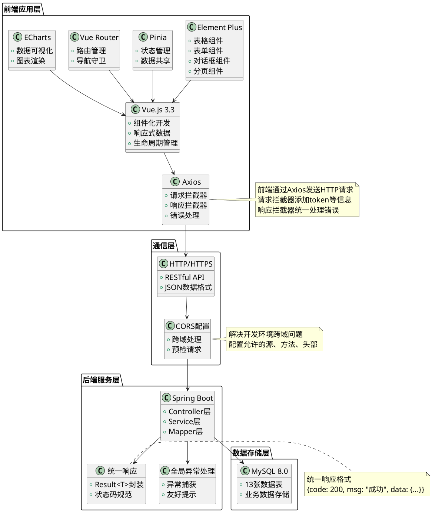
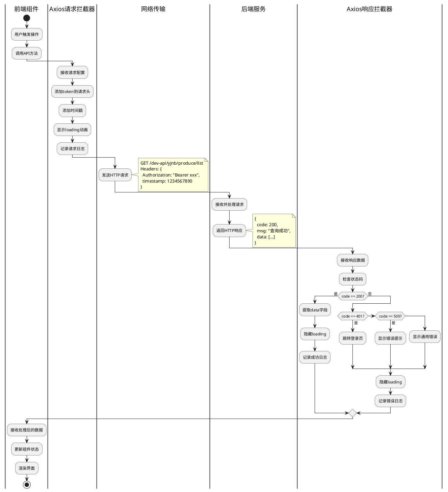
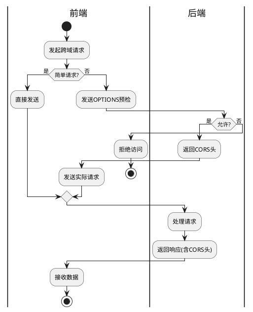
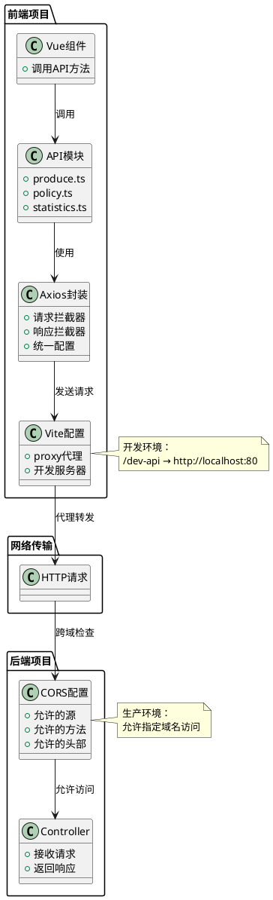
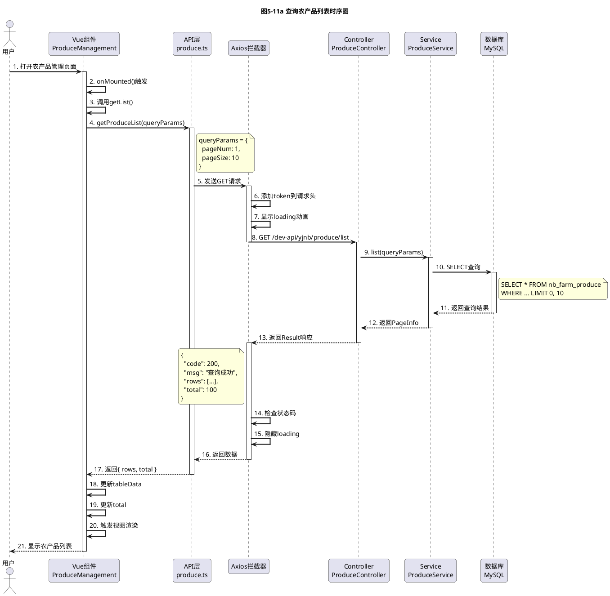
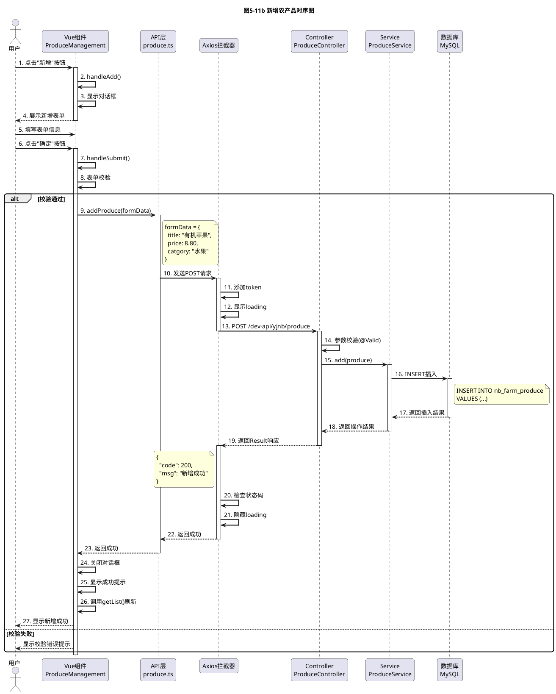
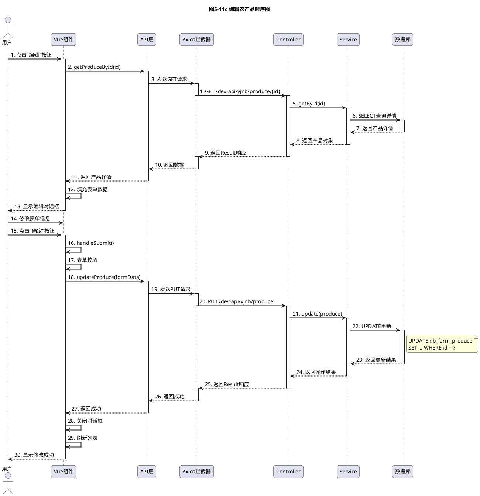
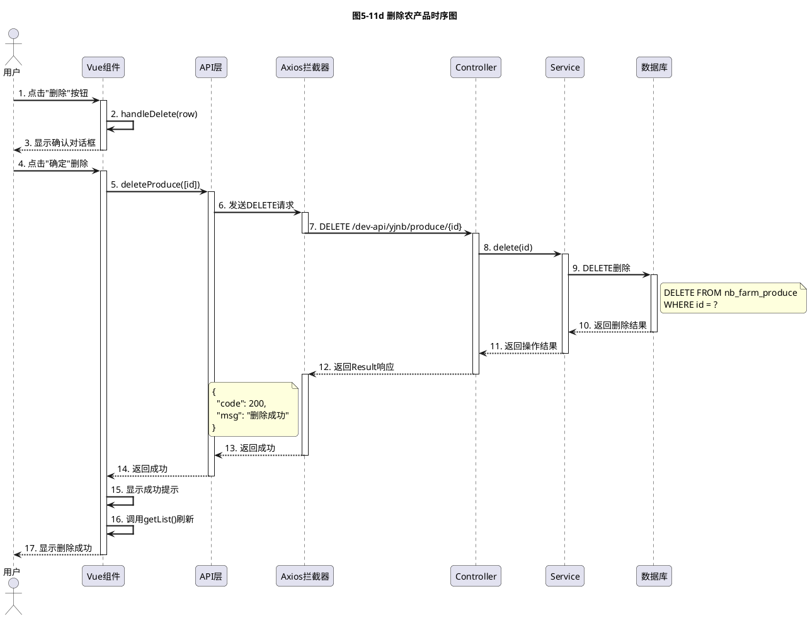
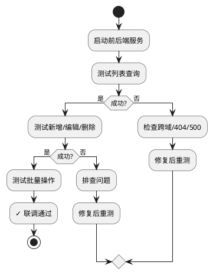

# 项目五 集成前端界面与后端服务

在项目一至项目四的学习中，我们完成了"农宝"平台的需求分析、数据库设计、后端核心功能开发、日志管理与单元测试等工作。后端服务已经具备完整的数据处理能力，41个API接口整装待发。然而，在项目验收会议上，前端工程师小李提出了困惑：

"后端接口已经开发完成，但我在前端调用时总是报错：'Access to XMLHttpRequest has been blocked by CORS policy'。这是什么问题？"——前端工程师的疑惑

"我按照接口文档调用了农产品列表接口，但返回的数据结构和文档不一致，有些字段是null，有些字段根本不存在。这让我很困惑。"——前端工程师的抱怨

"后端同事说接口已经测试通过，但我在前端页面上就是调不通。我们是不是在'各说各话'？"——前端工程师的无奈

与此同时，后端工程师小王也有自己的困扰：

"我的接口在Postman里测试得好好的，为什么前端调用就报错？是不是前端代码有问题？"——后端工程师的疑问

"前端说我的接口返回数据格式不对，但我明明按照统一响应格式返回的啊。到底是哪里出了问题？"——后端工程师的困惑

这些来自一线的真实痛点，指向了一个核心问题：**前后端如何高效协作？如何让"各自为战"变成"并肩作战"？**

答案就是本项目要学习的**前后端集成与接口对接**。在这个项目中，我们将一起探索如何配置前端请求、解决跨域问题、实现业务联调，并通过数据可视化大屏让数据"活"起来。让我们开始这段连接前后端、打通数据流的关键之旅。


图5-1 前后端协作场景示意图

**【价值思考】团队协作与沟通的艺术**

前后端分离不仅是技术架构的选择，更是团队协作模式的体现。前端工程师关注用户体验，后端工程师关注业务逻辑，两者通过API接口这座"桥梁"连接。然而，这座桥梁能否畅通，取决于双方的沟通与协作。在"农宝"项目中，前后端工程师需要共同制定接口规范、统一数据格式、解决跨域问题，这个过程不仅是技术实现，更是团队协作能力的体现。作为软件工程师，我们不仅要写好代码，更要学会与他人协作——理解对方的需求、尊重对方的工作、共同解决问题。这种"以他人为镜、以协作为本"的团队精神，是成为优秀工程师的必备素养。技术可以学，但协作能力需要在实践中不断磨练。唯有真正理解"团队大于个人"的道理，才能在项目中发挥更大价值。

## 【项目介绍】

项目五是"农宝"平台开发的关键阶段，承担着连接前后端、打通数据流、实现完整用户体验的重要使命。在前四个项目中，我们已经完成了需求分析、架构设计、数据库建模、后端核心功能开发、日志管理与单元测试等工作，后端服务已经具备完整的数据处理能力。现在，是时候让前端界面与后端服务"握手"，让用户真正体验到"农宝"平台的完整功能。

本项目以"农宝"后台管理系统的前后端集成为载体，围绕**前端请求配置、功能模块对接、数据可视化大屏**三大核心任务展开学习。我们将系统介绍如何使用Vue.js 3构建前端界面，如何通过Axios与后端API通信，如何解决跨域问题，如何实现完整的业务流程联调，以及如何使用ECharts构建数据可视化大屏。

在整体系统架构中，前后端集成是实现"农宝"平台完整功能的关键环节。前端应用层通过HTTP协议与后端服务层通信，后端服务层处理业务逻辑并返回数据，前端应用层将数据渲染为用户界面。这个过程涉及请求配置、跨域处理、数据格式转换、错误处理等多个技术环节，需要前后端工程师密切协作。

本项目的核心内容包括：

1. **前端请求配置与代理：**学习如何配置Axios请求基地址、开发环境代理、请求/响应拦截器，解决跨域问题，实现前后端的基础通信能力。

2. **功能模块对接与联调：**实现农产品管理、补贴政策管理等核心模块的前后端对接，完成列表查询、新增、修改、删除等完整业务流程的联调。

3. **数据可视化大屏实现：**基于ECharts实现数据统计大屏，动态展示农产品数量、政策发布量、用户访问趋势等关键指标，为运营决策提供数据支撑。

4. **AI辅助前后端协作：**学习如何利用AI工具辅助接口对接、调试跨域问题、生成API调用代码、优化数据流等，提升开发效率。

项目完成后，将产出以下成果：

* 一套完整的前端项目结构，包含Axios封装、API接口定义、状态管理、路由配置等，为前端开发提供标准化模板。
* 两个完整的功能模块前端实现（农产品管理、补贴政策管理），涵盖列表查询、新增、修改、删除、发布、推荐等核心功能。
* 一个数据可视化大屏页面，使用ECharts展示多维度数据统计，支持动态刷新，为运营分析提供直观的数据展示。
* 一套前后端联调的标准流程，包括接口测试、问题排查、错误处理等，为团队协作提供规范指导。
* 一套AI辅助前后端协作的实践经验，包括接口契约验证、API代码生成、跨域问题诊断等，提升开发效率。

前后端集成架构如图5-2所示。



图5-2 前后端集成架构图

如图5-2所示，前后端集成架构分为四层：前端应用层使用Vue.js 3.3+Element Plus+Axios+Pinia+Vue Router+ECharts技术栈，通过HTTP协议与后端服务层通信；通信层负责处理HTTP请求、CORS跨域配置；后端服务层使用Spring Boot框架，提供RESTful API接口，使用统一响应格式和全局异常处理；数据存储层使用MySQL 8.0存储业务数据。各层之间通过标准化协议实现交互，形成完整的前后端集成体系。

通过本项目的学习，读者可以建立起从前端界面到后端服务的完整思维链条，掌握前后端分离架构下的协作开发技能，并熟练运用AI工具辅助接口对接、调试跨域问题、生成API代码等关键环节，切实体验AI时代全栈开发工程师所需的新技能。本项目产出的前端项目结构、API接口定义、数据可视化大屏，既是本项目的核心成果，也将作为"农宝"平台前端开发的重要基础，为系统的完整交付奠定坚实基础。

在开展具体任务实施前，读者需先行掌握前后端分离架构、HTTP通信原理、Axios异步请求、跨域配置、Vue Router路由管理等相关基础知识。本教材将系统介绍上述基础知识，助力读者更好地理解并完成项目任务。

## 【学习目标】

### 【知识目标】

* 掌握前后端分离架构的通信原理，理解HTTP协议、RESTful API设计原则、请求-响应模型等核心概念
* 理解接口契约的重要性，掌握统一响应格式、请求参数规范、响应状态码规范等接口设计规范
* 掌握Axios异步请求技术，理解请求拦截器、响应拦截器、统一错误处理等核心机制
* 掌握跨域问题的产生原因与解决方案，能够配置CORS、开发代理等跨域处理机制
* 掌握Vue Router路由管理技术，理解路由配置、路由守卫、路由懒加载等核心概念
* 掌握ECharts数据可视化技术，能够实现柱状图、折线图、饼图等常见图表类型
* 了解AI在前后端协作中的应用，掌握AI辅助接口对接、调试问题、生成代码等方法

### 【能力目标】

* 培养前端开发能力，能够使用Vue.js 3+Element Plus构建企业级后台管理界面，实现完整的业务功能
* 建立接口对接能力，能够根据后端API文档编写前端调用代码，完成前后端的数据交互
* 掌握问题排查能力，能够使用浏览器开发者工具调试网络请求，快速定位并解决跨域、404、500等常见问题
* 提升数据可视化能力，能够根据业务需求选择合适的图表类型，使用ECharts实现数据的直观展示
* 培养全栈思维，能够站在前后端两个视角思考问题，理解前后端协作的关键要点
* 提升AI工具应用能力，能够利用AI工具提升前后端协作效率，快速解决技术问题

### 【素质目标】

* 培养团队协作意识，理解前后端工程师的职责分工，学会换位思考，提升沟通协作能力
* 建立用户体验意识，理解前端界面对用户体验的重要性，养成注重细节、追求卓越的习惯
* 培养工程化思维，理解接口规范、代码规范对团队协作的重要性，养成遵守规范的职业习惯
* 增强责任意识，理解前后端集成质量对系统整体质量的影响，对集成质量负责
* 培养持续学习能力，学会利用新技术（如AI工具）提升协作效率，勇于尝试和探索

## 【知识储备】

在正式开始前后端集成工作前，让我们先了解一些必备的基础知识。这些知识就像建造桥梁前需要了解的力学原理，掌握它们才能更好地完成前后端的"握手"。

### 5.1 前后端分离架构与通信原理

在项目一中，我们已经学习了前后端分离架构的基本概念（详见项目一1.1.2节）。本节重点讲解前后端通信的核心原理和实践要点。

#### 5.1.1 HTTP协议与RESTful API

HTTP（HyperText Transfer Protocol）是前后端通信的基础协议。在"农宝"平台中，我们遵循RESTful API设计原则，使用HTTP方法表示操作类型：GET（查询）、POST（新增）、PUT（修改）、DELETE（删除）。

前后端通信的完整流程：用户操作→前端构建请求→Axios拦截器处理→发送HTTP请求→后端Controller接收→Service处理→Mapper查询数据库→封装响应→Axios拦截器处理→前端渲染。

#### 5.1.2 请求-响应模型与数据流转

请求-响应模型的数据流转如表5-1所示。

表5-1 请求-响应模型数据流转

| 阶段 | 前端操作 | 数据格式 | 后端操作 | 数据格式 |
|------|---------|---------|---------|---------|
| **请求阶段** | 用户点击按钮触发事件 | JavaScript对象 | - | - |
| | 构建请求参数 | `{pageNum: 1, pageSize: 10}` | - | - |
| | Axios序列化参数 | Query String或JSON | - | - |
| | 发送HTTP请求 | HTTP报文 | Controller接收请求 | HTTP报文 |
| | - | - | 参数绑定到Java对象 | Java对象 |
| **处理阶段** | 等待响应（显示loading） | - | Service处理业务逻辑 | Java对象 |
| | - | - | Mapper查询数据库 | SQL查询 |
| | - | - | 封装响应数据 | `Result<T>`对象 |
| **响应阶段** | - | - | 返回HTTP响应 | HTTP报文 |
| | Axios接收响应 | HTTP报文 | - | - |
| | 解析JSON数据 | JavaScript对象 | - | - |
| | 更新组件状态 | Vue响应式数据 | - | - |
| | 渲染界面 | DOM元素 | - | - |

表5-1展示了数据从前端JavaScript对象到后端Java对象，再返回JSON并渲染为DOM的完整流转过程。

#### 5.1.3 前后端协作的关键要点

前后端协作的核心流程：需求评审→制定接口契约→并行开发（前端用Mock数据，后端实现接口）→联调测试→问题排查→上线部署。

**协作关键点：**

1. **接口契约先行：**开发前共同制定接口规范（路径、参数、响应格式），这是协作的"合同"
2. **文档及时更新：**接口变更需及时通知对方并更新文档
3. **Mock数据开发：**前端可先用假数据开发，不依赖后端进度
4. **联调及时沟通：**发现问题及时沟通，共同排查，不要"各自为战"

**【价值思考】换位思考与同理心**

在前后端协作中，最重要的是换位思考。前端要理解后端的技术限制，后端要理解前端的用户体验诉求。当前端反馈"日期格式不统一"时，后端不应回应"你自己转换"，而应主动统一格式。这种"我为人人"的协作精神，体现的是同理心和责任感。团队利益大于个人便利，这是成为受欢迎团队成员的关键。

#### 5.1.4 跨域问题与解决方案

**核心概念：**

* **同源策略：**浏览器安全机制，限制跨源访问（协议+域名+端口必须完全相同）
* **CORS：**服务器通过响应头声明允许的跨域访问
* **预检请求：**复杂请求（PUT/DELETE或自定义头）会先发送OPTIONS请求
* **开发代理：**开发服务器转发请求到后端，避免跨域

在"农宝"项目中，前端`localhost:5173`访问后端`localhost:80`会触发跨域。解决方案：开发环境用Vite代理，生产环境用CORS配置。

前后端通信核心概念如表5-2所示。

表5-2 前后端通信核心概念对比

| 概念 | 定义 | 作用 | 在"农宝"项目中的应用 |
|------|------|------|---------------------|
| **同源策略** | 浏览器安全机制，限制跨源访问 | 保护用户数据安全，防止恶意网站窃取信息 | 前端`localhost:5173`访问后端`localhost:80`会触发跨域限制 |
| **CORS** | 服务器声明允许的跨域访问 | 解决生产环境的跨域问题 | 后端配置CorsConfig，允许前端域名访问 |
| **预检请求** | 浏览器发送OPTIONS请求询问权限 | 确保复杂请求的安全性 | PUT、DELETE请求会触发预检，需要后端正确响应 |
| **开发代理** | 开发服务器转发请求到后端 | 解决开发环境的跨域问题 | Vite配置proxy，将`/dev-api`请求转发到`localhost:80` |
| **请求拦截器** | 在请求发送前进行处理 | 统一添加token、时间戳等信息 | Axios请求拦截器添加Authorization头 |
| **响应拦截器** | 在响应返回后进行处理 | 统一处理错误、提取数据 | Axios响应拦截器检查code字段，统一错误提示 |

表5-2系统展示了前后端通信的核心概念及其在"农宝"项目中的应用。理解这些概念，是掌握前后端集成的基础。

### 5.2 接口契约与数据格式规范

#### 5.2.1 接口契约规范

接口契约是前后端的"合同"，明确规定请求方式、参数格式、响应结构。在"农宝"项目中的规范：

* **路径规范：**`/dev-api/yjnb/{module}`，如`/dev-api/yjnb/produce/list`
* **方法规范：**GET查询、POST新增、PUT修改、DELETE删除
* **参数规范：**Query参数（查询条件）、Path参数（资源ID）、Body参数（复杂数据）
* **响应规范：**统一使用`Result<T>`结构（详见项目三）

#### 5.2.2 请求参数传递方式

前端向后端传递参数有三种方式，对比如表5-3所示。

表5-3 请求参数传递方式对比

| 参数类型 | 适用场景 | 前端发送方式 | 后端接收方式 | 优点 | 缺点 |
|---------|---------|-------------|-------------|------|------|
| **Query参数** | GET请求的查询条件 | `params: {...}` | `@RequestParam` | URL可见，便于调试和分享 | 不适合传递复杂数据，长度有限制 |
| **Path参数** | 资源标识（ID等） | 拼接到URL中 | `@PathVariable` | 语义清晰，符合RESTful规范 | 只能传递简单值，不能传递对象 |
| **Body参数** | 复杂数据（对象、数组） | `data: {...}` | `@RequestBody` | 可以传递复杂数据结构 | URL不可见，调试相对不便 |

#### 5.2.3 响应状态码规范

HTTP状态码规范如表5-4所示。在"农宝"项目中，`Result<T>`的`code`字段与HTTP状态码保持一致，前端根据`code`进行统一错误处理。

表5-4 HTTP状态码规范

| 状态码 | 含义 | 前端处理 |
|-------|------|---------|
| **200** | 成功 | 正常渲染数据 |
| **400** | 请求错误 | 提示检查输入 |
| **401** | 未授权 | 跳转登录页 |
| **403** | 禁止访问 | 提示权限不足 |
| **404** | 未找到 | 提示资源不存在 |
| **500** | 服务器错误 | 提示系统错误 |

### 5.3 前端异步请求技术

#### 5.3.1 Axios核心特性

Axios是基于Promise的HTTP客户端，核心特性包括：请求/响应拦截、自动转换JSON、取消请求、超时控制、统一错误处理。在"农宝"项目中，我们对Axios进行封装，统一配置baseURL、timeout、拦截器等。

#### 5.3.2 拦截器机制

**请求拦截器：**添加token、时间戳、显示loading、记录日志
**响应拦截器：**统一错误处理、数据解包、隐藏loading、记录日志

拦截器工作流程如图5-5所示。



图5-5 Axios拦截器工作流程图

如图5-5所示，拦截器机制简化了业务代码，提高了可维护性。完整的Axios封装实现将在任务一中详细讲解。

### 5.4 后端接口增强与联调准备

#### 5.4.1 跨域问题与CORS配置

**跨域问题：**浏览器同源策略限制跨源访问。"农宝"项目中，前端`localhost:5173`访问后端`localhost:80`会触发跨域。

**解决方案对比：**

| 方案 | 适用环境 | 配置位置 | 优缺点 |
|------|---------|---------|--------|
| **开发代理** | 开发环境 | vite.config.ts | 简单，但仅开发环境有效 |
| **CORS配置** | 生产环境 | CorsConfig.java | 支持多域名，但需后端配置 |

**CORS核心响应头：**`Access-Control-Allow-Origin`（允许的源）、`Access-Control-Allow-Methods`（允许的方法）、`Access-Control-Allow-Headers`（允许的请求头）。

**请求类型：**简单请求（GET/POST）直接发送；复杂请求（PUT/DELETE或自定义头）先发OPTIONS预检。

CORS请求处理流程如图5-6所示。



图5-6 CORS请求处理流程（简化版）

#### 5.4.2 接口参数校验

Spring Boot提供基于注解的参数校验：`@NotBlank`（非空）、`@Size`（长度）、`@Min/@Max`（数值范围）、`@Email`（邮箱）、`@Pattern`（正则）。在Controller使用`@Valid`启用校验，结合全局异常处理器返回友好错误信息。详细配置见任务一。

### 5.5 前端路由与单页面应用集成

#### 5.5.1 Vue Router核心概念

Vue Router用于构建单页面应用（SPA），核心概念：**路由（Route）**-URL与组件的映射、**路由器（Router）**-管理所有路由、**路由视图（RouterView）**-组件占位符、**路由链接（RouterLink）**-导航组件。

"农宝"系统使用嵌套路由实现左侧菜单+右侧内容布局，访问`/produce`时先渲染Layout组件，再渲染ProduceManagement组件。

#### 5.5.2 路由守卫与权限控制

路由守卫用于路由跳转前的权限验证、登录检查。全局前置守卫示例：

```typescript
router.beforeEach((to, from, next) => {
  if (to.meta.requiresAuth && !localStorage.getItem('token')) {
    next('/login')  // 未登录，跳转登录页
  } else {
    next()  // 允许访问
  }
})
```

守卫执行顺序：全局前置→路由独享→组件内→全局后置。任一守卫不通过则取消导航。

#### 5.5.3 路由懒加载

路由懒加载使用动态导入`() => import('@/views/ProduceManagement.vue')`，Vite会将每个页面打包为独立文件，按需加载，减少首屏加载时间。"农宝"项目使用懒加载后，首屏时间从3秒降至1秒内。

### 5.6 AI辅助前后端接口对接与调试

AI在前后端协作中的应用场景如表5-6所示。

表5-6 AI辅助前后端协作应用场景

| 应用场景 | AI的作用 | 输入内容 | 输出内容 | 实际价值 |
|---------|---------|---------|---------|---------|
| **接口代码生成** | 根据后端接口自动生成前端调用代码 | 后端Controller代码或接口文档 | TypeScript接口定义、Axios请求方法 | 减少手工编写API代码的时间，降低出错率 |
| **跨域问题诊断** | 分析跨域错误并提供解决方案 | 浏览器控制台错误信息 | 问题原因分析、配置代码 | 快速解决跨域问题，减少调试时间 |
| **接口契约验证** | 检查前后端接口定义一致性 | 前端API定义、后端Controller代码 | 不一致的地方列表、修复建议 | 提前发现接口不一致问题，避免联调时才发现 |
| **数据格式转换** | 生成数据格式转换代码 | 前后端数据格式差异说明 | 转换函数代码 | 统一数据格式，减少格式转换的重复代码 |
| **错误处理优化** | 分析并优化错误处理逻辑 | 现有错误处理代码 | 优化建议、改进代码 | 提升错误处理的完整性和友好性 |
| **性能优化建议** | 分析请求性能并提供优化建议 | 网络请求日志、响应时间 | 性能瓶颈分析、优化方案 | 提升接口响应速度，改善用户体验 |

表5-6展示了AI在接口代码生成、跨域诊断、契约验证、数据转换、性能优化等方面的应用。具体使用方法见各任务的AI辅助环节。

---

**知识储备小结：**

通过以上五个知识点的学习，我们已经掌握了前后端集成所需的核心知识：

1. **前后端分离架构：**理解了前后端的职责分工和协作模式
2. **接口契约规范：**掌握了统一响应格式和参数传递规范
3. **Axios异步请求：**了解了Axios的核心特性和拦截器机制
4. **跨域配置：**理解了跨域问题的原因和解决方案
5. **Vue Router：**掌握了路由管理和单页面应用的实现方式
6. **AI辅助：**了解了AI在前后端协作中的应用场景

接下来，让我们进入实践环节，将这些知识应用到"农宝"项目的前后端集成中。

## 任务一：配置前端请求基地址与代理

### 【任务描述】

本任务是前后端集成的第一步，需要完成前端项目的基础通信配置，让前端能够成功调用后端API接口。具体包括：

1. **创建Axios实例：**封装Axios，配置baseURL、timeout等基础参数。
2. **配置开发代理：**在Vite中配置proxy，解决开发环境的跨域问题。
3. **实现请求拦截器：**在请求发送前添加token、时间戳等信息。
4. **实现响应拦截器：**在响应返回后进行统一的错误处理和数据提取。
5. **配置后端CORS：**在Spring Boot中配置跨域支持，解决生产环境的跨域问题。
6. **测试基础通信：**验证前端能够成功调用后端接口，获取数据。

通过本任务的学习，你将掌握前后端通信的基础配置方法，为后续的业务功能对接奠定基础。

### 【任务分析】

本任务需要解决三个核心问题：

1. **封装Axios：**统一配置baseURL、timeout、拦截器，简化请求代码
2. **解决跨域：**开发环境用Vite代理，生产环境用CORS配置
3. **统一处理：**使用拦截器统一添加token、处理错误、控制loading

前后端通信配置架构如图5-8所示。



图5-8 前后端通信配置架构图

### 【实现步骤】

#### 步骤1：创建前端项目结构

前端项目采用标准Vue 3结构：`src/api`（接口定义）、`src/utils`（工具函数）、`src/views`（页面组件）、`src/stores`（状态管理）、`src/router`（路由配置）。

#### 步骤2：封装Axios请求工具

在`src/utils/request.ts`中封装Axios，这是前端项目中最重要的工具之一。

**代码5-1 Axios封装完整实现**

```typescript
// src/utils/request.ts
import axios, { AxiosInstance, AxiosRequestConfig, AxiosResponse, AxiosError } from 'axios'
import { ElMessage, ElLoading } from 'element-plus'
import type { LoadingInstance } from 'element-plus/es/components/loading/src/loading'

// 定义响应数据结构
export interface Result<T = any> {
  code: number
  msg: string
  data?: T
  rows?: T
  total?: number
}

// loading实例
let loadingInstance: LoadingInstance | null = null
// 当前请求数量
let requestCount = 0

/**
 * 显示loading
 */
function showLoading() {
  if (requestCount === 0) {
    loadingInstance = ElLoading.service({
      lock: true,
      text: '加载中...',
      background: 'rgba(0, 0, 0, 0.7)'
    })
  }
  requestCount++
}

/**
 * 隐藏loading
 */
function hideLoading() {
  requestCount--
  if (requestCount === 0 && loadingInstance) {
    loadingInstance.close()
    loadingInstance = null
  }
}

// 创建axios实例
const service: AxiosInstance = axios.create({
  baseURL: import.meta.env.VITE_API_BASE_URL || '/dev-api',  // API基础路径
  timeout: 15000,  // 请求超时时间15秒
  headers: {
    'Content-Type': 'application/json;charset=utf-8'
  }
})

// 请求拦截器
service.interceptors.request.use(
  (config: AxiosRequestConfig) => {
    // 显示loading
    showLoading()
    
    // 添加token到请求头
    const token = localStorage.getItem('token')
    if (token && config.headers) {
      config.headers['Authorization'] = `Bearer ${token}`
    }
    
    // 添加时间戳，防止缓存
    if (config.method === 'get' && config.params) {
      config.params._t = Date.now()
    }
    
    console.log('发送请求：', config.method?.toUpperCase(), config.url, config.params || config.data)
    
    return config
  },
  (error: AxiosError) => {
    hideLoading()
    console.error('请求错误：', error)
    ElMessage.error('请求配置错误')
    return Promise.reject(error)
  }
)

// 响应拦截器
service.interceptors.response.use(
  (response: AxiosResponse<Result>) => {
    hideLoading()
    
    const res = response.data
    console.log('收到响应：', response.config.url, res)
    
    // 根据code判断请求结果
    if (res.code === 200) {
      // 请求成功，返回数据
      return res
    } else if (res.code === 401) {
      // 未登录或token过期
      ElMessage.error('登录已过期，请重新登录')
      // 清除token
      localStorage.removeItem('token')
      // 跳转登录页（这里需要引入router）
      // router.push('/login')
      return Promise.reject(new Error(res.msg || '未登录'))
    } else if (res.code === 403) {
      // 无权限
      ElMessage.error('无权限访问')
      return Promise.reject(new Error(res.msg || '无权限'))
    } else {
      // 其他错误
      ElMessage.error(res.msg || '请求失败')
      return Promise.reject(new Error(res.msg || '请求失败'))
    }
  },
  (error: AxiosError) => {
    hideLoading()
    
    console.error('响应错误：', error)
    
    // 处理HTTP错误
    if (error.response) {
      const status = error.response.status
      switch (status) {
        case 400:
          ElMessage.error('请求参数错误')
          break
        case 401:
          ElMessage.error('未登录或登录已过期')
          localStorage.removeItem('token')
          // router.push('/login')
          break
        case 403:
          ElMessage.error('无权限访问')
          break
        case 404:
          ElMessage.error('请求的资源不存在')
          break
        case 500:
          ElMessage.error('服务器内部错误')
          break
        default:
          ElMessage.error(`请求失败：${status}`)
      }
    } else if (error.request) {
      // 请求已发送但没有收到响应
      ElMessage.error('网络连接失败，请检查网络')
    } else {
      // 请求配置错误
      ElMessage.error('请求配置错误')
    }
    
    return Promise.reject(error)
  }
)

export default service
```

**代码说明：**

1. **类型定义：**定义`Result<T>`接口，与后端响应格式保持一致，提供类型安全。

2. **loading控制：**使用`requestCount`计数器，确保多个并发请求时loading只显示一次，所有请求完成后才隐藏。

3. **请求拦截器：**
   * 显示loading动画
   * 从localStorage获取token并添加到请求头
   * 为GET请求添加时间戳参数，防止浏览器缓存
   * 记录请求日志，便于调试

4. **响应拦截器：**
   * 隐藏loading动画
   * 根据`code`字段判断请求结果
   * `code === 200`：请求成功，返回数据
   * `code === 401`：未登录，清除token并跳转登录页
   * `code === 403`：无权限，提示用户
   * 其他code：显示错误信息
   * 处理HTTP错误（400、404、500等）

5. **错误处理：**
   * 区分三种错误：响应错误（有status）、网络错误（无响应）、配置错误
   * 针对不同错误提供友好的提示信息

6. **环境变量：**使用`import.meta.env.VITE_API_BASE_URL`读取环境变量，支持不同环境使用不同的API地址。

#### 步骤3：配置Vite开发代理

在`vite.config.ts`中配置开发代理，解决开发环境的跨域问题。

**代码5-2 Vite配置文件**

```typescript
// vite.config.ts
import { defineConfig } from 'vite'
import vue from '@vitejs/plugin-vue'
import path from 'path'

// https://vitejs.dev/config/
export default defineConfig({
  plugins: [vue()],
  
  // 路径别名配置
  resolve: {
    alias: {
      '@': path.resolve(__dirname, 'src')
    }
  },
  
  // 开发服务器配置
  server: {
    port: 5173,  // 开发服务器端口
    open: true,  // 启动时自动打开浏览器
    
    // 代理配置
    proxy: {
      // 将/dev-api开头的请求代理到后端服务器
      '/dev-api': {
        target: 'http://localhost:80',  // 后端服务器地址
        changeOrigin: true,  // 改变请求源，解决跨域
        rewrite: (path) => path.replace(/^\/dev-api/, '/dev-api')  // 路径重写（这里保持不变）
      }
    }
  },
  
  // 构建配置
  build: {
    outDir: 'dist',  // 输出目录
    assetsDir: 'assets',  // 静态资源目录
    sourcemap: false,  // 不生成sourcemap
    
    // 代码分割配置
    rollupOptions: {
      output: {
        // 分包策略
        manualChunks: {
          'vue-vendor': ['vue', 'vue-router', 'pinia'],
          'element-plus': ['element-plus'],
          'echarts': ['echarts']
        }
      }
    }
  }
})
```

**核心配置说明：**

* **路径别名：**`@`指向`src`，简化导入路径
* **代理配置：**`target`指向后端地址，`changeOrigin: true`改变请求源
* **代理原理：**Vite作为中间人转发请求，浏览器认为是同源请求
* **构建配置：**代码分割，将Vue、Element Plus、ECharts分别打包

#### 步骤4：配置后端CORS

在Spring Boot项目中创建CORS配置类，解决生产环境的跨域问题。

**代码5-3 Spring Boot跨域配置**

```java
package com.movie.nbspringproduct.config;

import org.springframework.context.annotation.Bean;
import org.springframework.context.annotation.Configuration;
import org.springframework.web.cors.CorsConfiguration;
import org.springframework.web.cors.UrlBasedCorsConfigurationSource;
import org.springframework.web.filter.CorsFilter;

/**
 * 跨域配置类
 * 解决前后端分离架构中的跨域问题
 */
@Configuration
public class CorsConfig {
    
    /**
     * 配置CORS过滤器
     */
    @Bean
    public CorsFilter corsFilter() {
        // CORS配置对象
        CorsConfiguration config = new CorsConfiguration();
        
        // 允许的源（前端地址）
        // 开发环境
        config.addAllowedOrigin("http://localhost:5173");
        config.addAllowedOrigin("http://localhost:3000");
        // 生产环境（需要根据实际部署地址配置）
        // config.addAllowedOrigin("https://nongbao.example.com");
        
        // 允许的HTTP方法
        config.addAllowedMethod("GET");
        config.addAllowedMethod("POST");
        config.addAllowedMethod("PUT");
        config.addAllowedMethod("DELETE");
        config.addAllowedMethod("OPTIONS");
        
        // 允许的请求头（*表示允许所有请求头）
        config.addAllowedHeader("*");
        
        // 允许携带Cookie和认证信息
        config.setAllowCredentials(true);
        
        // 预检请求的缓存时间（秒）
        // 设置后，浏览器会缓存预检结果，减少OPTIONS请求
        config.setMaxAge(3600L);
        
        // 暴露的响应头（前端可以访问的响应头）
        config.addExposedHeader("Content-Disposition");  // 文件下载时需要
        
        // 注册CORS配置
        UrlBasedCorsConfigurationSource source = new UrlBasedCorsConfigurationSource();
        source.registerCorsConfiguration("/**", config);  // 对所有路径生效
        
        return new CorsFilter(source);
    }
}
```

**核心配置说明：**

* `addAllowedOrigin`：开发环境配`localhost:5173`，生产环境配实际域名（不用`*`）
* `addAllowedMethod`：配置GET、POST、PUT、DELETE、OPTIONS
* `setAllowCredentials(true)`：允许携带Cookie（此时Origin不能为`*`）
* `setMaxAge(3600L)`：预检缓存1小时，减少OPTIONS请求

#### 步骤5：环境变量配置

创建`.env.development`和`.env.production`文件，配置不同环境的API地址。开发环境用`/dev-api`（代理转发），生产环境用完整URL。

#### 步骤6：测试基础通信

**测试步骤：**启动后端服务→启动前端服务（`npm run dev`）→创建测试页面调用接口→打开浏览器F12查看Network面板→验证请求成功（状态码200，返回数据正确）。

常见问题排查如表5-7所示。

表5-7 前后端通信常见问题排查

| 错误现象 | 可能原因 | 排查方法 | 解决方案 |
|---------|---------|---------|---------|
| **跨域错误** | CORS配置不正确或Vite代理未生效 | 查看控制台错误信息，检查是否包含"CORS policy" | 1. 检查vite.config.ts的proxy配置<br>2. 检查后端CorsConfig是否生效<br>3. 重启前后端服务 |
| **404错误** | 接口路径不正确 | 查看Network标签的请求URL | 1. 检查前端API路径是否正确<br>2. 检查后端Controller的@RequestMapping路径<br>3. 检查baseURL配置 |
| **500错误** | 后端服务异常 | 查看后端控制台日志 | 1. 检查后端日志中的异常信息<br>2. 检查数据库连接是否正常<br>3. 检查SQL语句是否正确 |
| **请求超时** | 后端响应时间过长或网络问题 | 查看Network标签的请求时间 | 1. 增加timeout配置<br>2. 优化后端查询性能<br>3. 检查网络连接 |
| **参数格式错误** | 前端发送的参数格式与后端期望不符 | 查看Network标签的Request Payload | 1. 检查参数名称是否一致<br>2. 检查参数类型是否匹配<br>3. 检查是否使用了正确的Content-Type |

表5-7总结了常见问题和排查方法。使用浏览器F12开发者工具的Network面板可查看请求详情、请求头、响应头、参数和响应数据，快速定位问题。

### 【AI辅助环节】

#### 1. AI智能代理配置生成

**适用场景：**当你不确定如何配置Vite代理时，可以让AI根据项目特点生成配置。

**实践步骤：**

**步骤1：向AI描述项目情况**

```
我正在开发一个前后端分离项目，需要配置Vite开发代理。

项目信息：
- 前端：Vue 3 + Vite，运行在 localhost:5173
- 后端：Spring Boot，运行在 localhost:80
- API基础路径：/dev-api
- 需要代理的接口：/dev-api/yjnb/*

请帮我生成vite.config.ts的proxy配置，要求：
1. 将/dev-api开头的请求代理到后端
2. 支持WebSocket代理（为后续扩展准备）
3. 添加详细注释
```

**步骤2：AI生成配置代码**

AI会生成完整的配置代码，包含详细注释：

```typescript
export default defineConfig({
  server: {
    proxy: {
      // HTTP API代理
      '/dev-api': {
        target: 'http://localhost:80',
        changeOrigin: true,
        rewrite: (path) => path.replace(/^\/dev-api/, '/dev-api')
      },
      // WebSocket代理（为后续实时通信功能准备）
      '/ws': {
        target: 'ws://localhost:80',
        ws: true,
        changeOrigin: true
      }
    }
  }
})
```

**步骤3：审查和应用配置**

* 检查target地址是否正确
* 验证rewrite规则是否符合需求
* 根据实际情况调整配置
* 重启Vite开发服务器使配置生效

#### 2. 跨域问题自动诊断和解决方案

**适用场景：**当遇到跨域错误时，可以让AI帮助诊断问题并提供解决方案。

**实践步骤：**

**步骤1：向AI提供错误信息**

```
我在前端调用后端接口时遇到跨域错误，浏览器控制台显示：

Access to XMLHttpRequest at 'http://localhost:80/dev-api/yjnb/produce/list' 
from origin 'http://localhost:5173' has been blocked by CORS policy: 
Response to preflight request doesn't pass access control check: 
No 'Access-Control-Allow-Origin' header is present on the requested resource.

我的配置：
- 前端：Vite + Vue 3，运行在 localhost:5173
- 后端：Spring Boot，运行在 localhost:80
- 已经配置了Vite代理
- 已经配置了后端CorsConfig

请帮我分析问题原因并提供解决方案。
```

**步骤2：AI分析问题**

AI会分析错误信息并提供诊断：

```
问题分析：

从错误信息看，这是一个预检请求（preflight request）失败的问题。
说明你的请求是"复杂请求"，浏览器发送了OPTIONS预检请求，
但后端没有正确响应。

可能的原因：
1. 后端CorsConfig配置未生效
2. 后端没有处理OPTIONS请求
3. 前端请求绕过了Vite代理，直接访问了后端

解决方案：

方案1：确保Vite代理生效
检查vite.config.ts中的proxy配置，确保：
- target地址正确
- changeOrigin设为true
- 前端请求使用的是相对路径（/dev-api/...）而非完整URL

方案2：确保后端CORS配置生效
检查CorsConfig类：
- 是否添加了@Configuration注解
- 是否配置了OPTIONS方法
- 是否设置了正确的AllowedOrigin

方案3：检查请求方式
如果使用了自定义请求头或Content-Type为application/json，
会触发预检请求，需要确保后端正确处理OPTIONS请求。

调试步骤：
1. 在Network面板查看是否有OPTIONS请求
2. 查看OPTIONS请求的响应头是否包含Access-Control-*
3. 查看后端日志是否有CORS相关错误
```

**步骤3：根据AI建议逐步排查**

* 按照AI提供的方案逐一检查
* 使用浏览器开发者工具验证
* 查看后端日志确认配置是否生效

#### 3. 网络请求性能优化建议

**适用场景：**当系统运行一段时间后，发现接口响应较慢，可以让AI分析并提供优化建议。

**实践步骤：**

**步骤1：向AI提供性能数据**

```
我的"农宝"平台前端在调用后端接口时，发现以下性能问题：

1. 农产品列表接口响应时间：2-3秒
2. 数据统计接口响应时间：5秒以上
3. 页面切换时会重复请求相同的接口

请求信息：
- GET /dev-api/yjnb/produce/list?pageNum=1&pageSize=10
- GET /dev-api/statistics/overview

请分析性能瓶颈并提供优化建议。
```

**步骤2：AI分析并提供建议**

AI会从多个角度分析性能问题：

```
性能问题分析：

1. 农产品列表接口响应慢（2-3秒）
   可能原因：
   - 数据库查询慢（未建立索引、查询字段过多）
   - 返回数据量大（包含了不必要的字段）
   - 未使用分页优化

   优化建议：
   - 后端：为常用查询字段建立索引
   - 后端：只返回列表页需要的字段，详情字段在详情接口返回
   - 前端：使用虚拟滚动，减少DOM渲染压力

2. 数据统计接口响应慢（5秒以上）
   可能原因：
   - 统计查询涉及大量数据聚合
   - 未使用缓存
   - 实时计算导致性能问题

   优化建议：
   - 后端：使用Redis缓存统计结果，设置合理的过期时间
   - 后端：使用定时任务预计算统计数据
   - 前端：显示"数据加载中"提示，避免用户焦虑

3. 重复请求相同接口
   可能原因：
   - 未使用前端缓存
   - 组件重复渲染导致重复请求
   - 未使用防抖/节流

   优化建议：
   - 前端：使用Pinia缓存接口数据，避免重复请求
   - 前端：使用keep-alive缓存组件，避免重复渲染
   - 前端：对搜索等高频操作使用防抖
   - Axios：配置请求缓存，相同请求在短时间内返回缓存结果
```

**步骤3：根据建议进行优化**

* 后端：优化数据库查询，添加索引，使用缓存
* 前端：使用Pinia缓存数据，使用防抖/节流
* 测试：验证优化效果，对比优化前后的响应时间

**性能优化的实现示例：**

```typescript
// 使用Pinia缓存接口数据
import { defineStore } from 'pinia'

export const useProduceStore = defineStore('produce', {
  state: () => ({
    list: [],
    total: 0,
    lastFetchTime: 0
  }),
  
  actions: {
    async fetchList(params: any) {
      // 如果5分钟内已经请求过，直接返回缓存数据
      const now = Date.now()
      if (now - this.lastFetchTime < 5 * 60 * 1000 && this.list.length > 0) {
        console.log('使用缓存数据')
        return { rows: this.list, total: this.total }
      }
      
      // 请求新数据
      const res = await getProduceList(params)
      this.list = res.rows
      this.total = res.total
      this.lastFetchTime = now
      
      return res
    }
  }
})
```

通过AI辅助，我们可以快速识别性能瓶颈并进行针对性优化，提升系统性能和用户体验。

**【价值思考】性能优化中的用户体验意识**

性能优化不仅是技术问题，更是用户体验问题。当农户在田间地头用手机查询补贴政策时，如果页面加载需要5秒，他可能会认为系统坏了而放弃使用。我们在优化性能时，要站在用户的角度思考：哪些操作是高频的？用户能容忍多长的等待时间？如何让等待过程不那么焦虑？在"农宝"项目中，我们通过添加loading动画、显示"数据加载中"提示、使用骨架屏等方式，让用户感知到系统在工作，而不是卡死了。这种对细节的关注，体现的是对用户的尊重和责任感。技术优化的最终目的是服务用户，这是我们始终要牢记的初心。

### 【常见问题与调试】

**问题1：代理不生效仍跨域**
* 原因：使用完整URL而非相对路径，或未重启Vite
* 解决：使用`/dev-api/...`相对路径，检查proxy配置，重启服务

**问题2：OPTIONS预检失败**
* 原因：后端未配置OPTIONS方法或CorsConfig未生效
* 解决：确保`config.addAllowedMethod("OPTIONS")`和`@Configuration`注解

**问题3：token未添加到请求头**
* 原因：localStorage无token或拦截器配置错误
* 解决：检查token存储，检查拦截器逻辑，在Network面板查看Request Headers

---

**任务一小结：**

通过本任务的学习，我们完成了前后端通信的基础配置：

1. ✅ 封装了Axios请求工具，实现了请求/响应拦截器
2. ✅ 配置了Vite开发代理，解决了开发环境的跨域问题
3. ✅ 配置了Spring Boot CORS，解决了生产环境的跨域问题
4. ✅ 测试了基础通信，验证了配置的正确性
5. ✅ 学习了使用AI工具辅助配置和问题诊断

现在，前端和后端已经可以正常通信了，接下来我们将实现具体的业务功能对接。

## 任务二：对接功能模块接口并完成业务联调

### 【任务描述】

完成基础通信配置后，本任务将实现"农宝"平台核心业务模块的前后端对接。我们将以农产品管理和补贴政策管理两个模块为例，完成从API定义到页面实现的完整流程。

具体包括：

1. **创建API接口定义：**为每个业务模块创建API文件，定义接口方法和类型。
2. **实现农产品管理页面：**使用Element Plus组件实现列表查询、新增、修改、删除、发布、推荐等功能。
3. **实现补贴政策管理页面：**复用农产品页面的设计模式，增加数据导出功能。
4. **实现状态管理：**使用Pinia管理全局状态，如用户信息、菜单权限等。
5. **联调测试：**使用浏览器开发者工具进行接口联调，排查和解决问题。

通过本任务的学习，你将掌握完整的前后端对接流程，能够独立实现业务功能的前端界面。

### 【任务分析】

**页面核心要素：**

* 布局：搜索区域+操作按钮+数据表格+分页+对话框
* 数据流转：页面加载→查询列表→渲染表格；点击新增→填表单→调接口→刷新列表
* 状态管理：tableData、total、pageNum、pageSize、queryParams、dialogVisible、formData、loading

农产品管理页面数据流转包含多个业务流程，下面分别用时序图展示。

**（1）查询农产品列表流程**

查询列表是页面加载时的第一个操作，如图5-11a所示。



图5-11a 查询农产品列表时序图

**（2）新增农产品流程**

用户点击新增按钮后的完整流程，如图5-11b所示。



图5-11b 新增农产品时序图

**（3）编辑农产品流程**

编辑操作需要先查询详情再提交修改，如图5-11c所示。



图5-11c 编辑农产品时序图

**（4）删除农产品流程**

删除操作需要用户确认，如图5-11d所示。



图5-11d 删除农产品时序图

如图5-11所示，农产品管理页面的数据流转包括页面加载、列表查询、新增操作等环节。每个环节都涉及Vue组件、API层、Axios、后端服务的协作。理解这个流程，有助于我们实现完整的业务功能。

### 【实现步骤】

#### 步骤1：创建API接口定义文件

在`src/api/`目录下创建业务模块的API文件，定义接口方法和TypeScript类型。

**代码5-4 农产品API接口定义**

```typescript
// src/api/produce.ts
import request from '@/utils/request'
import type { Result } from '@/utils/request'

/**
 * 农产品查询参数接口
 */
export interface ProduceQueryParams {
  pageNum?: number
  pageSize?: number
  title?: string
  category?: string
  providerName?: string
  pushStatus?: number
  recommend?: number
}

/**
 * 农产品信息接口
 */
export interface ProduceInfo {
  id?: string
  title: string
  resume?: string
  description?: string
  image?: string
  catgory?: string
  produceType?: string
  price?: number
  browseNum?: number
  pushStatus?: number
  pushTime?: string
  recommend?: number
  providerName?: string
  accountId?: string
  createdTime?: string
  updatedTime?: string
  createBy?: string
  createTime?: string
  updateBy?: string
  updateTime?: string
  remark?: string
}

/**
 * 查询农产品列表
 * @param params 查询参数
 * @returns 农产品列表数据
 */
export function getProduceList(params: ProduceQueryParams) {
  return request<Result<ProduceInfo[]>>({
    url: '/yjnb/produce/list',
    method: 'get',
    params
  })
}

/**
 * 根据ID查询农产品详情
 * @param id 农产品ID
 * @returns 农产品详情数据
 */
export function getProduceById(id: string) {
  return request<Result<ProduceInfo>>({
    url: `/yjnb/produce/${id}`,
    method: 'get'
  })
}

/**
 * 新增农产品
 * @param data 农产品信息
 * @returns 操作结果
 */
export function addProduce(data: ProduceInfo) {
  return request<Result<void>>({
    url: '/yjnb/produce',
    method: 'post',
    data
  })
}

/**
 * 修改农产品
 * @param data 农产品信息
 * @returns 操作结果
 */
export function updateProduce(data: ProduceInfo) {
  return request<Result<void>>({
    url: '/yjnb/produce',
    method: 'put',
    data
  })
}

/**
 * 删除农产品
 * @param ids 农产品ID数组
 * @returns 操作结果
 */
export function deleteProduce(ids: string[]) {
  return request<Result<void>>({
    url: `/yjnb/produce/${ids.join(',')}`,
    method: 'delete'
  })
}

/**
 * 发布农产品
 * @param ids 农产品ID数组
 * @returns 操作结果
 */
export function publishProduce(ids: string[]) {
  return request<Result<void>>({
    url: '/yjnb/produce/pushFarmProduce',
    method: 'post',
    data: ids
  })
}

/**
 * 取消发布农产品
 * @param ids 农产品ID数组
 * @returns 操作结果
 */
export function unpublishProduce(ids: string[]) {
  return request<Result<void>>({
    url: '/yjnb/produce/unpushFarmProduce',
    method: 'post',
    data: ids
  })
}

/**
 * 推荐农产品
 * @param ids 农产品ID数组
 * @returns 操作结果
 */
export function recommendProduce(ids: string[]) {
  return request<Result<void>>({
    url: '/yjnb/produce/recommendFarmProduce',
    method: 'post',
    data: ids
  })
}

/**
 * 取消推荐农产品
 * @param ids 农产品ID数组
 * @returns 操作结果
 */
export function unrecommendProduce(ids: string[]) {
  return request<Result<void>>({
    url: '/yjnb/produce/unrecommendFarmProduce',
    method: 'post',
    data: ids
  })
}

/**
 * 导出农产品数据
 * @param params 查询参数
 */
export function exportProduce(params: ProduceQueryParams) {
  return request({
    url: '/yjnb/produce/export',
    method: 'post',
    data: params,
    responseType: 'blob'  // 文件下载
  })
}
```

**代码说明：**

1. 类型定义：定义`ProduceQueryParams`和`ProduceInfo`接口，提供完整的类型支持。字段名与后端实体类保持一致，使用可选属性`?`表示非必填字段。

2. API方法：为每个业务操作定义对应的API方法，方法名清晰明确，参数和返回值都有类型定义。

3. RESTful规范：遵循RESTful设计原则，使用合适的HTTP方法（GET查询、POST新增、PUT修改、DELETE删除）。

4. 泛型使用：使用`request<Result<ProduceInfo[]>>`指定返回类型，TypeScript会自动推断`res.rows`的类型为`ProduceInfo[]`，提供代码提示和类型检查。

5. 文件下载：导出接口使用`responseType: 'blob'`，告诉axios返回二进制数据而非JSON。

#### 步骤2：实现农产品管理页面

创建`src/views/ProduceManagement.vue`组件，实现完整的农产品管理功能。

**代码5-5 农产品管理页面完整实现**

```vue
<template>
  <div class="produce-management">
    <!-- 页面标题 -->
    <div class="page-header">
      <h2>农产品管理</h2>
    </div>
    
    <!-- 查询条件 -->
    <el-card class="search-card">
      <el-form :model="queryParams" inline>
        <el-form-item label="产品标题">
          <el-input
            v-model="queryParams.title"
            placeholder="请输入产品标题"
            clearable
            style="width: 200px"
          />
        </el-form-item>
        
        <el-form-item label="产品分类">
          <el-select
            v-model="queryParams.category"
            placeholder="请选择分类"
            clearable
            style="width: 150px"
          >
            <el-option label="粮食作物" value="粮食作物" />
            <el-option label="蔬菜" value="蔬菜" />
            <el-option label="水果" value="水果" />
            <el-option label="畜牧产品" value="畜牧产品" />
          </el-select>
        </el-form-item>
        
        <el-form-item label="发布状态">
          <el-select
            v-model="queryParams.pushStatus"
            placeholder="请选择状态"
            clearable
            style="width: 150px"
          >
            <el-option label="未发布" :value="0" />
            <el-option label="已发布" :value="1" />
          </el-select>
        </el-form-item>
        
        <el-form-item>
          <el-button type="primary" icon="Search" @click="handleQuery">查询</el-button>
          <el-button icon="Refresh" @click="handleReset">重置</el-button>
        </el-form-item>
      </el-form>
    </el-card>
    
    <!-- 操作按钮 -->
    <el-card class="toolbar-card">
      <el-row :gutter="10">
        <el-col :span="1.5">
          <el-button type="primary" icon="Plus" @click="handleAdd">新增</el-button>
        </el-col>
        <el-col :span="1.5">
          <el-button
            type="success"
            icon="Upload"
            :disabled="selectedIds.length === 0"
            @click="handlePublish"
          >
            发布
          </el-button>
        </el-col>
        <el-col :span="1.5">
          <el-button
            type="warning"
            icon="Star"
            :disabled="selectedIds.length === 0"
            @click="handleRecommend"
          >
            推荐
          </el-button>
        </el-col>
        <el-col :span="1.5">
          <el-button
            type="danger"
            icon="Delete"
            :disabled="selectedIds.length === 0"
            @click="handleDelete"
          >
            删除
          </el-button>
        </el-col>
        <el-col :span="1.5">
          <el-button type="info" icon="Download" @click="handleExport">导出</el-button>
        </el-col>
      </el-row>
    </el-card>
    
    <!-- 数据表格 -->
    <el-card class="table-card">
      <el-table
        v-loading="loading"
        :data="tableData"
        border
        stripe
        @selection-change="handleSelectionChange"
      >
        <el-table-column type="selection" width="55" align="center" />
        <el-table-column label="序号" type="index" width="60" align="center" />
        
        <el-table-column label="产品图片" width="100" align="center">
          <template #default="{ row }">
            <el-image
              v-if="row.image"
              :src="row.image"
              :preview-src-list="[row.image]"
              fit="cover"
              style="width: 60px; height: 60px"
            />
            <span v-else>暂无图片</span>
          </template>
        </el-table-column>
        
        <el-table-column label="产品标题" prop="title" min-width="150" show-overflow-tooltip />
        
        <el-table-column label="产品分类" prop="catgory" width="120" align="center" />
        
        <el-table-column label="价格" prop="price" width="100" align="center">
          <template #default="{ row }">
            <span style="color: #f56c6c; font-weight: bold">¥{{ row.price }}</span>
          </template>
        </el-table-column>
        
        <el-table-column label="供应商" prop="providerName" width="120" />
        
        <el-table-column label="浏览次数" prop="browseNum" width="100" align="center" />
        
        <el-table-column label="发布状态" width="100" align="center">
          <template #default="{ row }">
            <el-tag v-if="row.pushStatus === 1" type="success">已发布</el-tag>
            <el-tag v-else type="info">未发布</el-tag>
          </template>
        </el-table-column>
        
        <el-table-column label="推荐状态" width="100" align="center">
          <template #default="{ row }">
            <el-tag v-if="row.recommend === 1" type="warning">已推荐</el-tag>
            <el-tag v-else type="info">未推荐</el-tag>
          </template>
        </el-table-column>
        
        <el-table-column label="创建时间" prop="createTime" width="180" align="center" />
        
        <el-table-column label="操作" width="200" align="center" fixed="right">
          <template #default="{ row }">
            <el-button link type="primary" icon="Edit" @click="handleEdit(row)">编辑</el-button>
            <el-button link type="danger" icon="Delete" @click="handleDelete(row)">删除</el-button>
          </template>
        </el-table-column>
      </el-table>
      
      <!-- 分页组件 -->
      <el-pagination
        v-model:current-page="queryParams.pageNum"
        v-model:page-size="queryParams.pageSize"
        :total="total"
        :page-sizes="[10, 20, 50, 100]"
        layout="total, sizes, prev, pager, next, jumper"
        @size-change="getList"
        @current-change="getList"
      />
    </el-card>
    
    <!-- 新增/编辑对话框 -->
    <el-dialog
      v-model="dialogVisible"
      :title="dialogTitle"
      width="600px"
      @close="handleDialogClose"
    >
      <el-form
        ref="formRef"
        :model="formData"
        :rules="formRules"
        label-width="100px"
      >
        <el-form-item label="产品标题" prop="title">
          <el-input v-model="formData.title" placeholder="请输入产品标题" />
        </el-form-item>
        
        <el-form-item label="产品摘要" prop="resume">
          <el-input
            v-model="formData.resume"
            type="textarea"
            :rows="3"
            placeholder="请输入产品摘要"
          />
        </el-form-item>
        
        <el-form-item label="产品描述" prop="description">
          <el-input
            v-model="formData.description"
            type="textarea"
            :rows="5"
            placeholder="请输入产品描述"
          />
        </el-form-item>
        
        <el-form-item label="产品分类" prop="catgory">
          <el-select v-model="formData.catgory" placeholder="请选择分类" style="width: 100%">
            <el-option label="粮食作物" value="粮食作物" />
            <el-option label="蔬菜" value="蔬菜" />
            <el-option label="水果" value="水果" />
            <el-option label="畜牧产品" value="畜牧产品" />
          </el-select>
        </el-form-item>
        
        <el-form-item label="产品类型" prop="produceType">
          <el-input v-model="formData.produceType" placeholder="请输入产品类型" />
        </el-form-item>
        
        <el-form-item label="产品价格" prop="price">
          <el-input-number
            v-model="formData.price"
            :min="0"
            :precision="2"
            :step="0.1"
            placeholder="请输入价格"
            style="width: 100%"
          />
        </el-form-item>
        
        <el-form-item label="供应商名称" prop="providerName">
          <el-input v-model="formData.providerName" placeholder="请输入供应商名称" />
        </el-form-item>
        
        <el-form-item label="产品图片" prop="image">
          <el-input v-model="formData.image" placeholder="请输入图片URL" />
          <div v-if="formData.image" style="margin-top: 10px">
            <el-image :src="formData.image" style="width: 100px; height: 100px" fit="cover" />
          </div>
        </el-form-item>
        
        <el-form-item label="备注" prop="remark">
          <el-input
            v-model="formData.remark"
            type="textarea"
            :rows="2"
            placeholder="请输入备注"
          />
        </el-form-item>
      </el-form>
      
      <template #footer>
        <el-button @click="dialogVisible = false">取消</el-button>
        <el-button type="primary" @click="handleSubmit">确定</el-button>
      </template>
    </el-dialog>
  </div>
</template>

<script setup lang="ts">
import { ref, reactive, onMounted } from 'vue'
import { ElMessage, ElMessageBox, FormInstance, FormRules } from 'element-plus'
import {
  getProduceList,
  getProduceById,
  addProduce,
  updateProduce,
  deleteProduce,
  publishProduce,
  unpublishProduce,
  recommendProduce,
  unrecommendProduce,
  exportProduce,
  type ProduceInfo,
  type ProduceQueryParams
} from '@/api/produce'

// 查询参数
const queryParams = reactive<ProduceQueryParams>({
  pageNum: 1,
  pageSize: 10,
  title: '',
  category: '',
  pushStatus: undefined,
  recommend: undefined
})

// 表格数据
const tableData = ref<ProduceInfo[]>([])
const total = ref(0)
const loading = ref(false)
const selectedIds = ref<string[]>([])

// 对话框相关
const dialogVisible = ref(false)
const dialogTitle = ref('新增农产品')
const formRef = ref<FormInstance>()
const formData = reactive<ProduceInfo>({
  title: '',
  resume: '',
  description: '',
  catgory: '',
  produceType: '',
  price: 0,
  providerName: '',
  image: '',
  remark: ''
})

// 表单校验规则
const formRules: FormRules = {
  title: [
    { required: true, message: '请输入产品标题', trigger: 'blur' },
    { min: 2, max: 200, message: '标题长度在2到200个字符', trigger: 'blur' }
  ],
  catgory: [
    { required: true, message: '请选择产品分类', trigger: 'change' }
  ],
  price: [
    { required: true, message: '请输入产品价格', trigger: 'blur' }
  ]
}

/**
 * 获取农产品列表
 */
async function getList() {
  loading.value = true
  try {
    const res = await getProduceList(queryParams)
    tableData.value = res.rows || []
    total.value = res.total || 0
  } catch (error) {
    console.error('查询失败：', error)
  } finally {
    loading.value = false
  }
}

/**
 * 查询按钮
 */
function handleQuery() {
  queryParams.pageNum = 1
  getList()
}

/**
 * 重置按钮
 */
function handleReset() {
  queryParams.pageNum = 1
  queryParams.pageSize = 10
  queryParams.title = ''
  queryParams.category = ''
  queryParams.pushStatus = undefined
  queryParams.recommend = undefined
  getList()
}

/**
 * 表格选择变化
 */
function handleSelectionChange(selection: ProduceInfo[]) {
  selectedIds.value = selection.map(item => item.id!).filter(id => id)
}

/**
 * 新增按钮
 */
function handleAdd() {
  dialogTitle.value = '新增农产品'
  dialogVisible.value = true
  resetForm()
}

/**
 * 编辑按钮
 */
async function handleEdit(row: ProduceInfo) {
  dialogTitle.value = '编辑农产品'
  dialogVisible.value = true
  
  try {
    // 查询详情数据
    const res = await getProduceById(row.id!)
    Object.assign(formData, res.data)
  } catch (error) {
    console.error('查询详情失败：', error)
  }
}

/**
 * 删除按钮
 */
function handleDelete(row?: ProduceInfo) {
  const ids = row ? [row.id!] : selectedIds.value
  const message = row ? `确定删除产品"${row.title}"吗？` : `确定删除选中的${ids.length}个产品吗？`
  
  ElMessageBox.confirm(message, '删除确认', {
    type: 'warning',
    confirmButtonText: '确定',
    cancelButtonText: '取消'
  }).then(async () => {
    try {
      await deleteProduce(ids)
      ElMessage.success('删除成功')
      getList()
    } catch (error) {
      console.error('删除失败：', error)
    }
  }).catch(() => {
    // 用户取消删除
  })
}

/**
 * 发布按钮
 */
async function handlePublish() {
  try {
    await publishProduce(selectedIds.value)
    ElMessage.success('发布成功')
    getList()
  } catch (error) {
    console.error('发布失败：', error)
  }
}

/**
 * 推荐按钮
 */
async function handleRecommend() {
  try {
    await recommendProduce(selectedIds.value)
    ElMessage.success('推荐成功')
    getList()
  } catch (error) {
    console.error('推荐失败：', error)
  }
}

/**
 * 导出按钮
 */
async function handleExport() {
  try {
    const res = await exportProduce(queryParams)
    
    // 创建下载链接
    const blob = new Blob([res as any], {
      type: 'application/vnd.openxmlformats-officedocument.spreadsheetml.sheet'
    })
    const url = window.URL.createObjectURL(blob)
    const link = document.createElement('a')
    link.href = url
    link.download = `农产品数据_${new Date().getTime()}.xlsx`
    link.click()
    window.URL.revokeObjectURL(url)
    
    ElMessage.success('导出成功')
  } catch (error) {
    console.error('导出失败：', error)
  }
}

/**
 * 提交表单
 */
async function handleSubmit() {
  if (!formRef.value) return
  
  await formRef.value.validate(async (valid) => {
    if (valid) {
      try {
        if (formData.id) {
          // 编辑
          await updateProduce(formData)
          ElMessage.success('修改成功')
        } else {
          // 新增
          await addProduce(formData)
          ElMessage.success('新增成功')
        }
        
        dialogVisible.value = false
        getList()
      } catch (error) {
        console.error('提交失败：', error)
      }
    }
  })
}

/**
 * 对话框关闭
 */
function handleDialogClose() {
  resetForm()
}

/**
 * 重置表单
 */
function resetForm() {
  formRef.value?.resetFields()
  Object.assign(formData, {
    id: undefined,
    title: '',
    resume: '',
    description: '',
    catgory: '',
    produceType: '',
    price: 0,
    providerName: '',
    image: '',
    remark: ''
  })
}

// 页面加载时查询列表
onMounted(() => {
  getList()
})
</script>

<style scoped>
.produce-management {
  padding: 20px;
}

.page-header {
  margin-bottom: 20px;
}

.page-header h2 {
  margin: 0;
  font-size: 24px;
  color: #303133;
}

.search-card,
.toolbar-card,
.table-card {
  margin-bottom: 20px;
}

.el-pagination {
  margin-top: 20px;
  justify-content: flex-end;
}
</style>
```

**代码说明：**

1. **组件结构：**
   * `<template>`：页面模板，包含查询条件、操作按钮、数据表格、对话框
   * `<script setup>`：组合式API，使用TypeScript
   * `<style scoped>`：组件样式，scoped确保样式只在当前组件生效

2. **响应式数据：**
   * 使用`ref`定义简单类型的响应式数据（如`loading`、`total`）
   * 使用`reactive`定义对象类型的响应式数据（如`queryParams`、`formData`）

3. **Element Plus组件：**
   * `el-form`：表单组件，支持数据绑定和校验
   * `el-table`：表格组件，支持排序、筛选、分页
   * `el-dialog`：对话框组件，用于新增/编辑表单
   * `el-pagination`：分页组件，支持页码和每页数量切换

4. **业务逻辑：**
   * `getList()`：查询列表，在页面加载、查询、新增、修改、删除后调用
   * `handleAdd()`：打开新增对话框，重置表单数据
   * `handleEdit()`：打开编辑对话框，查询详情数据并填充表单
   * `handleDelete()`：显示删除确认框，调用删除接口
   * `handleSubmit()`：提交表单，根据是否有id判断是新增还是编辑

5. **表单校验：**
   * 使用`formRules`定义校验规则
   * 在提交时调用`formRef.value.validate()`进行校验
   * 校验失败时会自动显示错误提示

6. **文件下载：**
   * 导出接口返回Blob数据
   * 使用`window.URL.createObjectURL()`创建下载链接
   * 使用`<a>`标签触发下载
   * 下载完成后释放URL对象

这个页面实现了农产品管理的完整功能，代码结构清晰，逻辑完整，可以作为其他业务模块的模板。

#### 步骤3：实现补贴政策管理页面

补贴政策管理页面与农产品管理类似，主要差异：字段不同（author vs price）、发布接口不同（`releaseAllowancePolicy` vs `pushFarmProduce`）。读者可参考代码5-5农产品页面，调整字段和接口即可实现。补贴政策API接口定义参考代码5-4的结构，替换为政策相关字段。

#### 步骤4：实现状态管理与路由配置

状态管理（Pinia）：管理token、用户信息、权限等全局状态。核心方法：`setToken`、`login`、`logout`、`hasPermission`。

路由配置：在`src/router/index.ts`中配置路由，使用嵌套路由实现布局，配置路由懒加载，使用全局前置守卫检查登录状态。基本配置如下：

```typescript
// src/router/index.ts
import { createRouter, createWebHistory } from 'vue-router'
import type { RouteRecordRaw } from 'vue-router'

const routes: RouteRecordRaw[] = [
  {
    path: '/',
    component: () => import('@/layouts/IndexLayout.vue'),
    children: [
      {
        path: 'produce',
        name: 'ProduceManagement',
        component: () => import('@/views/ProduceManagement.vue'),
        meta: { title: '农产品管理', requiresAuth: true }
      },
      {
        path: 'policy',
        name: 'PolicyManagement',
        component: () => import('@/views/PolicyManagement.vue'),
        meta: { title: '补贴政策管理', requiresAuth: true }
      },
      {
        path: 'statistics',
        name: 'DataVisualization',
        component: () => import('@/views/DataVisualization.vue'),
        meta: { title: '数据统计', requiresAuth: true }
      }
    ]
  }
]

const router = createRouter({
  history: createWebHistory(),
  routes
})

// 全局前置守卫
router.beforeEach((to, from, next) => {
  if (to.meta.requiresAuth && !localStorage.getItem('token')) {
    next('/login')
  } else {
    next()
  }
})

export default router
```

**配置说明：**

- 嵌套路由：使用`children`配置子路由，实现Layout布局组件包裹内容组件
- 路由懒加载：使用`() => import()`动态导入组件，实现按需加载
- 路由守卫：使用`beforeEach`检查登录状态，未登录则跳转到登录页
- 路由元信息：使用`meta`存储路由的标题、权限等额外信息

#### 步骤5：联调测试与问题排查

测试流程：启动后端→启动前端→打开浏览器→测试列表查询→测试新增→测试编辑→测试删除→测试批量操作。每个功能都要检查：请求是否发送、参数是否正确、响应是否正确、界面是否更新。

联调测试流程如图5-12所示。



图5-12 联调测试流程（简化版）

常见问题排查如表5-8所示。

表5-8 前后端联调常见问题排查表

| 问题现象 | 可能原因 | 排查步骤 | 解决方案 |
|---------|---------|---------|---------|
| **表格不显示数据** | 1. 接口未返回数据<br>2. 数据结构不匹配<br>3. 表格列配置错误 | 1. 查看Network面板的响应数据<br>2. 查看Console是否有错误<br>3. 检查`tableData`的值 | 1. 检查后端是否返回rows字段<br>2. 检查前端是否正确提取rows<br>3. 检查表格列的prop属性 |
| **新增/编辑提交无反应** | 1. 表单校验失败<br>2. 请求未发送<br>3. 请求参数格式错误 | 1. 查看表单是否有红色错误提示<br>2. 查看Network面板<br>3. 查看Request Payload | 1. 检查formRules校验规则<br>2. 检查handleSubmit方法<br>3. 检查后端参数接收方式 |
| **删除确认框不显示** | ElMessageBox未正确导入或调用 | 查看Console是否有错误 | 检查ElMessageBox的导入和使用方式 |
| **分页不工作** | 1. 分页组件绑定错误<br>2. 分页事件未触发<br>3. 后端未返回total | 1. 检查v-model绑定<br>2. 检查@size-change和@current-change<br>3. 查看响应数据 | 1. 确保正确绑定pageNum和pageSize<br>2. 确保事件处理函数正确<br>3. 检查后端是否返回total字段 |
| **图片不显示** | 1. 图片URL错误<br>2. 跨域问题<br>3. 图片不存在 | 1. 查看Network面板的图片请求<br>2. 检查图片URL是否正确 | 1. 使用正确的图片URL<br>2. 配置图片服务器的CORS<br>3. 提供默认图片 |
| **操作按钮不可用** | 1. disabled属性绑定错误<br>2. 未选中数据 | 1. 检查disabled绑定逻辑<br>2. 检查selectedIds的值 | 1. 确保正确绑定selectedIds.length<br>2. 确保selection-change事件正常触发 |

**【价值思考】细节决定成败**

联调中的"小问题"（表格不显示、按钮无反应、图片失败、分页不工作）可能让用户无法使用系统。当农户看不到数据时，他会认为系统坏了，失去信任。作为开发者，要对每个细节负责，不能以"能用就行"为标准，要追求"好用、流畅"的更高目标。细节决定成败，这是专业工程师的基本素养。

### 【AI辅助环节】

#### 1. AI驱动的接口契约验证

向AI提供前后端接口定义，让其检查参数名称、类型是否一致。AI会指出不一致之处（如前端`category` vs 后端`catgory`拼写错误）并提供修复建议。

#### 2. 智能接口文档同步

当后端接口变更时，向AI提供变更信息，AI会生成更新后的前端TypeScript接口定义，保持前后端同步。

#### 3. 前后端数据流优化

向AI提供Network面板的请求记录，AI会分析重复请求、性能瓶颈，并提供优化建议（如使用Pinia缓存、防抖、虚拟滚动等）。

---

**任务二小结：**

通过本任务的学习，我们完成了核心业务模块的前后端对接：

1. ✅ 创建了API接口定义文件，提供完整的类型支持
2. ✅ 实现了农产品管理页面，包含列表查询、新增、修改、删除等功能
3. ✅ 实现了补贴政策管理页面，复用了农产品页面的设计模式
4. ✅ 实现了Pinia状态管理，管理全局状态和缓存数据
5. ✅ 完成了前后端联调测试，验证了功能的正确性
6. ✅ 学习了使用AI工具辅助接口契约验证和数据流优化

现在，"农宝"平台的核心业务功能已经实现了前后端的完整对接，接下来我们将实现数据可视化大屏，让数据"活"起来。

## 任务三：实现可视化大屏数据动态显示

### 【任务描述】

数据可视化是"农宝"平台的重要功能，通过图表直观展示农产品数量、政策发布量、用户访问趋势等关键指标，为运营决策提供数据支撑。本任务将基于ECharts实现数据统计大屏，包括：

1. **后端统计接口开发：**创建StatisticsController，提供综合统计、产品分布、月度趋势等统计接口。
2. **前端ECharts集成：**安装ECharts依赖，创建通用图表组件，封装图表配置。
3. **实现数据统计大屏：**创建DataVisualization.vue页面，使用多种图表类型展示统计数据。
4. **实现数据自动刷新：**使用定时器定期请求数据，实现图表的动态更新。
5. **大屏样式优化：**设计深色主题，实现响应式布局，添加动画效果。

通过本任务的学习，你将掌握数据可视化的实现方法，能够使用ECharts构建专业的数据大屏。

### 【任务分析】

**数据统计需求：**综合统计概览（4个关键指标）、产品分类分布（饼图）、月度访问趋势（折线图）、服务类型分布（柱状图）。

图表类型选择如表5-9所示。

表5-9 数据特征与图表类型对应关系

| 数据特征 | 适合的图表类型 | 使用场景 | 在"农宝"项目中的应用 |
|---------|--------------|---------|---------------------|
| **分类占比** | 饼图、环形图 | 展示各部分占整体的比例 | 产品分类分布、服务类型分布 |
| **时间趋势** | 折线图、面积图 | 展示数据随时间的变化趋势 | 月度访问趋势、政策发布趋势 |
| **数量对比** | 柱状图、条形图 | 对比不同类别的数量 | 服务类型数量对比、政策类型对比 |
| **关键指标** | 数字卡片 | 突出展示重要指标 | 农产品总数、政策数量、访问量 |
| **地理分布** | 地图 | 展示数据的地理分布 | 农产品产地分布（扩展功能） |
| **关系网络** | 关系图、树图 | 展示数据之间的关联关系 | 专家与课程关联（扩展功能） |

数据大屏布局设计如图5-13所示。

图5-13 数据大屏布局（第一行：4个指标卡片；第二行：饼图+柱状图；第三行：折线图）

### 【实现步骤】

#### 步骤1：后端统计接口开发

首先，我们需要在后端开发数据统计接口，为前端提供统计数据。

**代码5-9 数据统计Controller**

```java
package com.movie.nbspringproduct.controller;

import com.movie.nbspringproduct.common.Result;
import org.slf4j.Logger;
import org.slf4j.LoggerFactory;
import org.springframework.beans.factory.annotation.Autowired;
import org.springframework.web.bind.annotation.*;

import java.util.HashMap;
import java.util.List;
import java.util.Map;

/**
 * 数据统计Controller
 * 提供各类数据统计接口
 */
@RestController
@RequestMapping("/api/statistics")
@CrossOrigin(originPatterns = "*", allowCredentials = "true")
public class StatisticsController {
    
    private static final Logger logger = LoggerFactory.getLogger(StatisticsController.class);
    
    @Autowired
    private NbFarmProduceMapper produceMapper;
    
    @Autowired
    private NbAllowancePolicyMapper policyMapper;
    
    @Autowired
    private NbServiceMapper serviceMapper;
    
    /**
     * 综合统计概览
     * 返回农产品总数、政策数量、服务数量、总访问量
     */
    @GetMapping("/overview")
    public Result<Map<String, Object>> overview() {
        logger.info("查询综合统计概览");
        
        try {
            Map<String, Object> data = new HashMap<>();
            
            // 农产品总数
            Long produceCount = produceMapper.selectCount(new HashMap<>());
            data.put("produceCount", produceCount);
            
            // 补贴政策数量
            Long policyCount = policyMapper.selectCount(new HashMap<>());
            data.put("policyCount", policyCount);
            
            // 农事服务数量
            Long serviceCount = serviceMapper.selectCount(new HashMap<>());
            data.put("serviceCount", serviceCount);
            
            // 总访问量（累加各模块的浏览次数）
            Long totalViews = produceMapper.sumBrowseNum() + 
                             policyMapper.sumBrowseNum() + 
                             serviceMapper.sumBrowseNum();
            data.put("totalViews", totalViews);
            
            logger.info("综合统计概览查询成功：{}", data);
            
            return Result.success(data);
        } catch (Exception e) {
            logger.error("查询综合统计概览失败", e);
            return Result.error("查询失败：" + e.getMessage());
        }
    }
    
    /**
     * 产品分类分布统计
     * 返回各分类的产品数量
     */
    @GetMapping("/produceDistribution")
    public Result<List<Map<String, Object>>> produceDistribution() {
        logger.info("查询产品分类分布");
        
        try {
            // 查询各分类的产品数量
            List<Map<String, Object>> distribution = produceMapper.countByCategory();
            
            logger.info("产品分类分布查询成功，返回{}个分类", distribution.size());
            
            return Result.success(distribution);
        } catch (Exception e) {
            logger.error("查询产品分类分布失败", e);
            return Result.error("查询失败：" + e.getMessage());
        }
    }
    
    /**
     * 服务类型分布统计
     * 返回各类型的服务数量
     */
    @GetMapping("/serviceDistribution")
    public Result<List<Map<String, Object>>> serviceDistribution() {
        logger.info("查询服务类型分布");
        
        try {
            List<Map<String, Object>> distribution = serviceMapper.countByCategory();
            
            logger.info("服务类型分布查询成功，返回{}个类型", distribution.size());
            
            return Result.success(distribution);
        } catch (Exception e) {
            logger.error("查询服务类型分布失败", e);
            return Result.error("查询失败：" + e.getMessage());
        }
    }
    
    /**
     * 月度访问趋势统计
     * 返回最近12个月的访问量
     */
    @GetMapping("/monthlyTrend")
    public Result<List<Map<String, Object>>> monthlyTrend() {
        logger.info("查询月度访问趋势");
        
        try {
            // 查询最近12个月的访问量
            List<Map<String, Object>> trend = produceMapper.monthlyViewTrend();
            
            logger.info("月度访问趋势查询成功，返回{}个月份数据", trend.size());
            
            return Result.success(trend);
        } catch (Exception e) {
            logger.error("查询月度访问趋势失败", e);
            return Result.error("查询失败：" + e.getMessage());
        }
    }
}
```

**代码说明：**

1. **综合统计概览：**查询各模块的总数和总访问量，返回Map格式的数据。

2. **分类分布统计：**使用GROUP BY语句统计各分类的数量，返回List格式的数据。

3. **月度趋势统计：**使用日期函数统计每月的访问量，返回List格式的数据。

**对应的Mapper方法：**

```java
// NbFarmProduceMapper.java
public interface NbFarmProduceMapper extends BaseMapper<NbFarmProduce> {
    
    /**
     * 统计总浏览次数
     */
    @Select("SELECT COALESCE(SUM(browse_num), 0) FROM nb_farm_produce")
    Long sumBrowseNum();
    
    /**
     * 按分类统计产品数量
     */
    @Select("SELECT catgory AS name, COUNT(*) AS value FROM nb_farm_produce GROUP BY catgory")
    List<Map<String, Object>> countByCategory();
    
    /**
     * 月度浏览趋势（最近12个月）
     */
    @Select("SELECT DATE_FORMAT(create_time, '%Y-%m') AS month, SUM(browse_num) AS views " +
            "FROM nb_farm_produce " +
            "WHERE create_time >= DATE_SUB(NOW(), INTERVAL 12 MONTH) " +
            "GROUP BY DATE_FORMAT(create_time, '%Y-%m') " +
            "ORDER BY month")
    List<Map<String, Object>> monthlyViewTrend();
}
```

#### 步骤2：前端ECharts集成

安装ECharts依赖并创建通用图表组件。

**安装ECharts：**

```bash
npm install echarts
```

**代码5-10 通用图表组件**

```vue
<!-- src/components/BaseChart.vue -->
<template>
  <div ref="chartRef" :style="{ width: width, height: height }"></div>
</template>

<script setup lang="ts">
import { ref, onMounted, onBeforeUnmount, watch } from 'vue'
import * as echarts from 'echarts'
import type { EChartsOption } from 'echarts'

/**
 * 组件属性
 */
interface Props {
  option: EChartsOption  // 图表配置
  width?: string         // 宽度
  height?: string        // 高度
}

const props = withDefaults(defineProps<Props>(), {
  width: '100%',
  height: '400px'
})

// 图表DOM引用
const chartRef = ref<HTMLDivElement>()
// 图表实例
let chartInstance: echarts.ECharts | null = null

/**
 * 初始化图表
 */
function initChart() {
  if (!chartRef.value) return
  
  // 创建图表实例
  chartInstance = echarts.init(chartRef.value)
  
  // 设置图表配置
  chartInstance.setOption(props.option)
  
  // 监听窗口大小变化，自动调整图表大小
  window.addEventListener('resize', handleResize)
}

/**
 * 更新图表
 */
function updateChart() {
  if (chartInstance) {
    chartInstance.setOption(props.option)
  }
}

/**
 * 窗口大小变化处理
 */
function handleResize() {
  if (chartInstance) {
    chartInstance.resize()
  }
}

/**
 * 销毁图表
 */
function destroyChart() {
  if (chartInstance) {
    window.removeEventListener('resize', handleResize)
    chartInstance.dispose()
    chartInstance = null
  }
}

// 监听option变化，自动更新图表
watch(() => props.option, () => {
  updateChart()
}, { deep: true })

// 组件挂载时初始化图表
onMounted(() => {
  initChart()
})

// 组件卸载前销毁图表
onBeforeUnmount(() => {
  destroyChart()
})

// 暴露方法供父组件调用
defineExpose({
  updateChart,
  chartInstance
})
</script>
```

**代码说明：**

1. **组件封装：**将ECharts的初始化、更新、销毁逻辑封装在组件中，简化使用。

2. **响应式支持：**使用`watch`监听`option`变化，自动更新图表。

3. **自适应布局：**监听窗口大小变化，自动调整图表大小。

4. **资源清理：**在组件卸载前销毁图表实例，释放内存。

#### 步骤3：创建统计API接口

**代码5-11 统计API接口定义**

```typescript
// src/api/statistics.ts
import request from '@/utils/request'
import type { Result } from '@/utils/request'

/**
 * 综合统计概览数据接口
 */
export interface OverviewData {
  produceCount: number    // 农产品总数
  policyCount: number     // 补贴政策数量
  serviceCount: number    // 农事服务数量
  totalViews: number      // 总访问量
}

/**
 * 分布统计数据接口
 */
export interface DistributionItem {
  name: string   // 分类名称
  value: number  // 数量
}

/**
 * 趋势统计数据接口
 */
export interface TrendItem {
  month: string  // 月份
  views: number  // 访问量
}

/**
 * 查询综合统计概览
 */
export function getOverview() {
  return request<Result<OverviewData>>({
    url: '/statistics/overview',
    method: 'get'
  })
}

/**
 * 查询产品分类分布
 */
export function getProduceDistribution() {
  return request<Result<DistributionItem[]>>({
    url: '/statistics/produceDistribution',
    method: 'get'
  })
}

/**
 * 查询服务类型分布
 */
export function getServiceDistribution() {
  return request<Result<DistributionItem[]>>({
    url: '/statistics/serviceDistribution',
    method: 'get'
  })
}

/**
 * 查询月度访问趋势
 */
export function getMonthlyTrend() {
  return request<Result<TrendItem[]>>({
    url: '/statistics/monthlyTrend',
    method: 'get'
  })
}
```

#### 步骤4：实现数据统计大屏页面

创建`src/views/DataVisualization.vue`页面，使用ECharts展示统计数据。

**代码5-12 数据统计大屏页面完整实现**

```vue
<template>
  <div class="data-visualization">
    <!-- 页面标题 -->
    <div class="page-header">
      <h1>农宝平台数据统计</h1>
      <div class="update-time">
        最后更新：{{ updateTime }}
        <el-button type="primary" size="small" icon="Refresh" @click="refreshData">刷新</el-button>
      </div>
    </div>
    
    <!-- 关键指标卡片 -->
    <el-row :gutter="20" class="stats-cards">
      <el-col :span="6">
        <el-card class="stat-card" shadow="hover">
          <div class="stat-icon" style="background: linear-gradient(135deg, #667eea 0%, #764ba2 100%)">
            <el-icon :size="40"><Goods /></el-icon>
          </div>
          <div class="stat-content">
            <div class="stat-title">农产品总数</div>
            <div class="stat-value">{{ overviewData.produceCount }}</div>
            <div class="stat-desc">已发布产品</div>
          </div>
        </el-card>
      </el-col>
      
      <el-col :span="6">
        <el-card class="stat-card" shadow="hover">
          <div class="stat-icon" style="background: linear-gradient(135deg, #f093fb 0%, #f5576c 100%)">
            <el-icon :size="40"><Document /></el-icon>
          </div>
          <div class="stat-content">
            <div class="stat-title">补贴政策数量</div>
            <div class="stat-value">{{ overviewData.policyCount }}</div>
            <div class="stat-desc">已发布政策</div>
          </div>
        </el-card>
      </el-col>
      
      <el-col :span="6">
        <el-card class="stat-card" shadow="hover">
          <div class="stat-icon" style="background: linear-gradient(135deg, #4facfe 0%, #00f2fe 100%)">
            <el-icon :size="40"><Service /></el-icon>
          </div>
          <div class="stat-content">
            <div class="stat-title">农事服务数量</div>
            <div class="stat-value">{{ overviewData.serviceCount }}</div>
            <div class="stat-desc">可用服务</div>
          </div>
        </el-card>
      </el-col>
      
      <el-col :span="6">
        <el-card class="stat-card" shadow="hover">
          <div class="stat-icon" style="background: linear-gradient(135deg, #fa709a 0%, #fee140 100%)">
            <el-icon :size="40"><View /></el-icon>
          </div>
          <div class="stat-content">
            <div class="stat-title">总访问量</div>
            <div class="stat-value">{{ overviewData.totalViews }}</div>
            <div class="stat-desc">累计浏览次数</div>
          </div>
        </el-card>
      </el-col>
    </el-row>
    
    <!-- 分布图表 -->
    <el-row :gutter="20" class="chart-row">
      <el-col :span="12">
        <el-card class="chart-card" shadow="hover">
          <template #header>
            <div class="card-header">
              <span>产品分类分布</span>
              <el-tag type="info">饼图</el-tag>
            </div>
          </template>
          <BaseChart :option="produceDistributionOption" height="350px" />
        </el-card>
      </el-col>
      
      <el-col :span="12">
        <el-card class="chart-card" shadow="hover">
          <template #header>
            <div class="card-header">
              <span>服务类型分布</span>
              <el-tag type="info">柱状图</el-tag>
            </div>
          </template>
          <BaseChart :option="serviceDistributionOption" height="350px" />
        </el-card>
      </el-col>
    </el-row>
    
    <!-- 趋势图表 -->
    <el-row :gutter="20" class="chart-row">
      <el-col :span="24">
        <el-card class="chart-card" shadow="hover">
          <template #header>
            <div class="card-header">
              <span>月度访问趋势</span>
              <el-tag type="info">折线图</el-tag>
            </div>
          </template>
          <BaseChart :option="monthlyTrendOption" height="400px" />
        </el-card>
      </el-col>
    </el-row>
  </div>
</template>

<script setup lang="ts">
import { ref, reactive, onMounted, onBeforeUnmount } from 'vue'
import { ElMessage } from 'element-plus'
import { Goods, Document, Service, View } from '@element-plus/icons-vue'
import BaseChart from '@/components/BaseChart.vue'
import {
  getOverview,
  getProduceDistribution,
  getServiceDistribution,
  getMonthlyTrend,
  type OverviewData,
  type DistributionItem,
  type TrendItem
} from '@/api/statistics'
import type { EChartsOption } from 'echarts'

// 综合统计数据
const overviewData = reactive<OverviewData>({
  produceCount: 0,
  policyCount: 0,
  serviceCount: 0,
  totalViews: 0
})

// 更新时间
const updateTime = ref('')

// 产品分类分布图表配置
const produceDistributionOption = ref<EChartsOption>({
  title: {
    text: '产品分类分布',
    left: 'center',
    textStyle: {
      fontSize: 16,
      fontWeight: 'normal'
    }
  },
  tooltip: {
    trigger: 'item',
    formatter: '{b}: {c} ({d}%)'
  },
  legend: {
    orient: 'vertical',
    left: 'left',
    top: 'middle'
  },
  series: [
    {
      name: '产品分类',
      type: 'pie',
      radius: ['40%', '70%'],  // 环形图
      avoidLabelOverlap: false,
      itemStyle: {
        borderRadius: 10,
        borderColor: '#fff',
        borderWidth: 2
      },
      label: {
        show: true,
        formatter: '{b}\n{d}%'
      },
      emphasis: {
        label: {
          show: true,
          fontSize: 16,
          fontWeight: 'bold'
        }
      },
      data: []
    }
  ],
  color: ['#5470c6', '#91cc75', '#fac858', '#ee6666', '#73c0de', '#3ba272']
})

// 服务类型分布图表配置
const serviceDistributionOption = ref<EChartsOption>({
  title: {
    text: '服务类型分布',
    left: 'center',
    textStyle: {
      fontSize: 16,
      fontWeight: 'normal'
    }
  },
  tooltip: {
    trigger: 'axis',
    axisPointer: {
      type: 'shadow'
    }
  },
  grid: {
    left: '3%',
    right: '4%',
    bottom: '3%',
    containLabel: true
  },
  xAxis: {
    type: 'category',
    data: [],
    axisTick: {
      alignWithLabel: true
    }
  },
  yAxis: {
    type: 'value',
    name: '数量'
  },
  series: [
    {
      name: '服务数量',
      type: 'bar',
      barWidth: '60%',
      data: [],
      itemStyle: {
        color: {
          type: 'linear',
          x: 0,
          y: 0,
          x2: 0,
          y2: 1,
          colorStops: [
            { offset: 0, color: '#83bff6' },
            { offset: 0.5, color: '#188df0' },
            { offset: 1, color: '#188df0' }
          ]
        },
        borderRadius: [5, 5, 0, 0]
      },
      label: {
        show: true,
        position: 'top',
        formatter: '{c}'
      }
    }
  ]
})

// 月度访问趋势图表配置
const monthlyTrendOption = ref<EChartsOption>({
  title: {
    text: '月度访问趋势',
    left: 'center',
    textStyle: {
      fontSize: 16,
      fontWeight: 'normal'
    }
  },
  tooltip: {
    trigger: 'axis'
  },
  legend: {
    data: ['访问量'],
    top: 30
  },
  grid: {
    left: '3%',
    right: '4%',
    bottom: '3%',
    containLabel: true
  },
  xAxis: {
    type: 'category',
    boundaryGap: false,
    data: []
  },
  yAxis: {
    type: 'value',
    name: '访问量'
  },
  series: [
    {
      name: '访问量',
      type: 'line',
      smooth: true,
      data: [],
      areaStyle: {
        color: {
          type: 'linear',
          x: 0,
          y: 0,
          x2: 0,
          y2: 1,
          colorStops: [
            { offset: 0, color: 'rgba(58, 77, 233, 0.8)' },
            { offset: 1, color: 'rgba(58, 77, 233, 0.1)' }
          ]
        }
      },
      itemStyle: {
        color: '#3a4de9'
      },
      lineStyle: {
        width: 3
      }
    }
  ]
})

/**
 * 加载综合统计数据
 */
async function loadOverview() {
  try {
    const res = await getOverview()
    Object.assign(overviewData, res.data)
  } catch (error) {
    console.error('加载综合统计失败：', error)
    ElMessage.error('加载综合统计失败')
  }
}

/**
 * 加载产品分类分布
 */
async function loadProduceDistribution() {
  try {
    const res = await getProduceDistribution()
    const data = res.data || []
    
    // 更新图表数据
    if (produceDistributionOption.value.series && produceDistributionOption.value.series[0]) {
      (produceDistributionOption.value.series[0] as any).data = data
    }
  } catch (error) {
    console.error('加载产品分类分布失败：', error)
    ElMessage.error('加载产品分类分布失败')
  }
}

/**
 * 加载服务类型分布
 */
async function loadServiceDistribution() {
  try {
    const res = await getServiceDistribution()
    const data = res.data || []
    
    // 提取分类名称和数量
    const categories = data.map(item => item.name)
    const values = data.map(item => item.value)
    
    // 更新图表数据
    if (serviceDistributionOption.value.xAxis && serviceDistributionOption.value.series) {
      (serviceDistributionOption.value.xAxis as any).data = categories;
      (serviceDistributionOption.value.series[0] as any).data = values
    }
  } catch (error) {
    console.error('加载服务类型分布失败：', error)
    ElMessage.error('加载服务类型分布失败')
  }
}

/**
 * 加载月度访问趋势
 */
async function loadMonthlyTrend() {
  try {
    const res = await getMonthlyTrend()
    const data = res.data || []
    
    // 提取月份和访问量
    const months = data.map(item => item.month)
    const views = data.map(item => item.views)
    
    // 更新图表数据
    if (monthlyTrendOption.value.xAxis && monthlyTrendOption.value.series) {
      (monthlyTrendOption.value.xAxis as any).data = months;
      (monthlyTrendOption.value.series[0] as any).data = views
    }
  } catch (error) {
    console.error('加载月度访问趋势失败：', error)
    ElMessage.error('加载月度访问趋势失败')
  }
}

/**
 * 加载所有统计数据
 */
async function loadAllData() {
  await Promise.all([
    loadOverview(),
    loadProduceDistribution(),
    loadServiceDistribution(),
    loadMonthlyTrend()
  ])
  
  // 更新时间
  updateTime.value = new Date().toLocaleString('zh-CN', {
    year: 'numeric',
    month: '2-digit',
    day: '2-digit',
    hour: '2-digit',
    minute: '2-digit',
    second: '2-digit'
  })
}

/**
 * 刷新数据
 */
function refreshData() {
  loadAllData()
  ElMessage.success('数据已刷新')
}

// 定时器ID
let timer: number | null = null

/**
 * 启动自动刷新
 */
function startAutoRefresh() {
  // 每5分钟自动刷新一次
  timer = window.setInterval(() => {
    console.log('自动刷新数据')
    loadAllData()
  }, 5 * 60 * 1000)
}

/**
 * 停止自动刷新
 */
function stopAutoRefresh() {
  if (timer) {
    clearInterval(timer)
    timer = null
  }
}

// 页面加载时加载数据并启动自动刷新
onMounted(() => {
  loadAllData()
  startAutoRefresh()
})

// 页面卸载前停止自动刷新
onBeforeUnmount(() => {
  stopAutoRefresh()
})
</script>

<style scoped>
.data-visualization {
  padding: 20px;
  background: #f0f2f5;
  min-height: calc(100vh - 60px);
}

.page-header {
  display: flex;
  justify-content: space-between;
  align-items: center;
  margin-bottom: 20px;
  padding: 20px;
  background: #fff;
  border-radius: 4px;
  box-shadow: 0 2px 4px rgba(0, 0, 0, 0.1);
}

.page-header h1 {
  margin: 0;
  font-size: 28px;
  color: #303133;
  font-weight: 500;
}

.update-time {
  display: flex;
  align-items: center;
  gap: 10px;
  color: #909399;
  font-size: 14px;
}

/* 关键指标卡片样式 */
.stats-cards {
  margin-bottom: 20px;
}

.stat-card {
  cursor: pointer;
  transition: all 0.3s;
}

.stat-card:hover {
  transform: translateY(-5px);
  box-shadow: 0 4px 12px rgba(0, 0, 0, 0.15);
}

.stat-card :deep(.el-card__body) {
  display: flex;
  align-items: center;
  padding: 20px;
}

.stat-icon {
  width: 80px;
  height: 80px;
  border-radius: 12px;
  display: flex;
  align-items: center;
  justify-content: center;
  color: #fff;
  margin-right: 20px;
}

.stat-content {
  flex: 1;
}

.stat-title {
  font-size: 14px;
  color: #909399;
  margin-bottom: 8px;
}

.stat-value {
  font-size: 32px;
  font-weight: bold;
  color: #303133;
  margin-bottom: 4px;
}

.stat-desc {
  font-size: 12px;
  color: #c0c4cc;
}

/* 图表卡片样式 */
.chart-row {
  margin-bottom: 20px;
}

.chart-card {
  transition: all 0.3s;
}

.chart-card:hover {
  box-shadow: 0 4px 12px rgba(0, 0, 0, 0.15);
}

.card-header {
  display: flex;
  justify-content: space-between;
  align-items: center;
  font-size: 16px;
  font-weight: 500;
}
</style>
```

**代码说明：**

1. **关键指标卡片：**
   * 使用渐变色背景，视觉效果更好
   * 使用Element Plus的图标组件
   * 添加hover动画效果，提升交互体验

2. **图表组件：**
   * 使用封装的BaseChart组件
   * 传入ECharts配置对象
   * 支持响应式调整

3. **数据加载：**
   * 使用`Promise.all`并发加载多个接口，提高加载速度
   * 加载完成后更新图表数据

4. **自动刷新：**
   * 使用`setInterval`定时刷新数据
   * 在组件卸载前清除定时器，避免内存泄漏

5. **图表配置：**
   * 饼图：使用环形图样式，显示百分比
   * 柱状图：使用渐变色填充，显示数值标签
   * 折线图：使用平滑曲线，添加面积填充

#### 步骤5：ECharts图表配置要点

ECharts图表配置核心要素如表5-10所示。

表5-10 ECharts图表配置核心要素

| 配置项 | 说明 | 常用属性 | 示例 |
|-------|------|---------|------|
| **title** | 标题配置 | text（标题文本）、left（位置）、textStyle（样式） | `{text: '产品分布', left: 'center'}` |
| **tooltip** | 提示框配置 | trigger（触发类型）、formatter（格式化） | `{trigger: 'item', formatter: '{b}: {c}'}` |
| **legend** | 图例配置 | data（图例项）、orient（布局）、left/top（位置） | `{data: ['销量'], orient: 'vertical'}` |
| **grid** | 网格配置 | left/right/top/bottom（边距）、containLabel（包含标签） | `{left: '3%', containLabel: true}` |
| **xAxis** | X轴配置 | type（类型）、data（类目数据）、name（轴名称） | `{type: 'category', data: ['1月', '2月']}` |
| **yAxis** | Y轴配置 | type（类型）、name（轴名称）、min/max（范围） | `{type: 'value', name: '数量'}` |
| **series** | 系列配置 | type（图表类型）、data（数据）、itemStyle（样式） | `{type: 'bar', data: [120, 200]}` |
| **color** | 颜色配置 | 颜色数组 | `['#5470c6', '#91cc75', '#fac858']` |

**图表配置示例（饼图）：**

```typescript
{
  type: 'pie',
  radius: ['40%', '70%'],  // 环形图
  itemStyle: { borderRadius: 10, borderColor: '#fff', borderWidth: 2 },
  label: { formatter: '{b}\n{d}%' },  // 显示名称和百分比
  data: [{ name: '粮食作物', value: 320 }, ...]
}
```

柱状图和折线图配置类似，主要调整`type`、`xAxis`、`yAxis`、`series`等配置项。完整配置见代码5-12。

#### 步骤6：大屏效果优化

**优化要点：**深色主题（`echarts.init(el, 'dark')`）、动画效果（默认开启）、响应式布局（CSS Grid）、骨架屏（loading时显示）。

**配置示例（饼图）：**环形图`radius: ['40%', '70%']`、圆角边框、百分比标签、渐变色填充、高亮效果。柱状图和折线图类似，调整`type`和坐标轴配置。

### 【AI辅助环节】

#### 1. AI推荐数据可视化方案

向AI描述数据特征（分类占比、时间趋势、数量对比），AI会推荐图表类型（饼图、折线图、柱状图）、配色方案（清新自然、专业商务）、布局建议。

#### 2. 智能图表优化

向AI提供当前图表配置，AI会建议：使用环形图、添加圆角边框、优化标签显示、使用渐变色、添加高亮效果等。

#### 3. 性能优化建议

向AI描述性能问题（图表卡顿、刷新闪烁、渲染慢），AI会提供优化方案：分批渲染、增量更新、数据采样、数据聚合等。

**【价值思考】数据可视化的社会价值**

数据大屏上的每个数字、每条曲线，都承载着农业发展轨迹。"农产品总数从500增至1200"说明平台在发挥作用；"政策访问量持续上升"说明政策有效触达农民；"某类服务需求激增"提示需加强供给。数据可视化让抽象数字变直观图表，帮助决策者快速洞察问题、发现机会、制定策略。作为开发者，要思考如何让数据"说话"，如何通过可视化支撑决策。这是数据时代软件工程师的社会责任。

---

**任务三小结：**

通过本任务的学习，我们完成了数据可视化大屏的实现：

1. ✅ 开发了后端统计接口，提供综合统计、分布统计、趋势统计等数据
2. ✅ 集成了ECharts库，创建了通用图表组件
3. ✅ 实现了数据统计大屏页面，使用饼图、柱状图、折线图展示数据
4. ✅ 实现了数据自动刷新功能，每5分钟更新一次数据
5. ✅ 优化了大屏样式，使用渐变色、动画效果，提升视觉体验
6. ✅ 学习了使用AI工具辅助图表选择、配色优化、性能优化

现在，"农宝"平台的数据统计大屏已经完整实现，可以为运营决策提供直观的数据支撑。

## 【扩展学习】

### 【前端路由与API接口的映射关系】

**前端路由：**URL与组件的映射（如`/produce`→`ProduceManagement.vue`），不向服务器请求，由前端JavaScript控制。

**后端接口：**URL与Controller方法的映射（如`GET /dev-api/yjnb/produce/list`→`ProduceController.list()`），向服务器发送HTTP请求。

一个前端路由通常对应多个后端接口，如表5-11所示。

表5-11 前端路由与后端接口映射关系

| 前端路由 | 对应页面组件 | 页面功能 | 调用的后端接口 | 接口功能 |
|---------|------------|---------|--------------|---------|
| `/produce` | ProduceManagement.vue | 农产品管理页面 | `GET /dev-api/yjnb/produce/list`<br>`POST /dev-api/yjnb/produce`<br>`PUT /dev-api/yjnb/produce`<br>`DELETE /dev-api/yjnb/produce/{id}` | 查询列表<br>新增产品<br>修改产品<br>删除产品 |
| `/policy` | PolicyManagement.vue | 补贴政策管理页面 | `GET /dev-api/yjnb/policy/list`<br>`POST /dev-api/yjnb/policy`<br>`PUT /dev-api/yjnb/policy`<br>`DELETE /dev-api/yjnb/policy/{id}` | 查询列表<br>新增政策<br>修改政策<br>删除政策 |
| `/service` | ServiceManagement.vue | 农事服务管理页面 | `GET /dev-api/yjnb/service/list`<br>`POST /dev-api/yjnb/service`<br>`PUT /dev-api/yjnb/service`<br>`DELETE /dev-api/yjnb/service/{id}` | 查询列表<br>新增服务<br>修改服务<br>删除服务 |
| `/statistics` | DataVisualization.vue | 数据统计大屏 | `GET /dev-api/statistics/overview`<br>`GET /dev-api/statistics/produceDistribution`<br>`GET /dev-api/statistics/monthlyTrend` | 综合统计<br>分布统计<br>趋势统计 |

**单页面应用（SPA）：**页面切换由前端控制，不刷新页面。优势：用户体验流畅、减少服务器压力、支持前端缓存。实现原理：History API改变URL、Vue Router监听变化并渲染组件。

### 【WebSocket实时通信】

WebSocket实现服务器主动推送数据，适合实时监控、聊天、通知等场景。与HTTP对比：HTTP是请求-响应单向通信，WebSocket是全双工双向通信。基本使用：`new WebSocket('ws://...')`创建连接，`onmessage`接收数据，`send()`发送数据。"农宝"平台若需实时更新数据大屏，可用WebSocket替代定时器轮询。

### 【前端性能优化策略】

**优化方向：**

1. **代码分割：**路由懒加载、组件懒加载、第三方库按需引入
2. **资源优化：**图片压缩（WebP）、图片懒加载、字体优化
3. **请求优化：**接口缓存（Pinia）、请求合并、防抖节流
4. **渲染优化：**虚拟滚动、组件缓存（keep-alive）、计算属性

**关键指标：**FCP（首次内容绘制）<1.8秒、LCP（最大内容绘制）<2.5秒、FID（首次输入延迟）<100ms。

### 【微前端架构简介】

微前端将大型应用拆分为多个独立子应用，各自独立开发、部署、运行。实现方案：iframe、Single-SPA、qiankun（阿里）、Module Federation（Webpack 5）。适合大型项目，"农宝"等中小型项目用单体应用即可。

### 【低代码平台】

低代码平台通过可视化拖拽快速构建应用，特点：可视化开发、配置驱动、快速交付、降低门槛。代表平台：钉钉宜搭、腾讯云微搭、华为AppCube。适合标准化管理系统，复杂业务仍需传统编码。

## 【项目小结】

通过项目五的系统学习，我们完成了"农宝"平台前后端的完整集成，形成了完整的前后端协作开发流程。在前端请求配置阶段，封装了Axios请求工具，实现了请求/响应拦截器，配置了Vite开发代理和Spring Boot CORS，解决了跨域问题；在业务功能对接阶段，创建了API接口定义文件，实现了农产品管理和补贴政策管理两个完整的业务模块，使用Element Plus组件构建了专业的后台管理界面；在数据可视化实现阶段，开发了后端统计接口，集成了ECharts库，实现了包含饼图、柱状图、折线图的数据统计大屏；在整个项目实施过程中，学习了使用AI工具辅助前后端协作，包括代码生成、问题诊断、性能优化等，大幅提升了开发效率。项目最终实现了3个前端页面、3个API接口文件、20+个API方法、4个Vue组件、3个ECharts图表、4个后端统计接口，为"农宝"平台的完整交付奠定了坚实基础。

通过项目五的学习，我们不仅掌握了前后端分离架构下的协作开发流程、Vue.js 3 + Element Plus的开发方法、ECharts数据可视化技术、浏览器开发者工具的问题排查方法，更重要的是建立了全栈思维。我们学会了站在前后端两个视角思考问题：理解前端的用户体验诉求，也理解后端的技术限制；既能编写前端界面代码，也能理解后端接口实现；既关注功能实现，也关注性能优化和用户体验。这种全栈思维和综合分析能力，让我们能够更准确地定位问题、更有效地解决问题，是现代软件工程师的核心竞争力。

## 【答疑解惑】

1. 为什么开发环境要配置代理，生产环境要配置CORS？不能只用一种方案吗？

可以只用一种方案，但不推荐。开发环境使用代理的好处是配置简单，不需要修改后端代码，而且代理可以解决所有类型的跨域请求。但代理只在开发环境有效，打包后的生产环境无法使用代理。生产环境必须使用CORS，因为前端静态文件部署后，无法使用开发服务器的代理功能。同时使用两种方案，可以确保开发和生产环境都能正常工作，这是工程实践中的最佳选择。

2. 前端状态管理（Pinia）的作用是什么？不用状态管理可以吗？

可以不用，但不推荐。状态管理的核心作用是：（1）数据共享：多个组件可以共享同一份数据，避免重复请求；（2）数据缓存：缓存接口数据，提高性能；（3）状态持久化：将状态保存到localStorage，刷新页面后仍然有效；（4）统一管理：将全局状态集中管理，便于维护。在"农宝"项目中，用户信息、菜单权限等全局数据使用Pinia管理，避免在每个组件中重复请求。对于小型项目，可以不用状态管理；但对于中大型项目，状态管理是必不可少的。

3. ECharts与其他图表库（如Chart.js、D3.js）相比有什么优势？

ECharts的优势在于：（1）功能丰富：支持30+种图表类型，覆盖绝大多数可视化需求；（2）配置简单：通过配置对象即可实现复杂图表，学习成本低；（3）性能优秀：使用Canvas渲染，支持大数据量；（4）中文友好：文档完善，社区活跃，国内使用广泛；（5）移动端支持：自适应布局，支持触摸交互。Chart.js更轻量，适合简单图表；D3.js更灵活，适合定制化需求，但学习成本高。对于"农宝"这种企业级项目，ECharts是最佳选择。

4. 前端组件的复用性如何保证？农产品管理和补贴政策管理页面有很多相似代码，如何避免重复？

组件复用是前端开发的重要原则。对于相似的页面，可以采用以下方法：（1）提取公共组件：将表格、表单、对话框等公共部分提取为独立组件；（2）使用高阶组件：创建通用的列表页面组件，通过配置实现不同模块；（3）使用组合式函数：将业务逻辑提取为可复用的函数；（4）使用插槽：通过插槽实现组件的灵活定制。在"农宝"项目中，农产品和政策管理页面确实有很多相似代码，可以提取为通用的CRUD页面组件，通过配置实现不同模块的功能。这是后续优化的方向。

5. 在使用AI工具生成前端代码时，如何保证代码质量和项目规范的一致性？

AI生成的代码需要人工审查和调整。关键要点：（1）提供明确的规范：在向AI提问时，明确说明项目的代码规范、命名规范、组件结构等；（2）提供示例代码：给AI提供项目中已有的代码示例，让AI参考现有风格；（3）分步生成：不要让AI一次生成整个页面，而是分步生成（先生成API定义，再生成组件结构，最后生成业务逻辑），每步都进行审查；（4）人工优化：AI生成的代码可能不够优雅或存在冗余，需要根据项目实际情况优化；（5）团队评审：将AI生成的代码纳入团队代码评审流程，确保质量。AI是工具，不是替代品，最终的代码质量还是要靠人来保证。

## 【习题】

### 一、选择题

1. 在前后端分离架构中，前端与后端通过什么协议通信？（ ）

A. TCP  B. UDP  C. HTTP  D. FTP

**答案：C**

2. 关于跨域问题，下列说法正确的是？（ ）

A. 跨域是服务器的限制  
B. 跨域是浏览器的安全策略  
C. 只有不同域名才会跨域  
D. 跨域问题无法解决

**答案：B**

3. Axios的请求拦截器主要用于？（ ）

A. 处理响应数据  
B. 在请求发送前添加token等信息  
C. 处理网络错误  
D. 解析JSON数据

**答案：B**

4. 在Vue Router中，使用哪个组件作为路由视图的占位符？（ ）

A. `<router-link>`  
B. `<router-view>`  
C. `<router-outlet>`  
D. `<router-container>`

**答案：B**

5. ECharts中，饼图的type属性值是？（ ）

A. bar  B. line  C. pie  D. scatter

**答案：C**

### 二、填空题

1. 前后端分离架构中，前端通过 __ 与后端通信，后端返回 __ 格式的数据。

答案：HTTP协议（或RESTful API）、JSON

2. Vite开发代理配置在 __ 文件中，Spring Boot跨域配置在 __ 类中。

答案：vite.config.ts、CorsConfig.java（或CORS配置类）

3. Vue Router的全局前置守卫使用 __ 方法，全局后置守卫使用 __ 方法。

答案：beforeEach、afterEach

4. ECharts图表的三个核心配置项是 、 和 __。

答案：title（标题）、series（系列）、tooltip（提示框）（或其他合理答案如xAxis、yAxis等）

5. 在前端项目中，使用 __ 管理全局状态，使用 __ 管理路由。

答案：Pinia（或Vuex）、Vue Router

### 三、简答题

1. 简述前后端分离架构中，前端工程师和后端工程师的职责分工。

**参考答案：**

前端工程师负责用户界面的开发和交互逻辑实现，包括页面布局、组件开发、用户交互、数据展示等。后端工程师负责业务逻辑处理和数据存储，包括接口开发、数据库设计、业务逻辑实现、数据查询等。两者通过API接口进行协作，前端调用后端接口获取数据，后端处理业务逻辑并返回数据。

2. 简述跨域问题的产生原因和两种解决方案。

**参考答案：**

跨域问题是由浏览器的同源策略引起的。同源策略规定，JavaScript只能访问与当前页面同源（协议、域名、端口都相同）的资源。在前后端分离架构中，前端和后端通常运行在不同的端口或域名，属于跨源，浏览器会阻止前端访问后端API。

两种解决方案：
1. 开发环境：配置开发代理（如Vite proxy），将前端请求转发到后端，对浏览器来说是同源请求。
2. 生产环境：配置CORS（跨域资源共享），后端返回`Access-Control-Allow-Origin`等响应头，告诉浏览器允许跨域访问。

3. 简述Axios拦截器的作用和使用场景。

**参考答案：**

Axios拦截器分为请求拦截器和响应拦截器。

请求拦截器在请求发送前执行，主要用于：添加token到请求头、添加时间戳防止缓存、显示loading动画、记录请求日志等。

响应拦截器在响应返回后执行，主要用于：统一处理错误（根据状态码跳转或提示）、提取响应数据、隐藏loading动画、记录响应日志等。

通过拦截器，可以实现请求和响应的统一处理，简化业务代码，提高代码的可维护性。

### 四、设计题

1. 为"农贸市场管理"模块设计前端API接口（TypeScript），包含列表查询、详情查询、新增、修改、删除方法。

2. 使用AI工具为"农事服务管理"模块生成Vue组件代码，要求包含CRUD功能、Element Plus组件、TypeScript、组合式API。

3. 设计"农宝"平台用户行为数据可视化方案，包括数据指标（PV/UV、活跃时段、功能使用频率）、图表类型（折线图、热力图、柱状图）、页面布局、更新策略。

### 五、实践题

1. 完成农产品管理页面开发并联调测试，实现CRUD功能，记录问题和解决方案。

2. 使用ECharts实现数据统计页面，包含3种图表、自动刷新、渐变色样式、响应式布局。

3. 使用AI工具优化Vue组件代码，分析代码质量，进行重构，总结改进点。

### 六、综合实践题

选择一个业务模块（如专家管理），完成：需求分析→后端开发（Controller/Service/Mapper+日志+测试）→前端开发（API定义+Vue组件+CRUD功能）→联调测试→AI辅助（代码生成、审查、优化）→文档编写。

---

**参考答案：**

**一、选择题**
1. C  2. B  3. B  4. B  5. C

**二、填空题**
（答案见题目中）

**三、简答题**
（答案见题目中）

**四、设计题**
（答案见题目中）

**五、实践题**
（答案略，请根据实际项目完成）

**六、综合实践题**
（答案略，请根据实际项目完成）

---

**项目五完结寄语：**

恭喜你完成了项目五的学习！通过这个项目，你不仅掌握了前后端集成的技术技能，更重要的是建立了全栈思维和团队协作意识。你学会了如何配置前端请求、如何解决跨域问题、如何实现业务功能对接、如何使用ECharts构建数据大屏。你也学会了如何使用AI工具提升开发效率，如何使用浏览器开发者工具进行问题排查。

在"农宝"平台的开发旅程中，项目五是一个重要的里程碑——前端和后端终于"握手"成功，数据开始在系统中流转，用户可以通过界面操作数据，运营人员可以通过大屏查看统计。这标志着"农宝"平台从"分散的功能模块"变成了"完整的业务系统"。

然而，这还不是终点。在接下来的项目六中，我们将实现系统级的全局处理机制，包括全局异常处理、用户认证与权限拦截、AOP日志与性能监控等，让系统更加健壮、安全、可靠。在项目七中，我们将学习项目部署，将"农宝"平台部署到服务器，让农民真正用上这个系统。在项目八中，我们将总结项目成果，评估系统质量，设计架构演进路线。

路漫漫其修远兮，让我们继续前行，用技术服务"三农"，用创新助力乡村振兴！

