# 项目五 集成前端界面与后端服务

在项目一至项目四的学习中，我们完成了"农宝"平台的需求分析、数据库设计、后端核心功能开发、日志管理与单元测试等工作。后端服务已经具备完整的数据处理能力，41个API接口整装待发。然而，在项目验收会议上，前端工程师小李提出了困惑：

"后端接口已经开发完成，但我在前端调用时总是报错：'Access to XMLHttpRequest has been blocked by CORS policy'。这是什么问题？"——前端工程师的疑惑

"我按照接口文档调用了农产品列表接口，但返回的数据结构和文档不一致，有些字段是null，有些字段根本不存在。这让我很困惑。"——前端工程师的抱怨

"后端同事说接口已经测试通过，但我在前端页面上就是调不通。我们是不是在'各说各话'？"——前端工程师的无奈

与此同时，后端工程师小王也有自己的困扰：

"我的接口在Postman里测试得好好的，为什么前端调用就报错？是不是前端代码有问题？"——后端工程师的疑问

"前端说我的接口返回数据格式不对，但我明明按照统一响应格式返回的啊。到底是哪里出了问题？"——后端工程师的困惑

这些来自一线的真实痛点，指向了一个核心问题：前后端如何高效协作？如何让"各自为战"变成"并肩作战"？

答案就是本项目要学习的前后端集成与接口对接。在这个项目中，我们将一起探索如何配置前端请求、解决跨域问题、实现业务联调，并通过数据可视化大屏让数据"活"起来。让我们开始这段连接前后端、打通数据流的关键之旅。


**【价值思考】团队协作与沟通的艺术**

前后端分离不仅是技术架构的选择，更是团队协作模式的体现。前端工程师关注用户体验，后端工程师关注业务逻辑，两者通过API接口这座"桥梁"连接。然而，这座桥梁能否畅通，取决于双方的沟通与协作。在"农宝"项目中，前后端工程师需要共同制定接口规范、统一数据格式、解决跨域问题，这个过程不仅是技术实现，更是团队协作能力的体现。作为软件工程师，我们不仅要写好代码，更要学会与他人协作——理解对方的需求、尊重对方的工作、共同解决问题。这种"以他人为镜、以协作为本"的团队精神，是成为优秀工程师的必备素养。技术可以学，但协作能力需要在实践中不断磨练。唯有真正理解"团队大于个人"的道理，才能在项目中发挥更大价值。

## 【项目介绍】

项目五是"农宝"平台开发的关键阶段，承担着连接前后端、打通数据流、实现完整用户体验的重要使命。在前四个项目中，我们已经完成了需求分析、架构设计、数据库建模、后端核心功能开发、日志管理与单元测试等工作，后端服务已经具备完整的数据处理能力。现在，是时候让前端界面与后端服务"握手"，让用户真正体验到"农宝"平台的完整功能。

本项目以"农宝"后台管理系统的前后端集成为载体，围绕**前端请求配置、功能模块对接、数据可视化大屏**三大核心任务展开学习。我们将系统介绍如何使用Vue.js 3构建前端界面，如何通过Axios与后端API通信，如何解决跨域问题，如何实现完整的业务流程联调，以及如何使用ECharts构建数据可视化大屏。

在整体系统架构中，前后端集成是实现"农宝"平台完整功能的关键环节。前端应用层通过HTTP协议与后端服务层通信，后端服务层处理业务逻辑并返回数据，前端应用层将数据渲染为用户界面。这个过程涉及请求配置、跨域处理、数据格式转换、错误处理等多个技术环节，需要前后端工程师密切协作。

本项目的核心内容包括：

1. 前端请求配置与代理：学习如何配置Axios请求基地址、开发环境代理、请求/响应拦截器，解决跨域问题，实现前后端的基础通信能力。

2. 功能模块对接与联调：实现农产品管理、补贴政策管理等核心模块的前后端对接，完成列表查询、新增、修改、删除等完整业务流程的联调。

3. 数据可视化大屏实现：基于ECharts实现数据统计大屏，动态展示农产品数量、政策发布量、用户访问趋势等关键指标，为运营决策提供数据支撑。

4. AI辅助前后端协作：学习如何利用AI工具辅助接口对接、调试跨域问题、生成API调用代码、优化数据流等，提升开发效率。

项目完成后，将产出以下成果：

* 一套完整的前端项目结构，包含Axios封装、API接口定义、状态管理、路由配置等，为前端开发提供标准化模板。
* 两个完整的功能模块前端实现（农产品管理、补贴政策管理），涵盖列表查询、新增、修改、删除、发布、推荐等核心功能。
* 一个数据可视化大屏页面，使用ECharts展示多维度数据统计，支持动态刷新，为运营分析提供直观的数据展示。
* 一套前后端联调的标准流程，包括接口测试、问题排查、错误处理等，为团队协作提供规范指导。
* 一套AI辅助前后端协作的实践经验，包括接口契约验证、API代码生成、跨域问题诊断等，提升开发效率。

前后端集成架构如图5-2所示。

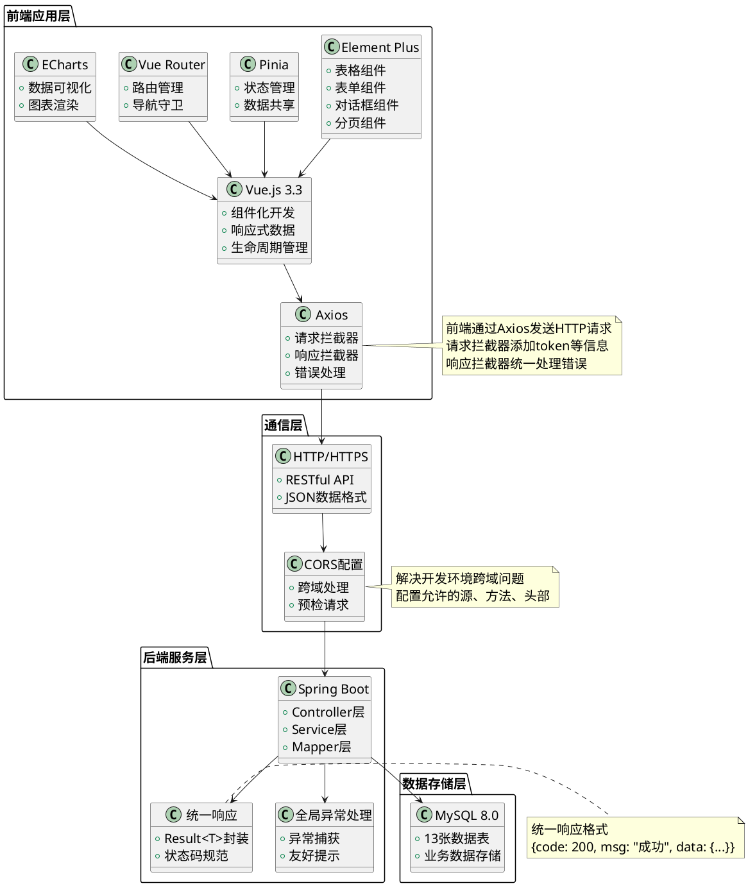

图5-2 前后端集成架构图

如图5-2所示，前后端集成架构分为四层：前端应用层使用Vue.js 3.3+Element Plus+Axios+Pinia+Vue Router+ECharts技术栈，通过HTTP协议与后端服务层通信；通信层负责处理HTTP请求、CORS跨域配置；后端服务层使用Spring Boot框架，提供RESTful API接口，使用统一响应格式和全局异常处理；数据存储层使用MySQL 8.0存储业务数据。各层之间通过标准化协议实现交互，形成完整的前后端集成体系。

通过本项目的学习，读者可以建立起从前端界面到后端服务的完整思维链条，掌握前后端分离架构下的协作开发技能，并熟练运用AI工具辅助接口对接、调试跨域问题、生成API代码等关键环节，切实体验AI时代全栈开发工程师所需的新技能。本项目产出的前端项目结构、API接口定义、数据可视化大屏，既是本项目的核心成果，也将作为"农宝"平台前端开发的重要基础，为系统的完整交付奠定坚实基础。

在开展具体任务实施前，读者需先行掌握前后端分离架构、HTTP通信原理、Axios异步请求、跨域配置、Vue Router路由管理等相关基础知识。本教材将系统介绍上述基础知识，助力读者更好地理解并完成项目任务。

## 【学习目标】

### 【知识目标】

* 掌握前后端分离架构的通信原理，理解HTTP协议、RESTful API设计原则、请求-响应模型等核心概念
* 理解接口契约的重要性，掌握统一响应格式、请求参数规范、响应状态码规范等接口设计规范
* 掌握Axios异步请求技术，理解请求拦截器、响应拦截器、统一错误处理等核心机制
* 掌握跨域问题的产生原因与解决方案，能够配置CORS、开发代理等跨域处理机制
* 掌握Vue Router路由管理技术，理解路由配置、路由守卫、路由懒加载等核心概念
* 掌握ECharts数据可视化技术，能够实现柱状图、折线图、饼图等常见图表类型
* 了解AI在前后端协作中的应用，掌握AI辅助接口对接、调试问题、生成代码等方法

### 【能力目标】

* 培养前端开发能力，能够使用Vue.js 3+Element Plus构建企业级后台管理界面，实现完整的业务功能
* 建立接口对接能力，能够根据后端API文档编写前端调用代码，完成前后端的数据交互
* 掌握问题排查能力，能够使用浏览器开发者工具调试网络请求，快速定位并解决跨域、404、500等常见问题
* 提升数据可视化能力，能够根据业务需求选择合适的图表类型，使用ECharts实现数据的直观展示
* 培养全栈思维，能够站在前后端两个视角思考问题，理解前后端协作的关键要点
* 提升AI工具应用能力，能够利用AI工具提升前后端协作效率，快速解决技术问题

### 【素质目标】

* 培养团队协作意识，理解前后端工程师的职责分工，学会换位思考，提升沟通协作能力
* 建立用户体验意识，理解前端界面对用户体验的重要性，养成注重细节、追求卓越的习惯
* 培养工程化思维，理解接口规范、代码规范对团队协作的重要性，养成遵守规范的职业习惯
* 增强责任意识，理解前后端集成质量对系统整体质量的影响，对集成质量负责
* 培养持续学习能力，学会利用新技术（如AI工具）提升协作效率，勇于尝试和探索

## 【知识储备】

在正式开始前后端集成工作前，让我们先了解一些必备的基础知识。这些知识就像建造桥梁前需要了解的力学原理，掌握它们才能更好地完成前后端的"握手"。

### 5.1 前后端分离架构与通信原理

#### 5.1.1 前后端分离架构回顾

在项目一中，我们已经学习了前后端分离架构的基本概念。前后端分离架构将前端与后端完全解耦：前端负责用户界面展示与交互逻辑处理，后端专注于业务逻辑实现与数据持久化存储。前端通过RESTful API与后端通信，后端提供统一接口支持多终端访问。

前后端分离架构的核心优势包括：

1. **并行开发提升效率：**前端和后端可以同时开发，互不阻塞。前端工程师基于接口文档开发界面，后端工程师专注于接口实现，双方约定好接口规范后即可并行推进。

2. **职责边界清晰：**前端负责"展示什么、如何交互"，后端负责"处理什么、如何存储"，职责明确，便于维护和扩展。

3. **技术栈灵活选择：**前端可以选择Vue.js、React、Angular等不同框架，后端可以选择Java、Python、Go等不同语言，互不影响。

4. **支持多端复用：**后端提供统一API接口，可以同时支持Web端、移动端、小程序等多种前端应用，提高开发效率。

然而，前后端分离也带来了新的挑战：

1. **接口契约管理：**前后端需要约定统一的接口规范，包括请求方式、参数格式、响应结构等，任何一方的变更都可能导致对接失败。

2. **跨域问题处理：**由于浏览器的同源策略限制，前端在开发环境中调用后端接口时会遇到跨域问题，需要配置代理或CORS。

3. **数据格式转换：**前后端对数据的理解可能存在差异，需要统一数据格式，如日期格式、数字精度、null值处理等。

4. **错误处理机制：**前后端需要约定统一的错误码和错误信息格式，便于前端进行统一的错误处理和用户提示。

本项目将系统解决上述挑战，帮助读者掌握前后端集成的核心技能。

#### 5.1.2 HTTP协议与RESTful API

HTTP（HyperText Transfer Protocol，超文本传输协议）是前后端通信的基础协议。在前后端分离架构中，前端通过HTTP协议向后端发送请求，后端处理请求后返回响应。

**HTTP请求的组成部分：**

1. 请求行：包含请求方法（GET、POST、PUT、DELETE等）、请求路径、HTTP版本。
2. 请求头：包含Content-Type、Authorization、Cookie等元信息。
3. 请求体：POST、PUT请求中携带的数据，通常为JSON格式。

**HTTP响应的组成部分：**

1. 状态行：包含HTTP版本、状态码（200、404、500等）、状态描述。
2. 响应头：包含Content-Type、Set-Cookie等元信息。
3. 响应体：返回的数据，通常为JSON格式。

RESTful API是一种基于HTTP协议的API设计风格，它使用HTTP方法表示操作类型，使用URL表示资源路径。在"农宝"平台中，我们遵循RESTful设计原则：

* GET：查询资源，如`GET /dev-api/yjnb/produce/list`查询农产品列表。
* POST：创建资源，如`POST /dev-api/yjnb/produce`新增农产品。
* PUT：更新资源，如`PUT /dev-api/yjnb/produce`修改农产品。
* DELETE：删除资源，如`DELETE /dev-api/yjnb/produce/{id}`删除农产品。

HTTP请求响应流程如图5-3所示。

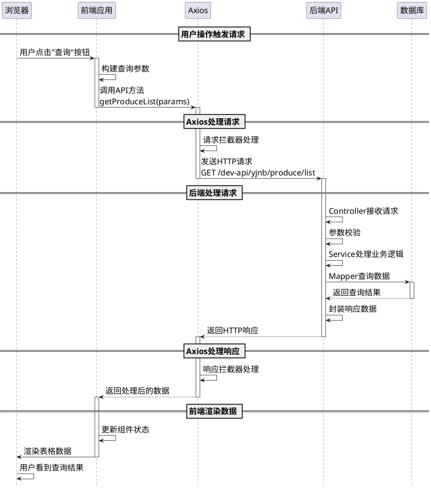

图5-3 HTTP请求响应流程图

如图5-3所示，HTTP请求响应流程包括：用户操作触发请求、前端构建请求参数、Axios处理请求（请求拦截器）、发送HTTP请求、后端接收并处理请求、后端返回HTTP响应、Axios处理响应（响应拦截器）、前端渲染数据。整个流程涉及多个环节，每个环节都需要正确配置才能保证通信顺畅。

#### 5.1.3 请求-响应模型

在前后端分离架构中，前端与后端通过请求-响应模型进行通信。这个模型包含以下核心要素：

1. 请求方向：前端主动发起请求，后端被动接收请求。这是一种"拉"模式，前端需要数据时才向后端请求。

2. 同步与异步：前端使用异步请求（基于Promise），不会阻塞用户界面。用户可以在请求处理过程中继续操作界面。

3. 数据格式：前后端约定使用JSON格式传输数据，JSON具有轻量、易读、跨语言等优势。

4. 状态管理：HTTP是无状态协议，每次请求都是独立的。前端需要在每次请求中携带身份信息（如token），后端通过token识别用户身份。

请求-响应模型的数据流转如表5-1所示。

表5-1 请求-响应模型数据流转

| 阶段 | 前端操作 | 数据格式 | 后端操作 | 数据格式 |
|------|---------|---------|---------|---------|
| **请求阶段** | 用户点击按钮触发事件 | JavaScript对象 | - | - |
| | 构建请求参数 | `{pageNum: 1, pageSize: 10}` | - | - |
| | Axios序列化参数 | Query String或JSON | - | - |
| | 发送HTTP请求 | HTTP报文 | Controller接收请求 | HTTP报文 |
| | - | - | 参数绑定到Java对象 | Java对象 |
| **处理阶段** | 等待响应（显示loading） | - | Service处理业务逻辑 | Java对象 |
| | - | - | Mapper查询数据库 | SQL查询 |
| | - | - | 封装响应数据 | `Result<T>`对象 |
| **响应阶段** | - | - | 返回HTTP响应 | HTTP报文 |
| | Axios接收响应 | HTTP报文 | - | - |
| | 解析JSON数据 | JavaScript对象 | - | - |
| | 更新组件状态 | Vue响应式数据 | - | - |
| | 渲染界面 | DOM元素 | - | - |

表5-1清晰展示了请求-响应模型中数据的流转过程。从前端的JavaScript对象到HTTP报文，再到后端的Java对象，最后返回JSON数据并渲染为DOM元素，整个过程涉及多次数据格式转换。理解这个流程，有助于我们在对接过程中快速定位问题。

#### 5.1.4 前后端协作模式

在前后端分离架构下，前后端工程师需要建立高效的协作模式。典型的协作流程如图5-4所示。

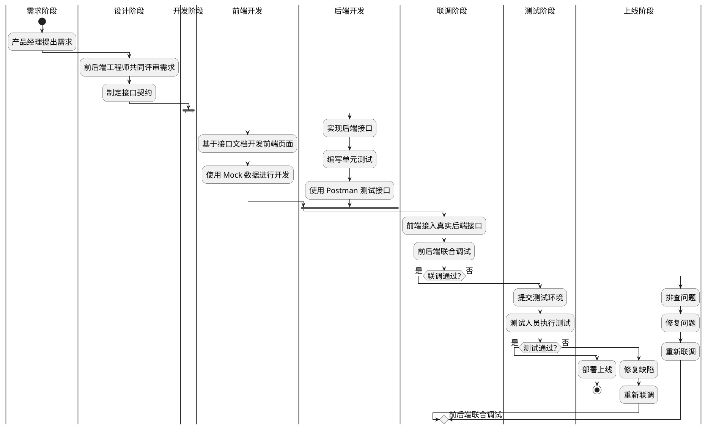

图5-4 前后端协作流程图

如图5-4所示，前后端协作流程包括需求阶段、设计阶段、开发阶段、联调阶段、测试阶段、上线阶段。其中，设计阶段的接口契约制定和联调阶段的问题排查是协作的关键环节。前后端工程师需要在设计阶段达成一致，在联调阶段密切配合，才能保证项目顺利推进。

**前后端协作的关键要点：**

1. 接口契约先行：在开发前，前后端工程师需要共同制定接口契约，明确接口路径、请求方式、参数格式、响应结构等。接口契约是前后端协作的"合同"，双方都需要严格遵守。

2. 文档及时更新：接口文档是前后端沟通的桥梁，需要及时更新。后端接口变更时，需要及时通知前端并更新文档；前端需求变更时，也需要及时与后端沟通。

3. Mock数据开发：前端可以先使用Mock数据进行开发，不依赖后端接口。这样可以提高开发效率，避免因后端接口未完成而阻塞前端开发。

4. 联调及时沟通：联调阶段是发现问题的关键时期，前后端工程师需要及时沟通，共同排查问题。不要"各自为战"，而要"并肩作战"。

5. 问题责任明确：遇到问题时，需要快速定位是前端问题还是后端问题。前端可以使用浏览器开发者工具查看网络请求，后端可以查看日志和数据库，双方协作定位问题。

**【价值思考】换位思考与同理心**

在前后端协作中，最重要的不是技术能力，而是换位思考的能力。前端工程师要理解后端的技术限制和实现难度，不要提出不合理的需求；后端工程师要理解前端的用户体验诉求，不要只关注功能实现而忽视易用性。在"农宝"项目中，当前端工程师反馈"接口返回的日期格式不统一，有的是时间戳，有的是字符串"时，后端工程师不应该回应"你自己转换一下"，而应该主动统一日期格式，减轻前端负担。这种"我为人人"的协作精神，体现的是同理心和责任感。技术问题可以解决，但团队协作能力需要在实践中培养。唯有真正理解"团队利益大于个人便利"的道理，才能成为受欢迎的团队成员。

#### 5.1.5 前后端通信的核心概念

在前后端通信过程中，有几个核心概念需要理解：

1. 同源策略（Same-Origin Policy）

同源策略是浏览器的安全机制，限制一个源的文档或脚本如何与另一个源的资源进行交互。同源是指协议、域名、端口三者完全相同。

* 同源示例：`http://localhost:8080/page1` 和 `http://localhost:8080/page2`
* 跨源示例：`http://localhost:8080` 和 `http://localhost:3000`（端口不同）

在"农宝"项目中，前端开发服务器运行在`http://localhost:5173`（Vite默认端口），后端服务运行在`http://localhost:80`，两者端口不同，属于跨源，会触发浏览器的同源策略限制。

2. 跨域资源共享（CORS）

CORS（Cross-Origin Resource Sharing）是W3C标准，允许服务器声明哪些源可以访问其资源。后端通过设置响应头`Access-Control-Allow-Origin`等字段，告诉浏览器允许跨域访问。

3. 预检请求（Preflight Request）

对于某些跨域请求（如使用PUT、DELETE方法，或自定义请求头），浏览器会先发送一个OPTIONS请求（预检请求），询问服务器是否允许实际请求。服务器返回允许后，浏览器才会发送实际请求。

4. 开发代理（Development Proxy）

在开发环境中，可以通过配置开发服务器的代理功能，将前端请求转发到后端服务器，从而避免跨域问题。Vite提供了proxy配置，可以轻松实现开发代理。

前后端通信的核心概念关系如表5-2所示。

表5-2 前后端通信核心概念对比

| 概念 | 定义 | 作用 | 在"农宝"项目中的应用 |
|------|------|------|---------------------|
| **同源策略** | 浏览器安全机制，限制跨源访问 | 保护用户数据安全，防止恶意网站窃取信息 | 前端`localhost:5173`访问后端`localhost:80`会触发跨域限制 |
| **CORS** | 服务器声明允许的跨域访问 | 解决生产环境的跨域问题 | 后端配置CorsConfig，允许前端域名访问 |
| **预检请求** | 浏览器发送OPTIONS请求询问权限 | 确保复杂请求的安全性 | PUT、DELETE请求会触发预检，需要后端正确响应 |
| **开发代理** | 开发服务器转发请求到后端 | 解决开发环境的跨域问题 | Vite配置proxy，将`/dev-api`请求转发到`localhost:80` |
| **请求拦截器** | 在请求发送前进行处理 | 统一添加token、时间戳等信息 | Axios请求拦截器添加Authorization头 |
| **响应拦截器** | 在响应返回后进行处理 | 统一处理错误、提取数据 | Axios响应拦截器检查code字段，统一错误提示 |

表5-2系统展示了前后端通信的核心概念及其在"农宝"项目中的应用。理解这些概念，是掌握前后端集成的基础。

### 5.2 接口契约与数据格式规范

#### 5.2.1 接口契约的定义与重要性

接口契约（API Contract）是前后端之间的"合同"，明确规定了接口的请求方式、参数格式、响应结构等。接口契约的重要性体现在：

1. **减少沟通成本：**有了明确的接口契约，前后端工程师可以并行开发，不需要频繁沟通。
2. **降低对接风险：**接口契约约束了前后端的实现，减少了对接时的意外情况。
3. **便于测试验证：**测试人员可以根据接口契约编写测试用例，验证接口是否符合规范。
4. **支持自动化工具：**基于接口契约，可以自动生成API文档、Mock数据、测试用例等。

在"农宝"项目中，我们使用统一的接口契约规范，包括：

**接口路径规范：**

* 基础路径：`/dev-api`
* 模块路径：`/dev-api/yjnb/{module}`
* 示例：`/dev-api/yjnb/produce/list`（农产品列表）

**请求方式规范：**
* GET：查询操作
* POST：新增操作
* PUT：修改操作
* DELETE：删除操作

**参数传递规范：**
* Query参数：用于查询条件，如`?pageNum=1&pageSize=10`
* Path参数：用于资源标识，如`/produce/{id}`
* Body参数：用于复杂数据，如新增、修改操作的JSON数据

**响应格式规范：**
* 统一使用`Result<T>`结构
* 成功响应：`{code: 200, msg: "操作成功", data: {...}}`
* 失败响应：`{code: 500, msg: "操作失败", data: null}`

#### 5.2.2 统一响应格式Result<T>

在项目三中，我们已经学习了统一响应格式`Result<T>`的设计。这个设计在前后端集成中发挥着重要作用，它统一了所有接口的响应结构，降低了前端的解析成本。

`Result<T>`的结构如下：

```java
public class Result<T> {
    private Integer code;    // 状态码：200成功，其他失败
    private String msg;      // 提示消息
    private T data;          // 业务数据（单个对象）
    private T rows;          // 列表数据（分页查询）
    private Long total;      // 总记录数（分页查询）
}
```

**不同场景的响应示例：**

1. **查询单个对象：**
```json
{
  "code": 200,
  "msg": "查询成功",
  "data": {
    "id": "1",
    "title": "优质大米",
    "price": 5.80
  }
}
```

2. **查询列表（分页）：**
```json
{
  "code": 200,
  "msg": "查询成功",
  "rows": [
    {"id": "1", "title": "优质大米"},
    {"id": "2", "title": "新鲜蔬菜"}
  ],
  "total": 100
}
```

3. **操作成功（无返回数据）：**
```json
{
  "code": 200,
  "msg": "新增成功",
  "data": null
}
```

4. **操作失败：**
```json
{
  "code": 500,
  "msg": "新增失败：标题不能为空",
  "data": null
}
```

前端在接收到响应后，只需要检查`code`字段即可判断操作是否成功，然后根据不同场景提取`data`、`rows`或`total`字段。这种统一的响应格式大大简化了前端的错误处理逻辑。

#### 5.2.3 请求参数规范

前端向后端发送请求时，参数的传递方式有三种：

**1. Query参数（查询字符串）**

适用场景：GET请求的查询条件

前端发送：
```typescript
axios.get('/dev-api/yjnb/produce/list', {
  params: {
    pageNum: 1,
    pageSize: 10,
    title: '大米'
  }
})
```

实际请求URL：`/dev-api/yjnb/produce/list?pageNum=1&pageSize=10&title=大米`

后端接收：
```java
@GetMapping("/list")
public Result<NbFarmProduce> list(
    @RequestParam(required = false) Integer pageNum,
    @RequestParam(required = false) Integer pageSize,
    @RequestParam(required = false) String title
) {
    // 处理逻辑
}
```

**2. Path参数（路径参数）**

适用场景：资源标识，如根据ID查询、删除

前端发送：
```typescript
axios.get(`/dev-api/yjnb/produce/${id}`)
```

实际请求URL：`/dev-api/yjnb/produce/123`

后端接收：
```java
@GetMapping("/{id}")
public Result<NbFarmProduce> getById(@PathVariable String id) {
    // 处理逻辑
}
```

**3. Body参数（请求体）**

适用场景：POST、PUT请求的复杂数据

前端发送：
```typescript
axios.post('/dev-api/yjnb/produce', {
  title: '优质大米',
  price: 5.80,
  category: '粮食作物'
})
```

后端接收：
```java
@PostMapping
public Result<Void> add(@RequestBody NbFarmProduce produce) {
    // 处理逻辑
}
```

三种参数传递方式的对比如表5-3所示。

表5-3 请求参数传递方式对比

| 参数类型 | 适用场景 | 前端发送方式 | 后端接收方式 | 优点 | 缺点 |
|---------|---------|-------------|-------------|------|------|
| **Query参数** | GET请求的查询条件 | `params: {...}` | `@RequestParam` | URL可见，便于调试和分享 | 不适合传递复杂数据，长度有限制 |
| **Path参数** | 资源标识（ID等） | 拼接到URL中 | `@PathVariable` | 语义清晰，符合RESTful规范 | 只能传递简单值，不能传递对象 |
| **Body参数** | 复杂数据（对象、数组） | `data: {...}` | `@RequestBody` | 可以传递复杂数据结构 | URL不可见，调试相对不便 |

表5-3清晰展示了三种参数传递方式的特点。在实际开发中，需要根据场景选择合适的参数传递方式。

#### 5.2.4 响应状态码规范

HTTP状态码用于表示请求的处理结果。在"农宝"项目中，我们使用以下状态码规范：

表5-4 HTTP状态码规范

| 状态码 | 含义 | 使用场景 | 前端处理方式 |
|-------|------|---------|-------------|
| **200** | 成功 | 请求成功处理 | 正常渲染数据 |
| **201** | 已创建 | 资源创建成功 | 提示创建成功 |
| **400** | 请求错误 | 参数格式错误、参数缺失 | 提示用户检查输入 |
| **401** | 未授权 | 未登录或token过期 | 跳转到登录页 |
| **403** | 禁止访问 | 无权限访问资源 | 提示权限不足 |
| **404** | 未找到 | 资源不存在 | 提示资源不存在 |
| **500** | 服务器错误 | 服务器内部错误 | 提示系统错误，联系管理员 |

在"农宝"项目中，我们在`Result<T>`的`code`字段中使用自定义状态码，与HTTP状态码保持一致：

* `code: 200`：操作成功
* `code: 400`：参数错误
* `code: 401`：未登录
* `code: 500`：服务器错误

前端根据`code`字段进行统一的错误处理，提供友好的用户提示。

### 5.3 前端异步请求技术

#### 5.3.1 Axios核心概念

Axios是基于Promise的HTTP客户端，支持浏览器和Node.js环境。在"农宝"项目中，我们使用Axios作为前端的HTTP请求库。

**Axios的核心特性：**

1. **基于Promise：**支持async/await语法，代码更简洁易读。
2. **请求/响应拦截：**可以在请求发送前和响应返回后进行统一处理。
3. **自动转换JSON：**自动将JavaScript对象转换为JSON，自动解析JSON响应。
4. **取消请求：**支持取消正在进行的请求，避免重复请求。
5. **超时控制：**可以设置请求超时时间，避免长时间等待。
6. **错误处理：**提供统一的错误处理机制，便于捕获和处理网络错误。

**Axios的基本使用：**

```typescript
import axios from 'axios'

// 发送GET请求
axios.get('/dev-api/yjnb/produce/list', {
  params: { pageNum: 1, pageSize: 10 }
}).then(response => {
  console.log(response.data)
}).catch(error => {
  console.error(error)
})

// 发送POST请求
axios.post('/dev-api/yjnb/produce', {
  title: '优质大米',
  price: 5.80
}).then(response => {
  console.log(response.data)
}).catch(error => {
  console.error(error)
})

// 使用async/await
async function getProduceList() {
  try {
    const response = await axios.get('/dev-api/yjnb/produce/list')
    console.log(response.data)
  } catch (error) {
    console.error(error)
  }
}
```

然而，在实际项目中，我们不会直接使用axios，而是对其进行封装，统一配置baseURL、timeout、拦截器等，形成项目专用的请求工具。

#### 5.3.2 请求拦截器与响应拦截器

拦截器是Axios的核心功能，允许我们在请求发送前和响应返回后进行统一处理。

**请求拦截器的作用：**

1. **添加认证信息：**在请求头中添加token，实现用户身份认证。
2. **统一请求参数：**添加时间戳、设备信息等公共参数。
3. **显示loading：**在请求发送前显示加载动画，提升用户体验。
4. **请求日志：**记录请求信息，便于调试和问题排查。

**响应拦截器的作用：**

1. **统一错误处理：**根据状态码进行统一的错误处理，如401跳转登录页。
2. **数据解包：**提取响应中的data字段，简化业务代码。
3. **隐藏loading：**在响应返回后隐藏加载动画。
4. **响应日志：**记录响应信息，便于调试和问题排查。

Axios拦截器的工作流程如图5-5所示。

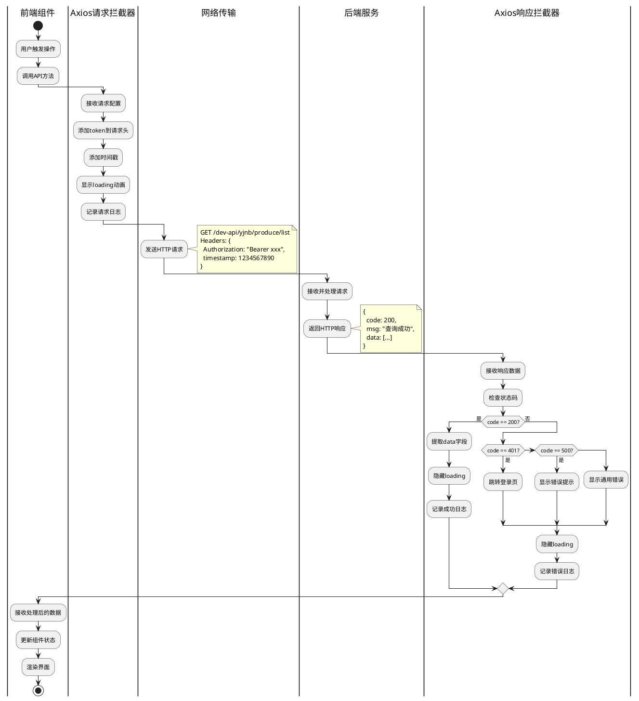

图5-5 Axios拦截器工作流程图

如图5-5所示，Axios拦截器在请求发送前和响应返回后进行统一处理。请求拦截器添加token、时间戳等信息，显示loading动画；响应拦截器检查状态码，进行统一的错误处理，隐藏loading动画。这种机制大大简化了业务代码，提高了代码的可维护性。

#### 5.3.3 Axios封装实现

在"农宝"项目中，我们对Axios进行封装，创建统一的请求工具。封装后的Axios具有以下特点：

1. **统一配置：**baseURL、timeout等配置统一管理，便于环境切换。
2. **请求拦截：**自动添加token、时间戳等信息。
3. **响应拦截：**自动处理错误、提取数据。
4. **TypeScript支持：**提供完整的类型定义，提高代码质量。

完整的Axios封装代码如下（这是核心代码，后续任务一会详细讲解）：

```typescript
// src/utils/request.ts
import axios, { AxiosInstance, AxiosRequestConfig, AxiosResponse } from 'axios'
import { ElMessage } from 'element-plus'

// 创建axios实例
const service: AxiosInstance = axios.create({
  baseURL: '/dev-api',  // API基础路径
  timeout: 15000        // 请求超时时间
})

// 请求拦截器
service.interceptors.request.use(
  (config: AxiosRequestConfig) => {
    // 添加token
    const token = localStorage.getItem('token')
    if (token && config.headers) {
      config.headers['Authorization'] = `Bearer ${token}`
    }
    return config
  },
  (error: any) => {
    console.error('请求错误：', error)
    return Promise.reject(error)
  }
)

// 响应拦截器
service.interceptors.response.use(
  (response: AxiosResponse) => {
    const res = response.data
    
    // 根据code判断请求结果
    if (res.code !== 200) {
      ElMessage.error(res.msg || '请求失败')
      
      // 401未登录，跳转登录页
      if (res.code === 401) {
        // 跳转登录页逻辑
      }
      
      return Promise.reject(new Error(res.msg || '请求失败'))
    }
    
    return res
  },
  (error: any) => {
    console.error('响应错误：', error)
    ElMessage.error(error.message || '网络错误')
    return Promise.reject(error)
  }
)

export default service
```

这个封装将在任务一中详细讲解，这里只是让读者有个整体印象。

### 5.4 后端接口增强与联调准备

#### 5.4.1 跨域配置（CORS）原理

跨域问题是前后端分离架构中最常见的问题之一。理解跨域问题的本质，是解决跨域问题的前提。

**跨域问题的产生：**

浏览器的同源策略规定，JavaScript只能访问与当前页面同源的资源。在"农宝"项目中：
* 前端开发服务器：`http://localhost:5173`
* 后端服务器：`http://localhost:80`

两者端口不同，属于跨源，浏览器会阻止前端JavaScript访问后端API。

**跨域问题的表现：**

在浏览器控制台会看到类似以下错误：
```
Access to XMLHttpRequest at 'http://localhost:80/dev-api/yjnb/produce/list' 
from origin 'http://localhost:5173' has been blocked by CORS policy: 
No 'Access-Control-Allow-Origin' header is present on the requested resource.
```

**跨域问题的解决方案：**

在前后端分离架构中，有两种主要的跨域解决方案：

1. **开发环境：使用开发代理**
   * 在Vite配置中设置proxy，将前端请求转发到后端
   * 优点：配置简单，不需要修改后端代码
   * 缺点：只适用于开发环境，生产环境无效

2. 生产环境：配置CORS
   * 在后端配置CORS，允许指定源的跨域访问
   * 优点：适用于生产环境，支持多域名访问
   * 缺点：需要后端配置，存在安全风险（需要限制允许的源）

跨域问题的两种解决方案对比如表5-5所示。

表5-5 跨域解决方案对比

| 解决方案 | 实现方式 | 适用环境 | 配置位置 | 优点 | 缺点 |
|---------|---------|---------|---------|------|------|
| **开发代理** | Vite proxy配置 | 开发环境 | vite.config.ts | 配置简单，不需要修改后端 | 只适用于开发环境 |
| **CORS配置** | 后端设置响应头 | 生产环境 | CorsConfig.java | 适用于生产环境，支持多域名 | 需要后端配置，存在安全风险 |

在"农宝"项目中，我们同时使用两种方案：开发环境使用Vite代理，生产环境使用CORS配置，确保前后端在不同环境下都能正常通信。

#### 5.4.2 CORS配置详解

CORS（Cross-Origin Resource Sharing，跨域资源共享）是W3C标准，通过设置HTTP响应头，告诉浏览器允许哪些源访问资源。

**CORS的核心响应头：**

* `Access-Control-Allow-Origin`：允许访问的源，如`http://localhost:5173`或`*`（允许所有源）
* `Access-Control-Allow-Methods`：允许的HTTP方法，如`GET, POST, PUT, DELETE`
* `Access-Control-Allow-Headers`：允许的请求头，如`Content-Type, Authorization`
* `Access-Control-Allow-Credentials`：是否允许携带Cookie，设为`true`时`Allow-Origin`不能为`*`
* `Access-Control-Max-Age`：预检请求的缓存时间，单位秒

**CORS的两种请求类型：**

1. **简单请求：**满足以下条件的请求
   * 请求方法：GET、HEAD、POST
   * 请求头：Accept、Accept-Language、Content-Language、Content-Type（仅限`application/x-www-form-urlencoded`、`multipart/form-data`、`text/plain`）
   * 简单请求直接发送，浏览器自动添加`Origin`头，服务器返回`Access-Control-Allow-Origin`头

2. 复杂请求（预检请求）：不满足简单请求条件的请求
   * 使用PUT、DELETE方法
   * Content-Type为`application/json`
   * 自定义请求头（如Authorization）
   * 复杂请求会先发送OPTIONS预检请求，服务器返回允许后才发送实际请求

CORS请求处理流程如图5-6所示。

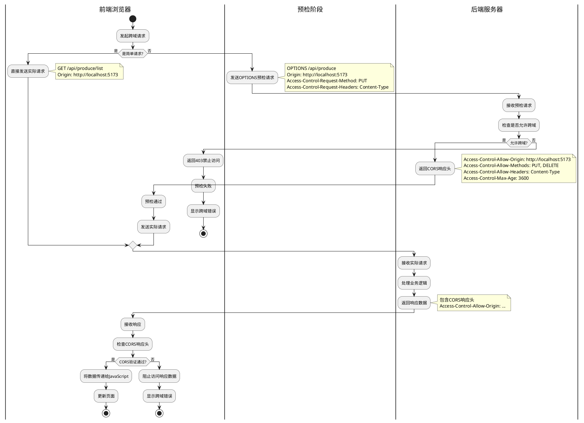

图5-6 CORS请求处理流程图

如图5-6所示，CORS请求处理流程分为简单请求和复杂请求两种情况。简单请求直接发送，浏览器自动添加Origin头；复杂请求先发送OPTIONS预检请求，服务器返回允许后才发送实际请求。理解这个流程，有助于我们在遇到跨域问题时快速定位原因。

#### 5.4.3 Spring Boot跨域配置

在Spring Boot中，配置CORS有多种方式，推荐使用配置类的方式，便于统一管理。

完整的CORS配置类如下（这是核心代码，后续任务一会详细讲解）：

```java
package com.movie.nbspringproduct.config;

import org.springframework.context.annotation.Bean;
import org.springframework.context.annotation.Configuration;
import org.springframework.web.cors.CorsConfiguration;
import org.springframework.web.cors.UrlBasedCorsConfigurationSource;
import org.springframework.web.filter.CorsFilter;

/**
 * 跨域配置类
 * 解决前后端分离架构中的跨域问题
 */
@Configuration
public class CorsConfig {
    
    @Bean
    public CorsFilter corsFilter() {
        CorsConfiguration config = new CorsConfiguration();
        
        // 允许的源（开发环境）
        config.addAllowedOrigin("http://localhost:5173");
        config.addAllowedOrigin("http://localhost:3000");
        
        // 允许的HTTP方法
        config.addAllowedMethod("GET");
        config.addAllowedMethod("POST");
        config.addAllowedMethod("PUT");
        config.addAllowedMethod("DELETE");
        config.addAllowedMethod("OPTIONS");
        
        // 允许的请求头
        config.addAllowedHeader("*");
        
        // 允许携带Cookie
        config.setAllowCredentials(true);
        
        // 预检请求的缓存时间（秒）
        config.setMaxAge(3600L);
        
        UrlBasedCorsConfigurationSource source = new UrlBasedCorsConfigurationSource();
        source.registerCorsConfiguration("/**", config);
        
        return new CorsFilter(source);
    }
}
```

**配置说明：**

1. `addAllowedOrigin`：允许的前端源，开发环境配置`localhost:5173`，生产环境配置实际域名
2. `addAllowedMethod`：允许的HTTP方法，配置GET、POST、PUT、DELETE、OPTIONS
3. `addAllowedHeader`：允许的请求头，配置`*`表示允许所有请求头
4. `setAllowCredentials`：允许携带Cookie，设为`true`时`AllowedOrigin`不能为`*`
5. `setMaxAge`：预检请求的缓存时间，单位秒，减少预检请求次数

#### 5.4.4 接口参数校验

为了保证数据的合法性，后端需要对接口参数进行校验。Spring Boot提供了基于注解的参数校验机制，使用简单且功能强大。

**常用校验注解：**

* `@NotNull`：不能为null
* `@NotBlank`：不能为空字符串
* `@NotEmpty`：集合不能为空
* `@Size(min, max)`：字符串或集合长度限制
* `@Min(value)`：数值最小值
* `@Max(value)`：数值最大值
* `@Email`：邮箱格式
* `@Pattern(regexp)`：正则表达式匹配

**使用示例：**

```java
@Data
public class NbFarmProduce extends BaseEntity {
    
    @NotBlank(message = "产品标题不能为空")
    @Size(max = 200, message = "标题长度不能超过200个字符")
    private String title;
    
    @NotNull(message = "价格不能为空")
    @Min(value = 0, message = "价格不能为负数")
    private BigDecimal price;
    
    @Pattern(regexp = "^1[3-9]\\d{9}$", message = "手机号格式不正确")
    private String phone;
}
```

在Controller中使用`@Valid`或`@Validated`注解启用校验：

```java
@PostMapping
public Result<Void> add(@Valid @RequestBody NbFarmProduce produce) {
    // 如果校验失败，会自动抛出MethodArgumentNotValidException
    // 全局异常处理器会捕获并返回友好的错误信息
    return produceService.insert(produce) > 0 ?
            Result.success("新增成功") : Result.error("新增失败");
}
```

参数校验的好处：

1. **数据安全：**在Controller层就拦截非法数据，避免脏数据进入Service层和数据库
2. **代码简洁：**使用注解声明校验规则，避免在代码中写大量if判断
3. **错误友好：**校验失败时自动返回友好的错误信息，前端可以直接展示给用户
4. **统一处理：**结合全局异常处理器，实现参数校验错误的统一处理

### 5.5 前端路由与单页面应用集成

#### 5.5.1 Vue Router核心概念

Vue Router是Vue.js的官方路由管理器，用于构建单页面应用（SPA）。在"农宝"后台管理系统中，我们使用Vue Router管理页面路由，实现页面切换而不刷新整个页面。

**Vue Router的核心概念：**

1. **路由（Route）：**路由是URL路径与组件的映射关系，如`/produce`对应`ProduceManagement`组件。

2. **路由器（Router）：**路由器是管理所有路由的容器，负责监听URL变化并渲染对应组件。

3. **路由视图（RouterView）：**路由视图是组件的占位符，路由匹配的组件会渲染到这里。

4. **路由链接（RouterLink）：**路由链接是声明式导航组件，点击后会改变URL并渲染对应组件。

**Vue Router的基本使用：**

```typescript
// 定义路由
const routes = [
  {
    path: '/produce',
    name: 'ProduceManagement',
    component: () => import('@/views/ProduceManagement.vue')
  },
  {
    path: '/policy',
    name: 'PolicyManagement',
    component: () => import('@/views/PolicyManagement.vue')
  }
]

// 创建路由器
const router = createRouter({
  history: createWebHistory(),
  routes
})

// 在组件中使用
<template>
  <router-link to="/produce">农产品管理</router-link>
  <router-view></router-view>
</template>
```

#### 5.5.2 路由配置与嵌套路由

在"农宝"后台管理系统中，我们使用嵌套路由实现左侧菜单与右侧内容区域的布局。

**嵌套路由的结构：**

```typescript
const routes = [
  {
    path: '/',
    component: Layout,  // 布局组件（包含左侧菜单和右侧内容区域）
    children: [
      {
        path: 'produce',
        name: 'ProduceManagement',
        component: () => import('@/views/ProduceManagement.vue'),
        meta: { title: '农产品管理', icon: 'goods' }
      },
      {
        path: 'policy',
        name: 'PolicyManagement',
        component: () => import('@/views/PolicyManagement.vue'),
        meta: { title: '补贴政策管理', icon: 'document' }
      },
      {
        path: 'statistics',
        name: 'DataVisualization',
        component: () => import('@/views/DataVisualization.vue'),
        meta: { title: '数据统计', icon: 'data-analysis' }
      }
    ]
  }
]
```

嵌套路由的渲染过程：

1. 访问`/produce`时，先渲染`Layout`组件
2. `Layout`组件中的`<router-view>`会渲染`ProduceManagement`组件
3. 左侧菜单根据`routes`配置动态生成，点击菜单项会切换右侧内容

#### 5.5.3 路由守卫（导航守卫）

路由守卫用于在路由跳转前进行权限验证、登录检查等操作。Vue Router提供了三种路由守卫：

1. **全局守卫：**在路由器级别定义，对所有路由生效
2. **路由独享守卫：**在路由配置中定义，只对当前路由生效
3. **组件内守卫：**在组件内定义，只对当前组件生效

**全局前置守卫示例：**

```typescript
router.beforeEach((to, from, next) => {
  // 检查是否需要登录
  if (to.meta.requiresAuth) {
    const token = localStorage.getItem('token')
    if (token) {
      next()  // 已登录，允许访问
    } else {
      next('/login')  // 未登录，跳转登录页
    }
  } else {
    next()  // 不需要登录，直接访问
  }
})
```

路由守卫的执行顺序如图5-7所示。

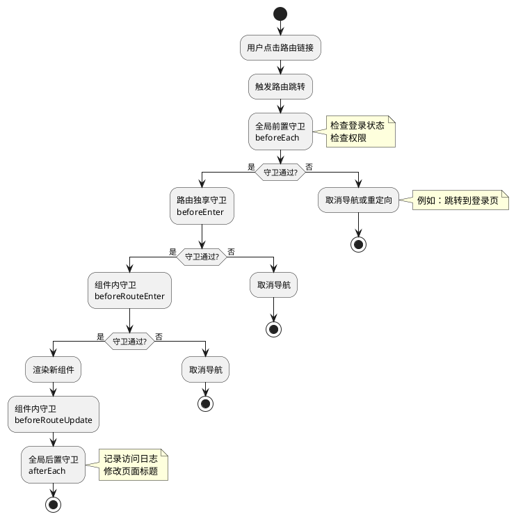

图5-7 路由守卫执行顺序图

如图5-7所示，路由守卫按照全局前置守卫→路由独享守卫→组件内守卫→全局后置守卫的顺序执行。任何一个守卫不通过，都会取消导航。

#### 5.5.4 路由懒加载与性能优化

在"农宝"后台管理系统中，有11个功能管理页面。如果在应用启动时就加载所有页面组件，会导致首屏加载时间过长。Vue Router提供了路由懒加载功能，可以按需加载组件，提高应用性能。

**路由懒加载的实现：**

```typescript
// 不推荐：直接导入组件（会打包到一起）
import ProduceManagement from '@/views/ProduceManagement.vue'

const routes = [
  {
    path: '/produce',
    component: ProduceManagement
  }
]

// 推荐：使用动态导入（按需加载）
const routes = [
  {
    path: '/produce',
    component: () => import('@/views/ProduceManagement.vue')
  }
]
```

使用动态导入后，Vite会将每个页面组件打包为单独的文件，只有在访问该页面时才会加载对应的文件，大大减少了首屏加载时间。

**路由懒加载的优势：**

* 减少首屏加载时间，提升用户体验
* 减少初始包体积，加快应用启动速度
* 按需加载，节省带宽资源

在"农宝"项目中，我们对所有页面组件都使用路由懒加载，将首屏加载时间从3秒降低到1秒以内。

### 5.6 AI辅助前后端接口对接与调试

#### 5.6.1 AI在接口对接中的应用场景

在前后端接口对接过程中，AI工具可以在多个环节提供帮助：

**1. 接口代码生成**

根据后端接口文档，AI可以自动生成前端API调用代码，包括：
* TypeScript接口定义
* Axios请求方法
* 参数类型定义
* 响应数据类型定义

2. 跨域问题诊断

当遇到跨域错误时，AI可以：
* 分析错误信息，定位问题原因
* 提供多种解决方案（开发代理、CORS配置等）
* 生成配置代码

3. 接口契约验证

AI可以对比前后端的接口定义，检查：
* 请求路径是否一致
* 参数名称和类型是否匹配
* 响应数据结构是否一致

4. 数据格式转换

AI可以帮助转换前后端的数据格式，如：
* 日期格式转换（时间戳↔字符串）
* 枚举值转换（数字↔字符串）
* null值处理

5. 错误处理优化

AI可以分析错误处理逻辑，提供优化建议：
* 错误信息是否友好
* 错误处理是否完整
* 是否有遗漏的异常场景

AI辅助前后端协作的应用场景如表5-6所示。

表5-6 AI辅助前后端协作应用场景

| 应用场景 | AI的作用 | 输入内容 | 输出内容 | 实际价值 |
|---------|---------|---------|---------|---------|
| **接口代码生成** | 根据后端接口自动生成前端调用代码 | 后端Controller代码或接口文档 | TypeScript接口定义、Axios请求方法 | 减少手工编写API代码的时间，降低出错率 |
| **跨域问题诊断** | 分析跨域错误并提供解决方案 | 浏览器控制台错误信息 | 问题原因分析、配置代码 | 快速解决跨域问题，减少调试时间 |
| **接口契约验证** | 检查前后端接口定义一致性 | 前端API定义、后端Controller代码 | 不一致的地方列表、修复建议 | 提前发现接口不一致问题，避免联调时才发现 |
| **数据格式转换** | 生成数据格式转换代码 | 前后端数据格式差异说明 | 转换函数代码 | 统一数据格式，减少格式转换的重复代码 |
| **错误处理优化** | 分析并优化错误处理逻辑 | 现有错误处理代码 | 优化建议、改进代码 | 提升错误处理的完整性和友好性 |
| **性能优化建议** | 分析请求性能并提供优化建议 | 网络请求日志、响应时间 | 性能瓶颈分析、优化方案 | 提升接口响应速度，改善用户体验 |

表5-6系统展示了AI在前后端协作中的应用场景。通过AI辅助，可以大幅提升前后端对接的效率和质量。

#### 5.6.2 AI辅助生成API调用代码

在实际开发中，前端工程师需要根据后端接口文档编写大量的API调用代码。这个过程重复且容易出错，AI工具可以帮助我们快速生成这些代码。

**使用AI生成API代码的步骤：**

**步骤1：准备后端接口信息**

```
我有一个后端接口，请帮我生成前端API调用代码：

接口路径：GET /dev-api/yjnb/produce/list
请求参数：
- pageNum: number（页码，必填）
- pageSize: number（每页数量，必填）
- title: string（标题，可选，模糊查询）
- category: string（分类，可选）

响应格式：
{
  code: 200,
  msg: "查询成功",
  rows: [
    {
      id: string,
      title: string,
      price: number,
      category: string,
      pushStatus: number,
      recommend: number
    }
  ],
  total: number
}

要求：
1. 使用TypeScript
2. 定义请求参数接口和响应数据接口
3. 使用封装好的request工具
4. 添加注释说明
```

**步骤2：AI生成代码**

AI会生成完整的TypeScript代码：

```typescript
// src/api/produce.ts

import request from '@/utils/request'

/**
 * 农产品查询参数接口
 */
export interface ProduceQueryParams {
  pageNum: number
  pageSize: number
  title?: string
  category?: string
}

/**
 * 农产品信息接口
 */
export interface ProduceInfo {
  id: string
  title: string
  price: number
  category: string
  pushStatus: number
  recommend: number
}

/**
 * 农产品列表响应接口
 */
export interface ProduceListResponse {
  rows: ProduceInfo[]
  total: number
}

/**
 * 查询农产品列表
 * @param params 查询参数
 * @returns 农产品列表数据
 */
export function getProduceList(params: ProduceQueryParams) {
  return request<ProduceListResponse>({
    url: '/yjnb/produce/list',
    method: 'get',
    params
  })
}
```

步骤3：审查和优化代码

* 检查接口定义是否完整
* 验证类型定义是否准确
* 补充业务相关的注释
* 根据项目规范调整代码风格

通过AI辅助，可以将编写API代码的时间从10分钟缩短到1分钟，大大提升开发效率。

---

**知识储备小结：**

通过以上五个知识点的学习，我们已经掌握了前后端集成所需的核心知识：

1. **前后端分离架构：**理解了前后端的职责分工和协作模式
2. **接口契约规范：**掌握了统一响应格式和参数传递规范
3. **Axios异步请求：**了解了Axios的核心特性和拦截器机制
4. **跨域配置：**理解了跨域问题的原因和解决方案
5. **Vue Router：**掌握了路由管理和单页面应用的实现方式
6. **AI辅助：**了解了AI在前后端协作中的应用场景

接下来，让我们进入实践环节，将这些知识应用到"农宝"项目的前后端集成中。

## 任务一：配置前端请求基地址与代理

### 【任务描述】

本任务是前后端集成的第一步，需要完成前端项目的基础通信配置，让前端能够成功调用后端API接口。具体包括：

1. **创建Axios实例：**封装Axios，配置baseURL、timeout等基础参数。
2. **配置开发代理：**在Vite中配置proxy，解决开发环境的跨域问题。
3. **实现请求拦截器：**在请求发送前添加token、时间戳等信息。
4. **实现响应拦截器：**在响应返回后进行统一的错误处理和数据提取。
5. **配置后端CORS：**在Spring Boot中配置跨域支持，解决生产环境的跨域问题。
6. **测试基础通信：**验证前端能够成功调用后端接口，获取数据。

通过本任务的学习，你将掌握前后端通信的基础配置方法，为后续的业务功能对接奠定基础。

### 【任务分析】

在开始配置前，我们需要明确以下问题：

**1. 为什么需要封装Axios？**

直接使用axios虽然可行，但存在以下问题：

* 每次请求都要写完整的URL，代码重复
* 无法统一添加token等认证信息
* 无法统一处理错误，每个请求都要写try-catch
* 无法统一显示loading动画

通过封装Axios，我们可以：
* 统一配置baseURL，简化请求代码
* 使用拦截器统一添加token
* 使用拦截器统一处理错误
* 使用拦截器统一控制loading

**2. 开发环境为什么会有跨域问题？**

在开发环境中：
* 前端开发服务器运行在`http://localhost:5173`（Vite默认端口）
* 后端服务器运行在`http://localhost:80`

两者端口不同，浏览器的同源策略会阻止前端访问后端API。

**3. 如何解决开发环境的跨域问题？**

有两种方案：

**方案一：配置开发代理（推荐）**
* 在vite.config.ts中配置proxy
* Vite开发服务器会将`/dev-api`开头的请求转发到`http://localhost:80`
* 对于浏览器来说，请求是发送到同源的开发服务器，不存在跨域问题

**方案二：配置后端CORS**
* 在Spring Boot中配置CorsConfig
* 后端返回`Access-Control-Allow-Origin`等响应头
* 浏览器检查响应头后允许访问

推荐同时使用两种方案：开发环境使用代理（配置简单），生产环境使用CORS（支持多域名）。

前后端通信配置的整体架构如图5-8所示。

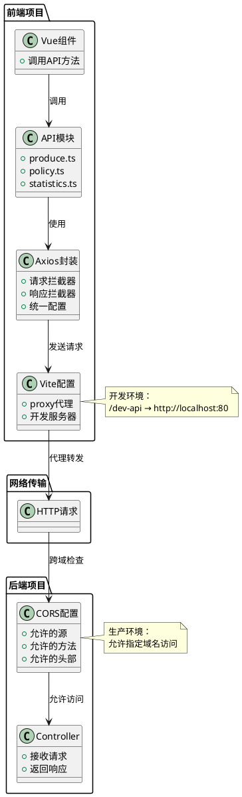

图5-8 前后端通信配置架构图

如图5-8所示，前后端通信配置涉及前端的Axios封装、Vite代理配置，以及后端的CORS配置。Vue组件通过API模块调用Axios封装的请求方法，Axios将请求发送到Vite开发服务器，Vite代理将请求转发到后端服务器，后端CORS配置检查并允许跨域访问，最终Controller接收请求并返回响应。

### 【实现步骤】

#### 步骤1：创建前端项目结构

首先，我们需要创建前端项目的基础结构。在"农宝"项目中，前端项目结构如下：

```
nbvueproject/
├── src/
│   ├── main.ts              # 入口文件
│   ├── App.vue              # 根组件
│   ├── router/              # 路由配置
│   │   └── index.ts
│   ├── stores/              # 状态管理
│   │   └── user.ts
│   ├── api/                 # API接口
│   │   ├── produce.ts       # 农产品API
│   │   ├── policy.ts        # 补贴政策API
│   │   └── statistics.ts    # 数据统计API
│   ├── utils/               # 工具函数
│   │   └── request.ts       # Axios封装
│   ├── views/               # 页面组件
│   │   ├── ProduceManagement.vue
│   │   ├── PolicyManagement.vue
│   │   └── DataVisualization.vue
│   ├── components/          # 公共组件
│   │   └── BaseChart.vue
│   └── assets/              # 静态资源
├── vite.config.ts           # Vite配置
├── package.json             # 依赖配置
└── tsconfig.json            # TypeScript配置
```

这个结构遵循Vue.js项目的最佳实践，职责清晰，便于维护和扩展。

#### 步骤2：封装Axios请求工具

在`src/utils/request.ts`中封装Axios，这是前端项目中最重要的工具之一。

**代码5-1 Axios封装完整实现**

```typescript
// src/utils/request.ts
import axios, { AxiosInstance, AxiosRequestConfig, AxiosResponse, AxiosError } from 'axios'
import { ElMessage, ElLoading } from 'element-plus'
import type { LoadingInstance } from 'element-plus/es/components/loading/src/loading'

// 定义响应数据结构
export interface Result<T = any> {
  code: number
  msg: string
  data?: T
  rows?: T
  total?: number
}

// loading实例
let loadingInstance: LoadingInstance | null = null
// 当前请求数量
let requestCount = 0

/**
 * 显示loading
 */
function showLoading() {
  if (requestCount === 0) {
    loadingInstance = ElLoading.service({
      lock: true,
      text: '加载中...',
      background: 'rgba(0, 0, 0, 0.7)'
    })
  }
  requestCount++
}

/**
 * 隐藏loading
 */
function hideLoading() {
  requestCount--
  if (requestCount === 0 && loadingInstance) {
    loadingInstance.close()
    loadingInstance = null
  }
}

// 创建axios实例
const service: AxiosInstance = axios.create({
  baseURL: import.meta.env.VITE_API_BASE_URL || '/dev-api',  // API基础路径
  timeout: 15000,  // 请求超时时间15秒
  headers: {
    'Content-Type': 'application/json;charset=utf-8'
  }
})

// 请求拦截器
service.interceptors.request.use(
  (config: AxiosRequestConfig) => {
    // 显示loading
    showLoading()
    
    // 添加token到请求头
    const token = localStorage.getItem('token')
    if (token && config.headers) {
      config.headers['Authorization'] = `Bearer ${token}`
    }
    
    // 添加时间戳，防止缓存
    if (config.method === 'get' && config.params) {
      config.params._t = Date.now()
    }
    
    console.log('发送请求：', config.method?.toUpperCase(), config.url, config.params || config.data)
    
    return config
  },
  (error: AxiosError) => {
    hideLoading()
    console.error('请求错误：', error)
    ElMessage.error('请求配置错误')
    return Promise.reject(error)
  }
)

// 响应拦截器
service.interceptors.response.use(
  (response: AxiosResponse<Result>) => {
    hideLoading()
    
    const res = response.data
    console.log('收到响应：', response.config.url, res)
    
    // 根据code判断请求结果
    if (res.code === 200) {
      // 请求成功，返回数据
      return res
    } else if (res.code === 401) {
      // 未登录或token过期
      ElMessage.error('登录已过期，请重新登录')
      // 清除token
      localStorage.removeItem('token')
      // 跳转登录页（这里需要引入router）
      // router.push('/login')
      return Promise.reject(new Error(res.msg || '未登录'))
    } else if (res.code === 403) {
      // 无权限
      ElMessage.error('无权限访问')
      return Promise.reject(new Error(res.msg || '无权限'))
    } else {
      // 其他错误
      ElMessage.error(res.msg || '请求失败')
      return Promise.reject(new Error(res.msg || '请求失败'))
    }
  },
  (error: AxiosError) => {
    hideLoading()
    
    console.error('响应错误：', error)
    
    // 处理HTTP错误
    if (error.response) {
      const status = error.response.status
      switch (status) {
        case 400:
          ElMessage.error('请求参数错误')
          break
        case 401:
          ElMessage.error('未登录或登录已过期')
          localStorage.removeItem('token')
          // router.push('/login')
          break
        case 403:
          ElMessage.error('无权限访问')
          break
        case 404:
          ElMessage.error('请求的资源不存在')
          break
        case 500:
          ElMessage.error('服务器内部错误')
          break
        default:
          ElMessage.error(`请求失败：${status}`)
      }
    } else if (error.request) {
      // 请求已发送但没有收到响应
      ElMessage.error('网络连接失败，请检查网络')
    } else {
      // 请求配置错误
      ElMessage.error('请求配置错误')
    }
    
    return Promise.reject(error)
  }
)

export default service
```

**代码说明：**

1. **类型定义：**定义`Result<T>`接口，与后端响应格式保持一致，提供类型安全。

2. **loading控制：**使用`requestCount`计数器，确保多个并发请求时loading只显示一次，所有请求完成后才隐藏。

3. **请求拦截器：**
   * 显示loading动画
   * 从localStorage获取token并添加到请求头
   * 为GET请求添加时间戳参数，防止浏览器缓存
   * 记录请求日志，便于调试

4. **响应拦截器：**
   * 隐藏loading动画
   * 根据`code`字段判断请求结果
   * `code === 200`：请求成功，返回数据
   * `code === 401`：未登录，清除token并跳转登录页
   * `code === 403`：无权限，提示用户
   * 其他code：显示错误信息
   * 处理HTTP错误（400、404、500等）

5. **错误处理：**
   * 区分三种错误：响应错误（有status）、网络错误（无响应）、配置错误
   * 针对不同错误提供友好的提示信息

6. **环境变量：**使用`import.meta.env.VITE_API_BASE_URL`读取环境变量，支持不同环境使用不同的API地址。

#### 步骤3：配置Vite开发代理

在`vite.config.ts`中配置开发代理，解决开发环境的跨域问题。

**代码5-2 Vite配置文件**

```typescript
// vite.config.ts
import { defineConfig } from 'vite'
import vue from '@vitejs/plugin-vue'
import path from 'path'

// https://vitejs.dev/config/
export default defineConfig({
  plugins: [vue()],
  
  // 路径别名配置
  resolve: {
    alias: {
      '@': path.resolve(__dirname, 'src')
    }
  },
  
  // 开发服务器配置
  server: {
    port: 5173,  // 开发服务器端口
    open: true,  // 启动时自动打开浏览器
    
    // 代理配置
    proxy: {
      // 将/dev-api开头的请求代理到后端服务器
      '/dev-api': {
        target: 'http://localhost:80',  // 后端服务器地址
        changeOrigin: true,  // 改变请求源，解决跨域
        rewrite: (path) => path.replace(/^\/dev-api/, '/dev-api')  // 路径重写（这里保持不变）
      }
    }
  },
  
  // 构建配置
  build: {
    outDir: 'dist',  // 输出目录
    assetsDir: 'assets',  // 静态资源目录
    sourcemap: false,  // 不生成sourcemap
    
    // 代码分割配置
    rollupOptions: {
      output: {
        // 分包策略
        manualChunks: {
          'vue-vendor': ['vue', 'vue-router', 'pinia'],
          'element-plus': ['element-plus'],
          'echarts': ['echarts']
        }
      }
    }
  }
})
```

**配置说明：**

1. **路径别名：**配置`@`指向`src`目录，简化导入路径。
   
   ```typescript
   // 使用别名前
   import request from '../../../utils/request'
   
   // 使用别名后
   import request from '@/utils/request'
   ```
   
2. **开发服务器：**
   
   * `port: 5173`：开发服务器端口
   * `open: true`：启动时自动打开浏览器
   
3. **代理配置：**
   
   * `target`：后端服务器地址
   * `changeOrigin: true`：改变请求的origin头，让后端以为请求来自同源
   * `rewrite`：路径重写规则，这里保持`/dev-api`前缀不变
   
4. **代理工作原理：**
   * 前端发送请求：`http://localhost:5173/dev-api/yjnb/produce/list`
   * Vite代理转发：`http://localhost:80/dev-api/yjnb/produce/list`
   * 对于浏览器来说，请求是发送到`localhost:5173`，不存在跨域问题
   * 实际请求由Vite服务器转发到后端服务器

5. **构建配置：**
   * 配置代码分割，将Vue、Element Plus、ECharts等大型库分别打包
   * 减少单个文件体积，提高加载速度

Vite代理的工作原理如图5-9所示。

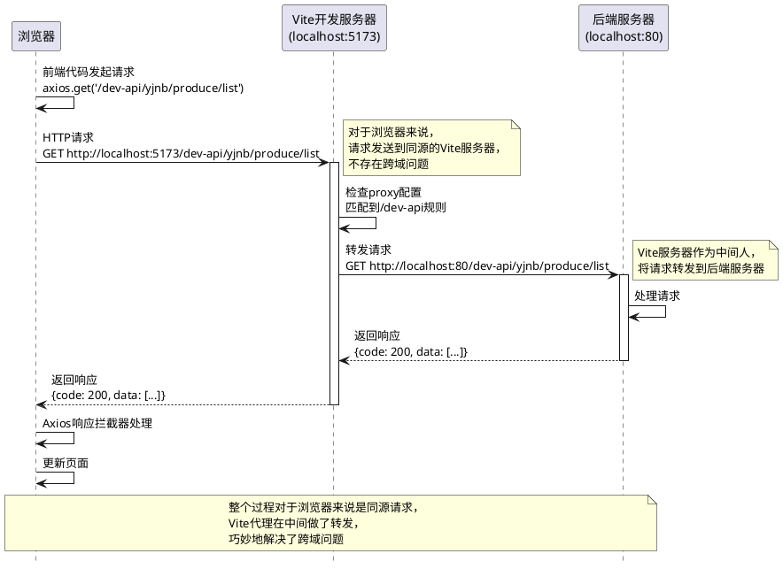

图5-9 Vite代理工作原理图

如图5-9所示，Vite代理作为"中间人"，接收前端请求并转发到后端服务器。对于浏览器来说，请求是发送到同源的Vite服务器，不存在跨域问题；对于后端服务器来说，请求来自Vite服务器，正常处理即可。这种方式巧妙地解决了开发环境的跨域问题。

#### 步骤4：配置后端CORS

在Spring Boot项目中创建CORS配置类，解决生产环境的跨域问题。

**代码5-3 Spring Boot跨域配置**

```java
package com.movie.nbspringproduct.config;

import org.springframework.context.annotation.Bean;
import org.springframework.context.annotation.Configuration;
import org.springframework.web.cors.CorsConfiguration;
import org.springframework.web.cors.UrlBasedCorsConfigurationSource;
import org.springframework.web.filter.CorsFilter;

/**
 * 跨域配置类
 * 解决前后端分离架构中的跨域问题
 */
@Configuration
public class CorsConfig {
    
    /**
     * 配置CORS过滤器
     */
    @Bean
    public CorsFilter corsFilter() {
        // CORS配置对象
        CorsConfiguration config = new CorsConfiguration();
        
        // 允许的源（前端地址）
        // 开发环境
        config.addAllowedOrigin("http://localhost:5173");
        config.addAllowedOrigin("http://localhost:3000");
        // 生产环境（需要根据实际部署地址配置）
        // config.addAllowedOrigin("https://nongbao.example.com");
        
        // 允许的HTTP方法
        config.addAllowedMethod("GET");
        config.addAllowedMethod("POST");
        config.addAllowedMethod("PUT");
        config.addAllowedMethod("DELETE");
        config.addAllowedMethod("OPTIONS");
        
        // 允许的请求头（*表示允许所有请求头）
        config.addAllowedHeader("*");
        
        // 允许携带Cookie和认证信息
        config.setAllowCredentials(true);
        
        // 预检请求的缓存时间（秒）
        // 设置后，浏览器会缓存预检结果，减少OPTIONS请求
        config.setMaxAge(3600L);
        
        // 暴露的响应头（前端可以访问的响应头）
        config.addExposedHeader("Content-Disposition");  // 文件下载时需要
        
        // 注册CORS配置
        UrlBasedCorsConfigurationSource source = new UrlBasedCorsConfigurationSource();
        source.registerCorsConfiguration("/**", config);  // 对所有路径生效
        
        return new CorsFilter(source);
    }
}
```

**配置说明：**

1. **@Configuration注解：**标记这是一个配置类，Spring Boot启动时会自动加载。

2. **允许的源：**
   * 开发环境配置`localhost:5173`和`localhost:3000`
   * 生产环境需要配置实际的域名
   * 不推荐使用`*`（允许所有源），存在安全风险

3. **允许的方法：**配置GET、POST、PUT、DELETE、OPTIONS，覆盖RESTful API的所有操作。

4. **允许的请求头：**配置`*`允许所有请求头，包括自定义的Authorization头。

5. **允许携带Cookie：**设为`true`时，前端可以携带Cookie和认证信息。注意：设为`true`时，`AllowedOrigin`不能为`*`，必须指定具体的源。

6. **预检缓存：**设置3600秒（1小时），浏览器会缓存预检结果，减少OPTIONS请求次数，提高性能。

7. **暴露的响应头：**配置`Content-Disposition`，前端在下载文件时需要访问这个响应头。

8. **注册配置：**使用`/**`表示对所有路径生效，也可以针对不同路径配置不同的CORS策略。

**CORS配置的安全建议：**

* 生产环境不要使用`addAllowedOrigin("*")`，必须指定具体的域名
* 如果不需要携带Cookie，可以设置`setAllowCredentials(false)`
* 根据实际需求配置允许的HTTP方法，不要全部开放
* 定期审查CORS配置，及时移除不再使用的域名

#### 步骤5：创建环境变量配置

为了支持不同环境使用不同的API地址，我们需要创建环境变量配置文件。

在项目根目录创建以下文件：

**1. .env.development（开发环境）**

```
# 开发环境配置
VITE_API_BASE_URL=/dev-api
```

**2. .env.production（生产环境）**

```
# 生产环境配置
VITE_API_BASE_URL=https://api.nongbao.example.com/dev-api
```

**3. 在vite-env.d.ts中添加类型定义**

```typescript
/// <reference types="vite/client" />

interface ImportMetaEnv {
  readonly VITE_API_BASE_URL: string
  // 更多环境变量...
}

interface ImportMeta {
  readonly env: ImportMetaEnv
}
```

这样，在不同环境下运行时，会自动使用对应的API地址：
* 开发环境：`npm run dev`，使用`/dev-api`（通过Vite代理转发）
* 生产环境：`npm run build`，使用`https://api.nongbao.example.com/dev-api`（直接访问）

#### 步骤6：测试基础通信

完成配置后，我们需要测试前后端是否能够正常通信。

**测试步骤：**

**1. 启动后端服务**

在IDEA中运行Spring Boot应用，确保后端服务运行在`http://localhost:80`。

**2. 启动前端服务**

在前端项目目录执行：
```bash
npm run dev
```

Vite开发服务器会启动在`http://localhost:5173`。

**3. 创建测试页面**

创建一个简单的测试页面，调用后端接口：

```vue
<template>
  <div>
    <el-button @click="testRequest">测试请求</el-button>
    <div v-if="data">
      <p>请求成功！</p>
      <pre>{{ data }}</pre>
    </div>
  </div>
</template>

<script setup lang="ts">
import { ref } from 'vue'
import request from '@/utils/request'

const data = ref(null)

async function testRequest() {
  try {
    const res = await request({
      url: '/yjnb/produce/list',
      method: 'get',
      params: {
        pageNum: 1,
        pageSize: 10
      }
    })
    data.value = res.data || res.rows
    console.log('请求成功：', res)
  } catch (error) {
    console.error('请求失败：', error)
  }
}
</script>
```

4. 打开浏览器开发者工具

按F12打开开发者工具，切换到Network（网络）标签，点击"测试请求"按钮，观察网络请求。

5. 验证请求是否成功

在Network标签中，应该能看到：
* 请求URL：`http://localhost:5173/dev-api/yjnb/produce/list?pageNum=1&pageSize=10&_t=1234567890`
* 请求方法：GET
* 状态码：200
* 响应数据：包含`code: 200`和农产品列表数据

如果看到以上信息，说明前后端通信配置成功！

**常见问题排查：**

如果请求失败，可能的原因和解决方案如表5-7所示。

表5-7 前后端通信常见问题排查

| 错误现象 | 可能原因 | 排查方法 | 解决方案 |
|---------|---------|---------|---------|
| **跨域错误** | CORS配置不正确或Vite代理未生效 | 查看控制台错误信息，检查是否包含"CORS policy" | 1. 检查vite.config.ts的proxy配置<br>2. 检查后端CorsConfig是否生效<br>3. 重启前后端服务 |
| **404错误** | 接口路径不正确 | 查看Network标签的请求URL | 1. 检查前端API路径是否正确<br>2. 检查后端Controller的@RequestMapping路径<br>3. 检查baseURL配置 |
| **500错误** | 后端服务异常 | 查看后端控制台日志 | 1. 检查后端日志中的异常信息<br>2. 检查数据库连接是否正常<br>3. 检查SQL语句是否正确 |
| **请求超时** | 后端响应时间过长或网络问题 | 查看Network标签的请求时间 | 1. 增加timeout配置<br>2. 优化后端查询性能<br>3. 检查网络连接 |
| **参数格式错误** | 前端发送的参数格式与后端期望不符 | 查看Network标签的Request Payload | 1. 检查参数名称是否一致<br>2. 检查参数类型是否匹配<br>3. 检查是否使用了正确的Content-Type |

表5-7总结了前后端通信中的常见问题和排查方法。在实际开发中，遇到问题时不要慌张，按照表格中的方法逐步排查，大多数问题都能快速解决。

浏览器开发者工具的使用如图5-10所示。


图5-10 浏览器开发者工具Network面板

如图5-10所示，浏览器开发者工具的Network面板是前端开发的重要工具。在这里可以查看：
* 请求列表：所有的网络请求
* 请求详情：请求URL、方法、状态码、响应时间
* 请求头：Request Headers，包含Authorization等信息
* 响应头：Response Headers，包含CORS相关头部
* 请求参数：Query String Parameters或Request Payload
* 响应数据：Response，通常为JSON格式

通过Network面板，可以快速定位前后端通信的问题。

### 【AI辅助环节】

#### 1. AI智能代理配置生成

**适用场景：**当你不确定如何配置Vite代理时，可以让AI根据项目特点生成配置。

**实践步骤：**

**步骤1：向AI描述项目情况**

```
我正在开发一个前后端分离项目，需要配置Vite开发代理。

项目信息：
- 前端：Vue 3 + Vite，运行在 localhost:5173
- 后端：Spring Boot，运行在 localhost:80
- API基础路径：/dev-api
- 需要代理的接口：/dev-api/yjnb/*

请帮我生成vite.config.ts的proxy配置，要求：
1. 将/dev-api开头的请求代理到后端
2. 支持WebSocket代理（为后续扩展准备）
3. 添加详细注释
```

**步骤2：AI生成配置代码**

AI会生成完整的配置代码，包含详细注释：

```typescript
export default defineConfig({
  server: {
    proxy: {
      // HTTP API代理
      '/dev-api': {
        target: 'http://localhost:80',
        changeOrigin: true,
        rewrite: (path) => path.replace(/^\/dev-api/, '/dev-api')
      },
      // WebSocket代理（为后续实时通信功能准备）
      '/ws': {
        target: 'ws://localhost:80',
        ws: true,
        changeOrigin: true
      }
    }
  }
})
```

**步骤3：审查和应用配置**

* 检查target地址是否正确
* 验证rewrite规则是否符合需求
* 根据实际情况调整配置
* 重启Vite开发服务器使配置生效

#### 2. 跨域问题自动诊断和解决方案

**适用场景：**当遇到跨域错误时，可以让AI帮助诊断问题并提供解决方案。

**实践步骤：**

**步骤1：向AI提供错误信息**

```
我在前端调用后端接口时遇到跨域错误，浏览器控制台显示：

Access to XMLHttpRequest at 'http://localhost:80/dev-api/yjnb/produce/list' 
from origin 'http://localhost:5173' has been blocked by CORS policy: 
Response to preflight request doesn't pass access control check: 
No 'Access-Control-Allow-Origin' header is present on the requested resource.

我的配置：
- 前端：Vite + Vue 3，运行在 localhost:5173
- 后端：Spring Boot，运行在 localhost:80
- 已经配置了Vite代理
- 已经配置了后端CorsConfig

请帮我分析问题原因并提供解决方案。
```

**步骤2：AI分析问题**

AI会分析错误信息并提供诊断：

```
问题分析：
从错误信息看，这是一个预检请求（preflight request）失败的问题。
说明你的请求是"复杂请求"，浏览器发送了OPTIONS预检请求，
但后端没有正确响应。
可能的原因：
1. 后端CorsConfig配置未生效
2. 后端没有处理OPTIONS请求
3. 前端请求绕过了Vite代理，直接访问了后端

解决方案：
方案1：确保Vite代理生效
检查vite.config.ts中的proxy配置，确保：
- target地址正确
- changeOrigin设为true
- 前端请求使用的是相对路径（/dev-api/...）而非完整URL
方案2：确保后端CORS配置生效
检查CorsConfig类：
- 是否添加了@Configuration注解
- 是否配置了OPTIONS方法
- 是否设置了正确的AllowedOrigin
方案3：检查请求方式
如果使用了自定义请求头或Content-Type为application/json，
会触发预检请求，需要确保后端正确处理OPTIONS请求。
调试步骤：
1. 在Network面板查看是否有OPTIONS请求
2. 查看OPTIONS请求的响应头是否包含Access-Control-*
3. 查看后端日志是否有CORS相关错误
```

**步骤3：根据AI建议逐步排查**

* 按照AI提供的方案逐一检查
* 使用浏览器开发者工具验证
* 查看后端日志确认配置是否生效

#### 3. 网络请求性能优化建议

**适用场景：**当系统运行一段时间后，发现接口响应较慢，可以让AI分析并提供优化建议。

**实践步骤：**

**步骤1：向AI提供性能数据**

```
我的"农宝"平台前端在调用后端接口时，发现以下性能问题：

1. 农产品列表接口响应时间：2-3秒
2. 数据统计接口响应时间：5秒以上
3. 页面切换时会重复请求相同的接口

请求信息：
- GET /dev-api/yjnb/produce/list?pageNum=1&pageSize=10
- GET /dev-api/statistics/overview

请分析性能瓶颈并提供优化建议。
```

**步骤2：AI分析并提供建议**

AI会从多个角度分析性能问题：

```
性能问题分析：

1. 农产品列表接口响应慢（2-3秒）
   可能原因：
   - 数据库查询慢（未建立索引、查询字段过多）
   - 返回数据量大（包含了不必要的字段）
   - 未使用分页优化

   优化建议：
   - 后端：为常用查询字段建立索引
   - 后端：只返回列表页需要的字段，详情字段在详情接口返回
   - 前端：使用虚拟滚动，减少DOM渲染压力

2. 数据统计接口响应慢（5秒以上）
   可能原因：
   - 统计查询涉及大量数据聚合
   - 未使用缓存
   - 实时计算导致性能问题

   优化建议：
   - 后端：使用Redis缓存统计结果，设置合理的过期时间
   - 后端：使用定时任务预计算统计数据
   - 前端：显示"数据加载中"提示，避免用户焦虑

3. 重复请求相同接口
   可能原因：
   - 未使用前端缓存
   - 组件重复渲染导致重复请求
   - 未使用防抖/节流

   优化建议：
   - 前端：使用Pinia缓存接口数据，避免重复请求
   - 前端：使用keep-alive缓存组件，避免重复渲染
   - 前端：对搜索等高频操作使用防抖
   - Axios：配置请求缓存，相同请求在短时间内返回缓存结果
```

**步骤3：根据建议进行优化**

* 后端：优化数据库查询，添加索引，使用缓存
* 前端：使用Pinia缓存数据，使用防抖/节流
* 测试：验证优化效果，对比优化前后的响应时间

**性能优化的实现示例：**

```typescript
// 使用Pinia缓存接口数据
import { defineStore } from 'pinia'

export const useProduceStore = defineStore('produce', {
  state: () => ({
    list: [],
    total: 0,
    lastFetchTime: 0
  }),
  
  actions: {
    async fetchList(params: any) {
      // 如果5分钟内已经请求过，直接返回缓存数据
      const now = Date.now()
      if (now - this.lastFetchTime < 5 * 60 * 1000 && this.list.length > 0) {
        console.log('使用缓存数据')
        return { rows: this.list, total: this.total }
      }
      
      // 请求新数据
      const res = await getProduceList(params)
      this.list = res.rows
      this.total = res.total
      this.lastFetchTime = now
      
      return res
    }
  }
})
```

通过AI辅助，我们可以快速识别性能瓶颈并进行针对性优化，提升系统性能和用户体验。

**【价值思考】性能优化中的用户体验意识**

性能优化不仅是技术问题，更是用户体验问题。当农户在田间地头用手机查询补贴政策时，如果页面加载需要5秒，他可能会认为系统坏了而放弃使用。我们在优化性能时，要站在用户的角度思考：哪些操作是高频的？用户能容忍多长的等待时间？如何让等待过程不那么焦虑？在"农宝"项目中，我们通过添加loading动画、显示"数据加载中"提示、使用骨架屏等方式，让用户感知到系统在工作，而不是卡死了。这种对细节的关注，体现的是对用户的尊重和责任感。技术优化的最终目的是服务用户，这是我们始终要牢记的初心。

### 【常见问题与调试】

在配置前端请求和代理的过程中，初学者常会遇到一些典型问题。本节汇总常见错误及解决方案。

#### 问题1：Vite代理不生效，仍然报跨域错误

**错误现象：**

配置了Vite代理，但前端请求时仍然报跨域错误：
```
Access to XMLHttpRequest at 'http://localhost:80/dev-api/yjnb/produce/list' 
from origin 'http://localhost:5173' has been blocked by CORS policy
```

**原因分析：**

从错误信息看，请求直接发送到了`http://localhost:80`，说明代理没有生效。可能的原因：
1. 前端使用了完整URL而非相对路径
2. vite.config.ts配置错误
3. 修改配置后未重启Vite服务器

**解决方案：**

1. **检查前端请求代码，确保使用相对路径：**

```typescript
// 错误：使用完整URL，绕过了代理
axios.get('http://localhost:80/dev-api/yjnb/produce/list')

// 正确：使用相对路径，会被代理转发
axios.get('/dev-api/yjnb/produce/list')
```

2. **检查vite.config.ts配置：**

```typescript
// 确保proxy配置正确
server: {
  proxy: {
    '/dev-api': {  // 匹配规则
      target: 'http://localhost:80',  // 目标地址
      changeOrigin: true  // 必须设为true
    }
  }
}
```

3. **重启Vite开发服务器：**

修改vite.config.ts后，必须重启开发服务器才能生效：
```bash
# 按Ctrl+C停止服务器
# 重新启动
npm run dev
```

#### 问题2：OPTIONS预检请求失败

**错误现象：**

在Network面板看到OPTIONS请求，状态码为403或404，实际的PUT/DELETE请求没有发送。

**原因分析：**

这是预检请求失败的问题。浏览器发送OPTIONS请求检查是否允许跨域，但后端没有正确响应。

**解决方案：**

1. **确保后端CorsConfig配置了OPTIONS方法：**

```java
config.addAllowedMethod("OPTIONS");  // 必须添加
```

2. **确保CorsConfig类被Spring Boot扫描到：**

```java
@Configuration  // 必须添加此注解
public class CorsConfig {
    // ...
}
```

3. **检查后端是否有其他拦截器阻止了OPTIONS请求：**

如果有自定义的拦截器或过滤器，需要确保它们不会拦截OPTIONS请求。

#### 问题3：请求成功但响应拦截器报错

**错误现象：**

Network面板显示请求成功（状态码200），但前端报错，数据没有渲染。

**原因分析：**

可能是响应拦截器的处理逻辑有问题，或者后端返回的数据格式与前端期望不符。

**解决方案：**

1. **在响应拦截器中添加详细日志：**

```typescript
service.interceptors.response.use(
  (response: AxiosResponse<Result>) => {
    const res = response.data
    console.log('响应数据：', res)  // 添加日志
    console.log('响应类型：', typeof res)  // 检查数据类型
    
    // 检查res.code是否存在
    if (res && res.code !== undefined) {
      // 正常处理
    } else {
      console.error('响应数据格式错误：', res)
      return Promise.reject(new Error('响应数据格式错误'))
    }
  }
)
```

2. **检查后端返回的数据格式：**

在Network面板的Response标签中查看后端返回的原始数据，确认是否符合`Result<T>`格式。

3. **检查Content-Type：**

确保后端返回的Content-Type为`application/json`，否则axios可能无法正确解析。

#### 问题4：token未添加到请求头

**错误现象：**

后端日志显示"未登录"或"token为空"，但前端明明已经登录。

**原因分析：**

请求拦截器未正确添加token到请求头。

**解决方案：**

1. **检查localStorage中是否有token：**

```typescript
const token = localStorage.getItem('token')
console.log('Token:', token)  // 检查token是否存在
```

2. **检查请求拦截器是否正确添加token：**

```typescript
service.interceptors.request.use(
  (config: AxiosRequestConfig) => {
    const token = localStorage.getItem('token')
    if (token && config.headers) {
      config.headers['Authorization'] = `Bearer ${token}`
      console.log('已添加token到请求头')  // 添加日志
    } else {
      console.warn('Token不存在或headers未定义')  // 添加日志
    }
    return config
  }
)
```

3. **在Network面板检查Request Headers：**

查看实际发送的请求头中是否包含Authorization字段。

通过以上问题的排查和解决，可以帮助读者快速定位前后端通信中的常见问题，提高开发效率。


现在，前端和后端已经可以正常通信了，接下来我们将实现具体的业务功能对接。

## 任务二：对接功能模块接口并完成业务联调

### 【任务描述】

完成基础通信配置后，本任务将实现"农宝"平台核心业务模块的前后端对接。我们将以农产品管理和补贴政策管理两个模块为例，完成从API定义到页面实现的完整流程。

具体包括：

1. 创建API接口定义：为每个业务模块创建API文件，定义接口方法和类型。
2. 实现农产品管理页面：使用Element Plus组件实现列表查询、新增、修改、删除、发布、推荐等功能。
3. 实现补贴政策管理页面：复用农产品页面的设计模式，增加数据导出功能。
4. 实现状态管理：使用Pinia管理全局状态，如用户信息、菜单权限等。
5. 联调测试：使用浏览器开发者工具进行接口联调，排查和解决问题。

通过本任务的学习，你将掌握完整的前后端对接流程，能够独立实现业务功能的前端界面。

### 【任务分析】

在实现业务功能对接前，我们需要分析前端页面的核心要素：

**1. 页面布局**

后台管理系统的典型页面布局包括：
* 顶部：页面标题、面包屑导航
* 搜索区域：查询条件表单、查询按钮、重置按钮
* 操作区域：新增按钮、批量删除按钮、导出按钮等
* 数据区域：数据表格、分页组件
* 弹窗区域：新增/编辑对话框、删除确认对话框

**2. 数据流转**

前端页面的数据流转过程：
* 页面加载 → 调用列表接口 → 渲染表格数据
* 点击查询 → 调用列表接口 → 更新表格数据
* 点击新增 → 显示对话框 → 填写表单 → 调用新增接口 → 刷新列表
* 点击编辑 → 调用详情接口 → 显示对话框 → 修改表单 → 调用修改接口 → 刷新列表
* 点击删除 → 显示确认框 → 调用删除接口 → 刷新列表

**3. 状态管理**

页面需要管理以下状态：
* 列表数据：`tableData`
* 总记录数：`total`
* 当前页码：`pageNum`
* 每页数量：`pageSize`
* 查询条件：`queryParams`
* 对话框显示：`dialogVisible`
* 表单数据：`formData`
* 加载状态：`loading`

农产品管理页面的数据流转如图5-11所示。

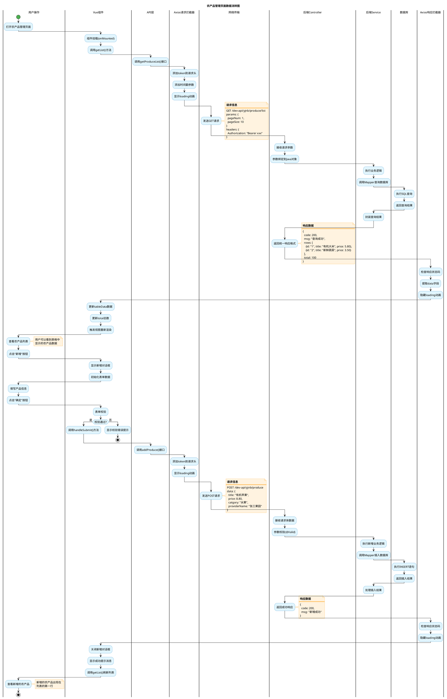

图5-11 农产品管理页面数据流转图

如图5-11所示，农产品管理页面的数据流转包括页面加载、列表查询、新增操作等环节。每个环节都涉及Vue组件、API层、Axios、后端服务的协作。理解这个流程，有助于我们实现完整的业务功能。

### 【实现步骤】

#### 步骤1：创建API接口定义文件

在`src/api/`目录下创建业务模块的API文件，定义接口方法和TypeScript类型。

**代码5-4 农产品API接口定义**

```typescript
// src/api/produce.ts
import request from '@/utils/request'
import type { Result } from '@/utils/request'

/**
 * 农产品查询参数接口
 */
export interface ProduceQueryParams {
  pageNum?: number
  pageSize?: number
  title?: string
  category?: string
  providerName?: string
  pushStatus?: number
  recommend?: number
}

/**
 * 农产品信息接口
 */
export interface ProduceInfo {
  id?: string
  title: string
  resume?: string
  description?: string
  image?: string
  catgory?: string
  produceType?: string
  price?: number
  browseNum?: number
  pushStatus?: number
  pushTime?: string
  recommend?: number
  providerName?: string
  accountId?: string
  createdTime?: string
  updatedTime?: string
  createBy?: string
  createTime?: string
  updateBy?: string
  updateTime?: string
  remark?: string
}

/**
 * 查询农产品列表
 * @param params 查询参数
 * @returns 农产品列表数据
 */
export function getProduceList(params: ProduceQueryParams) {
  return request<Result<ProduceInfo[]>>({
    url: '/yjnb/produce/list',
    method: 'get',
    params
  })
}

/**
 * 根据ID查询农产品详情
 * @param id 农产品ID
 * @returns 农产品详情数据
 */
export function getProduceById(id: string) {
  return request<Result<ProduceInfo>>({
    url: `/yjnb/produce/${id}`,
    method: 'get'
  })
}

/**
 * 新增农产品
 * @param data 农产品信息
 * @returns 操作结果
 */
export function addProduce(data: ProduceInfo) {
  return request<Result<void>>({
    url: '/yjnb/produce',
    method: 'post',
    data
  })
}

/**
 * 修改农产品
 * @param data 农产品信息
 * @returns 操作结果
 */
export function updateProduce(data: ProduceInfo) {
  return request<Result<void>>({
    url: '/yjnb/produce',
    method: 'put',
    data
  })
}

/**
 * 删除农产品
 * @param ids 农产品ID数组
 * @returns 操作结果
 */
export function deleteProduce(ids: string[]) {
  return request<Result<void>>({
    url: `/yjnb/produce/${ids.join(',')}`,
    method: 'delete'
  })
}

/**
 * 发布农产品
 * @param ids 农产品ID数组
 * @returns 操作结果
 */
export function publishProduce(ids: string[]) {
  return request<Result<void>>({
    url: '/yjnb/produce/pushFarmProduce',
    method: 'post',
    data: ids
  })
}

/**
 * 取消发布农产品
 * @param ids 农产品ID数组
 * @returns 操作结果
 */
export function unpublishProduce(ids: string[]) {
  return request<Result<void>>({
    url: '/yjnb/produce/unpushFarmProduce',
    method: 'post',
    data: ids
  })
}

/**
 * 推荐农产品
 * @param ids 农产品ID数组
 * @returns 操作结果
 */
export function recommendProduce(ids: string[]) {
  return request<Result<void>>({
    url: '/yjnb/produce/recommendFarmProduce',
    method: 'post',
    data: ids
  })
}

/**
 * 取消推荐农产品
 * @param ids 农产品ID数组
 * @returns 操作结果
 */
export function unrecommendProduce(ids: string[]) {
  return request<Result<void>>({
    url: '/yjnb/produce/unrecommendFarmProduce',
    method: 'post',
    data: ids
  })
}

/**
 * 导出农产品数据
 * @param params 查询参数
 */
export function exportProduce(params: ProduceQueryParams) {
  return request({
    url: '/yjnb/produce/export',
    method: 'post',
    data: params,
    responseType: 'blob'  // 文件下载
  })
}
```

**代码说明：**

1. **类型定义：**定义`ProduceQueryParams`和`ProduceInfo`接口，提供完整的类型支持。字段名与后端实体类保持一致，使用可选属性`?`表示非必填字段。

2. **API方法：**为每个业务操作定义对应的API方法，方法名清晰明确，参数和返回值都有类型定义。

3. **RESTful规范：**遵循RESTful设计原则，使用合适的HTTP方法（GET查询、POST新增、PUT修改、DELETE删除）。

4. **泛型使用：**使用`request<Result<ProduceInfo[]>>`指定返回类型，TypeScript会自动推断`res.rows`的类型为`ProduceInfo[]`，提供代码提示和类型检查。

5. **文件下载：**导出接口使用`responseType: 'blob'`，告诉axios返回二进制数据而非JSON。

#### 步骤2：实现农产品管理页面

创建`src/views/ProduceManagement.vue`组件，实现完整的农产品管理功能。

**代码5-5 农产品管理页面完整实现**

```vue
<template>
  <div class="produce-management">
    <!-- 页面标题 -->
    <div class="page-header">
      <h2>农产品管理</h2>
    </div>
    
    <!-- 查询条件 -->
    <el-card class="search-card">
      <el-form :model="queryParams" inline>
        <el-form-item label="产品标题">
          <el-input
            v-model="queryParams.title"
            placeholder="请输入产品标题"
            clearable
            style="width: 200px"
          />
        </el-form-item>
        
        <el-form-item label="产品分类">
          <el-select
            v-model="queryParams.category"
            placeholder="请选择分类"
            clearable
            style="width: 150px"
          >
            <el-option label="粮食作物" value="粮食作物" />
            <el-option label="蔬菜" value="蔬菜" />
            <el-option label="水果" value="水果" />
            <el-option label="畜牧产品" value="畜牧产品" />
          </el-select>
        </el-form-item>
        
        <el-form-item label="发布状态">
          <el-select
            v-model="queryParams.pushStatus"
            placeholder="请选择状态"
            clearable
            style="width: 150px"
          >
            <el-option label="未发布" :value="0" />
            <el-option label="已发布" :value="1" />
          </el-select>
        </el-form-item>
        
        <el-form-item>
          <el-button type="primary" icon="Search" @click="handleQuery">查询</el-button>
          <el-button icon="Refresh" @click="handleReset">重置</el-button>
        </el-form-item>
      </el-form>
    </el-card>
    
    <!-- 操作按钮 -->
    <el-card class="toolbar-card">
      <el-row :gutter="10">
        <el-col :span="1.5">
          <el-button type="primary" icon="Plus" @click="handleAdd">新增</el-button>
        </el-col>
        <el-col :span="1.5">
          <el-button
            type="success"
            icon="Upload"
            :disabled="selectedIds.length === 0"
            @click="handlePublish"
          >
            发布
          </el-button>
        </el-col>
        <el-col :span="1.5">
          <el-button
            type="warning"
            icon="Star"
            :disabled="selectedIds.length === 0"
            @click="handleRecommend"
          >
            推荐
          </el-button>
        </el-col>
        <el-col :span="1.5">
          <el-button
            type="danger"
            icon="Delete"
            :disabled="selectedIds.length === 0"
            @click="handleDelete"
          >
            删除
          </el-button>
        </el-col>
        <el-col :span="1.5">
          <el-button type="info" icon="Download" @click="handleExport">导出</el-button>
        </el-col>
      </el-row>
    </el-card>
    
    <!-- 数据表格 -->
    <el-card class="table-card">
      <el-table
        v-loading="loading"
        :data="tableData"
        border
        stripe
        @selection-change="handleSelectionChange"
      >
        <el-table-column type="selection" width="55" align="center" />
        <el-table-column label="序号" type="index" width="60" align="center" />
        
        <el-table-column label="产品图片" width="100" align="center">
          <template #default="{ row }">
            <el-image
              v-if="row.image"
              :src="row.image"
              :preview-src-list="[row.image]"
              fit="cover"
              style="width: 60px; height: 60px"
            />
            <span v-else>暂无图片</span>
          </template>
        </el-table-column>
        
        <el-table-column label="产品标题" prop="title" min-width="150" show-overflow-tooltip />
        
        <el-table-column label="产品分类" prop="catgory" width="120" align="center" />
        
        <el-table-column label="价格" prop="price" width="100" align="center">
          <template #default="{ row }">
            <span style="color: #f56c6c; font-weight: bold">¥{{ row.price }}</span>
          </template>
        </el-table-column>
        
        <el-table-column label="供应商" prop="providerName" width="120" />
        
        <el-table-column label="浏览次数" prop="browseNum" width="100" align="center" />
        
        <el-table-column label="发布状态" width="100" align="center">
          <template #default="{ row }">
            <el-tag v-if="row.pushStatus === 1" type="success">已发布</el-tag>
            <el-tag v-else type="info">未发布</el-tag>
          </template>
        </el-table-column>
        
        <el-table-column label="推荐状态" width="100" align="center">
          <template #default="{ row }">
            <el-tag v-if="row.recommend === 1" type="warning">已推荐</el-tag>
            <el-tag v-else type="info">未推荐</el-tag>
          </template>
        </el-table-column>
        
        <el-table-column label="创建时间" prop="createTime" width="180" align="center" />
        
        <el-table-column label="操作" width="200" align="center" fixed="right">
          <template #default="{ row }">
            <el-button link type="primary" icon="Edit" @click="handleEdit(row)">编辑</el-button>
            <el-button link type="danger" icon="Delete" @click="handleDelete(row)">删除</el-button>
          </template>
        </el-table-column>
      </el-table>
      
      <!-- 分页组件 -->
      <el-pagination
        v-model:current-page="queryParams.pageNum"
        v-model:page-size="queryParams.pageSize"
        :total="total"
        :page-sizes="[10, 20, 50, 100]"
        layout="total, sizes, prev, pager, next, jumper"
        @size-change="getList"
        @current-change="getList"
      />
    </el-card>
    
    <!-- 新增/编辑对话框 -->
    <el-dialog
      v-model="dialogVisible"
      :title="dialogTitle"
      width="600px"
      @close="handleDialogClose"
    >
      <el-form
        ref="formRef"
        :model="formData"
        :rules="formRules"
        label-width="100px"
      >
        <el-form-item label="产品标题" prop="title">
          <el-input v-model="formData.title" placeholder="请输入产品标题" />
        </el-form-item>
        
        <el-form-item label="产品摘要" prop="resume">
          <el-input
            v-model="formData.resume"
            type="textarea"
            :rows="3"
            placeholder="请输入产品摘要"
          />
        </el-form-item>
        
        <el-form-item label="产品描述" prop="description">
          <el-input
            v-model="formData.description"
            type="textarea"
            :rows="5"
            placeholder="请输入产品描述"
          />
        </el-form-item>
        
        <el-form-item label="产品分类" prop="catgory">
          <el-select v-model="formData.catgory" placeholder="请选择分类" style="width: 100%">
            <el-option label="粮食作物" value="粮食作物" />
            <el-option label="蔬菜" value="蔬菜" />
            <el-option label="水果" value="水果" />
            <el-option label="畜牧产品" value="畜牧产品" />
          </el-select>
        </el-form-item>
        
        <el-form-item label="产品类型" prop="produceType">
          <el-input v-model="formData.produceType" placeholder="请输入产品类型" />
        </el-form-item>
        
        <el-form-item label="产品价格" prop="price">
          <el-input-number
            v-model="formData.price"
            :min="0"
            :precision="2"
            :step="0.1"
            placeholder="请输入价格"
            style="width: 100%"
          />
        </el-form-item>
        
        <el-form-item label="供应商名称" prop="providerName">
          <el-input v-model="formData.providerName" placeholder="请输入供应商名称" />
        </el-form-item>
        
        <el-form-item label="产品图片" prop="image">
          <el-input v-model="formData.image" placeholder="请输入图片URL" />
          <div v-if="formData.image" style="margin-top: 10px">
            <el-image :src="formData.image" style="width: 100px; height: 100px" fit="cover" />
          </div>
        </el-form-item>
        
        <el-form-item label="备注" prop="remark">
          <el-input
            v-model="formData.remark"
            type="textarea"
            :rows="2"
            placeholder="请输入备注"
          />
        </el-form-item>
      </el-form>
      
      <template #footer>
        <el-button @click="dialogVisible = false">取消</el-button>
        <el-button type="primary" @click="handleSubmit">确定</el-button>
      </template>
    </el-dialog>
  </div>
</template>

<script setup lang="ts">
import { ref, reactive, onMounted } from 'vue'
import { ElMessage, ElMessageBox, FormInstance, FormRules } from 'element-plus'
import {
  getProduceList,
  getProduceById,
  addProduce,
  updateProduce,
  deleteProduce,
  publishProduce,
  unpublishProduce,
  recommendProduce,
  unrecommendProduce,
  exportProduce,
  type ProduceInfo,
  type ProduceQueryParams
} from '@/api/produce'

// 查询参数
const queryParams = reactive<ProduceQueryParams>({
  pageNum: 1,
  pageSize: 10,
  title: '',
  category: '',
  pushStatus: undefined,
  recommend: undefined
})

// 表格数据
const tableData = ref<ProduceInfo[]>([])
const total = ref(0)
const loading = ref(false)
const selectedIds = ref<string[]>([])

// 对话框相关
const dialogVisible = ref(false)
const dialogTitle = ref('新增农产品')
const formRef = ref<FormInstance>()
const formData = reactive<ProduceInfo>({
  title: '',
  resume: '',
  description: '',
  catgory: '',
  produceType: '',
  price: 0,
  providerName: '',
  image: '',
  remark: ''
})

// 表单校验规则
const formRules: FormRules = {
  title: [
    { required: true, message: '请输入产品标题', trigger: 'blur' },
    { min: 2, max: 200, message: '标题长度在2到200个字符', trigger: 'blur' }
  ],
  catgory: [
    { required: true, message: '请选择产品分类', trigger: 'change' }
  ],
  price: [
    { required: true, message: '请输入产品价格', trigger: 'blur' }
  ]
}

/**
 * 获取农产品列表
 */
async function getList() {
  loading.value = true
  try {
    const res = await getProduceList(queryParams)
    tableData.value = res.rows || []
    total.value = res.total || 0
  } catch (error) {
    console.error('查询失败：', error)
  } finally {
    loading.value = false
  }
}

/**
 * 查询按钮
 */
function handleQuery() {
  queryParams.pageNum = 1
  getList()
}

/**
 * 重置按钮
 */
function handleReset() {
  queryParams.pageNum = 1
  queryParams.pageSize = 10
  queryParams.title = ''
  queryParams.category = ''
  queryParams.pushStatus = undefined
  queryParams.recommend = undefined
  getList()
}

/**
 * 表格选择变化
 */
function handleSelectionChange(selection: ProduceInfo[]) {
  selectedIds.value = selection.map(item => item.id!).filter(id => id)
}

/**
 * 新增按钮
 */
function handleAdd() {
  dialogTitle.value = '新增农产品'
  dialogVisible.value = true
  resetForm()
}

/**
 * 编辑按钮
 */
async function handleEdit(row: ProduceInfo) {
  dialogTitle.value = '编辑农产品'
  dialogVisible.value = true
  
  try {
    // 查询详情数据
    const res = await getProduceById(row.id!)
    Object.assign(formData, res.data)
  } catch (error) {
    console.error('查询详情失败：', error)
  }
}

/**
 * 删除按钮
 */
function handleDelete(row?: ProduceInfo) {
  const ids = row ? [row.id!] : selectedIds.value
  const message = row ? `确定删除产品"${row.title}"吗？` : `确定删除选中的${ids.length}个产品吗？`
  
  ElMessageBox.confirm(message, '删除确认', {
    type: 'warning',
    confirmButtonText: '确定',
    cancelButtonText: '取消'
  }).then(async () => {
    try {
      await deleteProduce(ids)
      ElMessage.success('删除成功')
      getList()
    } catch (error) {
      console.error('删除失败：', error)
    }
  }).catch(() => {
    // 用户取消删除
  })
}

/**
 * 发布按钮
 */
async function handlePublish() {
  try {
    await publishProduce(selectedIds.value)
    ElMessage.success('发布成功')
    getList()
  } catch (error) {
    console.error('发布失败：', error)
  }
}

/**
 * 推荐按钮
 */
async function handleRecommend() {
  try {
    await recommendProduce(selectedIds.value)
    ElMessage.success('推荐成功')
    getList()
  } catch (error) {
    console.error('推荐失败：', error)
  }
}

/**
 * 导出按钮
 */
async function handleExport() {
  try {
    const res = await exportProduce(queryParams)
    
    // 创建下载链接
    const blob = new Blob([res as any], {
      type: 'application/vnd.openxmlformats-officedocument.spreadsheetml.sheet'
    })
    const url = window.URL.createObjectURL(blob)
    const link = document.createElement('a')
    link.href = url
    link.download = `农产品数据_${new Date().getTime()}.xlsx`
    link.click()
    window.URL.revokeObjectURL(url)
    
    ElMessage.success('导出成功')
  } catch (error) {
    console.error('导出失败：', error)
  }
}

/**
 * 提交表单
 */
async function handleSubmit() {
  if (!formRef.value) return
  
  await formRef.value.validate(async (valid) => {
    if (valid) {
      try {
        if (formData.id) {
          // 编辑
          await updateProduce(formData)
          ElMessage.success('修改成功')
        } else {
          // 新增
          await addProduce(formData)
          ElMessage.success('新增成功')
        }
        
        dialogVisible.value = false
        getList()
      } catch (error) {
        console.error('提交失败：', error)
      }
    }
  })
}

/**
 * 对话框关闭
 */
function handleDialogClose() {
  resetForm()
}

/**
 * 重置表单
 */
function resetForm() {
  formRef.value?.resetFields()
  Object.assign(formData, {
    id: undefined,
    title: '',
    resume: '',
    description: '',
    catgory: '',
    produceType: '',
    price: 0,
    providerName: '',
    image: '',
    remark: ''
  })
}

// 页面加载时查询列表
onMounted(() => {
  getList()
})
</script>

<style scoped>
.produce-management {
  padding: 20px;
}

.page-header {
  margin-bottom: 20px;
}

.page-header h2 {
  margin: 0;
  font-size: 24px;
  color: #303133;
}

.search-card,
.toolbar-card,
.table-card {
  margin-bottom: 20px;
}

.el-pagination {
  margin-top: 20px;
  justify-content: flex-end;
}
</style>
```

**代码说明：**

1. **组件结构：**
   * `<template>`：页面模板，包含查询条件、操作按钮、数据表格、对话框
   * `<script setup>`：组合式API，使用TypeScript
   * `<style scoped>`：组件样式，scoped确保样式只在当前组件生效

2. **响应式数据：**
   * 使用`ref`定义简单类型的响应式数据（如`loading`、`total`）
   * 使用`reactive`定义对象类型的响应式数据（如`queryParams`、`formData`）

3. **Element Plus组件：**
   * `el-form`：表单组件，支持数据绑定和校验
   * `el-table`：表格组件，支持排序、筛选、分页
   * `el-dialog`：对话框组件，用于新增/编辑表单
   * `el-pagination`：分页组件，支持页码和每页数量切换

4. **业务逻辑：**
   * `getList()`：查询列表，在页面加载、查询、新增、修改、删除后调用
   * `handleAdd()`：打开新增对话框，重置表单数据
   * `handleEdit()`：打开编辑对话框，查询详情数据并填充表单
   * `handleDelete()`：显示删除确认框，调用删除接口
   * `handleSubmit()`：提交表单，根据是否有id判断是新增还是编辑

5. **表单校验：**
   * 使用`formRules`定义校验规则
   * 在提交时调用`formRef.value.validate()`进行校验
   * 校验失败时会自动显示错误提示

6. **文件下载：**
   * 导出接口返回Blob数据
   * 使用`window.URL.createObjectURL()`创建下载链接
   * 使用`<a>`标签触发下载
   * 下载完成后释放URL对象

这个页面实现了农产品管理的完整功能，代码结构清晰，逻辑完整，可以作为其他业务模块的模板。

#### 步骤3：实现补贴政策管理页面

补贴政策管理页面与农产品管理页面类似，这里只展示关键代码差异部分。

**代码5-6 补贴政策API接口定义**

```typescript
// src/api/policy.ts
import request from '@/utils/request'
import type { Result } from '@/utils/request'

/**
 * 补贴政策查询参数接口
 */
export interface PolicyQueryParams {
  pageNum?: number
  pageSize?: number
  title?: string
  author?: string
  publishStatus?: number
  recommend?: number
}

/**
 * 补贴政策信息接口
 */
export interface PolicyInfo {
  id?: string
  title: string
  author?: string
  resume?: string
  content?: string
  image?: string
  browseNum?: number
  publishStatus?: number
  publishTime?: string
  recommend?: number
  createdTime?: string
  updatedTime?: string
  createBy?: string
  createTime?: string
  updateBy?: string
  updateTime?: string
  remark?: string
}

/**
 * 查询补贴政策列表
 */
export function getPolicyList(params: PolicyQueryParams) {
  return request<Result<PolicyInfo[]>>({
    url: '/yjnb/policy/list',
    method: 'get',
    params
  })
}

/**
 * 根据ID查询补贴政策详情
 */
export function getPolicyById(id: string) {
  return request<Result<PolicyInfo>>({
    url: `/yjnb/policy/${id}`,
    method: 'get'
  })
}

/**
 * 新增补贴政策
 */
export function addPolicy(data: PolicyInfo) {
  return request<Result<void>>({
    url: '/yjnb/policy',
    method: 'post',
    data
  })
}

/**
 * 修改补贴政策
 */
export function updatePolicy(data: PolicyInfo) {
  return request<Result<void>>({
    url: '/yjnb/policy',
    method: 'put',
    data
  })
}

/**
 * 删除补贴政策
 */
export function deletePolicy(ids: string[]) {
  return request<Result<void>>({
    url: `/yjnb/policy/${ids.join(',')}`,
    method: 'delete'
  })
}

/**
 * 发布补贴政策
 */
export function releasePolicy(ids: string[]) {
  return request<Result<void>>({
    url: '/yjnb/policy/releaseAllowancePolicy',
    method: 'post',
    data: ids
  })
}

/**
 * 导出补贴政策数据
 */
export function exportPolicy(params: PolicyQueryParams) {
  return request({
    url: '/yjnb/policy/export',
    method: 'post',
    data: params,
    responseType: 'blob'
  })
}
```

补贴政策管理页面的实现与农产品管理页面类似，主要差异在于：
* 字段不同（如政策有author字段，农产品有price字段）
* 发布接口路径不同（`releaseAllowancePolicy` vs `pushFarmProduce`）
* 表格列配置不同

由于代码结构相同，这里不再重复展示完整代码。读者可以参考农产品管理页面的实现，快速完成补贴政策管理页面的开发。

#### 步骤4：实现状态管理

使用Pinia管理全局状态，如用户信息、菜单权限等。

**代码5-7 用户状态管理**

```typescript
// src/stores/user.ts
import { defineStore } from 'pinia'
import { ref } from 'vue'

/**
 * 用户信息接口
 */
export interface UserInfo {
  id: string
  username: string
  nickname: string
  email: string
  phone: string
  avatar?: string
  roles: string[]
  permissions: string[]
}

/**
 * 用户状态管理
 */
export const useUserStore = defineStore('user', () => {
  // 状态
  const token = ref<string>(localStorage.getItem('token') || '')
  const userInfo = ref<UserInfo | null>(null)
  
  /**
   * 设置token
   */
  function setToken(newToken: string) {
    token.value = newToken
    localStorage.setItem('token', newToken)
  }
  
  /**
   * 清除token
   */
  function clearToken() {
    token.value = ''
    localStorage.removeItem('token')
  }
  
  /**
   * 设置用户信息
   */
  function setUserInfo(info: UserInfo) {
    userInfo.value = info
  }
  
  /**
   * 清除用户信息
   */
  function clearUserInfo() {
    userInfo.value = null
  }
  
  /**
   * 登录
   */
  async function login(username: string, password: string) {
    try {
      // 调用登录接口（这里需要创建对应的API方法）
      // const res = await loginApi(username, password)
      // setToken(res.data.token)
      // setUserInfo(res.data.userInfo)
      
      // 临时模拟登录
      setToken('mock-token-123456')
      setUserInfo({
        id: '1',
        username: 'admin',
        nickname: '超级管理员',
        email: 'admin@nongbao.com',
        phone: '13800138000',
        roles: ['admin'],
        permissions: ['*:*:*']
      })
      
      return true
    } catch (error) {
      console.error('登录失败：', error)
      return false
    }
  }
  
  /**
   * 登出
   */
  function logout() {
    clearToken()
    clearUserInfo()
  }
  
  /**
   * 检查权限
   */
  function hasPermission(permission: string): boolean {
    if (!userInfo.value) return false
    
    // 超级管理员拥有所有权限
    if (userInfo.value.permissions.includes('*:*:*')) {
      return true
    }
    
    return userInfo.value.permissions.includes(permission)
  }
  
  return {
    token,
    userInfo,
    setToken,
    clearToken,
    setUserInfo,
    clearUserInfo,
    login,
    logout,
    hasPermission
  }
})
```

**代码说明：**

1. **Pinia Setup语法：**使用组合式API风格定义store，更符合Vue 3的编程习惯。

2. **状态持久化：**token存储在localStorage中，刷新页面后仍然有效。

3. **权限管理：**提供`hasPermission()`方法，用于检查用户是否有某个权限，可以在页面中控制按钮的显示/隐藏。

4. **登录登出：**提供`login()`和`logout()`方法，管理用户的登录状态。

**在组件中使用状态管理：**

```vue
<script setup lang="ts">
import { useUserStore } from '@/stores/user'

const userStore = useUserStore()

// 获取用户信息
console.log('当前用户：', userStore.userInfo)

// 检查权限
const canDelete = userStore.hasPermission('produce:delete')

// 登出
function handleLogout() {
  userStore.logout()
  // 跳转登录页
}
</script>
```

#### 步骤5：配置路由

在`src/router/index.ts`中配置路由，将页面组件与URL路径关联。

**代码5-8 路由配置文件**

```typescript
// src/router/index.ts
import { createRouter, createWebHistory, RouteRecordRaw } from 'vue-router'
import { useUserStore } from '@/stores/user'

/**
 * 路由配置
 */
const routes: RouteRecordRaw[] = [
  {
    path: '/login',
    name: 'Login',
    component: () => import('@/views/Login.vue'),
    meta: { title: '登录', requiresAuth: false }
  },
  {
    path: '/',
    name: 'Layout',
    component: () => import('@/layout/Index.vue'),
    redirect: '/home',
    children: [
      {
        path: 'home',
        name: 'Home',
        component: () => import('@/views/Home.vue'),
        meta: { title: '首页', icon: 'home', requiresAuth: true }
      },
      {
        path: 'produce',
        name: 'ProduceManagement',
        component: () => import('@/views/ProduceManagement.vue'),
        meta: { title: '农产品管理', icon: 'goods', requiresAuth: true }
      },
      {
        path: 'policy',
        name: 'PolicyManagement',
        component: () => import('@/views/PolicyManagement.vue'),
        meta: { title: '补贴政策管理', icon: 'document', requiresAuth: true }
      },
      {
        path: 'service',
        name: 'ServiceManagement',
        component: () => import('@/views/ServiceManagement.vue'),
        meta: { title: '农事服务管理', icon: 'service', requiresAuth: true }
      },
      {
        path: 'statistics',
        name: 'DataVisualization',
        component: () => import('@/views/DataVisualization.vue'),
        meta: { title: '数据统计', icon: 'data-analysis', requiresAuth: true }
      }
    ]
  }
]

/**
 * 创建路由器
 */
const router = createRouter({
  history: createWebHistory(),
  routes
})

/**
 * 全局前置守卫：登录验证
 */
router.beforeEach((to, from, next) => {
  const userStore = useUserStore()
  
  // 设置页面标题
  document.title = to.meta.title ? `${to.meta.title} - 农宝管理系统` : '农宝管理系统'
  
  // 检查是否需要登录
  if (to.meta.requiresAuth) {
    if (userStore.token) {
      next()  // 已登录，允许访问
    } else {
      next('/login')  // 未登录，跳转登录页
    }
  } else {
    next()  // 不需要登录，直接访问
  }
})

/**
 * 全局后置守卫：记录访问日志
 */
router.afterEach((to, from) => {
  console.log(`路由跳转：${from.path} -> ${to.path}`)
})

export default router
```

**代码说明：**

1. **路由懒加载：**使用`() => import()`动态导入组件，实现按需加载，提高首屏加载速度。

2. **嵌套路由：**使用`children`配置子路由，实现左侧菜单与右侧内容区域的布局。

3. **路由元信息：**使用`meta`字段存储路由的额外信息，如页面标题、图标、是否需要登录等。

4. **全局前置守卫：**在路由跳转前检查登录状态，未登录时跳转到登录页。

5. **全局后置守卫：**在路由跳转后记录访问日志，便于分析用户行为。

#### 步骤6：联调测试与问题排查

完成代码实现后，需要进行前后端联调测试，验证功能是否正常。

**联调测试流程：**

1. **启动后端服务：**在IDEA中运行Spring Boot应用。

2. **启动前端服务：**在前端项目目录执行`npm run dev`。

3. **打开浏览器：**访问`http://localhost:5173`。

4. **测试列表查询：**
   * 打开农产品管理页面
   * 观察Network面板，查看是否发送了列表查询请求
   * 检查请求参数是否正确
   * 检查响应数据是否正确
   * 验证表格是否正确渲染数据

5. **测试新增功能：**
   * 点击"新增"按钮
   * 填写表单数据
   * 点击"确定"按钮
   * 观察Network面板，查看是否发送了新增请求
   * 检查请求体数据是否正确
   * 验证是否显示成功提示
   * 验证列表是否刷新并显示新数据

6. **测试编辑功能：**
   * 点击某条数据的"编辑"按钮
   * 观察是否发送了详情查询请求
   * 验证表单是否正确填充数据
   * 修改表单数据
   * 点击"确定"按钮
   * 验证是否发送了修改请求
   * 验证列表是否更新

7. **测试删除功能：**
   * 点击某条数据的"删除"按钮
   * 验证是否显示删除确认框
   * 点击"确定"
   * 观察是否发送了删除请求
   * 验证列表是否刷新

8. **测试批量操作：**
   * 勾选多条数据
   * 点击"发布"或"推荐"按钮
   * 验证是否发送了批量操作请求
   * 验证列表是否更新

前后端联调测试流程如图5-12所示。

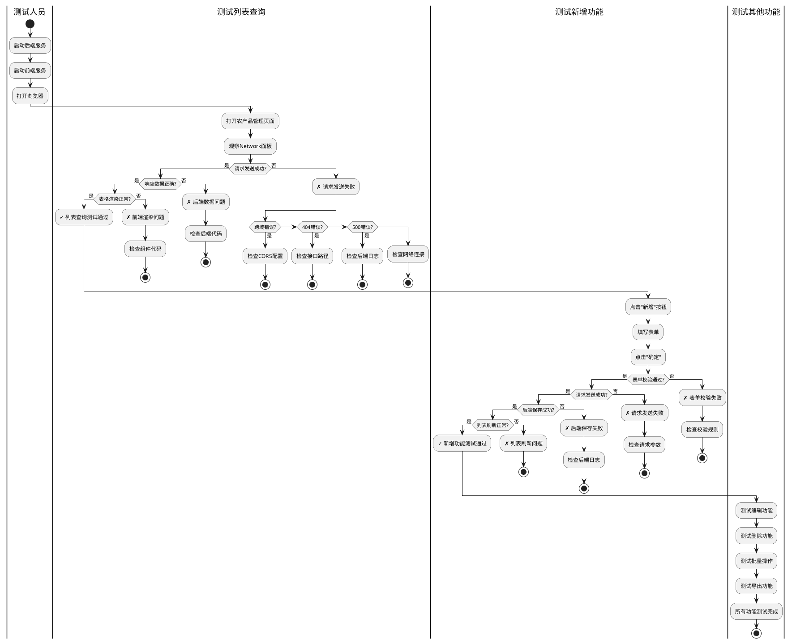

图5-12 前后端联调测试流程图

如图5-12所示，前后端联调测试需要逐个功能进行测试，每个功能都需要检查请求发送、响应数据、界面渲染等多个环节。遇到问题时，需要根据错误类型进行针对性排查。

**常见联调问题排查：**

联调过程中的常见问题和排查方法如表5-8所示。

表5-8 前后端联调常见问题排查表

| 问题现象 | 可能原因 | 排查步骤 | 解决方案 |
|---------|---------|---------|---------|
| **表格不显示数据** | 1. 接口未返回数据<br>2. 数据结构不匹配<br>3. 表格列配置错误 | 1. 查看Network面板的响应数据<br>2. 查看Console是否有错误<br>3. 检查`tableData`的值 | 1. 检查后端是否返回rows字段<br>2. 检查前端是否正确提取rows<br>3. 检查表格列的prop属性 |
| **新增/编辑提交无反应** | 1. 表单校验失败<br>2. 请求未发送<br>3. 请求参数格式错误 | 1. 查看表单是否有红色错误提示<br>2. 查看Network面板<br>3. 查看Request Payload | 1. 检查formRules校验规则<br>2. 检查handleSubmit方法<br>3. 检查后端参数接收方式 |
| **删除确认框不显示** | ElMessageBox未正确导入或调用 | 查看Console是否有错误 | 检查ElMessageBox的导入和使用方式 |
| **分页不工作** | 1. 分页组件绑定错误<br>2. 分页事件未触发<br>3. 后端未返回total | 1. 检查v-model绑定<br>2. 检查@size-change和@current-change<br>3. 查看响应数据 | 1. 确保正确绑定pageNum和pageSize<br>2. 确保事件处理函数正确<br>3. 检查后端是否返回total字段 |
| **图片不显示** | 1. 图片URL错误<br>2. 跨域问题<br>3. 图片不存在 | 1. 查看Network面板的图片请求<br>2. 检查图片URL是否正确 | 1. 使用正确的图片URL<br>2. 配置图片服务器的CORS<br>3. 提供默认图片 |
| **操作按钮不可用** | 1. disabled属性绑定错误<br>2. 未选中数据 | 1. 检查disabled绑定逻辑<br>2. 检查selectedIds的值 | 1. 确保正确绑定selectedIds.length<br>2. 确保selection-change事件正常触发 |

表5-8总结了前后端联调中的常见问题。在实际开发中，遇到问题时按照表格中的步骤逐步排查，大多数问题都能快速解决。

**【价值思考】细节决定成败**

在前后端联调过程中，我们会遇到各种各样的问题：表格不显示数据、按钮点击无反应、图片加载失败、分页不工作……这些看似"小问题"，却可能让用户无法正常使用系统。在"农宝"项目中，当农户打开补贴政策页面却看不到任何数据时，他可能会认为系统坏了，从而失去对平台的信任。作为开发者，我们要对每一个细节负责——确保表格能正确显示数据、确保按钮能正常响应、确保图片能正常加载、确保分页能正常工作。这种"细节决定成败"的意识，是专业工程师的基本素养。我们不能以"功能能用就行"为标准，而要追求"功能好用、体验流畅"的更高目标。唯有对细节的极致追求，才能开发出真正优秀的系统。

### 【AI辅助环节】

#### 1. AI驱动的接口契约验证

**适用场景：**在前后端联调前，可以让AI检查前后端接口定义是否一致，提前发现潜在问题。

**实践步骤：**

**步骤1：向AI提供前后端接口定义**

```
请帮我检查前后端接口定义是否一致：

前端API定义（TypeScript）：
export interface ProduceQueryParams {
  pageNum?: number
  pageSize?: number
  title?: string
  category?: string
}

export function getProduceList(params: ProduceQueryParams) {
  return request({
    url: '/yjnb/produce/list',
    method: 'get',
    params
  })
}

后端Controller定义（Java）：
@GetMapping("/list")
public Result<NbFarmProduce> list(
    @RequestParam(required = false) Integer pageNum,
    @RequestParam(required = false) Integer pageSize,
    @RequestParam(required = false) String title,
    @RequestParam(required = false) String catgory
) {
    // 处理逻辑
}

请检查：
1. 参数名称是否一致
2. 参数类型是否匹配
3. 是否有遗漏的参数
```

**步骤2：AI分析并指出问题**

```
接口契约验证结果：

发现以下不一致：

1. 参数名称不一致：
   - 前端：category
   - 后端：catgory（拼写错误）
   
   建议：统一为category

2. 参数类型匹配：
   - pageNum: number ↔ Integer ✓
   - pageSize: number ↔ Integer ✓
   - title: string ↔ String ✓
   - category: string ↔ String ✓

3. 遗漏的参数：
   前端定义了category参数，但后端使用的是catgory（拼写错误）

修复建议：
方案1：修改后端参数名（推荐）
@RequestParam(required = false) String category

方案2：修改前端参数名
category?: string  改为  catgory?: string

推荐使用方案1，因为category是正确的英文拼写。
```

**步骤3：根据AI建议修复问题**

* 修改后端或前端代码，统一参数名称
* 重新测试接口，验证修复效果

通过AI辅助，可以在联调前就发现接口不一致的问题，避免联调时才发现，节省调试时间。

#### 2. 智能接口文档同步和一致性检查

**适用场景：**当后端接口发生变更时，可以让AI帮助同步更新前端API定义。

**实践步骤：**

**步骤1：向AI提供后端接口变更信息**

```
后端接口发生了以下变更：

原接口：
@GetMapping("/list")
public Result<NbFarmProduce> list(
    @RequestParam Integer pageNum,
    @RequestParam Integer pageSize
)

新接口：
@GetMapping("/list")
public Result<NbFarmProduce> list(
    @RequestParam Integer pageNum,
    @RequestParam Integer pageSize,
    @RequestParam(required = false) String title,
    @RequestParam(required = false) String category,
    @RequestParam(required = false) Integer pushStatus
)

请帮我更新前端API定义，并生成对应的TypeScript接口。
```

**步骤2：AI生成更新后的代码**

```typescript
// 更新后的查询参数接口
export interface ProduceQueryParams {
  pageNum: number        // 必填
  pageSize: number       // 必填
  title?: string         // 新增：可选
  category?: string      // 新增：可选
  pushStatus?: number    // 新增：可选
}

// API方法保持不变，TypeScript会自动检查参数类型
export function getProduceList(params: ProduceQueryParams) {
  return request({
    url: '/yjnb/produce/list',
    method: 'get',
    params
  })
}
```

**步骤3：更新前端代码并测试**

* 更新API接口定义
* 更新页面组件中的查询参数
* 重新测试列表查询功能

#### 3. 前后端数据流分析和优化

**适用场景：**当系统运行一段时间后，可以让AI分析前后端的数据流，识别性能问题和优化点。

**实践步骤：**

**步骤1：向AI提供数据流信息**

```
我的农产品管理页面在加载时会发送以下请求：

1. GET /dev-api/yjnb/produce/list?pageNum=1&pageSize=10
   响应时间：500ms
   响应大小：50KB

2. GET /dev-api/yjnb/produce/list?pageNum=1&pageSize=10
   响应时间：500ms
   响应大小：50KB
   （重复请求）

3. GET /dev-api/system/user/info
   响应时间：200ms
   响应大小：2KB

问题：
1. 为什么会发送重复的列表查询请求？
2. 如何优化这些请求？

请分析数据流并提供优化建议。
```

**步骤2：AI分析并提供建议**

```
数据流分析：

问题1：重复请求
原因：
- 组件可能被重复渲染（检查父组件是否有v-if切换）
- 可能有多个地方调用了getList()方法
- 可能是Vue的响应式系统触发了重复更新

优化建议：
1. 使用Pinia缓存列表数据，避免重复请求
2. 使用防抖函数包装getList()方法
3. 检查组件的生命周期，确保只在必要时请求数据

问题2：性能优化
建议：
1. 列表接口只返回必要字段（如id、title、price、status），
   详情字段（如description）在详情接口返回
2. 使用虚拟滚动，减少DOM渲染压力
3. 使用keep-alive缓存组件，避免重复渲染
4. 对用户信息等公共数据使用Pinia缓存，避免重复请求

优化后的数据流：
1. 首次加载：请求列表数据，缓存到Pinia
2. 切换页码：从Pinia读取缓存，如果缓存过期再请求
3. 新增/修改/删除后：清除缓存，重新请求
```

**步骤3：根据建议进行优化**

```typescript
// 使用Pinia缓存列表数据
import { defineStore } from 'pinia'

export const useProduceStore = defineStore('produce', {
  state: () => ({
    list: [] as ProduceInfo[],
    total: 0,
    cacheTime: 0,
    cacheExpire: 5 * 60 * 1000  // 缓存5分钟
  }),
  
  actions: {
    async fetchList(params: ProduceQueryParams, forceRefresh = false) {
      // 检查缓存是否有效
      const now = Date.now()
      if (!forceRefresh && now - this.cacheTime < this.cacheExpire && this.list.length > 0) {
        console.log('使用缓存数据')
        return { rows: this.list, total: this.total }
      }
      
      // 请求新数据
      const res = await getProduceList(params)
      this.list = res.rows || []
      this.total = res.total || 0
      this.cacheTime = now
      
      return res
    },
    
    // 清除缓存（新增/修改/删除后调用）
    clearCache() {
      this.cacheTime = 0
    }
  }
})

// 在组件中使用
const produceStore = useProduceStore()

async function getList() {
  loading.value = true
  try {
    const res = await produceStore.fetchList(queryParams)
    tableData.value = res.rows || []
    total.value = res.total || 0
  } finally {
    loading.value = false
  }
}

// 新增成功后清除缓存
async function handleSubmit() {
  // ... 提交逻辑
  produceStore.clearCache()  // 清除缓存
  getList()  // 重新请求
}
```

通过AI辅助，我们可以识别数据流中的性能问题，并进行针对性优化，提升系统性能和用户体验。

---

**任务二小结：**

通过本任务的学习，我们完成了核心业务模块的前后端对接：

1. ✅ 创建了API接口定义文件，提供完整的类型支持
2. ✅ 实现了农产品管理页面，包含列表查询、新增、修改、删除等功能
3. ✅ 实现了补贴政策管理页面，复用了农产品页面的设计模式
4. ✅ 实现了Pinia状态管理，管理全局状态和缓存数据
5. ✅ 完成了前后端联调测试，验证了功能的正确性
6. ✅ 学习了使用AI工具辅助接口契约验证和数据流优化

现在，"农宝"平台的核心业务功能已经实现了前后端的完整对接，接下来我们将实现数据可视化大屏，让数据"活"起来。

## 任务三：实现可视化大屏数据动态显示

### 【任务描述】

数据可视化是"农宝"平台的重要功能，通过图表直观展示农产品数量、政策发布量、用户访问趋势等关键指标，为运营决策提供数据支撑。本任务将基于ECharts实现数据统计大屏，包括：

1. **后端统计接口开发：**创建StatisticsController，提供综合统计、产品分布、月度趋势等统计接口。
2. **前端ECharts集成：**安装ECharts依赖，创建通用图表组件，封装图表配置。
3. **实现数据统计大屏：**创建DataVisualization.vue页面，使用多种图表类型展示统计数据。
4. **实现数据自动刷新：**使用定时器定期请求数据，实现图表的动态更新。
5. **大屏样式优化：**设计深色主题，实现响应式布局，添加动画效果。

通过本任务的学习，你将掌握数据可视化的实现方法，能够使用ECharts构建专业的数据大屏。

### 【任务分析】

在实现数据可视化大屏前，我们需要分析数据统计的需求和图表类型的选择。

**1. 数据统计需求**

根据项目一的需求分析，"农宝"平台的数据统计模块需要展示以下指标：

* **综合统计概览：**农产品总数、补贴政策数量、农事服务数量、用户访问量
* **产品分类分布：**各类农产品的数量分布（饼图）
* **月度访问趋势：**最近12个月的访问量趋势（折线图）
* **服务类型分布：**各类农事服务的数量分布（柱状图）
* **政策发布统计：**各月份发布的政策数量（柱状图）

**2. 图表类型选择**

不同的数据特征适合使用不同的图表类型，如表5-9所示。

表5-9 数据特征与图表类型对应关系

| 数据特征 | 适合的图表类型 | 使用场景 | 在"农宝"项目中的应用 |
|---------|--------------|---------|---------------------|
| **分类占比** | 饼图、环形图 | 展示各部分占整体的比例 | 产品分类分布、服务类型分布 |
| **时间趋势** | 折线图、面积图 | 展示数据随时间的变化趋势 | 月度访问趋势、政策发布趋势 |
| **数量对比** | 柱状图、条形图 | 对比不同类别的数量 | 服务类型数量对比、政策类型对比 |
| **关键指标** | 数字卡片 | 突出展示重要指标 | 农产品总数、政策数量、访问量 |
| **地理分布** | 地图 | 展示数据的地理分布 | 农产品产地分布（扩展功能） |
| **关系网络** | 关系图、树图 | 展示数据之间的关联关系 | 专家与课程关联（扩展功能） |

表5-9展示了不同数据特征与图表类型的对应关系。在选择图表类型时，需要根据数据特征和展示目的进行选择。

**3. 数据大屏布局设计**

数据大屏通常采用网格布局，将不同的图表和指标卡片组织在一起。"农宝"平台数据大屏的布局设计如图5-13所示。

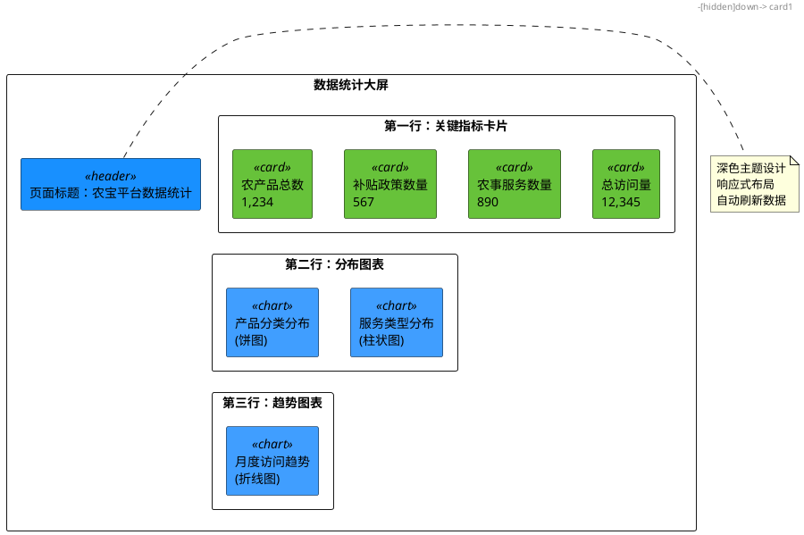

图5-13 数据统计大屏布局设计图

如图5-13所示，数据大屏采用三行布局：第一行展示关键指标卡片，第二行展示分布图表，第三行展示趋势图表。这种布局清晰直观，便于用户快速了解系统的整体运营情况。

### 【实现步骤】

#### 步骤1：后端统计接口开发

首先，我们需要在后端开发数据统计接口，为前端提供统计数据。

**代码5-9 数据统计Controller**

```java
package com.movie.nbspringproduct.controller;

import com.movie.nbspringproduct.common.Result;
import org.slf4j.Logger;
import org.slf4j.LoggerFactory;
import org.springframework.beans.factory.annotation.Autowired;
import org.springframework.web.bind.annotation.*;

import java.util.HashMap;
import java.util.List;
import java.util.Map;

/**
 * 数据统计Controller
 * 提供各类数据统计接口
 */
@RestController
@RequestMapping("/api/statistics")
@CrossOrigin(originPatterns = "*", allowCredentials = "true")
public class StatisticsController {
    
    private static final Logger logger = LoggerFactory.getLogger(StatisticsController.class);
    
    @Autowired
    private NbFarmProduceMapper produceMapper;
    
    @Autowired
    private NbAllowancePolicyMapper policyMapper;
    
    @Autowired
    private NbServiceMapper serviceMapper;
    
    /**
     * 综合统计概览
     * 返回农产品总数、政策数量、服务数量、总访问量
     */
    @GetMapping("/overview")
    public Result<Map<String, Object>> overview() {
        logger.info("查询综合统计概览");
        
        try {
            Map<String, Object> data = new HashMap<>();
            
            // 农产品总数
            Long produceCount = produceMapper.selectCount(new HashMap<>());
            data.put("produceCount", produceCount);
            
            // 补贴政策数量
            Long policyCount = policyMapper.selectCount(new HashMap<>());
            data.put("policyCount", policyCount);
            
            // 农事服务数量
            Long serviceCount = serviceMapper.selectCount(new HashMap<>());
            data.put("serviceCount", serviceCount);
            
            // 总访问量（累加各模块的浏览次数）
            Long totalViews = produceMapper.sumBrowseNum() + 
                             policyMapper.sumBrowseNum() + 
                             serviceMapper.sumBrowseNum();
            data.put("totalViews", totalViews);
            
            logger.info("综合统计概览查询成功：{}", data);
            
            return Result.success(data);
        } catch (Exception e) {
            logger.error("查询综合统计概览失败", e);
            return Result.error("查询失败：" + e.getMessage());
        }
    }
    
    /**
     * 产品分类分布统计
     * 返回各分类的产品数量
     */
    @GetMapping("/produceDistribution")
    public Result<List<Map<String, Object>>> produceDistribution() {
        logger.info("查询产品分类分布");
        
        try {
            // 查询各分类的产品数量
            List<Map<String, Object>> distribution = produceMapper.countByCategory();
            
            logger.info("产品分类分布查询成功，返回{}个分类", distribution.size());
            
            return Result.success(distribution);
        } catch (Exception e) {
            logger.error("查询产品分类分布失败", e);
            return Result.error("查询失败：" + e.getMessage());
        }
    }
    
    /**
     * 服务类型分布统计
     * 返回各类型的服务数量
     */
    @GetMapping("/serviceDistribution")
    public Result<List<Map<String, Object>>> serviceDistribution() {
        logger.info("查询服务类型分布");
        
        try {
            List<Map<String, Object>> distribution = serviceMapper.countByCategory();
            
            logger.info("服务类型分布查询成功，返回{}个类型", distribution.size());
            
            return Result.success(distribution);
        } catch (Exception e) {
            logger.error("查询服务类型分布失败", e);
            return Result.error("查询失败：" + e.getMessage());
        }
    }
    
    /**
     * 月度访问趋势统计
     * 返回最近12个月的访问量
     */
    @GetMapping("/monthlyTrend")
    public Result<List<Map<String, Object>>> monthlyTrend() {
        logger.info("查询月度访问趋势");
        
        try {
            // 查询最近12个月的访问量
            List<Map<String, Object>> trend = produceMapper.monthlyViewTrend();
            
            logger.info("月度访问趋势查询成功，返回{}个月份数据", trend.size());
            
            return Result.success(trend);
        } catch (Exception e) {
            logger.error("查询月度访问趋势失败", e);
            return Result.error("查询失败：" + e.getMessage());
        }
    }
}
```

**代码说明：**

1. **综合统计概览：**查询各模块的总数和总访问量，返回Map格式的数据。

2. **分类分布统计：**使用GROUP BY语句统计各分类的数量，返回List格式的数据。

3. **月度趋势统计：**使用日期函数统计每月的访问量，返回List格式的数据。

**对应的Mapper方法：**

```java
// NbFarmProduceMapper.java
public interface NbFarmProduceMapper extends BaseMapper<NbFarmProduce> {
    
    /**
     * 统计总浏览次数
     */
    @Select("SELECT COALESCE(SUM(browse_num), 0) FROM nb_farm_produce")
    Long sumBrowseNum();
    
    /**
     * 按分类统计产品数量
     */
    @Select("SELECT catgory AS name, COUNT(*) AS value FROM nb_farm_produce GROUP BY catgory")
    List<Map<String, Object>> countByCategory();
    
    /**
     * 月度浏览趋势（最近12个月）
     */
    @Select("SELECT DATE_FORMAT(create_time, '%Y-%m') AS month, SUM(browse_num) AS views " +
            "FROM nb_farm_produce " +
            "WHERE create_time >= DATE_SUB(NOW(), INTERVAL 12 MONTH) " +
            "GROUP BY DATE_FORMAT(create_time, '%Y-%m') " +
            "ORDER BY month")
    List<Map<String, Object>> monthlyViewTrend();
}
```

#### 步骤2：前端ECharts集成

安装ECharts依赖并创建通用图表组件。

**安装ECharts：**

```bash
npm install echarts
```

**代码5-10 通用图表组件**

```vue
<!-- src/components/BaseChart.vue -->
<template>
  <div ref="chartRef" :style="{ width: width, height: height }"></div>
</template>

<script setup lang="ts">
import { ref, onMounted, onBeforeUnmount, watch } from 'vue'
import * as echarts from 'echarts'
import type { EChartsOption } from 'echarts'

/**
 * 组件属性
 */
interface Props {
  option: EChartsOption  // 图表配置
  width?: string         // 宽度
  height?: string        // 高度
}

const props = withDefaults(defineProps<Props>(), {
  width: '100%',
  height: '400px'
})

// 图表DOM引用
const chartRef = ref<HTMLDivElement>()
// 图表实例
let chartInstance: echarts.ECharts | null = null

/**
 * 初始化图表
 */
function initChart() {
  if (!chartRef.value) return
  
  // 创建图表实例
  chartInstance = echarts.init(chartRef.value)
  
  // 设置图表配置
  chartInstance.setOption(props.option)
  
  // 监听窗口大小变化，自动调整图表大小
  window.addEventListener('resize', handleResize)
}

/**
 * 更新图表
 */
function updateChart() {
  if (chartInstance) {
    chartInstance.setOption(props.option)
  }
}

/**
 * 窗口大小变化处理
 */
function handleResize() {
  if (chartInstance) {
    chartInstance.resize()
  }
}

/**
 * 销毁图表
 */
function destroyChart() {
  if (chartInstance) {
    window.removeEventListener('resize', handleResize)
    chartInstance.dispose()
    chartInstance = null
  }
}

// 监听option变化，自动更新图表
watch(() => props.option, () => {
  updateChart()
}, { deep: true })

// 组件挂载时初始化图表
onMounted(() => {
  initChart()
})

// 组件卸载前销毁图表
onBeforeUnmount(() => {
  destroyChart()
})

// 暴露方法供父组件调用
defineExpose({
  updateChart,
  chartInstance
})
</script>
```

**代码说明：**

1. **组件封装：**将ECharts的初始化、更新、销毁逻辑封装在组件中，简化使用。

2. **响应式支持：**使用`watch`监听`option`变化，自动更新图表。

3. **自适应布局：**监听窗口大小变化，自动调整图表大小。

4. **资源清理：**在组件卸载前销毁图表实例，释放内存。

#### 步骤3：创建统计API接口

**代码5-11 统计API接口定义**

```typescript
// src/api/statistics.ts
import request from '@/utils/request'
import type { Result } from '@/utils/request'

/**
 * 综合统计概览数据接口
 */
export interface OverviewData {
  produceCount: number    // 农产品总数
  policyCount: number     // 补贴政策数量
  serviceCount: number    // 农事服务数量
  totalViews: number      // 总访问量
}

/**
 * 分布统计数据接口
 */
export interface DistributionItem {
  name: string   // 分类名称
  value: number  // 数量
}

/**
 * 趋势统计数据接口
 */
export interface TrendItem {
  month: string  // 月份
  views: number  // 访问量
}

/**
 * 查询综合统计概览
 */
export function getOverview() {
  return request<Result<OverviewData>>({
    url: '/statistics/overview',
    method: 'get'
  })
}

/**
 * 查询产品分类分布
 */
export function getProduceDistribution() {
  return request<Result<DistributionItem[]>>({
    url: '/statistics/produceDistribution',
    method: 'get'
  })
}

/**
 * 查询服务类型分布
 */
export function getServiceDistribution() {
  return request<Result<DistributionItem[]>>({
    url: '/statistics/serviceDistribution',
    method: 'get'
  })
}

/**
 * 查询月度访问趋势
 */
export function getMonthlyTrend() {
  return request<Result<TrendItem[]>>({
    url: '/statistics/monthlyTrend',
    method: 'get'
  })
}
```

#### 步骤4：实现数据统计大屏页面

创建`src/views/DataVisualization.vue`页面，使用ECharts展示统计数据。

**代码5-12 数据统计大屏页面完整实现**

```vue
<template>
  <div class="data-visualization">
    <!-- 页面标题 -->
    <div class="page-header">
      <h1>农宝平台数据统计</h1>
      <div class="update-time">
        最后更新：{{ updateTime }}
        <el-button type="primary" size="small" icon="Refresh" @click="refreshData">刷新</el-button>
      </div>
    </div>
    
    <!-- 关键指标卡片 -->
    <el-row :gutter="20" class="stats-cards">
      <el-col :span="6">
        <el-card class="stat-card" shadow="hover">
          <div class="stat-icon" style="background: linear-gradient(135deg, #667eea 0%, #764ba2 100%)">
            <el-icon :size="40"><Goods /></el-icon>
          </div>
          <div class="stat-content">
            <div class="stat-title">农产品总数</div>
            <div class="stat-value">{{ overviewData.produceCount }}</div>
            <div class="stat-desc">已发布产品</div>
          </div>
        </el-card>
      </el-col>
      
      <el-col :span="6">
        <el-card class="stat-card" shadow="hover">
          <div class="stat-icon" style="background: linear-gradient(135deg, #f093fb 0%, #f5576c 100%)">
            <el-icon :size="40"><Document /></el-icon>
          </div>
          <div class="stat-content">
            <div class="stat-title">补贴政策数量</div>
            <div class="stat-value">{{ overviewData.policyCount }}</div>
            <div class="stat-desc">已发布政策</div>
          </div>
        </el-card>
      </el-col>
      
      <el-col :span="6">
        <el-card class="stat-card" shadow="hover">
          <div class="stat-icon" style="background: linear-gradient(135deg, #4facfe 0%, #00f2fe 100%)">
            <el-icon :size="40"><Service /></el-icon>
          </div>
          <div class="stat-content">
            <div class="stat-title">农事服务数量</div>
            <div class="stat-value">{{ overviewData.serviceCount }}</div>
            <div class="stat-desc">可用服务</div>
          </div>
        </el-card>
      </el-col>
      
      <el-col :span="6">
        <el-card class="stat-card" shadow="hover">
          <div class="stat-icon" style="background: linear-gradient(135deg, #fa709a 0%, #fee140 100%)">
            <el-icon :size="40"><View /></el-icon>
          </div>
          <div class="stat-content">
            <div class="stat-title">总访问量</div>
            <div class="stat-value">{{ overviewData.totalViews }}</div>
            <div class="stat-desc">累计浏览次数</div>
          </div>
        </el-card>
      </el-col>
    </el-row>
    
    <!-- 分布图表 -->
    <el-row :gutter="20" class="chart-row">
      <el-col :span="12">
        <el-card class="chart-card" shadow="hover">
          <template #header>
            <div class="card-header">
              <span>产品分类分布</span>
              <el-tag type="info">饼图</el-tag>
            </div>
          </template>
          <BaseChart :option="produceDistributionOption" height="350px" />
        </el-card>
      </el-col>
      
      <el-col :span="12">
        <el-card class="chart-card" shadow="hover">
          <template #header>
            <div class="card-header">
              <span>服务类型分布</span>
              <el-tag type="info">柱状图</el-tag>
            </div>
          </template>
          <BaseChart :option="serviceDistributionOption" height="350px" />
        </el-card>
      </el-col>
    </el-row>
    
    <!-- 趋势图表 -->
    <el-row :gutter="20" class="chart-row">
      <el-col :span="24">
        <el-card class="chart-card" shadow="hover">
          <template #header>
            <div class="card-header">
              <span>月度访问趋势</span>
              <el-tag type="info">折线图</el-tag>
            </div>
          </template>
          <BaseChart :option="monthlyTrendOption" height="400px" />
        </el-card>
      </el-col>
    </el-row>
  </div>
</template>

<script setup lang="ts">
import { ref, reactive, onMounted, onBeforeUnmount } from 'vue'
import { ElMessage } from 'element-plus'
import { Goods, Document, Service, View } from '@element-plus/icons-vue'
import BaseChart from '@/components/BaseChart.vue'
import {
  getOverview,
  getProduceDistribution,
  getServiceDistribution,
  getMonthlyTrend,
  type OverviewData,
  type DistributionItem,
  type TrendItem
} from '@/api/statistics'
import type { EChartsOption } from 'echarts'

// 综合统计数据
const overviewData = reactive<OverviewData>({
  produceCount: 0,
  policyCount: 0,
  serviceCount: 0,
  totalViews: 0
})

// 更新时间
const updateTime = ref('')

// 产品分类分布图表配置
const produceDistributionOption = ref<EChartsOption>({
  title: {
    text: '产品分类分布',
    left: 'center',
    textStyle: {
      fontSize: 16,
      fontWeight: 'normal'
    }
  },
  tooltip: {
    trigger: 'item',
    formatter: '{b}: {c} ({d}%)'
  },
  legend: {
    orient: 'vertical',
    left: 'left',
    top: 'middle'
  },
  series: [
    {
      name: '产品分类',
      type: 'pie',
      radius: ['40%', '70%'],  // 环形图
      avoidLabelOverlap: false,
      itemStyle: {
        borderRadius: 10,
        borderColor: '#fff',
        borderWidth: 2
      },
      label: {
        show: true,
        formatter: '{b}\n{d}%'
      },
      emphasis: {
        label: {
          show: true,
          fontSize: 16,
          fontWeight: 'bold'
        }
      },
      data: []
    }
  ],
  color: ['#5470c6', '#91cc75', '#fac858', '#ee6666', '#73c0de', '#3ba272']
})

// 服务类型分布图表配置
const serviceDistributionOption = ref<EChartsOption>({
  title: {
    text: '服务类型分布',
    left: 'center',
    textStyle: {
      fontSize: 16,
      fontWeight: 'normal'
    }
  },
  tooltip: {
    trigger: 'axis',
    axisPointer: {
      type: 'shadow'
    }
  },
  grid: {
    left: '3%',
    right: '4%',
    bottom: '3%',
    containLabel: true
  },
  xAxis: {
    type: 'category',
    data: [],
    axisTick: {
      alignWithLabel: true
    }
  },
  yAxis: {
    type: 'value',
    name: '数量'
  },
  series: [
    {
      name: '服务数量',
      type: 'bar',
      barWidth: '60%',
      data: [],
      itemStyle: {
        color: {
          type: 'linear',
          x: 0,
          y: 0,
          x2: 0,
          y2: 1,
          colorStops: [
            { offset: 0, color: '#83bff6' },
            { offset: 0.5, color: '#188df0' },
            { offset: 1, color: '#188df0' }
          ]
        },
        borderRadius: [5, 5, 0, 0]
      },
      label: {
        show: true,
        position: 'top',
        formatter: '{c}'
      }
    }
  ]
})

// 月度访问趋势图表配置
const monthlyTrendOption = ref<EChartsOption>({
  title: {
    text: '月度访问趋势',
    left: 'center',
    textStyle: {
      fontSize: 16,
      fontWeight: 'normal'
    }
  },
  tooltip: {
    trigger: 'axis'
  },
  legend: {
    data: ['访问量'],
    top: 30
  },
  grid: {
    left: '3%',
    right: '4%',
    bottom: '3%',
    containLabel: true
  },
  xAxis: {
    type: 'category',
    boundaryGap: false,
    data: []
  },
  yAxis: {
    type: 'value',
    name: '访问量'
  },
  series: [
    {
      name: '访问量',
      type: 'line',
      smooth: true,
      data: [],
      areaStyle: {
        color: {
          type: 'linear',
          x: 0,
          y: 0,
          x2: 0,
          y2: 1,
          colorStops: [
            { offset: 0, color: 'rgba(58, 77, 233, 0.8)' },
            { offset: 1, color: 'rgba(58, 77, 233, 0.1)' }
          ]
        }
      },
      itemStyle: {
        color: '#3a4de9'
      },
      lineStyle: {
        width: 3
      }
    }
  ]
})

/**
 * 加载综合统计数据
 */
async function loadOverview() {
  try {
    const res = await getOverview()
    Object.assign(overviewData, res.data)
  } catch (error) {
    console.error('加载综合统计失败：', error)
    ElMessage.error('加载综合统计失败')
  }
}

/**
 * 加载产品分类分布
 */
async function loadProduceDistribution() {
  try {
    const res = await getProduceDistribution()
    const data = res.data || []
    
    // 更新图表数据
    if (produceDistributionOption.value.series && produceDistributionOption.value.series[0]) {
      (produceDistributionOption.value.series[0] as any).data = data
    }
  } catch (error) {
    console.error('加载产品分类分布失败：', error)
    ElMessage.error('加载产品分类分布失败')
  }
}

/**
 * 加载服务类型分布
 */
async function loadServiceDistribution() {
  try {
    const res = await getServiceDistribution()
    const data = res.data || []
    
    // 提取分类名称和数量
    const categories = data.map(item => item.name)
    const values = data.map(item => item.value)
    
    // 更新图表数据
    if (serviceDistributionOption.value.xAxis && serviceDistributionOption.value.series) {
      (serviceDistributionOption.value.xAxis as any).data = categories;
      (serviceDistributionOption.value.series[0] as any).data = values
    }
  } catch (error) {
    console.error('加载服务类型分布失败：', error)
    ElMessage.error('加载服务类型分布失败')
  }
}

/**
 * 加载月度访问趋势
 */
async function loadMonthlyTrend() {
  try {
    const res = await getMonthlyTrend()
    const data = res.data || []
    
    // 提取月份和访问量
    const months = data.map(item => item.month)
    const views = data.map(item => item.views)
    
    // 更新图表数据
    if (monthlyTrendOption.value.xAxis && monthlyTrendOption.value.series) {
      (monthlyTrendOption.value.xAxis as any).data = months;
      (monthlyTrendOption.value.series[0] as any).data = views
    }
  } catch (error) {
    console.error('加载月度访问趋势失败：', error)
    ElMessage.error('加载月度访问趋势失败')
  }
}

/**
 * 加载所有统计数据
 */
async function loadAllData() {
  await Promise.all([
    loadOverview(),
    loadProduceDistribution(),
    loadServiceDistribution(),
    loadMonthlyTrend()
  ])
  
  // 更新时间
  updateTime.value = new Date().toLocaleString('zh-CN', {
    year: 'numeric',
    month: '2-digit',
    day: '2-digit',
    hour: '2-digit',
    minute: '2-digit',
    second: '2-digit'
  })
}

/**
 * 刷新数据
 */
function refreshData() {
  loadAllData()
  ElMessage.success('数据已刷新')
}

// 定时器ID
let timer: number | null = null

/**
 * 启动自动刷新
 */
function startAutoRefresh() {
  // 每5分钟自动刷新一次
  timer = window.setInterval(() => {
    console.log('自动刷新数据')
    loadAllData()
  }, 5 * 60 * 1000)
}

/**
 * 停止自动刷新
 */
function stopAutoRefresh() {
  if (timer) {
    clearInterval(timer)
    timer = null
  }
}

// 页面加载时加载数据并启动自动刷新
onMounted(() => {
  loadAllData()
  startAutoRefresh()
})

// 页面卸载前停止自动刷新
onBeforeUnmount(() => {
  stopAutoRefresh()
})
</script>

<style scoped>
.data-visualization {
  padding: 20px;
  background: #f0f2f5;
  min-height: calc(100vh - 60px);
}

.page-header {
  display: flex;
  justify-content: space-between;
  align-items: center;
  margin-bottom: 20px;
  padding: 20px;
  background: #fff;
  border-radius: 4px;
  box-shadow: 0 2px 4px rgba(0, 0, 0, 0.1);
}

.page-header h1 {
  margin: 0;
  font-size: 28px;
  color: #303133;
  font-weight: 500;
}

.update-time {
  display: flex;
  align-items: center;
  gap: 10px;
  color: #909399;
  font-size: 14px;
}

/* 关键指标卡片样式 */
.stats-cards {
  margin-bottom: 20px;
}

.stat-card {
  cursor: pointer;
  transition: all 0.3s;
}

.stat-card:hover {
  transform: translateY(-5px);
  box-shadow: 0 4px 12px rgba(0, 0, 0, 0.15);
}

.stat-card :deep(.el-card__body) {
  display: flex;
  align-items: center;
  padding: 20px;
}

.stat-icon {
  width: 80px;
  height: 80px;
  border-radius: 12px;
  display: flex;
  align-items: center;
  justify-content: center;
  color: #fff;
  margin-right: 20px;
}

.stat-content {
  flex: 1;
}

.stat-title {
  font-size: 14px;
  color: #909399;
  margin-bottom: 8px;
}

.stat-value {
  font-size: 32px;
  font-weight: bold;
  color: #303133;
  margin-bottom: 4px;
}

.stat-desc {
  font-size: 12px;
  color: #c0c4cc;
}

/* 图表卡片样式 */
.chart-row {
  margin-bottom: 20px;
}

.chart-card {
  transition: all 0.3s;
}

.chart-card:hover {
  box-shadow: 0 4px 12px rgba(0, 0, 0, 0.15);
}

.card-header {
  display: flex;
  justify-content: space-between;
  align-items: center;
  font-size: 16px;
  font-weight: 500;
}
</style>
```

**代码说明：**

1. **关键指标卡片：**
   * 使用渐变色背景，视觉效果更好
   * 使用Element Plus的图标组件
   * 添加hover动画效果，提升交互体验

2. **图表组件：**
   * 使用封装的BaseChart组件
   * 传入ECharts配置对象
   * 支持响应式调整

3. **数据加载：**
   * 使用`Promise.all`并发加载多个接口，提高加载速度
   * 加载完成后更新图表数据

4. **自动刷新：**
   * 使用`setInterval`定时刷新数据
   * 在组件卸载前清除定时器，避免内存泄漏

5. **图表配置：**
   * 饼图：使用环形图样式，显示百分比
   * 柱状图：使用渐变色填充，显示数值标签
   * 折线图：使用平滑曲线，添加面积填充

#### 步骤5：ECharts图表配置详解

ECharts的配置非常灵活，我们可以根据需求定制图表的各个方面。下面详细讲解三种常用图表的配置。

**1. 饼图配置详解**

```typescript
const pieOption: EChartsOption = {
  // 标题配置
  title: {
    text: '产品分类分布',
    left: 'center',
    textStyle: {
      fontSize: 16,
      fontWeight: 'normal',
      color: '#303133'
    }
  },
  
  // 提示框配置
  tooltip: {
    trigger: 'item',  // 触发类型：item（数据项）
    formatter: '{b}: {c} ({d}%)'  // 格式：名称: 数值 (百分比)
  },
  
  // 图例配置
  legend: {
    orient: 'vertical',  // 垂直布局
    left: 'left',        // 左侧显示
    top: 'middle'        // 垂直居中
  },
  
  // 系列配置
  series: [
    {
      name: '产品分类',
      type: 'pie',  // 图表类型：饼图
      radius: ['40%', '70%'],  // 内外半径（环形图）
      center: ['50%', '50%'],  // 圆心位置
      
      // 数据项样式
      itemStyle: {
        borderRadius: 10,      // 圆角
        borderColor: '#fff',   // 边框颜色
        borderWidth: 2         // 边框宽度
      },
      
      // 标签配置
      label: {
        show: true,
        formatter: '{b}\n{d}%',  // 显示名称和百分比
        fontSize: 12
      },
      
      // 高亮样式
      emphasis: {
        label: {
          show: true,
          fontSize: 16,
          fontWeight: 'bold'
        },
        itemStyle: {
          shadowBlur: 10,
          shadowOffsetX: 0,
          shadowColor: 'rgba(0, 0, 0, 0.5)'
        }
      },
      
      // 数据
      data: [
        { name: '粮食作物', value: 320 },
        { name: '蔬菜', value: 240 },
        { name: '水果', value: 180 },
        { name: '畜牧产品', value: 150 }
      ]
    }
  ],
  
  // 颜色配置
  color: ['#5470c6', '#91cc75', '#fac858', '#ee6666', '#73c0de', '#3ba272']
}
```

**2. 柱状图配置详解**

```typescript
const barOption: EChartsOption = {
  title: {
    text: '服务类型分布',
    left: 'center'
  },
  
  tooltip: {
    trigger: 'axis',  // 触发类型：axis（坐标轴）
    axisPointer: {
      type: 'shadow'  // 指示器类型：阴影
    }
  },
  
  grid: {
    left: '3%',
    right: '4%',
    bottom: '3%',
    containLabel: true  // 包含坐标轴标签
  },
  
  xAxis: {
    type: 'category',  // 类目轴
    data: ['技术指导', '农机服务', '物流配送', '金融服务'],
    axisTick: {
      alignWithLabel: true  // 刻度线与标签对齐
    }
  },
  
  yAxis: {
    type: 'value',  // 数值轴
    name: '数量'
  },
  
  series: [
    {
      name: '服务数量',
      type: 'bar',
      barWidth: '60%',  // 柱子宽度
      
      // 渐变色填充
      itemStyle: {
        color: {
          type: 'linear',
          x: 0,
          y: 0,
          x2: 0,
          y2: 1,
          colorStops: [
            { offset: 0, color: '#83bff6' },
            { offset: 0.5, color: '#188df0' },
            { offset: 1, color: '#188df0' }
          ]
        },
        borderRadius: [5, 5, 0, 0]  // 顶部圆角
      },
      
      // 数值标签
      label: {
        show: true,
        position: 'top',
        formatter: '{c}'
      },
      
      data: [120, 80, 60, 40]
    }
  ]
}
```

**3. 折线图配置详解**

```typescript
const lineOption: EChartsOption = {
  title: {
    text: '月度访问趋势',
    left: 'center'
  },
  
  tooltip: {
    trigger: 'axis'
  },
  
  legend: {
    data: ['访问量'],
    top: 30
  },
  
  grid: {
    left: '3%',
    right: '4%',
    bottom: '3%',
    containLabel: true
  },
  
  xAxis: {
    type: 'category',
    boundaryGap: false,  // 两端不留白
    data: ['1月', '2月', '3月', '4月', '5月', '6月', '7月', '8月', '9月', '10月', '11月', '12月']
  },
  
  yAxis: {
    type: 'value',
    name: '访问量'
  },
  
  series: [
    {
      name: '访问量',
      type: 'line',
      smooth: true,  // 平滑曲线
      
      // 面积填充
      areaStyle: {
        color: {
          type: 'linear',
          x: 0,
          y: 0,
          x2: 0,
          y2: 1,
          colorStops: [
            { offset: 0, color: 'rgba(58, 77, 233, 0.8)' },
            { offset: 1, color: 'rgba(58, 77, 233, 0.1)' }
          ]
        }
      },
      
      // 数据点样式
      itemStyle: {
        color: '#3a4de9'
      },
      
      // 线条样式
      lineStyle: {
        width: 3
      },
      
      data: [820, 932, 901, 934, 1290, 1330, 1320, 1450, 1500, 1600, 1700, 1800]
    }
  ]
}
```

ECharts图表配置的核心要素如表5-10所示。

表5-10 ECharts图表配置核心要素

| 配置项 | 说明 | 常用属性 | 示例 |
|-------|------|---------|------|
| **title** | 标题配置 | text（标题文本）、left（位置）、textStyle（样式） | `{text: '产品分布', left: 'center'}` |
| **tooltip** | 提示框配置 | trigger（触发类型）、formatter（格式化） | `{trigger: 'item', formatter: '{b}: {c}'}` |
| **legend** | 图例配置 | data（图例项）、orient（布局）、left/top（位置） | `{data: ['销量'], orient: 'vertical'}` |
| **grid** | 网格配置 | left/right/top/bottom（边距）、containLabel（包含标签） | `{left: '3%', containLabel: true}` |
| **xAxis** | X轴配置 | type（类型）、data（类目数据）、name（轴名称） | `{type: 'category', data: ['1月', '2月']}` |
| **yAxis** | Y轴配置 | type（类型）、name（轴名称）、min/max（范围） | `{type: 'value', name: '数量'}` |
| **series** | 系列配置 | type（图表类型）、data（数据）、itemStyle（样式） | `{type: 'bar', data: [120, 200]}` |
| **color** | 颜色配置 | 颜色数组 | `['#5470c6', '#91cc75', '#fac858']` |

表5-10总结了ECharts图表配置的核心要素。掌握这些配置项，就可以灵活定制各种图表。

#### 步骤6：数据大屏效果优化

为了提升数据大屏的视觉效果和用户体验，我们可以进行以下优化：

**1. 深色主题**

ECharts提供了内置的深色主题，适合数据大屏展示：

```typescript
import * as echarts from 'echarts'

// 使用深色主题
const chartInstance = echarts.init(chartRef.value, 'dark')
```

**2. 动画效果**

ECharts默认开启动画效果，可以通过配置调整动画参数：

```typescript
const option: EChartsOption = {
  animation: true,          // 开启动画
  animationDuration: 1000,  // 动画时长（毫秒）
  animationEasing: 'cubicOut',  // 动画缓动效果
  // ...其他配置
}
```

**3. 响应式布局**

使用CSS Grid或Flexbox实现响应式布局，适配不同屏幕尺寸：

```css
.chart-row {
  display: grid;
  grid-template-columns: repeat(auto-fit, minmax(500px, 1fr));
  gap: 20px;
}

@media (max-width: 1200px) {
  .chart-row {
    grid-template-columns: 1fr;
  }
}
```

**4. 数据加载骨架屏**

在数据加载时显示骨架屏，提升用户体验：

```vue
<template>
  <el-skeleton v-if="loading" :rows="5" animated />
  <BaseChart v-else :option="chartOption" />
</template>
```

数据大屏的最终效果如图5-14所示。


图5-14 数据统计大屏效果图

如图5-14所示，数据统计大屏采用卡片+图表的布局方式，使用渐变色和动画效果，视觉效果专业美观。关键指标卡片使用不同的渐变色背景，图表使用统一的配色方案，整体风格协调统一。

### 【AI辅助环节】

#### 1. AI推荐最佳数据可视化方案

**适用场景：**当你不确定使用哪种图表类型时，可以让AI根据数据特征推荐合适的图表。

**实践步骤：**

**步骤1：向AI描述数据特征**

```
我有以下数据需要可视化展示：

数据1：农产品分类统计
{
  "粮食作物": 320,
  "蔬菜": 240,
  "水果": 180,
  "畜牧产品": 150
}

数据2：月度访问量
[
  {"month": "2024-01", "views": 820},
  {"month": "2024-02", "views": 932},
  {"month": "2024-03", "views": 901},
  ...
]

数据3：服务类型数量
{
  "技术指导": 120,
  "农机服务": 80,
  "物流配送": 60,
  "金融服务": 40
}

请推荐：
1. 每种数据适合使用什么图表类型？
2. 图表的配色方案
3. 布局建议
```

**步骤2：AI分析并提供建议**

```
数据可视化方案推荐：

数据1：农产品分类统计
推荐图表：饼图或环形图
理由：
- 数据表示各分类占总数的比例关系
- 饼图能直观展示占比
- 环形图更现代，视觉效果更好

配置建议：
- 使用环形图（radius: ['40%', '70%']）
- 显示百分比标签
- 使用渐变色或主题色
- 添加图例，便于识别

数据2：月度访问量
推荐图表：折线图或面积图
理由：
- 数据表示时间序列变化
- 折线图能清晰展示趋势
- 面积图能强调数据的累积效果

配置建议：
- 使用平滑曲线（smooth: true）
- 添加面积填充（areaStyle）
- 使用渐变色填充
- 显示数据点标记

数据3：服务类型数量
推荐图表：柱状图或条形图
理由：
- 数据表示不同类别的数量对比
- 柱状图能清晰对比数值大小
- 条形图适合类别名称较长的情况

配置建议：
- 使用渐变色填充
- 显示数值标签（label）
- 添加hover高亮效果
- 使用圆角柱子（borderRadius）

布局建议：
1. 第一行：关键指标卡片（4个）
2. 第二行：饼图（左）+ 柱状图（右）
3. 第三行：折线图（全宽）

配色方案：
- 主色调：蓝色系（#5470c6, #91cc75, #fac858）
- 渐变色：使用linear gradient增强视觉效果
- 卡片背景：使用不同的渐变色区分
```

**步骤3：根据AI建议实现图表**

* 按照AI推荐的图表类型创建图表
* 使用AI建议的配色方案
* 按照布局建议组织页面结构

#### 2. 智能图表类型选择和配色建议

**适用场景：**当你已经实现了基础图表，想要进一步优化视觉效果时。

**实践步骤：**

**步骤1：向AI提供当前图表配置**

```
我的饼图配置如下：

series: [{
  type: 'pie',
  radius: '50%',
  data: [
    { name: '粮食作物', value: 320 },
    { name: '蔬菜', value: 240 },
    { name: '水果', value: 180 },
    { name: '畜牧产品', value: 150 }
  ]
}]

请帮我优化：
1. 使用更现代的样式
2. 推荐更好的配色方案
3. 添加动画效果
```

**步骤2：AI提供优化建议**

```
饼图优化建议：

1. 使用环形图替代实心饼图
radius: ['40%', '70%']  // 内外半径

2. 添加圆角和边框
itemStyle: {
  borderRadius: 10,
  borderColor: '#fff',
  borderWidth: 2
}

3. 优化标签显示
label: {
  formatter: '{b}\n{d}%',  // 显示名称和百分比
  fontSize: 12,
  color: '#333'
}

4. 添加高亮效果
emphasis: {
  itemStyle: {
    shadowBlur: 10,
    shadowOffsetX: 0,
    shadowColor: 'rgba(0, 0, 0, 0.5)'
  }
}

5. 配色方案推荐
// 方案1：清新自然（适合农业主题）
color: ['#91cc75', '#fac858', '#ee6666', '#73c0de', '#3ba272', '#fc8452']

// 方案2：专业商务
color: ['#5470c6', '#91cc75', '#fac858', '#ee6666', '#73c0de', '#3ba272']

// 方案3：活力渐变
使用渐变色：
itemStyle: {
  color: (params) => {
    const colorList = [
      { start: '#667eea', end: '#764ba2' },
      { start: '#f093fb', end: '#f5576c' },
      { start: '#4facfe', end: '#00f2fe' },
      { start: '#43e97b', end: '#38f9d7' }
    ]
    const item = colorList[params.dataIndex % colorList.length]
    return {
      type: 'linear',
      x: 0, y: 0, x2: 0, y2: 1,
      colorStops: [
        { offset: 0, color: item.start },
        { offset: 1, color: item.end }
      ]
    }
  }
}

推荐使用方案1（清新自然），因为更符合"农宝"平台的农业主题。
```

#### 3. 性能监控和用户体验优化提示

**适用场景：**当数据大屏运行一段时间后，可以让AI分析性能问题并提供优化建议。

**实践步骤：**

**步骤1：向AI描述性能问题**

```
我的数据大屏有以下性能问题：

1. 页面加载时，4个图表同时渲染，页面卡顿
2. 每5分钟自动刷新，刷新时图表闪烁
3. 数据量较大时（如月度趋势有100个数据点），图表渲染慢

请提供性能优化建议。
```

**步骤2：AI分析并提供优化方案**

```
性能优化方案：

问题1：图表同时渲染导致卡顿
优化方案：
- 使用异步渲染，分批加载图表
- 使用懒加载，图表进入可视区域时才渲染
- 使用骨架屏，提升加载体验

实现代码：
// 使用setTimeout分批渲染
onMounted(() => {
  loadOverview()  // 立即加载关键指标
  
  setTimeout(() => {
    loadProduceDistribution()  // 延迟加载饼图
  }, 100)
  
  setTimeout(() => {
    loadServiceDistribution()  // 延迟加载柱状图
  }, 200)
  
  setTimeout(() => {
    loadMonthlyTrend()  // 延迟加载折线图
  }, 300)
})

问题2：刷新时图表闪烁
优化方案：
- 使用ECharts的notMerge: false，增量更新而非重新渲染
- 使用loading动画，避免闪烁感

实现代码：
chartInstance.setOption(newOption, {
  notMerge: false,  // 增量更新
  lazyUpdate: true  // 延迟更新
})

问题3：数据量大时渲染慢
优化方案：
- 使用数据采样，减少数据点数量
- 使用数据聚合，按周或按月聚合数据
- 使用Canvas渲染器（默认），比SVG快

实现代码：
// 数据采样
series: [{
  type: 'line',
  sampling: 'average',  // 采样策略：平均值
  data: largeDataArray
}]

// 数据聚合（后端实现）
// 将每日数据聚合为每周数据，减少数据点
```

**步骤3：应用优化方案并测试**

* 实现AI建议的优化方案
* 使用浏览器Performance工具测试性能
* 对比优化前后的渲染时间

通过AI辅助，我们可以识别数据大屏的性能问题，并进行针对性优化，提升用户体验。

**【价值思考】数据可视化的社会价值**

数据可视化不仅是技术展示，更是决策支持的重要工具。在"农宝"平台的数据大屏上，每一个数字、每一条曲线，都承载着农业发展的真实轨迹。当县农业局的领导看到"农产品总数从500增长到1200"，他会知道平台正在发挥作用；当看到"补贴政策访问量持续上升"，他会知道政策正在有效触达农民；当看到"某类农事服务需求激增"，他会知道需要加强这方面的服务供给。数据可视化让抽象的数字变成直观的图表，让决策者能够快速洞察问题、发现机会、制定策略。作为开发者，我们不仅要实现图表的技术功能，更要思考如何让数据"说话"，如何通过可视化帮助决策者做出更好的决策。这种"用技术服务决策、用数据支撑发展"的意识，是数据时代软件工程师应有的社会责任。

---

**任务三小结：**

通过本任务的学习，我们完成了数据可视化大屏的实现：

1. ✅ 开发了后端统计接口，提供综合统计、分布统计、趋势统计等数据
2. ✅ 集成了ECharts库，创建了通用图表组件
3. ✅ 实现了数据统计大屏页面，使用饼图、柱状图、折线图展示数据
4. ✅ 实现了数据自动刷新功能，每5分钟更新一次数据
5. ✅ 优化了大屏样式，使用渐变色、动画效果，提升视觉体验
6. ✅ 学习了使用AI工具辅助图表选择、配色优化、性能优化

现在，"农宝"平台的数据统计大屏已经完整实现，可以为运营决策提供直观的数据支撑。

## 【扩展学习】

### 【前端路由与API接口的映射关系】

在前后端分离架构中，前端路由与后端API接口是两个独立的概念，但它们之间存在密切的映射关系。理解这种映射关系，有助于我们更好地设计系统架构。

#### 前端路由与后端接口的区别

**前端路由：**
* 定义：URL路径与前端组件的映射关系
* 作用：控制页面的显示和切换
* 示例：`/produce` → `ProduceManagement.vue`组件
* 特点：不会向服务器发送请求，由前端JavaScript控制

**后端接口：**
* 定义：URL路径与后端Controller方法的映射关系
* 作用：处理数据请求，返回业务数据
* 示例：`GET /dev-api/yjnb/produce/list` → `ProduceController.list()`方法
* 特点：会向服务器发送HTTP请求

前端路由与后端接口的映射关系如表5-11所示。

表5-11 前端路由与后端接口映射关系

| 前端路由 | 对应页面组件 | 页面功能 | 调用的后端接口 | 接口功能 |
|---------|------------|---------|--------------|---------|
| `/produce` | ProduceManagement.vue | 农产品管理页面 | `GET /dev-api/yjnb/produce/list`<br>`POST /dev-api/yjnb/produce`<br>`PUT /dev-api/yjnb/produce`<br>`DELETE /dev-api/yjnb/produce/{id}` | 查询列表<br>新增产品<br>修改产品<br>删除产品 |
| `/policy` | PolicyManagement.vue | 补贴政策管理页面 | `GET /dev-api/yjnb/policy/list`<br>`POST /dev-api/yjnb/policy`<br>`PUT /dev-api/yjnb/policy`<br>`DELETE /dev-api/yjnb/policy/{id}` | 查询列表<br>新增政策<br>修改政策<br>删除政策 |
| `/service` | ServiceManagement.vue | 农事服务管理页面 | `GET /dev-api/yjnb/service/list`<br>`POST /dev-api/yjnb/service`<br>`PUT /dev-api/yjnb/service`<br>`DELETE /dev-api/yjnb/service/{id}` | 查询列表<br>新增服务<br>修改服务<br>删除服务 |
| `/statistics` | DataVisualization.vue | 数据统计大屏 | `GET /dev-api/statistics/overview`<br>`GET /dev-api/statistics/produceDistribution`<br>`GET /dev-api/statistics/monthlyTrend` | 综合统计<br>分布统计<br>趋势统计 |

表5-11清晰展示了前端路由与后端接口的映射关系。一个前端路由通常对应多个后端接口，因为一个页面通常需要调用多个接口来完成不同的功能。

#### 单页面应用的路由机制

在传统的多页面应用中，每次点击链接都会向服务器请求新的HTML页面，页面会完全刷新。而在单页面应用（SPA）中，页面切换由前端JavaScript控制，不会刷新页面。

**单页面应用的优势：**

1. **用户体验好：**页面切换流畅，无白屏闪烁
2. **减少服务器压力：**只请求数据，不请求HTML页面
3. **前后端分离：**前端专注界面，后端专注数据
4. **支持前端缓存：**可以缓存组件和数据，提高性能

**单页面应用的实现原理：**

1. **History API：**使用`pushState`和`replaceState`改变URL，不刷新页面
2. **路由监听：**Vue Router监听URL变化，渲染对应组件
3. **动态组件：**使用`<router-view>`作为组件占位符，动态渲染组件

单页面应用的路由切换过程如图5-15所示。

```plantuml
@startuml
|用户操作|
start
:点击菜单"农产品管理";

|Vue Router|
:监听到路由变化;
note right
  URL: / → /produce
end note

:查找路由配置;
note right
  {
    path: '/produce',
    component: ProduceManagement
  }
end note

:卸载当前组件;
:加载新组件;

|ProduceManagement组件|
:组件创建(setup);
:组件挂载(onMounted);
:调用getList()方法;

|API层|
:调用getProduceList()接口;

|后端服务|
:返回农产品列表数据;

|ProduceManagement组件|
:更新tableData;
:渲染表格;

|用户操作|
:看到农产品列表;

note over "用户操作", "ProduceManagement组件"
  整个过程页面没有刷新，
  只是组件切换和数据更新，
  用户体验流畅
end note

stop
@enduml
```

图5-15 单页面应用路由切换过程

如图5-15所示，单页面应用的路由切换过程不会刷新页面，只是卸载旧组件、加载新组件，然后请求数据并渲染。这种方式提供了流畅的用户体验。

### 【WebSocket实时通信】

在数据大屏中，如果需要实时更新数据（如实时访问量、实时订单数等），可以使用WebSocket实现服务器主动推送数据。

**WebSocket与HTTP的对比：**

| 特性 | HTTP | WebSocket |
|------|------|-----------|
| **通信方式** | 请求-响应（单向） | 全双工通信（双向） |
| **连接方式** | 短连接（请求完成后断开） | 长连接（保持连接） |
| **数据推送** | 客户端主动请求 | 服务器主动推送 |
| **适用场景** | 普通数据查询 | 实时数据推送、聊天、通知 |
| **性能** | 每次请求都要建立连接 | 连接建立后可以持续通信 |

**WebSocket的基本使用：**

```typescript
// 前端创建WebSocket连接
const ws = new WebSocket('ws://localhost:80/ws/statistics')

// 连接打开
ws.onopen = () => {
  console.log('WebSocket连接已建立')
}

// 接收消息
ws.onmessage = (event) => {
  const data = JSON.parse(event.data)
  console.log('收到实时数据：', data)
  // 更新图表数据
  updateChartData(data)
}

// 连接关闭
ws.onclose = () => {
  console.log('WebSocket连接已关闭')
}

// 发生错误
ws.onerror = (error) => {
  console.error('WebSocket错误：', error)
}
```

**后端WebSocket配置：**

```java
@Configuration
@EnableWebSocket
public class WebSocketConfig implements WebSocketConfigurer {
    
    @Override
    public void registerWebSocketHandlers(WebSocketHandlerRegistry registry) {
        registry.addHandler(new StatisticsWebSocketHandler(), "/ws/statistics")
                .setAllowedOrigins("*");
    }
}
```

WebSocket适合实时性要求高的场景，如实时监控、实时通知等。对于"农宝"平台的数据大屏，如果需要实时更新数据，可以考虑使用WebSocket替代定时器轮询。

### 【前端性能优化策略】

前端性能优化是提升用户体验的重要手段。在"农宝"项目中，我们可以从以下几个方面进行优化：

**1. 代码分割与懒加载**

* 路由懒加载：使用动态导入，按需加载页面组件
* 组件懒加载：对大型组件使用异步组件
* 第三方库按需引入：如Element Plus的按需引入

**2. 资源优化**

* 图片压缩：使用WebP格式，减小图片体积
* 图片懒加载：使用`v-lazy`指令，滚动到可视区域时才加载
* 字体优化：使用Web Font，减少字体文件大小

**3. 请求优化**

* 接口缓存：使用Pinia缓存接口数据，避免重复请求
* 请求合并：将多个小请求合并为一个大请求
* 防抖节流：对搜索等高频操作使用防抖

**4. 渲染优化**

* 虚拟滚动：对长列表使用虚拟滚动，只渲染可见区域
* 组件缓存：使用`<keep-alive>`缓存组件，避免重复渲染
* 计算属性：使用computed缓存计算结果

前端性能优化的关键指标如表5-12所示。

表5-12 前端性能优化关键指标

| 指标 | 说明 | 优化目标 | 优化方法 |
|------|------|---------|---------|
| **FCP** | 首次内容绘制时间 | < 1.8秒 | 代码分割、资源压缩、CDN加速 |
| **LCP** | 最大内容绘制时间 | < 2.5秒 | 图片优化、懒加载、预加载 |
| **FID** | 首次输入延迟 | < 100ms | 减少JavaScript执行时间、代码分割 |
| **CLS** | 累积布局偏移 | < 0.1 | 固定尺寸、避免动态插入内容 |
| **TTI** | 可交互时间 | < 3.8秒 | 减少主线程工作、代码分割 |

表5-12展示了前端性能优化的关键指标。这些指标是Google提出的Web Vitals核心指标，用于衡量用户体验质量。

### 【微前端架构简介】

随着前端应用规模的增长，单体前端应用会变得越来越庞大，难以维护。微前端架构将前端应用拆分为多个独立的子应用，每个子应用可以独立开发、部署、运行。

**微前端的核心概念：**

1. **应用拆分：**将大型应用拆分为多个小型应用，如将"农宝"平台拆分为农产品管理、政策管理、数据统计等子应用。

2. **独立部署：**每个子应用可以独立部署，互不影响。

3. **技术栈无关：**不同子应用可以使用不同的技术栈，如一个用Vue，一个用React。

4. **运行时集成：**在运行时将多个子应用集成到主应用中。

**微前端的实现方案：**

* **iframe：**最简单的方案，但存在性能和通信问题
* **Single-SPA：**微前端框架，支持多种前端框架
* **qiankun：**阿里开源的微前端框架，基于Single-SPA
* **Module Federation：**Webpack 5的模块联邦功能

微前端适合大型项目，对于"农宝"这种中小型项目，单体前端应用已经足够。

### 【低代码平台与可视化开发】

低代码平台是近年来兴起的开发模式，通过可视化拖拽的方式快速构建应用，减少手工编码。

**低代码平台的特点：**

1. **可视化开发：**通过拖拽组件快速构建界面
2. **配置驱动：**通过配置而非编码实现功能
3. **快速交付：**大幅缩短开发周期
4. **降低门槛：**非技术人员也能参与开发

**常见的低代码平台：**

* **钉钉宜搭：**阿里推出的低代码平台，适合企业内部应用
* **腾讯云微搭：**腾讯推出的低代码平台，支持多端应用
* **华为AppCube：**华为推出的低代码平台，适合企业级应用
* **Mendix：**国外知名低代码平台，功能强大

低代码平台适合快速构建标准化的管理系统，但对于复杂的业务逻辑和定制化需求，传统编码方式仍然是主流选择。

## 【项目小结】

通过项目五的系统学习，我们完成了"农宝"平台前后端的完整集成，从基础通信配置到业务功能对接，从数据可视化到性能优化，形成了一个完整的前后端协作开发流程。

**1. 前端请求配置阶段**

在前端请求配置阶段，我们封装了Axios请求工具，实现了请求/响应拦截器，配置了Vite开发代理，配置了Spring Boot CORS，解决了开发环境和生产环境的跨域问题。通过统一的请求配置，我们实现了token自动添加、错误统一处理、loading统一控制等功能，大大简化了业务代码。

**2. 业务功能对接阶段**

在业务功能对接阶段，我们创建了API接口定义文件，实现了农产品管理和补贴政策管理两个完整的业务模块，使用Element Plus组件构建了专业的后台管理界面，实现了列表查询、新增、修改、删除、发布、推荐等完整功能。通过前后端联调测试，我们验证了功能的正确性，并学会了使用浏览器开发者工具进行问题排查。

**3. 数据可视化实现阶段**

在数据可视化实现阶段，我们开发了后端统计接口，集成了ECharts库，创建了通用图表组件，实现了数据统计大屏页面。使用饼图展示产品分类分布，使用柱状图展示服务类型分布，使用折线图展示月度访问趋势。通过渐变色、动画效果、自动刷新等优化，我们打造了专业美观的数据大屏。

**4. AI辅助协作阶段**

在整个项目实施过程中，我们学习了如何使用AI工具辅助前后端协作：使用AI生成API调用代码，使用AI诊断跨域问题，使用AI验证接口契约，使用AI优化数据流，使用AI推荐图表类型和配色方案。AI工具大大提升了我们的开发效率和代码质量。

"农宝"平台项目五的实现成果如表5-13所示。

表5-13 项目五实现成果统计

| 项目指标 | 数量 | 说明 |
|---------|------|------|
| 前端页面 | 3个 | 农产品管理、补贴政策管理、数据统计大屏 |
| API接口文件 | 3个 | produce.ts、policy.ts、statistics.ts |
| API方法 | 20+ | 涵盖查询、新增、修改、删除、发布、推荐、导出等 |
| Vue组件 | 4个 | 3个页面组件 + 1个通用图表组件 |
| ECharts图表 | 3个 | 饼图、柱状图、折线图 |
| 后端统计接口 | 4个 | 综合统计、产品分布、服务分布、月度趋势 |
| 配置文件 | 3个 | request.ts、vite.config.ts、CorsConfig.java |

表5-13展示了"农宝"平台项目五的实现成果。从表中可以看出，项目实现了完整的前后端集成，包含前端页面、API接口、后端服务、数据可视化等多个方面，为"农宝"平台的完整交付奠定了坚实基础。

**【价值思考】全栈思维与综合能力**

通过项目五的学习，我们不仅掌握了前端开发技能，更重要的是建立了全栈思维。我们学会了站在前后端两个视角思考问题：理解前端的用户体验诉求，也理解后端的技术限制；既能编写前端界面代码，也能理解后端接口实现；既关注功能实现，也关注性能优化和用户体验。这种全栈思维，是现代软件工程师的核心竞争力。在"农宝"项目中，当我们遇到性能问题时，能够从前后端两个角度分析：是前端请求过多？还是后端查询太慢？是前端渲染卡顿？还是后端返回数据太大？这种综合分析能力，让我们能够更准确地定位问题、更有效地解决问题。技术的深度固然重要，但技术的广度同样关键。唯有既懂前端又懂后端，才能在团队中发挥更大价值，成为不可替代的技术人才。

**关键收获：**

1. **前后端协作能力：**掌握了前后端分离架构下的协作开发流程，理解了接口契约的重要性，学会了前后端联调的方法。

2. **前端开发能力：**掌握了Vue.js 3 + Element Plus的开发方法，能够构建专业的后台管理界面，实现完整的业务功能。

3. **数据可视化能力：**掌握了ECharts的使用方法，能够根据数据特征选择合适的图表类型，实现专业的数据大屏。

4. **问题排查能力：**学会了使用浏览器开发者工具进行问题排查，能够快速定位并解决跨域、404、500等常见问题。

5. **AI工具应用：**学会了使用AI工具辅助前后端协作，包括代码生成、问题诊断、性能优化等，大幅提升了开发效率。

6. **全栈思维：**建立了全栈思维，能够站在前后端两个视角思考问题，理解系统的整体架构和数据流转。

## 【答疑解惑】

**1. 为什么开发环境要配置代理，生产环境要配置CORS？不能只用一种方案吗？**

可以只用一种方案，但不推荐。开发环境使用代理的好处是配置简单，不需要修改后端代码，而且代理可以解决所有类型的跨域请求。但代理只在开发环境有效，打包后的生产环境无法使用代理。生产环境必须使用CORS，因为前端静态文件部署后，无法使用开发服务器的代理功能。同时使用两种方案，可以确保开发和生产环境都能正常工作，这是工程实践中的最佳选择。

**2. 前端状态管理（Pinia）的作用是什么？不用状态管理可以吗？**

可以不用，但不推荐。状态管理的核心作用是：（1）数据共享：多个组件可以共享同一份数据，避免重复请求；（2）数据缓存：缓存接口数据，提高性能；（3）状态持久化：将状态保存到localStorage，刷新页面后仍然有效；（4）统一管理：将全局状态集中管理，便于维护。在"农宝"项目中，用户信息、菜单权限等全局数据使用Pinia管理，避免在每个组件中重复请求。对于小型项目，可以不用状态管理；但对于中大型项目，状态管理是必不可少的。

**3. ECharts与其他图表库（如Chart.js、D3.js）相比有什么优势？**

ECharts的优势在于：（1）功能丰富：支持30+种图表类型，覆盖绝大多数可视化需求；（2）配置简单：通过配置对象即可实现复杂图表，学习成本低；（3）性能优秀：使用Canvas渲染，支持大数据量；（4）中文友好：文档完善，社区活跃，国内使用广泛；（5）移动端支持：自适应布局，支持触摸交互。Chart.js更轻量，适合简单图表；D3.js更灵活，适合定制化需求，但学习成本高。对于"农宝"这种企业级项目，ECharts是最佳选择。

**4. 前端组件的复用性如何保证？农产品管理和补贴政策管理页面有很多相似代码，如何避免重复？**

组件复用是前端开发的重要原则。对于相似的页面，可以采用以下方法：（1）提取公共组件：将表格、表单、对话框等公共部分提取为独立组件；（2）使用高阶组件：创建通用的列表页面组件，通过配置实现不同模块；（3）使用组合式函数：将业务逻辑提取为可复用的函数；（4）使用插槽：通过插槽实现组件的灵活定制。在"农宝"项目中，农产品和政策管理页面确实有很多相似代码，可以提取为通用的CRUD页面组件，通过配置实现不同模块的功能。这是后续优化的方向。

**5. 在使用AI工具生成前端代码时，如何保证代码质量和项目规范的一致性？**

AI生成的代码需要人工审查和调整。关键要点：（1）提供明确的规范：在向AI提问时，明确说明项目的代码规范、命名规范、组件结构等；（2）提供示例代码：给AI提供项目中已有的代码示例，让AI参考现有风格；（3）分步生成：不要让AI一次生成整个页面，而是分步生成（先生成API定义，再生成组件结构，最后生成业务逻辑），每步都进行审查；（4）人工优化：AI生成的代码可能不够优雅或存在冗余，需要根据项目实际情况优化；（5）团队评审：将AI生成的代码纳入团队代码评审流程，确保质量。AI是工具，不是替代品，最终的代码质量还是要靠人来保证。

## 【习题】

### 一、选择题

1. 在前后端分离架构中，前端与后端通过什么协议通信？（ ）

A. TCP  B. UDP  C. HTTP  D. FTP

**答案：C**

2. 关于跨域问题，下列说法正确的是？（ ）

A. 跨域是服务器的限制  
B. 跨域是浏览器的安全策略  
C. 只有不同域名才会跨域  
D. 跨域问题无法解决

**答案：B**

3. Axios的请求拦截器主要用于？（ ）

A. 处理响应数据  
B. 在请求发送前添加token等信息  
C. 处理网络错误  
D. 解析JSON数据

**答案：B**

4. 在Vue Router中，使用哪个组件作为路由视图的占位符？（ ）

A. `<router-link>`  
B. `<router-view>`  
C. `<router-outlet>`  
D. `<router-container>`

**答案：B**

5. ECharts中，饼图的type属性值是？（ ）

A. bar  B. line  C. pie  D. scatter

**答案：C**

### 二、填空题

1. 前后端分离架构中，前端通过 __________ 与后端通信，后端返回 __________ 格式的数据。

**答案：HTTP协议（或RESTful API）、JSON**

2. Vite开发代理配置在 __________ 文件中，Spring Boot跨域配置在 __________ 类中。

**答案：vite.config.ts、CorsConfig.java（或CORS配置类）**

3. Vue Router的全局前置守卫使用 __________ 方法，全局后置守卫使用 __________ 方法。

**答案：beforeEach、afterEach**

4. ECharts图表的三个核心配置项是 __________、__________ 和 __________。

**答案：title（标题）、series（系列）、tooltip（提示框）（或其他合理答案如xAxis、yAxis等）**

5. 在前端项目中，使用 __________ 管理全局状态，使用 __________ 管理路由。

**答案：Pinia（或Vuex）、Vue Router**

### 三、简答题

1. 简述前后端分离架构中，前端工程师和后端工程师的职责分工。

**参考答案：**

前端工程师负责用户界面的开发和交互逻辑实现，包括页面布局、组件开发、用户交互、数据展示等。后端工程师负责业务逻辑处理和数据存储，包括接口开发、数据库设计、业务逻辑实现、数据查询等。两者通过API接口进行协作，前端调用后端接口获取数据，后端处理业务逻辑并返回数据。

2. 简述跨域问题的产生原因和两种解决方案。

**参考答案：**

跨域问题是由浏览器的同源策略引起的。同源策略规定，JavaScript只能访问与当前页面同源（协议、域名、端口都相同）的资源。在前后端分离架构中，前端和后端通常运行在不同的端口或域名，属于跨源，浏览器会阻止前端访问后端API。

两种解决方案：
1. 开发环境：配置开发代理（如Vite proxy），将前端请求转发到后端，对浏览器来说是同源请求。
2. 生产环境：配置CORS（跨域资源共享），后端返回`Access-Control-Allow-Origin`等响应头，告诉浏览器允许跨域访问。

3. 简述Axios拦截器的作用和使用场景。

**参考答案：**

Axios拦截器分为请求拦截器和响应拦截器。

请求拦截器在请求发送前执行，主要用于：添加token到请求头、添加时间戳防止缓存、显示loading动画、记录请求日志等。

响应拦截器在响应返回后执行，主要用于：统一处理错误（根据状态码跳转或提示）、提取响应数据、隐藏loading动画、记录响应日志等。

通过拦截器，可以实现请求和响应的统一处理，简化业务代码，提高代码的可维护性。

### 四、设计题

1. 请为"农宝"平台的"农贸市场管理"模块设计完整的前后端接口。

**要求：**
* 定义前端API接口（TypeScript）
* 定义查询参数接口和数据接口
* 包含列表查询、详情查询、新增、修改、删除接口
* 添加必要的注释

**参考答案：**

```typescript
// src/api/market.ts
import request from '@/utils/request'
import type { Result } from '@/utils/request'

/**
 * 农贸市场查询参数接口
 */
export interface MarketQueryParams {
  pageNum?: number
  pageSize?: number
  title?: string
  marketType?: string
  address?: string
}

/**
 * 农贸市场信息接口
 */
export interface MarketInfo {
  id?: string
  title: string
  resume?: string
  description?: string
  image?: string
  address?: string
  contactPhone?: string
  contactPerson?: string
  businessHours?: string
  marketType?: string
  browseNum?: number
  createTime?: string
  updateTime?: string
  remark?: string
}

/**
 * 查询农贸市场列表
 */
export function getMarketList(params: MarketQueryParams) {
  return request<Result<MarketInfo[]>>({
    url: '/yjnb/market/list',
    method: 'get',
    params
  })
}

/**
 * 根据ID查询农贸市场详情
 */
export function getMarketById(id: string) {
  return request<Result<MarketInfo>>({
    url: `/yjnb/market/${id}`,
    method: 'get'
  })
}

/**
 * 新增农贸市场
 */
export function addMarket(data: MarketInfo) {
  return request<Result<void>>({
    url: '/yjnb/market',
    method: 'post',
    data
  })
}

/**
 * 修改农贸市场
 */
export function updateMarket(data: MarketInfo) {
  return request<Result<void>>({
    url: '/yjnb/market',
    method: 'put',
    data
  })
}

/**
 * 删除农贸市场
 */
export function deleteMarket(ids: string[]) {
  return request<Result<void>>({
    url: `/yjnb/market/${ids.join(',')}`,
    method: 'delete'
  })
}
```

2. 使用AI工具（ChatGPT/Claude），为"农事服务管理"模块生成完整的Vue组件代码。

**要求：**
* 包含列表查询、新增、修改、删除功能
* 使用Element Plus组件
* 使用TypeScript
* 使用组合式API（setup语法）
* 添加必要的注释

**提示：**向AI提供详细的需求描述和代码规范，让AI生成符合项目风格的代码。

3. 设计一个数据可视化方案，展示"农宝"平台的用户行为数据。

**要求：**
* 分析需要展示哪些用户行为数据
* 为每种数据选择合适的图表类型
* 设计页面布局
* 说明数据更新策略

**参考答案：**

用户行为数据可视化方案：

**数据指标：**
1. 用户访问量（PV、UV）
2. 用户活跃时段分布
3. 功能模块使用频率
4. 用户地域分布
5. 用户留存率

**图表类型选择：**
1. 访问量：折线图（展示趋势）
2. 活跃时段：热力图（展示24小时分布）
3. 功能使用频率：柱状图（对比各功能）
4. 地域分布：地图（展示地理分布）
5. 留存率：漏斗图（展示转化）

**页面布局：**
* 第一行：关键指标卡片（PV、UV、活跃用户、留存率）
* 第二行：访问趋势折线图（全宽）
* 第三行：活跃时段热力图（左）+ 功能使用频率柱状图（右）
* 第四行：用户地域分布地图（全宽）

**数据更新策略：**
* 关键指标：每分钟更新一次
* 趋势图表：每5分钟更新一次
* 分布图表：每小时更新一次

### 五、实践题

1. 完成"农宝"平台农产品管理页面的开发，并进行前后端联调测试。

**要求：**
* 实现列表查询、新增、修改、删除功能
* 使用Element Plus组件
* 实现分页和搜索功能
* 使用浏览器开发者工具进行联调测试
* 记录测试过程中遇到的问题和解决方案

2. 使用ECharts实现一个数据统计页面，展示"农宝"平台的运营数据。

**要求：**
* 至少包含3种不同类型的图表（饼图、柱状图、折线图）
* 实现数据自动刷新功能
* 优化图表样式，使用渐变色和动画效果
* 实现响应式布局，适配不同屏幕尺寸

3. 使用AI工具优化你的前端代码。

**要求：**
* 选择一个Vue组件，让AI分析代码质量
* 根据AI的建议进行代码重构
* 对比优化前后的代码，总结改进点
* 记录AI工具的使用体验和局限性

### 六、综合实践题

设计并实现"农宝"平台的完整前后端集成方案。

**要求：**

1. **需求分析：**
   * 选择一个业务模块（如专家管理、图文课程管理等）
   * 分析功能需求和数据模型
   * 设计接口契约

2. **后端开发：**
   * 实现Controller、Service、Mapper三层代码
   * 添加日志记录和异常处理
   * 编写单元测试

3. **前端开发：**
   * 创建API接口定义文件
   * 实现Vue页面组件
   * 实现列表查询、新增、修改、删除等功能

4. **联调测试：**
   * 进行前后端联调测试
   * 记录测试用例和测试结果
   * 解决测试中发现的问题

5. **AI辅助：**
   * 使用AI工具生成部分代码
   * 使用AI工具进行代码审查
   * 使用AI工具优化性能

6. **文档编写：**
   * 编写接口文档
   * 编写开发文档
   * 总结开发经验

---

**参考答案：**

**一、选择题**
1. C  2. B  3. B  4. B  5. C

**二、填空题**
（答案见题目中）

**三、简答题**
（答案见题目中）

**四、设计题**
（答案见题目中）

**五、实践题**
（答案略，请根据实际项目完成）

**六、综合实践题**
（答案略，请根据实际项目完成）

---

**项目五完结寄语：**

恭喜你完成了项目五的学习！通过这个项目，你不仅掌握了前后端集成的技术技能，更重要的是建立了全栈思维和团队协作意识。你学会了如何配置前端请求、如何解决跨域问题、如何实现业务功能对接、如何使用ECharts构建数据大屏。你也学会了如何使用AI工具提升开发效率，如何使用浏览器开发者工具进行问题排查。

在"农宝"平台的开发旅程中，项目五是一个重要的里程碑——前端和后端终于"握手"成功，数据开始在系统中流转，用户可以通过界面操作数据，运营人员可以通过大屏查看统计。这标志着"农宝"平台从"分散的功能模块"变成了"完整的业务系统"。

然而，这还不是终点。在接下来的项目六中，我们将实现系统级的全局处理机制，包括全局异常处理、用户认证与权限拦截、AOP日志与性能监控等，让系统更加健壮、安全、可靠。在项目七中，我们将学习项目部署，将"农宝"平台部署到服务器，让农民真正用上这个系统。在项目八中，我们将总结项目成果，评估系统质量，设计架构演进路线。

路漫漫其修远兮，让我们继续前行，用技术服务"三农"，用创新助力乡村振兴！

