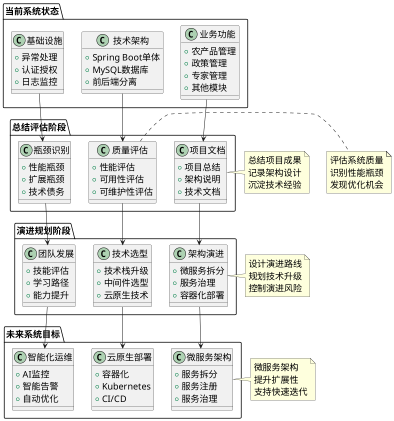
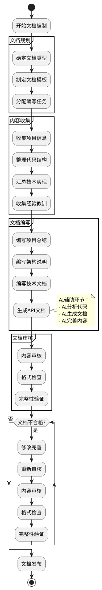
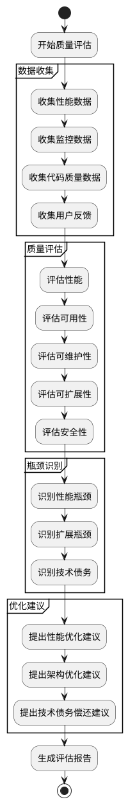
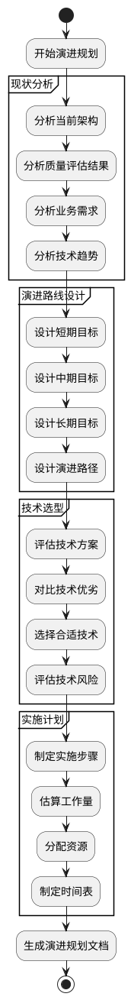

# 项目八 总结项目成果与架构演进

在项目一至项目七的学习中，我们完成了"农宝"平台从需求分析到成功部署的完整开发过程。系统功能日趋完善，代码质量不断提升，前后端已经可以顺畅协作，系统具备了完善的异常处理、安全防护、监控能力和部署方案。然而，随着系统成功上线运行，新的思考逐渐浮现：

"我们完成了这么多功能，但系统的整体架构是否合理？未来如何扩展？"——架构师的思考

"系统现在运行正常，但用户量增长后会不会出现性能瓶颈？我们该如何提前规划？"——技术负责人的担忧

"项目开发过程中积累了很多技术债务，哪些需要优先解决？如何制定重构计划？"——开发团队的困惑

"团队成员的技能水平参差不齐，如何制定技术发展规划，让团队持续成长？"——团队负责人的期待

这些来自一线的真实思考，指向了一个核心问题：**如何总结项目成果，评估系统质量？如何识别演进瓶颈，设计架构演进路线？如何建立持续改进机制，让系统持续演进？**

答案就是本项目要学习的**项目总结、质量评估、架构演进规划**。在这个项目中，我们将一起探索如何编制项目文档，如何评估系统质量，如何识别演进瓶颈，如何设计架构演进路线，让系统从"成功上线"走向"持续演进""持续优化""持续成长"。让我们开始这段从完成到超越的关键之旅。

**【价值思考】架构演进中的工程素养**

软件系统的价值不仅在于功能的实现，更在于能够持续演进和优化。一个专业的软件工程师，不仅要能完成当前的功能开发，更要能站在系统整体角度思考问题，评估系统质量，规划架构演进。在"农宝"项目中，当我们回顾整个开发过程，总结项目成果，评估系统质量，设计演进路线时，我们会感受到从完成到超越的完整思维带来的成就感。架构演进不是简单的"技术升级"，而是涉及质量评估、瓶颈识别、技术选型、风险控制、团队成长等多个方面的系统工程。正如建筑需要定期维护和升级一样，软件系统也需要持续演进和优化。唯有建立完善的总结和演进机制，才能让系统持续为用户创造价值，这是成为架构师的必经之路。

## 【项目介绍】

项目八是"农宝"平台开发的总结和展望阶段，承担着总结项目成果、评估系统质量、规划架构演进的重要使命。在前七个项目中，我们已经完成了业务功能的开发、前后端集成、全局处理机制建设、系统部署上线，系统已经具备了完整的业务能力和基础设施，并成功运行在生产环境。现在，是时候总结项目成果，评估系统质量，识别演进瓶颈，设计架构演进路线，为系统的持续演进奠定基础。

本项目以"农宝"平台的项目总结和架构演进为载体，围绕项目文档编制、系统质量评估、架构演进规划三大核心任务展开学习。我们将系统介绍如何编制项目总结文档，如何评估系统质量属性，如何识别演进瓶颈，如何设计架构演进路线，如何利用AI工具辅助文档生成、质量评估、技术规划。

在整体系统架构中，项目总结和架构演进是连接当前状态和未来目标的桥梁，是保障系统持续演进的关键环节。这一环节的完善程度，直接影响系统的可维护性、可扩展性和持续发展能力。

本项目的核心内容包括：

1. **项目文档编制：**学习如何编制项目总结文档、架构说明文档，如何利用AI工具辅助文档生成和完善。

2. **系统质量评估：**学习如何评估系统的质量属性（性能、可用性、可维护性等），如何识别演进瓶颈，如何利用AI工具辅助质量评估。

3. **架构演进规划：**学习如何设计架构演进路线，如何进行技术选型，如何评估风险，如何利用AI工具辅助技术规划。

4. **技术债务管理：**学习如何识别技术债务，如何制定重构计划，如何平衡新功能开发和技术债务偿还。

5. **团队技能发展：**学习如何评估团队技能水平，如何制定学习路径，如何利用AI工具辅助技能发展。

项目完成后，将产出以下成果：

* 一套完整的项目文档体系，包含项目总结、架构说明、技术文档等，为后续维护和演进提供参考。
* 一套系统质量评估方案，包含质量属性评估、瓶颈识别、优化建议等，为系统优化提供方向。
* 一套架构演进路线图，包含短期、中期、长期演进计划，为系统持续演进提供指导。
* 一套技术债务管理方案，包含债务识别、优先级排序、重构计划等，为系统重构提供依据。
* 一套AI辅助总结和规划实践经验，包括文档生成、质量评估、技术规划等，提升总结和规划效率。

项目总结与架构演进体系如图8-1所示。



图8-1 项目总结与架构演进体系图

如图8-1所示，项目总结与架构演进体系分为三个阶段：当前系统状态阶段完成功能开发和部署，总结评估阶段完成文档编制和质量评估，演进规划阶段完成架构演进路线设计。各阶段之间通过清晰的流程组织，形成完整的总结和演进体系。

通过本项目的学习，读者可以建立起完整的总结和演进思维，理解从完成到超越的完整流程，掌握项目文档编制、系统质量评估、架构演进规划等核心技术，并学会利用AI工具辅助总结和规划。本项目产出的项目文档、质量评估报告、演进路线图，既是本项目的核心成果，也将作为"农宝"平台的重要参考，为系统的持续演进和团队的能力提升提供指导。

在开展具体任务实施前，读者需先行掌握软件质量属性、架构评估模型、微服务架构、持续集成持续交付、云原生技术等相关基础知识。本教材将系统介绍上述基础知识，助力读者更好地理解并完成项目任务。

## 【学习目标】

### 【知识目标】

* 掌握软件质量属性的定义和评估方法，理解性能、可用性、可维护性等质量属性的重要性
* 理解从单体架构到微服务架构的演进路径，掌握微服务架构的核心概念和设计原则
* 掌握持续集成与持续交付的理念和实践方法，理解CI/CD在软件工程中的重要性
* 了解云原生技术的核心概念，理解容器化、服务网格、可观测性等技术的应用场景
* 了解AI在软件架构演进中的应用，掌握AI辅助文档生成、质量评估、技术规划等方法

### 【能力目标】

* 培养项目总结能力，能够编制完整的项目文档，总结项目成果和经验
* 建立质量评估能力，能够评估系统质量属性，识别演进瓶颈
* 掌握架构演进规划能力，能够设计架构演进路线，进行技术选型
* 提升技术债务管理能力，能够识别技术债务，制定重构计划
* 培养团队发展能力，能够评估团队技能，制定学习路径
* 提升AI工具应用能力，能够利用AI工具辅助总结和规划，提升效率

### 【素质目标】

* 培养系统思维，理解架构演进对系统质量的重要性，养成持续改进的习惯
* 建立前瞻意识，理解技术规划的重要性，对系统未来发展负责
* 培养总结反思能力，理解项目总结的价值，追求卓越的系统质量
* 增强学习能力，理解持续学习的重要性，提升技术敏感度
* 培养团队协作能力，理解团队发展的重要性，提升沟通和协作效率

## 【知识储备】

在正式开始动手实践前，让我们先了解一些必备的基础知识。这些知识就像建造房屋前需要了解的建筑原理，掌握它们才能更好地完成项目的总结和架构演进规划。

### 8.1 软件质量属性与架构评估模型

#### 8.1.1 软件质量属性

软件质量属性是衡量软件系统质量的重要指标，ISO/IEC 25010标准定义了软件质量模型，包括功能性、性能效率、兼容性、可用性、可靠性、安全性、可维护性、可移植性等八大质量属性。

**核心质量属性：**

- 性能（Performance）：系统响应时间、吞吐量、资源利用率等
- 可用性（Availability）：系统正常运行时间、故障恢复时间等
- 可维护性（Maintainability）：代码可读性、可修改性、可测试性等
- 可扩展性（Scalability）：系统处理增长负载的能力
- 安全性（Security）：数据安全、访问控制、漏洞防护等
- 可靠性（Reliability）：系统在指定条件下正常运行的能力

**质量属性权衡：**

在实际项目中，不同的质量属性之间可能存在冲突，需要进行权衡：

- 性能 vs 可维护性：追求极致性能可能导致代码复杂，降低可维护性
- 可用性 vs 成本：提高可用性需要增加冗余，增加成本
- 安全性 vs 易用性：提高安全性可能降低易用性

#### 8.1.2 架构评估模型

**ATAM（Architecture Tradeoff Analysis Method）：**

ATAM是一种架构评估方法，通过识别架构决策、质量属性场景、风险点、权衡点等，评估架构的质量。

**评估步骤：**

1. **描述架构：**描述系统的业务目标、架构视图、质量属性需求
2. **识别场景：**识别关键的质量属性场景（性能场景、可用性场景等）
3. **分析架构：**分析架构如何满足质量属性场景
4. **识别风险：**识别架构中的风险点和权衡点
5. **生成报告：**生成架构评估报告，包含风险、权衡、建议等

**质量属性场景模板：**

```
场景：在[环境]中，当[刺激]发生时，系统应该[响应]，以满足[质量属性]。
```

例如：
- **性能场景：在正常负载下，当用户查询农产品列表时，系统应该在2秒内返回结果，以满足性能要求。**
- **可用性场景：在系统故障时，当数据库连接失败时，系统应该在30秒内自动恢复，以满足可用性要求。**

#### 8.1.3 质量属性评估方法

**性能评估：**

- **响应时间：**测量系统响应请求的时间
- **吞吐量：**测量系统单位时间内处理的请求数
- **资源利用率：**测量CPU、内存、磁盘、网络等资源的使用率
- **压力测试：**通过压力测试工具（如JMeter）测试系统在高负载下的表现

**可用性评估：**

- **MTBF（Mean Time Between Failures）：**平均故障间隔时间
- **MTTR（Mean Time To Repair）：**平均修复时间
- **可用性 = MTBF / (MTBF + MTTR)**
- **目标：**99.9%可用性（年停机时间约8.76小时）

**可维护性评估：**

- 代码复杂度：使用圈复杂度等指标评估代码复杂度
- 代码重复率：评估代码重复程度
- 测试覆盖率：评估单元测试覆盖率
- 技术债务：识别和量化技术债务

### 8.2 从单体架构到微服务架构演进

#### 8.2.1 单体架构的局限性

**单体架构的特点：**

- **单一部署单元：**整个应用打包成一个部署单元
- **共享数据库：**所有模块共享同一个数据库
- **技术栈统一：**使用统一的技术栈

**单体架构的局限性：**

- 扩展困难：只能整体扩展，无法按需扩展
- 技术栈锁定：难以引入新技术
- 部署风险高：一个模块的问题可能影响整个系统
- 团队协作困难：多人修改同一代码库容易冲突

#### 8.2.2 微服务架构的核心概念

**微服务架构的特点：**

- **服务拆分：**将单体应用拆分为多个独立的服务
- **独立部署：**每个服务可以独立部署和扩展
- **技术栈多样：**不同服务可以使用不同的技术栈
- **数据独立：**每个服务拥有自己的数据库

**微服务架构的优势：**

- **独立扩展：**可以按需扩展特定服务
- **技术自由：**可以选择最适合的技术栈
- **故障隔离：**一个服务的故障不会影响其他服务
- **团队自治：**不同团队可以独立开发和部署

**微服务架构的挑战：**

- **分布式复杂性：**需要处理分布式系统的复杂性
- **服务治理：**需要服务注册、发现、负载均衡等
- **数据一致性：**需要处理分布式事务
- **运维复杂度：**需要管理更多的服务实例

#### 8.2.3 架构演进路径

**演进阶段：**

1. **单体架构：**适合初期快速开发，团队规模小
2. **模块化单体：**将单体应用模块化，为拆分做准备
3. **服务化拆分：**按业务域拆分服务，逐步微服务化
4. **微服务架构：**完全微服务化，实现服务治理

**拆分策略：**

- **按业务域拆分：**按业务领域（如用户、订单、商品）拆分
- **按数据模型拆分：**按数据模型拆分，避免数据耦合
- **按团队拆分：**按团队组织拆分，实现团队自治

### 8.3 持续集成与持续交付理念

#### 8.3.1 CI/CD核心概念

**持续集成（Continuous Integration，CI）：**

持续集成是指频繁地将代码集成到主分支，通过自动化构建和测试，快速发现集成问题。

**持续交付（Continuous Delivery，CD）：**

持续交付是指通过自动化流程，将代码快速、可靠地部署到生产环境。

**CI/CD流程：**

```
代码提交 → 自动构建 → 自动测试 → 自动部署 → 生产环境
```

#### 8.3.2 CI/CD工具链

**CI工具：**

- **Jenkins：**开源的CI/CD工具，功能强大，插件丰富
- **GitLab CI：**GitLab内置的CI/CD工具，与GitLab深度集成
- **GitHub Actions：**GitHub提供的CI/CD服务，与GitHub深度集成
- **Travis CI：**云端的CI服务，配置简单

**CD工具：**

- **Jenkins Pipeline：**Jenkins的流水线功能，支持复杂的部署流程
- **GitLab CD：**GitLab的持续部署功能
- **ArgoCD：**Kubernetes原生的CD工具
- **Spinnaker：**Netflix开源的CD平台

#### 8.3.3 CI/CD最佳实践

**CI最佳实践：**

- **频繁提交：**鼓励频繁提交代码，减少集成冲突
- **自动化测试：**每次构建都运行自动化测试
- **快速反馈：**构建和测试应该快速完成，及时反馈
- **构建失败处理：**构建失败时，团队应该优先修复

**CD最佳实践：**

- **自动化部署：**部署过程应该完全自动化
- **环境一致性：**开发、测试、生产环境应该保持一致
- **回滚机制：**应该支持快速回滚到上一个版本
- **蓝绿部署：**使用蓝绿部署实现零停机部署

### 8.4 云原生技术与部署架构演进

#### 8.4.1 云原生核心概念

**云原生（Cloud Native）：**

云原生是一种构建和运行应用程序的方法，利用云计算的优势，实现应用的快速开发、部署和扩展。

**云原生技术栈：**

- **容器化：**使用Docker等容器技术
- **编排：**使用Kubernetes等编排工具
- **微服务：**采用微服务架构
- **DevOps：**实现开发和运维的协作
- **持续交付：**实现持续集成和持续部署

#### 8.4.2 容器化技术

**Docker：**

Docker是一种容器化技术，可以将应用及其依赖打包成容器镜像。

**优势：**

- **环境一致性：**开发、测试、生产环境完全一致
- **快速部署：**容器启动速度快，部署简单
- **资源隔离：**容器之间相互隔离，互不影响
- **易于扩展：**可以快速扩展容器数量

#### 8.4.3 Kubernetes容器编排

Kubernetes核心概念：

- Pod：Kubernetes的最小部署单元，包含一个或多个容器
- Service：提供服务发现和负载均衡
- Deployment：管理Pod的部署和更新
- Namespace：提供资源隔离

Kubernetes优势：

- 自动扩展：根据负载自动扩展Pod数量
- 自愈能力：Pod故障时自动重启或替换
- 滚动更新：支持零停机滚动更新
- 服务发现：自动服务发现和负载均衡

### 8.5 AI在软件架构演进中的作用

#### 8.5.1 AI辅助文档生成

AI工具可以分析代码和架构，自动生成项目文档：

- **代码分析：**分析代码结构，生成架构图
- **文档生成：**根据代码注释和结构，生成API文档
- **文档完善：**检查文档完整性，提供补充建议

#### 8.5.2 AI辅助质量评估

AI工具可以分析代码和系统，评估系统质量：

- **代码质量分析：**分析代码复杂度、重复率等
- **性能分析：**分析性能数据，识别性能瓶颈
- **安全分析：**识别安全漏洞和风险

#### 8.5.3 AI辅助技术规划

AI工具可以分析技术趋势和需求，推荐技术方案：

- **技术选型：**根据需求推荐合适的技术栈
- **演进路线：**设计架构演进路线图
- **风险评估：**评估技术选型的风险

---

**知识储备小结：**

通过以上五个知识点的学习，我们已经掌握了项目总结和架构演进所需的核心知识：

1. **质量属性：**理解了软件质量属性的定义和评估方法
2. **架构演进：**理解了从单体架构到微服务架构的演进路径
3. **CI/CD：**理解了持续集成和持续交付的理念和实践
4. **云原生：**了解了云原生技术的核心概念和应用
5. **AI辅助：**了解了AI在软件架构演进中的应用场景

接下来，让我们进入实践环节，将这些知识应用到"农宝"项目的总结和架构演进规划中。

## 任务一：编制项目总结与架构说明文档

### 【任务描述】

本任务是项目总结的第一步，需要编制完整的项目文档，总结项目成果，记录架构设计，沉淀技术经验。具体包括：

1. **项目总结文档：**总结项目背景、目标、成果、经验教训等。
2. **架构说明文档：**描述系统架构、技术选型、模块设计等。
3. **技术文档：**记录关键技术实现、最佳实践、注意事项等。
4. **API文档：**生成和整理API接口文档。
5. **部署文档：**记录部署流程、环境配置、运维手册等。

通过本任务的学习，你将掌握项目文档编制的标准流程，建立起从代码到文档的完整文档化能力。

### 【任务分析】

在项目开发过程中，我们完成了大量的代码编写和功能实现，但可能缺少完善的文档记录。随着项目完成和团队变化，如果没有完善的文档，后续的维护和演进将变得困难。

**现有问题：**

1. 文档不完整：缺少项目总结、架构说明等关键文档
2. 文档不规范：文档格式不统一，内容不完整
3. 文档更新不及时：代码更新后文档没有同步更新
4. 文档查找困难：文档分散，查找困难

**改进方案：**

建立标准的文档体系，编制完整的项目文档，利用AI工具辅助文档生成和完善。文档编制流程如图8-2所示。



图8-2 项目文档编制流程图

如图8-2所示，文档编制流程分为文档规划、内容收集、文档编写、AI辅助、文档审核五个阶段。如果文档不合格，需要修改完善后重新审核。

### 【实现步骤】

#### 步骤1：制定文档体系

确定需要编制的文档类型和内容。

**文档体系结构：**

```
项目文档/
├── 01-项目总结/
│   ├── 项目背景.md
│   ├── 项目目标.md
│   ├── 项目成果.md
│   └── 经验教训.md
├── 02-架构设计/
│   ├── 系统架构.md
│   ├── 技术选型.md
│   ├── 模块设计.md
│   └── 数据库设计.md
├── 03-技术文档/
│   ├── 开发规范.md
│   ├── 最佳实践.md
│   ├── 常见问题.md
│   └── 技术债务.md
├── 04-API文档/
│   ├── API接口列表.md
│   └── API接口详情.md
└── 05-运维文档/
    ├── 部署手册.md
    ├── 环境配置.md
    └── 运维手册.md
```

#### 步骤2：编写项目总结文档

**代码8-1 项目总结文档模板**

```markdown
# 农宝平台项目总结

## 一、项目背景

### 1.1 项目概述

"农宝"平台是一个面向"三农"服务的综合性平台，旨在为农户、农业企业、农业专家提供信息发布、政策查询、专家咨询等服务。

### 1.2 项目目标

- 构建完整的"三农"服务平台
- 实现农产品信息管理
- 实现补贴政策管理
- 实现专家咨询服务
- 提供友好的用户体验

## 二、项目成果

### 2.1 功能成果

- ✅ 农产品管理模块：支持农产品的增删改查、发布、推荐等功能
- ✅ 补贴政策管理模块：支持政策的发布、查询、申请等功能
- ✅ 专家管理模块：支持专家的注册、认证、咨询等功能
- ✅ 用户认证模块：基于JWT的用户认证和权限控制
- ✅ 全局异常处理：统一的异常处理和错误提示
- ✅ 日志监控：完善的日志记录和性能监控

### 2.2 技术成果

- ✅ 前后端分离架构：Vue3 + Spring Boot
- ✅ 统一异常处理机制：@RestControllerAdvice
- ✅ JWT认证体系：基于JWT的用户认证
- ✅ AOP日志监控：基于AOP的日志和性能监控
- ✅ 自动化部署：基于Maven和Nginx的部署方案

### 2.3 文档成果

- ✅ 项目文档：完整的项目文档体系
- ✅ 架构文档：详细的架构设计文档
- ✅ API文档：完整的API接口文档
- ✅ 部署文档：详细的部署和运维文档

## 三、技术架构

### 3.1 整体架构

系统采用前后端分离架构：
- 前端：Vue3 + Element Plus
- 后端：Spring Boot + MyBatis
- 数据库：MySQL
- 部署：Nginx + Linux服务器

### 3.2 核心模块

- 业务模块：农产品管理、政策管理、专家管理
- 基础设施：异常处理、认证授权、日志监控
- 部署运维：构建打包、服务器部署、系统监控

## 四、项目经验

### 4.1 成功经验

1. **统一的技术栈：**前后端使用统一的技术栈，降低学习成本
2. **完善的异常处理：**全局异常处理机制，提升用户体验
3. **完善的监控体系：**AOP日志监控，快速定位问题
4. **标准化的部署流程：**自动化部署，提高部署效率

### 4.2 经验教训

1. **需求变更：**需求变更频繁，需要更好的需求管理
2. **技术债务：**部分代码存在技术债务，需要定期重构
3. **文档更新：**文档更新不及时，需要建立文档更新机制
4. **团队协作：**团队协作需要更好的沟通和协调

## 五、后续规划

### 5.1 功能规划

- 增加移动端支持
- 增加数据分析功能
- 增加消息推送功能

### 5.2 技术规划

- 微服务架构演进
- 容器化部署
- CI/CD自动化

## 六、项目数据

### 6.1 代码统计

- 后端代码：约15000行
- 前端代码：约20000行
- 测试代码：约3000行
- 文档：约50000字

### 6.2 开发周期

- 需求分析：2周
- 数据库设计：1周
- 后端开发：8周
- 前端开发：6周
- 集成测试：2周
- 部署上线：1周
- 总计：20周

## 七、团队贡献

感谢所有团队成员的辛勤付出，共同完成了"农宝"平台的开发工作。
```

#### 步骤3：编写架构说明文档

**代码8-2 架构说明文档模板**

```markdown
# 农宝平台架构说明文档

## 一、系统概述

### 1.1 系统定位

"农宝"平台是一个面向"三农"服务的综合性平台，采用前后端分离架构，提供Web端服务。

### 1.2 系统边界

- **用户端：**农户、农业企业、农业专家
- **管理端：**平台管理员
- **数据范围：**农产品信息、补贴政策、专家信息

## 二、整体架构

### 2.1 架构图

[插入架构图]

### 2.2 架构分层

系统采用分层架构：

1. **表现层：**Vue3前端应用，提供用户界面
2. **控制层：**Spring Boot Controller，处理HTTP请求
3. **业务层：**Service层，实现业务逻辑
4. **数据层：**MyBatis Mapper，访问数据库
5. **基础设施层：**异常处理、认证授权、日志监控

### 2.3 技术选型

**前端技术栈：**
- Vue 3.2：前端框架
- Element Plus：UI组件库
- Axios：HTTP客户端
- Vue Router：路由管理
- Vite：构建工具

**后端技术栈：**
- Spring Boot 2.7：后端框架
- MyBatis 2.2：ORM框架
- MySQL 8.0：关系型数据库
- JWT：用户认证
- Spring AOP：面向切面编程

**部署技术栈：**
- Linux：服务器操作系统
- Nginx：Web服务器和反向代理
- JDK 11：Java运行环境
- Maven：构建工具

## 三、模块设计

### 3.1 业务模块

#### 3.1.1 农产品管理模块

**功能：**
- 农产品信息管理（增删改查）
- 农产品发布和推荐
- 农产品分类管理

**技术实现：**
- Controller：NbFarmProduceController
- Service：NbFarmProduceServiceImpl
- Mapper：NbFarmProduceMapper
- Entity：NbFarmProduce

#### 3.1.2 补贴政策管理模块

**功能：**
- 政策信息管理（增删改查）
- 政策发布和查询
- 政策申请管理

**技术实现：**
- Controller：NbAllowancePolicyController
- Service：NbAllowancePolicyServiceImpl
- Mapper：NbAllowancePolicyMapper
- Entity：NbAllowancePolicy

#### 3.1.3 专家管理模块

**功能：**
- 专家信息管理（增删改查）
- 专家认证管理
- 专家咨询服务

**技术实现：**
- Controller：NbExpertController
- Service：NbExpertServiceImpl
- Mapper：NbExpertMapper
- Entity：NbExpert

### 3.2 基础设施模块

#### 3.2.1 全局异常处理

**实现：**
- GlobalExceptionHandler：全局异常处理器
- BusinessException：业务异常
- AuthenticationException：认证异常
- AuthorizationException：权限异常

**功能：**
- 统一异常捕获
- 友好错误提示
- 异常日志记录

#### 3.2.2 用户认证授权

**实现：**
- JwtUtil：JWT工具类
- AuthInterceptor：认证拦截器
- UserContext：用户上下文

**功能：**
- JWT令牌生成和验证
- 请求拦截和权限校验
- 用户信息存储

#### 3.2.3 日志监控

**实现：**
- LogAspect：日志切面
- PerformanceAspect：性能监控切面
- OperationLogAspect：操作审计切面

**功能：**
- 方法调用日志记录
- 性能监控和告警
- 操作审计记录

## 四、数据库设计

### 4.1 数据库概述

- **数据库类型：**MySQL 8.0
- **字符集：**utf8mb4
- **排序规则：**utf8mb4_unicode_ci

### 4.2 核心表结构

#### 4.2.1 农产品表（nb_farm_produce）

| 字段名 | 类型 | 说明 |
|--------|------|------|
| id | VARCHAR(32) | 主键 |
| title | VARCHAR(200) | 产品标题 |
| price | DECIMAL(10,2) | 产品价格 |
| catgory | VARCHAR(50) | 产品分类 |
| provider_name | VARCHAR(100) | 供应商名称 |
| push_status | INT | 发布状态 |
| recommend | INT | 推荐标识 |

#### 4.2.2 补贴政策表（nb_allowance_policy）

| 字段名 | 类型 | 说明 |
|--------|------|------|
| id | VARCHAR(32) | 主键 |
| policy_name | VARCHAR(200) | 政策名称 |
| policy_content | TEXT | 政策内容 |
| publish_time | DATETIME | 发布时间 |
| status | INT | 状态 |

### 4.3 数据库关系

- 农产品和供应商：多对一关系
- 政策和申请：一对多关系
- 专家和咨询：一对多关系

## 五、接口设计

### 5.1 RESTful API设计

**命名规范：**
- 使用名词，不使用动词
- 使用复数形式
- 使用小写字母和连字符

**HTTP方法：**
- GET：查询
- POST：新增
- PUT：修改
- DELETE：删除

**响应格式：**
```json
{
  "code": 200,
  "msg": "操作成功",
  "data": {}
}
### 5.2 核心接口

#### 5.2.1 农产品管理接口

- GET /api/yjnb/produce/list：查询农产品列表
- GET /api/yjnb/produce/{id}：查询农产品详情
- POST /api/yjnb/produce：新增农产品
- PUT /api/yjnb/produce：修改农产品
- DELETE /api/yjnb/produce/{id}：删除农产品

#### 5.2.2 认证接口

- POST /api/auth/login：用户登录
- POST /api/auth/logout：用户注销
- GET /api/auth/userInfo：获取用户信息

## 六、安全设计

### 6.1 认证机制

- **JWT认证：**使用JWT令牌进行用户认证
- **令牌有效期：**生产环境2天，开发环境7天
- **令牌刷新：**支持令牌刷新机制

### 6.2 权限控制

- **拦截器：**使用AuthInterceptor拦截请求
- **权限注解：**支持@RequiresPermission注解
- **白名单：**登录、注册等接口无需认证

### 6.3 数据安全

- **密码加密：**使用BCrypt加密密码
- **SQL注入防护：**使用MyBatis参数化查询
- **XSS防护：**对用户输入进行转义

## 七、性能优化

### 7.1 数据库优化

- **索引优化：**为常用查询字段添加索引
- **查询优化：**避免N+1查询，使用批量查询
- **连接池配置：**合理配置数据库连接池

### 7.2 缓存策略

- **静态资源缓存：**Nginx配置静态资源缓存
- **API响应缓存：**对热点数据进行缓存（未来规划）

### 7.3 前端优化

- **代码分割：**按需加载，减少初始加载时间
- **资源压缩：**压缩JavaScript、CSS文件
- **CDN加速：**静态资源使用CDN加速（未来规划）

## 八、部署架构

### 8.1 部署环境

- **服务器：**Linux CentOS 7
- **Web服务器：**Nginx
- **应用服务器：**Spring Boot内嵌Tomcat
- **数据库：**MySQL 8.0

### 8.2 部署流程

1. 构建项目：Maven构建后端，Vite构建前端
2. 上传文件：上传JAR包和静态文件到服务器
3. 配置服务：配置systemd服务和Nginx
4. 启动服务：启动后端服务和Nginx
5. 验证测试：验证系统功能是否正常

## 九、监控运维

### 9.1 日志管理

- **应用日志：**/var/log/nongbao/application.log
- **系统日志：**journalctl -u nongbao.service
- **Nginx日志：**/var/log/nginx/nongbao_access.log

### 9.2 性能监控

- **系统监控：**top、htop、free等工具
- **应用监控：**AOP性能监控切面
- **数据库监控：**MySQL慢查询日志

### 9.3 告警机制

- **慢方法告警：**执行时间超过1秒的方法告警
- **异常告警：**系统异常时记录ERROR日志（未来可接入告警系统）

## 十、技术债务

### 10.1 已知技术债务

1. **代码重复：**部分Service层代码存在重复，需要提取公共方法
2. **异常处理：**部分异常处理不够细化，需要完善
3. **测试覆盖：**单元测试覆盖率较低，需要补充测试
4. **文档更新：**部分文档更新不及时，需要建立更新机制

### 10.2 重构计划

1. **代码重构：**提取公共方法，减少代码重复
2. **异常优化：**细化异常处理，提供更友好的错误提示
3. **测试补充：**提高单元测试覆盖率，目标80%以上
4. **文档完善：**建立文档更新机制，保持文档与代码同步
```

#### 步骤4：利用AI辅助文档生成

**实践步骤：**

**步骤1：向AI提供代码和需求**

我正在编写"农宝"平台的项目文档，请帮我：

1. 分析项目代码结构，生成架构图说明
2. 总结项目的技术选型和设计决策
3. 识别项目的技术债务和优化建议
4. 生成API文档的框架

[提供项目代码结构、关键类、配置文件等]
```

**步骤2：AI生成文档内容**

AI会分析代码结构，生成文档内容，包括架构说明、技术选型、技术债务等。

**步骤3：人工审核和完善**

对AI生成的内容进行审核，补充和完善细节，确保文档的准确性和完整性。

### 【AI辅助环节】

#### 1. AI辅助项目文档生成和完善

**适用场景：**当你需要快速生成项目文档时，可以让AI帮助分析和生成文档内容。

**实践步骤：**

**步骤1：向AI提供项目信息**

```
请帮我生成"农宝"平台的项目总结文档，包括：

1. 项目背景和目标
2. 项目成果总结
3. 技术架构说明
4. 项目经验教训
5. 后续规划

[提供项目相关信息]
```

**步骤2：AI生成文档**

AI会生成完整的项目总结文档，包括各个部分的内容。

**步骤3：人工完善**

对AI生成的内容进行审核和完善，确保准确性和完整性。

#### 2. 智能架构图绘制和说明生成

**适用场景：**当你需要绘制架构图时，可以让AI帮助生成架构图的描述和说明。

**实践步骤：**

向AI描述系统架构，AI会生成PlantUML格式的架构图代码，并生成详细的架构说明。

#### 3. 技术债务分析和重构建议

**适用场景：**当你需要识别技术债务时，可以让AI帮助分析代码，识别技术债务。

**实践步骤：**

向AI提供代码，AI会分析代码质量，识别技术债务，并提供重构建议。

### 【常见问题与调试】

**问题1：文档内容不完整**

**原因：**可能是信息收集不充分，或者文档模板不完善。

**解决：**
1. 完善文档模板，确保覆盖所有重要内容
2. 收集更多项目信息，包括代码、配置、部署等
3. 利用AI工具辅助生成文档内容

**问题2：文档格式不统一**

**原因：**可能是没有统一的文档模板和格式规范。

**解决：**制定统一的文档模板和格式规范，所有文档按照模板编写。

**问题3：文档更新不及时**

**原因：**可能是没有建立文档更新机制。

**解决：**建立文档更新机制，代码更新时同步更新文档。

---

**任务一小结：**

通过本任务的学习，我们完成了项目文档的编制：

1. ✅ 制定了完整的文档体系，确定了文档类型和内容
2. ✅ 编写了项目总结文档，总结了项目背景、成果、经验等
3. ✅ 编写了架构说明文档，描述了系统架构、技术选型、模块设计等
4. ✅ 整理了技术文档，记录了关键技术实现和最佳实践
5. ✅ 学习了使用AI工具辅助文档生成和完善

现在，我们已经有了完整的项目文档，接下来让我们评估系统质量，识别演进瓶颈。


```

## 任务二：评估系统质量与识别演进瓶颈

### 【任务描述】

系统质量评估是项目总结的核心环节，也是架构演进的重要基础。本任务要求学习者全面评估"农宝"平台的质量属性，识别系统演进过程中可能存在的瓶颈，为后续的架构优化和演进提供科学依据。

本任务的具体内容包括：第一，质量属性评估，即对系统的性能、可用性、可维护性、可扩展性、安全性等核心质量属性进行系统性评估；第二，性能瓶颈识别，通过性能测试工具和监控数据分析，准确定位系统性能瓶颈；第三，扩展瓶颈识别，从架构层面分析系统扩展能力，识别限制系统扩展的关键因素；第四，技术债务识别，系统梳理开发过程中积累的技术债务，并进行量化和优先级排序；第五，优化建议提出，基于评估结果，提出分阶段、分优先级的优化建议。

通过本任务的学习，学习者将掌握系统质量评估的标准方法和工具，建立起从数据收集、质量评估、瓶颈识别到优化建议的完整质量保障能力，为系统的持续演进奠定基础。

### 【任务分析】

系统上线运行后，随着业务量的增长和时间的推移，系统可能面临性能下降、扩展困难、维护成本上升等问题。因此，需要建立系统性的质量评估机制，及时发现和解决问题，为系统的持续演进提供科学依据。

在实际项目中，质量评估工作往往面临以下挑战：第一，质量评估缺乏系统性，没有建立完整的评估指标体系和方法论；第二，瓶颈识别不够准确，缺少充分的性能测试数据和监控数据支撑；第三，技术债务管理不规范，技术债务没有进行系统梳理和量化；第四，优化方向不明确，缺少基于数据的科学分析和优先级排序。

针对上述问题，本任务采用系统化的质量评估方法，通过建立完整的评估指标体系，收集性能测试数据、监控数据、代码质量数据等多维度数据，运用科学的分析方法识别瓶颈，并对技术债务进行量化和优先级排序，最终提出分阶段、可执行的优化建议。质量评估的整体流程如图8-3所示。



图8-3 系统质量评估流程图

如图8-3所示，质量评估流程分为数据收集、质量评估、瓶颈识别、优化建议四个阶段，最后生成评估报告。

### 【实现步骤】

#### 步骤1：收集评估数据

质量评估的第一步是全面收集评估所需的数据。数据收集的完整性和准确性直接影响评估结果的质量。数据收集工作主要包括三个方面：

第一，性能数据收集。性能数据是评估系统性能质量属性的基础。收集工作包括：系统资源使用情况，通过Linux系统命令如top、free、df等工具查看CPU、内存、磁盘等资源的使用率；应用性能数据，通过项目六中实现的PerformanceAspect性能监控切面获取方法执行时间、调用次数等性能统计信息，也可以通过HTTP接口获取性能统计报告；数据库性能数据，通过MySQL的SHOW PROCESSLIST命令查看当前执行的查询，通过SHOW STATUS LIKE 'Slow_queries'查看慢查询统计，分析数据库性能瓶颈。

第二，代码质量数据收集。代码质量直接影响系统的可维护性。收集工作主要通过代码质量分析工具完成，如SonarQube可以分析代码复杂度、重复率、测试覆盖率等指标，Checkstyle可以检查代码规范遵循情况。这些工具能够自动分析代码库，生成详细的代码质量报告。

第三，用户反馈收集。用户反馈是评估系统质量的重要参考。收集工作包括：通过用户反馈渠道收集用户反映的问题和建议，分析用户使用数据识别使用频率高的功能和痛点，结合业务数据分析用户满意度等指标。

#### 步骤2：评估质量属性

质量属性评估是质量评估的核心环节。根据ISO/IEC 25010标准，需要从多个维度评估系统质量。本步骤重点评估性能、可用性和可维护性三个核心质量属性。

**性能评估**

性能评估主要关注系统的响应时间、吞吐量和资源利用率。以"农宝"平台为例，通过性能测试和监控数据分析，得到以下评估结果：

平均响应时间方面，当前系统大部分接口的平均响应时间在300毫秒以内，低于500毫秒的目标值，评估结果为达标。最大响应时间方面，复杂查询的最大响应时间为2000毫秒，低于3000毫秒的目标值，评估结果为达标。吞吐量方面，当前负载下系统吞吐量达到100请求每秒，高于50请求每秒的目标值，评估结果为达标。系统资源使用方面，CPU使用率平均为40%，峰值60%，内存使用率平均为60%，峰值75%，均低于80%的阈值，评估结果为达标。数据库连接池使用率为75%（15/20），低于80%的阈值，评估结果为达标。

总体而言，"农宝"平台的性能指标基本满足当前业务需求，但在高并发场景下可能存在性能瓶颈，需要持续优化。

**可用性评估**

可用性评估主要关注系统的正常运行时间和故障恢复能力。评估结果如下：

系统可用性方面，当前系统可用性为99.5%，低于99.9%的目标值，主要原因是存在偶发性故障，评估结果为需改进。平均故障间隔时间（MTBF）为720小时，低于8760小时的目标值，说明系统故障频率相对较高，评估结果为需改进。平均修复时间（MTTR）为2小时，高于1小时的目标值，说明故障修复效率有待提升，评估结果为需改进。自动重启机制方面，系统已实现systemd自动重启功能，能够自动恢复服务，评估结果为达标。日志完整性方面，系统日志记录完整，能够支持问题排查，评估结果为达标。

可用性评估显示，系统在故障自动恢复和日志记录方面表现良好，但在故障预防和快速修复方面需要改进。

**可维护性评估**

可维护性评估主要关注代码质量、测试覆盖率和文档完整性。评估结果如下：

代码复杂度方面，当前代码复杂度为中等水平，部分方法复杂度较高，低于低复杂度的目标，评估结果为需改进。代码重复率方面，当前代码重复率为15%，高于10%的目标值，存在一定程度的代码重复，评估结果为需改进。测试覆盖率方面，当前单元测试覆盖率为60%，低于80%的目标值，测试覆盖不足，评估结果为需改进。文档完整性方面，项目文档体系完整，包含项目总结、架构说明、技术文档等，评估结果为达标。代码规范方面，代码遵循统一的编码规范，评估结果为达标。

可维护性评估显示，系统在文档和代码规范方面表现良好，但在代码质量和测试覆盖率方面需要改进。

#### 步骤3：识别性能瓶颈

性能瓶颈识别是质量评估的关键环节。通过分析性能测试数据和监控数据，准确定位系统性能瓶颈，为性能优化提供方向。

**性能测试结果分析**

通过对"农宝"平台主要接口进行性能测试，得到以下结果：农产品列表查询接口的平均响应时间为300毫秒，最大响应时间为1200毫秒，P95响应时间为800毫秒，性能表现正常；农产品详情查询接口的平均响应时间为50毫秒，最大响应时间为200毫秒，P95响应时间为100毫秒，性能表现优秀；农产品新增接口的平均响应时间为200毫秒，最大响应时间为500毫秒，P95响应时间为300毫秒，性能表现正常；政策列表查询接口的平均响应时间为400毫秒，最大响应时间为1500毫秒，P95响应时间为1000毫秒，性能表现较慢，需要优化；专家列表查询接口的平均响应时间为350毫秒，最大响应时间为1300毫秒，P95响应时间为900毫秒，性能表现正常。

系统资源使用方面，CPU使用率平均为40%，峰值为60%，处于正常范围；内存使用率平均为60%，峰值为75%，处于正常范围；磁盘IO平均为30%，峰值为50%，处于正常范围；网络IO平均为20%，峰值为40%，处于正常范围。整体而言，系统资源使用率合理，未出现资源瓶颈。

**性能瓶颈识别**

通过深入分析性能测试结果，识别出以下性能瓶颈：

第一，数据库查询瓶颈。政策列表查询接口响应时间较长，平均响应时间达到400毫秒，最大响应时间达到1500毫秒，明显高于其他接口。通过分析数据库查询日志和慢查询统计，发现主要原因包括：缺少必要的索引，导致查询需要全表扫描；查询语句未优化，存在不必要的关联查询和子查询；随着数据量增长，查询性能逐渐下降。针对这些问题，建议采取以下优化措施：为常用查询字段添加索引，特别是政策名称、发布时间等高频查询字段；优化查询语句，避免全表扫描，使用合适的查询条件；考虑分页查询优化，减少单次查询的数据量。

第二，代码执行瓶颈。通过性能监控切面分析，发现部分Service方法执行时间较长，存在N+1查询问题。主要原因包括：在循环中执行数据库查询，导致查询次数过多；未使用批量查询，每次只查询单条记录；业务逻辑复杂，包含大量不必要的计算。针对这些问题，建议采取以下优化措施：使用批量查询替代循环查询，减少数据库访问次数；优化业务逻辑，减少不必要的计算和数据处理；考虑使用缓存，减少重复计算和数据库查询。

**优化建议**

基于性能瓶颈识别结果，提出分阶段的优化建议：

短期优化（1-2周）包括：数据库优化方面，为政策表添加索引，优化慢查询SQL语句，调整数据库连接池配置以提高并发处理能力；代码优化方面，修复N+1查询问题，优化循环逻辑，提取公共方法减少代码重复。

中期优化（1-2月）包括：缓存优化方面，引入Redis缓存系统，对热点数据进行缓存，实现缓存更新策略保证数据一致性；查询优化方面，实现分页查询优化，优化复杂查询逻辑，考虑读写分离提高数据库性能。

长期优化（3-6月）包括：架构优化方面，考虑微服务拆分提高系统扩展性，实现服务治理提高系统稳定性，引入消息队列实现异步处理；性能优化方面，实现CDN加速提高静态资源访问速度，优化前端加载减少首屏时间，实现数据库分库分表提高数据处理能力。

#### 步骤4：识别扩展瓶颈

扩展瓶颈识别是从架构层面分析系统扩展能力，识别限制系统扩展的关键因素。这对于系统的长期演进至关重要。

**当前架构分析**

"农宝"平台当前采用单体架构，所有功能集中在一个Spring Boot应用中，所有模块共享同一个MySQL数据库，应用部署在单台服务器上。这种架构在系统初期具有开发简单、部署方便的优势，但随着业务发展，逐渐暴露出扩展限制。

扩展限制主要体现在四个方面：第一，水平扩展困难，只能整体扩展应用实例，无法按需扩展特定模块，导致资源浪费；第二，技术栈锁定，所有模块必须使用统一的技术栈，难以引入更适合的新技术；第三，团队协作困难，多人修改同一代码库容易产生冲突，影响开发效率；第四，部署风险高，一个模块的问题可能导致整个系统不可用。

**扩展瓶颈识别**

通过架构分析，识别出以下扩展瓶颈：

第一，性能扩展瓶颈。单机性能有限，无法应对高并发场景；数据库成为性能瓶颈，随着数据量增长，查询性能下降；静态资源服务能力有限，无法有效利用CDN等加速技术。这些瓶颈的影响是：用户量增长后，系统响应变慢；高峰期可能出现服务不可用的情况。

第二，功能扩展瓶颈。代码耦合度高，新增功能需要修改多个模块，影响范围大；模块边界不清晰，修改一个模块可能影响其他模块；技术栈单一，难以引入更适合特定场景的新技术。这些瓶颈的影响是：新功能开发周期长；技术选型受限；系统演进困难。

第三，团队扩展瓶颈。代码库集中，多人协作时容易产生冲突；知识集中，团队扩展时知识传承困难；部署流程复杂，新人上手慢。这些瓶颈的影响是：团队规模受限；开发效率下降；知识传承困难。

**演进建议**

针对识别出的扩展瓶颈，提出分阶段的演进建议：

短期演进（3-6月）包括：模块化改造方面，将单体应用进行模块化拆分，明确模块边界，减少模块间耦合；性能优化方面，引入缓存提高响应速度，优化数据库查询提高处理能力，实现负载均衡提高并发能力。

中期演进（6-12月）包括：服务化拆分方面，按业务域拆分服务，实现服务独立部署，引入服务注册和发现机制；技术升级方面，升级Spring Boot版本，引入消息队列实现异步处理，实现分布式事务保证数据一致性。

长期演进（12-24月）包括：微服务架构方面，完全微服务化，实现服务治理，引入服务网格提高服务间通信能力；云原生改造方面，实现容器化部署，使用Kubernetes进行容器编排，建立CI/CD自动化流程。

#### 步骤5：识别技术债务

技术债务是软件开发过程中为了快速交付而采用的技术捷径，这些捷径虽然短期内能够满足需求，但长期来看会增加维护成本和系统风险。系统识别和量化技术债务，是质量评估的重要组成部分。

**技术债务识别**

通过对"农宝"平台代码库的系统分析，识别出以下技术债务：

代码重复方面，Service层存在一定程度的代码重复，主要体现在相似业务逻辑的重复实现，影响程度为中等，优先级为中等，预计需要2周工作量，主要工作是提取公共方法，减少代码重复。

异常处理方面，部分异常处理不够细化，缺少针对性的异常类型和处理逻辑，影响程度为中等，优先级为中等，预计需要1周工作量，主要工作是完善异常处理，提供更友好的错误提示。

测试覆盖方面，单元测试覆盖率为60%，低于80%的目标值，影响程度为高，优先级为高，预计需要3周工作量，主要工作是补充测试用例，提高测试覆盖率。

文档更新方面，部分文档更新不及时，代码变更后文档未同步更新，影响程度为低，优先级为低，预计需要1周工作量，主要工作是建立文档更新机制，保持文档与代码同步。

性能优化方面，部分查询未优化，存在慢查询问题，影响程度为中等，优先级为高，预计需要2周工作量，主要工作是优化慢查询，提高查询性能。

安全加固方面，部分安全配置不完善，存在安全风险，影响程度为高，优先级为高，预计需要2周工作量，主要工作是完善安全配置，提高系统安全性。

**技术债务优先级管理**

技术债务的优先级管理对于合理分配资源至关重要。根据影响程度和紧急程度，将技术债务分为三个优先级：

高优先级技术债务影响系统稳定性和安全性，需要尽快解决。这类债务包括测试覆盖率不足、安全配置不完善、性能优化等，如果不及时解决，可能导致系统故障或安全漏洞。

中优先级技术债务影响开发效率和代码质量，需要计划解决。这类债务包括代码重复、异常处理不完善等，虽然不会立即影响系统运行，但会降低开发效率和代码质量。

低优先级技术债务影响较小，可以延后解决。这类债务包括文档更新不及时等，对系统运行影响较小，可以在资源允许的情况下逐步解决。

### 【AI辅助环节】

#### 1. AI驱动的系统质量全面评估

在实际项目中，系统质量评估往往涉及大量数据的分析和处理，AI工具可以显著提高评估效率和准确性。

适用场景：当需要全面评估系统质量时，可以利用AI工具帮助分析多维度数据，生成综合性的质量评估报告。这种方法特别适用于数据量大、评估维度多的复杂系统。

实践步骤：第一步，向AI工具提供系统信息。需要提供的信息包括：性能数据，如接口响应时间、系统吞吐量、资源使用率等；代码质量数据，如代码复杂度、重复率、测试覆盖率等；系统架构信息，如架构图、技术选型、模块设计等；用户反馈数据，如用户反馈问题、使用数据分析等。在提供信息时，应明确要求AI工具提供质量属性评估结果、瓶颈识别和分析、优化建议和优先级等内容。

第二步，AI工具生成评估报告。AI工具会基于提供的数据，运用质量评估模型和方法，生成完整的质量评估报告。报告通常包括：质量属性评估结果，对各质量属性进行量化评估；瓶颈识别和分析，识别系统瓶颈并分析原因；优化建议和优先级，提出分阶段的优化建议并确定优先级。

第三步，人工审核和完善。AI生成的评估报告需要经过人工审核，确保评估结果的准确性和建议的可行性。对于AI识别出的问题，需要结合实际情况进行验证和完善。

#### 2. 智能性能瓶颈识别和优化路径

性能瓶颈识别是质量评估的难点，AI工具可以通过分析性能数据，快速定位瓶颈并提供优化路径。

适用场景：当需要识别系统性能瓶颈时，可以利用AI工具分析性能测试数据、监控数据、代码信息等多维度数据，快速定位瓶颈并提供优化建议。

实践步骤：向AI工具提供性能测试数据、监控数据、代码信息等，AI工具会运用性能分析算法，识别性能瓶颈并分析原因，最终提供具体的优化路径和实施方案。

#### 3. 用户体验分析和改进建议

用户体验是系统质量的重要组成部分，AI工具可以分析用户反馈和使用数据，识别用户体验问题并提供改进建议。

适用场景：当需要分析用户体验时，可以利用AI工具分析用户反馈、使用数据、界面截图等信息，识别用户体验问题并提供改进建议。

实践步骤：向AI工具提供用户反馈、使用数据、界面截图等信息，AI工具会分析用户体验问题，识别痛点，并提供针对性的改进建议。

### 【常见问题与调试】

在系统质量评估过程中，可能会遇到各种问题，以下是一些常见问题及解决方法：

问题1：性能数据不准确

性能数据不准确是质量评估中的常见问题。主要原因可能是测试环境与生产环境不一致，测试数据不充分，或者测试方法不当。

解决方法包括：第一，尽可能在生产环境或与生产环境高度一致的测试环境进行性能测试，确保测试结果的真实性；第二，收集足够长时间的监控数据，避免因数据样本不足导致的分析偏差；第三，使用专业的性能测试工具，如JMeter、LoadRunner等，确保测试方法的科学性和结果的准确性。

问题2：瓶颈识别不准确

瓶颈识别不准确会导致优化方向错误，浪费优化资源。主要原因可能是分析不深入，或者缺少关键数据。

解决方法包括：第一，深入分析性能数据，不仅要看平均值，还要关注最大值、P95、P99等分位数，识别异常值；第二，使用专业的性能分析工具，如JProfiler、VisualVM等，进行代码级别的性能分析；第三，结合代码分析识别瓶颈，不仅要看性能数据，还要分析代码实现，找出性能瓶颈的根本原因。

问题3：优化建议不具体

优化建议不具体会导致无法执行，影响优化效果。主要原因可能是分析不够深入，或者缺少实践经验。

解决方法包括：第一，深入分析问题根因，不仅要识别问题，还要分析问题的根本原因；第二，参考最佳实践，借鉴业界成熟的经验和方案；第三，利用AI工具提供具体建议，AI工具可以基于大量实践经验，提供更具体、可执行的优化建议。

---

**任务二小结：**

通过本任务的学习，我们完成了系统质量评估和瓶颈识别的完整流程。首先，我们建立了系统化的数据收集机制，收集了性能数据、代码质量数据、用户反馈等多维度评估数据，为质量评估提供了数据基础。其次，我们运用ISO/IEC 25010标准，对系统的性能、可用性、可维护性等核心质量属性进行了系统性评估，识别出系统在可用性和可维护性方面需要改进的问题。再次，我们通过性能测试和监控数据分析，识别出数据库查询瓶颈和代码执行瓶颈，并从架构层面识别出性能扩展瓶颈、功能扩展瓶颈和团队扩展瓶颈。最后，我们系统梳理了技术债务，进行了量化和优先级排序，并提出了分阶段、分优先级的优化建议。

通过本任务的学习，学习者掌握了系统质量评估的标准方法和工具，建立了从数据收集、质量评估、瓶颈识别到优化建议的完整质量保障能力。同时，学习了如何利用AI工具辅助质量评估和瓶颈识别，提高了评估效率和准确性。

现在，我们已经全面了解了系统的质量状况和演进瓶颈，为后续的架构演进规划提供了科学依据。接下来，我们将基于评估结果，设计架构演进路线和技术规划。

## 任务三：设计架构演进路线与技术规划

### 【任务描述】

本任务是项目总结的最后环节，需要基于质量评估结果，设计架构演进路线，制定技术规划，为系统的持续演进提供指导。具体包括：

1. **架构演进路线设计：**设计短期、中期、长期的架构演进路线。
2. **技术选型：**基于演进路线，进行技术选型。
3. **风险评估：**评估演进过程中的风险。
4. **实施计划：**制定详细的实施计划和时间表。
5. **团队技能规划：**制定团队技能发展规划。

通过本任务的学习，你将掌握架构演进规划的标准方法，建立起从评估到规划的完整演进能力。

### 【任务分析】

基于质量评估结果，我们需要设计架构演进路线，规划技术升级，为系统的持续演进提供指导。

**现有问题：**

1. **演进方向不明确：**不知道系统应该如何演进
2. **技术选型困难：**不知道应该选择哪些技术
3. **风险控制不足：**缺少风险识别和控制机制
4. **实施计划不具体：**缺少详细的实施计划

**改进方案：**

设计清晰的架构演进路线，进行合理的技术选型，识别和控制风险，制定详细的实施计划。演进规划流程如图8-4所示。



图8-4 架构演进规划流程图

如图8-4所示，演进规划流程分为现状分析、演进路线设计、技术选型、实施计划四个阶段，最后生成演进规划文档。

### 【实现步骤】

#### 步骤1：分析现状和需求

**现状分析：**

- **当前架构：**Spring Boot单体架构
- **技术栈：**Vue3 + Spring Boot + MyBatis + MySQL
- **部署方式：**传统部署，单机运行
- **团队规模：**5-10人

**业务需求分析：**

- **用户增长：**预计用户量将增长10倍
- **功能扩展：**需要增加移动端、数据分析等功能
- **性能要求：**需要支持更高的并发和更快的响应
- **可用性要求：**需要99.9%以上的可用性

**技术趋势分析：**

- **微服务架构：**成为主流架构模式
- **云原生技术：**容器化、Kubernetes等成为标准
- **DevOps：**CI/CD成为标准实践
- **AI技术：**在运维、监控等领域应用越来越广泛

#### 步骤2：设计架构演进路线

**代码8-9 架构演进路线图**

```markdown
# 农宝平台架构演进路线图

## 一、演进目标

### 1.1 短期目标（3-6月）

- **性能优化：**提升系统性能，响应时间降低50%
- **可用性提升：**系统可用性达到99.9%
- **代码质量：**技术债务减少50%，测试覆盖率提升到80%

### 1.2 中期目标（6-12月）

- **服务化拆分：**完成核心业务的服务化拆分
- **容器化部署：**实现Docker容器化部署
- **CI/CD自动化：**建立完整的CI/CD流程

### 1.3 长期目标（12-24月）

- **微服务架构：**完成微服务架构改造
- **云原生部署：**实现Kubernetes编排
- **智能化运维：**引入AI辅助运维

## 二、演进路径

### 2.1 第一阶段：优化和准备（0-6月）

**目标：**优化当前系统，为演进做准备

**任务：**
1. 性能优化：数据库优化、缓存引入、代码优化
2. 可用性提升：完善监控、告警、自动恢复机制
3. 代码质量：技术债务偿还、测试补充、文档完善
4. 模块化改造：将单体应用模块化，明确模块边界

**产出：**
- 性能提升50%
- 可用性达到99.9%
- 技术债务减少50%
- 模块化架构

### 2.2 第二阶段：服务化拆分（6-12月）

**目标：**按业务域拆分服务，实现服务独立部署

**任务：**
1. 服务拆分：按业务域（农产品、政策、专家）拆分服务
2. 服务治理：引入服务注册、发现、负载均衡
3. 数据拆分：为每个服务分配独立数据库
4. 接口改造：改造服务间调用，使用RESTful API

**产出：**
- 3个核心微服务
- 服务注册和发现机制
- 服务独立部署能力

### 2.3 第三阶段：容器化和CI/CD（12-18月）

**目标：**实现容器化部署和CI/CD自动化

**任务：**
1. 容器化：为每个服务编写Dockerfile
2. Kubernetes：实现Kubernetes编排
3. CI/CD：建立Jenkins/GitLab CI流水线
4. 监控完善：引入Prometheus、Grafana等监控工具

**产出：**
- Docker容器化
- Kubernetes编排
- CI/CD自动化流程
- 完善的监控体系

### 2.4 第四阶段：微服务和云原生（18-24月）

**目标：**完成微服务架构和云原生改造

**任务：**
1. 微服务完善：完善微服务架构，实现服务治理
2. 云原生改造：实现服务网格、可观测性等
3. 智能化运维：引入AI辅助运维
4. 性能优化：实现数据库分库分表、CDN加速等

**产出：**
- 完整的微服务架构
- 云原生部署方案
- AI辅助运维能力
- 高性能、高可用系统

## 三、技术选型

### 3.1 服务化阶段技术选型

**服务框架：**
- Spring Cloud：成熟的微服务框架
- Spring Cloud Alibaba：阿里云微服务解决方案

**服务注册和发现：**
- Nacos：服务注册和配置中心
- Consul：备选方案

**API网关：**
- Spring Cloud Gateway：Spring Cloud官方网关
- Kong：备选方案

**负载均衡：**
- Ribbon：客户端负载均衡
- Nginx：服务端负载均衡

### 3.2 容器化阶段技术选型

**容器技术：**
- Docker：容器化技术
- Docker Compose：本地开发环境

**容器编排：**
- Kubernetes：容器编排平台
- Minikube：本地开发环境

**镜像仓库：**
- Docker Hub：公共镜像仓库
- Harbor：私有镜像仓库

### 3.3 CI/CD技术选型

**CI工具：**
- GitLab CI：与GitLab深度集成
- Jenkins：功能强大的CI工具

**CD工具：**
- ArgoCD：Kubernetes原生CD工具
- GitLab CD：GitLab的CD功能

**代码质量：**
- SonarQube：代码质量分析
- Checkstyle：代码规范检查

### 3.4 监控技术选型

**监控工具：**
- Prometheus：指标监控
- Grafana：可视化展示
- ELK：日志分析
- Jaeger：分布式追踪

**告警工具：**
- AlertManager：Prometheus告警
- 钉钉/企业微信：告警通知

## 四、风险评估

### 4.1 技术风险

**风险1：服务拆分风险**

- **风险描述：**服务拆分可能导致系统不稳定
- **影响程度：**高
- **应对措施：**
  - 分阶段拆分，逐步演进
  - 充分测试，确保稳定性
  - 保留回滚方案

**风险2：技术选型风险**

- **风险描述：**技术选型不当可能导致项目失败
- **影响程度：**中
- **应对措施：**
  - 充分调研，对比技术优劣
  - 进行POC验证
  - 选择成熟稳定的技术

**风险3：团队技能风险**

- **风险描述：**团队对新技术的掌握不足
- **影响程度：**中
- **应对措施：**
  - 提前培训，提升团队技能
  - 引入外部专家
  - 分阶段实施，逐步学习

### 4.2 业务风险

**风险1：业务中断风险**

- **风险描述：**架构演进可能导致业务中断
- **影响程度：**高
- **应对措施：**
  - 采用灰度发布
  - 保留旧系统，支持快速回滚
  - 在低峰期进行升级

**风险2：数据迁移风险**

- **风险描述：**数据迁移可能导致数据丢失
- **影响程度：**高
- **应对措施：**
  - 充分备份数据
  - 分阶段迁移
  - 数据校验机制

## 五、实施计划

### 5.1 第一阶段实施计划（0-6月）

**月份1-2：性能优化**
- 数据库优化：添加索引，优化查询
- 缓存引入：引入Redis缓存
- 代码优化：修复N+1查询，优化循环逻辑

**月份3-4：可用性提升**
- 完善监控：引入Prometheus监控
- 告警机制：配置告警规则
- 自动恢复：完善自动重启机制

**月份5-6：代码质量**
- 技术债务偿还：提取公共方法，减少代码重复
- 测试补充：提高测试覆盖率到80%
- 文档完善：更新项目文档

### 5.2 第二阶段实施计划（6-12月）

**月份7-8：服务拆分准备**
- 模块化改造：将单体应用模块化
- 接口设计：设计服务间接口
- 数据拆分：设计数据拆分方案

**月份9-10：服务拆分实施**
- 拆分农产品服务：独立部署农产品服务
- 拆分政策服务：独立部署政策服务
- 拆分专家服务：独立部署专家服务

**月份11-12：服务治理**
- 服务注册：引入Nacos服务注册
- API网关：引入Spring Cloud Gateway
- 服务监控：完善服务监控

### 5.3 第三阶段实施计划（12-18月）

**月份13-14：容器化**
- Docker化：为每个服务编写Dockerfile
- 镜像构建：建立镜像构建流程
- 本地测试：使用Docker Compose测试

**月份15-16：Kubernetes**
- 集群搭建：搭建Kubernetes集群
- 服务部署：将服务部署到Kubernetes
- 服务治理：实现服务发现和负载均衡

**月份17-18：CI/CD**
- CI流水线：建立CI流水线
- CD流水线：建立CD流水线
- 自动化测试：完善自动化测试

## 六、团队技能规划

### 6.1 当前技能评估

**后端技能：**
- Spring Boot：熟练
- MyBatis：熟练
- MySQL：熟练
- 微服务：基础
- 容器化：基础

**前端技能：**
- Vue3：熟练
- Element Plus：熟练
- 前端工程化：熟练

**运维技能：**
- Linux：熟练
- Nginx：熟练
- Docker：基础
- Kubernetes：基础

### 6.2 技能发展计划

**短期（3-6月）：**
- 学习Spring Cloud微服务框架
- 学习Docker容器技术
- 学习性能优化方法

**中期（6-12月）：**
- 深入学习微服务架构
- 学习Kubernetes容器编排
- 学习CI/CD实践

**长期（12-24月）：**
- 掌握云原生技术
- 学习服务网格技术
- 学习AI辅助运维

### 6.3 学习资源

- **在线课程：**Spring Cloud官方文档、Kubernetes官方文档
- **实践项目：**在项目中实践新技术
- **技术分享：**定期组织技术分享会
- **外部培训：**参加相关技术培训
```

### 【AI辅助环节】

#### 1. AI推荐技术演进路线图

**适用场景：**当你需要设计架构演进路线时，可以让AI帮助分析和推荐演进方案。

**实践步骤：**

**步骤1：向AI描述现状和需求**

```
"农宝"平台当前是Spring Boot单体架构，需要设计架构演进路线：

当前状态：
- Spring Boot单体应用
- MySQL数据库
- 单机部署
- 团队规模5-10人

业务需求：
- 用户量预计增长10倍
- 需要支持移动端
- 需要99.9%可用性

请帮我：
1. 设计架构演进路线（短期、中期、长期）
2. 推荐技术选型
3. 评估演进风险
4. 制定实施计划
```

**步骤2：AI生成演进路线**

AI会分析现状和需求，生成详细的架构演进路线，包括技术选型、风险评估、实施计划等。

#### 2. 智能技术选型和风险评估

**适用场景：**当你需要进行技术选型时，可以让AI帮助分析和推荐技术方案。

**实践步骤：**

向AI描述技术需求，AI会分析并推荐合适的技术方案，评估技术优劣和风险。

#### 3. 团队技能发展规划和学习路径

**适用场景：**当你需要制定团队技能发展规划时，可以让AI帮助分析和推荐学习路径。

**实践步骤：**

向AI描述团队当前技能和目标技能，AI会分析技能差距，推荐学习路径。

### 【常见问题与调试】

**问题1：演进路线过于激进**

**原因：**可能是对技术难度估计不足，或者业务需求分析不充分。

**解决：**
1. 充分评估技术难度和风险
2. 分阶段实施，逐步演进
3. 保留回滚方案

**问题2：技术选型不当**

**原因：**可能是技术调研不充分，或者对业务需求理解不准确。

**解决：**
1. 充分调研技术，对比优劣
2. 进行POC验证
3. 参考最佳实践

**问题3：实施计划不现实**

**原因：**可能是工作量估计不准确，或者资源分配不合理。

**解决：**
1. 合理估计工作量
2. 充分考虑风险和缓冲时间
3. 分阶段实施，及时调整

---

**任务三小结：**

通过本任务的学习，我们完成了架构演进路线和技术规划：

1. ✅ 分析了现状和需求，明确了演进目标
2. ✅ 设计了架构演进路线，包括短期、中期、长期目标
3. ✅ 进行了技术选型，选择了合适的技术方案
4. ✅ 评估了演进风险，制定了应对措施
5. ✅ 制定了详细的实施计划和时间表
6. ✅ 制定了团队技能发展规划
7. ✅ 学习了使用AI工具辅助演进规划

现在，我们已经完成了项目的总结和架构演进规划，为系统的持续演进提供了清晰的指导。

## 【扩展学习：领域驱动设计核心概念】

### DDD核心概念

领域驱动设计（Domain-Driven Design，DDD）是一种软件设计方法，强调以业务领域为核心进行设计。

**核心概念：**

- **领域（Domain）：**业务领域，如农产品管理、政策管理等
- **实体（Entity）：**有唯一标识的对象，如农产品、政策
- **值对象（Value Object）：**没有唯一标识的对象，如价格、地址
- **聚合（Aggregate）：**一组相关对象的集合，如订单聚合
- **领域服务（Domain Service）：**不属于实体的业务逻辑
- **仓储（Repository）：**数据访问的抽象

### DDD在架构演进中的应用

在架构演进过程中，DDD可以帮助：

- **服务拆分：**按领域拆分服务，实现领域自治
- **边界划分：**明确服务边界，减少服务间耦合
- **业务建模：**以业务为核心，提升业务理解

### DDD实践建议

- **从业务出发：**以业务领域为核心进行设计
- **明确边界：**明确领域边界，避免领域混乱
- **持续重构：**随着业务理解深入，持续重构模型

## 【项目小结】

通过项目八的系统学习，我们完成了"农宝"平台的项目总结和架构演进规划：

1. **项目文档编制阶段：**编制了完整的项目文档体系，包括项目总结、架构说明、技术文档等，为后续维护和演进提供参考
2. **系统质量评估阶段：**全面评估了系统的质量属性，识别了性能瓶颈、扩展瓶颈、技术债务，为系统优化提供方向
3. **架构演进规划阶段：**设计了清晰的架构演进路线，进行了技术选型，评估了演进风险，制定了详细的实施计划，为系统持续演进提供指导
4. **团队技能规划阶段：**评估了团队技能水平，制定了学习路径，为团队能力提升提供方向
5. **AI辅助阶段：**学习了使用AI工具辅助文档生成、质量评估、技术规划等，提升了总结和规划效率

项目最终实现了：
- 一套完整的项目文档体系，包含项目总结、架构说明、技术文档等
- 一套系统质量评估方案，包含质量属性评估、瓶颈识别、优化建议等
- 一套架构演进路线图，包含短期、中期、长期演进计划
- 一套技术债务管理方案，包含债务识别、优先级排序、重构计划等
- 一套AI辅助总结和规划实践经验，包括文档生成、质量评估、技术规划等

通过项目八的学习，我们不仅掌握了项目文档编制、系统质量评估、架构演进规划等核心技术，更重要的是建立了从完成到超越的完整思维。我们学会了如何总结项目成果，如何评估系统质量，如何识别演进瓶颈，如何设计架构演进路线。项目总结和架构演进不是简单的"文档编写"，而是涉及质量评估、瓶颈识别、技术选型、风险控制、团队成长等多个方面的系统工程。这种对系统全生命周期的理解，对持续演进的规划，是成为架构师的必经之路。

在整个项目实施过程中，我们学习了使用AI工具辅助文档生成、质量评估、技术规划等，大幅提升了总结和规划效率。从项目一的需求分析，到项目八的总结和演进规划，我们完成了"农宝"平台从0到1的完整开发过程，并为其持续演进奠定了坚实的基础。

## 【答疑解惑】

**1. 为什么要进行项目总结？**

项目总结的价值包括：
- 知识沉淀：总结项目经验，形成知识资产
- 问题识别：识别项目中的问题和不足
- 经验传承：为后续项目提供参考
- 团队成长：通过总结提升团队能力

**2. 如何评估系统质量？**

评估系统质量的方法：
- **性能评估：**通过性能测试和监控数据评估性能
- **可用性评估：**通过MTBF、MTTR等指标评估可用性
- **可维护性评估：**通过代码质量工具评估可维护性
- **用户反馈：**收集和分析用户反馈

**3. 什么时候应该进行架构演进？**

架构演进的时机：
- **性能瓶颈：**系统性能无法满足业务需求
- **扩展困难：**系统扩展困难，影响业务发展
- **技术债务：**技术债务积累过多，影响开发效率
- **业务变化：**业务需求发生重大变化

**4. 如何控制架构演进的风险？**

控制架构演进风险的方法：
- **分阶段实施：**分阶段演进，降低风险
- **充分测试：**充分测试，确保稳定性
- **保留回滚：**保留回滚方案，支持快速回滚
- **灰度发布：**采用灰度发布，逐步推广

**5. 如何平衡新功能开发和技术债务偿还？**

平衡新功能开发和技术债务的方法：
- **优先级排序：**根据影响程度对技术债务排序
- **定期偿还：**每个迭代分配一定时间偿还技术债务
- **重构计划：**制定重构计划，逐步偿还
- **预防措施：**建立代码规范，预防技术债务积累

## 【习题】

### 一、选择题

1. 软件质量属性中，哪个属性衡量系统响应时间？（ ）

A. 可用性  
B. 性能  
C. 可维护性  
D. 安全性

答案：B

2. 从单体架构到微服务架构的演进中，哪个阶段是将单体应用模块化？（ ）

A. 服务化拆分  
B. 模块化单体  
C. 微服务架构  
D. 云原生改造

答案：B

3. CI/CD中，CI指的是？（ ）

A. Continuous Integration  
B. Continuous Improvement  
C. Continuous Innovation  
D. Continuous Implementation

答案：A

4. Kubernetes中，最小的部署单元是？（ ）

A. Container  
B. Pod  
C. Service  
D. Deployment

答案：B

5. 架构评估方法ATAM中，A指的是？（ ）

A. Architecture  
B. Analysis  
C. Assessment  
D. Application

答案：A

### 二、填空题

1. 软件质量属性包括：性能、可用性、可维护性、可扩展性、__、可靠性。

答案：安全性

2. 从单体架构到微服务架构的演进路径是：单体架构 → __ → 服务化拆分 → 微服务架构。

答案：模块化单体

3. CI/CD流程是：代码提交 → 自动构建 → 自动测试 → __ → 生产环境。

答案：自动部署

4. 云原生技术栈包括：容器化、编排、微服务、DevOps、__。

答案：持续交付

5. 架构演进规划包括：现状分析、演进路线设计、技术选型、__。

答案：实施计划

### 三、简答题

1. 简述软件质量属性的定义和评估方法。

**参考答案：**

软件质量属性是衡量软件系统质量的重要指标，包括：
- **性能：**系统响应时间、吞吐量、资源利用率等，通过性能测试和监控数据评估
- **可用性：**系统正常运行时间、故障恢复时间等，通过MTBF、MTTR等指标评估
- **可维护性：**代码可读性、可修改性、可测试性等，通过代码质量工具评估
- **可扩展性：**系统处理增长负载的能力，通过压力测试和架构分析评估
- **安全性：**数据安全、访问控制、漏洞防护等，通过安全测试和代码审查评估
- **可靠性：**系统在指定条件下正常运行的能力，通过故障测试和监控数据评估

2. 简述从单体架构到微服务架构的演进路径。

**参考答案：**

从单体架构到微服务架构的演进路径包括：
1. **单体架构：**适合初期快速开发，团队规模小，所有功能集中在一个应用中
2. **模块化单体：**将单体应用模块化，明确模块边界，为拆分做准备
3. **服务化拆分：**按业务域拆分服务，实现服务独立部署，引入服务注册和发现
4. **微服务架构：**完全微服务化，实现服务治理，支持独立扩展和部署

演进过程中需要注意：
- 分阶段实施，逐步演进
- 充分测试，确保稳定性
- 保留回滚方案
- 团队技能提升

3. 简述架构演进规划的关键要素。

**参考答案：**

架构演进规划的关键要素包括：
1. **现状分析：**分析当前架构、技术栈、业务需求、技术趋势
2. **演进目标：**制定短期、中期、长期演进目标
3. **演进路径：**设计清晰的演进路径，分阶段实施
4. **技术选型：**基于演进路线，选择合适的技术方案
5. **风险评估：**识别演进过程中的风险，制定应对措施
6. **实施计划：**制定详细的实施计划和时间表
7. **团队规划：**制定团队技能发展规划和学习路径

### 四、设计题

1. 为"农宝"平台设计一套完整的架构演进方案，包括演进路线、技术选型、实施计划等。

**参考答案：**

完整的架构演进方案包括：

**1. 演进路线：**
- **短期（3-6月）：**性能优化、可用性提升、代码质量改进
- **中期（6-12月）：**服务化拆分、容器化部署、CI/CD自动化
- **长期（12-24月）：**微服务架构、云原生部署、智能化运维

**2. 技术选型：**
- **服务化：**Spring Cloud、Nacos、Spring Cloud Gateway
- **容器化：**Docker、Kubernetes、Harbor
- **CI/CD：**GitLab CI、ArgoCD、SonarQube
- **监控：**Prometheus、Grafana、ELK、Jaeger

**3. 实施计划：**
- 分阶段实施，每个阶段有明确的目标和产出
- 充分测试，确保稳定性
- 保留回滚方案，控制风险

2. 设计一套技术债务管理方案，包括债务识别、优先级排序、重构计划等。

**参考答案：**

技术债务管理方案包括：

**1. 债务识别：**
- 代码质量分析：使用SonarQube等工具分析代码
- 性能分析：识别性能瓶颈
- 安全分析：识别安全漏洞
- 团队反馈：收集团队反馈的技术问题

**2. 优先级排序：**
- **高优先级：**影响系统稳定性和安全性
- **中优先级：**影响开发效率和代码质量
- **低优先级：**影响较小，可以延后解决

**3. 重构计划：**
- 制定重构计划，分阶段偿还技术债务
- 每个迭代分配一定时间偿还技术债务
- 建立代码规范，预防技术债务积累

### 五、实践题

1. 为你的项目编制完整的项目文档，包括项目总结、架构说明、技术文档等。

2. 全面评估你的系统质量，识别性能瓶颈和技术债务，提出优化建议。

3. 设计你的系统架构演进路线，包括短期、中期、长期目标和实施计划。

---

**项目八完结寄语：**

恭喜你完成了项目八的学习！通过这个项目，你不仅掌握了项目文档编制、系统质量评估、架构演进规划等核心技术，更重要的是建立了从完成到超越的完整思维。你学会了如何总结项目成果，如何评估系统质量，如何识别演进瓶颈，如何设计架构演进路线。

在"农宝"平台的开发旅程中，项目八是一个重要的里程碑——我们完成了项目的总结和架构演进规划，为系统的持续演进奠定了坚实的基础。这标志着"农宝"平台从"成功上线"走向了"持续演进"。

从项目一的需求分析，到项目八的总结和演进规划，我们完成了"农宝"平台从0到1的完整开发过程，并为其持续演进提供了清晰的指导。每一个项目都是一个台阶，每一次学习都是一次成长。你已经从一个初学者成长为能够独立完成企业级应用开发、部署、运维、总结和演进规划的全栈工程师和架构师。

然而，这还不是终点。在后续的学习和工作中，我们还将继续完善系统，探索更多的企业级特性，如微服务架构、容器编排、CI/CD、云原生等。但无论系统如何演进，本项目建立的总结和演进能力都将是坚实的基础，为系统的持续演进和团队的能力提升提供指导。

路漫漫其修远兮，让我们继续前行，用技术服务"三农"，用创新助力乡村振兴！记住：优秀的软件工程师不仅要会写代码，更要能总结项目成果，评估系统质量，规划架构演进。这是我们的使命，也是我们的追求。

