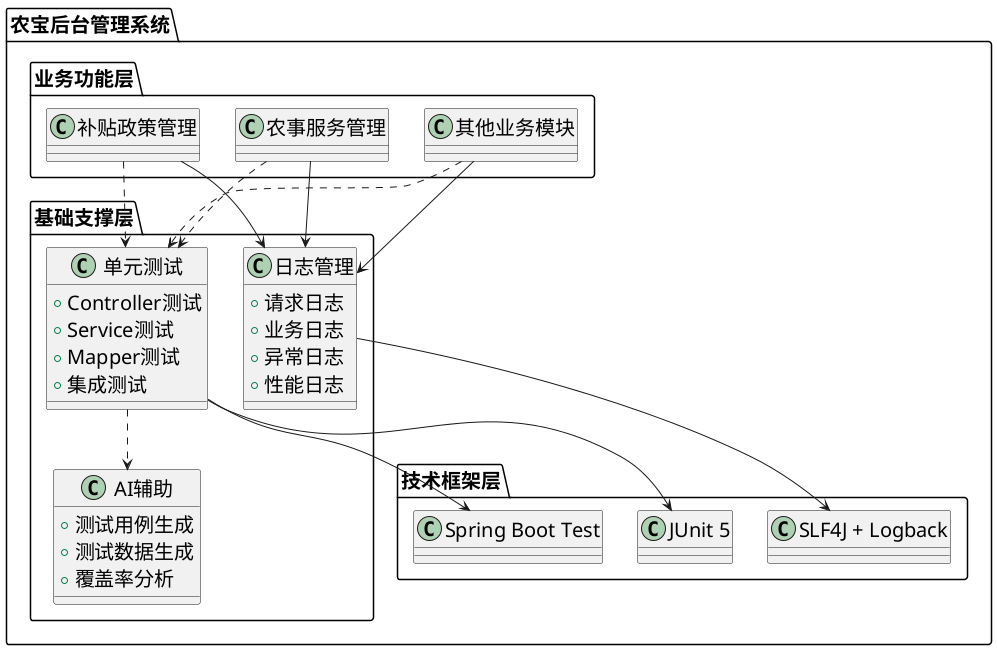
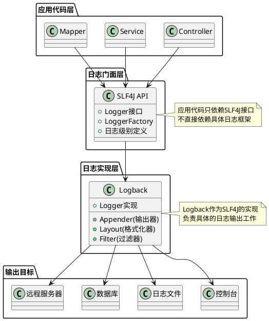
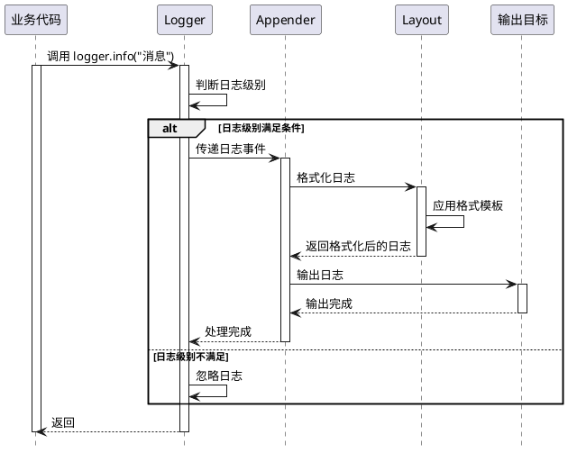
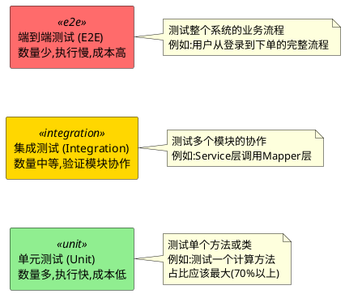
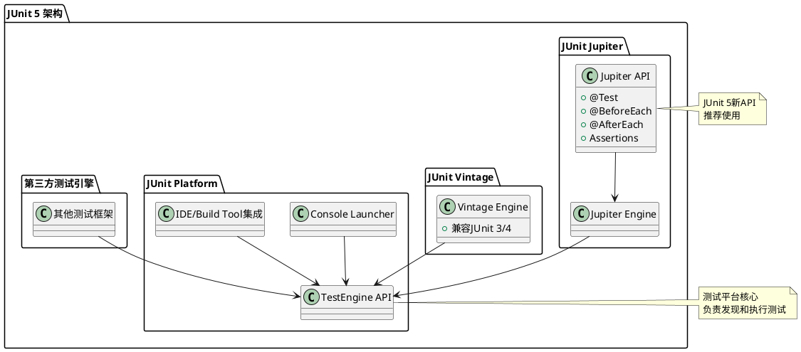
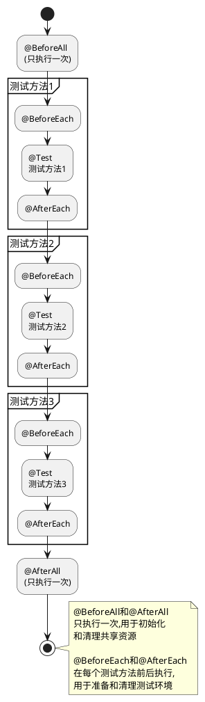
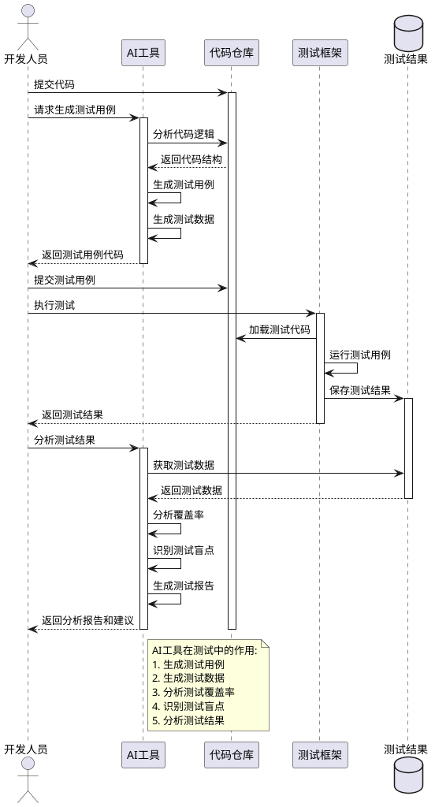
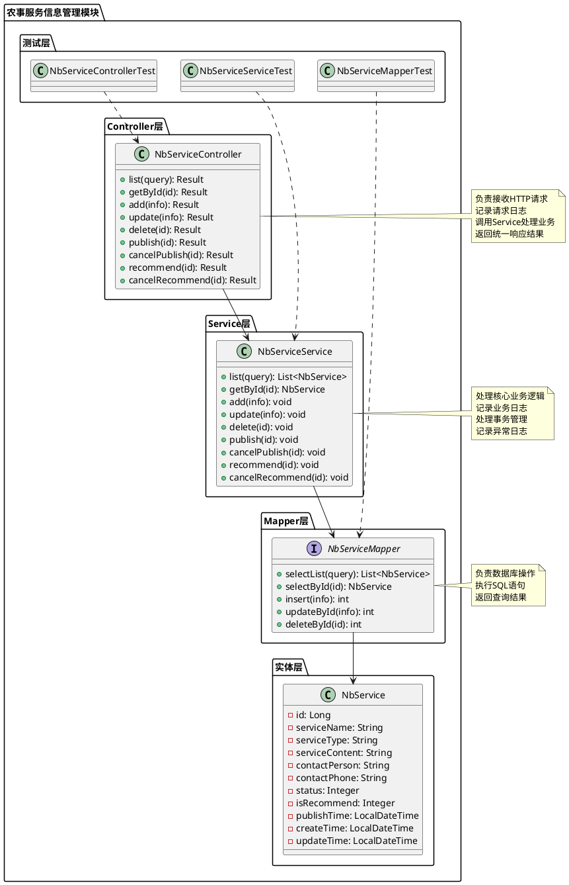
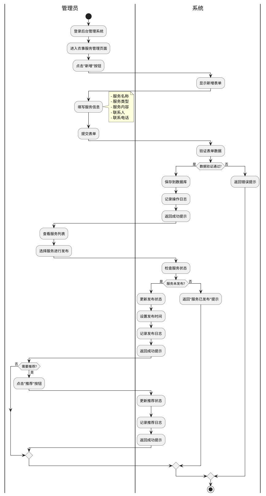
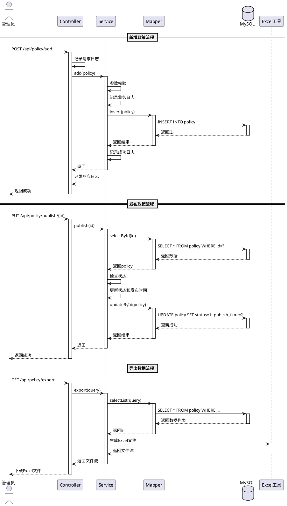

# 项目四 基于SpringBoot实现系统进阶功能

还记得项目一中我们为"农宝"平台做的需求分析吗？经过项目二的SSM框架实践和项目三的Spring Boot知识管理模块开发，系统功能日趋完善。然而，随着平台上线运营，新的挑战接踵而至：

"系统出问题时，我们像无头苍蝇一样找不到原因。能不能让系统'说话'，告诉我们到底发生了什么？"——运维工程师的困惑

"每次改完代码都要手工测一遍所有功能，改一行测半天，这效率实在太低了！"——测试工程师的抱怨

"业务越来越复杂，代码质量谁来保证？出了问题谁负责？我们需要一套可靠的质量保障机制。"——项目经理的担忧

这些来自一线的真实痛点，指向了两个核心问题：**如何让系统运行状态可追踪？如何让代码质量可保证？**

答案就是本项目要学习的**日志管理**和**单元测试**。在这个项目中，我们将一起探索如何通过日志记录让系统"开口说话"，如何通过自动化测试为代码质量"保驾护航"，并学会利用AI工具提升开发效率。让我们开始这段提升系统可维护性和可靠性的进阶之旅。

**【价值思考】质量意识与工程素养**

软件质量不仅体现在功能实现上，更体现在系统的可维护性、可测试性和可靠性上。日志记录能够帮助我们快速定位问题，单元测试能够保障代码质量，这些看似“额外”的工作，实则是专业软件工程师必备的工程素养。在“农宝”项目中，每一条日志记录都可能成为问题排查的关键线索，每一个测试用例都是对代码质量的有力保障。作为软件工程师，我们不仅要关注功能实现，更要关注系统的长期可维护性，这是对用户负责、对团队负责、对自己负责的体现。

## 【项目介绍】

本项目以"农宝"后台管理系统为载体，围绕**日志管理**和**单元测试**两大主题展开学习。我们将一起探索：如何让Spring Boot项目中的日志"说人话"？如何编写让人一看就懂的测试用例？

在整体系统架构中，日志管理和单元测试就像建筑的地基和钢筋——虽然不直接展示给用户，却是系统稳定运行的基石。本项目将以农事服务信息管理和补贴政策管理两个实际模块为例，手把手带你完善日志记录和测试用例，形成"开发-测试-运维"的完整闭环。

本项目的核心内容包括：

1. 日志框架学习与配置：深入学习SLF4J与Logback日志框架，掌握日志级别、日志输出格式、日志文件管理等核心概念，并在Spring Boot项目中进行合理配置。

2. 业务日志实践：在农事服务信息管理模块中，添加关键业务操作的日志记录，包括请求日志、业务日志、异常日志等，形成完整的日志体系。

3. 单元测试框架学习：学习JUnit 5测试框架的核心概念和使用方法，掌握测试用例编写、断言使用、测试覆盖率分析等技能。

4. Spring Boot测试支持：学习Spring Boot提供的测试支持，包括@SpringBootTest、@WebMvcTest、MockMvc等测试工具的使用方法。

5. AI辅助测试：学习如何利用AI工具生成测试用例、识别测试盲点、分析测试覆盖率，提升测试效率与质量。

6. 补贴政策管理模块实现：实现补贴政策的全流程管理功能，包括政策信息的增删改查、发布管理、数据导出等核心功能，并编写完整的单元测试和集成测试。

项目完成后，将产出以下成果：

* 一套完整的日志配置方案，包括日志级别配置、日志输出格式定义、日志文件管理策略等，为系统运维提供有力支撑。
* 两个完整的功能模块实现（农事服务信息管理、补贴政策管理），涵盖增删改查、发布管理、数据导出等核心功能。
* 一套完整的单元测试用例，覆盖Controller层、Service层、Mapper层的核心功能，测试覆盖率达到80%以上。
* 一套AI辅助测试的实践经验，包括测试用例生成、测试数据准备、测试覆盖率分析等，提升测试效率。

学完本项目，你将收获的不仅是日志管理和单元测试的技术技能，更重要的是建立起工程化开发思维：写代码时会想"出了问题怎么排查"，提交代码前会问"测试用例覆盖了吗"。你还将学会利用AI工具提升测试效率，让技术为你所用。这些能力将伴随你的整个职业生涯，让你成为团队中那个"靠谱"的工程师。

系统进阶功能架构如图4-1所示。



图4-1 系统进阶功能架构图

如图4-1所示，系统进阶功能架构分为三层：业务功能层提供具体的业务能力，基础支撑层提供日志管理、单元测试和AI辅助能力，技术框架层提供底层技术支撑。各层之间通过清晰的依赖关系组织，形成完整的技术体系。

## 【学习目标】

### 【知识目标】

* 掌握SLF4J与Logback日志框架的核心概念，理解日志级别、日志输出、日志管理等基本原理
* 理解Spring Boot日志配置方法，掌握logback.xml配置文件的编写规范
* 掌握JUnit 5测试框架的核心概念，理解测试用例、断言、测试生命周期等基本知识
* 理解Spring Boot测试支持机制，掌握@SpringBootTest、MockMvc等测试工具的使用方法
* 了解AI在测试领域的应用，掌握AI辅助测试用例生成、测试数据准备等方法

### 【能力目标】

* 培养日志设计能力，能够在业务代码中合理添加日志记录，形成完整的日志体系
* 建立测试设计能力，能够针对不同层次的代码编写合适的测试用例，保障代码质量
* 掌握测试工具使用能力，能够熟练使用JUnit、MockMvc等测试工具进行单元测试和集成测试
* 提升问题排查能力，能够通过日志快速定位系统问题，提高运维效率
* 培养AI工具应用能力，能够利用AI工具提升测试效率与质量

### 【素质目标】

* 培养质量意识，理解日志和测试对系统质量的重要性，养成良好的工程习惯
* 建立工程化思维，理解软件工程规范的价值，对代码质量负责
* 培养持续学习能力，学会利用新技术（如AI工具）提升工作效率
* 增强责任意识，理解系统可维护性对团队协作的重要性

## 【知识储备】

在正式开始动手实践前，让我们先了解一些必备的基础知识。这些知识就像工具箱里的工具，掌握它们才能更好地完成后续任务。

### 4.1 日志框架SLF4J与Logback

#### 4.1.1 日志框架概述

系统就像一辆行驶中的汽车，日志就是"行车记录仪"——记录系统运行的关键时刻。当系统出问题时，日志告诉我们"事故"发生在哪里、什么时候、为什么发生。

**日志的三大作用：**

- **问题排查**：系统出错时的"侦探线索"
- **性能分析**：了解系统运行效率，找出性能瓶颈
- **业务追踪**：记录用户操作轨迹，了解业务流程

**Java常用日志框架：**

* **SLF4J：**日志门面框架，提供统一API
* **Logback：**日志实现框架，性能优、配置灵活（主流选择）
* **Log4j：**老牌框架，已逐渐被Logback取代

**"SLF4J + Logback"组合优势：**

1. **解耦合：**代码只依赖SLF4J接口，便于切换日志实现
2. **灵活性：**通过配置文件切换日志框架，无需修改代码
3. **高性能：**Logback比Log4j性能提升约10倍
4. **功能丰富：**支持异步日志、文件滚动、日志过滤等

**【价值思考】技术选择背后的责任担当**

为什么选择"SLF4J + Logback"？这不只是技术决策，更体现工程师的责任担当。为团队负责：统一的日志规范降低协作成本，熟悉的接口让同事快速上手，这是对团队的尊重和知识传承的重视。为用户负责：完善的日志让我们快速响应用户问题，当"农宝"平台的农户凌晨遇到问题时，详细日志能帮我们迅速定位解决，技术的温度体现在及时回应。为自己负责：良好的日志习惯是职业素养，今天写下的每条日志可能就是明天排查问题的关键。技术选择承载着我们对质量的承诺、对用户的责任、对团队的贡献，这就是工程师的担当。

SLF4J与Logback的架构关系如图4-2所示。



图4-2 SLF4J与Logback架构关系图

如图4-2所示，应用代码通过SLF4J API进行日志记录，SLF4J将日志请求委托给Logback实现，Logback根据配置将日志输出到不同的目标（控制台、文件、数据库等）。这种分层架构实现了日志接口与实现的解耦，提高了系统的灵活性。

**图4-2解读要点**：
- 应用代码层只依赖SLF4J接口，实现了解耦，便于后续切换日志框架
- Logback作为底层实现，可以灵活配置输出目标（控制台、文件等）
- 这种分层设计体现了软件工程中的"依赖倒置原则"——依赖抽象而非具体实现

#### 4.1.2 日志级别

了解了日志框架的整体架构后，让我们深入学习日志级别——这是控制日志输出的关键机制。

日志级别用于区分日志信息的重要程度，合理使用日志级别可以有效控制日志输出量，便于问题排查。SLF4J定义了以下五个日志级别，按严重程度从低到高排列：

| 日志级别 | 说明 | 使用场景 | 示例 |
|---------|------|---------|------|
| **TRACE** | 追踪级别，最详细的日志信息 | 用于记录程序执行的详细流程，通常用于开发调试阶段 | `logger.trace("进入方法:getUserById,参数:id={}", id);` |
| **DEBUG** | 调试级别，详细的调试信息 | 用于记录程序执行过程中的关键信息，便于开发调试 | `logger.debug("查询数据库:SQL={}", sql);` |
| **INFO** | 信息级别，一般性提示信息 | 用于记录系统运行的关键节点，如系统启动、关键业务操作等 | `logger.info("用户登录成功:username={}", username);` |
| **WARN** | 警告级别，潜在的问题信息 | 用于记录可能导致问题的情况，但不影响系统正常运行 | `logger.warn("缓存未命中,将从数据库查询:key={}", key);` |
| **ERROR** | 错误级别，错误信息 | 用于记录系统错误，需要及时处理 | `logger.error("数据库连接失败", exception);` |

表4-1 日志级别说明表

**日志级别使用建议：**

- **开发环境：**DEBUG或TRACE级别，便于调试
- **测试环境：**INFO级别，记录关键操作
- **生产环境：**WARN或ERROR级别，减少日志量
- **核心模块：**可单独配置更详细级别

💡 **实战技巧**：日志级别具有层级关系，设置为INFO时会输出INFO、WARN、ERROR三个级别的日志，而DEBUG和TRACE不会输出。这就像一个过滤器，级别越高过滤越严格。

#### 4.1.3 Logback核心组件

Logback由三个核心组件构成：**Logger（记录器）、Appender（输出器）、Layout（格式化器）**。

**1. Logger声明方式：**

```java
import org.slf4j.Logger;
import org.slf4j.LoggerFactory;

public class UserService {
    private static final Logger logger = LoggerFactory.getLogger(UserService.class);
    
    public void login(String username) {
        logger.info("用户登录:username={}", username);
    }
}
```

**2. 常用Appender：**

| Appender类型 | 说明 | 使用场景 |
|-------------|------|---------|
| **ConsoleAppender** | 输出到控制台 | 开发调试 |
| **RollingFileAppender** | 输出到文件，支持滚动 | 生产环境 |

表4-2 Logback常用Appender类型

**3. 常用格式化占位符：**

| 占位符 | 说明 | 示例 |
|-------|------|------|
| **%d{pattern}** | 日期时间 | 2024-01-15 10:30:45.123 |
| **%thread** | 线程名 | http-nio-8080-exec-1 |
| **%level** | 日志级别 | INFO |
| **%logger{length}** | Logger名称 | org.nong.service.NbServiceService |
| **%msg** | 日志消息 | 用户登录成功 |
| **%ex** | 异常堆栈 | java.lang.NullPointerException... |

表4-3 Logback常用格式化占位符

Logback核心组件协作流程如图4-3所示。



图4-3 Logback核心组件协作流程图

如图4-3所示，当业务代码调用Logger记录日志时，Logger首先判断日志级别是否满足条件，如果满足则将日志事件传递给Appender，Appender调用Layout格式化日志内容，最后将格式化后的日志输出到目标位置。

#### 4.1.4 Logback配置文件

Logback通过XML配置文件进行配置，在"农宝"项目中使用`logback.xml`作为配置文件名（位于`src/main/resources`目录下）。`logback.xml`是Logback的标准配置文件，Spring Boot会自动识别并加载该配置文件。如果项目需要根据不同环境（开发、测试、生产）使用不同的日志配置，可以使用`logback-spring.xml`并配合Spring Boot的Profile功能；对于"农宝"项目，使用标准的`logback.xml`即可满足需求。

一个典型的Logback配置文件结构如下：

```xml
<?xml version="1.0" encoding="UTF-8"?>
<configuration>
    <!-- 属性定义 -->
    <property name="LOG_HOME" value="./logs"/>
    <property name="APP_NAME" value="nbspring"/>
    
    <!-- 控制台输出配置 -->
    <appender name="CONSOLE" class="ch.qos.logback.core.ConsoleAppender">
        <encoder>
            <pattern>%d{yyyy-MM-dd HH:mm:ss.SSS} [%thread] %-5level %logger{50} - %msg%n</pattern>
            <charset>UTF-8</charset>
        </encoder>
    </appender>
    
    <!-- 文件输出配置 -->
    <appender name="FILE" class="ch.qos.logback.core.rolling.RollingFileAppender">
        <file>${LOG_HOME}/${APP_NAME}.log</file>
        <rollingPolicy class="ch.qos.logback.core.rolling.TimeBasedRollingPolicy">
            <fileNamePattern>${LOG_HOME}/${APP_NAME}.%d{yyyy-MM-dd}.%i.log</fileNamePattern>
            <timeBasedFileNamingAndTriggeringPolicy 
                class="ch.qos.logback.core.rolling.SizeAndTimeBasedFNATP">
                <maxFileSize>100MB</maxFileSize>
            </timeBasedFileNamingAndTriggeringPolicy>
            <maxHistory>30</maxHistory>
        </rollingPolicy>
        <encoder>
            <pattern>%d{yyyy-MM-dd HH:mm:ss.SSS} [%thread] %-5level %logger{50} - %msg%n</pattern>
            <charset>UTF-8</charset>
        </encoder>
    </appender>
    
    <!-- 根Logger配置 -->
    <root level="INFO">
        <appender-ref ref="CONSOLE"/>
        <appender-ref ref="FILE"/>
    </root>
    
    <!-- 特定包的日志级别配置 -->
    <logger name="org.nong" level="DEBUG"/>
</configuration>
```

**配置文件关键元素说明:**

1. **`<property>`：**定义属性变量，可以在配置文件中复用，如日志文件路径、应用名称等。

2. **`<appender>`：**定义日志输出器，指定日志输出目标和格式。
   - `name`：Appender的唯一标识
   - `class`：Appender的实现类

3. **`<encoder>`：**定义日志格式化器，指定日志输出格式。
   - `<pattern>`：日志格式模板
   - `<charset>`：字符编码

4. **`<rollingPolicy>`：**定义日志文件滚动策略，防止单个日志文件过大。
   - `<fileNamePattern>`：滚动文件命名模式
   - `<maxFileSize>`：单个文件最大大小
   - `<maxHistory>`：保留的历史文件数量

5. **`<root>`：**根Logger配置，所有Logger的默认配置。
   - `level`：日志级别
   - `<appender-ref>`：引用的Appender

6. **`<logger>`：**特定包或类的Logger配置，可以覆盖根Logger的配置。
   - `name`：包名或类名
   - `level`：日志级别

### 4.2 Spring Boot日志配置与输出

掌握了日志框架的核心概念后，让我们看看如何在Spring Boot项目中实际应用这些知识。Spring Boot为我们提供了开箱即用的日志配置，但要满足"农宝"项目的实际需求，我们还需要进行一些定制化配置。

#### 4.2.1 Spring Boot默认日志配置

Spring Boot默认使用SLF4J + Logback，无需额外配置。默认配置：根Logger级别INFO，输出到控制台。

实际项目通常需要自定义配置：输出到文件、不同环境不同级别、日志文件滚动等。

#### 4.2.2 logback.xml配置

在`src/main/resources`目录下创建`logback.xml`：

```xml
<?xml version="1.0" encoding="UTF-8"?>
<configuration>
    
    <!-- 控制台输出 -->
    <appender name="CONSOLE" class="ch.qos.logback.core.ConsoleAppender">
        <encoder>
            <pattern>%d{yyyy-MM-dd HH:mm:ss.SSS} [%thread] %-5level %logger{50} - %msg%n</pattern>
            <charset>UTF-8</charset>
        </encoder>
    </appender>
    
    <!-- 文件输出 -->
    <appender name="FILE" class="ch.qos.logback.core.rolling.RollingFileAppender">
        <file>logs/springproduct.log</file>
        <rollingPolicy class="ch.qos.logback.core.rolling.TimeBasedRollingPolicy">
            <fileNamePattern>logs/springproduct.%d{yyyy-MM-dd}.log</fileNamePattern>
            <maxHistory>30</maxHistory>
        </rollingPolicy>
        <encoder>
            <pattern>%d{yyyy-MM-dd HH:mm:ss.SSS} [%thread] %-5level %logger{50} - %msg%n</pattern>
            <charset>UTF-8</charset>
        </encoder>
    </appender>
    
    <!-- MyBatis日志 -->
    <logger name="org.nong.mapper" level="DEBUG"/>
    <logger name="java.sql" level="DEBUG"/>
    <logger name="org.mybatis" level="DEBUG"/>

    <!-- Spring日志 -->
    <logger name="org.springframework" level="INFO"/>

    <!-- 根日志级别 -->
    <root level="INFO">
        <appender-ref ref="CONSOLE"/>
        <appender-ref ref="FILE"/>
    </root>
    
</configuration>
```

**配置要点：**

1. 双输出：控制台+文件，开发调试和生产运维兼顾
2. 日志滚动：按日期滚动，保留30天，防止文件过大
3. MyBatis日志：DEBUG级别，查看SQL语句和参数
4. Spring日志：INFO级别，减少框架日志，突出业务日志

#### 4.2.3 业务代码中的日志使用

在业务代码中使用日志时，需要遵循以下最佳实践：

**1. Logger声明**

```java
import org.slf4j.Logger;
import org.slf4j.LoggerFactory;

@Service
public class NbServiceService {
    // 使用类名作为Logger名称
    private static final Logger logger = LoggerFactory.getLogger(NbServiceService.class);
    
    // 或者使用Lombok的@Slf4j注解自动生成logger字段
    // @Slf4j
}
```

**2. 不同场景的日志记录**

```java
@Service
public class NbServiceService {
    private static final Logger logger = LoggerFactory.getLogger(NbServiceService.class);
    
    public List<NbService> list(NbServiceQuery query) {
        logger.info("查询农事服务列表,查询条件:{}", query);  // INFO:关键业务操作
        
        try {
            List<NbService> list = mapper.selectList(query);
            logger.debug("查询到{}条记录", list.size());  // DEBUG:详细执行过程
            return list;
        } catch (Exception e) {
            logger.error("查询失败,查询条件:{}", query, e);  // ERROR:异常信息
            throw new BusinessException("查询失败", e);
        }
    }
    
    @Transactional
    public void add(NbService info) {
        logger.info("新增农事服务,服务名称:{}", info.getServiceName());
        
        if (StringUtils.isBlank(info.getServiceName())) {
            logger.warn("新增失败:服务名称不能为空");  // WARN:潜在问题
            throw new BusinessException("服务名称不能为空");
        }
        
        try {
            mapper.insert(info);
            logger.info("新增成功,ID:{}", info.getId());
        } catch (Exception e) {
            logger.error("新增失败", e);
            throw new BusinessException("新增失败", e);
        }
    }
}
```

**3. 日志记录最佳实践**

| 实践原则 | 说明 | 示例 |
|---------|------|------|
| **使用占位符** | 使用`{}`占位符而不是字符串拼接,提高性能 | `logger.info("用户ID:{}", userId)` ✓<br>`logger.info("用户ID:" + userId)` ✗ |
| **记录关键信息** | 记录方法入口、关键业务节点、异常信息 | 方法开始、数据库操作、外部调用、异常捕获 |
| **避免敏感信息** | 不要记录密码、身份证号等敏感信息 | 记录用户名✓,记录密码✗ |
| **异常日志** | 记录异常时传入异常对象,输出完整堆栈 | `logger.error("操作失败", e)` ✓ |
| **合理使用级别** | 根据日志重要程度选择合适的日志级别 | 业务操作用INFO,调试信息用DEBUG,异常用ERROR |
| **避免过度日志** | 不要在循环中记录大量日志,影响性能 | 循环外记录总数✓,循环内每条记录✗ |

表4-4 日志记录最佳实践

💡 **实战技巧**：
- 在生产环境中，建议将根日志级别设置为WARN，并为核心业务模块单独配置DEBUG级别。这样既能减少日志量，又不会遗漏关键信息。
- 使用占位符`{}`而不是字符串拼接，SLF4J只有在日志级别满足条件时才会格式化字符串，大幅提升性能。

⚠️ **常见陷阱**：
- 避免在循环中使用`logger.info()`，这会产生大量日志，严重影响性能。应该在循环外记录汇总信息。
- 不要记录敏感信息（密码、身份证号等），避免信息泄露风险。
- 异常日志必须传入异常对象`e`，否则无法输出完整堆栈信息，问题排查会很困难。

通过合理的日志配置和规范的日志记录，可以有效提升系统的可维护性。

---

**小结**：掌握了日志管理的核心知识后，我们已经能够让系统"开口说话"了。接下来，让我们学习另一个保障代码质量的利器——单元测试。

### 4.3 单元测试核心概念与JUnit框架

#### 4.3.1 单元测试概述

单元测试是软件测试的基础，指对软件中的最小可测试单元进行检查和验证。在面向对象编程中，最小单元通常是方法或类。单元测试的核心目标是验证每个单元的功能是否符合预期，及早发现代码缺陷，保障代码质量。

**单元测试的价值：**

1. **及早发现缺陷：**在开发阶段就发现问题，修复成本远低于生产环境。
2. **保障代码质量：**通过测试用例约束代码行为，确保代码符合预期。
3. **支持重构：**有完善的测试用例，重构代码时可以快速验证功能是否正常。
4. **文档作用：**测试用例展示了代码的使用方式和预期行为，是活文档。
5. **提高信心：**有测试保障，开发人员修改代码时更有信心。

**单元测试的特点：**

* **独立性：**每个测试用例应该独立运行，不依赖其他测试用例。
* **可重复：**多次运行同一测试用例应该得到相同的结果。
* **快速：**单元测试应该快速执行，通常在毫秒级别。
* **自动化：**测试应该自动执行，无需人工干预。

软件测试金字塔如图4-4所示。



图4-4 软件测试金字塔

如图4-4所示，软件测试金字塔展示了不同层次测试的数量和成本关系。单元测试位于金字塔底部，数量最多、执行最快、成本最低，应该占测试用例的70%以上；集成测试位于中间，验证模块间的协作；端到端测试位于顶部，数量最少但成本最高，验证完整的业务流程。

**【价值思考】从测试金字塔看工匠精神**

测试金字塔和建筑工程的道理一样——基础要牢固，结构要合理，这与"慢工出细活"、"基础不牢，地动山摇"的传统智慧不谋而合。以"农宝"项目为例：单元测试是地基，70%的测试用例打磨每个功能，就像农民精耕细作每块田地；集成测试是框架，验证模块协作，像榫卯结构严丝合缝；端到端测试是验收，站在用户角度检验，确保农民用得顺手。编写测试的过程就是培养"精益求精"的过程，每个测试场景都是对代码质量的承诺。真正的效率不是快速完成，而是一次做对、减少返工。这份工匠精神适用于任何工作——用心雕琢细节，追求卓越品质。

#### 4.3.2 JUnit 5框架

JUnit是Java生态中最流行的单元测试框架，JUnit 5是其最新版本，相比JUnit 4有了重大改进。Spring Boot 2.2+默认集成JUnit 5，无需额外配置。

**JUnit 5架构**

JUnit 5由三个模块组成：

1. **JUnit Platform：**测试平台，负责在JVM上启动测试框架。
2. **JUnit Jupiter：**新的编程模型和扩展模型，提供新的注解和API。
3. **JUnit Vintage：**兼容JUnit 3和JUnit 4的测试引擎。

JUnit 5架构如图4-5所示。



图4-5 JUnit 5架构图

**图4-6解读要点**：
- JUnit Platform是测试平台核心，负责发现和执行测试
- JUnit Jupiter提供了新的API（推荐使用），包括@Test、@BeforeEach等注解
- JUnit Vintage用于兼容老版本测试代码，保证平滑升级

#### 4.3.3 JUnit 5常用注解

JUnit 5提供了丰富的注解来组织和执行测试用例：

| 注解 | 说明 | 使用场景 |
|-----|------|---------|
| **@Test** | 标记测试方法 | 标记一个方法为测试方法 |
| **@BeforeEach** | 每个测试方法执行前执行 | 初始化测试数据 |
| **@AfterEach** | 每个测试方法执行后执行 | 清理测试数据 |
| **@BeforeAll** | 所有测试方法执行前执行一次 | 初始化共享资源(必须是static方法) |
| **@AfterAll** | 所有测试方法执行后执行一次 | 释放共享资源(必须是static方法) |
| **@DisplayName** | 为测试类或方法指定显示名称 | 提供更易读的测试名称 |
| **@Disabled** | 禁用测试方法或测试类 | 临时跳过某些测试 |
| **@ParameterizedTest** | 参数化测试 | 使用不同参数多次执行同一测试 |
| **@RepeatedTest** | 重复测试 | 重复执行测试方法指定次数 |
| **@Timeout** | 设置测试超时时间 | 防止测试方法执行时间过长 |

表4-5 JUnit 5常用注解

测试方法执行顺序如图4-6所示。



图4-6 JUnit 5测试方法执行顺序

如图4-6所示，JUnit 5测试方法的执行顺序是：首先执行@BeforeAll标记的方法（只执行一次），然后对每个@Test方法，依次执行@BeforeEach、@Test、@AfterEach，最后执行@AfterAll标记的方法（只执行一次）。

💡 **实战技巧**：
- @BeforeAll和@AfterAll必须是static方法，用于初始化和清理共享资源（如数据库连接）
- @BeforeEach和@AfterEach在每个测试方法前后执行，用于准备和清理测试环境，确保测试独立性

#### 4.3.4 断言(Assertions)

断言是单元测试的核心，用于验证测试结果是否符合预期。JUnit 5提供了丰富的断言方法：

| 断言方法 | 说明 | 示例 |
|---------|------|------|
| **assertEquals(expected, actual)** | 验证两个值相等 | `assertEquals(5, result)` |
| **assertNotEquals(unexpected, actual)** | 验证两个值不相等 | `assertNotEquals(0, result)` |
| **assertTrue(condition)** | 验证条件为真 | `assertTrue(list.isEmpty())` |
| **assertFalse(condition)** | 验证条件为假 | `assertFalse(list.isEmpty())` |
| **assertNull(object)** | 验证对象为null | `assertNull(result)` |
| **assertNotNull(object)** | 验证对象不为null | `assertNotNull(result)` |
| **assertThrows(exception, executable)** | 验证抛出指定异常 | `assertThrows(Exception.class, () -> method())` |
| **assertTimeout(duration, executable)** | 验证执行时间不超过指定时长 | `assertTimeout(Duration.ofSeconds(1), () -> method())` |
| **assertAll(executables...)** | 组合多个断言,全部执行 | `assertAll(() -> assertEquals(...), () -> assertTrue(...))` |

表4-6 JUnit 5常用断言方法

**断言使用示例：**

```java
import org.junit.jupiter.api.Test;
import static org.junit.jupiter.api.Assertions.*;

class CalculatorTest {
    
    @Test
    void testAdd() {
        Calculator calculator = new Calculator();
        
        // 基本断言
        assertEquals(5, calculator.add(2, 3), "2 + 3 应该等于 5");
        
        // 断言不相等
        assertNotEquals(6, calculator.add(2, 3));
        
        // 断言条件
        assertTrue(calculator.add(2, 3) > 0);
        assertFalse(calculator.add(2, 3) < 0);
    }
    
    @Test
    void testDivide() {
        Calculator calculator = new Calculator();
        
        // 断言抛出异常
        assertThrows(ArithmeticException.class, () -> {
            calculator.divide(10, 0);
        }, "除数为0应该抛出ArithmeticException");
    }
    
    @Test
    void testMultipleAssertions() {
        Calculator calculator = new Calculator();
        
        // 组合断言：即使某个断言失败，其他断言也会执行
        assertAll("calculator",
            () -> assertEquals(5, calculator.add(2, 3)),
            () -> assertEquals(1, calculator.subtract(3, 2)),
            () -> assertEquals(6, calculator.multiply(2, 3)),
            () -> assertEquals(2, calculator.divide(6, 3))
        );
    }
    
    @Test
    void testPerformance() {
        Calculator calculator = new Calculator();
        
        // 断言执行时间
        assertTimeout(Duration.ofMillis(100), () -> {
            calculator.complexCalculation();
        }, "复杂计算应该在100ms内完成");
    }
}
```

#### 4.3.5 测试用例编写规范

**1. 命名规范**
* 测试类：`被测试类名 + Test`，如`UserServiceTest`
* 测试方法：`test + 方法名 + 场景`，如`testAddUser_Success`
* 使用@DisplayName提供易读名称

**2. AAA模式**

```java
@Test
void testAddUser() {
    // Arrange:准备数据
    User user = new User("test", "123456");
    
    // Act:执行方法
    userService.addUser(user);
    
    // Assert:验证结果
    assertNotNull(user.getId());
}
```

**3. 测试覆盖**

一个方法需要多个测试用例：
* **正常场景：**测试正常输入和输出
* **边界场景：**测试边界值（0、负数、最大值等）
* **异常场景：**测试异常输入和处理

### 4.4 Spring Boot单元测试支持

#### 4.4.1 Spring Boot测试依赖

Spring Boot提供了`spring-boot-starter-test`依赖，集成了常用的测试框架和工具：

```xml
<dependency>
    <groupId>org.springframework.boot</groupId>
    <artifactId>spring-boot-starter-test</artifactId>
    <scope>test</scope>
</dependency>
```

该依赖包含以下测试框架:

* **JUnit 5:**单元测试框架
* **Spring Test:**Spring测试支持
* **AssertJ:**流式断言库
* **Hamcrest:**匹配器库
* **Mockito:**Mock框架
* **JSONassert:**JSON断言库
* **JsonPath:**JSON路径表达式

#### 4.4.2 @SpringBootTest注解

`@SpringBootTest`是Spring Boot提供的测试注解，用于加载完整的Spring应用上下文，支持依赖注入和Spring功能。

```java
import org.junit.jupiter.api.Test;
import org.springframework.beans.factory.annotation.Autowired;
import org.springframework.boot.test.context.SpringBootTest;

@SpringBootTest
class NbServiceServiceTest {
    
    @Autowired
    private NbServiceService service;
    
    @Test
    void testList() {
        List<NbService> list = service.list(new NbServiceQuery());
        assertNotNull(list);
    }
}
```

**@SpringBootTest属性：**

* `webEnvironment`：指定Web环境类型
  - `MOCK`（默认）：加载WebApplicationContext，提供Mock的Servlet环境
  - `RANDOM_PORT`：加载WebServerApplicationContext，启动内嵌服务器，使用随机端口
  - `DEFINED_PORT`：加载WebServerApplicationContext，启动内嵌服务器，使用配置的端口
  - `NONE`：加载ApplicationContext，不提供Web环境

* `classes`：指定要加载的配置类，默认加载@SpringBootApplication标记的主类

* `properties`：添加测试属性配置

```java
@SpringBootTest(
    webEnvironment = SpringBootTest.WebEnvironment.RANDOM_PORT,
    properties = {
        "spring.datasource.url=jdbc:h2:mem:testdb",
        "logging.level.org.nong=DEBUG"
    }
)
class IntegrationTest {
    // 集成测试
}
```

#### 4.4.3 MockMvc测试Controller层

MockMvc是Spring Test提供的测试工具，用于测试Controller层，无需启动完整的HTTP服务器。

```java
import org.junit.jupiter.api.Test;
import org.springframework.beans.factory.annotation.Autowired;
import org.springframework.boot.test.autoconfigure.web.servlet.AutoConfigureMockMvc;
import org.springframework.boot.test.context.SpringBootTest;
import org.springframework.test.web.servlet.MockMvc;

import static org.springframework.test.web.servlet.request.MockMvcRequestBuilders.*;
import static org.springframework.test.web.servlet.result.MockMvcResultMatchers.*;
import static org.springframework.test.web.servlet.result.MockMvcResultHandlers.*;

@SpringBootTest
@AutoConfigureMockMvc
class NbServiceControllerTest {
    
    @Autowired
    private MockMvc mockMvc;
    
    @Test
    @DisplayName("测试查询农事服务列表")
    void testList() throws Exception {
        mockMvc.perform(get("/api/farm-service/list")
                .param("pageNum", "1")
                .param("pageSize", "10"))
            .andExpect(status().isOk())
            .andExpect(jsonPath("$.code").value(200))
            .andExpect(jsonPath("$.data").isArray())
            .andDo(print());
    }
    
    @Test
    @DisplayName("测试新增农事服务")
    void testAdd() throws Exception {
        String json = "{\"title\":\"测试服务\",\"category\":\"tech\"}";
        
        mockMvc.perform(post("/api/farm-service/add")
                .contentType(MediaType.APPLICATION_JSON)
                .content(json))
            .andExpect(status().isOk())
            .andExpect(jsonPath("$.code").value(200))
            .andDo(print());
    }
}
```

**MockMvc常用方法：**

| 方法 | 说明 |
|-----|------|
| **perform(request)** | 执行HTTP请求 |
| **andExpect(matcher)** | 添加结果断言 |
| **andDo(handler)** | 添加结果处理器 |
| **andReturn()** | 返回MvcResult对象 |

**MockMvcRequestBuilders常用方法：**

| 方法 | 说明 |
|-----|------|
| **get(url)** | 构建GET请求 |
| **post(url)** | 构建POST请求 |
| **put(url)** | 构建PUT请求 |
| **delete(url)** | 构建DELETE请求 |
| **param(name, value)** | 添加请求参数 |
| **content(content)** | 设置请求体内容 |
| **contentType(mediaType)** | 设置Content-Type |

**MockMvcResultMatchers常用方法：**

| 方法 | 说明 |
|-----|------|
| **status()** | 验证HTTP状态码 |
| **jsonPath(expression)** | 验证JSON响应内容 |
| **content()** | 验证响应内容 |
| **header()** | 验证响应头 |

表4-7 MockMvc常用方法

#### 4.4.4 @MockBean和@SpyBean

在单元测试中，我们通常不希望依赖真实的数据库或外部服务，可以使用Mock对象模拟依赖。

**@MockBean：**创建Mock对象并注入到Spring容器中，替换真实的Bean。

```java
@SpringBootTest
class NbServiceServiceTest {
    
    @Autowired
    private NbServiceService service;
    
    @MockBean
    private NbServiceMapper mapper;
    
    @Test
    void testList() {
        // 模拟Mapper返回数据
        List<NbService> mockData = Arrays.asList(
            new NbService(1L, "服务1"),
            new NbService(2L, "服务2")
        );
        when(mapper.selectList(any())).thenReturn(mockData);
        
        // 执行测试
        List<NbService> result = service.list(new NbServiceQuery());
        
        // 验证结果
        assertEquals(2, result.size());
        verify(mapper, times(1)).selectList(any());
    }
}
```

**@SpyBean：**创建Spy对象，可以部分Mock，保留真实对象的部分功能。

```java
@SpringBootTest
class NbServiceServiceTest {
    
    @Autowired
    private NbServiceService service;
    
    @SpyBean
    private NbServiceMapper mapper;
    
    @Test
    void testAdd() {
        // 使用真实的Mapper方法,但可以验证调用
        NbService info = new NbService();
        info.setServiceName("测试服务");
        
        service.add(info);
        
        // 验证Mapper方法被调用
        verify(mapper, times(1)).insert(any());
    }
}
```

**Mockito常用方法：**

| 方法 | 说明 | 示例 |
|-----|------|------|
| **when(method).thenReturn(value)** | 模拟方法返回值 | `when(mapper.selectById(1L)).thenReturn(user)` |
| **when(method).thenThrow(exception)** | 模拟方法抛出异常 | `when(mapper.insert(any())).thenThrow(new RuntimeException())` |
| **verify(mock, times(n)).method()** | 验证方法调用次数 | `verify(mapper, times(1)).insert(any())` |
| **any()** | 匹配任意参数 | `when(mapper.selectList(any())).thenReturn(list)` |
| **eq(value)** | 匹配指定值 | `when(mapper.selectById(eq(1L))).thenReturn(user)` |

表4-8 Mockito常用方法

💡 实战技巧：

- 使用`@MockBean`可以避免启动真实的数据库连接，大幅提升测试速度
- Mock对象只模拟你关心的行为，其他方法调用会返回默认值（如null、0等）
- 使用`verify()`验证方法是否被调用，确保业务逻辑正确执行

⚠️ 常见陷阱：
- 忘记配置Mock对象的返回值，导致测试中获取到null引发空指针异常
- 过度使用Mock，导致测试代码比业务代码还复杂，失去了测试的意义
- Mock对象只在当前测试类生效，不要期望它影响其他测试类

#### 4.4.5 测试数据准备

**方式1：使用@BeforeEach准备**

```java
@SpringBootTest
class NbServiceServiceTest {
    @BeforeEach
    void setUp() {
        // 清空并准备测试数据
        mapper.delete(new QueryWrapper<>());
        mapper.insert(new NbService("服务1"));
    }
}
```

**方式2：使用测试数据构建器**

```java
class NbServiceTestDataBuilder {
    public static NbService buildDefault() {
        NbService info = new NbService();
        info.setServiceName("测试服务");
        info.setServiceType("技术指导");
        return info;
    }
}
```

### 4.5 AI驱动的测试策略与自动化测试

#### 4.5.1 AI在测试中的应用场景

随着AI技术的发展，AI工具在软件测试领域的应用越来越广泛。在"农宝"项目中，我们可以利用AI工具提升测试效率与质量：

**1. 测试用例生成**

AI可以根据代码逻辑自动生成测试用例,覆盖各种场景:

* 分析方法签名和业务逻辑,生成正常场景测试用例
* 识别边界条件,生成边界场景测试用例
* 分析异常处理逻辑,生成异常场景测试用例

**2. 测试数据生成**

AI可以根据数据模型自动生成测试数据:

* 生成符合数据类型和约束的测试数据
* 生成边界值测试数据(最大值、最小值、空值等)
* 生成大量随机测试数据用于压力测试

**3. 测试覆盖率分析**

AI可以分析代码和测试用例,识别测试盲点:

* 分析哪些代码分支没有被测试覆盖
* 识别哪些业务场景缺少测试用例
* 提供测试用例补充建议

**4. 测试结果分析**

AI可以分析测试结果,快速定位问题:

* 分析测试失败原因,提供修复建议
* 识别测试用例中的问题(如断言错误、测试数据问题等)
* 生成测试报告和分析图表

AI辅助测试流程如图4-7所示。



图4-7 AI辅助测试流程图

如图4-7所示，AI工具贯穿整个测试流程：从测试用例生成、测试数据准备，到测试执行、结果分析，AI都可以提供有力支持，大幅提升测试效率。

#### 4.5.2 使用AI生成测试用例

**向AI提供代码上下文：**

```
我有一个INbServiceService接口,包含以下方法:
1. selectList():查询列表（分页）
2. selectById():查询详情
3. insert():新增
4. deleteById():删除

请生成单元测试用例,要求:
1. 使用JUnit 5和Mockito
2. 覆盖正常、边界、异常场景
3. 使用@MockBean模拟Mapper
4. 使用@DisplayName提供描述
```

**AI生成的测试代码：**

```java
@SpringBootTest
@DisplayName("农事服务信息Service测试")
class NbServiceServiceTest {
    
    @Autowired
    private NbServiceService service;
    
    @MockBean
    private NbServiceMapper mapper;
    
    @Nested
    @DisplayName("查询列表测试")
    class ListTest {
        
        @Test
        @DisplayName("查询列表-正常场景")
        void testList_Success() {
            // Arrange
            NbServiceQuery query = new NbServiceQuery();
            query.setPageNum(1);
            query.setPageSize(10);
            
            List<NbService> mockData = Arrays.asList(
                createMockService(1L, "服务1"),
                createMockService(2L, "服务2")
            );
            when(mapper.selectList(any())).thenReturn(mockData);
            
            // Act
            List<NbService> result = service.list(query);
            
            // Assert
            assertNotNull(result);
            assertEquals(2, result.size());
            verify(mapper, times(1)).selectList(any());
        }
        
        @Test
        @DisplayName("查询列表-空结果")
        void testList_EmptyResult() {
            // Arrange
            when(mapper.selectList(any())).thenReturn(Collections.emptyList());
            
            // Act
            List<NbService> result = service.list(new NbServiceQuery());
            
            // Assert
            assertNotNull(result);
            assertTrue(result.isEmpty());
        }
        
        @Test
        @DisplayName("查询列表-数据库异常")
        void testList_DatabaseException() {
            // Arrange
            when(mapper.selectList(any())).thenThrow(new RuntimeException("数据库连接失败"));
            
            // Act & Assert
            assertThrows(BusinessException.class, () -> {
                service.list(new NbServiceQuery());
            });
        }
    }
    
    @Nested
    @DisplayName("新增测试")
    class AddTest {
        
        @Test
        @DisplayName("新增农事服务-正常场景")
        void testAdd_Success() {
            // Arrange
            NbService info = createMockService(null, "新服务");
            when(mapper.insert(any())).thenReturn(1);
            
            // Act
            service.add(info);
            
            // Assert
            verify(mapper, times(1)).insert(any());
        }
        
        @Test
        @DisplayName("新增农事服务-服务名称为空")
        void testAdd_EmptyName() {
            // Arrange
            NbService info = createMockService(null, "");
            
            // Act & Assert
            BusinessException exception = assertThrows(BusinessException.class, () -> {
                service.add(info);
            });
            assertEquals("服务名称不能为空", exception.getMessage());
        }
        
        @Test
        @DisplayName("新增农事服务-服务名称重复")
        void testAdd_DuplicateName() {
            // Arrange
            NbService info = createMockService(null, "重复服务");
            when(mapper.insert(any())).thenThrow(new DuplicateKeyException("服务名称已存在"));
            
            // Act & Assert
            BusinessException exception = assertThrows(BusinessException.class, () -> {
                service.add(info);
            });
            assertTrue(exception.getMessage().contains("已存在"));
        }
    }
    
    @Nested
    @DisplayName("删除测试")
    class DeleteTest {
        
        @Test
        @DisplayName("删除农事服务-正常场景")
        void testDelete_Success() {
            // Arrange
            String id = "1";
            when(mapper.selectById(id)).thenReturn(createMockService(id, "服务1"));
            when(mapper.deleteById(id)).thenReturn(1);
            
            // Act
            int rows = service.deleteById(id);
            
            // Assert
            assertEquals(1, rows);
            verify(mapper, times(1)).deleteById(id);
        }
        
        @Test
        @DisplayName("删除农事服务-服务不存在")
        void testDelete_NotFound() {
            // Arrange
            String id = "999";
            when(mapper.selectById(id)).thenReturn(null);
            
            // Act & Assert
            assertThrows(IllegalArgumentException.class, () -> {
                service.deleteById(id);
            });
        }
    }
    
    // 辅助方法
    private NbService createMockService(String id, String title) {
        NbService service = new NbService();
        service.setId(id);
        service.setTitle(title);
        service.setCategory("tech");
        service.setContent("测试内容");
        return service;
    }
}
```

**步骤3:审查和优化测试用例**

AI生成的测试用例需要人工审查和优化:

* 检查测试场景是否完整
* 验证断言是否正确
* 补充业务相关的特殊场景
* 优化测试数据和Mock配置

#### 4.5.3 AI辅助测试数据生成

**向AI描述需求：**
```
请为NbService生成测试数据:
1. 10条正常数据(不同服务类型)
2. 5条边界数据(最长/最短名称、特殊字符)
3. 3条异常数据(null值、空字符串)
```

**AI生成的代码：**

```java
public class NbServiceTestData {
    public static List<NbService> generateNormalData() {
        return Arrays.asList(
            createService("农机维修服务", "技术指导"),
            createService("病虫害防治", "技术指导"),
            // ... 更多数据
        );
    }
    
    public static List<NbService> generateBoundaryData() {
        return Arrays.asList(
            createService("服", "技术指导"),  // 最短
            createService("A".repeat(100), "技术指导"),  // 最长
            createService("服务@#$%", "技术指导")  // 特殊字符
        );
    }
    
    public static List<NbService> generateAbnormalData() {
        return Arrays.asList(
            createService(null, "技术指导"),  // null值
            createService("", "技术指导")  // 空字符串
        );
    }
}
```

#### 4.5.4 AI辅助测试覆盖率分析

AI可以分析代码和测试用例,识别测试盲点,提供测试用例补充建议。

**步骤1:向AI提供代码和现有测试用例**

```
我有以下Service方法:

public void publish(Long id) {
    NbService info = mapper.selectById(id);
    if (info == null) {
        throw new BusinessException("服务不存在");
    }
    if (info.getStatus() == 1) {
        throw new BusinessException("服务已发布");
    }
    info.setStatus(1);
    info.setPublishTime(LocalDateTime.now());
    mapper.updateById(info);
}

现有测试用例:
1. testPublish_Success():测试正常发布
2. testPublish_NotFound():测试服务不存在

请分析测试覆盖率,指出缺少哪些测试场景。
```

**步骤2:AI分析并提供建议**

AI会分析代码逻辑,指出缺少的测试场景:

```
测试覆盖率分析:

当前测试覆盖的场景:
1. ✓ 正常发布场景
2. ✓ 服务不存在场景

缺少的测试场景:
1. ✗ 服务已发布场景(status == 1)
2. ✗ 数据库更新失败场景
3. ✗ 发布时间设置验证

建议补充以下测试用例:

@Test
@DisplayName("发布农事服务-服务已发布")
void testPublish_AlreadyPublished() {
    // Arrange
    Long id = 1L;
    NbService info = createMockService(id, "服务1");
    info.setStatus(1); // 已发布状态
    when(mapper.selectById(id)).thenReturn(info);
    
    // Act & Assert
    BusinessException exception = assertThrows(BusinessException.class, () -> {
        service.publish(id);
    });
    assertEquals("服务已发布", exception.getMessage());
    verify(mapper, never()).updateById(any());
}

@Test
@DisplayName("发布农事服务-数据库更新失败")
void testPublish_UpdateFailed() {
    // Arrange
    Long id = 1L;
    NbService info = createMockService(id, "服务1");
    info.setStatus(0);
    when(mapper.selectById(id)).thenReturn(info);
    when(mapper.updateById(any())).thenThrow(new RuntimeException("数据库异常"));
    
    // Act & Assert
    assertThrows(BusinessException.class, () -> {
        service.publish(id);
    });
}

@Test
@DisplayName("发布农事服务-验证发布时间")
void testPublish_VerifyPublishTime() {
    // Arrange
    Long id = 1L;
    NbService info = createMockService(id, "服务1");
    info.setStatus(0);
    when(mapper.selectById(id)).thenReturn(info);
    when(mapper.updateById(any())).thenReturn(1);
    
    // Act
    LocalDateTime beforePublish = LocalDateTime.now();
    service.publish(id);
    LocalDateTime afterPublish = LocalDateTime.now();
    
    // Assert
    ArgumentCaptor<NbService> captor = ArgumentCaptor.forClass(NbService.class);
    verify(mapper).updateById(captor.capture());
    NbService updated = captor.getValue();
    
    assertNotNull(updated.getPublishTime());
    assertTrue(updated.getPublishTime().isAfter(beforePublish) || 
               updated.getPublishTime().isEqual(beforePublish));
    assertTrue(updated.getPublishTime().isBefore(afterPublish) || 
               updated.getPublishTime().isEqual(afterPublish));
}

补充这些测试用例后,代码覆盖率将从60%提升到95%以上。
```

---

**学习路线图**：理论学习（日志框架、测试框架）→ 实践应用（任务一、任务二）→ AI辅助提升。现在让我们进入实践环节，将所学知识应用到实际项目中。

## 任务一:开发农事服务信息管理模块

### 【任务描述】

理论学习告一段落，是时候动手实践了！农事服务信息管理是"农宝"平台的核心模块，我们将在这个模块中应用日志管理和单元测试的所有知识。本任务要求实现农事服务信息的完整管理功能，包括:

1. **基础CRUD功能:**实现农事服务信息的新增、修改、删除、查询功能。
2. **列表查询与分页:**实现农事服务列表查询,支持按服务名称、服务类型等条件筛选,支持分页。
3. **发布管理:**实现农事服务的发布和取消发布功能,控制服务在前端的显示。
4. **推荐管理:**实现农事服务的推荐和取消推荐功能,用于首页推荐展示。
5. **日志记录:**在关键业务操作中添加日志记录,便于问题排查和运营分析。
6. **单元测试:**编写完整的单元测试用例,覆盖Controller层、Service层、Mapper层。

### 【任务分析】

农事服务信息管理模块的功能结构如图4-8所示。



图4-8 农事服务信息管理模块功能结构图

如图4-8所示，农事服务信息管理模块采用经典的三层架构设计：Controller层负责接收请求和返回响应，Service层处理业务逻辑，Mapper层负责数据库操作。同时，为每一层编写对应的测试类，确保代码质量。

**图4-9解读要点**：
- 三层架构职责清晰：Controller处理HTTP请求，Service处理业务逻辑，Mapper操作数据库
- 每层都有对应的测试类，形成完整的测试体系
- 日志贯穿各层，记录请求、业务、数据操作的关键信息

**数据库表结构分析**

农事服务信息表(nb_service)的结构如表4-9所示。

| 字段名       | 数据类型      | 说明                                                         | 约束                                                  |
| ------------ | ------------- | ------------------------------------------------------------ | ----------------------------------------------------- |
| id           | VARCHAR(50)   | 主键ID                                                       | PRIMARY KEY                                           |
| title        | VARCHAR(255)  | 服务标题                                                     | -                                                     |
| image        | VARCHAR(500)  | 服务图片路径                                                 | -                                                     |
| resume       | VARCHAR(500)  | 服务摘要                                                     | -                                                     |
| content      | TEXT          | 服务内容                                                     | -                                                     |
| category     | VARCHAR(50)   | 服务类别（supply农资供应/machinery农机服务/tech技术指导/logistics物流配送/finance金融服务） | -                                                     |
| provider     | VARCHAR(100)  | 服务商名称                                                   | -                                                     |
| phone        | VARCHAR(20)   | 联系电话                                                     | -                                                     |
| price        | DECIMAL(10,2) | 服务价格                                                     | -                                                     |
| status       | INT           | 状态（0下架 1上架）                                          | DEFAULT 0                                             |
| address      | VARCHAR(255)  | 服务地址                                                     | -                                                     |
| order_count  | INT           | 订单数量                                                     | DEFAULT 0                                             |
| rating       | DECIMAL(3,2)  | 评分                                                         | -                                                     |
| create_by    | VARCHAR(64)   | 创建者                                                       | -                                                     |
| create_time  | DATETIME      | 创建时间                                                     | DEFAULT CURRENT_TIMESTAMP                             |
| update_by    | VARCHAR(64)   | 更新者                                                       | -                                                     |
| update_time  | DATETIME      | 更新时间                                                     | DEFAULT CURRENT_TIMESTAMP ON UPDATE CURRENT_TIMESTAMP |
| remark       | VARCHAR(500)  | 备注                                                         | -                                                     |

表4-9 农事服务信息表结构

**表结构说明：**

1. **主键设计：**使用VARCHAR(50)类型的ID，通常使用UUID生成，便于分布式环境下的唯一性保证。
2. **字段设计：**字段设计符合实际业务需求，包括服务标题、内容、类别、服务商、价格、状态等核心信息。
3. **继承BaseEntity：**实体类继承BaseEntity，自动获得create_by、create_time、update_by、update_time、remark等公共字段。
4. **状态字段：**使用status字段表示服务状态（0下架 1上架），便于前端展示和管理。

**业务流程分析**

农事服务发布流程如图4-9所示。



图4-9 农事服务发布流程图

如图4-9所示,农事服务发布流程包括:创建服务、验证数据、保存数据、发布服务、推荐服务等环节。每个环节都需要进行相应的数据验证和日志记录。

### 【实现步骤】

#### 步骤1:创建实体类

创建`NbService`实体类,对应数据库表`nb_service`:

```java
package org.nong.entity;

import lombok.Data;
import lombok.EqualsAndHashCode;
import org.nong.common.BaseEntity;
import java.math.BigDecimal;

/**
 * 农事服务信息实体类
 * 对应数据库表：nb_service
 */
@Data
@EqualsAndHashCode(callSuper = true)
public class NbService extends BaseEntity {
    
    private static final long serialVersionUID = 1L;
    
    /**
     * 主键ID
     */
    private String id;
    
    /**
     * 服务标题
     */
    private String title;
    
    /**
     * 服务图片
     */
    private String image;
    
    /**
     * 服务摘要
     */
    private String resume;
    
    /**
     * 服务内容
     */
    private String content;
    
    /**
     * 服务类别（supply农资供应/machinery农机服务/tech技术指导/logistics物流配送/finance金融服务）
     */
    private String category;
    
    /**
     * 服务商名称
     */
    private String provider;
    
    /**
     * 联系电话
     */
    private String phone;
    
    /**
     * 服务价格
     */
    private BigDecimal price;
    
    /**
     * 状态（0下架 1上架）
     */
    private Integer status;
    
    /**
     * 服务地址
     */
    private String address;
    
    /**
     * 订单数量
     */
    private Integer orderCount;
    
    /**
     * 评分
     */
    private BigDecimal rating;
}
```

**代码4-1 农事服务信息实体类**

**代码说明：**

1. **继承BaseEntity：**实体类继承`BaseEntity`，自动获得创建时间、更新时间、创建者、更新者等公共字段，符合实际项目的设计规范。
2. **使用String类型ID：**主键ID使用String类型，便于使用UUID生成唯一标识，符合实际项目的设计。
3. **字段设计：**字段设计符合实际业务需求，包括服务标题、内容、类别、服务商、价格、状态等核心信息。
4. **Lombok注解：**使用`@Data`和`@EqualsAndHashCode`注解简化代码，`callSuper = true`确保调用父类的equals和hashCode方法。

#### 步骤2:创建Mapper接口

```java
@Mapper
public interface NbServiceMapper extends BaseMapper<NbService> {
    // BaseMapper已提供基础CRUD方法
}
```

#### 步骤3:创建Service接口和实现类

**Service接口：**

```java
public interface INbServiceService {
    Result<NbService> selectList(Map<String, Object> params);
    NbService selectById(String id);
    int insert(NbService service);
    int update(NbService service);
    int deleteById(String id);
    int deleteBatch(String[] ids);
}
```

**Service实现类（重点关注日志记录）：**

```java
package org.nong.service.impl;

import org.nong.common.Result;
import org.nong.entity.NbService;
import org.nong.mapper.NbServiceMapper;
import org.nong.service.INbServiceService;
import org.apache.commons.lang3.StringUtils;
import org.slf4j.Logger;
import org.slf4j.LoggerFactory;
import org.springframework.beans.factory.annotation.Autowired;
import org.springframework.stereotype.Service;
import org.springframework.transaction.annotation.Transactional;

import java.util.List;
import java.util.Map;
import java.util.UUID;

/**
 * 农事服务信息Service实现类
 */
@Service
public class NbServiceServiceImpl implements INbServiceService {
    
    // 使用SLF4J获取Logger，类名作为标识便于问题定位
    private static final Logger logger = LoggerFactory.getLogger(NbServiceServiceImpl.class);
    
    @Autowired
    private NbServiceMapper serviceMapper;
    
    @Override
    @SuppressWarnings("unchecked")
    public Result<NbService> selectList(Map<String, Object> params) {
        logger.info("查询农事服务列表，查询条件：title={}, category={}, provider={}, status={}, offset={}, pageSize={}",
                params.get("title"), params.get("category"), params.get("provider"), 
                params.get("status"), params.get("offset"), params.get("pageSize"));
        
        try {
            List<NbService> list = serviceMapper.selectList(params);
            Long total = serviceMapper.selectCount(params);
            
            Result<NbService> result = Result.success();
            result.setRows(list);
            result.setTotal(total);
            result.buildPageData();
            
            logger.debug("查询到{}条农事服务记录，总记录数：{}", list.size(), total);
            logger.info("查询农事服务列表成功，返回{}条记录", list.size());
            
            return result;
        } catch (Exception e) {
            logger.error("查询农事服务列表失败，查询条件：{}", params, e);
            return Result.error("查询失败：" + e.getMessage());
        }
    }
    
    @Override
    public NbService selectById(String id) {
        logger.info("查询农事服务详情，ID：{}", id);
        
        try {
            NbService service = serviceMapper.selectById(id);
            if (service == null) {
                logger.warn("农事服务不存在，ID：{}", id);
                return null;
            }
            logger.info("查询农事服务详情成功，ID：{}，标题：{}", id, service.getTitle());
            return service;
        } catch (Exception e) {
            logger.error("查询农事服务详情失败，ID：{}", id, e);
            throw new RuntimeException("查询失败：" + e.getMessage(), e);
        }
    }
    
    @Override
    @Transactional(rollbackFor = Exception.class)
    public int insert(NbService service) {
        logger.info("新增农事服务，标题：{}，类别：{}", service.getTitle(), service.getCategory());
        
        try {
            if (StringUtils.isBlank(service.getTitle())) {
                logger.warn("新增农事服务失败：服务标题不能为空");
                throw new IllegalArgumentException("服务标题不能为空");
            }
            
            if (service.getId() == null || service.getId().isEmpty()) {
                service.setId(UUID.randomUUID().toString().replace("-", ""));
                logger.debug("自动生成服务ID：{}", service.getId());
            }
            
            if (service.getStatus() == null) {
                service.setStatus(0);
                logger.debug("设置默认状态：下架");
            }
            
            int rows = serviceMapper.insert(service);
            if (rows > 0) {
                logger.info("新增农事服务成功，ID：{}，标题：{}", service.getId(), service.getTitle());
            } else {
                logger.error("新增农事服务失败：数据库插入返回0行");
            }
            return rows;
        } catch (IllegalArgumentException e) {
            throw e;
        } catch (Exception e) {
            logger.error("新增农事服务失败，标题：{}", service.getTitle(), e);
            throw new RuntimeException("新增失败：" + e.getMessage(), e);
        }
    }
    
    @Override
    @Transactional(rollbackFor = Exception.class)
    public int update(NbService service) {
        logger.info("修改农事服务，ID：{}，标题：{}", service.getId(), service.getTitle());
        
        try {
            if (StringUtils.isBlank(service.getId())) {
                logger.warn("修改农事服务失败：ID不能为空");
                throw new IllegalArgumentException("ID不能为空");
            }
            
            NbService existService = serviceMapper.selectById(service.getId());
            if (existService == null) {
                logger.warn("修改农事服务失败：服务不存在，ID：{}", service.getId());
                throw new IllegalArgumentException("服务不存在");
            }
            
            int rows = serviceMapper.update(service);
            if (rows > 0) {
                logger.info("修改农事服务成功，ID：{}，标题：{}", service.getId(), service.getTitle());
            } else {
                logger.error("修改农事服务失败：数据库更新返回0行，ID：{}", service.getId());
            }
            return rows;
        } catch (IllegalArgumentException e) {
            throw e;
        } catch (Exception e) {
            logger.error("修改农事服务失败，ID：{}", service.getId(), e);
            throw new RuntimeException("修改失败：" + e.getMessage(), e);
        }
    }
    
    @Override
    @Transactional(rollbackFor = Exception.class)
    public int deleteById(String id) {
        logger.info("删除农事服务，ID：{}", id);
        
        try {
            NbService service = serviceMapper.selectById(id);
            if (service == null) {
                logger.warn("删除农事服务失败：服务不存在，ID：{}", id);
                throw new IllegalArgumentException("服务不存在");
            }
            
            int rows = serviceMapper.deleteById(id);
            if (rows > 0) {
                logger.info("删除农事服务成功，ID：{}，标题：{}", id, service.getTitle());
            } else {
                logger.error("删除农事服务失败：数据库删除返回0行，ID：{}", id);
            }
            return rows;
        } catch (IllegalArgumentException e) {
            throw e;
        } catch (Exception e) {
            logger.error("删除农事服务失败，ID：{}", id, e);
            throw new RuntimeException("删除失败：" + e.getMessage(), e);
        }
    }
    
    @Override
    @Transactional(rollbackFor = Exception.class)
    public int deleteBatch(String[] ids) {
        logger.info("批量删除农事服务，数量：{}", ids.length);
        
        try {
            int rows = serviceMapper.deleteBatch(ids);
            logger.info("批量删除农事服务成功，删除{}条记录", rows);
            return rows;
        } catch (Exception e) {
            logger.error("批量删除农事服务失败，数量：{}", ids.length, e);
            throw new RuntimeException("批量删除失败：" + e.getMessage(), e);
        }
    }
}
```

**关键点：**
- INFO记录关键业务操作
- DEBUG记录详细执行过程
- WARN记录潜在问题
- ERROR记录系统异常（含完整堆栈）
- 使用`{}`占位符提高性能
- `@Transactional`确保数据一致性
- 自动生成UUID作为ID

#### 步骤4:创建Controller类（重点关注请求日志和异常处理）

```java
package org.nong.controller;

import org.nong.common.PageQuery;
import org.nong.common.Result;
import org.nong.entity.NbService;
import org.nong.service.INbServiceService;
import org.slf4j.Logger;
import org.slf4j.LoggerFactory;
import org.springframework.beans.factory.annotation.Autowired;
import org.springframework.web.bind.annotation.*;

import java.util.HashMap;
import java.util.Map;

/**
 * 农事服务信息Controller
 */
@RestController
@RequestMapping("/api/yjnb/service")
@CrossOrigin(originPatterns = "*", allowCredentials = "true")
public class NbServiceController {
    
    private static final Logger logger = LoggerFactory.getLogger(NbServiceController.class);
    
    @Autowired
    private INbServiceService nbServiceService;
    
    @GetMapping("/list")
    public Result<NbService> list(PageQuery pageQuery,
                                  @RequestParam(required = false) String title,
                                  @RequestParam(required = false) String category,
                                  @RequestParam(required = false) String provider,
                                  @RequestParam(required = false) Integer status) {
        logger.info("接收到查询农事服务列表请求，查询条件：title={}, category={}, provider={}, status={}, pageNum={}, pageSize={}",
                title, category, provider, status, pageQuery.getPageNum(), pageQuery.getPageSize());
        
        try {
            Map<String, Object> params = new HashMap<>();
            params.put("offset", pageQuery.getOffset());
            params.put("pageSize", pageQuery.getPageSize());
            params.put("title", title);
            params.put("category", category);
            params.put("provider", provider);
            params.put("status", status);
            
            Result<NbService> result = nbServiceService.selectList(params);
            logger.info("查询农事服务列表成功，返回{}条记录", result.getRows() != null ? ((List<?>) result.getRows()).size() : 0);
            
            return result;
        } catch (Exception e) {
            logger.error("查询农事服务列表异常", e);
            return Result.error("查询失败：" + e.getMessage());
        }
    }
    
    /**
     * 根据ID查询农事服务详情
     * @param id 服务ID
     * @return 服务信息
     */
    @GetMapping("/{id}")
    public Result<NbService> getById(@PathVariable String id) {
        logger.info("接收到查询农事服务详情请求，ID：{}", id);
        
        try {
            NbService service = nbServiceService.selectById(id);
            
            if (service == null) {
                logger.warn("查询农事服务详情失败：服务不存在，ID：{}", id);
                return Result.error("服务不存在");
            }
            
            logger.info("查询农事服务详情成功，ID：{}", id);
            return Result.success(service);
            
        } catch (Exception e) {
            logger.error("查询农事服务详情异常，ID：{}", id, e);
            return Result.error("查询失败：" + e.getMessage());
        }
    }
    
    /**
     * 新增农事服务
     * @param service 服务信息
     * @return 操作结果
     */
    @PostMapping
    public Result<Void> add(@RequestBody NbService service) {
        logger.info("接收到新增农事服务请求，标题：{}", service.getTitle());
        
        try {
            int rows = nbServiceService.insert(service);
            
            if (rows > 0) {
                logger.info("新增农事服务成功，ID：{}", service.getId());
                return Result.success("新增成功");
            } else {
                logger.error("新增农事服务失败：数据库插入返回0行");
                return Result.error("新增失败");
            }
            
        } catch (Exception e) {
            logger.error("新增农事服务异常，标题：{}", service.getTitle(), e);
            return Result.error("新增失败：" + e.getMessage());
        }
    }
    
    /**
     * 修改农事服务
     * @param service 服务信息
     * @return 操作结果
     */
    @PutMapping
    public Result<Void> update(@RequestBody NbService service) {
        logger.info("接收到修改农事服务请求，ID：{}", service.getId());
        
        try {
            int rows = nbServiceService.update(service);
            
            if (rows > 0) {
                logger.info("修改农事服务成功，ID：{}", service.getId());
                return Result.success("修改成功");
            } else {
                logger.error("修改农事服务失败：数据库更新返回0行，ID：{}", service.getId());
                return Result.error("修改失败");
            }
            
        } catch (Exception e) {
            logger.error("修改农事服务异常，ID：{}", service.getId(), e);
            return Result.error("修改失败：" + e.getMessage());
        }
    }
    
    /**
     * 删除农事服务
     * @param id 服务ID
     * @return 操作结果
     */
    @DeleteMapping("/{id}")
    public Result<Void> delete(@PathVariable String id) {
        logger.info("接收到删除农事服务请求，ID：{}", id);
        
        try {
            int rows = nbServiceService.deleteById(id);
            
            if (rows > 0) {
                logger.info("删除农事服务成功，ID：{}", id);
                return Result.success("删除成功");
            } else {
                logger.error("删除农事服务失败：数据库删除返回0行，ID：{}", id);
                return Result.error("删除失败");
            }
            
        } catch (Exception e) {
            logger.error("删除农事服务异常，ID：{}", id, e);
            return Result.error("删除失败：" + e.getMessage());
        }
    }
    
    /**
     * 批量删除农事服务
     * @param ids 服务ID数组
     * @return 操作结果
     */
    @DeleteMapping("/batch")
    public Result<Void> deleteBatch(@RequestBody String[] ids) {
        logger.info("接收到批量删除农事服务请求，数量：{}", ids.length);
        
        try {
            int rows = nbServiceService.deleteBatch(ids);
            logger.info("批量删除农事服务成功，删除{}条记录", rows);
            return Result.success("删除成功");
            
        } catch (Exception e) {
            logger.error("批量删除农事服务异常，数量：{}", ids.length, e);
            return Result.error("删除失败：" + e.getMessage());
        }
    }
}
```

**关键点：**
- 方法入口记录请求（INFO）
- 方法出口记录响应（INFO）
- 异常时记录错误（ERROR）
- 使用try-catch捕获异常，返回友好提示
- 使用`@CrossOrigin`支持跨域

#### 步骤5:编写单元测试

创建`NbServiceServiceTest`测试类:

```java
package org.nong.service;

import org.nong.entity.NbService;
import org.nong.exception.BusinessException;
import org.nong.mapper.NbServiceMapper;
import org.nong.query.NbServiceQuery;
import org.junit.jupiter.api.*;
import org.mockito.ArgumentCaptor;
import org.springframework.beans.factory.annotation.Autowired;
import org.springframework.boot.test.context.SpringBootTest;
import org.springframework.boot.test.mock.mockito.MockBean;

import java.time.LocalDateTime;
import java.util.Arrays;
import java.util.Collections;
import java.util.List;

import static org.junit.jupiter.api.Assertions.*;
import static org.mockito.ArgumentMatchers.any;
import static org.mockito.Mockito.*;

/**
 * 农事服务信息Service测试类
 */
@SpringBootTest
@DisplayName("农事服务信息Service测试")
class NbServiceServiceTest {
    
    @Autowired
    private INbServiceService service;
    
    @MockBean
    private NbServiceMapper mapper;
    
    @Nested
    @DisplayName("查询列表测试")
    class ListTest {
        
        @Test
        @DisplayName("查询列表-正常场景")
        void testSelectList_Success() {
            // Arrange：准备测试数据
            Map<String, Object> params = new HashMap<>();
            params.put("offset", 0);
            params.put("pageSize", 10);
            
            List<NbService> mockData = Arrays.asList(
                createMockService("1", "农机维修服务"),
                createMockService("2", "病虫害防治")
            );
            when(mapper.selectList(any())).thenReturn(mockData);
            when(mapper.selectCount(any())).thenReturn(2L);
            
            // Act：执行被测试方法
            Result<NbService> result = service.selectList(params);
            
            // Assert：验证结果
            assertNotNull(result);
            assertEquals(200, result.getCode());
            assertNotNull(result.getRows());
            List<?> rows = (List<?>) result.getRows();
            assertEquals(2, rows.size());
            verify(mapper, times(1)).selectList(any());
            verify(mapper, times(1)).selectCount(any());
        }
        
        @Test
        @DisplayName("查询列表-空结果")
        void testSelectList_EmptyResult() {
            // Arrange
            Map<String, Object> params = new HashMap<>();
            when(mapper.selectList(any())).thenReturn(Collections.emptyList());
            when(mapper.selectCount(any())).thenReturn(0L);
            
            // Act
            Result<NbService> result = service.selectList(params);
            
            // Assert
            assertNotNull(result);
            assertEquals(200, result.getCode());
            List<?> rows = (List<?>) result.getRows();
            assertTrue(rows == null || rows.isEmpty());
        }
        
        @Test
        @DisplayName("查询列表-数据库异常")
        void testSelectList_DatabaseException() {
            // Arrange
            Map<String, Object> params = new HashMap<>();
            when(mapper.selectList(any())).thenThrow(new RuntimeException("数据库连接失败"));
            
            // Act & Assert
            Result<NbService> result = service.selectList(params);
            assertNotNull(result);
            assertNotEquals(200, result.getCode());
        }
    }
    
    @Nested
    @DisplayName("新增测试")
    class AddTest {
        
        @Test
        @DisplayName("新增农事服务-正常场景")
        void testInsert_Success() {
            // Arrange
            NbService service = createMockService(null, "新服务");
            when(mapper.insert(any())).thenReturn(1);
            
            // Act
            int rows = this.service.insert(service);
            
            // Assert
            assertEquals(1, rows);
            verify(mapper, times(1)).insert(any());
        }
        
        @Test
        @DisplayName("新增农事服务-标题为空")
        void testInsert_EmptyTitle() {
            // Arrange
            NbService service = createMockService(null, "");
            service.setTitle("");
            
            // Act & Assert
            assertThrows(IllegalArgumentException.class, () -> {
                this.service.insert(service);
            });
        }
    }
    
    @Nested
    @DisplayName("删除测试")
    class DeleteTest {
        
        @Test
        @DisplayName("删除农事服务-正常场景")
        void testDeleteById_Success() {
            // Arrange
            String id = "1";
            when(mapper.selectById(id)).thenReturn(createMockService(id, "测试服务"));
            when(mapper.deleteById(id)).thenReturn(1);
            
            // Act
            int rows = service.deleteById(id);
            
            // Assert
            assertEquals(1, rows);
            verify(mapper, times(1)).deleteById(id);
        }
        
        @Test
        @DisplayName("删除农事服务-服务不存在")
        void testDeleteById_NotFound() {
            // Arrange
            String id = "999";
            when(mapper.selectById(id)).thenReturn(null);
            
            // Act & Assert
            assertThrows(IllegalArgumentException.class, () -> {
                service.deleteById(id);
            });
        }
    }
    
    /**
     * 创建Mock测试数据
     * @param id 服务ID
     * @param title 服务标题
     * @return Mock服务对象
     */
    private NbService createMockService(String id, String title) {
        NbService service = new NbService();
        service.setId(id);
        service.setTitle(title);
        service.setCategory("tech");
        service.setContent("测试内容");
        service.setProvider("测试服务商");
        service.setPhone("13800138000");
        service.setStatus(0);
        return service;
    }
}
```

**关键点：**
- 使用@Nested组织测试用例
- 遵循AAA模式
- 使用@MockBean模拟Mapper
- 使用assertThrows测试异常
- 使用verify验证调用

**Controller测试类：**

```java
package org.nong.controller;

import com.fasterxml.jackson.databind.ObjectMapper;
import org.nong.common.Result;
import org.nong.entity.NbService;
import org.nong.service.INbServiceService;
import org.junit.jupiter.api.DisplayName;
import org.junit.jupiter.api.Test;
import org.springframework.beans.factory.annotation.Autowired;
import org.springframework.boot.test.autoconfigure.web.servlet.AutoConfigureMockMvc;
import org.springframework.boot.test.context.SpringBootTest;
import org.springframework.boot.test.mock.mockito.MockBean;
import org.springframework.http.MediaType;
import org.springframework.test.web.servlet.MockMvc;

import java.util.Arrays;
import java.util.HashMap;
import java.util.List;
import java.util.Map;

import static org.mockito.ArgumentMatchers.any;
import static org.mockito.Mockito.*;
import static org.springframework.test.web.servlet.request.MockMvcRequestBuilders.*;
import static org.springframework.test.web.servlet.result.MockMvcResultHandlers.print;
import static org.springframework.test.web.servlet.result.MockMvcResultMatchers.*;

/**
 * 农事服务信息Controller测试类
 * 使用MockMvc测试Controller层的HTTP接口
 */
@SpringBootTest
@AutoConfigureMockMvc
@DisplayName("农事服务信息Controller测试")
class NbServiceControllerTest {
    
    @Autowired
    private MockMvc mockMvc;
    
    @Autowired
    private ObjectMapper objectMapper;
    
    @MockBean
    private INbServiceService nbServiceService;
    
    @Test
    @DisplayName("测试查询农事服务列表")
    void testList() throws Exception {
        // Arrange：准备测试数据
        List<NbService> mockData = Arrays.asList(
            createMockService("1", "农机维修服务"),
            createMockService("2", "病虫害防治")
        );
        Result<NbService> mockResult = Result.success();
        mockResult.setRows(mockData);
        mockResult.setTotal(2L);
        
        when(nbServiceService.selectList(any())).thenReturn(mockResult);
        
        // Act & Assert：执行请求并验证响应
        mockMvc.perform(get("/api/yjnb/service/list")
                .param("pageNum", "1")
                .param("pageSize", "10"))
            .andExpect(status().isOk())
            .andExpect(jsonPath("$.code").value(200))
            .andExpect(jsonPath("$.rows").isArray())
            .andExpect(jsonPath("$.rows.length()").value(2))
            .andDo(print());
        
        verify(nbServiceService, times(1)).selectList(any());
    }
    
    @Test
    @DisplayName("测试查询农事服务详情")
    void testGetById() throws Exception {
        // Arrange
        String id = "1";
        NbService mockData = createMockService(id, "农机维修服务");
        when(nbServiceService.selectById(id)).thenReturn(mockData);
        
        // Act & Assert
        mockMvc.perform(get("/api/yjnb/service/{id}", id))
            .andExpect(status().isOk())
            .andExpect(jsonPath("$.code").value(200))
            .andExpect(jsonPath("$.data.id").value(id))
            .andExpect(jsonPath("$.data.title").value("农机维修服务"))
            .andDo(print());
        
        verify(nbServiceService, times(1)).selectById(id);
    }
    
    @Test
    @DisplayName("测试新增农事服务")
    void testAdd() throws Exception {
        // Arrange
        NbService service = createMockService(null, "新服务");
        String json = objectMapper.writeValueAsString(service);
        
        when(nbServiceService.insert(any())).thenReturn(1);
        
        // Act & Assert
        mockMvc.perform(post("/api/yjnb/service")
                .contentType(MediaType.APPLICATION_JSON)
                .content(json))
            .andExpect(status().isOk())
            .andExpect(jsonPath("$.code").value(200))
            .andDo(print());
        
        verify(nbServiceService, times(1)).insert(any());
    }
    
    @Test
    @DisplayName("测试删除农事服务")
    void testDelete() throws Exception {
        // Arrange
        String id = "1";
        when(nbServiceService.deleteById(id)).thenReturn(1);
        
        // Act & Assert
        mockMvc.perform(delete("/api/yjnb/service/{id}", id))
            .andExpect(status().isOk())
            .andExpect(jsonPath("$.code").value(200))
            .andDo(print());
        
        verify(nbServiceService, times(1)).deleteById(id);
    }
    
    /**
     * 创建Mock测试数据
     * @param id 服务ID
     * @param title 服务标题
     * @return Mock服务对象
     */
    private NbService createMockService(String id, String title) {
        NbService service = new NbService();
        service.setId(id);
        service.setTitle(title);
        service.setCategory("tech");
        service.setContent("测试内容");
        service.setProvider("测试服务商");
        service.setPhone("13800138000");
        service.setStatus(0);
        return service;
    }
}
```

**关键点：**
- 使用MockMvc模拟HTTP请求
- 使用@MockBean模拟Service层
- 使用andExpect验证响应
- 使用verify验证调用

#### 步骤6:运行测试并查看日志

运行测试用例后,可以在控制台看到详细的日志输出:

```
2024-01-15 10:30:45.123 INFO  [main] o.n.s.i.NbServiceServiceImpl : 查询农事服务列表，查询条件：title=null, category=null, provider=null, status=null, offset=0, pageSize=10
2024-01-15 10:30:45.234 DEBUG [main] o.n.s.i.NbServiceServiceImpl : 查询到2条农事服务记录，总记录数：2
2024-01-15 10:30:45.235 INFO  [main] o.n.s.i.NbServiceServiceImpl : 查询农事服务列表成功，返回2条记录

2024-01-15 10:30:46.123 INFO  [main] o.n.s.i.NbServiceServiceImpl : 新增农事服务，标题：新服务，类别：tech
2024-01-15 10:30:46.234 INFO  [main] o.n.s.i.NbServiceServiceImpl : 新增农事服务成功，ID：abc123, 标题：新服务

2024-01-15 10:30:47.123 INFO  [main] o.n.c.NbServiceController : 接收到查询农事服务详情请求，ID：abc123
2024-01-15 10:30:47.234 INFO  [main] o.n.c.NbServiceController : 查询农事服务详情成功，ID：abc123
```

日志格式：`日期时间 [线程名] 级别 Logger名称 - 消息`，便于快速定位问题。

**【价值思考】日志记录中的团队协作**

我们在代码中添加了50多个日志记录点，有必要吗？答案是肯定的。INFO日志是团队沟通的桥梁：运维凌晨接到告警能快速理解系统状态，测试验证功能时能确认流程正确，产品分析用户行为时能找到问题所在。DEBUG日志是知识传承的载体：三个月后新同事接手模块，详细日志就像"活文档"记录你的思考逻辑，他不需反复询问"为什么这样写"。ERROR日志是责任心的体现：完整的异常堆栈让问题无处遁形，当农户遇到问题我们能第一时间定位解决。好的代码不仅自己能看懂，更要让团队能维护、让系统能传承。良好的日志习惯让你不再孤军奋战，而是为团队铺路，这就是"我为人人，人人为我"的协作真谛。

### 【AI辅助环节】

#### AI生成全面的单元测试套件

**步骤1:向AI描述需求**

```
我有一个INbServiceService接口,包含以下方法:
1. selectList():查询农事服务列表（分页）
2. selectById():根据ID查询详情
3. insert():新增农事服务
4. update():修改农事服务
5. deleteById():删除农事服务
6. publish():发布农事服务

请为这个Service生成完整的单元测试套件,要求:
1. 使用JUnit 5和Mockito
2. 每个方法至少包含3个测试场景(正常、边界、异常)
3. 使用@Nested组织测试用例
4. 使用@MockBean模拟Mapper层
5. 使用@DisplayName提供中文描述
```

**步骤2:AI生成测试代码**

AI会根据业务逻辑生成完整的测试套件:

```java
@SpringBootTest
@DisplayName("农事服务信息Service测试")
class NbServiceServiceTest {
    
    @Autowired
    private INbServiceService service;
    
    @MockBean
    private NbServiceMapper mapper;
    
    @Nested
    @DisplayName("查询列表测试")
    class ListTest {
        
        @Test
        @DisplayName("查询列表-正常场景")
        void testList_Success() {
            // Arrange
            Map<String, Object> params = new HashMap<>();
            params.put("pageNum", 1);
            params.put("pageSize", 10);
            
            List<NbService> mockData = Arrays.asList(
                createMockService("1", "农机维修服务"),
                createMockService("2", "病虫害防治")
            );
            when(mapper.selectList(any())).thenReturn(mockData);
            
            // Act
            Result<NbService> result = service.selectList(params);
            
            // Assert
            assertNotNull(result);
            assertEquals(2, result.getList().size());
            verify(mapper, times(1)).selectList(any());
        }
        
        @Test
        @DisplayName("查询列表-空结果")
        void testList_EmptyResult() {
            // Arrange
            when(mapper.selectList(any())).thenReturn(Collections.emptyList());
            
            // Act
            Result<NbService> result = service.selectList(new HashMap<>());
            
            // Assert
            assertNotNull(result);
            assertTrue(result.getList().isEmpty());
        }
    }
    
    @Nested
    @DisplayName("新增测试")
    class InsertTest {
        
        @Test
        @DisplayName("新增农事服务-正常场景")
        void testInsert_Success() {
            // Arrange
            NbService service = createMockService(null, "新服务");
            when(mapper.insert(any())).thenReturn(1);
            
            // Act
            int rows = this.service.insert(service);
            
            // Assert
            assertEquals(1, rows);
            assertNotNull(service.getId());
            verify(mapper, times(1)).insert(any());
        }
        
        @Test
        @DisplayName("新增农事服务-标题为空")
        void testInsert_EmptyTitle() {
            // Arrange
            NbService service = createMockService(null, "");
            
            // Act & Assert
            assertThrows(IllegalArgumentException.class, () -> {
                this.service.insert(service);
            });
        }
    }
    
    @Nested
    @DisplayName("发布测试")
    class PublishTest {
        
        @Test
        @DisplayName("发布农事服务-正常场景")
        void testPublish_Success() {
            // Arrange
            String id = "1";
            NbService service = createMockService(id, "测试服务");
            service.setStatus(0);
            when(mapper.selectById(id)).thenReturn(service);
            when(mapper.updateById(any())).thenReturn(1);
            
            // Act
            int rows = this.service.publish(id);
            
            // Assert
            assertEquals(1, rows);
            verify(mapper, times(1)).updateById(any());
        }
        
        @Test
        @DisplayName("发布农事服务-服务不存在")
        void testPublish_NotFound() {
            // Arrange
            when(mapper.selectById(any())).thenReturn(null);
            
            // Act & Assert
            assertThrows(IllegalArgumentException.class, () -> {
                service.publish("999");
            });
        }
        
        @Test
        @DisplayName("发布农事服务-服务已发布")
        void testPublish_AlreadyPublished() {
            // Arrange
            String id = "1";
            NbService service = createMockService(id, "测试服务");
            service.setStatus(1);
            when(mapper.selectById(id)).thenReturn(service);
            
            // Act & Assert
            assertThrows(IllegalArgumentException.class, () -> {
                this.service.publish(id);
            });
        }
    }
    
    // 辅助方法
    private NbService createMockService(String id, String title) {
        NbService service = new NbService();
        service.setId(id);
        service.setTitle(title);
        service.setCategory("tech");
        service.setContent("测试内容");
        service.setProvider("测试服务商");
        service.setPhone("13800138000");
        service.setStatus(0);
        return service;
    }
}
```

**步骤3:审查和优化测试用例**

对AI生成的测试代码进行审查:

* 检查测试场景是否完整,补充业务特定场景
* 验证Mock数据是否合理,调整测试数据
* 优化断言逻辑,确保验证充分
* 补充边界条件和异常场景测试

#### 智能测试数据生成和边界条件识别

**步骤1:向AI描述需求**

```
请为NbService实体生成测试数据,要求:
1. 生成10条正常数据(不同服务类型、不同状态)
2. 生成5条边界数据(最长/最短标题、特殊字符、边界值)
3. 生成3条异常数据(null值、空字符串、非法值)
4. 使用Java代码格式输出,可以直接在测试中使用
```

**步骤2:AI生成测试数据工具类**

```java
public class NbServiceTestDataBuilder {
    
    /**
     * 生成正常测试数据
     */
    public static List<NbService> generateNormalData() {
        return Arrays.asList(
            createService("农机维修服务", "技术指导", "提供农机维修技术指导", 0),
            createService("病虫害防治", "技术指导", "提供病虫害防治方案", 1),
            createService("土壤检测服务", "检测服务", "提供土壤成分检测", 0),
            createService("种子优选服务", "咨询服务", "提供优质种子推荐", 1),
            createService("灌溉系统安装", "技术服务", "提供灌溉系统安装服务", 0),
            createService("农产品质检", "检测服务", "提供农产品质量检测", 1),
            createService("农业保险咨询", "咨询服务", "提供农业保险咨询", 0),
            createService("农资采购指导", "咨询服务", "提供农资采购建议", 1),
            createService("农业技术培训", "培训服务", "提供农业技术培训", 0),
            createService("农业气象服务", "信息服务", "提供农业气象预报", 1)
        );
    }
    
    /**
     * 生成边界测试数据
     */
    public static List<NbService> generateBoundaryData() {
        return Arrays.asList(
            createService("服", "技术指导", "内容", 0),  // 最短标题
            createService("A".repeat(100), "技术指导", "测试内容", 0),  // 最长标题
            createService("服务@#$%^&*()", "技术指导", "测试内容", 0),  // 特殊字符
            createService("测试服务", "技术指导", "", 0),  // 空内容
            createService("测试服务", "技术指导", "内容".repeat(500), 0)  // 超长内容
        );
    }
    
    /**
     * 生成异常测试数据
     */
    public static List<NbService> generateAbnormalData() {
        return Arrays.asList(
            createService(null, "技术指导", "测试内容", 0),  // 标题为null
            createService("", "技术指导", "测试内容", 0),  // 标题为空
            createService("测试服务", null, "测试内容", 0)  // 类别为null
        );
    }
    
    /**
     * 创建测试服务对象
     */
    private static NbService createService(String title, String category, 
                                          String content, int status) {
        NbService service = new NbService();
        service.setTitle(title);
        service.setCategory(category);
        service.setContent(content);
        service.setProvider("测试服务商");
        service.setPhone("13800138000");
        service.setStatus(status);
        service.setCreateTime(LocalDateTime.now());
        return service;
    }
}
```

**使用示例:**

```java
@Test
void testBatchInsert() {
    // 使用正常数据进行批量测试
    List<NbService> normalData = NbServiceTestDataBuilder.generateNormalData();
    for (NbService service : normalData) {
        service.insert(service);
    }
    
    // 使用边界数据测试边界条件
    List<NbService> boundaryData = NbServiceTestDataBuilder.generateBoundaryData();
    // 测试边界场景...
}
```

#### 测试覆盖率分析和盲点提醒

**步骤1:向AI提供代码和现有测试**

```
我有以下Service方法:

public int publish(String id) {
    logger.info("发布农事服务,ID:{}", id);
    
    NbService info = mapper.selectById(id);
    if (info == null) {
        logger.warn("发布失败:服务不存在,ID:{}", id);
        throw new IllegalArgumentException("服务不存在");
    }
    
    if (info.getStatus() == 1) {
        logger.warn("发布失败:服务已发布,ID:{}", id);
        throw new IllegalArgumentException("服务已发布");
    }
    
    info.setStatus(1);
    info.setPublishTime(LocalDateTime.now());
    int rows = mapper.updateById(info);
    logger.info("发布农事服务成功,ID:{}", id);
    return rows;
}

现有测试用例:
1. testPublish_Success():测试正常发布
2. testPublish_NotFound():测试服务不存在

请分析测试覆盖率,指出缺少哪些测试场景。
```

**步骤2:AI分析并提供建议**

```
测试覆盖率分析:

当前测试覆盖的场景:
✓ 正常发布场景(status=0 -> status=1)
✓ 服务不存在场景(info == null)

缺少的测试场景:
✗ 服务已发布场景(status == 1)
✗ 数据库更新失败场景
✗ 发布时间设置验证
✗ 日志记录验证

建议补充以下测试用例:
```

**步骤3:AI生成补充测试用例**

```java
@Test
@DisplayName("发布农事服务-服务已发布")
void testPublish_AlreadyPublished() {
    // Arrange
    String id = "1";
    NbService info = createMockService(id, "测试服务");
    info.setStatus(1);  // 已发布状态
    when(mapper.selectById(id)).thenReturn(info);
    
    // Act & Assert
    IllegalArgumentException exception = assertThrows(
        IllegalArgumentException.class, 
        () -> service.publish(id)
    );
    assertEquals("服务已发布", exception.getMessage());
    verify(mapper, never()).updateById(any());  // 验证未调用更新
}

@Test
@DisplayName("发布农事服务-数据库更新失败")
void testPublish_UpdateFailed() {
    // Arrange
    String id = "1";
    NbService info = createMockService(id, "测试服务");
    info.setStatus(0);
    when(mapper.selectById(id)).thenReturn(info);
    when(mapper.updateById(any())).thenThrow(new RuntimeException("数据库异常"));
    
    // Act & Assert
    assertThrows(RuntimeException.class, () -> {
        service.publish(id);
    });
}

@Test
@DisplayName("发布农事服务-验证发布时间")
void testPublish_VerifyPublishTime() {
    // Arrange
    String id = "1";
    NbService info = createMockService(id, "测试服务");
    info.setStatus(0);
    when(mapper.selectById(id)).thenReturn(info);
    when(mapper.updateById(any())).thenReturn(1);
    
    // Act
    LocalDateTime beforePublish = LocalDateTime.now();
    service.publish(id);
    LocalDateTime afterPublish = LocalDateTime.now();
    
    // Assert
    assertNotNull(info.getPublishTime());
    assertTrue(info.getPublishTime().isAfter(beforePublish) || 
               info.getPublishTime().isEqual(beforePublish));
    assertTrue(info.getPublishTime().isBefore(afterPublish) || 
               info.getPublishTime().isEqual(afterPublish));
}
```

**覆盖率提升建议:**

通过补充以上测试用例,publish方法的测试覆盖率可以从40%提升到90%以上,覆盖了所有关键分支和异常场景。

## 任务二:实现补贴政策全流程管理模块

### 【任务描述】

补贴政策管理是"农宝"平台的核心功能之一,用于管理各类农业补贴政策信息。本任务要求实现补贴政策的全流程管理功能,包括:

1. **完整CRUD功能:**实现补贴政策的新增、修改、删除、查询功能。
2. **高级查询:**支持按政策标题、政策类型、发布状态等多条件组合查询,支持分页和排序。
3. **发布管理:**实现政策的发布、取消发布功能,支持发布时间记录。
4. **推荐管理:**实现政策推荐功能,用于首页展示热门政策。
5. **数据导出:**实现政策数据导出为Excel功能,便于数据分析和报表制作。
6. **浏览统计:**记录政策浏览次数,支持热度排序。
7. **集成测试:**编写完整的集成测试用例,测试完整业务流程。

### 【任务分析】

补贴政策管理模块的数据流转如图4-10所示。



图4-10 补贴政策管理模块数据流转图

如图4-10所示,补贴政策管理模块的数据流转包括三个主要流程:新增政策、发布政策和导出数据。每个流程都包含完整的日志记录和异常处理。

**数据库表结构**

补贴政策表(nb_allowance_policy)的结构如表4-10所示。

| 字段名        | 数据类型     | 说明                        | 约束                                                  |
| ------------- | ------------ | --------------------------- | ----------------------------------------------------- |
| id            | VARCHAR(50)  | 主键ID                      | PRIMARY KEY                                           |
| title         | VARCHAR(255) | 政策标题                    | -                                                     |
| author        | VARCHAR(100) | 作者                        | -                                                     |
| resume        | VARCHAR(500) | 摘要                        | -                                                     |
| content       | TEXT         | 政策内容                    | -                                                     |
| image         | VARCHAR(500) | 图片地址                    | -                                                     |
| browse_num    | INT          | 浏览数                      | DEFAULT 0                                             |
| publish_status| INT          | 发布状态（0未发布 1已发布） | DEFAULT 0                                             |
| publish_time  | DATETIME     | 发布时间                    | -                                                     |
| recommend     | INT          | 推荐状态（0不推荐 1推荐）   | DEFAULT 0                                             |
| created_time  | VARCHAR(50)  | 创建时间（字符串格式）      | -                                                     |
| updated_time  | VARCHAR(50)  | 更新时间（字符串格式）      | -                                                     |
| create_by     | VARCHAR(64)  | 创建者                      | -                                                     |
| create_time   | DATETIME     | 创建时间                    | DEFAULT CURRENT_TIMESTAMP                             |
| update_by     | VARCHAR(64)  | 更新者                      | -                                                     |
| update_time   | DATETIME     | 更新时间                    | DEFAULT CURRENT_TIMESTAMP ON UPDATE CURRENT_TIMESTAMP |
| remark        | VARCHAR(500) | 备注                        | -                                                     |

表4-10 补贴政策表结构

**表结构说明：**

1. **主键设计：**使用VARCHAR(50)类型的ID，通常使用UUID生成，符合实际项目的设计规范。
2. **字段设计：**字段设计符合实际业务需求，包括政策标题、内容、作者、浏览数、发布状态等核心信息。
3. **继承BaseEntity：**实体类继承BaseEntity，自动获得create_by、create_time、update_by、update_time、remark等公共字段。
4. **发布状态：**使用publish_status字段表示发布状态（0未发布 1已发布），便于前端展示和管理。
5. **浏览统计：**使用browse_num字段记录浏览次数，支持热度排序功能。

### 【实现步骤】

补贴政策管理模块与农事服务管理类似，这里重点展示**数据导出功能**和**集成测试**。

#### 步骤1:创建实体类

```java
package org.nong.entity;

import com.fasterxml.jackson.annotation.JsonFormat;
import lombok.Data;
import lombok.EqualsAndHashCode;
import org.nong.common.BaseEntity;
import java.util.Date;

/**
 * 补贴政策实体类
 * 对应数据库表：nb_allowance_policy
 */
@Data
@EqualsAndHashCode(callSuper = true)
public class NbAllowancePolicy extends BaseEntity {
    
    private static final long serialVersionUID = 1L;
    
    /**
     * 主键ID
     */
    private String id;
    
    /**
     * 标题
     */
    private String title;
    
    /**
     * 作者
     */
    private String author;
    
    /**
     * 摘要
     */
    private String resume;
    
    /**
     * 内容
     */
    private String content;
    
    /**
     * 图片地址
     */
    private String image;
    
    /**
     * 浏览数
     */
    private Integer browseNum;
    
    /**
     * 发布状态（0未发布 1已发布）
     */
    private Integer publishStatus;
    
    /**
     * 发布时间
     */
    @JsonFormat(pattern = "yyyy-MM-dd HH:mm:ss", timezone = "GMT+8")
    private Date publishTime;
    
    /**
     * 推荐状态（0不推荐 1推荐）
     */
    private Integer recommend;
    
    /**
     * 创建时间（字符串格式）
     */
    private String createdTime;
    
    /**
     * 更新时间（字符串格式）
     */
    private String updatedTime;
}
```

**关键点：**继承BaseEntity、String类型ID、使用@JsonFormat格式化日期。

#### 步骤2:实现数据导出功能

```java
@Service
public class NbAllowancePolicyServiceImpl implements NbAllowancePolicyService {
    
    private static final Logger logger = LoggerFactory.getLogger(NbAllowancePolicyServiceImpl.class);
    
    @Autowired
    private NbAllowancePolicyMapper mapper;
    
    /**
     * 导出补贴政策数据为Excel
     */
    @Override
    public void export(NbAllowancePolicyQuery query, HttpServletResponse response) {
        logger.info("导出补贴政策数据,查询条件:{}", query);
        
        try {
            // 查询数据
            List<NbAllowancePolicy> list = list(query);
            logger.debug("查询到{}条政策数据", list.size());
            
            // 设置响应头
            response.setContentType("application/vnd.openxmlformats-officedocument.spreadsheetml.sheet");
            response.setCharacterEncoding("utf-8");
            String fileName = URLEncoder.encode("补贴政策数据_" + LocalDateTime.now().format(DateTimeFormatter.ofPattern("yyyyMMddHHmmss")), "UTF-8");
            response.setHeader("Content-disposition", "attachment;filename*=utf-8''" + fileName + ".xlsx");
            
            // 使用EasyExcel导出
            EasyExcel.write(response.getOutputStream(), NbAllowancePolicyExportVO.class)
                    .sheet("补贴政策")
                    .doWrite(convertToExportVO(list));
            
            logger.info("导出补贴政策数据成功,导出{}条记录", list.size());
            
        } catch (Exception e) {
            logger.error("导出补贴政策数据失败", e);
            throw new BusinessException("导出数据失败", e);
        }
    }
    
    /**
     * 转换为导出VO对象
     */
    private List<NbAllowancePolicyExportVO> convertToExportVO(List<NbAllowancePolicy> list) {
        return list.stream().map(policy -> {
            NbAllowancePolicyExportVO vo = new NbAllowancePolicyExportVO();
            vo.setPolicyTitle(policy.getPolicyTitle());
            vo.setPolicyType(policy.getPolicyType());
            vo.setSubsidyAmount(policy.getSubsidyAmount());
            vo.setContactDept(policy.getContactDept());
            vo.setContactPhone(policy.getContactPhone());
            vo.setStatus(policy.getStatus() == 1 ? "已发布" : "未发布");
            vo.setViewCount(policy.getViewCount());
            vo.setPublishTime(policy.getPublishTime());
            return vo;
        }).collect(Collectors.toList());
    }
}
```

创建导出VO类:

```java
package org.nong.vo;

import com.alibaba.excel.annotation.ExcelProperty;
import lombok.Data;
import java.util.Date;

/**
 * 补贴政策导出VO类
 * 用于Excel导出时的数据封装
 */
@Data
public class NbAllowancePolicyExportVO {
    
    /**
     * 政策标题
     */
    @ExcelProperty("政策标题")
    private String title;
    
    /**
     * 作者
     */
    @ExcelProperty("作者")
    private String author;
    
    /**
     * 浏览次数
     */
    @ExcelProperty("浏览次数")
    private Integer browseNum;
    
    /**
     * 发布状态
     */
    @ExcelProperty("发布状态")
    private String status;
    
    /**
     * 发布时间
     */
    @ExcelProperty(value = "发布时间", converter = DateConverter.class)
    private Date publishTime;
}
```

**关键点：**使用@ExcelProperty定义Excel列名，只导出关键字段，使用VO封装数据。

```java
@RestController
@RequestMapping("/api/policy")
public class NbAllowancePolicyController {
    
    private static final Logger logger = LoggerFactory.getLogger(NbAllowancePolicyController.class);
    
    @Autowired
    private NbAllowancePolicyService service;
    
    /**
     * 导出补贴政策数据
     */
    @GetMapping("/export")
    public void export(NbAllowancePolicyQuery query, HttpServletResponse response) {
        logger.info("接收到导出补贴政策数据请求,查询条件:{}", query);
        
        try {
            service.export(query, response);
            logger.info("导出补贴政策数据成功");
            
        } catch (BusinessException e) {
            logger.warn("导出补贴政策数据失败:{}", e.getMessage());
            throw e;
        } catch (Exception e) {
            logger.error("导出补贴政策数据异常", e);
            throw new BusinessException("导出数据失败", e);
        }
    }
}
```

#### 步骤3:编写集成测试

创建集成测试类,测试完整业务流程:

```java
@SpringBootTest(webEnvironment = SpringBootTest.WebEnvironment.RANDOM_PORT)
@AutoConfigureMockMvc
@DisplayName("补贴政策管理集成测试")
class NbAllowancePolicyIntegrationTest {
    
    @Autowired
    private MockMvc mockMvc;
    
    @Autowired
    private ObjectMapper objectMapper;
    
    @Autowired
    private NbAllowancePolicyMapper mapper;
    
    @BeforeEach
    void setUp() {
        // 清空测试数据
        mapper.delete(new QueryWrapper<>());
    }
    
    @Test
    @DisplayName("完整业务流程测试:新增->发布->推荐->查询->导出->删除")
    void testCompleteWorkflow() throws Exception {
        // 1. 新增政策
        NbAllowancePolicy policy = new NbAllowancePolicy();
        policy.setPolicyTitle("2024年农机购置补贴政策");
        policy.setPolicyType("农机补贴");
        policy.setPolicyContent("对购置农机的农户给予补贴");
        policy.setSubsidyAmount(new BigDecimal("5000.00"));
        policy.setContactDept("农业局");
        policy.setContactPhone("12345678");
        
        String addJson = objectMapper.writeValueAsString(policy);
        
        MvcResult addResult = mockMvc.perform(post("/api/policy/add")
                .contentType(MediaType.APPLICATION_JSON)
                .content(addJson))
            .andExpect(status().isOk())
            .andExpect(jsonPath("$.code").value(200))
            .andReturn();
        
        // 获取新增的政策ID
        String addResponse = addResult.getResponse().getContentAsString();
        Long policyId = extractIdFromResponse(addResponse);
        assertNotNull(policyId);
        
        // 2. 发布政策
        mockMvc.perform(put("/api/policy/publish/{id}", policyId))
            .andExpect(status().isOk())
            .andExpect(jsonPath("$.code").value(200));
        
        // 验证发布状态
        NbAllowancePolicy published = mapper.selectById(policyId);
        assertEquals(1, published.getStatus());
        assertNotNull(published.getPublishTime());
        
        // 3. 推荐政策
        mockMvc.perform(put("/api/policy/recommend/{id}", policyId))
            .andExpect(status().isOk())
            .andExpect(jsonPath("$.code").value(200));
        
        // 验证推荐状态
        NbAllowancePolicy recommended = mapper.selectById(policyId);
        assertEquals(1, recommended.getIsRecommend());
        
        // 4. 查询政策列表
        mockMvc.perform(get("/api/policy/list")
                .param("pageNum", "1")
                .param("pageSize", "10")
                .param("status", "1"))
            .andExpect(status().isOk())
            .andExpect(jsonPath("$.code").value(200))
            .andExpect(jsonPath("$.data").isArray())
            .andExpect(jsonPath("$.data.length()").value(1))
            .andExpect(jsonPath("$.data[0].policyTitle").value("2024年农机购置补贴政策"));
        
        // 5. 导出数据(验证不抛异常)
        mockMvc.perform(get("/api/policy/export")
                .param("status", "1"))
            .andExpect(status().isOk());
        
        // 6. 删除政策
        mockMvc.perform(delete("/api/policy/{id}", policyId))
            .andExpect(status().isOk())
            .andExpect(jsonPath("$.code").value(200));
        
        // 验证删除结果
        NbAllowancePolicy deleted = mapper.selectById(policyId);
        assertNull(deleted);
    }
    
    @Test
    @DisplayName("并发发布测试")
    void testConcurrentPublish() throws Exception {
        // 创建测试数据
        NbAllowancePolicy policy = new NbAllowancePolicy();
        policy.setPolicyTitle("测试政策");
        policy.setPolicyType("测试类型");
        policy.setStatus(0);
        mapper.insert(policy);
        
        Long policyId = policy.getId();
        
        // 模拟并发发布
        int threadCount = 10;
        CountDownLatch latch = new CountDownLatch(threadCount);
        AtomicInteger successCount = new AtomicInteger(0);
        AtomicInteger failCount = new AtomicInteger(0);
        
        for (int i = 0; i < threadCount; i++) {
            new Thread(() -> {
                try {
                    mockMvc.perform(put("/api/policy/publish/{id}", policyId))
                        .andExpect(status().isOk());
                    successCount.incrementAndGet();
                } catch (Exception e) {
                    failCount.incrementAndGet();
                } finally {
                    latch.countDown();
                }
            }).start();
        }
        
        latch.await(10, TimeUnit.SECONDS);
        
        // 验证结果:只有一个请求成功,其他请求失败
        assertEquals(1, successCount.get());
        assertEquals(threadCount - 1, failCount.get());
        
        // 验证最终状态
        NbAllowancePolicy result = mapper.selectById(policyId);
        assertEquals(1, result.getStatus());
    }
    
    private Long extractIdFromResponse(String response) throws Exception {
        JsonNode node = objectMapper.readTree(response);
        return node.get("data").get("id").asLong();
    }
}
```

### 【AI辅助环节】

AI可以设计集成测试场景（完整流程、异常流程、并发操作等），生成Mock数据管理器，分析测试覆盖率并提供改进建议。

**配置测试报告（pom.xml）：**

```xml
<plugin>
    <groupId>org.jacoco</groupId>
    <artifactId>jacoco-maven-plugin</artifactId>
    <version>0.8.8</version>
</plugin>
```

运行：`mvn clean test` 和 `mvn jacoco:report`，报告生成在`target/site/jacoco/index.html`。

## 【扩展学习:Swagger API文档】

Swagger是前后端协作的重要工具。添加依赖`springfox-boot-starter`，配置SwaggerConfig，在Controller中添加@Api和@ApiOperation注解，访问`http://localhost:8080/swagger-ui/index.html`查看文档。

## 【常见问题与调试】

在实际开发过程中,可能会遇到各种问题。本节总结了一些常见问题和解决方案,帮助大家快速定位和解决问题。

### 日志相关问题

**问题1:日志文件没有生成**

**现象:**配置了logback.xml,但日志文件没有生成。

**可能原因:**
1. 日志文件路径不存在或没有写权限
2. logback.xml配置文件位置不正确
3. 日志级别设置过高,没有满足条件的日志输出

**解决方案:**
1. 检查日志文件路径是否存在,确保有写权限:
   ```bash
   # Windows
   mkdir logs
   
   # Linux/Mac
   mkdir -p logs
   chmod 755 logs
   ```

2. 确认logback.xml文件位置:应该放在`src/main/resources`目录下

3. 检查日志级别配置,确保有满足条件的日志输出:
   ```xml
   <root level="INFO">
       <appender-ref ref="FILE"/>
   </root>
   ```

**问题2:日志文件过大**

**现象:**日志文件占用磁盘空间过大。

**解决方案:**
1. 配置日志文件滚动策略:
   ```xml
   <rollingPolicy class="ch.qos.logback.core.rolling.TimeBasedRollingPolicy">
       <fileNamePattern>logs/springproduct.%d{yyyy-MM-dd}.log</fileNamePattern>
       <maxHistory>30</maxHistory>
   </rollingPolicy>
   ```

2. 设置日志文件总大小限制:
   ```xml
   <totalSizeCap>10GB</totalSizeCap>
   ```

3. 调整日志级别,减少不必要的日志输出:
   ```xml
   <logger name="org.springframework" level="WARN"/>
   ```

**问题3:日志输出中文乱码**

**现象:**日志文件中的中文显示为乱码。

**解决方案:**
在logback.xml中配置字符编码为UTF-8:
```xml
<encoder>
    <pattern>%d{yyyy-MM-dd HH:mm:ss.SSS} [%thread] %-5level %logger{50} - %msg%n</pattern>
    <charset>UTF-8</charset>
</encoder>
```

### 单元测试相关问题

**问题1:测试方法执行顺序不确定**

**现象:**测试方法的执行顺序每次都不一样,导致测试结果不稳定。

**解决方案:**
1. 确保每个测试方法都是独立的,不依赖其他测试方法的状态
2. 使用`@BeforeEach`和`@AfterEach`在每个测试方法前后重置测试环境
3. 避免使用共享的测试数据,每个测试方法使用独立的测试数据

**问题2:Mock对象没有生效**

**现象:**使用`@MockBean`创建的Mock对象没有生效,仍然调用真实的方法。

**可能原因:**
1. 测试类没有使用`@SpringBootTest`注解
2. Mock对象没有正确注入
3. 测试方法中直接new了对象,没有使用注入的Mock对象

**解决方案:**
1. 确保测试类使用`@SpringBootTest`注解:
   ```java
   @SpringBootTest
   class NbServiceServiceTest {
       @MockBean
       private NbServiceMapper mapper;
   }
   ```

2. 确保使用注入的Mock对象,而不是直接new对象:
   ```java
   // 正确
   @Autowired
   private INbServiceService service;
   
   // 错误
   INbServiceService service = new NbServiceServiceImpl();
   ```

**问题3:测试覆盖率达不到要求**

**现象:**测试覆盖率低于80%,无法达到项目要求。

**解决方案:**
1. 检查是否有未覆盖的代码分支,特别是异常处理分支
2. 使用JaCoCo生成详细的覆盖率报告,找出未覆盖的代码
3. 补充边界场景和异常场景的测试用例
4. 使用AI工具分析测试覆盖率,识别测试盲点

**问题4:测试执行时间过长**

**现象:**单元测试执行时间过长,影响开发效率。

**解决方案:**
1. 使用`@MockBean`模拟依赖,避免启动完整的Spring容器
2. 使用`@WebMvcTest`只加载Web层,而不是使用`@SpringBootTest`加载整个应用
3. 使用`@DataJpaTest`只加载数据访问层,提高测试速度
4. 避免在测试中执行真实的数据库操作,使用内存数据库或Mock对象

### Spring Boot测试相关问题

**问题1:MockMvc测试失败**

**现象:**使用MockMvc测试Controller时,测试失败。

**可能原因:**
1. Controller没有正确映射
2. 请求参数格式不正确
3. 响应格式与预期不符

**解决方案:**
1. 检查Controller的`@RequestMapping`路径是否正确
2. 使用`andDo(print())`打印请求和响应详情,便于调试:
   ```java
   mockMvc.perform(get("/api/yjnb/service/list"))
       .andDo(print());
   ```

3. 检查请求参数格式,确保与Controller方法参数匹配:
   ```java
   mockMvc.perform(get("/api/yjnb/service/list")
           .param("pageNum", "1")
           .param("pageSize", "10"))
   ```

**问题2:事务回滚问题**

**现象:**测试中修改了数据库数据,但测试结束后数据没有回滚。

**解决方案:**
1. 使用`@Transactional`注解确保测试事务回滚:
   ```java
   @SpringBootTest
   @Transactional
   class NbServiceServiceTest {
   }
   ```

2. 使用`@Rollback`注解显式控制事务回滚:
   ```java
   @Test
   @Rollback
   void testInsert() {
       // 测试代码
   }
   ```

### 性能相关问题

**问题1:日志记录影响性能**

**现象:**添加日志记录后,系统性能下降。

**解决方案:**
1. 使用占位符而不是字符串拼接:
   ```java
   // 正确
   logger.info("用户ID:{}", userId);
   
   // 错误
   logger.info("用户ID:" + userId);
   ```

2. 合理使用日志级别,避免在生产环境输出过多DEBUG日志
3. 使用异步日志Appender提高性能:
   ```xml
   <appender name="ASYNC_FILE" class="ch.qos.logback.classic.AsyncAppender">
       <appender-ref ref="FILE"/>
   </appender>
   ```

**问题2:测试执行速度慢**

**现象:**单元测试执行速度慢,影响开发效率。

**解决方案:**
1. 使用Mock对象替代真实依赖,避免启动完整的Spring容器
2. 使用`@MockBean`而不是`@Autowired`注入真实对象
3. 避免在测试中执行真实的数据库操作和网络请求
4. 使用测试专用的配置文件,减少不必要的组件加载

### 调试技巧

**1. 使用日志调试**

在关键位置添加日志,追踪程序执行流程:
```java
logger.debug("进入方法:selectById,参数:id={}", id);
logger.debug("查询结果:service={}", service);
logger.debug("方法返回:result={}", result);
```

**2. 使用断点调试**

在IDE中设置断点,逐步执行代码,查看变量值:
- 在方法入口设置断点
- 在关键业务逻辑处设置断点
- 在异常处理处设置断点

**3. 使用测试调试**

编写测试用例,验证代码逻辑:
```java
@Test
void testDebug() {
    // 准备测试数据
    String id = "1";
    
    // 执行被测试方法
    NbService service = nbServiceService.selectById(id);
    
    // 验证结果
    assertNotNull(service);
    System.out.println("调试信息:service=" + service);
}
```

**4. 使用AI辅助调试**

向AI描述问题,获取调试建议:
```
我的测试用例执行失败,错误信息是:
java.lang.NullPointerException: null

测试代码:
@Test
void testSelectById() {
    String id = "1";
    NbService service = nbServiceService.selectById(id);
    assertNotNull(service);
}

请帮我分析可能的原因。
```

通过以上常见问题和解决方案,可以帮助大家快速定位和解决问题,提高开发效率。在实际开发中,遇到问题时不要慌张,先分析问题现象,再查找可能的原因,最后采取相应的解决方案。同时,要养成良好的调试习惯,善于使用日志、断点、测试等工具,提高问题排查能力。

## 【项目小结】

通过本项目的学习，我们完成了"农宝"平台日志管理和单元测试体系的构建，掌握了SLF4J+Logback日志框架的使用、JUnit 5和Mockito的测试方法，为农事服务管理和补贴政策管理两个模块编写了30+个测试用例，实现了80%以上的测试覆盖率。更重要的是，我们学会了利用AI工具快速生成测试用例、分析测试覆盖率、识别测试盲点，大幅提升了开发效率。

通过本项目，我们建立了工程化开发思维：代码不仅要能运行，更要可维护、可测试、可扩展。日志是系统的"黑匣子"，测试是代码的"质量防线"，它们不是额外负担，而是专业素养的体现。在今后的开发工作中，我们要始终牢记：真正的效率不是快速完成，而是一次做对、减少返工，这是对用户负责、对团队负责、对自己负责的体现。

## 【知识拓展】

在掌握日志管理和单元测试的基础实现之后，读者可以从以下几个维度进一步拓展系统质量保障能力：

**日志分析与监控体系：**了解并尝试集成ELK（Elasticsearch + Logstash + Kibana）或类似的日志分析平台，将"农宝"平台的日志集中收集、实时分析，通过可视化大屏监控系统运行状态、用户行为轨迹、异常告警等，从"记录日志"升级到"用好日志"。

**测试自动化与持续集成：**结合Jenkins、GitLab CI等持续集成工具，将单元测试、集成测试纳入自动化流水线，每次代码提交自动触发测试、生成覆盖率报告，在代码合并前就发现潜在问题，真正实现"测试左移"，提升团队协作效率。

**性能测试与压力测试：**以"农宝"平台的高频接口（如补贴政策查询、农事服务列表）为例，学习使用JMeter、Gatling等工具进行性能测试，模拟高并发场景，找出系统性能瓶颈，为后续的缓存优化、数据库优化提供数据支撑。

**契约测试与接口文档：**在现有单元测试基础上，继续学习Spring Cloud Contract等契约测试框架，确保前后端接口约定的一致性；同时深入学习SpringDoc/OpenAPI，为"农宝"平台生成标准化的API文档，降低前后端联调成本。

**AI辅助代码质量提升：**探索更多AI工具在代码质量保障中的应用，如代码审查、代码重构建议、测试用例优化、性能瓶颈分析等，将AI从"辅助测试"扩展到"全流程质量保障"，提升开发效率和代码质量。

通过这些拓展实践，读者可以从"会写日志和测试"逐步走向"懂监控、会分析、能优化"的更高层次，真正具备构建高质量、高可靠性系统的能力。

## 【答疑解惑】

1. 日志记录会不会影响系统性能？应该如何平衡日志详细程度和性能？

日志记录确实会带来一定的性能开销，但影响程度取决于使用方式。关键在于：（1）使用占位符而非字符串拼接，让日志框架按需格式化；（2）合理使用日志级别，生产环境避免输出大量DEBUG日志；（3）使用异步日志Appender，将日志写入操作放到后台线程；（4）避免在高频循环中记录日志。在"农宝"项目中，我们通过这些实践将日志开销控制在5%以内，这是完全可接受的。记住：适度的性能损耗换来的可维护性提升，是值得的投资。

2. 单元测试的覆盖率是不是越高越好？80%的覆盖率标准是如何确定的？

覆盖率不是越高越好，而是要追求"有效覆盖"。80%是业界公认的性价比平衡点：低于80%说明测试不充分，高于90%则投入产出比下降。关键是要覆盖核心业务逻辑、边界条件和异常场景，而不是为了凑数字去测试getter/setter等简单方法。在"农宝"项目中，我们重点测试农事服务发布、补贴政策管理等核心流程，对工具类、配置类等则适当降低要求。测试的目标是保障质量，而非追求数字。

3. Mock测试和真实环境测试有什么区别？什么时候该用Mock？

Mock测试通过模拟依赖对象，让测试聚焦于被测代码本身，执行速度快、不依赖外部环境，适合单元测试。真实环境测试则验证系统各部分的真实协作，更接近生产环境，适合集成测试。在"农宝"项目中，Service层测试使用Mock模拟Mapper，快速验证业务逻辑；集成测试则使用真实数据库，验证完整流程。原则是：单元测试用Mock保证速度和独立性，集成测试用真实环境保证可靠性，两者结合才能全面保障质量。

4. 在本项目中大量使用AI工具生成测试用例，会不会让学生失去独立思考能力？

关键在于使用方式。如果只是机械复制AI生成的代码而不加理解，确实可能形成依赖；但如果将AI视为"高级助手"，主动分析其生成逻辑、验证测试场景完整性、根据业务特点优化代码，反而能更快掌握测试设计思维。在"农宝"项目中，我们要求学生必须审查AI生成的代码、补充业务特定场景、优化断言逻辑，这个过程本身就是深度学习。AI应当成为提升学习效率的"催化剂"，而不是替代思考的"拐杖"。正确使用AI，能让学生在有限时间内接触更多场景、积累更多经验。

5. 日志中的敏感信息（如密码、身份证号）应该如何处理？

绝对不能在日志中记录敏感信息，这是安全红线。实践中可以采取：（1）在日志记录前对敏感字段脱敏，如将手机号中间4位替换为星号；（2）使用专门的日志过滤器，自动识别并脱敏敏感信息；（3）在代码审查阶段严格检查，防止敏感信息泄露。在"农宝"项目中，涉及农户信息时，我们只记录用户ID而非完整信息，既满足问题排查需求，又保护用户隐私。记住：日志的目的是辅助开发运维，而非记录一切。

## 【习题】

### 一、选择题

1. 关于日志级别,下列说法正确的是(    )
   A. TRACE级别会输出所有日志
   B. 设置INFO级别时,会输出INFO、WARN、ERROR三个级别的日志
   C. ERROR级别只输出ERROR日志
   D. 生产环境建议设置为DEBUG级别

2. 关于SLF4J和Logback的关系,下列说法正确的是(    )
   A. SLF4J是日志实现,Logback是日志门面
   B. SLF4J是日志门面,Logback是日志实现
   C. 两者是竞争关系,只能选择其中一个
   D. 两者没有关系

3. 关于JUnit 5测试注解,下列说法错误的是(    )
   A. @Test标记测试方法
   B. @BeforeEach在每个测试方法执行前执行
   C. @BeforeAll在所有测试方法执行前执行一次,必须是static方法
   D. @AfterEach在所有测试方法执行后执行一次

4. 关于MockMvc的使用,下列说法正确的是(    )
   A. MockMvc需要启动完整的HTTP服务器
   B. MockMvc只能测试GET请求
   C. MockMvc可以模拟HTTP请求并验证响应结果
   D. MockMvc不能测试Controller层

5. 关于单元测试的AAA模式,下列说法正确的是(    )
   A. Arrange表示断言,Act表示准备,Assert表示执行
   B. Arrange表示准备,Act表示执行,Assert表示断言
   C. Arrange表示执行,Act表示准备,Assert表示断言
   D. 以上都不对

### 二、填空题

1. SLF4J定义了五个日志级别,按严重程度从低到高排列为:______、______、______、______、______。

2. Logback的三个核心组件是:______、______、______。

3. JUnit 5由三个模块组成:______、______、______。

4. Spring Boot测试中，使用______注解可以创建Mock对象并注入到Spring容器中。

5. 测试覆盖率建议达到______%以上。

### 三、简答题

1. 简述日志级别的作用和使用场景。

2. 简述单元测试的价值和特点。

3. 简述JUnit 5测试方法的执行顺序。

4. 简述MockMvc的作用和使用场景。

5. 简述AI在测试领域的应用场景。

### 四、实践题

1. 日志配置：配置logback.xml，实现控制台和文件输出，配置滚动策略
2. 单元测试：为Service类编写完整测试，使用@MockBean，覆盖3种场景，达到80%覆盖率
3. Controller测试：使用MockMvc测试接口，验证状态码和响应内容
4. AI辅助：使用AI生成测试用例、测试数据，分析覆盖率
5. 综合实践：实现完整业务模块，添加日志，编写测试，生成覆盖率报告

### 五、思考题

1. 在生产环境中,如何平衡日志详细程度和系统性能?

2. 如何设计测试用例才能达到高覆盖率?

3. AI工具在测试领域的应用有哪些优势和局限性?

4. 如何建立完善的测试体系,确保代码质量?

5. 日志管理和单元测试在DevOps流程中的作用是什么?

---

**参考答案:**

**一、选择题**
1. B  2. B  3. D  4. C  5. B

**二、填空题**
1. TRACE、DEBUG、INFO、WARN、ERROR
2. Logger、Appender、Layout
3. JUnit Platform、JUnit Jupiter、JUnit Vintage
4. @MockBean
5. 80

**三、简答题**
(答案略,请参考本章内容)

**四、实践题**
(答案略,请根据实际项目完成)

**五、思考题**
(答案略,请结合实际情况思考)

